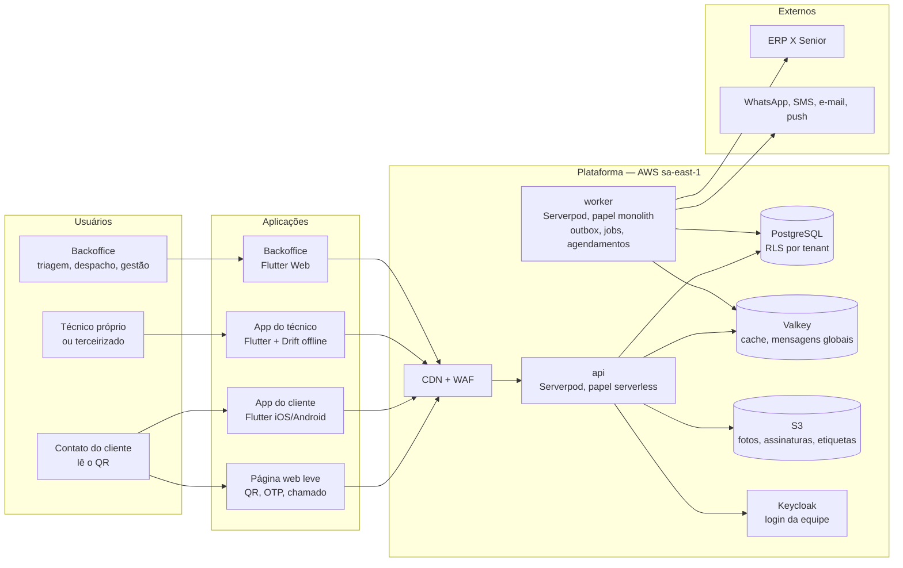

# Plataforma de Ordens de Serviço — Arquitetura

Versão 1.0 — 07/11/2026 — **arquitetura fechada para início do desenvolvimento** · nome provisório: `plataforma-os`

> **Comece por aqui:** [Guia de início do desenvolvimento](docs/13-guia-de-inicio-do-desenvolvimento.md) — escopo do primeiro ciclo, sprint 0, ordem de construção, regras do time e decisões pendentes.
>
> **Integração com o ERP em segundo plano** (decisão de 07/11/2026): o primeiro ciclo roda com cadastros locais e importação por planilha; o desenho do [07](docs/07-integracao-erp-senior.md) fica para a fase 2, e o modelo de dados já está pronto para ele.

SaaS multi-tenant de assistência técnica em campo. Cada equipamento entregue a um cliente (fornos, estufas, armários, freezers em comodato) fica vinculado a esse cliente e recebe uma **etiqueta QR**. Quando dá defeito, o cliente lê o QR com o celular e abre o chamado em segundos. A empresa faz a triagem (ou o vendedor resolve por telefone) e despacha um técnico próprio ou terceirizado. O técnico executa pelo app, mesmo sem sinal, lançando itens, horas e fotos. Ao encerrar a OS, o pedido de serviço é aberto no **ERP X da Senior** (fase 2).

**Histórico:** v0.1 desenho base · v0.2 funcionalidades do [benchmark Sismetro](docs/11-benchmark-sismetro-e-novas-funcionalidades.md) · v0.3 [stack Dart](docs/12-stack-dart-flutter-serverpod.md) (Flutter + Serverpod).

---

## Em uma página

| Peça | Para quem | Como |
|---|---|---|
| **Backoffice** | Atendentes, despachantes, gestores, vendedores, gestores de prestadores, admins do tenant | **Flutter Web**, no navegador. Triagem e acompanhamento de OS, agenda, plantão e escalonamento, **todos os cadastros** (operadores, turnos, clientes, produtos, serviços, prestadores...), ativos e etiquetas QR, custos, relatórios, monitor de integrações |
| **App do cliente** | Contato do cliente (ex.: gerente da padaria) | App **Flutter** (Android e iOS) para quem usa sempre. Quem lê o QR sem o app cai numa **página web leve**: abre em ~1 s, faz o login por código no WhatsApp e abre o chamado |
| **App do técnico** | Técnicos próprios e terceirizados; plantonistas (aba Despacho) | **Flutter** (Android e iOS), offline-first com **Drift + SQLCipher**: agenda, check-in pelo QR, itens, horas, fotos, checklist, assinatura |
| **Servidor** | — | **Dart + Serverpod 4** sobre **PostgreSQL**. O mesmo executável roda como `api` e como `worker`. O isolamento por tenant é garantido pelo banco (RLS) |

- **Multi-tenant de verdade:** `tenant_id` em toda tabela, Row-Level Security com FORCE e chaves estrangeiras compostas. Uma linha de um tenant não consegue nem apontar para a de outro.
- **Vínculo produto–cliente:** produto (modelo) → ativo (unidade física com nº de série/patrimônio) → alocação no cliente e na unidade, **com histórico e termo de movimentação**.
- **QR:** a etiqueta só tem `https://<dominio>/q/<token>` (token aleatório) e um código curto com dígito verificador. Nenhum dado pessoal no QR.
- **Terceirizados sob controle (v0.2):** prestadores com tabela de preços; custo do terceiro só após conferência; check-in obrigatório pelo QR do ativo; resolução remota antes do despacho; indicadores antifraude.
- **Mesmo dia, inclusive fim de semana (v0.2):** plantão, escalonamento até alguém assumir e despacho pelo celular.
- **Offline sem broker (v0.3):** a fila fica no aparelho. Ao recuperar a rede, o app envia lotes para um endpoint idempotente, que responde por mutação. RabbitMQ não é necessário ([ADR-018](docs/adr/ADR-018-sync-endpoint-direto-e-drift.md)).
- **ERP:** conector trocável (Senior ERP X primeiro), saída por outbox e jobs idempotentes. Na fase 2 entram bens patrimoniais, requisição de materiais e fechamento de prestadores.
- **Nuvem e custo:** AWS São Paulo como referência, com desenho portátil. Infraestrutura estimada em R$ 7 mil a R$ 16 mil/mês (produção + homologação), sem contar as mensagens.
- **Prazo (ordem de grandeza):** 6 a 8 meses até o MVP com ~7 pessoas; mais 3 a 4 meses para a fase 2.

## Decisões principais

| Tema | Decisão | Registro |
|---|---|---|
| Stack | Flutter (iOS, Android, Web) + Dart/Serverpod 4 + PostgreSQL | [ADR-017](docs/adr/ADR-017-stack-dart-flutter-serverpod.md) |
| Arquitetura | Monólito modular com dois deployables (`api` e `worker`) | [ADR-001](docs/adr/ADR-001-monolito-modular.md) |
| Multi-tenancy | Banco compartilhado, RLS com FORCE, FKs compostas com `tenant_id` | [ADR-002](docs/adr/ADR-002-multi-tenancy-rls.md) |
| Dados | SQL-first: tabelas não gerenciadas pelo Serverpod, tenant pelo `databaseInterceptor`, dinheiro em centavos | [ADR-019](docs/adr/ADR-019-dados-com-serverpod.md) |
| Identidade | Keycloak para a equipe (token de tenant emitido pela api); OTP próprio por WhatsApp para clientes | [ADR-003](docs/adr/ADR-003-identidade-idp-e-otp.md) |
| Offline | Sync por comandos idempotentes; endpoint direto sem broker; Drift + SQLCipher no aparelho | [ADR-005](docs/adr/ADR-005-sync-offline-por-comandos.md), [ADR-018](docs/adr/ADR-018-sync-endpoint-direto-e-drift.md) |
| QR | URL curta + token opaco + código curto com verificador, em domínio estável da plataforma | [ADR-006](docs/adr/ADR-006-qr-url-token-opaco.md) |
| Ordem de serviço | Entidade única (nasce "Solicitada"), várias visitas, status do ERP separado | [ADR-007](docs/adr/ADR-007-os-unica-com-visitas.md) |
| ERP | Porta `ErpConnector`, outbox e jobs idempotentes | [ADR-008](docs/adr/ADR-008-integracao-erp-conectores-outbox.md) |
| Nuvem | AWS sa-east-1 de referência, desenho portátil | [ADR-009](docs/adr/ADR-009-nuvem-de-referencia-aws.md) |
| Prestadores | Entidade própria, custos conferidos e antifraude no fluxo | [ADR-013](docs/adr/ADR-013-prestadores-e-antifraude.md) |
| Triagem e plantão | Triagem configurável (central, vendedor, direta), resolução remota, escalonamento | [ADR-014](docs/adr/ADR-014-triagem-configuravel-e-plantao.md) |
| Preventiva | Planos por calendário ou medidor; leitura manual de horímetro (F2) | [ADR-015](docs/adr/ADR-015-planos-de-manutencao-e-medidores.md) |
| Telemetria | IoT genérica, sem dependência de fabricante (F3, com piloto) | [ADR-016](docs/adr/ADR-016-telemetria-generica.md) |

ADRs substituídos na v0.3: 004 (app universal Expo), 010 (Kysely), 011 (pg-boss) e 012 (SSE). A lista completa está em [docs/adr](docs/adr/README.md).

## Como ler esta documentação

| Documento | O que tem |
|---|---|
| [01 — Visão geral e requisitos](docs/01-visao-geral-e-requisitos.md) | Problema, atores, requisitos RF-01 a RF-101 com prioridade por fase, glossário |
| [02 — Arquitetura de solução](docs/02-arquitetura-de-solucao.md) | Diagramas C4, módulos, stack Dart com versões, padrões transversais, monorepo, testes |
| [03 — Modelo de domínio](docs/03-modelo-de-dominio.md) | Diagramas ER, dicionário, máquinas de estado, regras de negócio, implementação com Serverpod |
| [04 — Multi-tenancy e segurança](docs/04-multi-tenancy-e-seguranca.md) | Isolamento em todas as camadas, Keycloak, tokens, OTP, `qr_context`, RBAC (inclusive vendedor e prestador), ameaças, LGPD |
| [05 — Ativos e QR code](docs/05-ativos-e-qr-code.md) | Ciclo de vida do ativo, movimentação com termo, etiqueta física, leitura por ator, antiabuso |
| [06 — Aplicações e fluxos](docs/06-aplicacoes-e-fluxos.md) | Telas dos apps e do backoffice, página web leve, protocolo de sync offline, notificações |
| [07 — Integração com o ERP Senior](docs/07-integracao-erp-senior.md) | Pesquisa das APIs (com fontes), conector em Dart, cadastros, bens, requisição, pedido, checklist para a Senior |
| [08 — API](docs/08-api.md) | Endpoints do Serverpod para os apps, rotas REST para o público e as integrações, eventos |
| [09 — Infraestrutura e operação](docs/09-infraestrutura-e-operacao.md) | AWS (e equivalentes), papéis do Serverpod, CI/CD de Flutter, observabilidade, backup/DR, custos |
| [10 — Roadmap e riscos](docs/10-roadmap-e-riscos.md) | Fases, provas de conceito, épicos, time, riscos, providências e **decisões pendentes** |
| [11 — Benchmark Sismetro](docs/11-benchmark-sismetro-e-novas-funcionalidades.md) | O que a demonstração revelou, matriz de funcionalidades, o que entrou e em que fase, telemetria Kairós |
| [12 — Stack Dart](docs/12-stack-dart-flutter-serverpod.md) | Mapeamento da stack, encaixe do Serverpod, fila × endpoint, banco local, spikes S1 a S6 |
| [13 — Guia de início do desenvolvimento](docs/13-guia-de-inicio-do-desenvolvimento.md) | Escopo do primeiro ciclo (sem ERP), sprint 0, ordem de construção, regras do time, decisões pendentes |
| [db/validacao](db/validacao/README.md) | Validador do `schema.sql` e 42 testes funcionais, para rodar local e no CI |
| [ADRs](docs/adr/README.md) | As decisões registradas, com contexto e alternativas |
| [db/schema.sql](db/schema.sql) | DDL completo do PostgreSQL, com RLS, funções, triggers e comentários |

Caminhos sugeridos: **gestão** — este README → 01 → 11 → 10. **Backend** — 12 → 02 → 03 → `schema.sql` → 04 → 08. **Mobile/Flutter** — 12 → 06 → 05 → 08. **Integração** — 07 → 08.

## Estado da validação

- **Banco executado de verdade:** o `schema.sql` (90 tabelas, das quais 84 de tenant) roda sem erro num PostgreSQL 18 (PGlite, em WebAssembly) e passa nas checagens estruturais. Toda tabela de tenant tem RLS ENABLE + FORCE e política; nenhuma das 276 FKs entre tabelas de tenant está sem `tenant_id`; as funções SECURITY DEFINER têm `search_path` fixo; não sobrou nenhuma coluna `numeric` (dinheiro em centavos, para o ORM do Serverpod). Os **42 testes funcionais** ([db/validacao](db/validacao/README.md)) passam e cobrem: isolamento entre tenants, QR e código curto, numeração, máquinas de estado, alocação com aprovação, resolução remota, prestadores e custos, planos, medidores, valores em centavos, filas do worker (outbox, integrações, jobs genéricos), modo TV, sessões de suporte e auditoria.
- **Consistência entre documentos:** nomes de tabelas, colunas, eventos, rotas e papéis são cruzados por script entre os documentos e o `schema.sql`.
- **Ainda não validado:** a stack Dart na prática (spikes S1 a S6 do docs/12: Serverpod + RLS, ORM em tabelas não gerenciadas, Drift + SQLCipher, upload em segundo plano, Flutter Web, página leve do QR), as APIs da Senior (checklist no 07) e o uso em campo. Os diagramas Mermaid foram revisados à mão.

## Estado do desenvolvimento (sprint 0 iniciada em 07/11/2026)

| Entrega | Onde | Validação |
|---|---|---|
| Monorepo (pub workspace + melos), convenções de lint e formatação | [pubspec.yaml](pubspec.yaml), [analysis_options.yaml](analysis_options.yaml) | `dart analyze --fatal-infos` sem problemas |
| Migração inicial do dbmate gerada do `schema.sql`, papéis de login e seed com dois tenants | [db/migrations](db/migrations), [infra/local/postgres](infra/local/postgres), [db/seeds](db/seeds) | `node tool/db/validate_all.mjs`: 42 testes do schema + 12 de migração/seed/isolamento |
| `packages/core`: máquinas de estado da OS e da visita, centavos e milésimos, short code e token do QR, UUID v7 | [packages/core](packages/core) | 32 testes, com vetores gerados pelo PostgreSQL |
| Servidor Serverpod 4.1.1: interceptor de tenant, tokens ES256, troca do token do Keycloak, `me.get`/`me.tenants` | [server](server/README.md) | 11 testes unitários + 13 de ponta a ponta no PostgreSQL 18 com o schema completo, incluindo o login real pelo Keycloak; custo do escopo por tenant +0,96 ms (p50) ([relatório do spike S1](docs/spikes/S1-S2-serverpod-rls.md)) |
| Ambiente local (PostgreSQL 18, Valkey, Keycloak com realm de dev, S3 local com RustFS, Mailpit) e CI | [infra/local](infra/local/README.md), [.github/workflows/ci.yml](.github/workflows/ci.yml) | Compose testado no Docker Desktop; CI ainda não executado (o repositório não tem Git nem remoto) |

Ainda não criados: apps Flutter (`apps/*`), `packages/ui_kit`, `packages/sync_engine`, IaC (`infra/modules`, `infra/envs`).

## Próximos passos

1. **Decidir** as questões de negócio, cada uma com o prazo em que trava o desenvolvimento ([13 — seção 7](docs/13-guia-de-inicio-do-desenvolvimento.md)), principalmente: como os prestadores são pagos, se o vendedor continua como primeiro filtro e quem faz o plantão. O que vai para o ERP só precisa ser decidido antes da fase 2.
2. **Providências com prazo de terceiros** ([10 — seção 9](docs/10-roadmap-e-riscos.md)): domínio do QR, homologação da Senior e módulos contratados, WhatsApp Business, contas das lojas, amostras de etiqueta, lista de prestadores e vendedores.
3. **Fase 0:** provas de conceito P1 a P6, incluindo os spikes S1 a S6 da stack Dart, e esqueleto do monorepo (estrutura no [02](docs/02-arquitetura-de-solucao.md)).
