# 01 — Visão geral e requisitos

Versão 0.3 — 02/11/2026 — rascunho para revisão (funcionalidades do [benchmark Sismetro](11-benchmark-sismetro-e-novas-funcionalidades.md) e [stack Dart](12-stack-dart-flutter-serverpod.md))

Propósito: consolidar o problema, os atores, os requisitos e o escopo de cada fase. É a base para todos os demais documentos e para a priorização do backlog.

---

## 1. Contexto e problema

A empresa (primeiro tenant da plataforma) envia equipamentos para clientes, por exemplo freezers em comodato. Cada equipamento físico tem um código próprio (nº de série e/ou patrimônio) e fica na posse do cliente. Quando dá defeito, o cliente precisa pedir assistência. A empresa precisa:

1. saber **qual equipamento** está com problema, **em qual cliente e endereço**, e qual é o histórico dele;
2. fazer a **triagem** do pedido e **despachar** um operador (técnico de campo) dentro do turno e da região certos;
3. registrar o que foi feito em campo: **itens** (peças e serviços), **horas apontadas**, fotos, checklist e assinatura;
4. ao finalizar, **gerar o pedido de serviço no ERP X da Senior** sem redigitação (fase 2);
5. medir prazo (SLA), produtividade e recorrência de falhas por modelo de equipamento.

Visão de produto: a solução nasce para a empresa do usuário, mas será **vendida como SaaS multi-tenant** a outras empresas. Essas empresas podem usar o ERP X da Senior, outro ERP ou nenhum ERP.

### 1.0 O que a demonstração do Sismetro acrescentou (v0.2)

A reunião de demonstração de um sistema de mercado para a Superpan detalhou a operação de referência ([benchmark](11-benchmark-sismetro-e-novas-funcionalidades.md)):

- **Equipamentos:** fornos, estufas, armários e freezers em comodato, de valor alto.
- **Técnicos terceirizados** fazem a maior parte dos atendimentos no RS, PR e SC, hoje coordenados por grupos de WhatsApp. Há casos de visita desnecessária e de conserto de equipamento que não é da empresa, cobrado dela.
- **Atendimento no mesmo dia**, inclusive em fins de semana e feriados.
- **O cliente costuma ligar para o vendedor**, que faz a triagem e muitas vezes resolve por telefone.
- **O patrimônio nasce no ERP** (a NF de entrada gera o bem) e o contrato de comodato é emitido por ele.
- **Cruzamento com as vendas:** a empresa quer saber se cada cliente compra o suficiente para justificar o equipamento.

Isso gerou os requisitos RF-80 a RF-101 (seções 4.9 e 4.10).

### 1.1 Ideia central

```mermaid
flowchart LR
    A["Equipamento no cliente<br/>com etiqueta QR"] -->|"cliente lê o QR"| B["Chamado aberto<br/>(OS Solicitada)"]
    B -->|"triagem"| C["OS Aberta"]
    C -->|"despacho"| D["Visita agendada<br/>para um técnico"]
    D -->|"app do técnico"| E["Execução: itens,<br/>horas, fotos, assinatura"]
    E --> F["OS Concluída"]
    F -->|"conferência"| G["OS Encerrada"]
    G -->|"fase 2: API"| H["Pedido de serviço<br/>no ERP X Senior"]
```

## 2. Objetivos e indicadores de sucesso

| Objetivo | Indicador | Meta inicial (a validar com o negócio) |
|---|---|---|
| Abrir chamado sem atrito | Tempo do scan do QR até o chamado registrado | < 60 s, em no máximo 3 telas |
| Rastreabilidade dos equipamentos | % de ativos em clientes com alocação e etiqueta QR vinculadas | 100% dos novos envios; legado em mutirão |
| Cumprir prazos | % de OS dentro do SLA de primeiro atendimento e de solução | Linha de base no 1º mês, depois meta por tenant |
| Resolver na primeira visita | First-time fix rate | Medir no MVP e definir a meta depois |
| Acabar com a redigitação | % de OS encerradas com pedido gerado no ERP sem intervenção | > 95% na fase 2 |
| Produto vendável | Tempo de onboarding de um novo tenant | < 1 dia útil, com importação por planilha |

## 3. Atores

| Ator | Papel (RBAC) | Canal | O que precisa |
|---|---|---|---|
| Contato do cliente (ex.: gerente do bar) | `customer_contact` | Página web leve aberta pelo QR ou app Flutter do cliente | Abrir chamado em segundos lendo o QR, sem senha; acompanhar; avaliar |
| Administrador do cliente | `customer_admin` | App do cliente | Gerenciar os outros contatos do mesmo cliente |
| Atendente | `backoffice_agent` | Backoffice web | Abrir OS recebidas por telefone/e-mail, manter cadastros |
| Coordenador / despachante | `dispatcher` | Backoffice web | Triagem, agenda, despacho, acompanhamento em tempo real |
| Operador / técnico de campo | `technician` | App do técnico | Agenda, execução, itens, horas, fotos, assinatura; trabalhar offline |
| Gestor | `manager` | Backoffice web | Indicadores, relatórios, SLA |
| Administrador do tenant | `tenant_admin` | Backoffice web | Configurações, usuários, papéis, integrações, branding |
| Administrador da plataforma (equipe do SaaS) | `platform_admin` | Console da plataforma | Tenants, planos, suporte, saúde da plataforma |
| Vendedor / representante (v0.2) | `sales_rep` | Backoffice (responsivo) e avisos por WhatsApp | Ver a carteira de clientes, seus equipamentos e OS; abrir OS em nome do cliente; fazer a primeira triagem e resolver por telefone quando der |
| Técnico terceirizado (v0.2) | `technician` (`kind = contractor`) | App do técnico ou atendimento por link (F2) | O mesmo que o técnico próprio, com custo da visita conferido pela empresa |
| Gestor do prestador (v0.2) | `provider_admin` | Backoffice com escopo da sua empresa | Distribuir as OS recebidas entre os seus técnicos e acompanhar a execução |
| Plantonista (v0.2) | `dispatcher` em plantão | Aba Despacho no app do técnico | Assumir e despachar chamados fora do horário comercial, avisado por push e escalonamento |
| ERP X da Senior | — (sistema) | API | Fonte de clientes, produtos e serviços; destino do pedido de serviço |
| Provedores de mensagens | — (sistemas) | API | WhatsApp, SMS, e-mail, push |

## 4. Requisitos funcionais

Prioridade: **M** = MVP (fase 1) · **F2** = fase 2 · **F3** = fase 3.

### 4.1 Ordens de serviço (backoffice)

| ID | Requisito | Prior. |
|---|---|---|
| RF-01 | Abrir OS manualmente (telefone, e-mail, balcão) informando cliente, unidade, ativo (opcional), tipo, prioridade, sintoma e descrição | M |
| RF-02 | Fila de triagem dos chamados abertos pelo cliente: aceitar, recusar com motivo, marcar como duplicado, ajustar tipo e prioridade | M |
| RF-03 | Agendar e despachar visitas para técnicos considerando turno/escala, região, habilidades e carga | M |
| RF-04 | Acompanhar as OS em tempo real: painel por status, SLA em risco, filtros, mapa | M |
| RF-05 | Detalhe da OS: linha do tempo, visitas, itens, horas, fotos, assinatura, checklist, comentários internos e visíveis ao cliente, histórico de status | M |
| RF-06 | Conferir e encerrar a OS (aprovar itens e horas). A conferência é configurável por tenant: sem ela, a OS concluída é encerrada automaticamente | M |
| RF-07 | Cancelar e reabrir OS com motivo | M |
| RF-08 | Retorno: uma OS pode ter várias visitas (ex.: aguardando peça) | M |
| RF-09 | OS preventivas geradas por plano de manutenção | F3 |

### 4.2 Cadastros (todos no backoffice)

| ID | Requisito | Prior. |
|---|---|---|
| RF-10 | Operadores/técnicos: dados, habilidades, equipe, região, usuário de acesso ao app | M |
| RF-11 | Turnos de trabalho (períodos por dia da semana, intervalos) e escalas por técnico | M |
| RF-12 | Equipes, regiões de atendimento, calendário de expediente e feriados | M |
| RF-13 | Tipos de OS, sintomas, causas, soluções, checklists e políticas de SLA | M |
| RF-14 | Clientes, unidades (endereços de atendimento) e contatos: locais no MVP; na fase 2, sincronizados do ERP X, com os campos mestres somente leitura | M / F2 |
| RF-15 | Produtos e serviços: locais no MVP; sincronizados do ERP X na fase 2 | M / F2 |
| RF-16 | Importação por planilha (CSV/XLSX) dos cadastros mestres, com validação e relatório de erros | M |
| RF-17 | Usuários, papéis e permissões do tenant | M |

### 4.3 Ativos, vínculo produto–cliente e QR code

| ID | Requisito | Prior. |
|---|---|---|
| RF-20 | Cadastrar o ativo (unidade física): produto/modelo, nº de série, patrimônio (código específico), propriedade (comodato, locação, do cliente), garantia | M |
| RF-21 | Vincular o ativo a um cliente e a uma unidade, com histórico (instalação, transferência, recolhimento, baixa) e documento de origem (ex.: NF de remessa em comodato) | M |
| RF-22 | Gerar etiquetas QR (lote pré-impresso ou para ativos já cadastrados), imprimir (PDF para folhas A4 e ZPL para impressora térmica), vincular a etiqueta ao ativo (pelo técnico em campo ou pelo backoffice), substituir e revogar | M |
| RF-23 | Consultar o ativo pelo QR ou pelo código curto: dados, alocação atual, histórico de OS | M |
| RF-24 | Alocação automática a partir das notas de remessa do ERP (com nº de série) | F3 |

### 4.4 App do cliente (app Flutter + página web leve para quem não tem o app)

| ID | Requisito | Prior. |
|---|---|---|
| RF-30 | Ler o QR com a câmera do celular e cair direto na abertura do chamado, sem instalar nada. Se o app nativo estiver instalado, ele abre no lugar do navegador | M |
| RF-31 | Identificar-se sem senha, por código OTP enviado por WhatsApp, SMS ou e-mail | M |
| RF-32 | Abrir chamado: sintoma (lista), descrição, fotos/vídeo curto, janela de disponibilidade, contato no local | M |
| RF-33 | Ver "Meus equipamentos" e abrir chamado também pela lista (sem QR) | M |
| RF-34 | Acompanhar o status em linguagem simples, receber notificações, comentar e avaliar o atendimento | M |
| RF-35 | Evitar chamado duplicado: se o equipamento já tem chamado aberto, mostrar esse chamado | M |

### 4.5 App do técnico

| ID | Requisito | Prior. |
|---|---|---|
| RF-40 | Agenda de visitas; detalhe da OS, do cliente, do ativo e do histórico | M |
| RF-41 | Transições da visita (deslocamento, check-in, pausa, retomada, finalização), com apontamento automático de horas | M |
| RF-42 | Apontar horas manualmente, com justificativa (deslocamento, execução, pausa) | M |
| RF-43 | Incluir itens (peças e serviços do catálogo) com quantidade e tipo de cobrança (cobrável, garantia, contrato/comodato, cortesia) | M |
| RF-44 | Checklist, diagnóstico (sintoma confirmado, causa, solução), fotos antes/depois, assinatura do cliente | M |
| RF-45 | Ler QR para check-in, vincular etiqueta virgem e abrir nova OS no local | M |
| RF-46 | Funcionar offline e sincronizar automaticamente quando houver sinal | M |
| RF-47 | Estoque de peças do técnico (veículo) com baixa no ERP | F3 |

### 4.6 Integração com o ERP (fase 2)

| ID | Requisito | Prior. |
|---|---|---|
| RF-50 | Sincronizar clientes (com unidades e contatos), produtos e serviços do ERP X da Senior: carga inicial e incremental | F2 |
| RF-51 | Ao encerrar a OS, abrir um pedido de serviço no ERP com os itens e as horas cobráveis, sem duplicar o pedido, e guardar o número retornado | F2 |
| RF-52 | Monitor de integrações: execuções, erros, pendências de mapeamento, reprocessamento manual | F2 |
| RF-53 | Conectores para outros ERPs (incluindo o ERP Senior "clássico" via SOAP) | F3 |

### 4.7 Plataforma SaaS (multi-tenant)

| ID | Requisito | Prior. |
|---|---|---|
| RF-60 | Isolamento total dos dados por tenant, em todas as camadas | M |
| RF-61 | Onboarding de novo tenant: dados, branding, usuários, importação de cadastros e conexão com ERP | M |
| RF-62 | Branding por tenant no app do cliente, nas notificações e nas etiquetas | M |
| RF-63 | Planos, limites e feature flags; suspensão e encerramento com exportação dos dados | M (básico) / F2 |
| RF-64 | Console da plataforma e acesso de suporte com justificativa e auditoria | M |
| RF-65 | SSO corporativo para tenants (federação com o IdP do cliente) | F3 |

### 4.8 Notificações e indicadores

| ID | Requisito | Prior. |
|---|---|---|
| RF-70 | Notificações por evento para cliente, backoffice e técnico, por WhatsApp, e-mail e push, com modelos por tenant | M |
| RF-71 | Indicadores: SLA, MTTR, MTBF por modelo, first-time fix, produtividade por técnico e turno, backlog | M (básico) / F2 |

### 4.9 Prestadores, vendedores, plantão e controles (v0.2)

| ID | Requisito | Prior. |
|---|---|---|
| RF-80 | Cadastro de prestadores de serviço terceirizados (CNPJ, regiões, vigência) com tabela de preços (visita, hora, km, serviço fixo) | M |
| RF-81 | Técnicos próprios ou terceirizados vinculados a um prestador; gestor do prestador distribui as OS recebidas entre os seus técnicos | M |
| RF-82 | Custos da OS por linha (peças, mão de obra própria, terceiros, deslocamento, outros); custo do terceiro gerado pela tabela e válido só após conferência | M |
| RF-83 | Fechamento mensal por prestador, com demonstrativo, aprovação e envio ao ERP | F2 |
| RF-84 | Atendimento por link (sem app) para prestadores: check-in pelo QR, fotos, checklist e assinatura no navegador | F2 |
| RF-85 | Vendedores com carteira de clientes: ver equipamentos e OS da carteira e abrir OS em nome do cliente | M |
| RF-86 | Modo de triagem por tenant: central, vendedor primeiro (com prazo e subida para a central) ou direto ao técnico | M |
| RF-87 | Resolução remota na triagem (orientação por telefone ou WhatsApp, sem visita), registrada e medida | M |
| RF-88 | Antifraude: check-in pelo QR do ativo obrigatório por política, OS só para ativo vinculado ao cliente, fotos obrigatórias, indicadores e alertas por prestador e técnico | M |
| RF-89 | Plantão de fins de semana e feriados e escalonamento até alguém assumir o chamado | M |
| RF-90 | Despacho pelo celular: fila de triagem, aceitar, resolver remotamente e atribuir técnico ou prestador | M |
| RF-91 | Movimentação de ativo com aprovação opcional e termo em PDF assinado; documentos do ativo (contrato de comodato, NF, manuais); dados de aquisição | M |
| RF-92 | Filiais (CNPJs) da empresa, definindo a filial do pedido no ERP e o escopo de usuários | M (1 filial) / F2 |

### 4.10 Manutenção planejada, ERP ampliado e telemetria (v0.2)

| ID | Requisito | Prior. |
|---|---|---|
| RF-93 | Planos de manutenção preventiva (a cada N dias, dia fixo do mês ou por medidor) que abrem OS automaticamente, com previsão na agenda | F2 |
| RF-94 | Medidores do ativo (horímetro, consumo, temperatura, ciclos) com leitura manual pelo técnico como item de checklist | F2 |
| RF-95 | Bens patrimoniais vindos do ERP, com etiqueta QR gerada após a integração | F2 |
| RF-96 | Requisição de materiais ao estoque do ERP a partir da OS, com status da aprovação e baixa | F2 |
| RF-97 | Relatório de custos por período, tipo, cliente, ativo, modelo e prestador; modo TV para a sala de operação | M (básico) / F2 |
| RF-98 | Rentabilidade do comodato: vendas por cliente (do ERP) × valor dos equipamentos alocados × custo de manutenção, com alertas ao vendedor | F3 |
| RF-99 | Telemetria IoT (horímetro, consumo, temperatura): dispositivos por ativo, ingestão, regras de alerta e OS automática | F3 |
| RF-100 | OS de oficina (recondicionamento, desmontagem para peças) e manutenção interna dos setores da própria empresa | F3 |
| RF-101 | Hierarquia de ativos (componentes rastreados como ativos filhos) | F3 |

## 5. Requisitos não funcionais

| ID | Categoria | Requisito |
|---|---|---|
| RNF-01 | Isolamento | Nenhum dado de um tenant pode ser lido ou escrito por outro. Defesa em camadas, com Row-Level Security no PostgreSQL como última barreira e testes automatizados que provam o isolamento |
| RNF-02 | Segurança | Meta OWASP ASVS nível 2; pentest antes do go-live; segredos (ex.: credenciais do ERP) em cofre, nunca no banco em texto puro |
| RNF-03 | Privacidade (LGPD) | Tenant como controlador e plataforma como operadora; DPA; minimização; retenção definida por tipo de dado; rastreamento de localização do técnico só durante a jornada/visita |
| RNF-04 | Offline | O técnico consegue trabalhar um dia inteiro sem sinal; nada se perde e nada se duplica na sincronização |
| RNF-05 | Desempenho | A página web leve do QR carrega rápido em 4G (meta: conteúdo útil em < 1,5 s); as telas do backoffice respondem em < 1 s no p95 depois do carregamento inicial do Flutter Web |
| RNF-06 | Disponibilidade | 99,5% mensal no MVP e 99,9% a partir da fase 2; RPO ≤ 5 min; RTO ≤ 4 h no MVP (≤ 1 h na fase 2). SLOs, alertas e testes de restore em [Infraestrutura e operação](09-infraestrutura-e-operacao.md) |
| RNF-07 | Escalabilidade | Premissa do 1º ano: até ~50 tenants; por tenant até ~20 mil ativos, ~5 mil OS/mês, ~200 técnicos e ~50 usuários de backoffice. Crescer 10× sem reescrever |
| RNF-08 | Usabilidade | Abrir chamado em até 3 telas; app do técnico usável com uma mão e com luva/sol forte; acessibilidade WCAG AA no backoffice e no app do cliente |
| RNF-09 | Portabilidade | Sem dependência forte de uma nuvem: containers, PostgreSQL, Redis, storage S3-compatível, IdP OIDC |
| RNF-10 | Auditoria | Toda alteração relevante (status, itens, horas, vínculos de ativo e QR, configurações, acessos de suporte) fica auditada com autor e data |
| RNF-11 | Observabilidade | Logs, métricas e traces com tenant_id; alertas de integração, fila e sincronização mobile |
| RNF-12 | Manutenibilidade | Monólito modular com fronteiras verificadas automaticamente; contratos de API em OpenAPI; cobertura de testes nos fluxos críticos |

## 6. Escopo por fase

| Fase | Entregas |
|---|---|
| **Fase 1 — MVP** | Plataforma multi-tenant; backoffice (OS, triagem, agenda, painel, todos os cadastros, ativos, etiquetas QR, configurações); app do cliente (app Flutter + página web leve para quem não tem o app) com abertura pelo QR e OTP; app do técnico offline com itens, horas, fotos, checklist e assinatura; notificações; importação de cadastros por planilha; indicadores básicos. **v0.2:** prestadores e técnicos terceirizados, custos da OS, vendedores e modos de triagem, resolução remota, antifraude, plantão e escalonamento, despacho pelo celular, movimentação com termo, documentos do ativo, filial padrão |
| **Fase 2 — Integração ERP** | Conector do ERP X da Senior: clientes, produtos e serviços entrando; pedido de serviço saindo no encerramento da OS; monitor de integrações; indicadores avançados; planos e feature flags completos. **v0.2:** bens patrimoniais do ERP, requisição de materiais, fechamento de prestadores, planos de manutenção preventiva, medidores com leitura manual, relatório de custos completo, modo TV, atendimento por link, multifilial |
| **Fase 3 — Evoluções** | Estoque do técnico, roteirização, SSO corporativo, apps white-label nas lojas, conectores de outros ERPs, API pública e webhooks para tenants, alocação automática de ativos pelas NFs de remessa. **v0.2:** rentabilidade do comodato, telemetria IoT, oficina e desmontagem, manutenção interna, hierarquia de ativos, painéis personalizáveis |

O detalhamento das fases, os riscos e o backlog de épicos estão em [Roadmap e riscos](10-roadmap-e-riscos.md).

## 7. Premissas e restrições

- **Stack Dart** (decisão do usuário, v0.3): servidor em Dart com **Serverpod 4** e **PostgreSQL**; apps em **Flutter** para Android e iOS (técnico e cliente); backoffice em **Flutter Web**. Detalhes e adaptações em [Stack Dart](12-stack-dart-flutter-serverpod.md).
- O cliente abre chamado pela **página web leve** aberta pelo QR (primeiro acesso, sem instalar nada) ou pelo **app Flutter** (clientes frequentes). Se o app estiver instalado, o QR abre o app. Decisão do usuário.
- Sincronização offline por **endpoint direto** no servidor, com a fila no próprio aparelho, sem broker de mensagens ([ADR-018](adr/ADR-018-sync-endpoint-direto-e-drift.md)).
- Nuvem sem preferência: desenho portátil, com uma nuvem de referência sugerida em [Infraestrutura e operação](09-infraestrutura-e-operacao.md).
- O ERP X da Senior é o sistema-mestre de clientes, produtos e serviços a partir da fase 2. Até lá, os cadastros são locais ou importados.
- Os detalhes exatos das APIs da Senior precisam ser validados com a Senior ou com o parceiro de implantação. Veja o checklist em [Integração com o ERP Senior](07-integracao-erp-senior.md).
- Os clientes finais são, em geral, empresas (B2B: bares, mercados, restaurantes), mas o modelo também comporta pessoa física.

## 8. Fora de escopo (por enquanto)

- Emissão de documentos fiscais (NF-e/NFS-e): continua no ERP.
- Precificação e tributação: o ERP é a autoridade. A OS mostra, no máximo, preços de referência.
- Contas a receber e cobrança.
- Gestão de compras e estoque central (só o estoque do técnico, na fase 3).
- Telemetria/IoT dos equipamentos (ex.: sensor de temperatura). Fica como oportunidade futura; o modelo de ativos já comporta esse vínculo.

## 9. Rastreabilidade: requisito → onde está desenhado

| Requisitos | Documento(s) |
|---|---|
| RF-01 a RF-09 (OS) | [Modelo de domínio](03-modelo-de-dominio.md) (estados e regras), [Aplicações e fluxos](06-aplicacoes-e-fluxos.md) (telas), [API](08-api.md) |
| RF-10 a RF-17 (cadastros) | [Modelo de domínio](03-modelo-de-dominio.md), [Aplicações e fluxos](06-aplicacoes-e-fluxos.md), [Integração ERP](07-integracao-erp-senior.md) (origem ERP e importação) |
| RF-20 a RF-24 (ativos e QR) | [Ativos e QR code](05-ativos-e-qr-code.md), [Modelo de domínio](03-modelo-de-dominio.md), [schema.sql](../db/schema.sql) |
| RF-30 a RF-35 (app do cliente) | [Aplicações e fluxos](06-aplicacoes-e-fluxos.md), [Ativos e QR code](05-ativos-e-qr-code.md), [Multi-tenancy e segurança](04-multi-tenancy-e-seguranca.md) (OTP) |
| RF-40 a RF-47 (app do técnico) | [Aplicações e fluxos](06-aplicacoes-e-fluxos.md) (inclui o protocolo de sincronização), [API](08-api.md) |
| RF-50 a RF-53 (ERP) | [Integração com o ERP Senior](07-integracao-erp-senior.md), [API](08-api.md) (eventos) |
| RF-60 a RF-65 (SaaS) | [Multi-tenancy e segurança](04-multi-tenancy-e-seguranca.md), [Arquitetura de solução](02-arquitetura-de-solucao.md) |
| RF-70, RF-71 | [Aplicações e fluxos](06-aplicacoes-e-fluxos.md) (matriz de notificações e indicadores) |
| RNF-01 a RNF-12 | [Arquitetura de solução](02-arquitetura-de-solucao.md), [Multi-tenancy e segurança](04-multi-tenancy-e-seguranca.md), [Infraestrutura e operação](09-infraestrutura-e-operacao.md) |
| RF-80 a RF-101 (v0.2) | Decisões e nomes no [benchmark Sismetro](11-benchmark-sismetro-e-novas-funcionalidades.md); modelo em [Modelo de domínio](03-modelo-de-dominio.md) e [schema.sql](../db/schema.sql); telas em [Aplicações e fluxos](06-aplicacoes-e-fluxos.md); ERP em [Integração ERP](07-integracao-erp-senior.md); endpoints e eventos em [API](08-api.md); papéis e escopos em [Multi-tenancy e segurança](04-multi-tenancy-e-seguranca.md) |

## 10. Glossário

| Termo | Significado | Identificador no código/banco |
|---|---|---|
| Tenant | Empresa assinante da plataforma (ex.: a empresa do usuário) | `tenants` |
| Cliente | Cliente do tenant, que recebe os equipamentos | `customers` |
| Unidade | Endereço/local de atendimento do cliente | `customer_sites` |
| Contato | Pessoa do cliente que abre e acompanha chamados | `customer_contacts` |
| Produto | Item de catálogo / modelo (ex.: "Freezer horizontal 400 L") | `products` |
| Serviço | Item faturável de mão de obra ou visita (ex.: "Hora técnica") | `services` |
| Ativo / equipamento | Unidade física de um produto, com nº de série/patrimônio | `assets` |
| Alocação | Vínculo do ativo com cliente e unidade, com histórico (é o "vínculo produto–cliente") | `asset_assignments` |
| Etiqueta QR | Etiqueta física com URL e token opaco, vinculada a um ativo | `qr_tags` |
| Código curto | Código legível impresso na etiqueta (XXXX-XXXX), para digitar quando a câmera falhar | `qr_tags.short_code` |
| OS | Ordem de serviço; nasce como "Solicitada" quando aberta pelo cliente | `work_orders` |
| Visita | Cada ida do técnico ao local; uma OS pode ter várias | `work_order_visits` |
| Operador / técnico | Colaborador do tenant que executa o serviço em campo | `technicians` |
| Turno / escala | Horário de trabalho e a atribuição de turnos ao técnico | `work_shifts`, `technician_shift_assignments` |
| Apontamento | Registro de horas: deslocamento, execução ou pausa | `time_entries` |
| Item da OS | Peça ou serviço usado na OS, com tipo de cobrança | `work_order_items` |
| Triagem | Análise do chamado do cliente antes de virar OS aberta | transição `requested → open` |
| Comodato | Empréstimo do equipamento ao cliente; normalmente cobre o reparo | `assets.ownership_type = tenant_loan` |
| Outbox | Tabela de eventos gravados na mesma transação, para integrações confiáveis | `outbox_messages` |
| RLS | Row-Level Security do PostgreSQL: filtro por tenant aplicado pelo próprio banco | políticas em todas as tabelas de tenant |
| Prestador | Empresa terceirizada que executa atendimentos com seus técnicos | `service_providers` |
| Vendedor | Representante comercial com carteira de clientes; pode fazer a primeira triagem | `sales_reps`, papel `sales_rep` |
| Resolução remota | Chamado resolvido por orientação, sem visita | `work_orders.resolution_mode = remote` |
| Plantão / escalonamento | Escala fora do horário comercial e avisos crescentes até alguém assumir o chamado | `on_call_assignments`, `escalation_policies` |
| Custo da OS | Linhas de custo (peças, mão de obra, terceiros, deslocamento) | `work_order_costs` |
| Termo de movimentação | PDF de entrega, retirada ou transferência do ativo, com aprovação e assinatura | `asset_assignments.term_attachment_id` |
| Filial | CNPJ da empresa que responde pelo atendimento e pelo pedido no ERP | `branches` |
| Plano de manutenção | Regra que abre OS preventivas por calendário ou por medidor | `maintenance_plans` |
| Medidor / leitura | Horímetro, consumo, temperatura ou ciclos de um ativo, lido pelo técnico ou por IoT | `asset_meters`, `meter_readings` |

## 11. Questões em aberto

1. **Faturamento:** toda OS encerrada gera pedido no ERP, ou só as que têm itens cobráveis? Reparos de equipamentos em comodato geram pedido sem valor, pedido interno ou nenhum pedido?
2. **Conferência:** o backoffice vai conferir itens e horas antes de encerrar, ou a OS concluída pelo técnico já pode ir para o ERP?
3. **Quem pode abrir chamado:** só contatos já cadastrados do cliente, ou qualquer pessoa com acesso físico ao equipamento (com OTP e triagem)?
4. **Canais:** o WhatsApp será o canal principal com o cliente? A empresa já tem número na WhatsApp Business Platform?
5. **Legado:** quantos equipamentos já estão em clientes hoje, e existe planilha com nº de série × cliente para a carga inicial e o mutirão de etiquetagem?
6. **Senior:** qual é o ambiente do ERP X (tenant da Senior, módulos contratados) e quem será o contato técnico para liberar o acesso à API?
7. **SLA:** existem prazos contratuais com os clientes (ex.: atendimento em 24 h para equipamento em comodato)?
8. **v0.2:** as perguntas sobre prestadores, fechamento, triagem pelo vendedor, plantão, bens no ERP, telemetria, desmontagem e rentabilidade do comodato estão no [benchmark Sismetro](11-benchmark-sismetro-e-novas-funcionalidades.md), seção 9.
