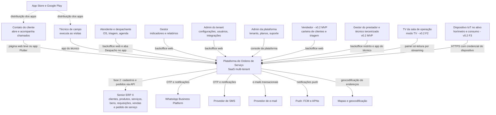
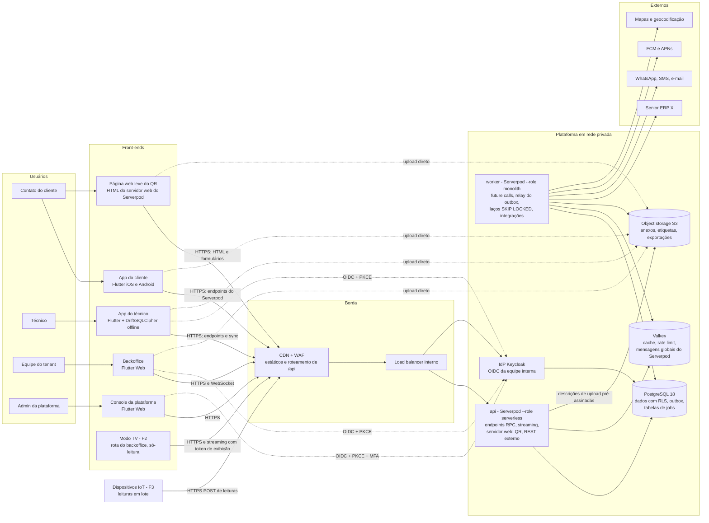
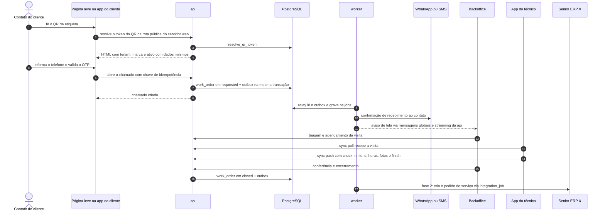
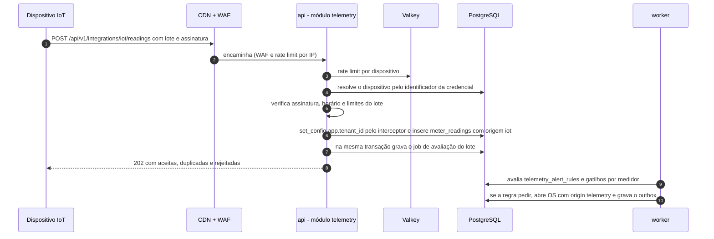
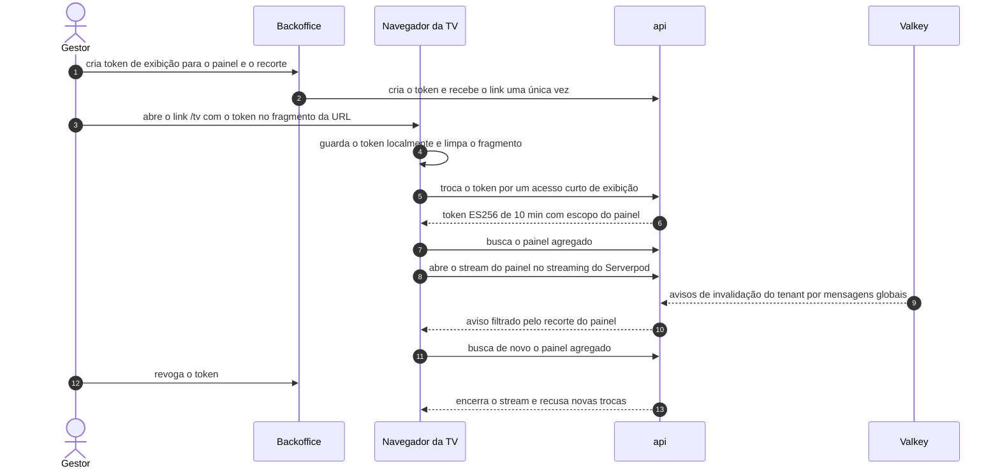
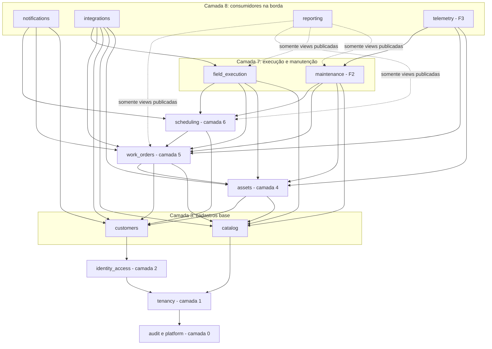
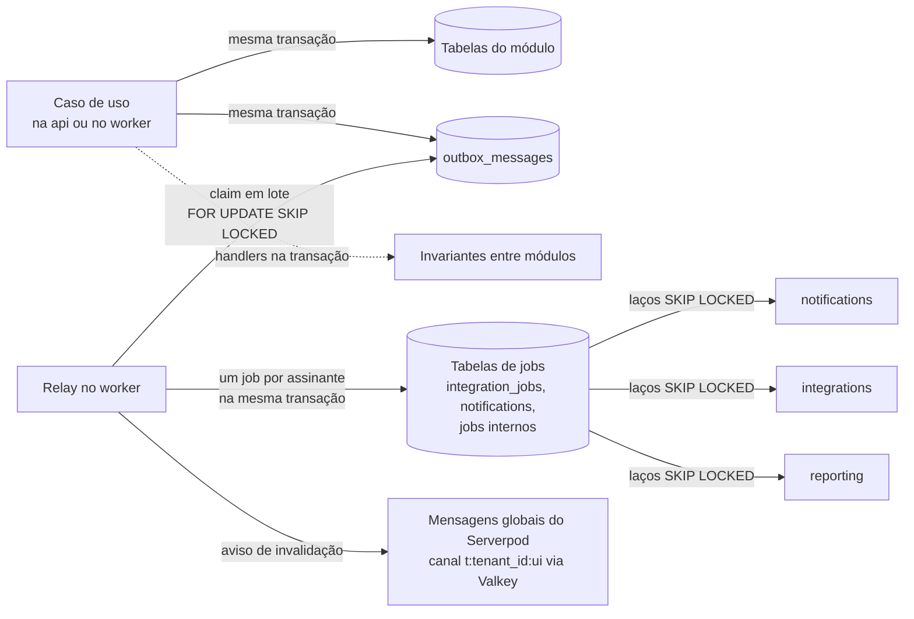
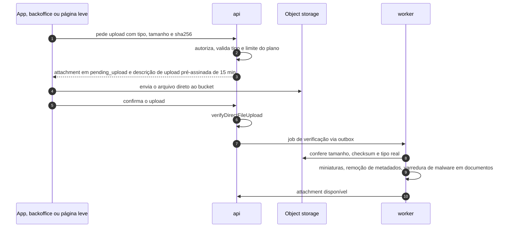
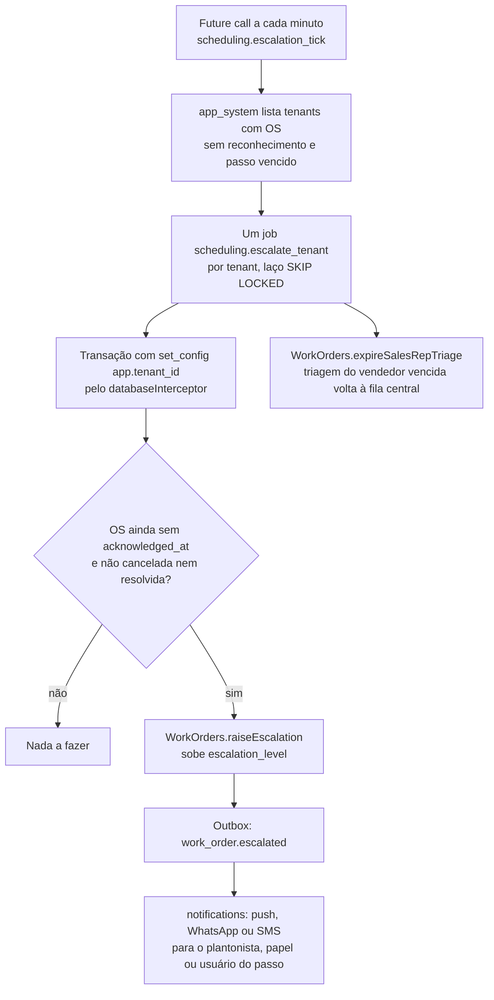

# 02 — Arquitetura de solução

Versão 0.3 — 02/11/2026 — rascunho para revisão (stack Dart: Flutter + Serverpod)

Propósito: descrever como a plataforma é construída — contexto, containers, módulos do monólito, stack, padrões transversais, monorepo e estratégia de testes —, com cada decisão relevante, seu motivo e as alternativas descartadas, para orientar o time que vai implementar.

Documentos relacionados: [Visão geral e requisitos](01-visao-geral-e-requisitos.md) · [Modelo de domínio](03-modelo-de-dominio.md) · [Multi-tenancy e segurança](04-multi-tenancy-e-seguranca.md) · [Ativos e QR code](05-ativos-e-qr-code.md) · [Aplicações e fluxos](06-aplicacoes-e-fluxos.md) · [Integração com o ERP Senior](07-integracao-erp-senior.md) · [API](08-api.md) · [Infraestrutura e operação](09-infraestrutura-e-operacao.md) · [Benchmark Sismetro e novas funcionalidades](11-benchmark-sismetro-e-novas-funcionalidades.md) · [Stack Dart: Flutter + Serverpod](12-stack-dart-flutter-serverpod.md)

**O que mudou na v0.3** (decisões do [Stack Dart](12-stack-dart-flutter-serverpod.md); domínio, regras, banco, multi-tenancy, QR, protocolo de sync, outbox, conector ERP, eventos e funcionalidades da v0.2 **não mudam**):

| Tema | Mudança neste documento |
|---|---|
| Linguagem e backend | Dart 3 de ponta a ponta; servidor **Serverpod 4.1** compilado para executável nativo, com papéis `serverless` (`api`) e `monolith` (`worker`) — seções 1, 2.2, 3.1 e 4 |
| Front-ends | Apps **Flutter** (Android e iOS) para técnico e cliente; backoffice e console em **Flutter Web**; **página web leve** do QR servida pelo servidor web do Serverpod no lugar da PWA — seções 2.2, 2.3 e 4.3 |
| Contratos | Modelos do Serverpod (`.spy.yaml`) geram as classes e o cliente Dart; OpenAPI só para as rotas REST externas — seção 4.2.3 |
| Jobs e tempo real | Sem pg-boss: tabelas de jobs no PostgreSQL consumidas por laços `FOR UPDATE SKIP LOCKED` no `worker` e future calls do Serverpod só para horários; streaming do Serverpod no lugar do SSE, com mensagens globais via Valkey — seções 4.2.4, 4.2.5 e 5.12 |
| Dinheiro e medidas | Dinheiro em centavos e quantidades em milésimos (inteiros); medidas em `double precision` — seção 5.9 |
| Monorepo, testes e spikes | Dart pub workspaces + melos; `serverpod_test`, `flutter_test`, `integration_test`/Patrol e Maestro; spikes S1 a S6 do [Stack Dart](12-stack-dart-flutter-serverpod.md) — seções 6, 7 e 8 |

**O que mudou na v0.2** (decisões do [Benchmark Sismetro](11-benchmark-sismetro-e-novas-funcionalidades.md)):

| Tema | Mudança neste documento | Fase |
|---|---|---|
| Módulos novos | `maintenance` (planos, medidores e leituras) e `telemetry` (dispositivos IoT, ingestão e regras de alerta) — seção 3.2 | F2 / F3 |
| Módulos existentes | Filiais em `tenancy`; vendedores (e vendas por cliente na F3) em `customers`; prestadores, plantão e escalonamento em `scheduling`; custos (e fechamento de prestadores na F2) em `field_execution`; triagem pelo vendedor, resolução remota e reconhecimento em `work_orders`; movimentação com aprovação e termo em `assets` | MVP / F2 / F3 |
| Jobs agendados | Escalonamento a cada minuto (MVP), geração de OS por planos diária e por leitura (F2), fechamento mensal de prestadores (F2), sincronização de vendas (F3) — seção 5.12 | MVP / F2 / F3 |
| Caminhos novos de entrada | Ingestão IoT por HTTPS na `api` (F3; broker MQTT só se necessário) e modo TV com atualização em tempo real (streaming do Serverpod na v0.3) e token de exibição (F2) — seções 2.5 e 2.6 | F2 / F3 |

---

## 1. Resumo executivo

**O que vamos construir.** Um único produto SaaS, usado por várias empresas (tenants) ao mesmo tempo, com três aplicações sobre o mesmo backend:

- **Backoffice web** (Flutter Web) — a empresa abre e acompanha OS, faz triagem e despacho, mantém todos os cadastros (operadores, turnos, clientes, produtos, ativos...), gera etiquetas QR, acompanha integrações e indicadores.
- **App do cliente** — app Flutter nas lojas (Android e iOS) e, para quem não tem o app, uma **página web leve** (HTML servido pelo próprio servidor, sem Flutter Web). Quem lê o QR do equipamento cai direto na abertura do chamado, sem instalar nada; quem tem o app instalado abre direto nele; quem abre chamados com frequência instala o app.
- **App do técnico** (Flutter, Android e iOS) — agenda, execução, itens, horas, fotos e assinatura, funcionando um dia inteiro sem sinal.

**Como.** Backend em Dart com Serverpod organizado como *monólito modular*: um só código, compilado num único executável e implantado em dois papéis (`api` e `worker`), dividido em módulos com fronteiras verificadas automaticamente (12 no MVP; `maintenance` entra na F2 e `telemetry` na F3). O PostgreSQL é a fonte única da verdade — inclusive da fila de jobs e dos eventos para integrações —, o que reduz o número de peças críticas. O isolamento entre empresas é garantido em várias camadas e, por último, pelo próprio banco (Row-Level Security). A equipe interna entra por um provedor de identidade (Keycloak); os clientes entram sem senha, com código enviado por WhatsApp, SMS ou e-mail.

**Onde.** Containers em nuvem pública, região São Paulo. A nuvem de referência é a AWS, mas o desenho só usa componentes com equivalente direto na Azure e no Google Cloud ([Infraestrutura e operação](09-infraestrutura-e-operacao.md)).

**Por que assim.** É o desenho que permite a um time pequeno entregar o MVP com baixo custo de operação e crescer 10× sem reescrever: começar simples (um deployable, um banco), mas com as costuras certas (módulos, eventos, portas de integração, células) para extrair serviços ou mover um tenant grande para um banco dedicado quando — e se — isso for necessário.

| Risco principal | Como tratamos |
|---|---|
| Desempenho da entrada pelo QR no 4G | Página web leve (HTML do servidor, pouco JavaScript) no lugar de uma SPA; orçamento medido no CI desde a sprint 0 (spike S6) — seção 4.3 |
| Maturidade do Serverpod para um desenho SQL-first com RLS | `databaseInterceptor` aplicando o tenant em toda operação, versão fixada e testes de isolamento a cada atualização; spikes S1 e S2 na fase 0 — seções 5.2 e 8 |
| Complexidade do offline do técnico | Protocolo próprio de sincronização por comandos idempotentes; testes de propriedade e e2e com modo avião |
| Vazamento de dados entre tenants | Defesa em camadas, RLS como última barreira e suíte de isolamento bloqueante no CI ([Multi-tenancy e segurança](04-multi-tenancy-e-seguranca.md)) |
| APIs do ERP X ainda não validadas | Porta `ErpConnector`, integração só na fase 2, testes de contrato ([Integração com o ERP Senior](07-integracao-erp-senior.md)) |
| Custo variável de WhatsApp/SMS | Medição por tenant e repasse/limite por plano ([Infraestrutura e operação](09-infraestrutura-e-operacao.md)) |

**Decisões-chave em uma linha**

| Tema | Decisão |
|---|---|
| Backend | Dart 3 com **Serverpod 4.1**, compilado para executável nativo; monólito modular com o mesmo executável em dois papéis: `api` (`--role serverless`) e `worker` (`--role monolith`) |
| HTTP | Endpoints do Serverpod (RPC sobre HTTP) para os apps; rotas REST do servidor web do Serverpod para a página do QR, webhooks, IoT e integrações |
| Banco e acesso a dados | PostgreSQL 18 com RLS; ORM do Serverpod sobre tabelas não gerenciadas (`managedMigration: false`) + SQL parametrizado; migrações em SQL puro (dbmate) |
| Fila de jobs | Tabelas de jobs no próprio PostgreSQL (gravadas na mesma transação), consumidas por laços `FOR UPDATE SKIP LOCKED` no `worker`; future calls do Serverpod só para disparos por horário |
| Cache e tempo real | Valkey (compatível com Redis) para cache, rate limit e mensagens globais do Serverpod; streaming do Serverpod (WebSocket) com avisos de invalidação para o backoffice |
| Validação e contratos | Modelos do Serverpod (`.spy.yaml`) → classes Dart e cliente Dart gerados, compartilhados por servidor e apps; OpenAPI 3.1 escrito só para as rotas REST externas |
| Identidade | Keycloak 26 para a equipe interna; OTP próprio para contatos de clientes; handler de autenticação customizado do Serverpod validando os tokens próprios ES256 |
| Front-ends | Flutter (Android e iOS) nos apps do técnico e do cliente; Flutter Web no backoffice e no console; página web leve (HTML do servidor web do Serverpod) para o QR sem app |
| Nuvem de referência | AWS sa-east-1: ECS Fargate, RDS for PostgreSQL, ElastiCache (Valkey), S3, CloudFront + WAF |
| Observabilidade | Logs do Serverpod + OpenTelemetry (pacote da comunidade, a validar) → Grafana Cloud (região São Paulo); Sentry (`sentry_dart`/`sentry_flutter`) para erros do servidor, web e mobile |

## 2. Contexto e containers

### 2.1 C4 nível 1 — contexto



| Sistema externo | Uso | Fase | Criticidade | Observação |
|---|---|---|---|---|
| Senior ERP X | Entrada de clientes, produtos e serviços; saída do pedido de serviço | F2 | Alta (faturamento), mas assíncrona | Sempre via `integration_jobs`; indisponibilidade do ERP não bloqueia a operação |
| WhatsApp Business Platform | OTP e notificações ao contato | MVP | Alta | Canal principal; fallback para SMS e e-mail |
| Provedor de SMS | OTP e notificações (fallback) | MVP | Média | Restrito a números +55 por padrão (antifraude) |
| E-mail transacional | Convites, notificações, relatórios | MVP | Média | Amazon SES na região São Paulo na nuvem de referência |
| FCM e APNs | Push para os apps Flutter (FCM no Android; APNs no iOS, direto ou via FCM) | MVP | Média | Payload sem dados pessoais; o app busca o detalhe na API |
| Mapas e geocodificação | Coordenadas das unidades, mapa do painel | MVP | Baixa | Atrás da porta `GeoProvider`; provedor em aberto (seção 8) |
| Lojas de apps | Distribuição dos apps Flutter | MVP | Média | Publicação por fastlane a partir do CI (iOS em runner macOS ou Codemagic) |
| Senior ERP X — novas capacidades (v0.2) | Bens patrimoniais, requisição de materiais (`create_stock_requisition`), fechamento de prestadores (F2); vendas mensais por cliente (F3) | F2 / F3 | Média, assíncrona | Mesma porta `ErpConnector`; detalhes em [Integração com o ERP Senior](07-integracao-erp-senior.md) |
| Dispositivos IoT (v0.2) | Leituras de horímetro, consumo estimado e temperatura | F3 (piloto ~20 equipamentos) | Baixa no piloto | Fornecedor em aberto (Kairós ou hardware aberto equivalente, a validar); só HTTPS no início (seção 2.5) |
| TV da sala de operação (v0.2) | Painel só-leitura com indicadores | F2 | Baixa | Navegador da TV ou de um mini-PC; token de exibição (seção 2.6) |

### 2.2 C4 nível 2 — containers



| Container | Tecnologia | Responsabilidade | Estado | Escala |
|---|---|---|---|---|
| Backoffice | Flutter Web (Riverpod, go_router), cliente Dart gerado pelo Serverpod | Todas as telas do tenant | Sem estado (estáticos na CDN) | CDN |
| Console da plataforma | Flutter Web (app separado, mesmo `ui_kit`) | Tenants, planos, suporte, saúde | Sem estado | CDN; host com WAF restrito |
| App do cliente | Flutter (Android e iOS), Riverpod, go_router, `mobile_scanner` | Chamado pelo QR, acompanhamento, avaliação | Tokens em `flutter_secure_storage` | Lojas |
| Página web leve do QR | Rotas e templates HTML do servidor web do Serverpod (no executável da `api`), CSS mínimo e pouco JavaScript | Resolução do QR, OTP, abertura e acompanhamento do chamado, avaliação, para quem não tem o app | Sessão do contato em cookie `__Host-` HttpOnly | Horizontal com a `api`; assets estáticos na CDN |
| App do técnico | Flutter (Android e iOS), Drift + SQLCipher, Riverpod, go_router, `mobile_scanner` | Agenda, execução, sync offline | Banco local criptografado + fila de mutações (`pending_mutations`) | Lojas |
| `api` | Executável Dart do Serverpod 4.1, `--role serverless` | Endpoints do Serverpod (RPC) para os apps, streaming, servidor web (página do QR, REST externo, webhooks, IoT), autorização, casos de uso | Sem estado | Horizontal (2 a 8 tarefas no MVP), atrás do load balancer |
| `worker` | Mesmo executável, `--role monolith` | Future calls (horários), relay do outbox, laços `SKIP LOCKED` sobre as tabelas de jobs, integrações, notificações, geração de etiquetas, importações | Sem estado (estado nas tabelas do PostgreSQL) | Horizontal por laço; fora do load balancer |
| Keycloak | Keycloak 26.8 em container | Login da equipe interna, MFA, SSO corporativo (F3) | Banco próprio (database separada no mesmo cluster no MVP) | 2 tarefas |
| PostgreSQL | PostgreSQL 18 gerenciado | Dados de todos os módulos (schema `app`), outbox, tabelas de jobs; tabelas internas do Serverpod (schema `public`) | Fonte da verdade | Vertical + réplica de leitura (F2) |
| Valkey | ElastiCache for Valkey | Cache do Serverpod, rate limit, mensagens globais (difusão do streaming entre instâncias) | Efêmero: pode ser esvaziado sem perda de dados | Serverless/nós |
| Object storage | S3 privado, pelo cloud storage S3 do Serverpod | Anexos, etiquetas (PDF/ZPL), exportações, termos de movimentação em PDF (v0.2) | Durável, versionado | Gerenciado |
| Modo TV (v0.2, F2) | Rota `/tv` do backoffice Flutter Web (mesmo build), sem login OIDC | Painel só-leitura da sala de operação | Token de exibição no armazenamento local do navegador da TV | CDN; streams na `api` |
| Dispositivos IoT (v0.2, F3) | Hardware de terceiros (fora do nosso código) | Enviam leituras em lote com o horário do dispositivo | Memória local do dispositivo | Piloto ~20 unidades; 10× sem mudança de desenho (seção 2.5) |

### 2.3 Domínios e roteamento na borda

Todos os hosts ficam sob o domínio estável da plataforma ([ADR-020](adr/ADR-020-dominio-do-qr.md)): a página do QR e a página leve em `qr.platform-lac.com.br` (a linha `<dominio>` abaixo) e os demais hosts sob a raiz `platform-lac.com.br` (`<dominio>` nas outras linhas). Navegadores sempre falam com o servidor na **mesma origem** da página (a CDN encaminha `/api/*` — endpoints do Serverpod, streaming e rotas REST — para o load balancer), o que elimina CORS para o backoffice e a página do QR e permite cookie `__Host-` HttpOnly da sessão do contato na página do QR.

| Host | Conteúdo | Destino na borda |
|---|---|---|
| `<dominio>` | QR (`/q/<token>`) e demais telas da página web leve do cliente, `/.well-known/` (`apple-app-site-association` e `assetlinks.json`) | Servidor web do Serverpod na `api` (HTML dinâmico, sem cache compartilhado); `/static/*` (CSS, ícones, pouco JavaScript) em cache na CDN; `/api/*` → api |
| `<slug>.<dominio>` | Backoffice do tenant em Flutter Web (curinga `*.<dominio>`) | Estáticos no bucket do backoffice; `/api/*` → api |
| `app.<dominio>` | Entrada genérica do backoffice: login e escolha do tenant | Redireciona para `<slug>.<dominio>` |
| `console.<dominio>` | Console da plataforma | Estáticos; `/api/*` → api; WAF com lista de IPs opcional |
| `api.<dominio>` | API para apps nativos e integrações; ingestão IoT em `/api/v1/integrations/iot/readings` (F3) | api (sem cache na CDN); regra de WAF e rate limit próprios para a rota IoT |
| `<slug>.<dominio>/tv` | Modo TV (F2): mesmo build Flutter Web do backoffice, sem login | Estáticos; `/api/*` → api |
| `iot.<dominio>` (F3, só se houver dispositivos com mTLS) | Ingestão IoT com certificado de cliente | Load balancer com mTLS em modo de verificação, sem passar pela CDN; mesma rota da `api` |
| `mqtt.<dominio>` (F3, só se necessário) | Broker MQTT gerenciado para dispositivos que não falem HTTPS | Fora da CDN; TLS direto no broker (seção 2.5) |
| `auth.<dominio>` | Keycloak (login da equipe) | Keycloak; console de administração do Keycloak **não** é exposto aqui |
| `cdn.<dominio>` | Logos e imagens públicas de branding | Bucket público de assets, URLs versionadas |
| `status.<dominio>` | Status page | Serviço externo |
| Domínio do tenant (F2/F3) | Backoffice com domínio próprio (ex.: `os.empresa.com.br`) | Distribuição multi-tenant da CDN com certificado gerenciado |

Slugs reservados (não podem ser usados por tenants): `api`, `app`, `auth`, `cdn`, `console`, `status`, `www`, `admin`, `mail`, `docs`, `help`, `suporte`, `static`, `assets`, `q`, `t`, `mqtt`, `iot`, `tv` (os três últimos acrescentados na v0.2), `qr` (host do QR, [ADR-020](adr/ADR-020-dominio-do-qr.md)). A validação fica no módulo `tenancy`.

### 2.4 Como os containers colaboram no caminho crítico



Os fluxos de tela e as regras de cada etapa estão em [Aplicações e fluxos](06-aplicacoes-e-fluxos.md); as transições de status em [Modelo de domínio](03-modelo-de-dominio.md).

Na v0.2 o caminho crítico ganha dois desvios, ambos no MVP: (1) com `tenant_settings.triage_mode = sales_rep_first`, o chamado de cliente com vendedor passa primeiro pela carteira dele e volta à fila central se o prazo `sales_rep_triage_timeout_minutes` vencer; (2) a triagem pode encerrar a OS por **resolução remota** (`resolution_mode = remote`, evento `work_order.resolved_remotely`), sem visita. Em paralelo, o escalonamento (seção 5.12) avisa plantonistas até que alguém **assuma** a OS (`work_order.acknowledged`).

### 2.5 Ingestão de telemetria IoT — F3

**Decisão:** rota REST do servidor web do Serverpod na própria `api` — `POST /api/v1/integrations/iot/readings` — com credencial por dispositivo; broker MQTT só se o hardware escolhido não falar HTTPS, e mesmo assim atrás da mesma porta de ingestão. O contrato da rota está em [API](08-api.md); as credenciais e ameaças em [Multi-tenancy e segurança](04-multi-tenancy-e-seguranca.md); volume e armazenamento em [Infraestrutura e operação](09-infraestrutura-e-operacao.md).



| Aspecto | Decisão | Motivo |
|---|---|---|
| Caso de uso único | `Telemetry.ingest(batch)` no módulo `telemetry`; HTTP e (se existir) MQTT são só adaptadores | Mesma validação, idempotência e auditoria para qualquer transporte |
| Resolução do tenant | Pela credencial do dispositivo (o lote nunca informa `tenant_id`), com função `SECURITY DEFINER` de resolução no mesmo padrão de `resolve_qr_token` (nome no [Modelo de domínio](03-modelo-de-dominio.md)); resultado em cache curto no Valkey | O dispositivo não tem sessão nem usuário; a RLS segue valendo depois do `set_config` feito pelo `databaseInterceptor` |
| Lote | Até 500 leituras e 256 KB por requisição; cada leitura com medidor (`hour_meter`, `energy_kwh`, `temperature`, `cycles`), valor numérico (`double precision`) e horário do dispositivo | O dispositivo guarda dados offline e envia atrasado; limites protegem a `api` |
| Idempotência | Chave natural dispositivo + medidor + horário da leitura (`ON CONFLICT DO NOTHING`); reenvio do mesmo lote devolve as leituras como duplicadas | Wi-Fi do cliente instável: o dispositivo reenvia sem medo |
| Horário | Aceita lotes atrasados (até 30 dias, configurável); rejeita leituras mais de 5 minutos no futuro; guarda também o horário de recebimento | Relógio do dispositivo pode derivar; o atraso é esperado |
| Frequência | Leituras **agregadas** pelo dispositivo a cada 5 a 15 min (não amostras brutas por segundo) | Volume previsível (ver [Infraestrutura e operação](09-infraestrutura-e-operacao.md)) |
| Processamento posterior | Job `telemetry.evaluate_batch` (fila `default`, limite de concorrência por tenant no laço do `worker`), gravado na mesma transação | A requisição responde rápido; regras e planos rodam no worker |
| Eventos | `meter_reading.recorded` no máximo uma vez por medidor e janela de agregação (não por ponto); `telemetry.alert_triggered` quando uma regra dispara | Evita inundar o outbox com milhares de eventos por hora |

**Por que na `api` e não num serviço de ingestão separado:** o piloto prevê cerca de 20 equipamentos e mesmo 10 mil dispositivos enviando um lote a cada 15 minutos dão ~11 requisições/s, muito abaixo do que a `api` já atende no sync dos técnicos. Reaproveitamos autenticação, RLS, rate limit e observabilidade. **Quando separar:** acima de ~200 lotes/s sustentados, ou se a ingestão começar a afetar a latência do backoffice; o passo natural é um terceiro serviço com o mesmo executável (`--role serverless`, atrás de uma regra de roteamento só para a rota de ingestão), sem mudar o módulo (seção 3.5).

**MQTT (F3, só se necessário):** se o fabricante só publicar em MQTT, usamos um broker MQTT em container (EMQX ou Mosquitto, a decidir no piloto) com TLS e credencial por dispositivo, e um assinante no `worker` (`telemetry.mqtt_bridge`) que chama o mesmo `Telemetry.ingest`. Serviços proprietários de IoT (AWS IoT Core, Azure IoT Hub) ficam como alternativa operacional, não como dependência de código, para manter a portabilidade de [ADR-009](adr/ADR-009-nuvem-de-referencia-aws.md) — o Google Cloud, por exemplo, já descontinuou o seu serviço gerenciado de IoT, o que confirma o risco de amarrar o desenho a um deles.

**Descartado:** ingestão direta do dispositivo no banco (sem validação nem isolamento), webhook da nuvem do fabricante como único caminho (aceitável como adaptador se o Kairós só oferecer isso — a validar —, mas não como desenho), séries temporais em banco separado no MVP de IoT (ver particionamento em [Infraestrutura e operação](09-infraestrutura-e-operacao.md)).

### 2.6 Modo TV — F2

**Decisão:** o modo TV é uma rota `/tv` do backoffice Flutter Web, sem login OIDC, autenticada por um **token de exibição** só-leitura e revogável, criado por um `tenant_admin` ou `manager` para um painel e um recorte (filial, equipe, região). Atualização pelo streaming do Serverpod, no mesmo mecanismo de invalidação da seção 4.2.5. Se o navegador de alguma TV não rodar o Flutter Web a contento (spike S13), a alternativa é uma página leve do servidor web do Serverpod com atualização periódica. Regras de segurança do token em [Multi-tenancy e segurança](04-multi-tenancy-e-seguranca.md).



- **Rotas:** endpoint público de exibição do Serverpod (troca do token, painel agregado e stream; equivalente ao grupo `/api/v1/public/display/*` da v0.2), com rate limit próprio; o nome exato fica em [API](08-api.md).
- **Conteúdo:** só agregados e listas sem dados pessoais (número, tipo, prioridade, status e prazo de SLA da OS; filial ou região; contagens por status e por prestador; indicadores do dia). Nunca nome ou telefone de contato, endereço, nome de técnico, fotos ou comentários.
- **Custo de leitura:** a resposta do painel fica em cache no Valkey (cache do Serverpod) por recorte (10 s), porque várias TVs podem olhar o mesmo painel.
- **Por que não reutilizar um usuário "TV":** um login de pessoa numa tela pública vaza permissões amplas, sessão longa e auditoria confusa; o token de exibição tem escopo mínimo e pode ser revogado sem afetar ninguém.
- **F3:** painéis personalizáveis (montagem de gráficos) usam o mesmo token e as mesmas consultas de `reporting`.

## 3. Módulos do monólito

### 3.1 Regras do monólito modular

1. **Um código, um executável, dois papéis.** O projeto Serverpod em `server/` é compilado num único executável (`dart compile exe`) que sobe em dois papéis: `api` com `--role serverless` (endpoints, streaming e servidor web; não executa future calls) e `worker` com `--role monolith` (future calls com os horários, relay do outbox e laços de processamento das tabelas de jobs). O papel `worker` liga os laços por configuração (`WORKER_LOOPS`), e a `api` nunca os inicia. O mesmo binário nos dois papéis elimina divergência de versão entre api e worker.
2. **Cada módulo é dono das suas tabelas.** Nenhum módulo lê ou escreve tabela de outro. Leituras compostas usam a interface pública do módulo dono ou **views publicadas** por ele (sempre `security_invoker = true`, ver [Multi-tenancy e segurança](04-multi-tenancy-e-seguranca.md)).
3. **Interface pública explícita.** Cada módulo é uma biblioteca Dart em `server/lib/src/<contexto>/` e exporta, por um único arquivo `<contexto>.dart` (diretivas `export ... show`), suas *facades* (comandos e consultas), os modelos de DTO e os tipos de evento. Todo o resto fica em `internal/` e não pode ser importado de fora (regra de imports no CI, seção 3.4). Os endpoints do Serverpod de cada contexto ficam no próprio módulo.
4. **Comunicação.** Síncrona: chamada in-process à facade de um módulo de camada inferior. Assíncrona: eventos de domínio `<agregado>.<fato_no_passado>`, de dois tipos:
   - *na transação* — handlers síncronos que rodam na mesma transação do caso de uso, para invariantes entre módulos (ex.: `visit.travel_started` coloca a OS em `in_progress`);
   - *via outbox* — gravados em `outbox_messages` na mesma transação e entregues depois pelo worker (notificações, integrações, projeções).
5. **Sem ciclos.** Dependências só "para baixo" na hierarquia da seção 3.3. A comunicação "para cima" usa eventos ou inversão de dependência (o módulo de baixo define uma porta e o de cima a implementa).
6. **Núcleo técnico compartilhado (`platform/`).** Banco (`databaseInterceptor`, SQL parametrizado), contexto do tenant, transações, eventos/outbox, tabelas de jobs e laços do worker, cache, storage, mensageria de baixo nível (adaptadores de WhatsApp/SMS/e-mail/push), borda (handler de autenticação, verificação de permissão, exceções serializáveis, Problem Details nas rotas REST), configuração e observabilidade. Não contém regra de negócio e não importa nenhum módulo.
7. **Camada de composição (`composition/`).** Endpoints orientados a tela que agregam vários módulos (ex.: detalhe completo da OS com visitas, itens, horas e anexos) ficam acima de todos os módulos e só usam interfaces públicas. Nenhum módulo depende dela.

### 3.2 Catálogo de módulos

A lista definitiva de entidades, eventos e payloads é a do [Modelo de domínio](03-modelo-de-dominio.md) e do catálogo de eventos da [API](08-api.md); abaixo está a divisão de responsabilidades que orienta o código.

**identity_access**
- Responsabilidade: identidade global, vínculos usuário–tenant e papéis, catálogo de permissões e avaliação de autorização, OTP e sessões próprias dos contatos, dispositivos móveis.
- Entidades: `users`, `tenant_memberships`, `roles`, `permissions`, `otp_challenges`, `auth_sessions`, `devices`.
- Interface pública: `AccessPolicy.authorize(actor, permission, resource)`, `Memberships.forUser()`, `ContactAuth.startOtp()`, `ContactAuth.verifyOtp()`, `ContactAuth.refresh()`, `Devices.register()`, `Devices.revoke()`, `Users.findOrCreateByVerifiedChannel()`.
- Emite: `tenant_membership.granted`, `tenant_membership.revoked`, `device.registered`, `device.blocked`, `auth_session.reuse_detected`.
- Consome: `tenant.provisioned` (cria a organização no IdP e convida o primeiro admin), `customer_contact.deactivated` (revoga sessões), `technician.deactivated` (revoga dispositivos), `tenant.suspended`.

**tenancy**
- Responsabilidade: cadastro e ciclo de vida dos tenants, planos e limites, configurações, branding, feature flags, numeração sequencial por tenant.
- Entidades: `tenants`, `plans`, `tenant_settings`, `tenant_sequences`.
- Interface pública: `TenantDirectory.resolveByHost()`, `TenantDirectory.resolveBySlug()`, `TenantSettings.get()`, `Features.isEnabled(tenantId, flag)`, `Limits.check(tenantId, limit)`, `Sequences.next(tenantId, key, year)`.
- Emite: `tenant.provisioned`, `tenant.activated`, `tenant.suspended`, `tenant.reactivated`, `tenant.closure_requested`, `tenant.closed`, `tenant_settings.updated`.
- Consome: nenhum (módulo base).
- **v0.2 — filiais (MVP com uma filial padrão):** entidade `branches` (CNPJ, IE, endereço, código da filial no ERP, `is_default`); o provisionamento cria a filial padrão. Interface: `Branches.get()`, `Branches.list()`, `Branches.defaultFor(tenantId)`. A filial passa a ser a fonte principal da filial do pedido no ERP (no lugar do mapeamento `service_area_branch`) e o escopo opcional de usuários por filial é avaliado em `identity_access`. Sem eventos novos (cadastro raro; `audit_logs` basta). Novas chaves em `tenant_settings`: `triage_mode`, `sales_rep_triage_timeout_minutes`, `require_qr_check_in`, `require_movement_approval` (MVP).

**customers**
- Responsabilidade: clientes do tenant, unidades (endereços de atendimento) e contatos; extensões locais sobre dados mestres vindos do ERP; escopo de acesso do contato.
- Entidades: `customers`, `customer_sites`, `customer_contacts`.
- Interface pública: `Customers.get()`, `Customers.search()`, `Customers.summaries(ids)`, `Contacts.scopeFor(userId)` (clientes e unidades permitidas), `CustomerSync.upsertFromErp()` (usada por `integrations`), implementação da porta `ContactDirectory` de `identity_access`.
- Emite: `customer.created`, `customer.updated`, `customer.deactivated`, `customer_site.created`, `customer_site.updated`, `customer_contact.created`, `customer_contact.updated`, `customer_contact.deactivated`.
- Consome: nenhum.
- **v0.2 — vendedores (MVP):** entidade `sales_reps` (nome, contato, `user_id` opcional, código do representante no ERP) e colunas `customers.primary_sales_rep_id` e `customers.kind` (`standard`, `internal` — este na F3, para manutenção interna). Interface: `SalesReps.get()`, `SalesReps.portfolioOf(salesRepId)` (clientes da carteira, usada pelo escopo de dados do papel `sales_rep`), `SalesReps.forCustomer(customerId)` (usada pela triagem em `work_orders`).
- **v0.2 — vendas por cliente (F3):** entidade `customer_sales_summaries` (vendas mensais por cliente vindas do ERP), gravada por `CustomerSales.upsertMonthly()` (usada por `integrations`) e lida por `reporting` para a rentabilidade do comodato.

**catalog**
- Responsabilidade: produtos e serviços (com origem `local` ou `erp`), sintomas, causas, soluções e modelos de checklist.
- Entidades: `products`, `services`, `symptoms`, `failure_causes`, `resolution_codes`, `checklist_templates`.
- Interface pública: `Catalog.getProduct()`, `Catalog.getService()`, `Catalog.searchItems()`, `Catalog.itemSnapshot(ref)` (descrição, unidade e preço para o snapshot do item da OS), `CatalogSync.upsertFromErp()`.
- Emite: `product.created`, `product.updated`, `service.created`, `service.updated`, `checklist_template.published`.
- Consome: nenhum.

**assets**
- Responsabilidade: ativos (unidades físicas), alocação no cliente com histórico (o vínculo produto–cliente) e etiquetas QR.
- Entidades: `assets`, `asset_assignments`, `qr_tags`, `qr_tag_batches`.
- Interface pública: `Assets.get()`, `Assets.byCustomer()`, `Assets.currentAssignment(assetId)`, `QrTags.resolvePublic(tokenOrShortCode)` (via funções `SECURITY DEFINER`), `QrTags.bind()`, `QrTags.revoke()`, `QrBatches.generate()`.
- Emite: `asset.registered`, `asset.updated`, `asset.assigned`, `asset.transferred`, `asset.withdrawn`, `asset.retired`, `asset.status_changed`, `qr_tag_batch.generated`, `qr_tag.bound`, `qr_tag.revoked`.
- Consome: nenhum no MVP. Detalhes de QR em [Ativos e QR code](05-ativos-e-qr-code.md).
- **v0.2 — movimentação com aprovação e termo (MVP):** `asset_assignments` ganha `approval_status`, `approved_by`, `approved_at` e `term_attachment_id`; com `tenant_settings.require_movement_approval`, a movimentação nasce `pending`. Interface: `Movements.request()`, `Movements.approve()`, `Movements.reject()`, `Movements.generateTerm()` (PDF do termo de entrega, retirada ou transferência, gerado no worker com o pacote Dart `pdf`, como as etiquetas). Emite `asset.movement_requested`, `asset.movement_approved`, `asset.movement_rejected`; `asset.assigned`, `asset.transferred` e `asset.withdrawn` continuam sendo emitidos quando a movimentação é efetivada.
- **v0.2 — documentos e aquisição (MVP):** categorias de anexo do ativo e do modelo (`comodato_contract`, `invoice`, `manual`, `movement_term`, `photo`, `other`) — os anexos continuam em `field_execution`, que expõe a consulta por ativo; colunas `acquisition_date`, `acquisition_cost`, `supplier_name`, `acquisition_document`; `branch_id` no ativo.
- **v0.2 — bens do ERP (F2):** ativos com `source = erp` e as colunas `external_*` e `missing_since`, gravados por `AssetSync.upsertFromErp()` (usada por `integrations`). **F3:** `parent_asset_id` para componentes rastreados.

**work_orders**
- Responsabilidade: OS (máquina de estados D9), tipos de OS, SLA, comentários, avaliações, histórico de status, deduplicação de chamados por ativo.
- Entidades: `work_orders`, `work_order_types`, `work_order_status_history`, `work_order_comments`, `work_order_feedback`, `sla_policies`.
- Interface pública: `WorkOrders.request()` (chamado do cliente), `WorkOrders.open()`, `WorkOrders.triage()`, `WorkOrders.complete()`, `WorkOrders.close()`, `WorkOrders.cancel()`, `WorkOrders.reopen()`, `WorkOrders.get()`, `WorkOrders.list()`, `WorkOrders.findOpenByAsset()`, `Sla.evaluate()`.
- Emite: `work_order.requested`, `work_order.status_changed`, `work_order.completed`, `work_order.closed`, `work_order.cancelled`, `work_order.reopened`, `work_order.sla_at_risk`, `work_order.sla_breached`, `work_order_comment.added`, `work_order_feedback.submitted`.
- Consome (na transação): eventos de visita de `scheduling` que mudam o status da OS.
- **v0.2 — triagem, resolução remota e reconhecimento (MVP):** colunas `branch_id`, `resolution_mode` (`field`, `remote`, `workshop`), `acknowledged_at`, `acknowledged_by`, `escalation_level`, `escalation_policy_id` e `service_provider_id`; novos valores de `origin`/`entry_method` (`sales_rep`, `telemetry`) e de `work_order_types.category` (`refurbishment`, `teardown` — F3). Interface nova: `WorkOrders.requestOnBehalf()` (abertura pelo vendedor, `origin = sales_rep`), `WorkOrders.routeTriage()` (aplica `triage_mode`: `central`, `sales_rep_first` ou `direct`), `WorkOrders.expireSalesRepTriage(now)`, `WorkOrders.resolveRemotely()` (descrição obrigatória), `WorkOrders.acknowledge()` (o primeiro "assumi" de um humano), `WorkOrders.raiseEscalation(id, level)` e `WorkOrders.listUnacknowledged()` (usadas pelo tique de escalonamento de `scheduling`). Validação antifraude na abertura: OS só para ativo do tenant vinculado e alocado ao cliente; OS sem ativo exige justificativa e fica sinalizada para a conferência.
- Emite (v0.2): `work_order.acknowledged`, `work_order.escalated`, `work_order.resolved_remotely`.
- **v0.2 — F2:** `work_orders.maintenance_plan_asset_id` e abertura com `origin = preventive_plan` por `WorkOrders.openFromPlan()`, chamada por `maintenance`; **F3:** `origin = telemetry` por `WorkOrders.openFromTelemetry()`, chamada por `telemetry`.

**scheduling**
- Responsabilidade: visitas, técnicos, equipes, regiões, turnos, escalas, calendários e despacho.
- Entidades: `work_order_visits`, `technicians`, `teams`, `service_areas`, `work_shifts`, `technician_shift_assignments`, `business_calendars`.
- Interface pública: `Visits.schedule()`, `Visits.reschedule()`, `Visits.assign()`, `Visits.cancel()`, `Visits.transition(command)` (comandos `visit.start_travel`, `visit.check_in`, `visit.pause`, `visit.resume`, `visit.finish` do sync), `Availability.find()`, `Calendars.businessTime()` (usado no cálculo de SLA).
- Emite: `visit.scheduled`, `visit.rescheduled`, `visit.reassigned`, `visit.cancelled`, `visit.travel_started`, `visit.checked_in`, `visit.paused`, `visit.resumed`, `visit.finished`, `visit.diagnosis_recorded`, `technician.created`, `technician.deactivated`.
- Consome: `work_order.cancelled` (cancela visitas futuras).
- **v0.2 — prestadores de serviço (MVP):** entidades `service_providers` e `provider_rates`; colunas `technicians.kind` (`employee`, `contractor`), `technicians.service_provider_id`, `technicians.branch_id` e `work_order_visits.service_provider_id`. Interface: `Providers.get()`, `Providers.list()`, `Providers.ratesAt(providerId, date)` (usada por `field_execution` para a linha automática de custo), `Dispatch.assignToProvider()` (a visita vai ao prestador, cujo `provider_admin` escolhe o técnico; grava também `work_orders.service_provider_id` pela facade de `work_orders`), `Dispatch.assignTechnician()` (técnico próprio ou terceirizado). O check-in registra se foi pelo QR do ativo da OS ou por GPS justificado (`check_in_off_site` sinalizado), conforme `tenant_settings.require_qr_check_in` e o tipo de OS. Emite `service_provider.created`, `service_provider.updated`, `service_provider.deactivated`; o payload de `visit.finished` passa a levar o método de check-in e o prestador, para a regra de custo.
- **v0.2 — plantão e escalonamento (MVP):** entidades `on_call_assignments` (usuário, papel no plantão `dispatcher` ou `technician`, filial ou região, início e fim) e `escalation_policies` (por prioridade, tipo e cliente; passos com espera em minutos, destinatário — plantonista, papel ou usuário — e canais push, WhatsApp ou SMS). Interface: `OnCall.whoIsOnCall(tenantId, at, scope)`, `Escalation.policyFor(workOrder)`, `Escalation.tick(now)` (job a cada minuto, seção 5.12). O SLA 24×7 usa `business_calendars` por cliente ou contrato com relógio corrido. A aba "Despacho" do app do técnico usa chamadas online desta interface e de `work_orders` (não são mutações de sync).
- Consome (v0.2, via outbox): `work_order.requested` (associa a política e agenda o primeiro passo), `work_order.acknowledged` (encerra o escalonamento).

**field_execution**
- Responsabilidade: apontamentos, itens, checklists respondidos, anexos e assinatura; protocolo de sincronização do app do técnico.
- Entidades: `time_entries`, `work_order_items`, `checklist_responses`, `attachments`, além das tabelas de controle do sync (registro de mutações aplicadas, tombstones) definidas no [Modelo de domínio](03-modelo-de-dominio.md).
- Interface pública: `TimeEntries.add()`, `TimeEntries.adjust()`, `Items.add()`, `Items.remove()`, `Attachments.createUploadIntent()`, `Attachments.register()`, `Signatures.capture()`, `Checklists.submit()`, `TechnicianSync.pull(cursor)`, `TechnicianSync.push(mutations)`.
- Emite: `time_entry.created`, `time_entry.adjusted`, `work_order_item.added`, `work_order_item.removed`, `attachment.uploaded`, `signature.captured`, `checklist_response.submitted`.
- Consome (na transação): eventos de visita para abrir e fechar apontamentos automáticos (deslocamento, execução, pausa); `work_order.closed` para congelar itens e horas.
- O sync agrega dados de módulos inferiores por meio de "feeds de sincronização" que cada um expõe na interface pública (entidades com `row_version`) e despacha cada mutação para o handler do módulo dono. O protocolo (D11) está em [Aplicações e fluxos](06-aplicacoes-e-fluxos.md) e os endpoints em [API](08-api.md).
- **v0.2 — registro de feeds e de handlers (F2):** como `maintenance` fica na mesma camada (seção 3.3) e módulos da mesma camada não dependem um do outro, o sync passa a usar um registro técnico `SyncRegistry` em `platform/sync`, no qual qualquer módulo registra feeds (ex.: `asset_meters` dos ativos da agenda) e handlers de mutação (ex.: `meter_reading.record`). O registro só conhece nomes, modelos do Serverpod (payload da mutação) com seus validadores e funções; a regra continua no módulo dono. `field_execution` não importa `maintenance`, e vice-versa.
- **v0.2 — custos da OS (MVP):** entidade `work_order_costs` com `cost_type` (`parts`, `own_labor`, `third_party_labor`, `travel`, `other`), `status` (`pending_review`, `approved`, `rejected`) e `settlement_id`. Interface: `Costs.add()`, `Costs.review(id, decision)`, `Costs.summaryFor(workOrderId)`. Ao consumir `visit.finished` de um técnico terceirizado, gera a linha `third_party_labor` pela taxa vigente (`Providers.ratesAt`) com status `pending_review` — **exceto** se a visita não teve check-in válido ou teve `check_in_off_site` (antifraude, [Benchmark Sismetro](11-benchmark-sismetro-e-novas-funcionalidades.md) §4.3). Emite `work_order_cost.added`, `work_order_cost.reviewed`.
- **v0.2 — fechamento de prestadores (F2):** entidade `provider_settlements` (`draft → approved → sent_to_erp`), que agrupa as linhas `approved` de um período por prestador. Interface: `Settlements.draftForPeriod()` (job mensal, seção 5.12), `Settlements.approve()`, `Settlements.markSentToErp()` (chamada por `integrations` após o sucesso do job). Emite `provider_settlement.approved`, `provider_settlement.sent_to_erp`.
- **v0.2 — requisição de materiais (F2):** `work_order_items.stock_requisition_status` (`not_required`, `pending`, `approved`, `rejected`, `issued`) e `erp_requisition_ref`; `Items.updateRequisition()` (chamada por `integrations`); emite `work_order_item.requisition_status_changed`. O custo `parts` vem da baixa no ERP.
- **v0.2 — termo e documentos:** a assinatura do termo de movimentação em campo usa o mesmo `signature.capture`, e o PDF é registrado como anexo `movement_term`.

**maintenance** — novo na v0.2 (F2)
- Responsabilidade: planos de manutenção preventiva, medidores dos ativos e leituras; geração automática de OS por calendário ou por leitura; previsão das preventivas.
- Entidades: `maintenance_plans` (tipo de OS, checklist, gatilho `interval_days`, `monthly_day` ou `meter`, intervalo, antecedência, tolerância, aplicação por modelo de produto ou por ativo), `maintenance_plan_assets` (plano × ativo, próxima data ou leitura prevista, última OS gerada), `asset_meters` (`hour_meter`, `energy_kwh`, `temperature`, `cycles`) e `meter_readings` (origem `manual`, `iot` ou `file_import`).
- Interface pública: `Plans.create()`, `Plans.applyTo(assetIds | productId)`, `Plans.forecast(range, scope)` (usada pela agenda, via `composition/`), `Plans.generateDue(now)` (job diário), `Plans.evaluateMeter(meterId)` (após leitura), `Meters.recordReading()` (leitura manual, handler da mutação `meter_reading.record`), `Meters.recordBatch()` (usada por `telemetry`, com idempotência por dispositivo + horário), `Meters.latest(assetId)`.
- Emite: `maintenance_plan.work_order_generated`, `meter_reading.recorded`.
- Consome (via outbox): `meter_reading.recorded` (reavalia os planos por medidor do ativo), `work_order.closed` (atualiza a próxima data ou leitura prevista do `maintenance_plan_asset`), `asset.retired` (desativa os vínculos do ativo).
- A geração cria a OS por `WorkOrders.openFromPlan()` com `origin = preventive_plan` e `maintenance_plan_asset_id`, agrupando por cliente e unidade para que uma visita atenda vários ativos (forma do agrupamento no [Modelo de domínio](03-modelo-de-dominio.md)). O item de checklist do tipo `meter_reading` grava a leitura pela mutação `meter_reading.record`, registrada no `SyncRegistry` de `field_execution`.

**telemetry** — novo na v0.2 (F3)
- Responsabilidade: dispositivos IoT vinculados a ativos, credenciais por dispositivo, ingestão de leituras (seção 2.5), regras de alerta que notificam ou abrem OS.
- Entidades: `iot_devices` (dispositivo vinculado ao ativo, com referência à credencial no cofre — nunca o segredo em texto puro) e `telemetry_alert_rules`. As leituras ficam em `meter_readings` (dono: `maintenance`), com origem `iot`.
- Interface pública: `Devices.register()`, `Devices.rotateCredential()`, `Devices.revoke()`, `Telemetry.ingest(batch)` (caso de uso único para HTTPS e MQTT), `AlertRules.evaluate(batch)`.
- Emite: `telemetry.alert_triggered`.
- Consome: o próprio job `telemetry.evaluate_batch`; `asset.retired` (desvincula e revoga o dispositivo).
- Regras típicas: freezer ligado sem parar por N horas (vedação ou gás), equipamento desligado há N dias (ocioso, candidato a recolher), consumo fora da faixa do modelo, dispositivo sem enviar há N horas. A ação é notificar (pelo evento) ou abrir OS por `WorkOrders.openFromTelemetry()` com `origin = telemetry`, deduplicada pela OS aberta do ativo.

**notifications**
- Responsabilidade: regras de quem recebe o quê, por qual canal; modelos por tenant; registro de envios e falhas; fan-out de avisos de tela (streaming do Serverpod).
- Entidades: `notifications`, `notification_templates`.
- Interface pública: `Notifications.send(templateKey, recipient, data)`, `Templates.render()`.
- Emite: `notification.sent`, `notification.failed` (métricas e monitor).
- Consome (via outbox): `work_order.requested`, `work_order.status_changed`, `visit.scheduled`, `visit.reassigned`, `visit.travel_started`, `work_order.completed`, `work_order.closed`, `work_order_comment.added`, `work_order.sla_at_risk`, `integration_job.failed`.
- Consome (v0.2): `work_order.escalated` (MVP — envia o passo da política pelos canais definidos: push, WhatsApp ou SMS, com prioridade na fila `critical`), `work_order.acknowledged` (MVP — avisa os demais avisados que alguém assumiu), `work_order.resolved_remotely` (MVP — relatório ao cliente), `work_order.closed` com envio automático do relatório PDF ao cliente (MVP), `asset.movement_requested` (MVP — avisa o aprovador), `work_order_cost.added` (MVP — fila de conferência), `maintenance_plan.work_order_generated` (F2), `work_order_item.requisition_status_changed` (F2 — avisa o técnico), `provider_settlement.approved` (F2 — demonstrativo ao prestador), `telemetry.alert_triggered` (F3).

**integrations**
- Responsabilidade: conectores de ERP (porta `ErpConnector`), relay do outbox, jobs de integração, execuções de sincronização, mapeamentos, importação de planilhas, webhooks de entrada.
- Entidades: `integration_connections`, `outbox_messages`, `integration_jobs`, `sync_runs` e as tabelas de mapeamento e importação definidas em [Integração com o ERP Senior](07-integracao-erp-senior.md).
- Interface pública: `DomainEvents.publish()` (usada por todos os módulos para gravar no outbox, via `platform/`), `Imports.start()`, `IntegrationMonitor.list()`, `IntegrationMonitor.retry()`, `Connections.configure()`, `Connections.test()`.
- Emite: `integration_job.succeeded`, `integration_job.failed`, `sync_run.finished`.
- Consome (via outbox): `work_order.closed` (fase 2: cria o `integration_job` do pedido de serviço).
- **v0.2 — F2:** sincronização de bens patrimoniais (chama `AssetSync.upsertFromErp()`); `work_order_item.requisition_status_changed` com status `pending` cria o job de requisição (capacidade `create_stock_requisition` do conector) e o retorno do ERP atualiza o item por `Items.updateRequisition()`; `provider_settlement.approved` cria o job de envio do fechamento (conta a pagar ou nota de serviço tomado, a validar com a Senior) e, no sucesso, chama `Settlements.markSentToErp()`; anexação do contrato de comodato vindo do ERP, se a API permitir. **F3:** sincronização de vendas por cliente (chama `CustomerSales.upsertMonthly()`). Capacidades e contratos em [Integração com o ERP Senior](07-integracao-erp-senior.md).

**reporting**
- Responsabilidade: indicadores (SLA, MTTR, first-time fix, produtividade), exportações assíncronas, projeções de leitura.
- Entidades: tabelas de projeção próprias (com `tenant_id` e RLS) e leitura de views publicadas pelos outros módulos.
- Interface pública: `Reports.query()`, `Exports.request()`.
- Emite: `report_export.ready`.
- Consome (via outbox): eventos de OS, visita e apontamento para manter projeções.
- **v0.2:** custos por período, tipo, cliente, ativo, modelo e prestador (MVP básico, F2 completo, a partir de `work_order_cost.added` e `work_order_cost.reviewed`); MTBF, MTTR, HH e backlog (F2); indicadores antifraude por prestador e técnico — visitas por cliente, reincidência em 30 dias, tempo no local, custo médio por OS, OS sem ativo, check-ins fora do local (MVP); "% resolvido remotamente" por cliente, vendedor e prestador (MVP); painéis do modo TV (F2) e painéis personalizáveis (F3); rentabilidade do comodato a partir de `customer_sales_summaries`, valor de aquisição dos ativos e custos (F3).

**audit**
- Responsabilidade: trilha de auditoria de negócio (quem, o quê, quando, de onde, com qual justificativa), inclusive acessos de suporte.
- Entidades: `audit_logs` (somente inserção para o papel da aplicação).
- Interface pública: `Audit.record(entry)` (síncrona, na mesma transação do caso de uso), `Audit.query()`.
- Emite e consome: nenhum.

### 3.3 Dependências permitidas



Todos os módulos podem chamar `tenancy` (configurações, feature flags), `identity_access` (contexto do ator, autorização), `audit` e `platform`; essas setas foram omitidas para legibilidade.

| Camada | Módulos | Pode depender de |
|---|---|---|
| 0 | `platform` (núcleo técnico), `audit` | `audit` → `platform`; `platform` → nada |
| 1 | `tenancy` | camada 0 |
| 2 | `identity_access` | camadas 0–1 |
| 3 | `customers`, `catalog` | camadas 0–2 |
| 4 | `assets` | camadas 0–3 |
| 5 | `work_orders` | camadas 0–4 |
| 6 | `scheduling` | camadas 0–5 |
| 7 | `field_execution`, `maintenance` (F2) | camadas 0–6; não dependem um do outro (o sync usa o `SyncRegistry` de `platform/`) |
| 8 | `notifications`, `integrations`, `reporting`, `telemetry` (F3) | camadas 0–7 (`reporting` só por views publicadas); não dependem um do outro |
| topo | `composition/` (endpoints de tela) | qualquer módulo, só por interface pública |

Exemplos de comunicação "para cima": o provisionamento do tenant (`tenancy`) precisa criar a organização no IdP (`identity_access`) — resolvido pelo evento `tenant.provisioned`; o OTP (`identity_access`) precisa saber se o telefone pertence a um contato (`customers`) — resolvido pela porta `ContactDirectory`, definida em `identity_access` e implementada em `customers`.

Exemplos da v0.2: o escalonamento é de `scheduling` (camada 6), mas o estado de reconhecimento fica na OS (`work_orders`, camada 5) — `scheduling` chama `WorkOrders.raiseEscalation()` e `work_orders` emite `work_order.escalated`; o escopo do papel `sales_rep` (carteira, em `customers`) e do `provider_admin` (empresa do prestador, em `scheduling`) é avaliado por `identity_access` por meio da porta `DataScopeProvider`, definida em `identity_access` e implementada pelos módulos donos dos dados; a agenda mostra a previsão das preventivas por um endpoint de `composition/` que junta `scheduling` e `maintenance`.

**Eventos novos da v0.2 — quem emite e quem consome**

| Evento | Emite | Consome | Fase |
|---|---|---|---|
| `work_order.acknowledged` | `work_orders` | `scheduling` (encerra o escalonamento), `notifications`, `reporting` | MVP |
| `work_order.escalated` | `work_orders` | `notifications` (canais do passo), `reporting` | MVP |
| `work_order.resolved_remotely` | `work_orders` | `notifications`, `reporting` | MVP |
| `asset.movement_requested` | `assets` | `notifications` (aprovador) | MVP |
| `asset.movement_approved`, `asset.movement_rejected` | `assets` | `notifications`, `reporting` | MVP |
| `service_provider.created`, `service_provider.updated`, `service_provider.deactivated` | `scheduling` | `identity_access` (revoga acessos do `provider_admin` e dos técnicos ao desativar), `reporting` | MVP |
| `work_order_cost.added`, `work_order_cost.reviewed` | `field_execution` | `notifications` (fila de conferência), `reporting` | MVP |
| `maintenance_plan.work_order_generated` | `maintenance` | `notifications`, `reporting` | F2 |
| `meter_reading.recorded` | `maintenance` | `maintenance` (planos por medidor), `reporting` | F2 |
| `work_order_item.requisition_status_changed` | `field_execution` | `integrations` (cria a requisição), `notifications` (técnico) | F2 |
| `provider_settlement.approved` | `field_execution` | `integrations` (envio ao ERP), `notifications` (demonstrativo) | F2 |
| `provider_settlement.sent_to_erp` | `field_execution` | `reporting`, `notifications` | F2 |
| `telemetry.alert_triggered` | `telemetry` | `notifications`, `reporting` | F3 |

Payloads e versões dos eventos ficam no catálogo da [API](08-api.md); entidades e transições no [Modelo de domínio](03-modelo-de-dominio.md).

### 3.4 Como garantir as fronteiras

Estrutura de cada módulo:

```text
server/lib/src/work_orders/
├── work_orders.dart          # interface pública: export ... show das facades, DTOs e eventos
├── tables.dart               # tabelas e views deste módulo (mapa de propriedade)
├── models/                   # modelos .spy.yaml (tabelas com managedMigration: false,
│                             # DTOs, eventos, exceções serializáveis)
├── endpoints/                # endpoints do Serverpod por público (backoffice, technician, customer)
├── routes/                   # rotas do servidor web, quando o módulo tem REST externo
└── internal/
    ├── domain/               # regras puras: máquina de estados, invariantes, eventos
    ├── application/          # casos de uso (comandos e consultas), handlers de eventos
    ├── infrastructure/       # repositórios (ORM do Serverpod e SQL parametrizado) e adaptadores
    └── jobs/                 # handlers dos laços do worker (registrados só no papel worker)
server/test/work_orders/      # testes do módulo (serverpod_test)
```

As classes geradas pelo Serverpod a partir de `models/` ficam em `lib/src/generated/work_orders/` (mesma pasta do modelo; a confirmar no spike S2) e só podem ser importadas pelo próprio módulo — exceto os DTOs e eventos reexportados pela interface pública.

| Mecanismo | O que impede | Quando roda |
|---|---|---|
| Regra de imports (script sobre `package:analyzer`, rodado pelo melos) | Importar `internal/` ou classes geradas de tabela de outro módulo (só `src/<x>/<x>.dart` é permitido); violar a hierarquia de camadas; ciclos; `platform/` importar módulo; `internal/domain/` importar `package:serverpod`, repositórios ou infraestrutura | CI e pre-commit |
| Repositório por módulo | Consultar tabela de outro módulo: o repositório-base só aceita as tabelas e views declaradas em `tables.dart` do módulo, inclusive no SQL próprio (verificação em teste sobre as consultas registradas) | Testes e regra de imports |
| Teste do mapa de propriedade | Tabela sem dono ou com dois donos; view sem `security_invoker`; tabela de tenant sem RLS; modelo `.spy.yaml` divergente da tabela real | CI, contra banco real |
| Teste de endpoints | Método de endpoint sem permissão declarada no mapa `endpointPermissions` do módulo e sem marcação explícita de público; endpoint no grupo errado (a lista vem do código gerado pelo Serverpod) | CI |
| CODEOWNERS | Mudança em migrações, políticas RLS, autenticação, `platform/` ou modelos de tabela sem revisão do dono | Pull request |

Mapa de propriedade por módulo (esboço):

```dart
// server/lib/src/work_orders/tables.dart
const workOrdersTables = <String>{
  'work_orders', 'work_order_types', 'work_order_status_history',
  'work_order_comments', 'work_order_feedback', 'sla_policies',
};

// views publicadas por outros módulos que este módulo pode ler
const workOrdersReads = <String>{'customers_pub_summary', 'assets_pub_summary'};

const workOrdersOwnership = ModuleOwnership(
  module: 'work_orders',
  owns: workOrdersTables,
  reads: workOrdersReads,
);
```

Os nomes das views publicadas acima são ilustrativos; as views reais são definidas no [Modelo de domínio](03-modelo-de-dominio.md) e no [schema.sql](../db/schema.sql).

### 3.5 Extração futura de um módulo para serviço

Só extrair com motivo concreto: necessidade de escala independente (ex.: volume de notificações), isolamento de falhas (conectores de ERP instáveis), cadência de release ou time próprio, exigência contratual de isolamento. Primeiros candidatos: `integrations` (conectores) e `notifications`.

Passos, possíveis porque as fronteiras já existem desde o MVP:

1. A facade do módulo vira um cliente HTTP/gRPC que implementa a mesma interface; os chamadores não mudam.
2. As tabelas do módulo (já de um único dono) migram para banco ou schema próprio, por cópia lógica das tabelas e dos dados de cada tenant.
3. O relay do outbox passa a publicar também num broker (ex.: SNS+SQS, NATS ou Kafka) em vez de só criar jobs locais; o outbox continua sendo a origem dos eventos.
4. Execução em paralelo atrás de feature flag (strangler), comparação de resultados e corte.
5. O serviço extraído mantém o mesmo modelo de isolamento: `tenant_id`, RLS e contexto do tenant propagado nas mensagens.

## 4. Stack tecnológica

### 4.1 Tabela da stack

Versões conferidas em 02/11/2026 (pub.dev, arquivo de releases do Flutter, keycloak.org, postgresql.org); o que não foi possível confirmar está marcado "a confirmar" e é fixado no spike S1. As versões exatas ficam fixadas no `pubspec.lock` do workspace e são atualizadas pelo Renovate (seção 6.2); o Serverpod, em especial, só sobe de versão de forma planejada ([Stack Dart](12-stack-dart-flutter-serverpod.md) §4.3).

| Camada | Escolha | Versão de referência | Por quê |
|---|---|---|---|
| Linguagem | Dart 3 (servidor e apps) | 3.13.x (a que acompanha o Flutter estável) | Uma linguagem de ponta a ponta; *null safety*, *records* e *sealed classes* para comandos e eventos; compilação AOT para executável nativo no servidor |
| SDK dos apps | Flutter estável | 3.47.x (agosto/2026); 3.50 previsto para novembro/2026 — adotar após a primeira *hotfix* | Decisão do usuário: Android, iOS e web com o mesmo código |
| Framework backend | Serverpod | 4.1.x (fixado) | Decisão do usuário; modelos e cliente gerados, streaming, cloud storage S3, future calls, servidor web e papéis de execução — seção 4.2.1 |
| Banco | PostgreSQL | 18.x (19 tem GA prevista para 19/11/2026; adotar após a primeira minor e o suporte do provedor gerenciado e do Serverpod) | RLS madura, `uuidv7()` nativo como fallback, I/O assíncrono; recomendado pelo contrato |
| Acesso a dados | ORM do Serverpod (tabelas com `managedMigration: false`) + `unsafeQuery`/`unsafeExecute` parametrizados | o do Serverpod 4.1 | Seção 4.2.2 |
| Migrações | dbmate (SQL puro) + squawk (lint de migrações); tabelas internas do Serverpod pelas migrações do próprio Serverpod | dbmate 2.37+ | Seção 4.2.2 |
| Contrato | Modelos `.spy.yaml` do Serverpod + OpenAPI 3.1 escrito à mão para as rotas REST externas | — | Seção 4.2.3 |
| Fila de jobs | Tabelas no PostgreSQL + laços `FOR UPDATE SKIP LOCKED` no `worker`; future calls do Serverpod para horários | — | Seção 4.2.4 |
| Cache, rate limit, mensagens globais | Valkey (compatível com o protocolo Redis), pela integração Redis do Serverpod | Valkey 8.x gerenciado | Valkey é o fork aberto do Redis e é ofertado com preço menor na nuvem de referência; nenhuma dependência de recurso exclusivo do Redis |
| Contexto e transações | `Session` do Serverpod + `databaseInterceptor` (Serverpod 4.0+) | o do Serverpod 4.1 | Seções 5.1 e 5.2 |
| Logs | Logs do Serverpod em JSON para a saída padrão | — | Seção 5.10 |
| Observabilidade | OpenTelemetry (pacote da comunidade para Serverpod 4, a validar) + Collector; Sentry (`sentry_dart` no servidor, `sentry_flutter` nos apps) | a confirmar | Seção 4.2.9 |
| Identidade da equipe | Keycloak | 26.8.x | Ver [Multi-tenancy e segurança](04-multi-tenancy-e-seguranca.md) |
| Monorepo | Dart pub workspaces + melos (scripts) | melos a confirmar | Um `pubspec.lock` para todo o repositório; scripts filtrados por pacote afetado |
| Backoffice e console | Flutter Web | o do Flutter estável | Decisão do usuário; mesmo `ui_kit`, modelos e cliente dos apps — seção 4.2.7 |
| Estado | Riverpod | 3.x (a confirmar a minor) | Seção 4.2.8; Bloc fica como alternativa ([Stack Dart](12-stack-dart-flutter-serverpod.md) §9) |
| Navegação | go_router | 17.x (a confirmar a minor) | Rotas declarativas com parâmetros na URL no Flutter Web e *deep links* nos apps |
| OIDC | `flutter_appauth` no mobile; fluxo OIDC Authorization Code + PKCE no Flutter Web (biblioteca a escolher no spike S1) | `flutter_appauth` 8.x (a confirmar) | Navegador do sistema no mobile; detalhes em [Multi-tenancy e segurança](04-multi-tenancy-e-seguranca.md) |
| Apps móveis | Flutter (Android e iOS) | o do Flutter estável | Decisão do usuário; app do técnico e app do cliente com pacotes comuns |
| Banco local do técnico | Drift (SQLite) + SQLCipher (`sqlcipher_flutter_libs`) | a confirmar | Offline-first com criptografia em repouso — [Stack Dart](12-stack-dart-flutter-serverpod.md) §6 |
| Leitura de QR | `mobile_scanner` | a confirmar | Câmera nativa nos dois sistemas |
| Armazenamento seguro | `flutter_secure_storage` (Keychain/Keystore) | a confirmar | Tokens e chave do SQLCipher |
| Cliente de API | Cliente Dart gerado pelo Serverpod (`server_client`) | o do Serverpod 4.1 | Tipos idênticos aos do servidor; roda em mobile e web |
| QR, PDF e etiquetas | Pacotes Dart `barcode` (QR em SVG) e `pdf` (PDF), templates ZPL | a confirmar | Seção 4.2.6 |
| Testes | `serverpod_test`, `test`, `flutter_test`, `integration_test`/Patrol, Maestro, k6, `glados` (propriedade, a validar) | a confirmar | Seção 7 |
| IaC | OpenTofu (compatível com Terraform) | 1.12.x | Licença aberta (MPL); módulos portáveis entre nuvens |
| CI/CD | GitHub Actions (Linux para servidor, web e Android; macOS ou Codemagic para iOS) + fastlane; OTA com Shorebird a validar | — | Ver [Infraestrutura e operação](09-infraestrutura-e-operacao.md) |

### 4.2 Decisões de stack

#### 4.2.1 Servidor: Serverpod com endpoints RPC e servidor web

- **Decisão:** Serverpod 4.1. Os apps e o backoffice falam com **endpoints do Serverpod** (RPC sobre HTTP, com o cliente Dart gerado); o que precisa de URL estável e contrato aberto — página web leve do QR, webhooks, ingestão IoT, rotas para integradores, `/.well-known/` — fica em **rotas do servidor web do Serverpod**, no mesmo executável ([Stack Dart](12-stack-dart-flutter-serverpod.md) §4.6).
- **Por quê:** decisão do usuário; Dart de ponta a ponta com modelos e cliente gerados (sem manter OpenAPI e SDK para os próprios apps); recursos prontos que o desenho usa — streaming, cloud storage S3, future calls persistidas, servidor web, mensagens globais e papéis `serverless`/`monolith`; UUID v7 gerado no próprio modelo, que o app offline precisa.
- **Regras:** endpoints são finos — validam a entrada, verificam a permissão e chamam a facade do módulo; regras nunca ficam no endpoint. A autenticação é um handler customizado do Serverpod que valida os nossos tokens ES256 (token de tenant e token de contato) e preenche o contexto ([Multi-tenancy e segurança](04-multi-tenancy-e-seguranca.md)). Upload de arquivo nunca passa pelo servidor (seção 5.7).
- **Pontos de atenção:** a API da camada de banco do Serverpod pode mudar de forma incompatível numa versão *minor*; por isso a versão é fixada e cada atualização roda a suíte de isolamento (seção 7.2).
- **Descartado:** Dart puro com `shelf` ou Dart Frog (menos peças prontas: teríamos de construir cliente gerado, streaming, storage e agendamento), manter um backend em outra linguagem com os apps em Flutter (duas linguagens e um contrato OpenAPI a manter para os próprios apps).

#### 4.2.2 Acesso a dados: ORM do Serverpod sobre tabelas não gerenciadas + migrações em SQL puro

| Critério | ORM do Serverpod + SQL parametrizado | Migrações geradas pelo Serverpod | Pacote `postgres` direto (sem ORM) |
|---|---|---|---|
| RLS com `set_config` por transação | `databaseInterceptor` aplica em toda operação da sessão, inclusive SQL próprio (spike S1) | Igual | Explícito em cada transação; fácil de esquecer |
| Fonte da verdade do schema | Migrações SQL (dbmate) + `schema.sql`; modelos `.spy.yaml` espelham as tabelas e o CI confere | Modelos `.spy.yaml` | Migrações SQL |
| Políticas, triggers, funções `SECURITY DEFINER`, FKs compostas, CHECKs | Naturais (SQL puro) | Não expressáveis nas migrações geradas | Naturais |
| Gravar job na mesma transação | Sim: mesma transação da sessão | Sim | Sim |
| Classes tipadas e cliente gerado | Sim | Sim | Não |

- **Decisão:** tabelas de negócio declaradas nos modelos com `managedMigration: false`, lidas e gravadas pelo ORM do Serverpod; relatórios, consultas complexas e chamadas às funções do schema (`claim_*`, `resolve_qr_*`, `next_tenant_sequence`) por SQL parametrizado (`unsafeQuery`/`unsafeExecute`, sempre com parâmetros ligados, nunca concatenação). As tabelas de negócio ficam no schema `app` e as internas do Serverpod no `public`, com `search_path = app, public` no papel da aplicação ([Stack Dart](12-stack-dart-flutter-serverpod.md) §4.2).
- **Tipos:** dinheiro em centavos e quantidades em milésimos como inteiros (`bigint`/`int`), porque o ORM não tem `numeric`; medidas (latitude, longitude, precisão, distância, leituras de medidor) em `double precision`; datas em `timestamptz` com a sessão do papel da aplicação em UTC; `jsonb` a validar no spike S2 ([Stack Dart](12-stack-dart-flutter-serverpod.md) §4.1).
- **Por quê:** o modelo é SQL-first (RLS com `FORCE`, FKs compostas com `tenant_id`, trigger de `row_version`, funções `SECURITY DEFINER` para o QR); o [schema.sql](../db/schema.sql) do arquiteto de Domínio e Dados é a referência, e as migrações geradas pelo Serverpod não expressam essas regras. O ORM continua útil para o CRUD tipado; o SQL próprio cobre o resto.
- **Migrações:** dbmate, com arquivos `db/migrations/<timestamp>_<descricao>.sql` (`-- migrate:up` / `-- migrate:down`), `transaction:false` quando necessário (ex.: `CREATE INDEX CONCURRENTLY`). O squawk faz lint de operações perigosas (lock longo, `NOT NULL` sem estratégia, índice sem `CONCURRENTLY`). A migração inicial é derivada do `schema.sql`; depois, toda mudança entra por migração e o CI compara o schema resultante com o `schema.sql` atualizado no mesmo PR. Em produção só se migra para frente (rollback é correção para frente). As tabelas internas do Serverpod (autenticação, future calls, sessões de log) são migradas pelo próprio Serverpod, num passo separado do pipeline com o papel de migração; nunca se roda *repair migration* em produção sem revisão. O CI sobe um banco efêmero com as duas migrações aplicadas e confere modelos `.spy.yaml` × colunas reais (nome, tipo, nulabilidade).
- **Descartado:** migrações geradas pelo Serverpod para as tabelas de negócio (não expressam RLS, FKs compostas, CHECKs, triggers nem funções), acesso só pelo pacote `postgres` sem ORM (perde classes e cliente gerados), ORM externo ao Serverpod (dois mapeamentos para a mesma tabela).

#### 4.2.3 Contratos: modelos do Serverpod e OpenAPI só para o REST externo

- **Decisão:** os modelos `.spy.yaml` são o contrato entre servidor e apps. O gerador do Serverpod produz as classes Dart (serialização incluída) no servidor e no pacote do cliente (`server_client`), usado pelos apps Flutter e pelo backoffice. As mutações do sync, os eventos de tela e as exceções de negócio também são modelos.
- **Validação:** feita no servidor, no endpoint (formato e limites) e na facade (regra de negócio), com validadores Dart compartilhados em `packages/core` para que o app do técnico valide as mutações offline com a mesma regra.
- **Fluxo do contrato:** `serverpod generate` roda no CI e falha se o código gerado versionado divergir; o PR mostra o diff dos modelos. Mudança incompatível (remover campo, mudar tipo, tornar obrigatório) é bloqueada por uma verificação sobre os modelos, porque os apps instalados continuam chamando a versão antiga até atualizar (versão mínima do app, [Infraestrutura e operação](09-infraestrutura-e-operacao.md)). Para as rotas REST externas (página do QR, webhooks, IoT, integradores), o OpenAPI 3.1 é escrito à mão, versionado no repositório e conferido com `oasdiff` no CI. As convenções (erros, paginação, idempotência, versionamento) estão em [API](08-api.md).
- **Regras:** campos novos em modelos existentes entram como opcionais; dinheiro em centavos e quantidades em milésimos como `int` (convertidos para decimal só no JSON externo, pelo adaptador); datas sempre UTC; enums canônicos definidos uma única vez nos modelos. Nenhum modelo tem `tenant_id` vindo do cliente (lint sobre os `.spy.yaml`).
- **Descartado:** OpenAPI também para os apps (dois artefatos e um gerador de cliente a mais sem ganho, com o cliente Dart já gerado), validação por anotações em tempo de execução (não roda no app offline).

#### 4.2.4 Fila de jobs: tabelas no PostgreSQL + laços `SKIP LOCKED`; future calls só para horários

| Critério | Tabelas próprias + `SKIP LOCKED` | Future calls do Serverpod como fila | Broker (RabbitMQ, SQS) |
|---|---|---|---|
| Gravar o job na mesma transação do caso de uso | Sim | Sim, mas sem controle de tentativas | Não (dependeria só do outbox) |
| Retentativa com backoff e falha visível | Nas nossas colunas (`attempts`, `next_attempt_at`, `last_error`), como já desenhado | Não há retentativa automática | Sim |
| Durabilidade | A do PostgreSQL, com backup e PITR | A do PostgreSQL | Cluster a mais em alta disponibilidade |
| Limite de concorrência por tenant | Na consulta de *claim* (no máximo N por `tenant_id`) | Não | Por fila |
| Disparo por horário (cron) | Não é o papel | **Sim** — uso escolhido | Não |
| Vazão | Centenas a poucos milhares de jobs/s — sobra para 10× a premissa | — | Dezenas de milhares |

- **Decisão:** o trabalho assíncrono fica nas tabelas do PostgreSQL já previstas — `outbox_messages`, `integration_jobs`, `notifications` e uma tabela de jobs internos para etiquetas, exportações, importações e verificação de anexos (nome e colunas no [Modelo de domínio](03-modelo-de-dominio.md)) — consumidas por laços no `worker` com `FOR UPDATE SKIP LOCKED` (funções `claim_*` do schema, com *lease*). As **future calls** do Serverpod servem só para disparar no horário (cron): tique de escalonamento (1 min), planos (diário), fechamento (mensal), partições e limpezas ([Stack Dart](12-stack-dart-flutter-serverpod.md) §4.4). O código usa a porta `JobQueue` em `platform/jobs`.
- **Por quê:** o PostgreSQL já é o componente mais protegido (Multi-AZ, PITR); gravar o job na mesma transação remove uma classe inteira de inconsistências; o Valkey pode ser esvaziado a qualquer momento sem perda; as future calls são executadas *pelo menos uma vez* e sem retentativa automática, por isso não servem de fila de trabalho, e toda tarefa disparada por elas é idempotente.
- **Operação:** tudo é criado pelo pipeline de migrações (o papel de runtime não tem DDL). Filas por prioridade (coluna `queue` ou tabela, com um laço por fila e concorrência própria): `critical` (OTP, push, WhatsApp; na v0.2 também o tique de escalonamento e os avisos de plantão), `default` (fan-out do outbox, SLA; na v0.2 avaliação de leituras e de lotes IoT), `heavy` (importações, exportações, etiquetas, sync com ERP; na v0.2 geração de OS por planos, fechamento de prestadores, termos de movimentação em PDF). Jobs agendados da v0.2 na seção 5.12.
- **Quando revisitar:** vazão sustentada acima de ~500 jobs/s, necessidade de workflows longos com compensação (avaliar Temporal) ou extração de serviços (broker gerenciado). A sincronização dos apps **não** passa por broker: é endpoint direto com a fila no próprio aparelho ([Stack Dart](12-stack-dart-flutter-serverpod.md) §5).
- **Descartado:** future calls como fila de trabalho (sem retentativa nem limite por tenant), RabbitMQ entre apps e servidor ([Stack Dart](12-stack-dart-flutter-serverpod.md) §5), SQS e equivalentes (aprisionam a nuvem e não são transacionais com o banco), Temporal no MVP (peso operacional desproporcional).

#### 4.2.5 Tempo real no backoffice: streaming do Serverpod

- **Decisão:** streaming do Serverpod (WebSocket), servidor → backoffice, para o painel de OS, a fila de triagem e a agenda, com **avisos de invalidação**.
- **Como:** o worker, ao processar eventos do outbox, publica avisos curtos no canal do tenant pelas **mensagens globais** do Serverpod (difusão entre instâncias via Valkey, canal `t:<tenant_id>:ui`); cada instância da `api` repassa aos backoffices conectados daquele tenant, filtrando por permissão e escopo. O aviso não carrega dados (`UiInvalidation(type: 'work_order.status_changed', id: ..., version: 7)`): o front invalida os *providers* do Riverpod afetados e busca pelos endpoints, onde a autorização acontece. Heartbeat a cada 15 s (abaixo dos timeouts da CDN e do load balancer); na reconexão, se houver lacuna, recarga das listas; o servidor encerra o stream quando o token de tenant expira e o cliente reconecta com token novo.
- **App do técnico e app do cliente:** sem conexão persistente; push "há novidades" + sync (técnico) ou atualização ao abrir a tela (cliente). A aba "Despacho" do app do técnico (v0.2, MVP) também não usa streaming: recebe push a cada OS nova e a cada escalonamento e recarrega a fila ao abrir ou ao puxar a tela.
- **Modo TV (v0.2, F2):** o mesmo mecanismo de invalidação, com stream autenticado pelo token de exibição e filtrado pelo recorte do painel (seção 2.6).
- **Atenção:** WebSocket exige que a CDN e o load balancer aceitem *upgrade* e conexões longas (timeouts em [Infraestrutura e operação](09-infraestrutura-e-operacao.md)); não exige afinidade de sessão, porque a difusão é pelas mensagens globais.
- **Descartado:** SSE próprio sobre o servidor web (duplicaria o que o Serverpod já oferece e o cliente gerado não usa), polling puro (latência e carga), serviços gerenciados de tempo real (custo e dados fora do país).

#### 4.2.6 Geração de QR e de etiquetas (PDF e ZPL)

- **Decisão:** geração no `worker`, como job idempotente por lote: tokens com CSPRNG (`Random.secure()` do `dart:math`, 16 bytes → base32 Crockford, 26 caracteres) e short code de 8 caracteres com verificação de unicidade (D7); QR em SVG com o pacote `barcode`; PDF com o pacote `pdf` (folhas A4 de etiquetas adesivas e rolos); ZPL por template de texto para impressoras térmicas Zebra (comando de QR nativo da linguagem). Os arquivos vão para `t/<tenant_id>/qr_tag_batches/<batch_id>/` no storage e são baixados por URL pré-assinada.
- **Por quê:** bibliotecas Dart puras, leves e sem navegador headless (rodam no executável compilado); lotes de milhares de etiquetas gerados em streaming sem bloquear a API.
- **Descartado:** HTML→PDF com Chromium headless (imagem pesada e lenta), serviços externos de etiquetas (dados e custo).
- Layout das etiquetas, correção de erro do QR e fluxo de impressão/vínculo: [Ativos e QR code](05-ativos-e-qr-code.md).

#### 4.2.7 UI do backoffice e dos apps: Flutter Web e `ui_kit` comum

- **Decisão:** backoffice e console em **Flutter Web**, com componentes Material 3 adaptados num pacote próprio `packages/ui_kit` (tema, tokens de design, componentes de formulário, tabelas, estados vazios e de erro), usado também pelos apps móveis. Grades grandes e a agenda de despacho usam componentes Flutter específicos — pacote comercial com licença ou construção própria, decidido no spike S5 ([Stack Dart](12-stack-dart-flutter-serverpod.md) §4.7 e §9).
- **Por quê:** decisão do usuário; um só toolkit de UI e uma só linguagem para web e mobile; branding por tenant pelo `ThemeData` montado a partir das configurações do tenant; o primeiro carregamento de alguns MB é aceitável no escritório.
- **Acessibilidade:** a árvore de semântica do Flutter Web é ligada por padrão no backoffice (leitores de tela e navegação por teclado), com revisão manual por sprint (RNF-08).
- **Descartado:** backoffice em outra stack web (segunda linguagem e segundo conjunto de componentes), Flutter Web também na página pública do QR (carga inicial pesada para o 4G; decisão do usuário — seção 4.3).
- **Em aberto:** componente de agenda/despacho com linha do tempo por técnico e de grade com 10 mil linhas — spike S5 e seção 8.

#### 4.2.8 Estado e navegação nos apps e no backoffice: Riverpod e go_router

- **Backoffice:** Riverpod para estado de servidor (cache por *provider*, retentativa, invalidação pelo streaming) e de UI; filtros, paginação e ordenação na URL com go_router (telas compartilháveis por link); formulários com `Form` do Flutter e validadores de `packages/core`.
- **App do cliente:** Riverpod (online), com cache local da última lista de equipamentos e chamados.
- **App do técnico:** o banco local (Drift sobre SQLite + SQLCipher) é a fonte de verdade da UI (offline-first), com consultas reativas do Drift expostas por *providers* do Riverpod; mutações entram em `pending_mutations` na mesma transação da alteração local e são enviadas pelo protocolo de sync (D11) com `packages/sync_engine`; chamadas online só em telas que exigem conexão. Detalhes em [Aplicações e fluxos](06-aplicacoes-e-fluxos.md) e no [Stack Dart](12-stack-dart-flutter-serverpod.md) §6.
- **Alternativa:** Bloc, se o time preferir ([Stack Dart](12-stack-dart-flutter-serverpod.md) §9); a escolha não muda a arquitetura.

#### 4.2.9 Observabilidade

- **Decisão:** logs do Serverpod em JSON e OpenTelemetry no servidor (traces, métricas e correlação de logs) pelo pacote da comunidade para Serverpod 4 — a validar no spike S1; se não atender, instrumentação manual com o SDK OpenTelemetry para Dart nos pontos críticos (endpoints, laços do worker, SQL) —, Collector como gateway e Grafana Cloud (região São Paulo) como backend de referência; Sentry para erros e crashes do servidor (`sentry_dart`), da web e do mobile (`sentry_flutter`), com remoção de dados pessoais.
- **Por quê:** padrão aberto, troca de backend sem mudar código, região no Brasil.
- **Descartado:** só CloudWatch/X-Ray (aprisiona a nuvem e logs ficam caros), Datadog (custo por host e por volume), stack própria (custo operacional no MVP).
- Atributos obrigatórios, dashboards e alertas: [Infraestrutura e operação](09-infraestrutura-e-operacao.md).

#### 4.2.10 Bibliotecas de autenticação

Handler de autenticação customizado do Serverpod validando os tokens próprios ES256 (biblioteca JOSE para Dart a escolher no spike S1, com cache de JWKS para validar o token do Keycloak na troca); `flutter_appauth` (OIDC + PKCE pelo navegador do sistema) nos apps móveis; fluxo OIDC Authorization Code + PKCE no Flutter Web; tokens no `flutter_secure_storage` nos apps nativos; tokens próprios dos contatos assinados com ES256 pela `api`. A equipe interna troca o access token do Keycloak por um token de tenant de curta duração, também emitido pela `api` com ES256, que carrega o tenant ativo. Fluxos completos em [Multi-tenancy e segurança](04-multi-tenancy-e-seguranca.md).

### 4.3 Cliente: app Flutter + página web leve do QR

**Decisão do usuário:** o contato que tem o app Flutter instalado cai direto nele ao ler o QR; quem não tem recebe uma **página web leve** — HTML renderizado no servidor pelas rotas e templates do servidor web do Serverpod, sem Flutter Web nessa tela. A PWA da v0.2 deixa de existir.

| Requisito | Como fica | Observação |
|---|---|---|
| Entrada pelo QR sem instalar nada | `GET /q/<token>` no servidor web do Serverpod: resolve o token (`resolve_qr_token`), renderiza no HTML a marca do tenant, a identificação do equipamento e o botão "Abrir chamado" | Conteúdo útil já na primeira resposta, sem esperar JavaScript |
| Telas da página leve | QR, OTP, abertura do chamado (com foto opcional), acompanhamento e avaliação — 6 a 8 telas com formulários HTML (`POST` com *redirect*) e um script pequeno só para melhorias progressivas (prévia de foto, upload direto ao S3, contagem do OTP) | Funciona mesmo com o JavaScript bloqueado, exceto o upload de foto |
| Sessão do contato | Cookie `__Host-pos_rt_<slug>` HttpOnly, `Secure`, `SameSite=Lax`, com proteção CSRF nos formulários e CSP rígida | Detalhes em [Multi-tenancy e segurança](04-multi-tenancy-e-seguranca.md) |
| App instalado | Universal links (iOS) e App Links (Android) para `/q/*`; o servidor web publica `apple-app-site-association` e `assetlinks.json`; o app Flutter trata o link pelo go_router | O app abre se instalado; senão o navegador abre a página leve (spike S6) |
| Notificações | App Flutter: push (FCM/APNs). Página leve: WhatsApp, SMS ou e-mail com link para o acompanhamento | Sem web push nem *service worker* |
| Textos e marca | Templates com os mesmos catálogos pt-BR (`packages/core`, exportados para o servidor) e o branding do tenant | Mesma linguagem visual do app, sem compartilhar widgets |

**Orçamento de desempenho da rota `/q/<token>` (gate de aceite):** em Android intermediário com perfil 4G (Lighthouse "Slow 4G" no CI e WebPageTest em aparelho real a partir de São Paulo):

| Métrica | Meta |
|---|---|
| First Contentful Paint | ≤ 1,5 s |
| Conteúdo útil (marca do tenant, identificação do equipamento e botão "Abrir chamado") | ≤ 2,0 s (meta RNF-05 de [Visão geral e requisitos](01-visao-geral-e-requisitos.md)) |
| Largest Contentful Paint | ≤ 2,5 s |
| Total Blocking Time | ≤ 300 ms |
| JavaScript inicial da rota (gzip) | ≤ 30 KB (a página funciona sem ele) |
| HTML + CSS críticos da primeira resposta (gzip) | ≤ 50 KB |

**Plano de decisão:**

1. Sprint 0 (spike S6, meta de conteúdo útil < 1,5 s, com folga sobre a RNF-05): fluxo `/q` → OTP → chamado na página leve; medição com Lighthouse CI (assertivas de orçamento em todo PR que tocar as rotas ou templates da página leve) e RUM (web-vitals enviados por OpenTelemetry) em homologação; teste dos links universais abrindo o app Flutter em Android e iOS.
2. A resposta HTML de `/q/<token>` não fica em cache compartilhado (depende do estado da etiqueta); CSS, ícones e o script ficam em `/static/*` com nome versionado e cache longo na CDN. A resolução do token tem cache curto no Valkey (seção 7.4).
3. Custo assumido: as 6 a 8 telas existem duas vezes (widgets Flutter no app e templates HTML na página leve), com paridade garantida por testes e2e dos mesmos cenários nos dois.

Sem *service worker* na página leve: nada de dados pessoais em cache do navegador e nenhuma versão antiga presa no aparelho do contato.

## 5. Padrões transversais

Todos os padrões abaixo moram em `server/lib/src/platform/` e são usados pelos módulos só por suas interfaces. Nenhum módulo reimplementa contexto, transação, outbox, idempotência ou tratamento de erro.

### 5.1 Contexto da requisição e do tenant (`Session` do Serverpod)

Cada chamada de endpoint, rota do servidor web, stream, job e mensagem do outbox roda com um `RequestContext` imutável associado à `Session` do Serverpod (preenchido pelo handler de autenticação ou pelo laço do worker e lido por uma extensão `session.ctx`). O contexto é explícito — a `Session` é passada de endpoint para facade e repositório —, então não há estado implícito a propagar entre chamadas assíncronas:

| Campo | Origem no HTTP | Origem no worker |
|---|---|---|
| `tenant_id` | Claim do token (tenant ativo) ou resolução pública do QR | Envelope do job (obrigatório, exceto jobs de plataforma) |
| `user_id`, `actor_type` | Token (`user`, `technician`, `customer_contact`, `platform_support`) | Envelope (`system`, `integration` ou o ator que originou o evento) |
| `membership_id`, papéis, permissões, escopos de dados | Carregados da `tenant_membership` (cache de 60 s por sessão) | Do envelope, quando o job age em nome de alguém |
| `request_id` / `correlation_id` | Cabeçalho `X-Request-Id` (gerado na borda se ausente) | Herdado do evento ou da requisição que criou o job |
| `trace_id`, `span_id` | W3C `traceparent` | `traceparent` gravado no envelope |
| `locale`, `timezone` | `Accept-Language` / configurações do tenant | Configurações do tenant |
| `device_id`, `idempotency_key` | Cabeçalhos dos apps móveis | — |

Regras:

1. **O `tenant_id` nunca vem dos parâmetros do endpoint, do corpo, da query ou do caminho.** Vem do token validado (ou, nas rotas públicas do servidor web e nos endpoints públicos, do resultado das funções `SECURITY DEFINER` de resolução do QR). Campos `tenant_id` em modelos de entrada são proibidos pelo lint de modelos.
2. O handler de autenticação preenche o contexto; a verificação de permissão (`session.authorize(Permission.x)`, declarada no mapa `endpointPermissions` do módulo) avalia contra ele; os repositórios leem o contexto e nunca recebem `tenant_id` como parâmetro.
3. Todo job é gravado com um envelope padronizado; o laço do worker abre uma `Session` interna, recria o contexto antes de chamar o handler e rejeita job de tenant sem `tenant_id`:

```dart
// server/lib/src/platform/jobs/job_envelope.dart
final class JobEnvelope<T> {
  const JobEnvelope({
    required this.tenantId, // null só para jobs de plataforma (lista explícita)
    required this.actor,
    required this.correlationId,
    this.traceparent,
    required this.payload,
  });

  final int schemaVersion = 1;
  final UuidValue? tenantId;
  final Actor actor; // (type: ActorType, id: UuidValue?)
  final String correlationId;
  final String? traceparent;
  final T payload;
}
```

4. Operações de plataforma que atravessam tenants (relay do outbox, cron de SLA, console) **iteram por tenant** definindo o contexto de cada um, ou usam funções `SECURITY DEFINER` específicas do papel `app_system` definidas no [schema.sql](../db/schema.sql). Não existe "modo sem tenant" genérico. Detalhes das camadas de isolamento em [Multi-tenancy e segurança](04-multi-tenancy-e-seguranca.md).

### 5.2 Transação por caso de uso e `set_config('app.tenant_id', ...)` pelo `databaseInterceptor`

- Cada comando de aplicação roda numa única transação aberta pelo executor de casos de uso de `platform/tx` (`useCase.run(session, (tx) async { ... })`, sobre `session.db.transaction`), e os repositórios recebem a transação corrente. O **`databaseInterceptor` do Serverpod 4** é o ponto único que garante o tenant: toda operação de banco da sessão — ORM, SQL próprio e transações explícitas — roda dentro de uma transação cuja primeira instrução define as variáveis usadas pelas políticas de RLS e pela auditoria; operação sem contexto de tenant (fora da lista explícita de operações de plataforma) é recusada pelo interceptor. A RLS continua como segunda barreira ([Stack Dart](12-stack-dart-flutter-serverpod.md) §4.3; validação no spike S1):

```sql
SELECT set_config('app.tenant_id',      $1, true),   -- true = escopo da transação (equivale a SET LOCAL)
       set_config('app.user_id',        $2, true),
       set_config('app.actor_type',     $3, true),
       set_config('app.correlation_id', $4, true);
```

  Usamos `set_config(..., true)` porque `SET LOCAL` não aceita parâmetros ligados; o efeito é o mesmo e termina com o `COMMIT`/`ROLLBACK`. Por isso o pool do Serverpod e um pool em modo transação (RDS Proxy ou PgBouncer) são seguros: nenhuma variável sobrevive à transação ([Infraestrutura e operação](09-infraestrutura-e-operacao.md)). Custo-alvo da transação extra numa leitura simples: < 2 ms (S1).
- Consultas (telas, listas) também rodam em transação, `READ ONLY`, com as mesmas variáveis. O repositório-base falha se for chamado sem a transação do caso de uso; e, mesmo que alguém escape disso, a RLS devolve zero linhas sem `app.tenant_id` (falha fechada).
- **Atualizações do Serverpod:** a documentação avisa que a API da camada de banco pode mudar numa versão *minor*; a versão fica fixada, a atualização é planejada e a suíte de isolamento (seção 7.2) roda antes de cada atualização chegar a `main`.
- **Nada externo dentro da transação:** chamadas a ERP, WhatsApp, SMS, e-mail, push e storage (exceto gerar a descrição de upload ou a URL pré-assinada, que é local) viram jobs ou eventos de outbox.
- Limites: `statement_timeout` de 5 s e `idle_in_transaction_session_timeout` de 10 s para a `api`; até 60 s para filas `heavy`, que processam em lotes (ex.: importação de 500 linhas por transação).
- Números legíveis (ex.: OS `2026-000123`) vêm de `tenant_sequences` com `UPDATE ... RETURNING` na mesma transação — o único bloqueio pessimista rotineiro do sistema.

### 5.3 Eventos de domínio, outbox e relay



- `DomainEvents.publish(session, event)` grava em `outbox_messages` (id UUID v7, `tenant_id`, `event_type` no formato `<agregado>.<fato_no_passado>`, `aggregate_type`, `aggregate_id`, `aggregate_version`, `payload`, `occurred_at`, `correlation_id`, `traceparent`) usando a transação corrente do caso de uso — sem transação ativa, lança erro.
- O relay é um laço do `worker`: varre a cada 1 s (e acorda antes por `LISTEN/NOTIFY` se o driver usado pelo Serverpod permitir, a validar no S1), reivindica lotes de até 200 mensagens com `app.claim_outbox_messages` (papel `app_system`, com *lease*), grava um job por assinante registrado (chave única `<assinante>:<message_id>`, `ON CONFLICT DO NOTHING`) na mesma transação em que marca a mensagem como despachada e, por fim, publica o aviso de UI pelas mensagens globais do Serverpod.
- Os demais laços do worker seguem o mesmo molde: *claim* com `FOR UPDATE SKIP LOCKED` e *lease* (`claim_integration_jobs` e equivalentes), processamento fora da transação do *claim*, gravação do resultado com `attempts`, `next_attempt_at` (backoff exponencial com *jitter*) e `last_error`; instâncias extras do `worker` dividem o trabalho sem coordenação.
- **Entrega pelo menos uma vez.** Todo handler é idempotente (chave natural ou registro de processamento por `message_id`) e tolera fora de ordem comparando `aggregate_version` quando a ordem importa (ex.: projeções de relatório).
- Mensagens despachadas ficam 7 dias para diagnóstico e são removidas por job diário; mensagens que falharam ficam até reprocessamento manual. Integrações com ERP ganham, além do job, uma linha em `integration_jobs` visível no Monitor de Integrações (D2/D10).
- O catálogo de eventos e os payloads versionados (`schema_version`) estão em [API](08-api.md) e no [Modelo de domínio](03-modelo-de-dominio.md).

### 5.4 Idempotência

| Onde | Chave | Armazenamento | Comportamento |
|---|---|---|---|
| Comandos de criação dos apps (endpoints do Serverpod, parâmetro `idempotencyKey`) e POSTs das rotas REST de integrações (D12, cabeçalho `Idempotency-Key`) | Chave + endpoint/rota + ator | Tabela de chaves de idempotência no PostgreSQL, gravada **na mesma transação** do caso de uso | Mesma chave e mesmo corpo → devolve a resposta original; mesma chave e corpo diferente → erro de conflito de idempotência; requisição ainda em curso → 409 com `Retry-After` |
| Push do sync do técnico (D11) | `mutation_id` | Registro de mutações processadas do `field_execution` | `applied` na primeira vez, `duplicate` depois — sempre com o mesmo resultado |
| Jobs | Chave única do job (ex.: `<assinante>:<message_id>`) + chave natural no handler | Tabelas de jobs e do módulo | Reentrega não duplica efeito |
| Future calls do Serverpod (horários) | Chave do período (ex.: minuto do tique, dia do plano) | Tabelas do módulo | Execução *pelo menos uma vez*: repetir o disparo não duplica efeito |
| Saída para o ERP (fase 2) | Chave do `integration_job` (ex.: `work_order:<id>:service_order`) | `integration_jobs` e, quando o ERP aceita, campo de referência externa | Ver [Integração com o ERP Senior](07-integracao-erp-senior.md) |

- Chaves de idempotência HTTP expiram em 24 h (7 dias para o app do cliente, que pode reenviar depois de muito tempo sem rede); a limpeza é um job diário. Guardar no PostgreSQL, e não no Valkey, garante efeito exatamente uma vez mesmo se o Valkey for esvaziado.
- Os nomes das tabelas e colunas estão no [Modelo de domínio](03-modelo-de-dominio.md); o formato dos erros, em [API](08-api.md).

### 5.5 Concorrência otimista

- Toda tabela de tenant tem `version` (D14), incrementada por trigger em cada `UPDATE`. Os modelos de leitura trazem `version`, e todo endpoint de alteração do backoffice exige o parâmetro `expectedVersion`; ausência → `PreconditionRequiredException`, divergência → `ConcurrencyConflictException` com a versão atual. Nas rotas REST externas, o equivalente é `ETag: "<version>"` + `If-Match` (428/412 com Problem Details).
- O repositório faz `UPDATE ... WHERE tenant_id = ... AND id = $1 AND version = $2` (ORM com `where` na coluna `version` ou SQL parametrizado); zero linhas → `ConcurrencyConflictException`.
- No app do técnico não há `expectedVersion`: as mutações são comandos de negócio e o servidor decide por regra (ex.: `visit.finish` numa visita cancelada pelo despachante → `conflict` com `server_state`). As regras de conflito por comando estão em [Aplicações e fluxos](06-aplicacoes-e-fluxos.md) e [API](08-api.md).
- Na tela, conflito vira aviso "este registro foi alterado por Fulano" com recarga e reaplicação das alterações do usuário quando possível.

### 5.6 Configurações, limites de plano e feature flags por tenant

| Tipo | Exemplo | Onde fica | Quem altera |
|---|---|---|---|
| Configuração de negócio | Exigir conferência do backoffice (D9), formato do número da OS, fuso, aceitar contato não cadastrado (ver [Ativos e QR code](05-ativos-e-qr-code.md)) | `tenant_settings`, validada por modelo do Serverpod versionado (`TenantSettingsV<n>`) | `tenant_admin` |
| Limite do plano | Nº de técnicos, armazenamento, mensagens WhatsApp/SMS por mês, integração com ERP | `plans` + sobrescrita por tenant | `platform_admin` |
| Direito comercial (*entitlement*) | Módulo de integração, SSO corporativo, domínio próprio | `plans` + sobrescrita por tenant | `platform_admin` |
| Flag de liberação (técnica) | Nova tela de agenda para 10% dos tenants | Tabela de flags da plataforma, avaliada por OpenFeature com provedor próprio | Time de produto, sem deploy |

- Avaliação por `Features.isEnabled(flag)` / `Limits.check(limit)`, usando o tenant do contexto. Cache em memória por 30 s, invalidado pelas mensagens globais do Serverpod (`t:<tenant_id>:config`).
- Os front-ends recebem configurações e flags efetivas no endpoint `me` (equivalente ao `GET /api/v1/me` da v0.2) e no pull do técnico; o servidor sempre reavalia — flag no front só esconde UI.
- Sem serviço externo de flags no MVP (dados e custo); OpenFeature permite trocar o provedor depois.

### 5.7 Anexos pelo cloud storage S3 do Serverpod (upload direto)

O storage privado é configurado como *cloud storage* S3 do Serverpod. O upload usa a descrição de upload direto pré-assinada do Serverpod (`createDirectFileUploadDescription`) e a verificação do upload (`verifyDirectFileUpload`), envolvidas pela facade `Attachments` para aplicar as nossas regras.



- Chave do objeto: `t/<tenant_id>/attachments/<aaaa>/<mm>/<attachment_id>` — sem nome de arquivo nem dado pessoal na chave (o nome original fica no banco). Bucket privado, criptografado, versionado, bloqueio de acesso público.
- Upload com política de POST pré-assinado que fixa `Content-Type` e `content-length-range` (a confirmar no spike S4 se a descrição do Serverpod permite fixar os dois; senão, a `api` gera a política com o SDK S3 e mantém só a verificação do Serverpod); tipos permitidos: JPEG, PNG, HEIC/WebP (convertidos), PDF, e planilhas apenas na importação. Fotos têm metadados EXIF removidos na cópia servida; a localização da foto, quando necessária, é guardada como campo da OS com a finalidade declarada.
- Download: a `api` autoriza e devolve URL pré-assinada de GET de 5 min com `Content-Disposition`; miniaturas seguem a mesma regra. Nunca há URL permanente para anexo de tenant.
- App do técnico offline: o arquivo fica no armazenamento local (fila de uploads do Drift), a mutação `attachment.register` sobe primeiro (com o id gerado no aparelho) e o upload acontece em segundo plano quando houver rede, com retomada (spike S4); o servidor aceita o registro antes do binário e marca o anexo como pendente.

### 5.8 Tratamento de erros

- Erros de domínio são **exceções serializáveis do Serverpod** (modelos `.spy.yaml` com `exception: true`), com `code` estável (ex.: `work_order.invalid_transition`), `message` localizada, `requestId` e, em validação, a lista de campos. O cliente Dart gerado relança a mesma classe no app ou no backoffice, que trata por tipo. Nas rotas REST do servidor web, um mapeador único converte as mesmas exceções em Problem Details (RFC 9457) com `type`, `title`, `status`, `detail`, `instance`, `code` e `request_id`. O catálogo de códigos e o mapeamento para HTTP estão em [API](08-api.md).

| Exceção serializável | HTTP nas rotas REST | Observação |
|---|---|---|
| `ValidationException` | 400/422 conforme [API](08-api.md) | Campos com caminho |
| `NotAuthenticatedException` / `ForbiddenException` | 401 / 403 | 403 só quando o recurso é do mesmo tenant e o ator não tem permissão |
| `NotFoundException` (inclui recurso de outro tenant ou fora do escopo) | 404 | Nunca revela que o recurso existe em outro tenant |
| `ConcurrencyConflictException`, `PreconditionRequiredException` | 412, 428 | Seção 5.5 |
| `BusinessRuleException`, `IdempotencyConflictException` | 409 / 422 | Conforme catálogo |
| `RateLimitedException` | 429 | `retryAfter` (cabeçalho `Retry-After` no REST) |
| Qualquer outra exceção | 500 | Mensagem genérica (exceção não serializável não chega ao cliente); detalhe só no log e no Sentry |

- Stack trace, SQL e nomes de constraint nunca vão para a resposta. Erros 5xx vão para o Sentry com `request_id`; 4xx esperados não.
- Nos conectores e integrações, erros são classificados como **transitórios** (timeout, 5xx, 429 → retry com backoff exponencial e jitter) ou **permanentes** (validação, 4xx de negócio → `failed` sem retry, visível no Monitor de Integrações).

### 5.9 Internacionalização (pt-BR primeiro)

- Textos de interface em arquivos ARB (`flutter_localizations` + `intl`, formato ICU para plurais) em `packages/core`, chaves em inglês e catálogo `pt-BR` completo; `en` e `es` preparados mas não traduzidos no MVP. Nenhum texto fixo em widgets (regra de lint). Os templates da página leve usam os mesmos catálogos, exportados para o servidor.
- O backend devolve `code` estável nas exceções e eventos; o front traduz. A `message` das exceções, o `detail` dos Problem Details e os modelos de notificação são localizados no servidor (idioma do cliente, depois idioma do contato, depois do tenant).
- Datas trafegam em UTC (`DateTime` UTC nos modelos, ISO-8601 no REST) e são exibidas no fuso do tenant (padrão `America/Sao_Paulo`) para tudo o que envolve SLA, turno e agenda; a conversão de fuso usa o pacote `timezone`. Formatação com `intl`.
- **Dinheiro e quantidades são inteiros** ([Stack Dart](12-stack-dart-flutter-serverpod.md) §4.1): dinheiro em centavos (R$ 12,34 → `1234`) e quantidades em milésimos (1,5 m → `1500`), `bigint` no banco e `int` no Dart — no Flutter Web os 53 bits de precisão sobram para centavos. Multiplicação de preço por quantidade arredonda uma única vez, por regra única em `packages/core`. Só o JSON externo (webhooks, ERP) usa decimal, convertido no adaptador. Medidas (latitude, longitude, precisão, distância, leituras de medidor) são `double precision`/`double`.

### 5.10 Logs estruturados

- Logs do Serverpod em JSON para a saída padrão, um evento por linha, coletados e enviados ao Collector do OpenTelemetry (o log de sessões no banco do Serverpod fica desligado em produção, ou restrito a erros, para não gravar dados pessoais nem pesar no PostgreSQL). Campos obrigatórios: `timestamp`, `level`, `service` (`api`/`worker`), `env`, `version`, `request_id`, `trace_id`, `span_id`, `tenant_id`, `user_id`, `actor_type` e, conforme o caso, `route`, `status`, `duration_ms`, `job_name`, `job_id`.
- Redação obrigatória (logger central de `platform/observability`, por cima do log do Serverpod): `authorization`, `cookie`, `set-cookie`, tokens, códigos OTP, `qr_context`, segredos de conexão; telefone e e-mail mascarados; token do QR truncado aos 4 primeiros caracteres. Corpos de requisição não são logados.
- Logs técnicos **não** são auditoria: alterações de negócio vão para `audit_logs` na mesma transação (módulo `audit`), com retenção própria ([Multi-tenancy e segurança](04-multi-tenancy-e-seguranca.md)).

### 5.11 Tempo, identificadores e relógio

- IDs UUID v7 gerados na aplicação (D6): nos modelos do Serverpod com `defaultModel=random_v7` e, nos apps offline, com o pacote `uuid` (v7) — o mesmo formato em servidor e aparelho; `app.uuid_v7()` no banco só para inserts feitos em SQL.
- `Clock` injetável em todos os casos de uso (testes de SLA e de expiração sem `sleep`).
- No app do técnico, `client_timestamp` (relógio do aparelho) é guardado ao lado do horário do servidor; regras de negócio usam o horário informado, mas o servidor rejeita apontamentos no futuro e sinaliza desvios de relógio acima de 10 min.

### 5.12 Jobs agendados e reativos da v0.2

Todos os jobs usam a porta `JobQueue` (tabelas de jobs + laços `SKIP LOCKED` no `worker`, seção 4.2.4), seguem a regra da seção 5.1 (operações que atravessam tenants iteram por tenant ou usam função `SECURITY DEFINER` do `app_system`) e são idempotentes por chave única do job mais uma chave natural no handler. Os gatilhos "cron" são **future calls do Serverpod** com agenda cron, executadas só no papel `worker` (`--role monolith`); como elas rodam *pelo menos uma vez* e sem retentativa automática, cada disparo apenas grava os jobs do período (com chave única) e o trabalho em si corre nos laços, com tentativas e backoff nas nossas colunas.

| Job | Módulo | Gatilho | Fila | Idempotência | Fase |
|---|---|---|---|---|---|
| `scheduling.escalation_tick` | `scheduling` | Future call cron `* * * * *` (a cada minuto) | `critical` | Chave única = minuto do tique | MVP |
| `scheduling.escalate_tenant` | `scheduling` | Gravado pelo tique, um por tenant com OS vencida | `critical`, no máximo 1 em execução por tenant (*claim*) | Chave única = tenant + minuto; nível esperado na OS (`raiseEscalation(id, level)` só aplica se o nível atual for `level - 1`) | MVP |
| `maintenance.generate_due` | `maintenance` | Future call de hora em hora; processa os tenants cujo horário local é 02h (fuso do tenant) | `heavy`, concorrência limitada por tenant | Uma OS por `maintenance_plan_asset` e ciclo previsto (chave única no banco) | F2 |
| `maintenance.evaluate_meter` | `maintenance` | Reativo: `meter_reading.recorded` | `default` | Chave única = `maintenance_plan_asset` + ciclo | F2 |
| `field_execution.provider_settlement_draft` | `field_execution` | Future call mensal, dia 1 às 03h no fuso do tenant (período e dia de corte configuráveis) | `heavy` | Um `draft` por prestador e período; reexecução recalcula o rascunho sem duplicar | F2 |
| `integrations.erp_asset_sync` | `integrations` | Mesma cadência dos cadastros mestres (delta) | `heavy` | `sync_runs` + `external_hash` | F2 |
| `integrations.erp_sales_sync` | `integrations` | Future call diária (madrugada) com recarga do mês corrente e do anterior | `heavy` | Chave natural cliente + mês em `customer_sales_summaries` | F3 |
| `telemetry.evaluate_batch` | `telemetry` | Gravado na transação da ingestão | `default`, concorrência limitada por tenant | Chave única = lote | F3 |
| `telemetry.device_silence_check` | `telemetry` | Future call a cada 15 min | `default` | Alerta aberto por dispositivo não duplica | F3 |
| `telemetry.consolidate_daily` | `telemetry` | Future call diária | `heavy` | Recalcula o dia inteiro (substitui) | F3 |
| Partições e limpezas (`ensure_audit_log_partitions`, chaves de idempotência, outbox despachado) | `platform` | Future calls diárias | `default` | Funções idempotentes | MVP |

**Escalonamento (MVP) — como funciona**



- **Instante de referência:** o próximo passo vence em "entrada na fila + soma das esperas dos passos até o nível atual"; a coluna exata do instante de entrada na fila fica no [Modelo de domínio](03-modelo-de-dominio.md). Um índice parcial sobre as OS sem `acknowledged_at` mantém a consulta do tique barata.
- **Destinatário:** `OnCall.whoIsOnCall()` resolve o plantonista vigente (filial ou região da OS); sem plantonista, o passo cai para o papel configurado (ex.: `dispatcher`) e o tique registra o furo de escala para o painel.
- **Fim:** o primeiro "assumi" (`WorkOrders.acknowledge()`, pelo backoffice, pela aba Despacho ou pelo app do técnico) grava `acknowledged_at`/`acknowledged_by` e encerra o escalonamento; esgotados os passos, o último se repete a cada 15 min até o limite da política.
- **Latência-alvo:** do vencimento do passo ao envio do push, p95 < 90 s (a future call cron tem resolução de 1 minuto; o atraso real é medido no spike S11). Monitoramento e alertas em [Infraestrutura e operação](09-infraestrutura-e-operacao.md).
- **Descartado:** uma future call atrasada por OS — simples, mas milhares de chamadas futuras por tenant e reagendamento a cada mudança de política; preferimos um tique único e consultas por índice.

## 6. Estrutura do monorepo e convenções

### 6.1 Árvore de pastas

```text
plataforma-os/
├── server/                       # projeto Serverpod 4.1: um executável, papéis api e worker
│   ├── bin/main.dart             # entrada: lê --role (serverless | monolith) e a configuração
│   ├── lib/src/
│   │   ├── platform/             # núcleo técnico: db (databaseInterceptor), context, tx, outbox,
│   │   │                         # jobs e laços, cache, storage, messaging, auth (handler),
│   │   │                         # errors (exceções serializáveis), config, observability
│   │   ├── identity_access/  tenancy/  customers/  catalog/  assets/  work_orders/
│   │   ├── scheduling/  field_execution/  notifications/  integrations/  reporting/  audit/
│   │   ├── maintenance/ (F2)  telemetry/ (F3)   # um contexto por pasta (estrutura da seção 3.4)
│   │   ├── composition/          # endpoints orientados a tela (só interfaces públicas)
│   │   ├── web/                  # rotas do servidor web: página leve do QR, /.well-known/,
│   │   │                         # webhooks, IoT, REST externo + openapi.yaml
│   │   └── generated/            # código gerado pelo Serverpod (versionado; o CI confere)
│   ├── web/                      # templates HTML da página leve, static/ (CSS, ícones, script),
│   │                             # well-known/ (apple-app-site-association, assetlinks.json)
│   ├── config/                   # development.yaml, staging.yaml, production.yaml (sem segredos)
│   ├── migrations/               # migrações das tabelas internas do Serverpod (schema public)
│   ├── test/                     # serverpod_test: integração, isolamento (RLS), arquitetura
│   └── Dockerfile                # multi-stage: dart compile exe → imagem mínima, usuário não root
├── server_client/                # cliente Dart gerado pelo Serverpod (modelos + endpoints)
├── apps/
│   ├── technician_app/           # Flutter Android/iOS: offline-first com Drift + SQLCipher
│   │   ├── integration_test/     # integration_test/Patrol
│   │   └── .maestro/             # fluxos Maestro
│   ├── customer_app/             # Flutter Android/iOS: chamado pelo QR (links universais)
│   │   ├── integration_test/
│   │   └── .maestro/
│   ├── backoffice_web/           # Flutter Web: backoffice do tenant (<slug>.<dominio>) e modo TV
│   │   └── integration_test/     # e2e web (integration_test com flutter drive no Chrome)
│   └── console_web/              # Flutter Web: console da plataforma (console.<dominio>)
├── packages/
│   ├── core/                     # Dart puro: regras compartilhadas (máquinas de estado da OS e
│   │                             # da visita, cálculo de horas, centavos e milésimos), validadores
│   │                             # das mutações offline, catálogos ARB pt-BR (en/es preparados)
│   ├── ui_kit/                   # tema, tokens de design e widgets comuns (web e mobile)
│   ├── sync_engine/              # protocolo pull/push (D11): pending_mutations, cursor,
│   │                             # upserts/tombstones no Drift, fila de uploads, backoff
│   └── test_kit/                 # fábricas de dados e fixtures de 2+ tenants (servidor e apps)
├── tool/                         # regra de imports (package:analyzer), lint de modelos .spy.yaml
├── db/
│   ├── schema.sql                # referência do schema (dono: Domínio e Dados)
│   ├── migrations/               # dbmate: <timestamp>_<descricao>.sql
│   ├── seeds/                    # tenants fictícios para dev, homologação e e2e
│   └── tests/                    # verificações SQL do catálogo (RLS, FKs compostas, grants)
├── infra/
│   ├── modules/                  # módulos OpenTofu (rede, ecs-service, postgres, valkey, cdn...)
│   ├── envs/{dev,hml,prod}/      # composição por ambiente e estado remoto
│   ├── keycloak/                 # realm como código (keycloak-config-cli)
│   └── local/                    # compose: postgres 18, valkey, s3 (rustfs), keycloak, mailpit, otel
├── docs/                         # esta documentação e docs/adr/
├── .github/
│   ├── workflows/                # ci.yml, deploy.yml, mobile.yml, nightly.yml
│   └── CODEOWNERS
├── pubspec.yaml                  # raiz do pub workspace (workspace: [...]) + config do melos
├── analysis_options.yaml  renovate.json
```

Regras do monorepo:

- **Dart pub workspaces**: um `pubspec.lock` único na raiz, pacotes internos referenciados pelo workspace e nunca publicados. **melos** só para scripts (`melos run analyze`, `test`, `generate`, `build`) com filtros por pacote alterado.
- `packages/core` é Dart puro: não importa `package:flutter`, `package:serverpod` nem `dart:io` (roda no servidor, no mobile e na web; verificado pela regra de imports).
- Apps nunca importam outros apps. O servidor não importa `ui_kit` nem Flutter. Front-ends só falam com o servidor pelo `server_client` gerado (proibido HTTP direto para `/api`), exceto o upload direto ao S3 pela descrição pré-assinada.
- No CI, análise, testes e builds rodam só nos pacotes afetados pelo PR (e seus dependentes), com cache do pub e dos builds Flutter.
- Ambiente local com um comando (`melos run dev`): sobe o compose de `infra/local`, aplica as migrações (dbmate e Serverpod), carrega seeds com dois tenants (para enxergar o isolamento desde o primeiro dia) e inicia o servidor em `--role monolith` (api e worker num processo só, para desenvolvimento) e o backoffice no Chrome.

### 6.2 Convenções

| Tema | Convenção |
|---|---|
| Dart | Dart 3 com *null safety*; `strict-casts`, `strict-inference` e `strict-raw-types` no `analysis_options.yaml`; sem `dynamic` implícito; `sealed class` para comandos, eventos e resultados de mutação |
| Lint e formatação | `dart analyze` com regras recomendadas (`lints`/`flutter_lints`) + `dart format`; regra de imports para fronteiras (seção 3.4); squawk para migrações; lint de modelos `.spy.yaml` (proíbe `tenant_id` em modelo de entrada, exige `managedMigration: false` nas tabelas de negócio) |
| Nomes | Pastas de módulo e tabelas em `snake_case` (nome do bounded context); arquivos Dart em `snake_case`; classes em `PascalCase`; membros em `camelCase`; identificadores de código e banco em inglês, documentação em pt-BR (D14) |
| Commits | Conventional Commits (`feat(work_orders): ...`, `fix(sync): ...`) validados por commitlint; escopo = módulo ou app |
| Branches | Trunk-based: `main` protegida, branches curtas (`feat/...`, `fix/...`), PR obrigatório com 1 revisão (2 quando toca `platform/`, migrações, RLS ou autenticação via CODEOWNERS), squash merge, checks verdes obrigatórios |
| Versionamento | api, worker e front-ends web: entrega contínua, versão = `aaaa.mm.dd-<sha curto>`; apps móveis: SemVer nas lojas + número de build, com versão mínima do app verificada a cada chamada e atualização OTA (Shorebird) a validar ([Infraestrutura e operação](09-infraestrutura-e-operacao.md)); modelos e endpoints do Serverpod evoluem só de forma compatível (seção 4.2.3); REST externo versionado no caminho (`/api/v1`) com `oasdiff` bloqueando quebra |
| Dependências | Renovate semanal com agrupamento e espera mínima de 3 dias após a publicação de uma versão (mitiga pacote comprometido recém-publicado); Serverpod e Drift fora do agrupamento automático (atualização planejada); `pubspec.lock` obrigatório; revisão de pacotes com código nativo (plugins Flutter) antes da adoção |
| ADRs | Decisões estruturais em `docs/adr/`, uma por arquivo, com status |
| Feature flags | Toda funcionalidade incompleta em `main` fica atrás de flag de liberação (seção 5.6); flags removidas em até 2 sprints após 100% |

## 7. Estratégia de testes e requisitos não funcionais

### 7.1 Pirâmide de testes

| Nível | Ferramenta | O que cobre | Quando roda | Bloqueia merge? |
|---|---|---|---|---|
| Unitário | `package:test` (servidor e `packages/core`), `flutter_test` (widgets e *providers*) | `internal/domain/` dos módulos (máquinas de estado D9, SLA, cálculo de horas, itens em centavos e milésimos), `packages/core`, widgets do `ui_kit` e das telas | Todo PR | Sim |
| Propriedade | `glados` ou gerador próprio sobre `package:test` (a validar) | Sync do técnico: qualquer ordem/repetição de mutações converge ao mesmo estado; idempotência; geração de short code e verificador | Todo PR | Sim |
| Integração | `serverpod_test` com banco real (PostgreSQL 18, Valkey e S3 local do compose do CI) | Endpoints e casos de uso com banco real, migrações (dbmate + Serverpod) aplicadas, `databaseInterceptor`, outbox → relay → jobs, laços `SKIP LOCKED`, future calls, repositórios | Todo PR (afetados) | Sim |
| **Isolamento entre tenants** | `serverpod_test` com banco real, conectado como `app_runtime` | Seção 7.2 | Todo PR e toda atualização do Serverpod | **Sim, sem exceção** |
| Banco local do app | `test` + Drift em memória (e SQLCipher em dispositivo no noturno) | Migrações do Drift entre versões do app, `pending_mutations` na mesma transação, aplicação de upserts/tombstones | Todo PR que toca `sync_engine` ou o app do técnico | Sim |
| Arquitetura | Regra de imports + testes do mapa de propriedade + conferência modelos × banco | Fronteiras de módulo (seção 3.4) | Todo PR | Sim |
| Contrato | `serverpod generate` sem diferença + verificação de compatibilidade dos modelos + `oasdiff` no REST externo | Código gerado em dia; mudança incompatível em endpoints usados por apps instalados; quebra em `/api/v1` | Todo PR | Sim |
| Contrato do ERP | Suíte de conformidade da porta `ErpConnector` | Mesma suíte roda contra o adaptador falso, contra respostas gravadas do ERP X e (noturno) contra o ambiente de testes da Senior | PR (gravadas) e noturno (real) | PR sim; noturno abre alerta |
| E2E web | `integration_test` (Flutter Web no Chrome) para o backoffice; testes HTTP + navegador sem cabeça para a página leve, com acessibilidade (axe) | Fluxos críticos do backoffice e da página leve do QR (emulação móvel) | PR em ambiente efêmero (compose) e após deploy em homologação | Sim |
| Desempenho da página leve | Lighthouse CI | Orçamento da seção 4.3 | PR que toca as rotas (`server/lib/src/web/`) ou os templates (`server/web/`) da página leve | Sim |
| E2E mobile | `integration_test`/Patrol (permissões, câmera, notificações) e Maestro (caixa-preta, modo avião) | Fluxos do técnico (incluindo modo avião) e do cliente em emulador Android; iOS no noturno (runner macOS ou Codemagic) | PR que toca apps móveis (Android) e noturno | Android sim |
| Carga | k6 | Cenários da seção 7.4, com destaque para o **sync**: rajada de fim de turno (push de lotes de 100 mutações), pull inicial e `429` com `Retry-After` | Semanal em homologação e antes de cada marco | Não (gera relatório e alerta) |
| Segurança | CodeQL (onde houver suporte), Semgrep, SCA (`dart pub outdated`/OSV + Renovate), Trivy na imagem, ZAP baseline na página leve e nas rotas REST | Seção 6 de [Multi-tenancy e segurança](04-multi-tenancy-e-seguranca.md) | PR e noturno | Críticos sim |

Regras gerais:

- Testes de integração conectam com o **mesmo papel de banco da produção** (`app_runtime`, sem `BYPASSRLS` e sem ser dono das tabelas). Testar como superusuário esconderia toda falha de RLS, porque superusuário ignora políticas.
- Dados de teste por fábricas do `test_kit`, sempre com pelo menos dois tenants; banco reaproveitado entre testes com a transação revertida do `serverpod_test` (padrão do `withServerpod`) — a validar no S1 se o `databaseInterceptor` convive com essa transação; senão, limpeza por tenant entre testes.
- Cobertura mínima medida por módulo (80% em `internal/domain/` e `internal/application/`), sem perseguir número global.

### 7.2 Testes que provam o isolamento por RLS

A suíte `server/test/isolation/` é gerada a partir do catálogo do banco, da lista de endpoints do código gerado pelo Serverpod e do OpenAPI das rotas REST, para que uma tabela, endpoint ou rota nova entre automaticamente na verificação:

1. **Catálogo:** toda tabela com `tenant_id` tem `ENABLE` e `FORCE ROW LEVEL SECURITY`, políticas para `app_runtime` com `USING` e `WITH CHECK`, `UNIQUE (tenant_id, id)` e FKs compostas; nenhuma view sem `security_invoker`; `app_runtime` não é dono de nada e não tem `BYPASSRLS`; funções `SECURITY DEFINER` têm `search_path` fixo e pertencem a `app_system`.
2. **Leitura cruzada:** com dados semeados nos tenants A e B e contexto A, `SELECT` em cada tabela de tenant não retorna linha de B.
3. **Escrita cruzada:** com contexto A, `UPDATE`/`DELETE` por id de B afetam zero linhas; `INSERT` com `tenant_id` de B falha no `WITH CHECK`; FK apontando para registro de B falha pela FK composta.
4. **Sem contexto:** sem `app.tenant_id`, toda tabela de tenant retorna zero linhas e rejeita escrita.
5. **API:** para cada método de endpoint que recebe identificador (e cada rota REST com identificador no caminho), um token do tenant A pedindo recurso de B recebe `NotFoundException` (404 no REST); SQL próprio (`unsafeQuery`) também passa pelo interceptor e pela RLS; listas nunca trazem itens de B; o mesmo para escopos de dados (técnico vê só as próprias visitas; contato vê só o próprio cliente).
6. **Funções públicas:** `resolve_qr_token` e `resolve_qr_short_code` devolvem só os campos mínimos previstos em [Ativos e QR code](05-ativos-e-qr-code.md), e nada para etiqueta revogada ou inexistente além do estado previsto.
7. **Demais camadas:** URL pré-assinada para chave de outro tenant é recusada; chaves de cache incluem o tenant; job de tenant sem `tenant_id` é rejeitado; stream de A nunca recebe aviso de B (inclusive com duas instâncias da `api` ligadas pelas mensagens globais).
8. **Escopos novos da v0.2 (MVP):** `sales_rep` vê só clientes da própria carteira (e ativos e OS deles); `provider_admin` e técnicos terceirizados veem só as OS atribuídas à sua empresa; usuário com escopo de filial não vê outra filial; o token de exibição do modo TV (F2) só lê o painel e o recorte para os quais foi emitido, e nenhuma resposta dele contém campo classificado como dado pessoal (teste por lista de campos permitidos).
9. **Ingestão IoT (F3):** credencial de dispositivo do tenant A nunca grava leitura em ativo de B, mesmo que o lote informe identificadores de B; lote reenviado não duplica leituras.

### 7.3 Requisitos não funcionais

| RNF ([Visão geral e requisitos](01-visao-geral-e-requisitos.md)) | Meta técnica | Como medimos |
|---|---|---|
| RNF-05 Desempenho — backoffice | Telas < 1 s no p95; API de leitura p95 < 300 ms e escrita p95 < 500 ms no servidor | Traces (OpenTelemetry) e RUM web-vitals |
| RNF-05 Desempenho — QR | Conteúdo útil < 2 s em 4G (seção 4.3); resolução do token p95 < 150 ms no servidor | Lighthouse CI, WebPageTest, traces |
| RNF-04 Offline — técnico | Um dia inteiro offline (até 30 visitas, 300 fotos); push de 100 mutações p95 < 3 s; pull inicial de um técnico < 10 s em 4G; banco local abre < 1 s e consultas da agenda < 50 ms (S3) | k6, Maestro, métricas do app (incluindo mutações pendentes e há quanto tempo) |
| RNF-06 Disponibilidade | 99,5% mensal no MVP, 99,9% a partir da fase 2; RPO ≤ 5 min; RTO ≤ 4 h no MVP (≤ 1 h na fase 2) | SLOs e testes de restore ([Infraestrutura e operação](09-infraestrutura-e-operacao.md)) |
| RNF-07 Escalabilidade | Premissa do contrato e 10× sem reescrever (seção 7.4) | k6 com volume de 10× |
| RNF-08 Acessibilidade | WCAG 2.2 AA no backoffice e no app do cliente; app do técnico com alvos de toque ≥ 48 dp, contraste alto e uso com uma mão | axe na página leve, árvore de semântica do Flutter Web verificada nos testes de widget, revisão manual por sprint |
| RNF-12 Manutenibilidade | Fronteiras verificadas no CI; modelos do Serverpod e OpenAPI do REST externo sem quebra; build de PR < 15 min (sem os builds iOS, que rodam em paralelo) | Pipeline |
| Escalonamento (v0.2, MVP) | Do vencimento do passo ao envio do aviso p95 < 90 s; nenhum tique perdido por mais de 3 minutos | Métrica de atraso do tique e alerta ([Infraestrutura e operação](09-infraestrutura-e-operacao.md)) |
| Geração de preventivas (v0.2, F2) | OS do dia geradas até 06h no fuso do tenant; reação a leitura de medidor em < 5 min | Métricas do job e alerta de falha |
| Ingestão IoT (v0.2, F3) | p95 < 300 ms por lote de até 500 leituras; nenhuma leitura aceita é perdida | Traces e reconciliação de contagens por dispositivo |
| Modo TV (v0.2, F2) | Atualização visível em < 10 s após o evento | Traces do streaming |

**Compatibilidade de dispositivos** (mínimos finais a confirmar com os requisitos do Flutter estável adotado):

| Plataforma | Mínimo |
|---|---|
| App do técnico | Android 10+ com 3 GB de RAM e 32 GB de armazenamento (parque recomendado ao tenant); iOS na versão mínima suportada pelo Flutter estável adotado |
| App do cliente | Mínimos do Flutter estável adotado em iOS e Android |
| Página web leve do QR | Chrome Android, Safari iOS e Samsung Internet das versões dos últimos 5 anos (HTML e CSS sem dependência de recurso recente; o JavaScript é só melhoria) |
| Backoffice e console (Flutter Web) | 2 últimas versões de Chrome, Edge, Firefox e Safari; resolução a partir de 1366×768 |

### 7.4 Carga de referência

| Métrica | Premissa (ano 1) | 10× | Observação |
|---|---|---|---|
| OS criadas | 250 mil/mês (≈ 0,1/s em média) | 2,5 milhões/mês | Picos de 10× a média em horário comercial |
| Técnicos ativos | até 10 mil | 100 mil | Sync a cada 5 min em jornada → ~35 req/s (premissa), ~350 req/s (10×) |
| Usuários de backoffice simultâneos | ~1.500 conexões de streaming (WebSocket) | ~15 mil | Cada `api` sustenta alguns milhares de conexões (a medir no k6); escala horizontal com difusão pelas mensagens globais |
| Resoluções de QR | Baixa e em rajadas | — | Rate limit e cache curto da resposta pública |
| Ativos | 1 milhão | 10 milhões | Índices por `(tenant_id, ...)`; particionamento só das tabelas volumosas (ver [Infraestrutura e operação](09-infraestrutura-e-operacao.md)) |
| Dispositivos IoT (v0.2, F3) | Piloto: ~20; meta de desenho: 10 mil | 100 mil | Lote a cada 15 min → ~11 req/s (10 mil) e ~110 req/s (100 mil); `meter_readings` particionada por mês |
| Tique de escalonamento (v0.2, MVP) | 1 por minuto | 1 por minuto | Custo proporcional às OS sem reconhecimento, não ao total de OS |

## 8. Riscos técnicos e spikes da fase 0

Os spikes S1 a S6 são os do [Stack Dart](12-stack-dart-flutter-serverpod.md) §7 e substituem os itens específicos da stack TypeScript da v0.2 (TypeScript 7, Zod → OpenAPI, PWA, pg-boss sem DDL e expo-sqlite). Os demais continuam, renumerados a partir de S7.

| # | Risco ou incerteza | Spike / validação | Critério de saída | Plano alternativo |
|---|---|---|---|---|
| S1 | Serverpod + RLS: o `databaseInterceptor` garante `set_config` em toda operação (ORM, SQL próprio, transações) com o pool do Serverpod? Junto: handler de autenticação com ES256, biblioteca OIDC do Flutter Web, pacote OpenTelemetry e convivência com a transação do `serverpod_test` | Endpoint, laço do worker e SQL próprio em dois tenants, com a suíte de isolamento | Teste de isolamento passa; nenhuma operação sem tenant; custo da transação extra < 2 ms | Executor de casos de uso de `platform/tx` como único caminho para o banco (proibido `session.db` direto, pela regra de imports), mantendo a RLS como barreira |
| S2 | ORM do Serverpod em tabelas não gerenciadas: `uuid` v7, `timestamptz` (sessão UTC), textos com CHECK, `bigint` em centavos e `jsonb`; pasta das classes geradas por módulo | CRUD completo de `work_orders` e `work_order_items` pelo ORM | CRUD sem conversão manual (ou lista exata das colunas que exigem SQL próprio) | SQL parametrizado nas colunas que falharem, com mapeamento manual |
| S3 | Drift + SQLCipher: desempenho e tamanho num Android de entrada e num iPhone, com 1 dia de dados (30 visitas, 300 fotos pendentes) e migração de schema | Protótipo do app do técnico | Abrir < 1 s; consultas da agenda < 50 ms; migração sem perda; pull inicial < 10 s | Ajustar escopo do pull, índices e compressão de fotos |
| S4 | Upload em segundo plano de fotos e vídeos (Android e iOS) com retomada, pela descrição pré-assinada do Serverpod | 30 fotos e 2 vídeos com o app em segundo plano e rede intermitente | Nenhuma perda após ficar offline | Upload só com o app em primeiro plano e aviso ao técnico; política de POST gerada pelo SDK S3 |
| S5 | Flutter Web no backoffice: carga inicial, grade com 10 mil linhas e agenda de despacho com linha do tempo por técnico, arrastar e soltar e turnos | Protótipo com componente comercial (licença) e com construção própria | Interação fluida com 50 técnicos × 1 semana; componente de agenda escolhido | Construção própria limitada (visão diária) no MVP |
| S6 | Página leve do QR: tempo de carga em 4G e links universais abrindo o app Flutter | Fluxo `/q` → OTP → chamado em aparelho real (seção 4.3) | Conteúdo útil < 1,5 s; app instalado abre direto | Reduzir CSS/JS e mover recursos para a CDN; ajustar `apple-app-site-association`/`assetlinks.json` |
| S7 | Pool em modo transação com `set_config` local: comportamento de *pinning* no RDS Proxy | Teste de carga com proxy | Sem pinning ou com impacto aceitável | PgBouncer em modo transação como sidecar/serviço, ou só o pool do Serverpod |
| S8 | Maestro: alternar modo avião e rede no emulador no CI | Fluxo "visita offline → online" | Fluxo estável em 10 execuções seguidas | Alternância de rede via `adb` no runner |
| S9 | Modelo de autenticação no WhatsApp Business Platform aprovado e custo por mensagem | Cadastrar modelo e enviar OTP em homologação | Entrega < 10 s no p95 | SMS como canal principal temporário |
| S10 | Provedor de mapas e geocodificação (custo, termos, dados no Brasil) | Comparar 2–3 provedores atrás da porta `GeoProvider` | Custo por 1.000 geocodificações e qualidade em endereços brasileiros | Geocodificação manual (pino no mapa) |
| S11 (v0.2, MVP) | Precisão da future call cron do Serverpod e atraso do tique de escalonamento sob carga (inclusive com duas instâncias do `worker`) | Tique com 5 mil OS sem reconhecimento em 50 tenants | p95 do atraso < 90 s; nenhum tique duplicado com efeito | Laço próprio no worker com relógio interno e trava consultiva (`pg_try_advisory_lock`) |
| S12 (v0.2, F3) | O Kairós (ou hardware equivalente) expõe os dados por API, webhook ou MQTT, com horário do dispositivo e reenvio do que ficou guardado offline? | Teste de bancada com 2 dispositivos e Wi-Fi intermitente | Leituras chegam completas, sem duplicar, pela rota HTTPS ou por um adaptador | Hardware aberto com sensor de corrente e de temperatura e firmware que fale HTTPS |
| S13 (v0.2, F2) | Modo TV em navegadores de smart TV (Flutter Web e WebSocket do streaming do Serverpod) | Testar em 2–3 TVs e num mini-PC | Atualização contínua por 24 h sem vazamento de memória | Página leve do servidor web com atualização a cada 30 s para navegadores que não rodem o Flutter Web |

## Questões em aberto

1. Domínio estável da plataforma (`<dominio>`) e nome comercial — bloqueia QR impresso, universal links e certificados.
2. Componentes de agenda/despacho e de grade no Flutter Web (S5): orçamento para licença comercial ou construção própria.
3. Provedor de mapas e geocodificação (S10).
4. (v0.3) Estado nos apps: Riverpod (recomendado) ou Bloc — vale a preferência do time ([Stack Dart](12-stack-dart-flutter-serverpod.md) §9).
5. (v0.3) Se o pacote da comunidade de OpenTelemetry para Serverpod 4 atende ou se a instrumentação será manual (S1).
6. Mínimos de dispositivos do app do técnico a recomendar aos tenants (depende do parque real do primeiro tenant).
7. Momento de adotar o PostgreSQL 19 (após a primeira minor e o suporte do provedor gerenciado).
8. (v0.2) Hardware de telemetria: Kairós ou equivalente aberto, e se ele exige MQTT ou webhook da nuvem do fabricante (S12).
9. (v0.2) Dia de corte e periodicidade do fechamento de prestadores (mensal no dia 1 é o padrão proposto) — depende da resposta da questão 2 do [Benchmark Sismetro](11-benchmark-sismetro-e-novas-funcionalidades.md).
10. (v0.2) ~~Nome da tabela do token de exibição do modo TV e da consolidação diária de leituras~~ — *resolvido na consolidação da v0.3:* `display_tokens` (em `identity_access`, resolvido por `app.find_display_token_by_hash`) e `meter_reading_daily` (em `maintenance`, gerada pelo job `maintenance.meter_rollup`); ver [Modelo de domínio](03-modelo-de-dominio.md) e [schema.sql](../db/schema.sql).
11. (v0.2) Política padrão de escalonamento a sugerir no onboarding (passos e esperas para prioridade `urgent` e `high`).
12. (v0.3) Atualização OTA dos apps Flutter com Shorebird: custo e política das lojas.
13. (v0.3) Login da equipe: Keycloak desde o MVP (MFA/SSO) ou módulo nativo do Serverpod no MVP e Keycloak depois ([Stack Dart](12-stack-dart-flutter-serverpod.md) §4.5).
14. (v0.3) ~~Nome e colunas da tabela de jobs internos~~ — *resolvido na consolidação:* `background_jobs` (tipo `<agregado>.<ação>`, prioridade 1–9, payload, chave de idempotência opcional, tentativas, lease), consumida por `app.claim_background_jobs` com `FOR UPDATE SKIP LOCKED`; detalhes no [Modelo de domínio](03-modelo-de-dominio.md) e no [schema.sql](../db/schema.sql).
15. (v0.3) Hospedagem: Serverpod Cloud × AWS própria (a referência continua AWS, por portabilidade e dados no Brasil).
16. (v0.3) Versões a confirmar no spike S1 (marcadas na seção 4.1): Drift, `mobile_scanner`, `flutter_appauth`, `flutter_secure_storage`, `sentry_flutter`, `pdf`, `barcode`, melos e as minors de Riverpod e go_router.
