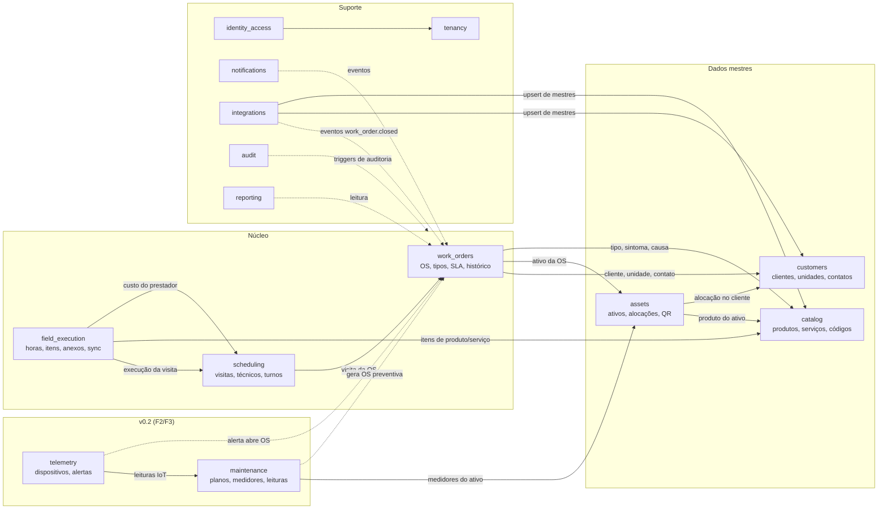
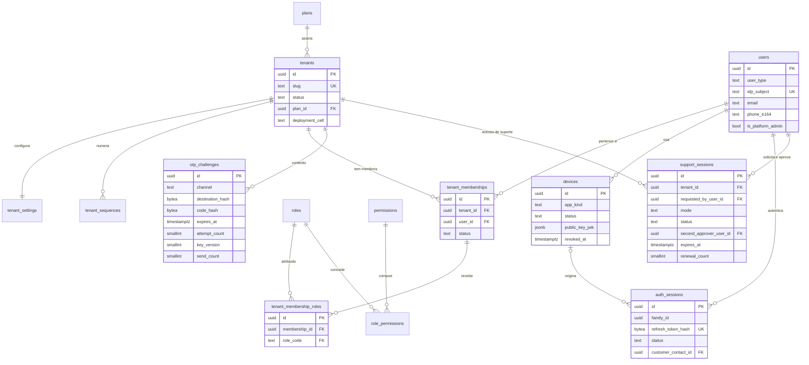
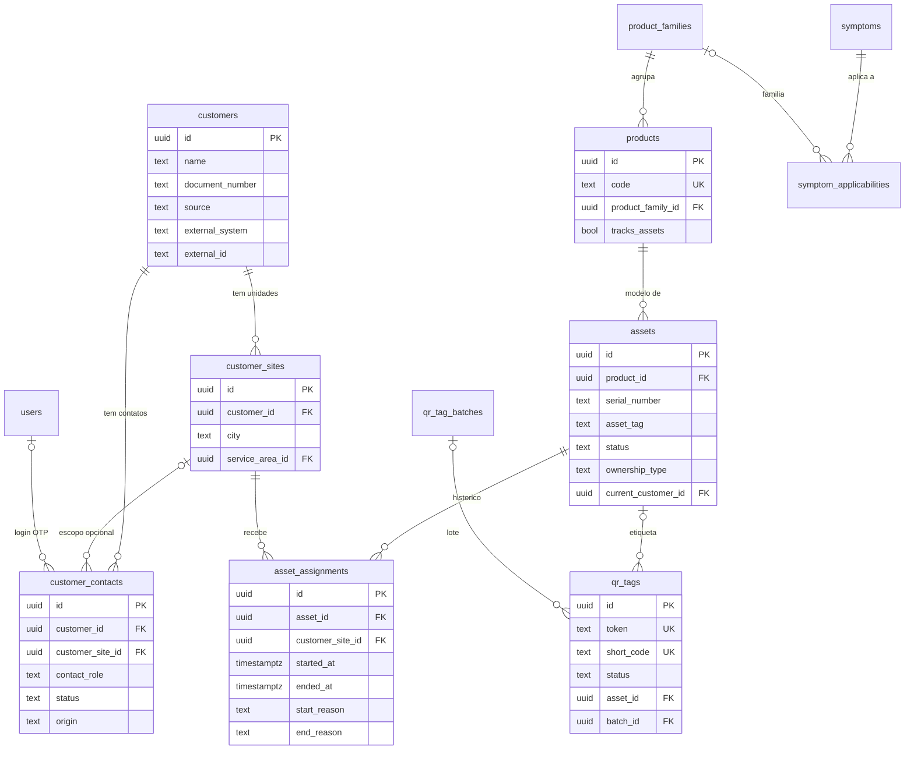
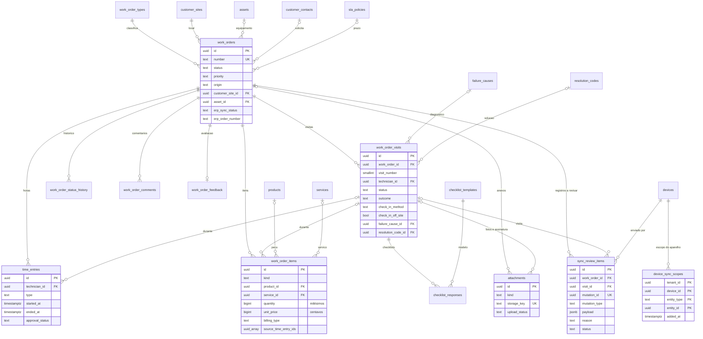
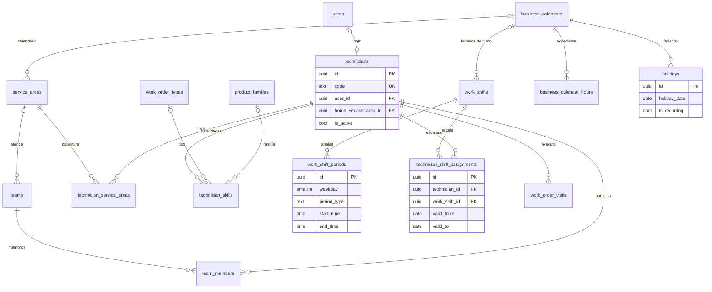
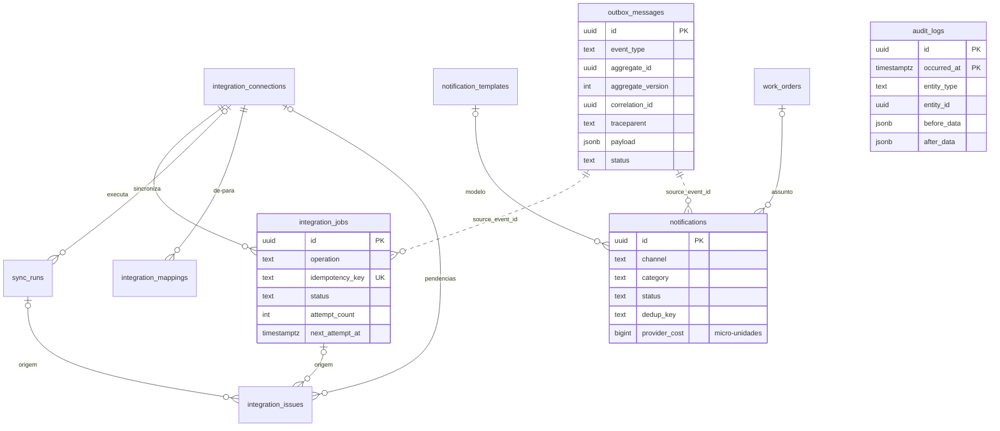
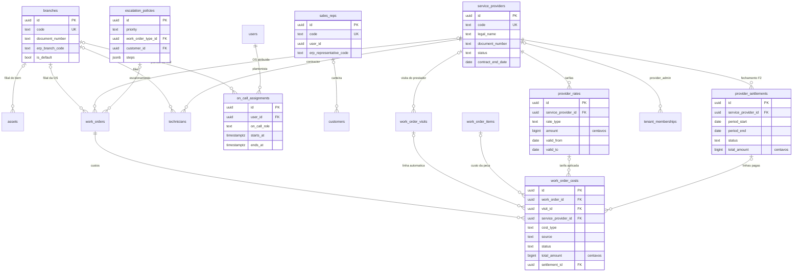
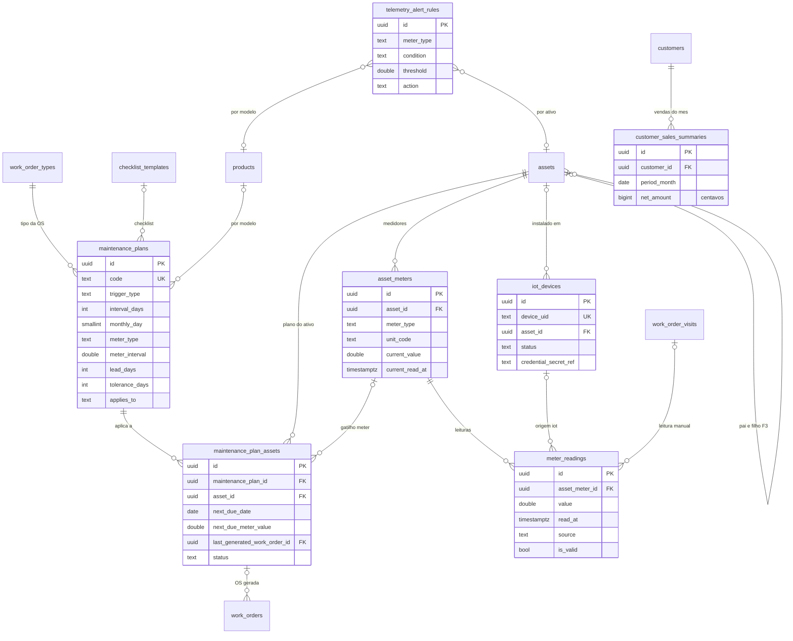
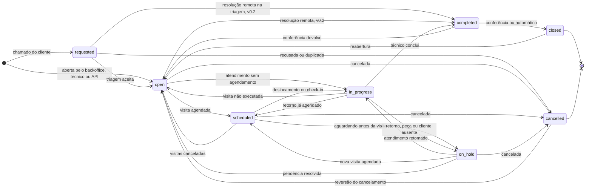
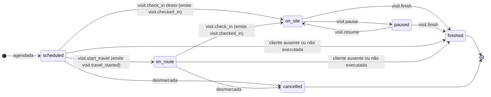

# Modelo de domínio e dados

Versão 0.3 — 02/11/2026 — rascunho para revisão (stack Dart: Flutter + Serverpod)

Propósito: definir as entidades, invariantes, máquinas de estado e regras de negócio da plataforma-os e como elas viram tabelas PostgreSQL, com o DDL de referência em [schema.sql](../db/schema.sql).

**Como ler este documento.** As seções 1 e 2 dão o mapa (contextos e diagramas ER). A seção 3 é o dicionário enxuto: campos-chave e invariantes de cada tabela. A lista completa de colunas, CHECKs e índices está no [schema.sql](../db/schema.sql), que é a fonte de verdade do schema e já foi executado num PostgreSQL 18 (detalhes na seção 11.5). As seções 4 a 11 tratam dos temas que exigem mais explicação: vínculo produto–cliente, QR, estados da OS e da visita, regras de negócio, dados mestres do ERP, sync do app do técnico, auditoria e operação do banco.

Documentos relacionados: [Arquitetura de solução](02-arquitetura-de-solucao.md) (stack e módulos), [Multi-tenancy e segurança](04-multi-tenancy-e-seguranca.md), [Ativos e QR code](05-ativos-e-qr-code.md), [Aplicações e fluxos](06-aplicacoes-e-fluxos.md), [Integração com o ERP Senior](07-integracao-erp-senior.md), [API](08-api.md), [Benchmark Sismetro e novas funcionalidades](11-benchmark-sismetro-e-novas-funcionalidades.md), [Stack Dart: Flutter + Serverpod](12-stack-dart-flutter-serverpod.md).

**Novidades da v0.2** (decididas no [docs/11](11-benchmark-sismetro-e-novas-funcionalidades.md), com os nomes canônicos do apêndice A): filiais, vendedores e modos de triagem, resolução remota, prestadores de serviço com tarifas e custos da OS, plantão e escalonamento, movimentação de ativo com aprovação e termo, documentos e dados de aquisição do ativo (MVP); bens vindos do ERP, fechamento de prestadores, requisição de materiais, planos de manutenção e medidores (F2); telemetria IoT, rentabilidade do comodato, oficina/desmontagem e ativos pai/filho (F3). As tabelas F2 e F3 já existem no [schema.sql](../db/schema.sql), com a fase no `COMMENT`, para que as próximas fases mudem só código e dados. Cada item novo deste documento traz a fase entre parênteses.

**Novidades da v0.3** ([docs/12](12-stack-dart-flutter-serverpod.md), ADR-019): só a implementação muda; domínio, regras, máquinas de estado, RLS, FKs compostas e triggers continuam os mesmos. Para ficar compatível com o ORM do Serverpod, o banco deixa de usar `numeric`: dinheiro passa a inteiro em centavos e quantidade a inteiro em milésimos (`bigint`), medidas passam a `double precision`, a duração calculada do apontamento passa a minutos inteiros e a sessão dos papéis de login fica em UTC (seção 3.1). A seção 13 descreve como os modelos do Serverpod espelham as tabelas.

---

## 1. Bounded contexts e entidades

Cada módulo do monólito (contrato §5) é dono exclusivo das suas tabelas. Outro módulo lê pela interface pública do dono ou reage a eventos de domínio (`outbox_messages`). As FKs entre tabelas de módulos diferentes existem no banco para garantir integridade, mas o código de um módulo não faz `SELECT`/`UPDATE` em tabela de outro.

| Módulo | Tabelas (dono) |
|---|---|
| identity_access | `users`, `roles`, `permissions`, `role_permissions`, `tenant_memberships`, `tenant_membership_roles`, `otp_challenges`, `auth_sessions`, `devices`, `support_sessions`, `idempotency_keys` |
| tenancy | `plans`, `tenants`, `tenant_settings`, `tenant_sequences`, `branches` (v0.2, MVP) |
| customers | `customers`, `customer_sites`, `customer_contacts`, `sales_reps` (v0.2, MVP), `customer_sales_summaries` (v0.2, F3) |
| catalog | `product_families`, `products`, `services`, `symptoms`, `symptom_applicabilities`, `failure_causes`, `resolution_codes`, `checklist_templates` |
| assets | `assets`, `asset_assignments`, `qr_tag_batches`, `qr_tags` |
| work_orders | `work_order_types`, `sla_policies`, `work_orders`, `work_order_status_history`, `work_order_comments`, `work_order_feedback` |
| scheduling | `work_order_visits`, `technicians`, `teams`, `team_members`, `service_areas`, `technician_service_areas`, `technician_skills`, `work_shifts`, `work_shift_periods`, `technician_shift_assignments`, `business_calendars`, `business_calendar_hours`, `holidays`; v0.2 (MVP): `service_providers`, `provider_rates`, `on_call_assignments`, `escalation_policies` |
| field_execution | `time_entries`, `work_order_items`, `checklist_responses`, `attachments`, `sync_mutations`, `sync_tombstones`, `device_sync_scopes`, `sync_review_items`; v0.2: `work_order_costs` (MVP), `provider_settlements` (F2) |
| maintenance (v0.2, F2) | `maintenance_plans`, `maintenance_plan_assets`, `asset_meters`, `meter_readings` |
| telemetry (v0.2, F3) | `iot_devices`, `telemetry_alert_rules` (as leituras IoT vão para `meter_readings`, do módulo maintenance) |
| notifications | `notification_templates`, `notifications`, `notification_preferences` |
| integrations | `integration_connections`, `outbox_messages` (relay), `integration_jobs`, `sync_runs`, `integration_issues`, `integration_mappings` |
| reporting | sem tabelas próprias no MVP: lê réplicas/visões; fase 2 terá agregados materializados |
| audit | `audit_logs` (particionada) |



Setas cheias: dependência síncrona pela interface pública do módulo. Setas tracejadas: reação a eventos de domínio.

---

## 2. Diagramas ER

Os diagramas mostram as chaves e alguns campos de negócio; colunas padrão (`created_at`, `updated_at`, `created_by`, `updated_by`, `version`) e de sync (`row_version`, `sync_xid`) estão omitidas. Em todas as tabelas de tenant, as FKs são compostas `(tenant_id, x_id)`; nos diagramas aparece só `x_id`.

### 2.1 Plataforma, tenancy e identidade



### 2.2 Clientes, catálogo, ativos e QR



### 2.3 OS, visitas e execução em campo



### 2.4 Técnicos, equipes, regiões, turnos e escalas



### 2.5 Integrações, outbox, notificações e auditoria



As linhas pontilhadas (`source_event_id`) são referências lógicas sem FK: o outbox é expurgado depois de publicado, e o job/notificação precisa sobreviver a ele.

### 2.6 Filiais, vendedores, prestadores, custos e plantão (v0.2)

MVP, exceto `provider_settlements` (F2). `on_call_assignments.user_id` aponta para a tabela global `users`.



As FKs compostas `(tenant_id, service_provider_id, x_id)` garantem, sem trigger, que o técnico atribuído à OS ou à visita é do prestador atribuído, que a tarifa de uma linha de custo é do prestador da linha e que o fechamento só agrupa linhas do mesmo prestador.

### 2.7 Manutenção, medidores e telemetria (v0.2)

Planos e medidores na F2; dispositivos IoT e regras de alerta na F3. `customer_sales_summaries` (F3) aparece aqui por alimentar, com os custos, os indicadores de rentabilidade do comodato.



---

## 3. Dicionário de entidades

### 3.1 Convenções que valem para todas as tabelas

| Item | Regra |
|---|---|
| Chave primária | `id uuid` (UUID v7 gerado pela aplicação, inclusive offline; `DEFAULT app.uuid_v7()` só cobre inserts feitos pelo banco) |
| Tabela de tenant | `tenant_id uuid NOT NULL` + `UNIQUE (tenant_id, id)`; FKs compostas `(tenant_id, x_id)`; RLS `ENABLE` + `FORCE` com a política `tenant_isolation` |
| Colunas padrão (D14) | `created_at`, `updated_at`, `created_by`, `updated_by`, `version`, preenchidas pelo trigger `trg_stamp` (`version` +1 a cada UPDATE; a API compara com `If-Match`) |
| Tabelas append-only | `work_order_status_history`, `sync_mutations`, `sync_tombstones` e `audit_logs` têm apenas `created_at`/`created_by` (nunca são alteradas; o runtime não tem UPDATE nelas) |
| Tipos discretos | `text` + `CHECK` com os valores exatos do contrato (sem ENUM nativo, para facilitar migração expand/contract) |
| Dinheiro | inteiro em **centavos**, `bigint` (`int` no Dart): R$ 12,34 → `1234`. Vale para preços, custos, totais, descontos, tarifas, custo de aquisição e vendas. O nome da coluna não muda; o `COMMENT` registra a unidade. No JSON dos apps também vai inteiro em centavos; no JSON externo (webhooks, ERP) o adaptador converte para decimal |
| Quantidade | inteiro em **milésimos**, `bigint`: 1,5 m → `1500`; 1 UN → `1000`. Valor da linha = `app.line_amount_cents(quantidade, preço)` = quantidade × preço ÷ 1000, arredondado ao centavo (meio para longe do zero) |
| Custo de provedor de mensagens | inteiro em **micro-unidades** da moeda (`bigint`), porque o preço por mensagem tem fração de centavo: US$ 0,0079 → `7900` (`notifications.provider_cost`) |
| Medidas | `double precision` (`double` no Dart): latitude, longitude, precisão e distância do GPS, leituras, limites e intervalos de medidor |
| Durações calculadas | minutos inteiros (`integer`), arredondados (`time_entries.duration_minutes`) |
| Datas | `timestamptz`, com o fuso da sessão dos papéis de login (`app_api`, `app_worker`, `app_migrator`) fixado em UTC; o Serverpod lê e grava `DateTime` sempre em UTC. Regras de calendário usam o fuso do tenant (`tenant_settings.timezone`) |
| Cadastros | nunca apagados fisicamente: `is_active` + auditoria. `DELETE` só é concedido em associações (ex.: `team_members`) e expurgos técnicos |
| Sincronizadas (D11) | `row_version bigint` + `sync_xid xid8` atualizados por `trg_row_version`; `trg_sync_tombstone` em exclusão física |
| Mestres (D10) | `source`, `external_system`, `external_id`, `external_payload`, `external_hash`, `last_synced_at`; único parcial `(tenant_id, external_system, external_id)`. Em `customers`, `customer_sites`, `customer_contacts`, `products`, `services` e, desde a v0.2, `assets` também `missing_since` (primeira varredura completa do ERP em que o registro não veio; volta a nulo se reaparecer; inativação só na segunda ausência consecutiva — docs/07; protegido pelo guarda de campos mestres) |
| `created_by`/`updated_by` | `uuid` de `users.id` sem FK (ator pode ser sistema/integração; evita FK para tabela global em toda escrita) |

Legenda de "Quem cria / altera": BO = backoffice (papéis indicados), TA = app do técnico, CA = app Flutter do cliente ou página web leve, INT = integração/importação, SYS = worker/trigger.

### 3.2 Plataforma, tenancy e identidade

| Tabela | Propósito e campos-chave | Unicidades e invariantes | Origem | Cria / altera |
|---|---|---|---|---|
| `plans` | Plano comercial: `code`, `limits` (jsonb), `features` | `code` único | local (seed) | migração / platform_admin (fase 3) |
| `tenants` | Empresa assinante (global; o `id` é o `tenant_id`): `slug`, `status` (`trial`, `active`, `suspended`, `cancelled`), `plan_id`, `idp_organization_id` (Keycloak), `deployment_cell` (`shared` ou silo) | `slug` e `idp_organization_id` únicos; RLS: lê o tenant ativo, os tenants dos próprios vínculos e, em contexto de plataforma, todos | local | platform_admin; tenant_admin altera dados de exibição |
| `tenant_settings` | 1 linha por tenant: `timezone`, `require_backoffice_review`, formato/padding/reinício da numeração, `default_business_calendar_id`, `sla_time_basis`, `duplicate_window_hours`, `reopen_window_days`, `time_entry_approval_required`, `allow_unregistered_contacts`, `max_self_service_requests_per_day`, `otp_channels`, `branding`; v0.2 (MVP): `triage_mode` (`central`, `sales_rep_first`, `direct`), `sales_rep_triage_timeout_minutes`, `require_qr_check_in`, `require_movement_approval` | `tenant_id` único; formato contém `{SEQ}`; prazo do vendedor entre 5 e 1440 min | local | criada no provisionamento; tenant_admin |
| `tenant_sequences` | Contador por `(sequence_key, period_key)`: `work_order/2026`, `qr_tag_batch/` | único `(tenant_id, sequence_key, period_key)`; `last_value >= 0` | SYS | `app.next_tenant_sequence()` |
| `users` | Identidade global: `user_type` (`staff`, `customer_contact`), `idp_subject`, `full_name`, `email`, `phone_e164`, `status`, `is_platform_admin` | `idp_subject` único; e-mail único entre `staff`; contato nunca tem `idp_subject`; senha nunca existe | IdP (staff) / OTP (contato) | JIT no primeiro login; tenant_admin convida |
| `roles`, `permissions`, `role_permissions` | RBAC canônico: 8 papéis do contrato, mais `sales_rep` e `provider_admin` (v0.2, MVP), e permissões `<recurso>.<ação>` | `roles.code` restrito aos 10 papéis | seed | migração (somente leitura em runtime) |
| `tenant_memberships` | Vínculo usuário (equipe) × tenant: `status` (`invited`, `active`, `suspended`, `removed`); v0.2 (MVP): `service_provider_id` (prestador do `provider_admin`) | único `(tenant_id, user_id)`; o usuário lê os próprios vínculos em todos os tenants; prestador do mesmo tenant (FK composta) | local | tenant_admin |
| `tenant_membership_roles` | Papéis do vínculo (`role_code`) | só papéis de equipe (`tenant_admin`, `dispatcher`, `backoffice_agent`, `manager`, `technician`, `sales_rep`, `provider_admin`); único por vínculo+papel | local | tenant_admin |
| `otp_challenges` | Desafio OTP do contato: `channel`, `destination_hash`, `destination_masked`, `code_hash`, `key_version` (versão do pepper HMAC), `send_count`/`last_sent_at` (reenvios), `qr_tag_id` (do `qr_context`), `expires_at`, `attempt_count`/`max_attempts`, `status` | `expires_at <= created_at + 10 min`; tentativas ≤ máximo; código e destino só em hash (HMAC com pepper do cofre; a verificação usa o pepper de `key_version`, o que permite rotacionar sem invalidar desafios em curso); `send_count >= 1`; limites de reenvio (docs/04) aplicados pela API sobre `send_count` e `last_sent_at` | SYS | API pública de OTP; expurgo em 30 dias |
| `auth_sessions` | Um registro por refresh token do contato: `family_id`, `parent_session_id`, `refresh_token_hash`, `status` (`active`, `rotated`, `revoked`, `reuse_detected`), `expires_at`, `absolute_expires_at` | hash único; reapresentar token `rotated` revoga toda a `family_id` | SYS | API (login, refresh, logout) |
| `devices` | Dispositivo por tenant: `app_kind` (v0.3: `technician_app` e `customer_app`, os apps Flutter; `customer_web`, o navegador do contato na página web leve, substitui `customer_pwa`), `platform`, `push_provider` (v0.3: `fcm` ou `apns`; sem push na página web leve)/`push_token`, `technician_id` ou `customer_contact_id`, `last_sync_at`, `status` (`active`, `logout_requested`, `blocked`), `public_key_jwk` (chave pública do aparelho para prova de posse na troca por token de tenant, docs/04 §4), `revoked_at`/`revoked_reason` | app do técnico exige `technician_id`; `customer_web` só com `platform = web` e sem push; push token ativo único por tenant; `active` ⇒ `revoked_at` nulo; `blocked` ⇒ `revoked_at` preenchido; `logout_requested`: no próximo contato o app envia o pendente e apaga a base local, e `revoked_at` é preenchido quando o logout se confirma; `public_key_jwk` é um objeto JWK com `kty` (só parte pública) | TA / CA | registro no login; logout remoto e bloqueio pelo BO (docs/06; emite `device.registered` / `device.blocked`) |
| `support_sessions` | Acesso de suporte da plataforma a um tenant (docs/04 §3.6): `requested_by_user_id`, `mode` (`read_only` padrão, `read_write`), `reason`, `support_ticket_ref`, `status` (`pending_approval`, `active`, `ended`, `rejected`, `expired`), `approved_by_user_id` (tenant_admin), `second_approver_user_id` (platform_admin), `is_emergency`, `starts_at`/`expires_at`, `renewal_count`, `ended_at`/`end_reason` | tabela **de tenant** (RLS `tenant_isolation`; o tenant_admin vê as sessões do seu tenant; o console grava/lê com `app.tenant_id` do tenant-alvo, pois o contexto de plataforma nunca libera linhas de tenant); `read_write` só começa com segundo aprovador (≠ solicitante); `active`/`ended` exigem `starts_at` e `expires_at`; `expires_at <= starts_at + 60 min × (renewal_count + 1)` com `renewal_count <= 1` (60 min, renovável uma vez); `ended` exige `ended_at`; aprovação do tenant_admin dispensável com `is_emergency` (registrada e notificada) ou se o tenant não a exigir | SYS / console da plataforma | platform_admin/platform_support solicita; tenant_admin aprova; API expira/encerra; auditada |
| `idempotency_keys` | `Idempotency-Key` de POSTs: `scope`, `request_hash`, resposta gravada, `expires_at` | único `(tenant_id, scope, idempotency_key)`; mesma chave com hash diferente → 422 | SYS | API; expurgo diário |

### 3.3 Clientes e catálogo

| Tabela | Propósito e campos-chave | Unicidades e invariantes | Origem | Cria / altera |
|---|---|---|---|---|
| `customers` | Cliente do tenant: `code`, `name`, `trade_name`, `person_type`, `document_type`/`document_number`, contatos gerais, `notes` (extensão local); v0.2: `primary_sales_rep_id` e `skip_triage` (MVP), `kind` (`standard`, `internal`; F3) | `code` único quando informado; documento **não** é único (duplicidade do ERP vira `integration_issues.possible_duplicate`); `document_type <> 'none'` exige número; cliente `internal` é sempre `local`; vendedor, `skip_triage` e `kind` são extensões locais | local (MVP) / ERP (fase 2) | backoffice_agent, dispatcher, tenant_admin; INT |
| `customer_sites` | Unidade/endereço de atendimento: endereço, `latitude`/`longitude` (graus decimais, `double precision`), `suggested_latitude`/`suggested_longitude`, `location_suggested_at`/`location_suggested_by`, `service_area_id`, `business_calendar_id`, `access_notes` | `UNIQUE (tenant_id, customer_id, id)` permite FKs que garantem "unidade pertence ao cliente"; geolocalização, região e acesso são extensões locais; sugestão de coordenada (mutação `customer_site.suggest_location`, docs/06) nunca sobrescreve `latitude`/`longitude`: o backoffice aceita (copia e limpa, `customer_site.updated`) ou descarta (limpa); latitude e longitude sugeridas vêm juntas e exigem `location_suggested_at` | local / ERP | idem; TA sugere localização |
| `customer_contacts` | Quem abre chamados: `name`, `email`, `phone_e164`, `contact_role` (`customer_contact`, `customer_admin`), `status` (`active`, `pending_approval`, `blocked`), `origin` (`backoffice`, `file_import`, `erp`, `qr_self_service`), `customer_site_id` (nulo = todas as unidades), `user_id`, `whatsapp_opt_in_at` | unidade, se informada, é do mesmo cliente (FK composta); `blocked` exige motivo; WhatsApp só com `whatsapp_opt_in_at` preenchido (salvo o OTP pedido pelo próprio contato), senão SMS/e-mail | local / ERP / autocadastro via QR | BO; customer_admin gerencia contatos do próprio cliente; CA (autocadastro `pending_approval`, `customer_contact.created`) |
| `product_families` | Família/categoria hierárquica (`parent_id`) | `code` único; não é pai de si mesma | local (pode vir do ERP) | catalog.manage |
| `products` | Modelo/SKU: `code`, `name`, `product_kind` (`equipment`, `spare_part`, `consumable`, `other`), `unit_code`, `tracks_assets`, `default_warranty_months`, `reference_price` (centavos), `label_position_instructions` + foto | `code` único por tenant | local / ERP | catalog.manage; INT |
| `services` | Serviço faturável (hora técnica, visita, deslocamento): `code`, `unit_code`, `default_price` (centavos por unidade), `estimated_minutes`, `service_kind` (`labour`, `travel`, `visit`, `other`; padrão `other`) | `code` único; `service_kind` é extensão local e guia a conversão de apontamentos em itens na conferência (docs/07 §9.4: `work` → `labour`, `travel` → `travel`, visita fixa → `visit`) | local / ERP | catalog.manage; INT |
| `symptoms` + `symptom_applicabilities` | Sintoma relatado: `customer_label`, `icon`, `visible_to_customer`, `suggested_priority`; aplicabilidade por família **ou** produto | visível ao cliente exige `customer_label`; aplicabilidade com exatamente um alvo; sem linhas = vale para todos | local | catalog.manage |
| `failure_causes`, `resolution_codes` | Causa da falha e solução aplicada, opcionalmente por família | `code` único | local | catalog.manage |
| `checklist_templates` | Modelo versionado: `code`, `template_version`, `status` (`draft`, `published`, `archived`), `items` (jsonb array); v0.2 (F2): novo tipo de item `meter_reading` (opções `meter_type`, `unit_code`) | único `(tenant_id, code, template_version)`; publicado é imutável (alterar = nova versão); o tipo dos itens é validado pela aplicação (jsonb, sem CHECK; documentado no `COMMENT` da coluna) | local | catalog.manage |

### 3.4 Ativos e QR

| Tabela | Propósito e campos-chave | Unicidades e invariantes | Origem | Cria / altera |
|---|---|---|---|---|
| `assets` | Unidade física: `product_id`, `serial_number`, `asset_tag`, `status` (D9b), `ownership_type` (D9b), `location_note`, `warranty_until`, `current_customer_id`/`current_customer_site_id` (desnormalizados); v0.2: `branch_id`, `acquisition_date` (substitui `acquired_at`), `acquisition_cost` (centavos), `supplier_name`, `acquisition_document` (MVP); colunas de origem externa completas com `missing_since` (F2); `parent_asset_id` (F3) | série única por produto; patrimônio único por tenant; exige série ou patrimônio; `installed` ⇒ alocação vigente e `in_stock`/`retired` ⇒ nenhuma (verificado no COMMIT); `source = erp` exige `external_id` e protege as colunas mestres (seção 8); não é pai de si mesmo | local / importação / ERP (F2) | assets.manage; TA (`asset.register`, `asset.install`, `asset.withdraw`, `asset.update_details`); INT (bens do ERP) |
| `asset_assignments` | Histórico da alocação: cliente, unidade, `ownership_type` (snapshot), `started_at`/`ended_at`, motivos, documento de origem, OS de instalação/recolhimento; v0.2 (MVP): `approval_status` (`not_required`, `pending`, `approved`, `rejected`), `approved_by`, `approved_at`, `term_attachment_id` | **vigente = `ended_at` nulo e `approval_status` em `not_required`/`approved`**: no máximo uma por ativo (índice único parcial) e sem sobreposição entre alocações efetivas (exclusion constraint com `WHERE`); no máximo uma `pending` por ativo; `pending` não tem `ended_at`; `approved`/`rejected` ⇔ `approved_by` + `approved_at`; `ended_at` ⇔ `end_reason` | local / importação | assets.manage; TA; aprovação: `asset_movements.approve` (seção 7.10) |
| `qr_tag_batches` | Lote de pré-impressão: `code`, `quantity`, `label_layout`, `printed_at`; custódia (fase 2) | `code` único | local | qr_tags.manage |
| `qr_tags` | Etiqueta: `token`, `short_code`, `status`, `asset_id`, `last_bound_asset_id`, dados de impressão, vínculo, revogação, substituição e leitura | `token` e `short_code` **globalmente** únicos; formato e verificador por CHECK; `asset_id` preenchido ⇔ `bound`; no máximo uma `bound` por ativo; `revoked` é terminal | local | qr_tags.manage; TA (`asset.bind_qr_tag`); unbind só tenant_admin |

### 3.5 OS, visitas e execução

| Tabela | Propósito e campos-chave | Unicidades e invariantes | Origem | Cria / altera |
|---|---|---|---|---|
| `work_order_types` | Tipo: `category` (`corrective`, `preventive`, `installation`, `removal`, `inspection`, `refurbishment` e `teardown` (v0.2, F3), `other`), `default_priority`, `requires_asset`, `available_to_customer`, checklist e serviço padrão; v0.2 (MVP): `require_qr_check_in` (nulo = herda do tenant), `skip_triage` (modo `direct`) | `code` único | local | tenant_admin |
| `sla_policies` | Prazo por prioridade × tipo × cliente: `triage_minutes`, `first_response_minutes`, `resolution_minutes`, `time_basis`, `business_calendar_id`, `pause_on_hold` | uma ativa por combinação (índice único com `coalesce`); resolução ≥ primeiro atendimento | local | tenant_admin |
| `work_orders` | OS: `number`, `status`, `hold_reason`, `priority`, `origin`, `entry_method`, `customer_id`/`customer_site_id` (gravados na abertura), `asset_id`, solicitante, sintoma, sinalizações de triagem (`flag_unverified_requester`, `flag_off_site`, `flag_typed_code`), `duplicate_of_work_order_id`, atribuição, SLA, causa/solução, marcos de tempo, cancelamento, reabertura, `erp_sync_status`/`erp_order_number`; v0.2 (MVP): `branch_id`, `resolution_mode` (`field` padrão, `remote`, `workshop` na F3), `acknowledged_at`/`acknowledged_by`, `escalation_level`, `escalation_policy_id`, `service_provider_id`; `maintenance_plan_asset_id` (F2); `origin`/`entry_method` ganham `sales_rep` (MVP) e `telemetry` (F3) | número único por tenant; transições pelo trigger de guarda; `on_hold` exige motivo; `cancelled` exige motivo e data; `duplicate` exige a OS original; `completed`/`closed` exigem `completed_at`; `remote` concluída exige `resolution_notes`; aceite ⇔ `acknowledged_by`; nível > 0 exige política; técnico atribuído é do prestador atribuído (FK composta); uma OS não terminal por plano × ativo | CA, BO, TA, API, importação, vendedor (MVP), plano preventivo (F2), telemetria (F3) | ver seção 6 |
| `work_order_visits` | Visita: `visit_number`, `technician_id` (v0.2: pode ser nulo enquanto a visita está só com o prestador e `scheduled`), `service_provider_id` (v0.2, MVP; técnico do mesmo prestador por FK composta), `team_id`, `status`, `outcome`, janela agendada, marcos (deslocamento, check-in, fim), geolocalização (latitude/longitude, precisão e distância em `double precision`), check-in (`check_in_method` `qr`/`gps`/`manual`, `check_in_distance_m` em metros, `check_in_off_site`), assinatura (`signature_attachment_id`, `signer_name`, `signer_document`, `signed_at`), diagnóstico da visita (`confirmed_symptom_id`, `failure_cause_id`, `resolution_code_id`, `diagnosis_notes`) | `finished` ⇔ `outcome`; sem check-in só termina como `customer_absent`/`not_executed`; `UNIQUE (tenant_id, work_order_id, id)` garante que filhos apontem para visita da mesma OS; FKs compostas para `symptoms`, `failure_causes`, `resolution_codes`; check-in fora do raio não bloqueia, só marca `check_in_off_site`; **o diagnóstico da OS é o da última visita finalizada**: ao finalizar, a aplicação copia causa/solução/notas para `work_orders.failure_cause_id`/`resolution_code_id`/`resolution_notes` (a OS mantém essas colunas; o BO pode corrigi-las na conferência) | BO (agenda) / TA (execução) | dispatcher; TA (`visit.start_travel`, `visit.check_in`, `visit.record_diagnosis` → `visit.diagnosis_recorded`) |
| `work_order_status_history` | Uma linha por transição: `from_status`, `to_status`, `hold_reason`, `reason`, `changed_by`, `actor_type` | append-only, gravado por trigger | SYS | trigger |
| `work_order_comments` | `visibility` (`internal`, `customer`), `author_type`, autor, `body`, `deleted_at` | contato só escreve `customer`; exclusão lógica | BO, TA, CA | autor |
| `work_order_feedback` | Avaliação: `rating` 1–5, `nps_score` 0–10, `comment` | uma por OS | CA | contato após `completed`/`closed` |
| `time_entries` | Apontamento: `type` (`travel`, `work`, `pause`), `started_at`/`ended_at`, `duration_minutes` (gerada, minutos inteiros arredondados), `source` (`visit_transition`, `manual`, `backoffice`), `justification`, aprovação, `hour_classification` (fase 2), anulação | sem sobreposição por técnico entre apontamentos válidos (exclusion constraint); manual exige justificativa | TA / BO | TA; BO aprova/rejeita/ajusta |
| `work_order_items` | Item: `kind`, `product_id` XOR `service_id`, snapshot (`item_code`, `description`, `unit_code`, `unit_price` em centavos), `quantity` (milésimos), `discount_amount` (centavos), `total_amount` (gerada, centavos: `app.line_amount_cents(quantity, unit_price) - discount_amount`), `billing_type`, `price_source`, `added_via`, `part_serial_number`, `source_time_entry_ids` (apontamentos que geraram o item na conferência), anulação; v0.2 (F2): `stock_requisition_status` (`not_required`, `pending`, `approved`, `rejected`, `issued`), `erp_requisition_ref` | requisição só em `kind = product`; `issued` exige `erp_requisition_ref`; `UNIQUE (tenant_id, work_order_id, id)` para custos da mesma OS; XOR por CHECK; desconto só em `billable` e ≤ bruto; `source_time_entry_ids` é `uuid[]` **sem FK** (array): a aplicação valida na mesma transação que os ids são apontamentos da mesma OS e que nenhum está em outro item não anulado; anular o item libera os apontamentos | TA / BO | TA (`work_order_item.add`); BO até o encerramento (eventos `work_order_item.added`/`.updated`/`.removed`) |
| `checklist_responses` | Respostas por visita e modelo (versão fixada) | uma por visita+modelo | TA | `checklist_response.submit` |
| `attachments` | Metadados do arquivo: `kind`, dono (OS, visita, comentário, checklist, ativo ou produto), `storage_key`, `content_type`, `size_bytes`, `sha256`, `upload_status`, `visible_to_customer`, captura; v0.2 (MVP): `category` dos documentos do ativo e do modelo (`comodato_contract`, `invoice`, `manual`, `movement_term`, `photo`, `other`) | `storage_key` começa com `t/<tenant_id>/` (CHECK) e é único; assinatura sempre ligada a visita; `category` só com ativo ou produto; `movement_term` só no ativo e como `document` | TA / CA / BO | registro antes do upload (`attachment.register`) |
| `sync_mutations` | Mutação recebida no push (`id` = `mutation_id`): `device_id`, `technician_id`, `type`, `entity_id`, `status`, `payload_hash`, `result` | PK = `mutation_id` ⇒ idempotência | SYS | API de sync; expurgo em 90 dias |
| `sync_tombstones` | Remoção para o pull: `entity_type`, `entity_id`, `technician_id` (nulo = todos), `reason` (`deleted`, `scope_lost`), `row_version` | append-only | SYS | triggers e módulo de sync |
| `device_sync_scopes` | Snapshot do escopo de cada dispositivo (docs/06 §6): `device_id`, `entity_type` (nome da tabela), `entity_id`, `added_at` | PK `(tenant_id, device_id, entity_type, entity_id)`; FK composta para `devices` com `ON DELETE CASCADE`; **sem colunas padrão de auditoria nem `row_version`** (estado técnico de alta rotatividade, recalculável a partir do escopo; exclusão física concedida ao runtime) | SYS | API de sync (pull), na transação que fecha a página |
| `sync_review_items` | "Registros a revisar": fato de campo que chegou por sync e não pôde ser aplicado: `work_order_id`, `visit_id` (opcional), `technician_id`, `device_id`, `mutation_id`, `mutation_type`, `payload` (original, intacto), `reason` (`work_order_cancelled`, `work_order_closed`, `visit_reassigned`, `other`), `status` (`pending`, `accepted`, `discarded`), `decided_by`/`decided_at`/`decision_note` + colunas padrão | `UNIQUE (tenant_id, mutation_id)` (reenvio não duplica); `mutation_id` sem FK para `sync_mutations` (expurgada em 90 dias); visita da mesma OS (FK composta); `pending` ⇔ sem `decided_at`; decisão exige `decided_by`; `discarded` exige `decision_note`; não entra nos totais da OS | SYS (push com `conflict`) | BO aceita (reaplica o payload: reabre a OS ou gera OS nova) ou descarta com motivo |

### 3.6 Técnicos, equipes, regiões, turnos e escalas

| Tabela | Propósito e campos-chave | Unicidades e invariantes | Origem | Cria / altera |
|---|---|---|---|---|
| `technicians` | Operador: `code` (matrícula), `name`, contatos, `user_id` (login), `home_service_area_id`, `hourly_cost` (fase 2; centavos por hora), `max_daily_visits`; v0.2 (MVP): `kind` (`employee`, `contractor`), `service_provider_id`, `branch_id` | `code` único; um técnico por usuário no tenant; `contractor` ⇔ `service_provider_id` preenchido (CHECK); `UNIQUE (tenant_id, service_provider_id, id)` para as FKs "técnico do prestador" | local | scheduling.manage; `service_providers.manage` para terceirizados |
| `teams` + `team_members` | Equipe (opcionalmente por região) e seus técnicos (`is_leader`) | técnico uma vez por equipe | local | scheduling.manage |
| `service_areas` + `technician_service_areas` | Região de atendimento (`code`, prefixos de CEP, calendário; polígono na fase 3) e cobertura por técnico | `code` único | local | scheduling.manage |
| `technician_skills` | Habilidade por tipo de OS **ou** família de produto, `level` 1–5 | exatamente um alvo coerente com `skill_type` | local | scheduling.manage |
| `work_shifts` + `work_shift_periods` | Turno e suas janelas por dia da semana (`work`/`rest_break`; `crosses_midnight` gerado) | início ≠ fim | local | scheduling.manage |
| `technician_shift_assignments` | Escala: turno vigente de `valid_from` a `valid_to` (nulo = sem fim) | sem sobreposição por técnico (exclusion constraint em `daterange`) | local | scheduling.manage |
| `business_calendars` + `business_calendar_hours` + `holidays` | Expediente semanal e feriados (recorrentes ou não, meio expediente) usados pelo SLA em horas úteis e pelos turnos | um calendário padrão por tenant; um feriado por data e calendário | local | tenant_admin |

### 3.7 Integrações, notificações e auditoria

| Tabela | Propósito e campos-chave | Unicidades e invariantes | Origem | Cria / altera |
|---|---|---|---|---|
| `integration_connections` | Conexão com ERP: `external_system`, `connector_type`, `status`, `base_url`, `secret_ref` (referência ao cofre), `config`, `enabled_features`, `sync_schedule`, saúde | uma ativa por `external_system`; ativa exige `secret_ref` (exceto `file_only`) | local | integrations.manage |
| `outbox_messages` | Evento de domínio (envelope de docs/02 §5): `event_type` (`<agregado>.<fato>`, catálogo canônico da seção 6.3), `event_version`, `aggregate_type`/`aggregate_id`, `aggregate_version`, `correlation_id`, `traceparent` (W3C), `payload`, `metadata`, estado do relay | `published` exige `published_at`; `aggregate_version > 0` (consumidor descarta versão ≤ à já processada); `traceparent` no formato W3C (CHECK) | SYS (mesma transação do caso de uso) | relay do worker; expurgo em 7 dias |
| `integration_jobs` | Unidade de trabalho com o ERP (docs/07 §4.3): `operation`, `subject_*`, `idempotency_key`, `status`, tentativas, lease, erros, payloads mascarados, `result`, `attempt_log` | `idempotency_key` única por tenant | SYS | worker; reprocesso manual no Monitor |
| `display_tokens` (v0.3, F2) | Token de exibição do modo TV: `name`, `dashboard` (`work_orders_board`, `sla`, `dispatch`, `costs`), `scope` (filial/equipe/região), `token_hash` (SHA-256; o token nunca é gravado), `allowed_ip_ranges`, `expires_at`, revogação, último uso | `token_hash` único global; validade ≤ 1 ano; resolvido sem tenant por `app.find_display_token_by_hash` (só tokens válidos de tenants ativos) | L | tenant_admin, manager (`display_token.manage`) |
| `meter_reading_daily` (v0.3, F2/F3) | Consolidação diária por medidor: `day`, `reading_count`, `min/max/avg/last_value`, `delta_value` (consumo do dia em medidores cumulativos) | `(tenant_id, asset_meter_id, day)` único; `min ≤ avg ≤ max`; `delta ≥ 0` | SYS | job `maintenance.meter_rollup`; base dos gráficos e do histórico longo |
| `background_jobs` (v0.3) | Fila genérica do worker para o que não é integração nem notificação (no lugar das filas do pg-boss): PDF/ZPL de etiquetas, termos e relatórios, importações e exportações, verificação de anexos, geração de OS por planos. `kind` (`<agregado>.<ação>`), `priority` 1–9, `payload`, `status`, tentativas, lease, `result` | `(tenant_id, kind, idempotency_key)` única quando há chave; `attempt_count ≤ max_attempts`; reservada por `app.claim_background_jobs` (SKIP LOCKED, por prioridade) | SYS | worker; expurgo dos concluídos após 30 dias |
| `sync_runs` | Execução de sync ou importação de planilha: `entity_type`, `mode`, `trigger`, `dry_run`, cursores, `stats`, arquivos | `file_import` ⇔ sem conexão e com arquivo | SYS / BO | worker; imports.run |
| `integration_issues` | Pendência que exige ação humana, deduplicada (`occurrences`) | uma aberta por tipo + registro | SYS | worker; BO resolve/ignora |
| `integration_mappings` | De-para por conexão: `mapping_type`, `local_key`, `external_value` (jsonb) | um ativo por conexão + tipo + chave | local | integrations.manage |
| `notification_templates` | Personalização por tenant (evento × canal × público × idioma) | única por combinação; sem linha = padrão do código | local | tenant_admin |
| `notifications` | Envio e caixa in_app: canal, `category` (cobrança do WhatsApp: `authentication`, `utility`, `service`, `marketing`), destinatário, `dedup_key`, estado de entrega, ids do provedor, `provider_cost` (micro-unidades da moeda: US$ 0,0079 = 7900)/`provider_cost_currency` (ISO 4217) | ao menos um destinatário; `dedup_key` única; canal `whatsapp` exige `category`; custo exige moeda; WhatsApp só para contato com `whatsapp_opt_in_at` (salvo OTP pedido por ele) | SYS | worker de notificações (`notification.sent` / `notification.failed`) |
| `notification_preferences` | Opt-out por evento/canal de usuário **ou** contato | exatamente um dono | CA / BO | o próprio usuário |
| `audit_logs` | Antes/depois em jsonb, `changed_fields`, ator, correlação; `tenant_id` nulo = ação de plataforma | append-only; particionada por mês | SYS | trigger `trg_audit` e API (eventos de segurança) |

### 3.8 Filiais, vendedores e rentabilidade (v0.2)

| Tabela | Propósito e campos-chave | Unicidades e invariantes | Origem | Cria / altera |
|---|---|---|---|---|
| `branches` (MVP) | Filial: `code`, `legal_name`, `trade_name`, `document_number` (CNPJ), `state_registration`, endereço, `erp_branch_code`, `is_default`, `is_active` | `code` único; CNPJ e código do ERP únicos quando informados; **uma filial padrão por tenant** (índice único parcial), sempre ativa | local (criada no provisionamento) | tenant_admin (`settings.manage`) |
| `sales_reps` (MVP) | Vendedor: `code`, `name`, contatos, `user_id` (login com papel `sales_rep`), `branch_id`, `erp_representative_code` | `code` único; um vendedor por usuário no tenant; código do ERP único quando informado | local (F2: representante do ERP) | customers.manage |
| `customer_sales_summaries` (F3) | Vendas mensais por cliente (e filial): `period_month` (1º dia do mês), `gross_amount` e `net_amount` (centavos), `quantity` (milésimos), `invoice_count`, `external_hash`, `last_synced_at` | único por cliente + mês + filial; `gross_amount >= 0`; `net_amount` pode ser negativo (devoluções) | INT (ERP) | só a integração; leitura em relatórios |

### 3.9 Prestadores, plantão, escalonamento e custos (v0.2)

| Tabela | Propósito e campos-chave | Unicidades e invariantes | Origem | Cria / altera |
|---|---|---|---|---|
| `service_providers` (MVP) | Empresa prestadora: `code`, `legal_name`, `trade_name`, `document_number` (CNPJ), `contact_name`, `email`, `phone_e164`, `served_states` (UFs), `branch_id`, `status` (`active`, `suspended`, `inactive`), `contract_start_date`/`contract_end_date`, `erp_supplier_code` | `code` único; CNPJ único quando informado; `inactive` ⇔ `deactivated_at`; UFs válidas (CHECK) | local | `service_providers.manage` (eventos `service_provider.created`/`.updated`/`.deactivated`) |
| `provider_rates` (MVP) | Tarifa: `rate_type` (`per_visit`, `per_hour`, `per_km`, `fixed_per_service`), `work_order_type_id` e `service_id` opcionais, `amount` (centavos por unidade da tarifa), `valid_from`/`valid_to` | sem sobreposição de vigência para o mesmo prestador + tipo de tarifa + tipo de OS + serviço (exclusion constraint); `fixed_per_service` exige serviço ou tipo de OS; `amount >= 0` | local | `service_providers.manage` |
| `on_call_assignments` (MVP) | Plantão: `user_id`, `on_call_role` (`dispatcher`, `technician`), `branch_id`/`service_area_id` opcionais, `starts_at`/`ends_at` | `ends_at > starts_at`; sem sobreposição para o mesmo usuário e papel; DELETE físico permitido (escala) | local | `on_call.manage` |
| `escalation_policies` (MVP) | Política: `priority`, `work_order_type_id`, `customer_id` (nulos = qualquer), `steps` (jsonb: espera, quem avisar, canais) | uma ativa por combinação (índice único com `coalesce`); 1 a 10 passos | local | `on_call.manage` |
| `work_order_costs` (MVP) | Custo da OS para o tenant: `cost_type` (`parts`, `own_labor`, `third_party_labor`, `travel`, `other`), `source` (`provider_rate`, `time_entry`, `erp_issue`, `manual`), `status` (`pending_review`, `approved`, `rejected`), `quantity` (milésimos, padrão 1000) × `unit_cost` (centavos) = `total_amount` (gerada, centavos, `app.line_amount_cents`), ligações opcionais a visita, item, prestador, tarifa e fechamento | visita, item e OS coerentes (FKs compostas pela OS); tarifa e fechamento do mesmo prestador (FKs compostas pelo prestador); terceiro exige prestador; valores ≥ 0; conferida ⇔ `reviewed_by`/`reviewed_at`; rejeitada exige motivo; uma linha automática por visita e tarifa | SYS (linha automática) / BO | `work_order_costs.review` (eventos `work_order_cost.added`/`.reviewed`) |
| `provider_settlements` (F2) | Fechamento: prestador, `branch_id`, `period_start`/`period_end`, `status` (`draft`, `approved`, `sent_to_erp`), `total_amount` (centavos), `line_count`, `statement_attachment_id` (demonstrativo), `erp_document_ref` | períodos sem sobreposição por prestador e filial; aprovado exige quem/quando; `sent_to_erp` exige `sent_to_erp_at` | BO / SYS | `provider_settlements.manage` (eventos `provider_settlement.approved`/`.sent_to_erp`) |

### 3.10 Manutenção, medidores e telemetria (v0.2)

| Tabela | Propósito e campos-chave | Unicidades e invariantes | Origem | Cria / altera |
|---|---|---|---|---|
| `maintenance_plans` (F2) | Plano: `code`, `work_order_type_id`, `checklist_template_id`, `priority`, `trigger_type` (`interval_days`, `monthly_day`, `meter`), `interval_days`, `monthly_day`, `meter_type`, `meter_interval`, `lead_days`, `tolerance_days`, `meter_lead` (`meter_interval` e `meter_lead` na unidade do medidor, `double precision`), `applies_to` (`product`, `asset`), `product_id`, `group_by_site` | CHECK por gatilho: `interval_days > 0`; `monthly_day` de 1 a 28; `meter` exige `meter_type` e `meter_interval > 0`; os campos dos outros gatilhos ficam nulos; `product` ⇔ `product_id` | local | `maintenance_plans.manage` |
| `maintenance_plan_assets` (F2) | Plano × ativo: `asset_meter_id`, `status` (`active`, `paused`, `ended`), `next_due_date`, `next_due_meter_value`, `last_generated_work_order_id`, `last_generated_at`, `last_completed_at` | único por plano + ativo; ativo exige próximo vencimento; vencimento por leitura exige medidor | SYS / BO | job de planos; `maintenance_plans.manage` |
| `asset_meters` (F2) | Medidor: `asset_id`, `meter_type` (`hour_meter`, `energy_kwh`, `temperature`, `cycles`), `name`, `unit_code`, `is_cumulative`, `current_value` (`double precision`, na unidade do medidor)/`current_read_at` | nome único por ativo; só `temperature` não é cumulativo; valor e data atuais juntos; **sincronizada** com o app do técnico | local | `maintenance_plans.manage`; atualizada ao gravar leituras |
| `meter_readings` (F2 manual, F3 IoT) | Leitura: `asset_meter_id`, `value` (`double precision`), `read_at` (horário do aparelho ou do dispositivo), `received_at`, `source` (`manual`, `iot`, `file_import`), OS/visita/técnico (manual), `iot_device_id` (IoT), `is_valid`/`invalid_reason` | **idempotência** por `(tenant_id, asset_meter_id, read_at, source)`; `iot` exige dispositivo; visita exige OS (FK composta); inválida exige motivo; nunca apagada; nenhuma FK aponta para ela (pode ser particionada) | TA (`meter_reading.record`) / INT | app do técnico; ingestão IoT; importação |
| `iot_devices` (F3) | Dispositivo: `device_uid` (global), `vendor`, `model`, `firmware_version`, `asset_id`, `status` (`provisioned`, `active`, `inactive`, `revoked`), `credential_secret_ref` (cofre), `credential_rotated_at`, `last_seen_at` | `device_uid` globalmente único (resolve o tenant na ingestão); ativo exige ativo vinculado e credencial; um dispositivo ativo por ativo | local | `telemetry.manage` |
| `telemetry_alert_rules` (F3) | Regra: `meter_type`, `applies_to` (`product`, `asset`), `condition` (`above`, `below`, `no_data`, `continuous_on`, `idle`), `threshold` (`double precision`), `duration_minutes`, `action` (`notify`, `open_work_order`), `work_order_type_id`, `priority`, `cooldown_minutes` | exatamente um alvo coerente com `applies_to`; limites exigem `threshold`; condições de tempo exigem duração; abrir OS exige tipo | local | `telemetry.manage` |

---

## 4. Vínculo produto ↔ cliente

O pedido do usuário ("enviei um freezer com código específico, preciso ligar esse produto a esse cliente") é modelado em três níveis:

| Nível | Tabela | Exemplo |
|---|---|---|
| Modelo (catálogo) | `products` | "Freezer horizontal 500 L", código `FRZ-500` |
| Unidade física | `assets` | o freezer de série `SN-2026-00042`, patrimônio `PAT-1187`, etiqueta QR `K7M2-P9QX` |
| Vínculo com histórico | `asset_assignments` | de 03/02/2026 a hoje no Mercado Bom Preço, unidade Centro, em comodato, NF de remessa 12345 |

**Por que alocação com histórico, e não só `assets.customer_id`.** Ativos de comodato circulam: são entregues, trocados, transferidos entre lojas da mesma rede, recolhidos para oficina e reenviados a outro cliente. Relatórios ("quantas OS esse freezer teve no cliente X"), garantia, faturamento de contrato e a reconciliação com o ERP precisam saber onde o ativo estava em cada data. Uma coluna só guardaria o presente. A alternativa descartada foi derivar o histórico do `audit_logs`: daria para reconstruir, mas sem semântica de negócio (motivo, documento de origem) e com consultas caras.

**Regras e como o banco as garante**

1. **No máximo uma alocação vigente por ativo.** Vigente = `ended_at` nulo **e** `approval_status` em `not_required`/`approved` (v0.2). O índice único parcial `asset_assignments_current_key (tenant_id, asset_id) WHERE ended_at IS NULL AND approval_status IN ('not_required', 'approved')` impede duas vigentes. A exclusion constraint em `tstzrange(started_at, ended_at)`, restrita às alocações efetivas, impede períodos sobrepostos, inclusive em correções retroativas. Alocações `pending` e `rejected` ficam fora das duas regras (seção 7.10).
2. **Unidade pertence ao cliente.** A FK `(tenant_id, customer_id, customer_site_id) → customer_sites (tenant_id, customer_id, id)` garante isso sem trigger.
3. **Consulta eficiente da alocação vigente.** O trigger `trg_refresh_current` mantém `assets.current_customer_id` e `current_customer_site_id` (com o índice `(tenant_id, current_customer_id, current_customer_site_id)` para listar os equipamentos de um cliente, que é a tela inicial do app do cliente). A aplicação nunca grava essas colunas diretamente.
4. **Status × alocação** (constraint trigger adiada para o COMMIT): `installed` exige alocação vigente; `in_stock` e `retired` não admitem alocação vigente; `in_workshop` admite as duas situações (o equipamento do próprio cliente continua dele enquanto está na oficina; o de comodato recolhido não). Por ser adiada, a aplicação pode encerrar a alocação, abrir a nova e mudar o status em qualquer ordem dentro da transação.
5. **Propriedade (`ownership_type`)**: `tenant_loan` (comodato), `tenant_rental` (locação) ou `customer_owned` (do cliente; o tenant só presta assistência). O valor fica no ativo (situação atual) e é copiado na alocação (situação naquele período), porque o mesmo freezer pode ir em comodato para um cliente e depois ser vendido a outro (`end_reason = customer_purchase`, nova alocação `customer_owned`).
6. **Garantia.** `assets.warranty_until` (preenchida na entrega a partir de `products.default_warranty_months` ou da NF do fabricante). Na abertura da OS, a API sugere `billing_type = warranty` para itens enquanto a garantia vale; para comodato/locação sugere `contract`. A sugestão é editável pelo técnico/backoffice, e o valor gravado no item é o que vale.
7. **Documento de origem.** `source_document_type` (`shipment_invoice` = NF de remessa em comodato, `loan_contract`, `rental_contract`, `sale_invoice`, `work_order`, `other`) + número + data. Na fase 2, a NF de remessa vinda do ERP pode criar a alocação automaticamente (a confirmar em [Integração com o ERP Senior](07-integracao-erp-senior.md)).

**Operações (comandos do módulo assets, também disponíveis como mutações do app do técnico)**

| Operação | Efeito no modelo |
|---|---|
| Entrega/instalação (`asset.install`) | cria alocação (`start_reason` `delivery` ou `installation`, opcionalmente `work_order_id` da OS de instalação); ativo → `installed`; evento `asset.assigned` |
| Transferência entre clientes ou unidades | encerra a vigente (`end_reason = transfer`) e abre outra (`start_reason = transfer`) na mesma transação, com o mesmo instante como fim e início; evento `asset.transferred` |
| Recolhimento (`asset.withdraw`) | encerra a vigente (`withdrawal`, `ended_work_order_id` = OS de retirada); ativo → `in_workshop` ou `in_stock`; evento `asset.withdrawn` |
| Baixa | encerra a vigente (`retirement`), ativo → `retired` com `retired_at`; etiqueta `bound` → `revoked` (`asset_retired`) |
| Correção de cadastro | `start_reason`/`end_reason = correction`, sempre auditada; datas retroativas respeitam a exclusion constraint |
| Movimentação com aprovação (v0.2, MVP) | com `require_movement_approval`, a operação grava a alocação nova `pending` (e o termo), sem mexer na vigente nem no status do ativo; a aprovação aplica a operação inteira numa transação (seção 7.10); eventos `asset.movement_requested`, `asset.movement_approved`, `asset.movement_rejected` |
| Desmontagem (v0.2, F3) | OS `teardown` concluída: encerra a vigente (se houver), ativo → `retired` com `retirement_reason = cannibalized`; peças recuperadas registradas na OS |

**OS abertas quando o ativo muda de cliente.** A OS grava `customer_id` e `customer_site_id` na abertura, e eles não mudam com a transferência (docs/05): a OS pertence ao atendimento solicitado por aquele cliente, e o histórico não pode ser reescrito. Regras: (a) transferência/recolhimento com OS não terminal do ativo (`requested`…`on_hold`) exige confirmação explícita no backoffice, que lista as OS afetadas; (b) se o recolhimento for a própria solução (troca do equipamento), a OS segue o fluxo normal até `completed`; (c) as demais OS abertas recebem um comentário interno automático e a sinalização na fila de triagem; o dispatcher decide cancelar (`other`) ou manter. A API não cancela OS automaticamente, porque uma transferência lançada por engano não pode apagar chamados de cliente.

---

## 5. QR no modelo

A experiência completa está em [Ativos e QR code](05-ativos-e-qr-code.md). Aqui fica o que o banco garante.

| Elemento | Regra no schema |
|---|---|
| `token` | 26 caracteres base32 Crockford = 128 bits (primeiro caractere `0`–`7`), gerados por CSPRNG na aplicação; `UNIQUE (token)` **global** (é ele que resolve o tenant); CHECK de formato |
| `short_code` | 8 caracteres = 7 aleatórios + 1 verificador Luhn mod 32 (proposta do docs/05); `UNIQUE (short_code)` global; CHECK de formato **e** do verificador (`app.crockford_luhn32_is_valid`). Exibição `XXXX-XXXX` |
| `status` | `generated` → `printed` → `bound`; `generated` → `bound` (etiqueta gerada para ativo já cadastrado); `bound` → `printed` ("desfazer vínculo", exceção auditada, só `tenant_admin`, incrementa `unbind_count`); qualquer → `revoked` (terminal). Trigger `trg_guard_status` |
| `asset_id` | preenchido **somente** quando `bound` (CHECK). Ao sair de `bound`, o trigger move o valor para `last_bound_asset_id`, que preserva o histórico |
| Uma por ativo | índice único parcial `(tenant_id, asset_id) WHERE status = 'bound'` |
| Lote | `batch_id` opcional → `qr_tag_batches` (pré-impressão em lote sem ativo) |
| Revogação | `revoked_at`, `revoked_by`, `revoked_reason` (`damaged`, `lost`, `replaced`, `asset_retired`, `misprint`, `security`, `other`), `revocation_note`, `replaced_by_tag_id` (só em revogadas) |
| Impressão e leitura | `printed_at`, `print_count`, `last_printed_by`; `scan_count`, `last_scanned_at` (atualizados pela API depois da resolução, já no contexto do tenant) |

**Funções públicas de resolução** (`SECURITY DEFINER`, dono `app_system`, `search_path = pg_catalog, pg_temp`, `EXECUTE` só para `app_runtime`):

```sql
public.resolve_qr_token(p_token text)
public.resolve_qr_short_code(p_code text)
-- ambas: RETURNS TABLE (tenant_id uuid, qr_tag_id uuid, status text, asset_id uuid)
```

- Normalizam a entrada (maiúsculas, `I`/`L` → `1`, `O` → `0`, remoção de hífen/espaço) e limitam o tamanho antes de consultar.
- O short code com verificador inválido retorna vazio sem tocar na tabela (corta erros de digitação e reduz a superfície de enumeração; o rate limit fica na API).
- Etiquetas de tenants `suspended`/`cancelled` não resolvem.
- Não retornam dados de negócio: a API, com o `tenant_id` obtido, faz `SET LOCAL app.tenant_id` e lê o ativo, o produto e o branding pelas políticas normais de RLS. Depois emite o `qr_context` assinado (formato em [Multi-tenancy e segurança](04-multi-tenancy-e-seguranca.md) e [API](08-api.md)), cujo `qr_tag_id` fica gravado em `otp_challenges.qr_tag_id`.
- O `app_system` só tem `SELECT` em `qr_tags` e `tenants` (para esse fim) e não tem `BYPASSRLS`: o acesso entre tenants vem de políticas explícitas `TO app_system`, ou seja, é uma exceção visível e restrita a estas funções.

---

## 6. Máquinas de estado

### 6.1 Ordem de serviço



Rótulos em pt-BR: requested = Solicitada, open = Aberta, scheduled = Agendada, in_progress = Em atendimento, on_hold = Pendente, completed = Concluída pelo técnico, closed = Encerrada, cancelled = Cancelada.

O banco tem a mesma tabela de transições no trigger `trg_guard_status` (segunda barreira). A regra completa (ator, pré-condições, efeitos) é do módulo work_orders.

**Resolução remota (v0.2, MVP).** `work_orders.resolution_mode` vale `field` (padrão), `remote` ou `workshop` (F3, OS de oficina). O trigger aceita `requested → completed` e `open → completed` **somente** com `resolution_mode = 'remote'` e sem visita `scheduled`/`en_route`/`on_site`/`paused`; recusa `remote` em `in_progress → completed` (já houve visita); preenche `first_response_at` se estiver nulo (a resolução remota é o primeiro atendimento do SLA). Um CHECK exige `resolution_notes` em OS `remote` concluída ou encerrada. `completed → closed` não muda: a conferência vale para todos os modos.

| De → para | Ator / papel | Pré-condições | Efeitos |
|---|---|---|---|
| (novo) → requested | customer_contact (CA), API | contato `active` (ou autocadastro permitido), `qr_context` válido quando a origem é leitura física; tipo `available_to_customer` | número; SLA escolhido e prazos calculados a partir de `created_at`; detecção de duplicidade (seção 7.3); sinalizações de triagem; eventos `work_order.requested`; notifica a fila de triagem (streaming do Serverpod) e o contato (protocolo) |
| (novo) → open | backoffice_agent, dispatcher, técnico, API, importação; v0.2: SYS por plano (F2, `origin = preventive_plan`) ou alerta de telemetria (F3, `origin = telemetry`) | cliente/unidade ativos; ativo obrigatório se `requires_asset`; v0.2: ativo do tenant e alocado ao cliente, senão justificativa e sinalização (antifraude, seção 7.8) | idem, evento `work_order.created`; `triaged_at` = criação; política de escalonamento escolhida (seção 7.9) |
| (novo) → requested pelo vendedor (v0.2, MVP) | `sales_rep`, só para clientes da carteira | `origin = sales_rep`, `entry_method = sales_rep` | como o chamado do cliente; no modo `sales_rep_first` o próprio vendedor já pode triar ou resolver remotamente |
| requested → open | dispatcher, backoffice_agent | prioridade e tipo revisados | `triaged_at`/`triaged_by`; `work_order.triaged` + `work_order.status_changed`; notifica o contato "chamado aceito" |
| requested → cancelled | dispatcher, backoffice_agent | `cancellation_reason` `rejected_in_triage` ou `duplicate` (+ `duplicate_of_work_order_id`) | `work_order.cancelled`; notifica o contato com motivo legível |
| open → scheduled | dispatcher | visita criada (`scheduled`) com técnico e janela | `visit.scheduled`; push ao técnico; notifica o contato com a janela |
| open/scheduled/on_hold → in_progress | SYS (por `visit.start_travel` ou `visit.check_in`) | visita do técnico autenticado | `started_at` na primeira vez; `first_response_at` no primeiro check-in; SLA retoma se pausado |
| in_progress → on_hold | SYS (por `visit.finish` com `needs_return` ou `customer_absent`) ou dispatcher | `hold_reason` (`awaiting_part`, `needs_return`, `awaiting_customer`, `awaiting_approval`, `other`) | pausa o SLA se `pause_on_hold`; notifica o dispatcher para reagendar |
| in_progress → open | SYS (`visit.finish` com `not_executed`) | — | volta à fila de despacho; SLA continua correndo |
| in_progress/on_hold → scheduled | dispatcher | nova visita agendada e nenhuma visita ativa | SLA retoma |
| in_progress → completed | technician (TA) | visita `finished` com `resolved`; checklists obrigatórios enviados; assinatura se o tipo exigir; nenhum apontamento aberto | `completed_at`, `completed_by_technician_id`, causa/solução; `work_order.completed`; se `require_backoffice_review = false`, segue para `closed` na mesma transação |
| requested/open → completed (v0.2, MVP) | dispatcher, `sales_rep` (na pré-triagem), plantonista; permissão `work_orders.resolve_remotely` | `resolution_mode = remote`; `resolution_notes` obrigatória (orientação dada por telefone/WhatsApp); nenhuma visita ativa | `completed_at`; `first_response_at` se nulo; `triaged_at`/`triaged_by` se vinha de `requested`; `acknowledged_at` se nulo (para o escalonamento); `work_order.resolved_remotely` + `work_order.completed`; sem custo de visita; se `require_backoffice_review = false`, segue para `closed`; indicador "% resolvido remotamente" por cliente, vendedor e prestador |
| completed → closed | dispatcher, tenant_admin, ou SYS (automático) | itens e apontamentos conferidos (apontamentos `pending` exigem aprovação se `time_entry_approval_required`); v0.2: custos `pending_review` conferidos (aprovados ou rejeitados) | `closed_at`; `work_order.closed` → outbox; se há conexão de ERP ativa: `erp_sync_status = pending` e `integration_job` `erp.sales_order.create`, senão `not_required`; pedido de avaliação ao contato |
| completed → open | dispatcher | motivo da devolução | comentário interno; técnico notificado |
| open/scheduled/on_hold → cancelled | dispatcher, tenant_admin; contato enquanto `requested`/`open` | sem visita `en_route`/`on_site`/`paused`; motivo | visitas pendentes → `cancelled`; `work_order.cancelled`; notificação |
| closed → open | dispatcher, tenant_admin | dentro de `reopen_window_days`; motivo; se `erp_sync_status = succeeded`, confirmação explícita | `reopened_count` +1; `work_order.reopened`; o novo encerramento gera job com nova chave de idempotência (`sales_order:<id>:<reopened_count+1>`) e o tratamento do pedido anterior segue [Integração com o ERP Senior](07-integracao-erp-senior.md) |
| cancelled → open | tenant_admin | motivo (cancelamento indevido) | auditado; `work_order.reopened` |

Todo `UPDATE` de status gera uma linha em `work_order_status_history` (trigger) e o evento `work_order.status_changed` (gravado pela aplicação no outbox), além do evento específico. O backoffice (Flutter Web) recebe pelo streaming do Serverpod (WebSocket) só o aviso de invalidação no canal `t:<tenant_id>:ui`; a difusão entre instâncias usa as mensagens globais do Serverpod (Redis/Valkey).

### 6.2 Visita



Rótulos: scheduled = Agendada, en_route = Em deslocamento, on_site = Em execução, paused = Pausada, finished = Finalizada, cancelled = Cancelada.

| De → para | Comando / ator | Pré-condições | Efeitos |
|---|---|---|---|
| scheduled → en_route | `visit.start_travel` (técnico da visita) | sem outra visita própria `en_route`/`on_site` | abre `time_entry` `travel`; `travel_started_at`; OS → `in_progress`; evento `visit.travel_started`; notifica o contato "técnico a caminho" (configurável) |
| en_route/scheduled → on_site | `visit.check_in` | `check_in_method` (`qr`, `gps` ou `manual`); geolocalização opcional: `check_in_distance_m` até a coordenada da unidade; acima do limite marca `check_in_off_site` na visita e `flag_off_site` na OS (não bloqueia) | fecha `travel` (se houver), abre `work`; `checked_in_at`; `first_response_at` da OS se nulo; evento `visit.checked_in` |
| on_site → paused / paused → on_site | `visit.pause` / `visit.resume` | — | fecha `work` e abre `pause` / o inverso; a OS continua `in_progress`; eventos `visit.paused` / `visit.resumed` |
| on_site/paused (sem mudar status) | `visit.record_diagnosis` | catálogos ativos | grava `confirmed_symptom_id`, `failure_cause_id`, `resolution_code_id`, `diagnosis_notes` na visita; evento `visit.diagnosis_recorded` |
| on_site/paused → finished | `visit.finish` com `outcome` | checklists obrigatórios; assinatura se `resolved` e o tipo exigir (`signer_name`, `signer_document` opcional) | fecha o apontamento aberto; `finished_at`; copia o diagnóstico da visita para a OS (o da última visita finalizada vale para a OS); `visit.finished` (e `signature.captured` se houver assinatura); efeito na OS conforme a tabela abaixo |
| scheduled/en_route → finished | `visit.finish` com `customer_absent` ou `not_executed` | — (trigger rejeita outros outcomes sem check-in) | fecha `travel` se aberto; foto/observação recomendada como evidência; `visit.finished` |
| scheduled/en_route → cancelled | dispatcher (reagendamento) | — | `cancelled_at`; apontamento aberto é fechado; tombstone `scope_lost` se o técnico mudar; `visit.cancelled` (troca de técnico sem cancelar: `visit.reassigned`; nova janela: `visit.rescheduled`) |

**Como a visita move a OS** (aplicado pelo módulo work_orders ao consumir o resultado do comando, na mesma transação):

| Situação da visita | Efeito na OS |
|---|---|
| visita criada `scheduled` e nenhuma ativa | `open`/`on_hold` → `scheduled` |
| `en_route` ou `on_site` | `open`/`scheduled`/`on_hold` → `in_progress` |
| `paused` | sem mudança |
| `finished` + `resolved` | `in_progress` → `completed` (com as pré-condições da seção 6.1) |
| `finished` + `needs_return` | → `on_hold` (`hold_reason` `awaiting_part` ou `needs_return`, escolhido pelo técnico) |
| `finished` + `customer_absent` | → `on_hold` (`awaiting_customer`) |
| `finished` + `not_executed` | → `open` (volta à fila; SLA não pausa) |
| `cancelled` e não resta visita `scheduled` | `scheduled` → `open` |

Se a OS tiver mais de uma visita ativa ao mesmo tempo (raro: dois técnicos em dias seguidos), a OS só sai de `in_progress` quando nenhuma visita estiver `en_route`/`on_site`/`paused`.

### 6.3 Catálogo canônico de eventos de domínio

`outbox_messages.event_type` usa somente os nomes abaixo (decisão do integrador, válida para todos os documentos). Comandos (`visit.start_travel`, `visit.check_in`, `visit.record_diagnosis`, `customer_site.suggest_location`…) são verbos no imperativo; eventos são fatos no particípio. O antigo evento genérico de "visita iniciada" foi **abolido** (era ambíguo entre deslocamento e check-in): use `visit.travel_started` ou `visit.checked_in`.

| Agregado | Eventos |
|---|---|
| OS | `work_order.requested`, `.created`, `.triaged`, `.status_changed`, `.completed`, `.closed`, `.cancelled`, `.reopened`, `.sla_at_risk`, `.sla_breached`, `.erp_sync_status_changed`, `.feedback_received`; `work_order_comment.added` |
| Visita | `visit.scheduled`, `.rescheduled`, `.reassigned`, `.cancelled`, `.travel_started` (scheduled → en_route), `.checked_in` (→ on_site), `.paused`, `.resumed`, `.finished`, `.diagnosis_recorded` |
| Execução | `signature.captured`, `checklist_response.submitted`, `attachment.uploaded`; `time_entry.created`, `.adjusted`, `.cancelled`; `work_order_item.added`, `.updated`, `.removed` |
| Ativos e QR | `asset.registered`, `.updated`, `.assigned`, `.transferred`, `.withdrawn`, `.retired`, `.status_changed`; `qr_tag_batch.generated`; `qr_tag.bound`, `.unbound`, `.revoked` |
| Mestres | `customer.created`, `.updated`, `.deactivated`; `customer_site.created`, `.updated`; `customer_contact.created` (inclui autocadastro via QR em `pending_approval`), `.updated`, `.approved`, `.blocked`, `.deactivated`; `product.created`, `.updated`; `service.created`, `.updated` |
| Equipe, aparelhos e tenant | `technician.created`, `.deactivated`; `device.registered`, `.blocked`; `tenant.provisioned`, `.activated`, `.suspended`, `.reactivated`, `.closure_requested`, `.closed` |
| Integração e notificação | `integration_job.succeeded`, `.failed`; `sync_run.finished`; `notification.sent`, `.failed` |
| v0.2 — OS e triagem (MVP) | `work_order.acknowledged`, `work_order.escalated`, `work_order.resolved_remotely` |
| v0.2 — Ativos (MVP) | `asset.movement_requested`, `asset.movement_approved`, `asset.movement_rejected` |
| v0.2 — Prestadores e custos | `service_provider.created`, `.updated`, `.deactivated` (MVP); `work_order_cost.added`, `.reviewed` (MVP); `provider_settlement.approved`, `.sent_to_erp` (F2) |
| v0.2 — Manutenção, estoque e telemetria | `maintenance_plan.work_order_generated`, `meter_reading.recorded`, `work_order_item.requisition_status_changed` (F2); `telemetry.alert_triggered` (F3) |

Mutação nova do app do técnico (v0.2, F2): `meter_reading.record`. As ações da aba Despacho no celular (aceitar/recusar, assumir, resolver remotamente, atribuir técnico ou prestador) são chamadas online da API, não mutações de sync.

---

## 7. Regras de negócio

### 7.1 Numeração por tenant

- `work_orders.number` é atribuído pelo trigger `trg_number` (BEFORE INSERT) quando vem nulo. Ele lê `tenant_settings` (formato com `{YYYY}` e `{SEQ}`, padding, reinício `yearly`/`never`, fuso) e chama `app.next_tenant_sequence('work_order', <ano no fuso do tenant>)`.
- A função faz `INSERT … ON CONFLICT DO UPDATE SET last_value = last_value + 1 RETURNING`, atômica: a linha do contador fica travada até o COMMIT. Por isso não há números repetidos nem lacunas (um rollback devolve o número). O custo é serializar as aberturas de OS do mesmo tenant no mesmo ano. Com ~5 mil OS/mês (pico estimado de poucas por segundo), a espera é de milissegundos. Alternativa descartada: `SEQUENCE` por tenant, que gera lacunas, não reinicia por ano sem DDL e multiplica objetos no catálogo.
- OS criada offline pelo técnico recebe o número só quando o push chega ao servidor. Até lá o app mostra "provisória" com o UUID curto.
- Importações podem informar `number` (migração de legado). A unicidade `(tenant_id, number)` continua valendo.
- A mesma função serve a outros contadores (`qr_tag_batch` para o código do lote).

### 7.2 Prioridade e SLA

- Prioridades: `low`, `normal`, `high`, `urgent`. A prioridade inicial vem do sintoma (`suggested_priority`), senão do tipo (`default_priority`); a triagem pode alterar, com auditoria.
- **Escolha da política**: a mais específica ativa entre as que casam com a prioridade: cliente + tipo > cliente > tipo > genérica (`sla_policies_scope_key` garante uma por combinação). A política e os prazos ficam gravados na OS (`sla_policy_id`, `sla_*_due_at`), então mudar a política não altera OS existentes. Mudança de prioridade na triagem recalcula os prazos.
- **Marcos**: primeiro atendimento = primeiro check-in (`first_response_at`) ou resolução remota; solução = `completed_at`. `triage_minutes` (opcional) mede `requested → open`.
- **Base de tempo**: `business_hours` (expediente de `business_calendar_hours` menos `holidays`, no fuso do calendário) ou `calendar` (24×7). O padrão vem de `tenant_settings.sla_time_basis` e a política pode sobrescrever. Calendário efetivo: o da política, senão o da unidade do cliente, senão o padrão do tenant.
- **Pausa**: com `pause_on_hold`, a entrada em `on_hold` grava `sla_paused_since`, e a saída soma os minutos (úteis ou corridos) a `sla_paused_minutes` e empurra os prazos. `not_executed` (volta para `open`) não pausa.
- **Cálculo**: o worker calcula os prazos (o cálculo de horas úteis fica em Dart, testável, e não em SQL). Uma tarefa agendada do Serverpod (future call com cron, a cada minuto, idempotente) emite `work_order.sla_at_risk` ao passar de 75% do prazo, marca `sla_*_breached` usando o índice parcial `work_orders_sla_due_idx` e emite `work_order.sla_breached` (notifica o dispatcher). O relógio corre a partir de `created_at`, inclusive em `requested`.

### 7.3 Chamado duplicado por ativo

Ao abrir a OS (qualquer origem), a API procura OS não terminais do mesmo ativo (`work_orders_open_by_asset_idx`) e OS do mesmo ativo encerradas há menos de `duplicate_window_hours`:

- **App do cliente**: se houver OS aberta, a tela mostra "já existe o chamado 2026-000123 para este equipamento" e oferece acompanhar ou acrescentar um comentário (`work_order_comments` com `visibility = customer`), em vez de abrir outro. Se o contato insistir, a nova OS nasce `requested` com `duplicate_of_work_order_id` sugerido; a triagem confirma (`cancelled`/`duplicate`) ou desfaz.
- **Backoffice**: aviso não bloqueante.
- Encerrada na janela: a nova OS recebe um comentário interno "possível reincidência" (indicador de qualidade).

### 7.4 Itens da OS

- `kind = product` ⇒ `product_id` e nunca `service_id`, e vice-versa (CHECK).
- **Snapshot**: `item_code`, `description`, `unit_code` e `unit_price` são copiados do catálogo (ou da tabela de preço do ERP na fase 2, `price_source = erp_price_list`) no lançamento. Mudanças posteriores no catálogo não alteram OS antigas. Preço manual exige a permissão `work_orders.update` no backoffice (`price_source = manual`).
- Unidades (v0.3): `quantity` em milésimos, `unit_price`, `discount_amount` e `total_amount` em centavos, todos `bigint`. `total_amount` é coluna gerada: `app.line_amount_cents(quantity, unit_price) − discount_amount`, ou seja, quantidade × preço ÷ 1000 arredondado ao centavo (1,5 × R$ 12,34 → `1500 × 1234 ÷ 1000` = `1851`, R$ 18,51). Somas de itens e custos são somas de inteiros, sem erro de arredondamento. Desconto só em `billable`; itens `warranty`, `contract` e `no_charge` são registrados com o preço de referência (para custo e relatório), mas o pedido ao ERP usa o de-para `billing_type_transaction` ([Integração com o ERP Senior](07-integracao-erp-senior.md)).
- Itens não são apagados: `voided_at` + `void_reason`. Depois de `closed`, itens são somente leitura (a reabertura libera de novo).
- `part_serial_number` registra o número de série da peça aplicada (rastreabilidade de garantia de componentes).
- **Itens a partir de apontamentos (conferência)**: o backoffice converte apontamentos aprovados em itens de serviço pelo `services.service_kind` (`work` → serviço `labour`, `travel` → serviço `travel`; taxa de visita fixa → serviço `visit`). O item guarda os apontamentos de origem em `source_time_entry_ids` (`uuid[]`, sem FK); a aplicação garante que um apontamento não alimente dois itens não anulados.

### 7.5 Apontamentos de horas

- Tipos: `travel` (deslocamento), `work` (execução), `pause`.
- **Gerados pelas transições da visita** (`source = visit_transition`): `start_travel` abre `travel`; `check_in` fecha `travel` e abre `work`; `pause`/`resume` alternam `work` e `pause`; `finish` fecha o aberto. Os horários vêm do `client_timestamp` da mutação (relógio do aparelho), validados no servidor: não podem estar no futuro (+5 min de tolerância) nem ser anteriores à última mutação aplicada daquela visita.
- **Manuais** (`manual` pelo técnico, `backoffice` pelo coordenador) exigem `justification` (CHECK).
- **Sem sobreposição por técnico**: exclusion constraint em `tstzrange(started_at, ended_at)` entre apontamentos não anulados e não rejeitados. Um apontamento aberto (`ended_at` nulo) ocupa o intervalo até o infinito, então o servidor sempre fecha o anterior antes de abrir o próximo. Um conflito no push vira `status = conflict` com `server_state`.
- **Aprovação**: com `time_entry_approval_required`, nascem `pending`; dispatcher/tenant_admin aprova ou rejeita (com motivo) antes do encerramento da OS. Ajuste = anular (`voided_at`) e lançar outro, preservando o original.
- **Duração**: `duration_minutes` é gerada em minutos inteiros (arredondados ao minuto mais próximo). Cálculos que precisam de fração (custo de mão de obra própria) usam `started_at`/`ended_at`.
- **Hora normal × extra (fase 2)**: `hour_classification` calculada pelo worker cruzando o apontamento com a escala (`technician_shift_assignments` → `work_shift_periods`) e feriados. No MVP fica nula.

### 7.6 Cancelamento, reabertura, comentários e avaliação

- **Cancelamento**: motivo obrigatório (`rejected_in_triage`, `duplicate`, `customer_cancelled`, `created_in_error`, `other`) + `cancellation_note`. Não é permitido com visita em andamento. O contato pode cancelar o próprio chamado enquanto `requested`/`open` (`customer_cancelled`).
- **Reabertura**: `completed → open` (devolução da conferência), `closed → open` (dentro de `reopen_window_days`) e `cancelled → open` (só `tenant_admin`). Incrementa `reopened_count`. O histórico e a auditoria preservam tudo.
- **Comentários**: `internal` (só equipe; nunca sai pela rota `/api/v1/customer/*`) e `customer` (visível ao contato e notificável). Contato só cria `customer`. Exclusão lógica (`deleted_at`); edição registra `edited_at` e auditoria.
- **Avaliação**: uma por OS (`work_order_feedback`), liberada após `completed`/`closed`, por um contato do mesmo cliente; nota 1–5, NPS opcional; emite `work_order.feedback_received`. Nota ≤ 2 gera notificação ao gestor. Comentário novo emite `work_order_comment.added`.

### 7.7 Prestadores de serviço e custos da OS (v0.2, MVP; fechamento na F2)

- **Técnico próprio ou terceirizado.** `technicians.kind = contractor` exige `service_provider_id`; `employee` não pode ter (CHECK). Os dois usam o mesmo app, e um técnico pode atender mais de um tenant (um registro por tenant).
- **Atribuição.** A OS e a visita podem ir a um técnico (próprio ou terceirizado) ou só ao prestador (`service_provider_id`), cujo gestor (`provider_admin`) escolhe o técnico. A visita só do prestador fica com `technician_id` nulo e não sai de `scheduled` sem técnico (CHECK). Com os dois preenchidos, a FK composta `(tenant_id, service_provider_id, technician_id)` garante que o técnico é do prestador. Ao atribuir um técnico `contractor`, a API preenche o `service_provider_id` da visita.
- **Linha automática.** Ao finalizar a visita de um prestador, o módulo field_execution aplica a tarifa vigente (`provider_rates` pela data da visita, pelo tipo de OS e, para `fixed_per_service`, pelo serviço) e grava uma linha `work_order_costs` com `source = provider_rate`, `cost_type = third_party_labor` (ou `travel` para `per_km`) e `status = pending_review`. O índice único `(tenant_id, visit_id, provider_rate_id) WHERE source = 'provider_rate'` torna a geração idempotente (reprocessar a finalização não duplica a linha).
- **Antifraude no custo.** Visita sem check-in válido (sem `checked_in_at`, ou `check_in_method` diferente de `qr` quando o QR é obrigatório) ou com `check_in_off_site` **não gera** linha automática; a conferência pode lançar uma linha manual com justificativa.
- **Outras linhas.** Mão de obra própria (`own_labor`, `source = time_entry`: horas `work` aprovadas × `technicians.hourly_cost`; a linha grava as horas em milésimos, ex.: 2,5 h → `quantity = 2500`, e o custo da hora em centavos), peças (`parts`, ligada ao item; na F2 com o custo da baixa no ERP, `source = erp_issue`), deslocamento e outros (`manual`). Custo é **custo para o tenant**; preço ao cliente continua em `work_order_items`.
- **Conferência.** Toda linha nasce `pending_review` e só conta em relatórios e no fechamento depois de `approved` (`reviewed_by`/`reviewed_at`); rejeição exige motivo. O encerramento da OS (`completed → closed`) exige que não restem linhas `pending_review`. Eventos `work_order_cost.added` e `work_order_cost.reviewed`.
- **Custo da OS** = soma das linhas `approved` (peças + mão de obra própria + terceiros + deslocamento + outros), base dos relatórios de custo por período, tipo, cliente, ativo, modelo e prestador (MVP básico, F2 completo).
- **Fechamento (F2).** `provider_settlements` agrupa as linhas `approved` de um prestador num período (`settlement_id`; FK composta garante o mesmo prestador; CHECK exige `approved`), `draft → approved → sent_to_erp`, gera o demonstrativo em PDF e envia ao ERP como conta a pagar ou nota de serviço tomado. Linha já vinculada a um fechamento aprovado não pode ser alterada (regra da aplicação). Períodos do mesmo prestador e filial não se sobrepõem (exclusion constraint).

### 7.8 Modos de triagem, vendedores e antifraude na abertura (v0.2, MVP)

- `tenant_settings.triage_mode`:
  - `central`: todo chamado `requested` vai para a fila do despacho;
  - `sales_rep_first`: chamado de cliente com `primary_sales_rep_id` aparece primeiro para o vendedor, que pode aceitar (`requested → open`), recusar, resolver remotamente ou repassar. Sem resposta em `sales_rep_triage_timeout_minutes` (contados de `created_at`), a tarefa agendada de escalonamento (future call do Serverpod, a cada minuto) sobe o chamado para a fila central (comentário interno automático);
  - `direct`: chamados de clientes ou tipos com `skip_triage = true` nascem `open` e vão direto ao técnico ou prestador da região; os demais seguem a fila central.
- O **vendedor** (`sales_rep`) só vê e opera clientes da própria carteira (`customers.primary_sales_rep_id` = o `sales_reps` ligado ao seu usuário). É filtro de aplicação: a RLS continua só por tenant.
- **Só há OS para ativos do tenant**: com `asset_id`, o ativo precisa estar alocado (vigente) ao cliente da OS; OS sem ativo em tipo que não exige ativo pede justificativa e fica sinalizada na conferência. Check-in pelo QR do ativo é obrigatório quando `work_order_types.require_qr_check_in` (ou, se nulo, `tenant_settings.require_qr_check_in`) for verdadeiro; GPS ou manual só com justificativa, sinalizados.

### 7.9 Plantão, escalonamento e aceite (v0.2, MVP)

- **Plantão** (`on_call_assignments`): quem responde como `dispatcher` ou `technician` num intervalo, opcionalmente por filial ou região; sem sobreposição para o mesmo usuário e papel. Complementa as escalas (`technician_shift_assignments`).
- **Política** (`escalation_policies`): escolhida na abertura como a de SLA (cliente + tipo > cliente > tipo > genérica, por prioridade), gravada em `work_orders.escalation_policy_id`. Os `steps` (jsonb) dizem quanto esperar, quem avisar (plantonista do papel, papel ou usuário) e por quais canais (push, WhatsApp, SMS).
- **Job a cada minuto**: para OS `requested`/`open` com `acknowledged_at` nulo (índice `work_orders_unacknowledged_idx`), se o tempo desde a abertura passou da soma das esperas até o próximo passo, incrementa `escalation_level`, notifica os destinatários do passo e emite `work_order.escalated`. O nível nunca passa do número de passos.
- **Aceite**: o primeiro "assumi" de um humano (despacho no backoffice ou no celular, plantonista, técnico ou gestor do prestador) grava `acknowledged_at` + `acknowledged_by` (CHECK: os dois juntos) e emite `work_order.acknowledged`; o escalonamento para. Atribuir técnico, resolver remotamente ou triar também contam como aceite se ainda não houver.
- **SLA 24×7**: clientes de atendimento no mesmo dia usam política com `time_basis = calendar` ou calendário de 7 dias (`business_calendars`).

### 7.10 Movimentação de ativo com aprovação e termo (v0.2, MVP)

- Com `tenant_settings.require_movement_approval = true`, entrega, instalação e transferência gravam a **nova alocação com `approval_status = pending`**; sem a política, `not_required`.
- **A pendente não vale**: não ocupa período na exclusion constraint, não conta no índice de vigente, não atualiza `assets.current_customer_*` (o trigger `trg_refresh_current` ignora `pending`/`rejected`) e, por isso, não entra na invariante status × alocação verificada no COMMIT. O ativo mantém status e alocação anteriores. No máximo uma pendente por ativo; pendente não tem `ended_at`.
- **Aprovação** (permissão `asset_movements.approve`, nunca por quem registrou): numa única transação, encerra a vigente anterior (se houver; `end_reason = transfer`), ajusta `started_at` da nova para o instante efetivo, marca `approved` com `approved_by`/`approved_at` e muda o status do ativo (ex.: `in_stock → installed`). A invariante é conferida no COMMIT; se faltar um passo, a transação inteira falha. Evento `asset.movement_approved`.
- **Rejeição**: `rejected` com `approved_by`/`approved_at` (quem decidiu) e motivo em `notes`; a alocação fica como histórico e nunca valeu. Se o equipamento já saiu fisicamente, o backoffice abre a regularização. Evento `asset.movement_rejected`.
- **Retirada**: o encerramento de uma alocação não gera linha nova; quando a política exige aprovação, a retirada é pedida pela OS de retirada (`removal`) e o encerramento só é gravado na aprovação.
- **Termo**: toda movimentação gera o termo de entrega, retirada ou transferência em PDF (`attachments.category = movement_term`, `asset_assignments.term_attachment_id`), assinado pelo cliente no app do técnico quando em campo. Evento `asset.movement_requested` no registro.
- **Documentos do ativo e do modelo**: `attachments.category` (`comodato_contract`, `invoice`, `manual`, `movement_term`, `photo`, `other`); o contrato de comodato do ERP entra por upload no MVP e pela integração na F2.

### 7.11 Filiais (v0.2, MVP com uma filial padrão)

- Todo tenant tem uma filial padrão (`branches.is_default`, única por tenant). `branch_id` em `assets`, `work_orders` e `technicians` (também em vendedores, prestadores, plantão e fechamentos) é nulo só em dados anteriores à v0.2; a aplicação trata nulo como a filial padrão.
- A filial da OS vem da filial do ativo, senão da padrão; ela define a filial do pedido no ERP (`erp_branch_code`), no lugar do mapeamento `service_area_branch`, que fica como alternativa para tenants sem filiais cadastradas.
- O escopo de usuários por filial é de aplicação (definido em [Multi-tenancy e segurança](04-multi-tenancy-e-seguranca.md)); a RLS continua só por tenant.

### 7.12 Geração de OS por planos de manutenção (v0.2, F2)

- **Gatilhos** (CHECKs por `trigger_type`): `interval_days` (a cada N > 0 dias desde a última conclusão ou `starts_on`), `monthly_day` (dia 1 a 28, para existir em todos os meses) e `meter` (a cada `meter_interval` > 0 unidades do `meter_type`). Os campos dos outros gatilhos ficam nulos.
- **Aplicação**: por ativo ou por modelo (`applies_to = product`); planos por modelo materializam uma linha `maintenance_plan_assets` para cada ativo do modelo (inclusive os cadastrados depois).
- **Tarefa diária** (future call do Serverpod com cron, no fuso do tenant; idempotente) e **reação a `meter_reading.recorded`**: cria a OS quando `hoje ≥ next_due_date − lead_days` ou `leitura ≥ next_due_meter_value − meter_lead`, com `origin = preventive_plan`, `entry_method = preventive_plan`, `maintenance_plan_asset_id`, tipo, prioridade e checklist do plano. Com `group_by_site`, as OS do mesmo dia e unidade são agendadas juntas (uma visita para vários ativos). Evento `maintenance_plan.work_order_generated`.
- **Idempotência**: no máximo uma OS não terminal por plano × ativo (índice único parcial `work_orders_open_plan_asset_key`); o job pode rodar de novo sem duplicar.
- **Recalcular o próximo vencimento** ao concluir a OS (`last_completed_at`), não ao gerar. Passada a `tolerance_days` sem conclusão, a OS aparece como preventiva atrasada. Ativo baixado ou recolhido pausa ou encerra o plano (`status`).
- A previsão (próximos vencimentos) aparece na agenda sem criar OS.

### 7.13 Medidores e leituras (v0.2, F2)

- `asset_meters` por ativo: `hour_meter` (h), `energy_kwh` (consumo **estimado** pela corrente e tensão nominal, não medição de energia ativa), `temperature` (°C, único não cumulativo) e `cycles`.
- O técnico lê o medidor como item de checklist `meter_reading`; o app grava pela mutação `meter_reading.record` (`source = manual`, com OS, visita e técnico). O backoffice pode lançar ou importar (`file_import`).
- **Idempotência**: único `(tenant_id, asset_meter_id, read_at, source)`; o reenvio da mutação ou de um lote IoT usa `ON CONFLICT DO NOTHING` e responde com a leitura existente.
- **Validação**: leitura de medidor cumulativo menor que a anterior, ou com `read_at` no futuro (+5 min de tolerância), fica `is_valid = false` com `invalid_reason` e não atualiza `current_value`; leituras nunca são apagadas. Leitura válida mais recente atualiza `asset_meters.current_value`/`current_read_at` e emite `meter_reading.recorded`.

### 7.14 Telemetria IoT (v0.2, F3)

- `iot_devices` vinculados ao ativo, com `device_uid` globalmente único e credencial por dispositivo no cofre (`credential_secret_ref`, com rotação). Um dispositivo ativo por ativo.
- Ingestão por HTTPS (`POST /api/v1/integrations/iot/readings`; MQTT via broker se necessário): o dispositivo envia lotes com o próprio horário; cada leitura vira `meter_readings` com `source = iot` e `iot_device_id` (CHECK), idempotente pela mesma chave. Leituras agregadas de 5 a 15 min; consolidação diária para os painéis.
- `telemetry_alert_rules` avaliam as leituras: acima/abaixo de limite, sem dados, ligado sem parar (freezer com vedação ou gás) ou ocioso (equipamento parado no cliente), por `duration_minutes`. A ação notifica ou abre OS (`origin = telemetry`, deduplicada pela regra de chamado duplicado por ativo e por `cooldown_minutes`). Evento `telemetry.alert_triggered`.
- As leituras IoT alimentam os planos por medidor (seção 7.12).

### 7.15 Rentabilidade do comodato (v0.2, F3)

- `customer_sales_summaries` recebe do ERP as vendas mensais por cliente (e filial), por upsert idempotente; o adaptador converte o decimal do ERP para centavos e milésimos.
- Indicadores por cliente e mês: receita por equipamento alocado (vendas ÷ ativos `tenant_loan` vigentes), custo de manutenção sobre receita (`work_order_costs` aprovados das OS do cliente ÷ vendas) e valor imobilizado (soma de `assets.acquisition_cost` dos ativos alocados). Clientes abaixo do mínimo definido pelo tenant geram alerta ao vendedor (renegociar ou recolher).
- O cálculo roda no módulo reporting sobre réplica/agregados, nunca na transação de escrita.

### 7.16 Oficina, desmontagem, manutenção interna e componentes (v0.2, F3)

- OS de categoria `refurbishment` (recondicionamento) ou `teardown` (desmontagem para peças) usam `resolution_mode = workshop`; o ativo fica `in_workshop` durante a OS.
- Ao concluir uma `teardown`, o ativo é baixado (`retired`, `retirement_reason = cannibalized`, etiqueta revogada com `asset_retired`); as peças recuperadas ficam registradas na OS (itens/observações) para entrada manual no estoque de seminovos do ERP.
- `customers.kind = internal` representa setores e a oficina do próprio tenant: manutenção interna com o mesmo modelo (cliente interno é sempre `local`).
- **Pai/filho**: `assets.parent_asset_id` liga um componente rastreado ao equipamento (ex.: motor de um forno), com histórico de OS por componente; o filho segue o status do pai enquanto montado. O CHECK impede apontar para si mesmo; ciclos maiores são barrados pela aplicação.

---

## 8. Dados mestres: ERP × locais

| Coluna | Uso |
|---|---|
| `source` | `local` (cadastro manual/importação) ou `erp` (sincronizado) |
| `external_system` | ex.: `senior_erpx` (mesmo valor de `integration_connections.external_system`) |
| `external_id` | chave no ERP (código do cliente/produto/serviço) |
| `external_payload` | último registro bruto recebido (diagnóstico; excluído da auditoria) |
| `external_hash` | SHA-256 do registro normalizado (proposta do docs/07): varredura completa sem regravar o que não mudou |
| `last_synced_at` | última sincronização bem-sucedida |
| `missing_since` | primeira varredura completa em que o registro não veio do ERP (nulo = presente) |

Regras:

1. Unicidade parcial `(tenant_id, external_system, external_id) WHERE external_id IS NOT NULL` em `customers`, `customer_sites`, `customer_contacts`, `products`, `services`, `assets` (v0.2: bens do ERP, F2) e, opcionalmente, `product_families`. `external_system` e `external_id` são ambos nulos ou ambos preenchidos; `source = erp` exige `external_id`.
2. **Somente leitura quando `source = erp`**: o trigger `trg_guard_erp_master` rejeita mudança nas colunas mestres (lista por tabela no schema.sql) se a transação não estiver com `app.actor_type = integration`. A UI desabilita esses campos, e o trigger é a segunda barreira. Ficam editáveis as extensões locais: geolocalização (inclusive a sugestão de coordenada vinda do campo), região, calendário e observações de acesso da unidade; `notes` do cliente; papel, status, escopo de unidade, vínculo de usuário e `whatsapp_opt_in_at` do contato; família, instruções de etiqueta e flags de rastreio do produto; `service_kind` do serviço. `missing_since` entra na lista de colunas protegidas (só a integração grava). **Ativos (v0.2, F2)**: com `source = erp` são protegidos `product_id`, `serial_number`, `asset_tag`, `branch_id`, `acquisition_date`, `acquisition_cost`, `supplier_name`, `acquisition_document`, `is_active`, `missing_since` e as `external_*`; ficam locais o status, a alocação, `location_note`, `warranty_until`, `ownership_type`, `parent_asset_id`, a baixa operacional e as notas. A plataforma gera a etiqueta para bens novos vindos do ERP; o mutirão do app do técnico vincula os bens do legado.
3. **Vinculação de registro local existente** (MVP → fase 2): a importação inicial do ERP casa por documento/código e, ao vincular, a integração preenche `external_*` e muda `source` para `erp` (permitido só ao ator `integration`). Casos ambíguos viram `integration_issues` (`possible_duplicate`, `customer_not_linked`).
4. **Inativação**: registro que chega inativo → `is_active = false` (nunca DELETE). Registro que **some** numa varredura completa recebe `missing_since` na primeira ausência (sem inativar) e só é inativado na segunda varredura completa consecutiva em que continuar ausente (docs/07; emite `customer.deactivated`/`customer_contact.deactivated` quando aplicável); se reaparecer, `missing_since` volta a nulo. OS e ativos existentes continuam válidos; o registro inativo não aparece em seleções novas.
5. **Importação por planilha (MVP)**: grava `source = local` (ou `erp` com `external_id` quando a planilha é um export do ERP, a critério do tenant_admin), registrada em `sync_runs` com `mode = file_import`.
6. **Outros dados do ERP sem `source` (v0.2)**: `customer_sales_summaries` (F3) é gravada só pela integração; `sales_reps.erp_representative_code`, `branches.erp_branch_code` e `service_providers.erp_supplier_code` são chaves de de-para mantidas localmente.

---

## 9. Suporte ao sync do app do técnico (D11)

**Cursor incremental.** Toda tabela sincronizada tem `row_version bigint` (sequence global `app.sync_row_version_seq`) e `sync_xid xid8` (transação escritora), atualizados por `trg_row_version` em todo INSERT/UPDATE. Uma sequence global, e não por tabela, porque um único número ordena as mudanças de todas as entidades e o cursor opaco do contrato vira um par simples.

**Problema da transação lenta.** `nextval` é obtido antes do COMMIT. Uma transação longa pode gravar `row_version = 100` e só confirmar depois de outra que gravou `101` e já foi lida. A regra do pull evita a perda:

1. no início do pull, a API lê `pg_snapshot_xmin(pg_current_snapshot())`;
2. só devolve linhas com `sync_xid < xmin` (transações garantidamente confirmadas ou abortadas) **e** `row_version > cursor.rv`;
3. o novo cursor é o maior `row_version` devolvido. Linhas mais novas de transações ainda abertas saem no próximo pull.

O cursor opaco (base64url assinado com HMAC, docs/06 §6) codifica o watermark de `row_version`, a versão do esquema de sync, o hash do escopo, o `device_id` e o tenant. Cursor de outro dispositivo/tenant ou de esquema incompatível → `409 sync-reset-required` e ressincronização completa.

**Snapshot de escopo por dispositivo (`device_sync_scopes`).** Em cada pull a API calcula o conjunto atual de entidades do escopo (tabela abaixo) e compara com as linhas do dispositivo em `device_sync_scopes` (`tenant_id`, `device_id`, `entity_type`, `entity_id`, `added_at`):

1. **Entradas** (no escopo atual e ausentes do snapshot; ex.: visita recém-atribuída de um cliente antigo, com `row_version` baixo): enviadas por inteiro, independentemente do watermark, e inseridas no snapshot.
2. **Saídas** (no snapshot e fora do escopo atual: visita reatribuída, cancelada há mais de 2 dias, fora da janela): vão em `deletes` e o motivo vai em `meta.removed_reasons` (`scope_lost`; `deleted` para exclusão real vinda de `sync_tombstones`), para o app gerar o aviso certo; são removidas do snapshot.
3. **Mudanças incrementais** das entidades que continuam no escopo: `row_version > cursor` e `sync_xid < xmin`.

A atualização do snapshot acontece na mesma transação local do servidor que fecha a página: se a resposta se perder, o app repete o pull com o cursor antigo e recebe de novo as mesmas entradas/saídas (idempotente). A tabela não tem colunas padrão de auditoria nem `row_version` (estado técnico, alta rotatividade, recalculável); o runtime tem `DELETE` nela; apagar o dispositivo apaga o snapshot (`ON DELETE CASCADE`) e uma ressincronização completa (cursor `null`) o reconstrói do zero. `device_sync_scopes` complementa `sync_tombstones`: o tombstone `scope_lost` do trigger `trg_scope_lost` continua valendo para técnicos sem snapshot (aparelho novo ou reinstalado).

**Tabelas sincronizadas e escopo por técnico**

| Entidade | Escopo enviado ao técnico |
|---|---|
| `work_order_visits` | visitas do técnico de hoje − 7 dias até + 30 dias, e todas não terminais |
| `work_orders`, `work_order_items`, `time_entries`, `checklist_responses`, `attachments` (metadados), `work_order_comments` (só `internal` e `customer`, sem dados de outros clientes) | das OS dessas visitas |
| `customers`, `customer_sites`, `customer_contacts` | dos clientes/unidades dessas OS (contatos só com nome e telefone) |
| `assets` | das OS do escopo e os alocados nas unidades do escopo |
| `products`, `services`, `product_families`, `symptoms`, `symptom_applicabilities`, `failure_causes`, `resolution_codes`, `checklist_templates`, `work_order_types` | catálogo ativo completo do tenant (pequeno) |
| `technicians` | o próprio e os colegas das suas equipes (nome e cor) |
| `asset_meters` (v0.2, F2) | medidores ativos dos `assets` do escopo (para o item `meter_reading` mostrar a leitura anterior offline) |
| `sync_tombstones` | `technician_id` nulo ou igual ao do técnico |

**Tabelas novas da v0.2 que não são sincronizadas** (decisão): `meter_readings` (volume; o app só envia pela mutação `meter_reading.record` e lê `asset_meters.current_value`), `work_order_costs` e `provider_settlements` (custos não vão ao técnico, inclusive por antifraude), `service_providers`/`provider_rates`, `sales_reps`, `branches`, `on_call_assignments`/`escalation_policies` (a aba Despacho e o plantão são online), `maintenance_plans`/`maintenance_plan_assets` (o técnico recebe a OS gerada com o checklist), `iot_devices`, `telemetry_alert_rules` e `customer_sales_summaries`. As colunas novas de tabelas já sincronizadas (ex.: `work_orders.resolution_mode`, `work_order_visits.service_provider_id`, `technicians.kind`) seguem no pull normalmente. Visita atribuída só ao prestador (`technician_id` nulo) não entra no escopo de nenhum técnico até o gestor do prestador escolher o técnico; essa atribuição não gera tombstone (`trg_scope_lost` só age quando havia técnico anterior).

`qr_tags` não é sincronizada: o vínculo `asset.bind_qr_tag` é validado no servidor (unicidade global), e o app guarda só o token lido.

**Tombstones.**
- `deleted`: o trigger `trg_sync_tombstone` grava um tombstone em toda exclusão física de tabela sincronizada (raro, porque cadastros não são apagados).
- `scope_lost`: o trigger `trg_scope_lost` grava quando a visita muda de técnico. O módulo de sync grava os tombstones derivados (OS, itens, anexos daquela visita) para o técnico anterior. Inativação de cadastro não é tombstone: chega como upsert com `is_active = false`.
- Retenção de 30 dias (janela máxima offline). Um dispositivo com cursor mais antigo que o tombstone mais antigo recebe `has_more` com reset completo.

**Push.** Cada mutação é gravada em `sync_mutations` na mesma transação do comando. Um reenvio do mesmo `mutation_id` responde `duplicate` com o `result` original. Conflitos de versão (ex.: OS cancelada no backoffice enquanto o técnico estava offline) respondem `conflict` com `server_state`.

**Registros a revisar (`sync_review_items`).** Nada que o técnico registrou é descartado em silêncio (docs/06 §6). Quando o push traz fatos de campo (horas, itens, fotos, diagnóstico, assinatura) para uma OS `cancelled` ou `closed`, ou para uma visita que foi reatribuída a outro técnico, a mutação responde `conflict`, fica em `sync_mutations` e o **payload original** é gravado em `sync_review_items` com `reason` (`work_order_cancelled`, `work_order_closed`, `visit_reassigned`, `other`), `work_order_id`, `visit_id` (quando houver), `technician_id`, `device_id`, `mutation_id` e `mutation_type`. Regras:

- `UNIQUE (tenant_id, mutation_id)`: o reenvio da mesma mutação não duplica o registro (mesma resposta `duplicate`).
- O registro não entra nos totais nem nos apontamentos da OS enquanto `pending`; a OS mostra o selo "registros a revisar" (índice `(tenant_id, work_order_id, status)`).
- O backoffice decide: `accepted` (reaplica o payload: reabre a OS, gera OS nova com os registros ou, na visita reatribuída, aplica à visita escolhida pelo despachante) ou `discarded` com `decision_note` obrigatória; ambos gravam `decided_by`/`decided_at` (CHECK) e auditoria.
- Transições de status da visita antiga (ex.: `visit.check_in` numa visita já cancelada) não viram registro a revisar: só respondem `conflict` e o app restaura o `server_state`.
- `mutation_id` não tem FK para `sync_mutations` porque esta é expurgada em 90 dias; o registro a revisar vive até a decisão.

As mutações de ativo propostas no docs/05 (`asset.bind_qr_tag`, `asset.install`, `asset.withdraw`, `asset.register`, `asset.update_details`) usam as mesmas tabelas e regras do backoffice.

---

## 10. Auditoria e histórico

- `audit_logs`: o trigger genérico `trg_audit` (AFTER INSERT/UPDATE/DELETE) grava `before_data`/`after_data` (linha inteira em jsonb), `changed_fields` (ignora `updated_at`, `version`, `row_version`, `sync_xid`, `external_payload`, `last_synced_at`) e um UPDATE sem mudança real não gera linha. O ator vem de `app.user_id`/`app.actor_type`, e `correlation_id` liga a linha ao trace da requisição. Tabelas auditadas: todos os cadastros, ativos, alocações, etiquetas, OS, visitas, itens, apontamentos, registros a revisar (`sync_review_items`), sessões de suporte (`support_sessions`), configurações, vínculos/papéis e conexões/mapeamentos de integração; v0.2: filiais, vendedores, prestadores e tarifas, plantão, políticas de escalonamento, custos e fechamentos, planos e planos × ativos, medidores, dispositivos IoT e regras de alerta. `meter_readings` e `customer_sales_summaries` ficam fora da auditoria por linha (volume alto e origem automática; a origem fica na própria linha). Durante uma sessão de suporte, cada linha de auditoria leva o ator real e o id da sessão.
- Eventos de segurança sem linha de tabela (login, falha de OTP, desfazer vínculo de etiqueta, exportação) são gravados pela API em `audit_logs` com `entity_type` próprio.
- O runtime tem só `SELECT`/`INSERT` em `audit_logs` (append-only por grant). `tenant_id` nulo = ação de plataforma, visível só em contexto de plataforma.
- `work_order_status_history` é o histórico operacional da OS (base de SLA, tempo em cada status e relatórios), separado da auditoria por ser consultado com frequência e pequeno.
- Dados pessoais em `before_data`/`after_data` seguem a retenção da LGPD definida em [Multi-tenancy e segurança](04-multi-tenancy-e-seguranca.md). A anonimização de um contato também reescreve as entradas dele na auditoria.

---

## 11. Índices, particionamento, volumetria e migrações

### 11.1 Índices

- Quase todos os índices começam por `tenant_id` (RLS filtra sempre por ele). As exceções são buscas globais intencionais: `qr_tags (token)` e `(short_code)` (resolução pública), `users`, telefone/e-mail de contatos (login), `outbox_messages`/`integration_jobs` por status (relay entre tenants) e índices GIN de trigram (`customers.name`, `products.name`, `assets.serial_number`), que combinam com o filtro de tenant via bitmap.
- Toda FK composta tem índice de suporte, salvo quatro FKs para cadastros pouco filtrados (`reported_symptom_id`, `sla_policy_id`, `resolution_code_id`, `tenant_membership_roles.role_code`), justificadas no schema.sql.
- Índices parciais para filas de trabalho: OS não terminais por ativo (duplicidade), prazos de SLA abertos, OS com ERP pendente, apontamentos pendentes de aprovação, anexos pendentes de upload, mensagens/jobs a processar.
- Pull do sync: `(tenant_id, row_version)` em cada tabela sincronizada.

### 11.2 Volumetria estimada (premissas do contrato: 50 tenants; por tenant 20 mil ativos, 5 mil OS/mês)

| Tabela | 1º ano (50 tenants) | 10× | Observação |
|---|---|---|---|
| `assets` / `qr_tags` | 1 M / ~1,2 M | 10 M / 12 M | crescimento lento |
| `work_orders` | 3 M | 30 M | ~1,5 KB/linha |
| `work_order_visits` | ~3,9 M (1,3/OS) | 39 M | |
| `time_entries` | ~12 M (3–4/visita) | 120 M | |
| `work_order_items` | ~9 M | 90 M | |
| `attachments` | ~15 M (5/OS) | 150 M | só metadados; binários no S3 (~3 TB/ano) |
| `work_order_status_history` | ~18 M | 180 M | |
| `audit_logs` | ~150 M (~200 GB) | 1,5 B | a maior; particionada |
| `outbox_messages` | ~5 M/mês em trânsito | 50 M/mês | expurgo em 7 dias |
| `sync_mutations` | ~40 M/ano | 400 M | expurgo em 90 dias |
| `device_sync_scopes` | ~1–3 mil linhas por dispositivo ativo (~0,5 M no total) | ~5 M | alta rotatividade; DELETE físico, autovacuum agressivo |
| `work_order_costs` (v0.2) | ~6 M (~2/OS) | 60 M | |
| `meter_readings` (v0.2) | manual (F2): ~1 M | IoT (F3): piloto de 20 equipamentos a cada 15 min ≈ 0,7 M/ano; 10 mil equipamentos ≈ 350 M/ano | particionar por mês quando a IoT entrar (seção 11.3) |

### 11.3 Particionamento

- **MVP**: só `audit_logs`, por mês (`RANGE (occurred_at)`), com partição `DEFAULT` de segurança e `app.ensure_audit_log_partitions(n)` criando as próximas com RLS. A tarefa agendada mensal de manutenção (future call do Serverpod no `worker`, com conexão do papel de migração, membro de `app_owner`) chama a função, e a retenção é feita com `DETACH PARTITION` + export para object storage.
- **Quando crescer (gatilho: > 100 M linhas ou VACUUM afetando a latência)**: `time_entries`, `work_order_status_history`, `sync_mutations` e `notifications` por mês; `work_orders`/`attachments` só se um tenant passar de dezenas de milhões. Antes de particionar por tenant (hash), a saída preferida para tenant grande é o silo (`tenants.deployment_cell`).
- Particionar exige que a PK inclua a chave de partição, o que quebra `UNIQUE (tenant_id, id)` e as FKs compostas para a tabela. Por isso só se particionam tabelas que não são alvo de FK (como `audit_logs`).
- **`meter_readings` (v0.2)**: nasce sem partição (F2 só tem leitura manual) e **não é alvo de nenhuma FK**, de propósito. Quando a telemetria entrar (F3), vira `PARTITION BY RANGE (read_at)` mensal, com PK `(id, read_at)`; a chave de idempotência `(tenant_id, asset_meter_id, read_at, source)` já contém a chave de partição e continua única. Índice BRIN em `read_at` para varreduras por período; consolidação diária para os painéis; retenção do detalhe a definir (RDS não oferece TimescaleDB, então o particionamento é nativo, criado pelo mesmo job mensal de `audit_logs`).
- `outbox_messages` e `sync_tombstones` usam expurgo por DELETE em lotes (volume em trânsito pequeno, autovacuum ajustado por tabela).

### 11.4 Estratégia de migrações

- **dbmate com SQL puro** (decisão do docs/02). O `db/schema.sql` é a referência do schema completo: a migração inicial é gerada dele, e o CI valida que "migrações aplicadas do zero" == schema.sql (diff de `pg_dump --schema-only`).
- **Expand/contract** sempre: (1) expand (coluna nova nula ou com default, tabela nova, índice `CONCURRENTLY` em migração própria fora de transação); (2) deploy do código que escreve nos dois formatos; (3) backfill em lotes por tenant (com `SET LOCAL app.tenant_id`, já que RLS vale para o `app_owner`); (4) contract (remove o antigo) num release seguinte. Valores de CHECK (`text` + CHECK) são ampliados com `NOT VALID` + `VALIDATE CONSTRAINT`.
- Toda tabela nova com `tenant_id` precisa de `UNIQUE (tenant_id, id)`, RLS `ENABLE`+`FORCE`+política e trigger `trg_stamp` (exceção documentada: `device_sync_scopes`, estado técnico sem `id` próprio nem colunas padrão). O teste de CI roda as checagens estruturais do validador (seção 11.5) a cada migração.
- Os modelos `.spy.yaml` do Serverpod espelham as tabelas com `managedMigration: false` (o Serverpod não gera DDL para elas); o CI confere modelos × banco migrado a cada migração (seção 13). As tabelas internas do Serverpod (`serverpod_*`, schema `public`) são migradas pelas migrações do próprio Serverpod, num passo separado do dbmate; "repair migration" nunca roda em produção sem revisão.

### 11.5 Validação do schema

O `schema.sql` foi executado num banco vazio de PostgreSQL 18 (PGlite/WebAssembly) com o script de validação do projeto, sem erros. Resultado estrutural: 72 tabelas (66 de tenant, 6 globais), 0 tabelas de tenant sem `ENABLE`+`FORCE`+política, 0 FKs entre tabelas de tenant sem `tenant_id` (de 204), todas as funções `SECURITY DEFINER` com `search_path` fixo, nenhuma tabela com `updated_at` sem trigger, 22 tabelas sincronizadas com trigger de `row_version`. Também passaram 25 testes funcionais: isolamento por RLS (leitura e `WITH CHECK`), FK composta entre tenants, resolução de token e short code (normalização e verificador), numeração sequencial, guarda de transições da OS e da etiqueta, invariante ativo × alocação no COMMIT, uma etiqueta `bound` por ativo, apontamentos sem sobreposição, campos mestres do ERP, auditoria, visibilidade de `users`/`tenants`, claim do outbox entre tenants e, para as tabelas e colunas novas: `devices.status` × `revoked_at`; `device_sync_scopes` isolado por tenant e apagado em cascata com o dispositivo; `sync_review_items` com `UNIQUE (tenant_id, mutation_id)`, decisão exigindo nota e isolamento; `support_sessions` rejeitando `read_write` ativo sem segundo aprovador, validade acima de 60 min e mais de uma renovação, e invisível em contexto de plataforma sem `app.tenant_id`; envelope do outbox (`traceparent` inválido rejeitado). Falta repetir a execução no RDS for PostgreSQL 18 com os usuários LOGIN reais.

**Revalidação da v0.2 (02/11/2026).** Com as tabelas e colunas do apêndice A do docs/11, o `schema.sql` executou sem erros no mesmo ambiente: **87 tabelas (81 de tenant, 6 globais)**, 0 tabelas de tenant sem `ENABLE`+`FORCE`+política, **0 FKs entre tabelas de tenant sem `tenant_id` (de 272)**, funções `SECURITY DEFINER` com `search_path` fixo, nenhuma tabela com `updated_at` sem trigger e **23 tabelas sincronizadas** (nova: `asset_meters`). O módulo de testes funcionais foi recriado para a v0.2 com **19 testes, todos passando**: 6 de regressão (isolamento por RLS na leitura e no `WITH CHECK`, numeração, guarda de transição, invariante ativo × alocação no COMMIT, campos mestres do ERP) e 13 novos: resolução remota (`requested → completed` sem visita e `completed → closed`; recusa sem modo `remote`, sem descrição, com visita ativa e a partir de `in_progress`), movimentação pendente que não vira vigente e aprovada que vira (inclusive transferência pendente convivendo com a vigente e no máximo uma pendente), `contractor` sem prestador e `employee` com prestador rejeitados, técnico de outro prestador rejeitado na visita, isolamento e FKs compostas de `work_order_costs` (visita de outra OS, OS de outro tenant, valor negativo, terceiro sem prestador, aprovação sem conferente), CHECKs dos planos por gatilho, idempotência de `meter_readings`, colunas mestres do ativo vindo do ERP, uma OS aberta por plano × ativo, filial padrão única com auditoria das tabelas novas, aceite e nível de escalonamento, e apontamentos sem sobreposição.

**Revalidação da v0.3 (02/11/2026).** Com a conversão de tipos (dinheiro em centavos, quantidade em milésimos, medidas em `double precision`, duração em minutos inteiros) e os novos valores de `devices` (`customer_web`; `fcm`/`apns`), o `schema.sql` executou sem erros no mesmo ambiente: 87 tabelas (81 de tenant), **nenhuma coluna `numeric`**, 0 tabelas de tenant sem `ENABLE`+`FORCE`+política, 0 FKs entre tabelas de tenant sem `tenant_id` (de 272), funções `SECURITY DEFINER` com `search_path` fixo e 23 tabelas sincronizadas. A rodada anterior havia perdido parte dos testes de regressão da v0.1; o módulo foi recomposto e tem **40 testes, todos passando**: os 19 da v0.2 (o de custos agora em centavos), 19 de regressão restaurados (sem `app.tenant_id` nenhuma tabela mostra linhas; FK composta entre tenants; `resolve_qr_token` sem tenant e com normalização, inclusive tenant suspenso; `resolve_qr_short_code` com hífen/minúsculas e verificador inválido; `qr_tags` de outro tenant invisível e inalterável; numeração independente por tenant e prefixada pelo ano; histórico de cada transição da OS; alocação vigente duplicada; uma etiqueta `bound` por ativo e desfazer vínculo; `revoked` terminal; `row_version` crescente e auditoria antes/depois; `users` e vínculos visíveis só pelos próprios vínculos e pelo tenant ativo; `find_user_by_idp_subject` e `claim_outbox_messages` entre tenants só pela função, com lease; runtime sem UPDATE/DELETE em `audit_logs`; `devices` status × `revoked_at`; `device_sync_scopes` isolado e em cascata; `sync_review_items` único por `mutation_id` e isolado; `support_sessions` com segundo aprovador e validade de 60 min; `traceparent` inválido) e 2 novos da v0.3: soma de valores em centavos sem erro de arredondamento (10 × R$ 0,10 = 100 centavos, o que em `double` não fecha) e linha = quantidade em milésimos × preço ÷ 1000 com arredondamento ao centavo (inclui `duration_minutes` inteiro e latitude em `double precision`).

---

## 12. Acesso da API às tabelas globais e variáveis de sessão

Na v0.3 as variáveis de sessão são definidas pelo `databaseInterceptor` do Serverpod: toda operação da sessão (ORM ou SQL próprio) roda numa transação que começa com `set_config('app.tenant_id', ..., true)` (e `app.user_id`, `app.actor_type`, `app.correlation_id`), o equivalente a `SET LOCAL`. A tabela abaixo usa `SET LOCAL` por brevidade.

| Situação | Como a API acessa |
|---|---|
| Requisição da equipe (JWT do Keycloak) | `app.find_user_by_idp_subject(sub)` → `SET LOCAL app.user_id`; antes de escolher o tenant, lê `tenant_memberships` (política `own_memberships_read`) e `tenants` (política `tenants_read` pelos próprios vínculos); depois `SET LOCAL app.tenant_id` |
| Requisição do contato (token próprio ES256) | o token carrega `tenant_id` e `customer_contact_id` → `SET LOCAL app.tenant_id`, `app.user_id`, `app.actor_type = customer_contact` |
| Refresh do contato (cookie HttpOnly) | `app.find_auth_session_by_refresh_hash(hash)` descobre o tenant; o restante corre no contexto do tenant |
| Login do contato sem QR | `app.find_contact_logins(canal, destino)`; a lista de tenants só é revelada depois de validar o OTP |
| Página pública do QR | `public.resolve_qr_token` / `public.resolve_qr_short_code` |
| Relay do outbox / executor de jobs | `app.claim_outbox_messages` / `app.claim_integration_jobs` (entre tenants); cada item é processado com `SET LOCAL app.tenant_id` do item |
| Administração do SaaS (`/api/v1/platform/*`) | `SET LOCAL app.platform_scope = 'on'` (só para `users.is_platform_admin`): libera `tenants`, `users` e auditoria de plataforma; nunca libera linhas de tenant (suporte dentro de um tenant usa `app.tenant_id` + `actor_type = platform_support`, auditado) |
| Catálogos globais (`plans`, `roles`, `permissions`) | `SELECT` livre para o runtime; escrita só por migração |
| Vendedor e gestor do prestador (v0.2, MVP) | mesmo contexto da equipe (`app.tenant_id`); a RLS isola só por tenant, e a API acrescenta o filtro de carteira (`customers.primary_sales_rep_id` do `sales_reps` com `user_id` do ator) ou de prestador (`service_provider_id` de `tenant_memberships`) em toda consulta e comando desses papéis |
| Ingestão IoT (v0.2, F3) | o dispositivo é resolvido por `iot_devices.device_uid` (globalmente único) antes de conhecer o tenant; isso exigirá uma função `SECURITY DEFINER` dedicada (dono `app_system`), a criar na F3 |

Papéis de banco: `app_owner` (dono, migrações, sujeito a RLS), `app_runtime` (API/worker: DML necessário, sem `BYPASSRLS`, não é dono), `app_system` (NOLOGIN, dono das funções `SECURITY DEFINER`, com políticas explícitas só nas tabelas que elas leem). Os usuários LOGIN (`app_migrator`, `app_api`, `app_worker`) são criados pela infraestrutura ([Infraestrutura e operação](09-infraestrutura-e-operacao.md)), que também aplica a cada um `ALTER ROLE ... SET timezone = 'UTC'` e `SET search_path = app, public` (bloco comentado no fim da seção 23 do `schema.sql`).

---

## 13. Implementação com Serverpod

A v0.3 troca a implementação para Dart com Serverpod 4.1 ([docs/12](12-stack-dart-flutter-serverpod.md)). O modelo de dados não muda; muda a forma como o código o acessa.

- **Modelos espelham as tabelas.** Cada tabela de negócio tem um modelo `.spy.yaml` com `table:` igual ao nome da tabela e `managedMigration: false`: o ORM lê e grava, mas o DDL (RLS, FKs compostas, CHECKs, triggers, funções) continua SQL-first no `schema.sql` e nas migrações do dbmate. As tabelas ficam no schema `app`; as tabelas internas do Serverpod (`serverpod_*`: autenticação, future calls, sessões) ficam em `public`, migradas pelo próprio Serverpod. O `search_path = app, public` dos papéis de login deixa o ORM achar as duas.
- **IDs.** `id` é `UuidValue` com `defaultModel=random_v7`: o app gera o UUID v7 no aparelho, inclusive offline, e o mesmo id chega ao banco pelo sync. O `DEFAULT app.uuid_v7()` só cobre inserts feitos pelo próprio banco.
- **Tipos.** `bigint` → `int` (centavos, milésimos, micro-unidades, `row_version`); `double precision` → `double`; `timestamptz` → `DateTime` em UTC; `text` + CHECK → `String` (os valores permitidos ficam em `enum` Dart serializado como texto, conferido pelo CI contra o CHECK); `jsonb` → objeto do modelo ou SQL próprio, conforme o spike S2. No Flutter Web, `int` tem 53 bits, o que comporta até R$ 90 trilhões em centavos. Colunas geradas (`total_amount`, `duration_minutes`) não aceitam valor no INSERT/UPDATE, então ficam fora da parte persistida do modelo (`!persist`) e são lidas por SQL próprio (ou recalculadas no Dart com a mesma regra de `app.line_amount_cents`); a validar no spike S2. As preenchidas por trigger (`number`, `row_version`, colunas padrão) podem ir nulas no INSERT, porque os triggers `BEFORE` as preenchem. `sync_xid` (`xid8`) fica fora do modelo e é lido por SQL próprio no pull.
- **Tenant pelo interceptor.** O `databaseInterceptor` aplica `set_config('app.tenant_id', ..., true)` no início de toda transação da sessão, inclusive nas consultas por SQL próprio. O RLS `FORCE` continua como segunda barreira: uma consulta que escape do interceptor vê zero linhas. Os testes de isolamento (`serverpod_test` com banco real) rodam a cada atualização do Serverpod (a API da camada de banco pode mudar numa versão *minor*).
- **SQL próprio.** Relatórios, o pull do sync (`sync_xid < xmin`, escopo por dispositivo), o relay (`claim_*` com `SKIP LOCKED`), upserts idempotentes (`ON CONFLICT`) e as funções `SECURITY DEFINER` usam SQL parametrizado (`unsafeQuery`/`unsafeExecute`), sempre dentro da transação aberta pelo interceptor.
- **Conferência no CI.** Um passo do CI compara os modelos com o banco migrado (`information_schema`): nome e tipo de cada coluna, nulidade e valores dos CHECKs de tipos discretos. Divergência quebra o build.

Exemplo de modelo (`lib/src/field_execution/models/work_order_item.spy.yaml`):

```yaml
class: WorkOrderItem
table: work_order_items
managedMigration: false
fields:
  id: UuidValue?, defaultModel=random_v7
  tenantId: UuidValue, column=tenant_id
  workOrderId: UuidValue, column=work_order_id
  kind: String            # product | service (CHECK no banco)
  itemCode: String, column=item_code
  quantity: int           # milésimos (1,5 = 1500)
  unitPrice: int, column=unit_price          # centavos
  discountAmount: int, column=discount_amount  # centavos
  totalAmount: int?, !persist   # coluna gerada no banco: lida por SQL próprio
  billingType: String, column=billing_type
  rowVersion: int?, column=row_version
  createdAt: DateTime?, column=created_at    # UTC
```

Conversão no adaptador externo (ERP e webhooks), que é o único lugar com decimal:

```dart
/// Converte centavos (int) para o decimal do JSON externo, sem passar por double.
String centsToDecimal(int cents) {
  final sign = cents < 0 ? '-' : '';
  final abs = cents.abs();
  return '$sign${abs ~/ 100}.${(abs % 100).toString().padLeft(2, '0')}';
}

/// Converte o decimal recebido ("1234.5", "12,34") para centavos, arredondando
/// meio para longe do zero; rejeita mais de 6 casas.
int decimalToCents(String value) {
  final v = value.trim().replaceAll(',', '.');
  final m = RegExp(r'^(-?)(\d+)(?:\.(\d{1,6}))?$').firstMatch(v);
  if (m == null) throw FormatException('valor monetário inválido: $value');
  final frac = (m.group(3) ?? '').padRight(3, '0');
  final cents = int.parse(m.group(2)!) * 100 + int.parse(frac.substring(0, 2));
  final roundUp = int.parse(frac[2]) >= 5 ? 1 : 0;
  final result = cents + roundUp;
  return m.group(1) == '-' ? -result : result;
}
```

---

## Divergências do contrato

Nenhuma divergência de decisão. Interpretações registradas:

1. **Tabelas append-only sem `updated_at`/`updated_by`/`version`** (`work_order_status_history`, `sync_mutations`, `sync_tombstones`, `audit_logs`): o D14 pede colunas padrão nas tabelas de tenant, mas essas linhas nunca são alteradas (o runtime não tem UPDATE nelas). Mantêm `id`, `tenant_id`, `created_at`, `created_by`.
2. **`audit_logs` com PK `(id, occurred_at)` e sem `UNIQUE (tenant_id, id)`**, exigência do particionamento. Nenhuma tabela referencia `audit_logs`. `tenant_id` é nulo para ações de plataforma.
3. **`tenant_settings`** tem `tenant_id` único (1 linha por tenant) em vez de `UNIQUE (tenant_id, id)`, por não ser alvo de FK.
4. **Tabelas novas além do glossário**, todas auxiliares: `role_permissions`, `tenant_membership_roles`, `idempotency_keys`, `business_calendar_hours`, `holidays`, `product_families`, `symptom_applicabilities`, `team_members`, `technician_service_areas`, `technician_skills`, `work_shift_periods`, `sync_mutations`, `sync_tombstones`, `notification_preferences`, e as propostas do docs/07 `integration_issues` e `integration_mappings` (incorporadas como propostas). Os campos do docs/05 §1.1 foram todos incorporados.
5. **Papel `app_system`** (terceiro papel de banco além de `app_owner` e `app_runtime`) para ser dono das funções `SECURITY DEFINER`, evitando que elas rodem como o dono das tabelas.
6. **Tabelas pedidas por outros documentos** (decisão do integrador): `device_sync_scopes` e `sync_review_items` (docs/06 §6) e `support_sessions` (docs/04 §3.6). `device_sync_scopes` **não tem colunas padrão** (D14) nem `id`: é estado técnico de alta rotatividade, recalculável a partir do escopo, com PK natural `(tenant_id, device_id, entity_type, entity_id)` e exclusão física.
7. **`support_sessions`**: o "segundo aprovador obrigatório quando `read_write`" é verificado por CHECK no momento em que a sessão começa (`starts_at` preenchido), para que o pedido `pending_approval` possa nascer antes da segunda aprovação. A validade de 60 min é `expires_at <= starts_at + 60 min × (renewal_count + 1)`: sem renovação, exatamente 60 min; a única renovação permitida acrescenta no máximo 60 min. A tabela é de tenant e não tem política de plataforma (o contexto de plataforma nunca libera linhas de tenant).
8. **Catálogo de eventos** (seção 6.3): o antigo evento genérico de início de visita foi abolido e substituído por `visit.travel_started` (deslocamento) e `visit.checked_in` (chegada); a triagem passa a emitir `work_order.triaged`.

**v0.2 (docs/11).** Todos os nomes do apêndice A foram aplicados sem alteração. Interpretações e acréscimos:

9. **`assets.acquired_at` virou `acquisition_date`** (nome canônico); nenhum outro documento usava o nome antigo.
10. **`asset_assignments.approved_by`/`approved_at` registram quem decidiu**, inclusive na rejeição (não há colunas separadas de rejeição; o motivo vai em `notes`). A pendente **não é vigente**: as regras de vigência (índice único, exclusion constraint, `trg_refresh_current`) passaram a filtrar `approval_status`. Retirada com aprovação é pedida pela OS de retirada, porque encerrar uma alocação não cria linha nova.
11. **`work_order_visits.technician_id` passou a aceitar nulo** para a visita atribuída só ao prestador (docs/11 §4.1), limitada a `scheduled`/`cancelled` por CHECK; `trg_scope_lost` deixou de gerar tombstone quando não havia técnico anterior.
12. **Colunas auxiliares fora do apêndice A**, necessárias para as regras: `tenant_memberships.service_provider_id` (prestador do `provider_admin`), `customers.skip_triage` e `work_order_types.skip_triage` (modo `direct`), `work_order_types.require_qr_check_in` ("e por tipo de OS", docs/11 §4.3), `attachments.category` (a v0.1 não tinha coluna de categoria; o apêndice A só lista valores), `work_order_items UNIQUE (tenant_id, work_order_id, id)`, `technicians UNIQUE (tenant_id, service_provider_id, id)`, `provider_rates`/`provider_settlements UNIQUE (tenant_id, service_provider_id, id)` (alvos das FKs compostas), além de colunas de apoio nas tabelas novas (ex.: `work_order_costs.source`, `provider_rate_id`, `reviewed_by`; `meter_readings.is_valid`; `iot_devices.device_uid`).
13. **Tabelas F2/F3 criadas já na v0.2** (com a fase no `COMMENT`), para que as fases seguintes não precisem de DDL de criação; elas ficam vazias até a fase.
14. **Permissões novas** no seed (`work_orders.resolve_remotely`, `work_orders.acknowledge`, `asset_movements.approve`, `service_providers.manage`, `on_call.manage`, `work_order_costs.review`, `provider_settlements.manage`, `maintenance_plans.manage`, `telemetry.manage`) e a matriz dos papéis `sales_rep` e `provider_admin` são proposta deste documento; a matriz final é de [Multi-tenancy e segurança](04-multi-tenancy-e-seguranca.md).
15. **Tipo de item de checklist `meter_reading`**: `checklist_templates.items` é jsonb, então o valor novo é documentado no `COMMENT` da coluna e validado pela aplicação, sem CHECK.

**v0.3 (docs/12, ADR-019).** Conversão de tipos sem mudança de domínio. Interpretações:

16. **Custo do provedor de mensagens em micro-unidades** (`notifications.provider_cost`): única coluna de dinheiro fora da regra de centavos, porque o preço por mensagem tem fração de centavo (ex.: US$ 0,0079). Conversão para centavos só no relatório.
17. **`work_order_costs.quantity` passa a ter padrão `1000`** (1 unidade em milésimos), equivalente ao padrão `1` da v0.2.
18. **Função `app.line_amount_cents(quantidade, preço)`** (IMMUTABLE) concentra a regra de arredondamento usada nas colunas geradas e no CHECK de desconto, no lugar de `round(quantity × unit_price, 2)`.
19. **`devices`**: `app_kind` `customer_pwa` → `customer_web` (navegador do contato na página web leve, sem push) e `push_provider` restrito a `fcm`/`apns` (sem `expo` e `web_push`), com CHECK de coerência para `customer_web`. Não havia dados de produção a migrar.
20. **Coordenadas com CHECK de faixa** também em `work_order_visits` (check-in e fim) e `attachments`, e precisão do GPS não negativa, aproveitando a troca de tipo.

---

## Questões em aberto

1. **Login do contato sem QR em vários tenants**: o OTP é criado no primeiro tenant encontrado e a lista aparece após a validação. Confirmar com [Aplicações e fluxos](06-aplicacoes-e-fluxos.md) se o app nativo é genérico (multi-tenant) ou por tenant (white-label, fase 3).
2. **Mais de um técnico por visita** (ajudante): o MVP tem técnico único por visita; ajudantes apontam horas em visita própria. Avaliar `work_order_visit_technicians` na fase 2.
3. **Criação automática de alocação a partir da NF de remessa do ERP** (fase 2): depende de a API do ERP X expor as remessas de comodato (a validar em [Integração com o ERP Senior](07-integracao-erp-senior.md)).
4. **Prazo de reabertura após pedido gerado no ERP**: cancelar/estornar o pedido anterior é fase 3 (`erp.sales_order.cancel`). No MVP a reabertura exige confirmação e tratamento manual no ERP.
5. **Primeiro atendimento = check-in**: confirmar com o negócio se o SLA de primeiro atendimento é a chegada ao local (adotado) ou o aceite da triagem (disponível em `triage_minutes`).
6. **Retenção da auditoria** (5 anos sugeridos) e anonimização LGPD de contatos: confirmar com [Multi-tenancy e segurança](04-multi-tenancy-e-seguranca.md).
7. **Limite da janela offline** (30 dias de tombstones): confirmar com o uso real dos técnicos em áreas sem cobertura. O docs/06 §6 cita retenção de 90 dias para `sync_tombstones`; o schema adota 30 dias (janela máxima offline). Alinhar um dos dois.
8. **Partição DEFAULT de `audit_logs`**: se o job mensal falhar e houver linhas no mês seguinte na DEFAULT, a criação da partição exige mover as linhas. O alerta de "partição futura ausente" fica em [Infraestrutura e operação](09-infraestrutura-e-operacao.md).
9. **Lista de sessões de suporte no console da plataforma**: sem política de plataforma em `support_sessions`, a lista entre tenants exige iterar por tenant (`SET LOCAL app.tenant_id`) ou uma função `SECURITY DEFINER` dedicada (dono `app_system`, só colunas não sensíveis). Decidir com [Multi-tenancy e segurança](04-multi-tenancy-e-seguranca.md).
10. **`devices.status = logout_requested` sem novo contato do aparelho**: definir o prazo após o qual o logout é dado como confirmado (`revoked_at` preenchido) mesmo sem o aparelho voltar a falar com o servidor ([Aplicações e fluxos](06-aplicacoes-e-fluxos.md)).
11. **Aceitação de registro a revisar em visita reatribuída**: confirmar com o negócio se o padrão é aplicar à visita nova (do outro técnico) ou criar visita retroativa do técnico original para preservar a autoria das horas.

Novas na v0.2 (complementam as questões do [docs/11](11-benchmark-sismetro-e-novas-funcionalidades.md) §9):

12. **Tarifas dos prestadores** (docs/11 Q1): o modelo cobre por visita, hora, km e valor fixo por serviço, com vigência. Confirmar se há adicionais (fim de semana, feriado, urgência), que pediriam um multiplicador na tarifa ou tarifas por calendário.
13. **Escopo de usuários por filial**: `branches` existe, mas o vínculo usuário × filiais (uma ou várias) não foi modelado; decidir em [Multi-tenancy e segurança](04-multi-tenancy-e-seguranca.md) se é uma coluna em `tenant_memberships` ou uma associação própria.
14. **Movimentação rejeitada com equipamento já entregue**: a rejeição não desfaz o fato físico. Definir o fluxo de regularização (OS de retirada automática ou pendência no backoffice) com [Ativos e QR code](05-ativos-e-qr-code.md).
15. **Plano por modelo**: materializar `maintenance_plan_assets` para todos os ativos do modelo (adotado) ou calcular sob demanda. Com 20 mil ativos por tenant, a materialização é pequena, mas precisa de job para ativos novos.
16. **Leituras de medidor cumulativo que diminuem** (troca do horímetro ou do dispositivo): hoje ficam inválidas; avaliar um "reset" explícito do medidor com novo valor-base.
17. **Rentabilidade (docs/11 Q8)**: a métrica (vendas brutas ou líquidas, margem, mix) define se `customer_sales_summaries` precisa de mais colunas (por linha de produto, por exemplo).
18. **Peças recuperadas na desmontagem (docs/11 Q7)**: se o controle tiver de ficar na plataforma, faltará uma tabela de peças recuperadas por OS `teardown`; hoje ficam como itens/observações da OS.

Novas na v0.3 ([docs/12](12-stack-dart-flutter-serverpod.md)):

19. **Spike S2**: confirmar que o ORM do Serverpod lê e grava `bigint`, `double precision`, `timestamptz` com sessão em UTC, `uuid` v7 e `text` com CHECK nas tabelas com `managedMigration: false`, e como tratar colunas geradas (`!persist` + SQL próprio) e `jsonb`. O resultado fecha a lista exata de colunas que exigem SQL próprio.
20. **Valores de `devices.app_kind`/`push_provider`** — *resolvido na consolidação da v0.3:* a página web leve registra dispositivo (`customer_web`, sem push), para amarrar a sessão e o `X-Install-Id` do `qr_context` ([Aplicações e fluxos](06-aplicacoes-e-fluxos.md)). Fica em aberto só se o push no iOS vai direto por APNs ou via FCM (os dois valores são aceitos).
