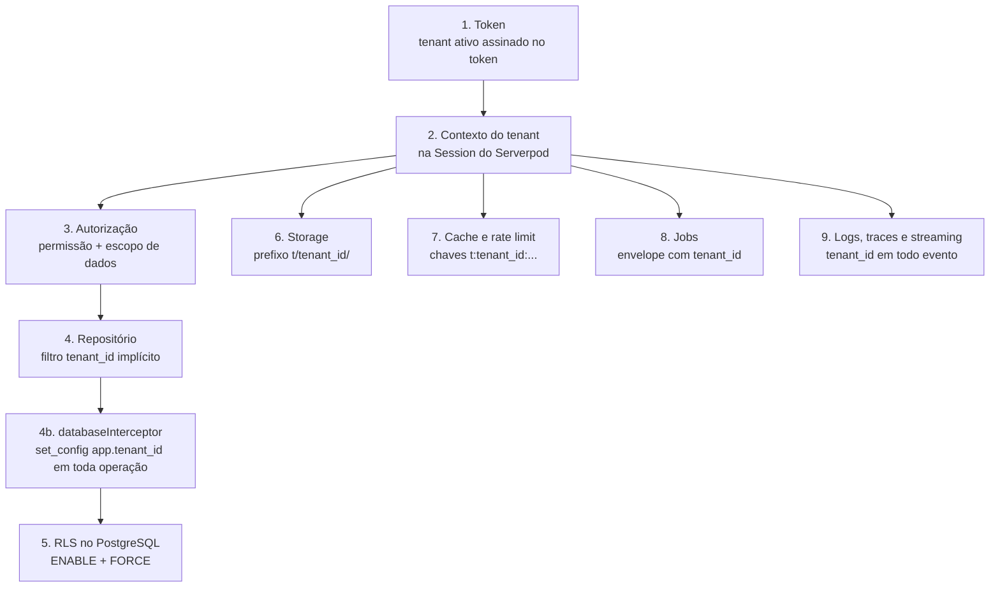
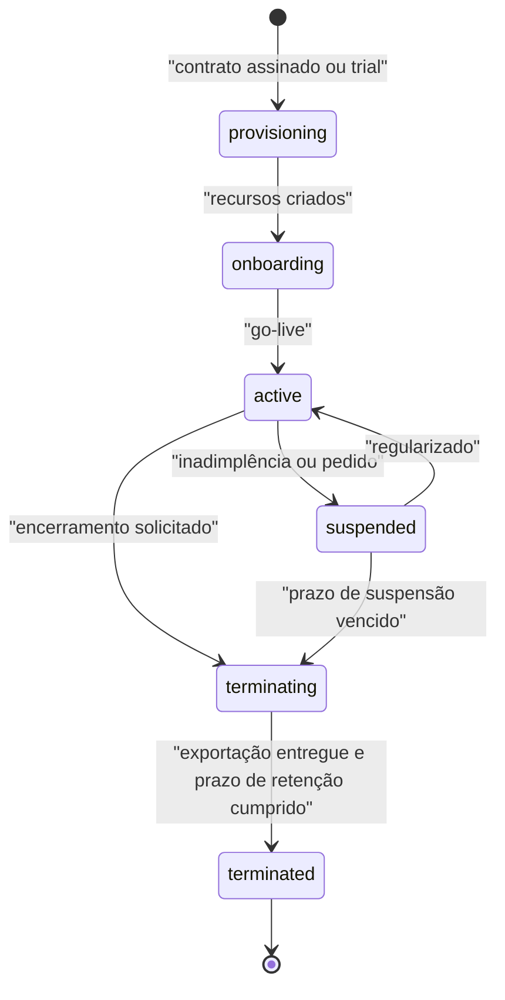
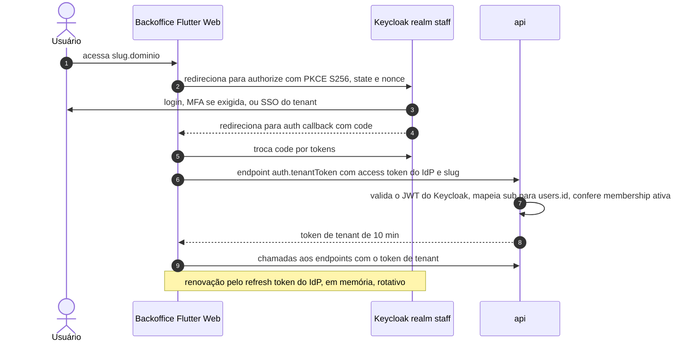

# 04 — Multi-tenancy e segurança

Versão 0.3 — 02/11/2026 — rascunho para revisão (stack Dart: Flutter + Serverpod)

Propósito: definir como os dados de cada empresa assinante ficam isolados, como cada ator se autentica e é autorizado, quais ameaças tratamos e como a plataforma cumpre a LGPD, para orientar implementação, revisão de segurança e contratos com os tenants.

Documentos relacionados: [Arquitetura de solução](02-arquitetura-de-solucao.md) · [Modelo de domínio](03-modelo-de-dominio.md) · [schema.sql](../db/schema.sql) · [Ativos e QR code](05-ativos-e-qr-code.md) · [Aplicações e fluxos](06-aplicacoes-e-fluxos.md) · [Integração com o ERP Senior](07-integracao-erp-senior.md) · [API](08-api.md) · [Infraestrutura e operação](09-infraestrutura-e-operacao.md) · [Benchmark Sismetro e novas funcionalidades](11-benchmark-sismetro-e-novas-funcionalidades.md) · [Stack Dart: Flutter + Serverpod](12-stack-dart-flutter-serverpod.md)

**O que mudou na v0.3** (só implementação; modelo de tenancy, RLS, Keycloak, OTP, `qr_context`, RBAC e LGPD **não mudam**):

| Tema | Seção |
|---|---|
| Tenant aplicado pelo `databaseInterceptor` do Serverpod (mais RLS FORCE) | 1.2, 1.3 |
| Handler de autenticação customizado do Serverpod validando os tokens próprios ES256 (tenant e contato) | 4.2 |
| Login da equipe com `flutter_appauth` no mobile e fluxo OIDC no Flutter Web; onde guardar tokens no Flutter Web | 4.3, 4.4 |
| App nativo com `flutter_secure_storage`; chave do aparelho para a prova de posse (biblioteca a validar) | 4.4, 6.7 |
| Página web leve do QR (servidor web do Serverpod) no lugar da PWA: sessão em cookie `__Host-pos_rt_<slug>`, CSP rígida, pouco JavaScript | 2.3, 4.5, 6.2, 6.4 |

**O que mudou na v0.2** (decisões do [Benchmark Sismetro](11-benchmark-sismetro-e-novas-funcionalidades.md)):

| Tema | Seção | Fase |
|---|---|---|
| Papéis `sales_rep` (vendedor) e `provider_admin` (gestor do prestador) na matriz e nos escopos de dados; escopo por filial; técnico terceirizado | 5.1, 5.2 | MVP |
| Token de exibição do modo TV | 4.8 | F2 |
| Credenciais de dispositivos IoT | 4.9 | F3 |
| Link de uso único para prestador sem app | 4.10 | F2 |
| Fraude de prestadores, falsificação de leituras, vazamento do token de exibição e abuso do escalonamento no modelo de ameaças | 6.2, 6.10 | MVP / F2 / F3 |
| Prestadores como terceiros que acessam dados de clientes (LGPD) | 7.9 | MVP |

---

## 1. Modelo de tenancy

### 1.1 Comparação dos modelos

| Critério | Pool: banco e schema compartilhados + RLS | Schema por tenant | Banco por tenant (silo) |
|---|---|---|---|
| Isolamento | Lógico; depende de `tenant_id` + RLS bem testada | Lógico, mais forte (namespaces) | Físico |
| Custo por tenant | Mínimo | Baixo | Alto (instância, backup, monitoração) |
| Migrações | Uma vez | N vezes (50 → 500 schemas); risco de schemas divergentes | N vezes, com orquestração |
| Pool de conexões | Um pool para todos | `search_path` por transação; catálogo do PostgreSQL cresce muito | Um pool por banco |
| Relatórios da plataforma e console | Simples | Consultas por união de schemas | Federação |
| Restaurar um tenant | Exportação lógica filtrada | `pg_dump -n` | Restore da instância |
| *Noisy neighbor* | Precisa de limites na aplicação | Igual ao pool | Resolvido |
| Adequado para | Muitos tenants pequenos e médios (nosso caso) | Dezenas de tenants com customização de schema | Poucos tenants grandes ou com exigência contratual |

**Decisão (D4):** pool com RLS. Todas as tabelas de dados de tenant têm `tenant_id NOT NULL`, `UNIQUE (tenant_id, id)`, FKs compostas `(tenant_id, <x>_id)` e RLS com `ENABLE` + `FORCE`. É o modelo de menor custo e operação para 50 tenants no 1º ano e 500 depois, e o único em que uma migração roda uma vez só. Schema por tenant foi descartado porque multiplica migrações e não traz isolamento físico; banco por tenant fica como **caminho de exceção** (seção 1.5).

### 1.2 Riscos do pool e mitigações

| Risco | Mitigação |
|---|---|
| Esquecer o filtro por tenant numa consulta | RLS com `FORCE` como última barreira; repositórios sem parâmetro `tenant_id` (vem do contexto); teste de isolamento gerado do catálogo ([Arquitetura de solução](02-arquitetura-de-solucao.md), seção 7.2) |
| Variável de sessão vazando entre requisições no pool | Só `set_config(..., true)` (escopo de transação), aplicado pelo `databaseInterceptor` do Serverpod em toda operação da sessão (ORM, SQL próprio e transações); nenhuma consulta de tenant fora de transação; sem `app.tenant_id` a RLS devolve zero linhas |
| Mudança incompatível na camada de banco do Serverpod numa versão *minor* (o interceptor deixar de cobrir algum caminho) | Versão do Serverpod fixada; atualização planejada; suíte de isolamento obrigatória antes de cada atualização ([Stack Dart](12-stack-dart-flutter-serverpod.md) §4.3) |
| Papel da aplicação ignorar RLS | `app_runtime` sem `BYPASSRLS`, sem ser dono das tabelas; migrações com `app_owner`, que também está sujeito a `FORCE`; teste de catálogo |
| Função `SECURITY DEFINER` expondo dados de outro tenant | Poucas funções, todas de `app_system`, `search_path` fixo, retorno mínimo, revisão obrigatória (CODEOWNERS) e testes dedicados |
| Referência cruzada por FK (OS do tenant A apontando para ativo do B) | FKs compostas com `tenant_id` |
| *Noisy neighbor* | Rate limit e cotas por tenant, limite de concorrência por tenant no *claim* dos laços do worker nas filas pesadas, `statement_timeout` ([Infraestrutura e operação](09-infraestrutura-e-operacao.md)) |
| Vazamento por caminhos fora do banco (storage, cache, logs, streaming, e-mail) | Seção 1.3 |

### 1.3 Isolamento em todas as camadas



| # | Camada | Regra | Verificação automática |
|---|---|---|---|
| 1 | Token | O tenant ativo vem de claim (`tid`) de token assinado pela `api` (seção 4) e validado pelo handler de autenticação do Serverpod; nunca de parâmetro do endpoint, corpo, query ou caminho | Lint de modelos `.spy.yaml` proíbe `tenant_id` em modelo de entrada; testes de endpoint |
| 2 | Contexto | `RequestContext` associado à `Session` do Serverpod pelo handler de autenticação ([Arquitetura de solução](02-arquitetura-de-solucao.md), seção 5.1) | Teste: caso de uso sem contexto lança erro |
| 3 | Autorização | Permissão declarada no mapa `endpointPermissions` para todo método de endpoint não público, verificada por `session.authorize(...)`; escopo de dados aplicado por papel (seção 5) | Teste de endpoints sem permissão declarada (lista do código gerado) |
| 4 | Repositório e interceptor | Repositório-base injeta `tenant_id` do contexto em `WHERE` e `INSERT`; o `databaseInterceptor` do Serverpod 4 envolve toda operação de banco da sessão (ORM, `unsafeQuery`/`unsafeExecute`, transações) numa transação iniciada por `set_config('app.tenant_id', ..., true)` e recusa operação sem tenant fora da lista de operações de plataforma; recurso de outro tenant é `NotFoundException` (404 no REST) | Testes de isolamento da API; spike S1 |
| 5 | RLS | Política `tenant_isolation` em toda tabela de tenant (abaixo), segunda barreira mesmo se o interceptor falhar | Teste de catálogo + leitura/escrita cruzada |
| 6 | Storage | Chaves `t/<tenant_id>/...`; descrição de upload e URL pré-assinada (cloud storage S3 do Serverpod) só são geradas pela `api` após autorização e para chave do tenant do contexto; bucket privado | Teste: pedido de URL para chave de outro tenant falha |
| 7 | Cache | Chaves sempre `t:<tenant_id>:<módulo>:<chave>` via helper único sobre o cache do Serverpod (não há API de cache sem tenant, exceto o namespace `platform:`) | Regra de imports proíbe uso direto das caches do Serverpod e do cliente Valkey fora de `platform/cache` |
| 8 | Jobs | Envelope com `tenant_id` obrigatório; o laço do worker recria o contexto e o interceptor aplica `app.tenant_id` | Teste: job sem `tenant_id` é rejeitado |
| 9 | Observabilidade e tempo real | `tenant_id` em todo log, span e métrica de negócio; canal `t:<tenant_id>:ui` das mensagens globais do Serverpod só repassado a streams do mesmo tenant, com filtro de escopo; avisos sem dados | Teste: stream de A não recebe aviso de B (com duas instâncias da `api`) |
| 10 | Notificações | Modelos e remetentes resolvidos pelo tenant do evento; destinatário sempre carregado no contexto do tenant | Teste de integração do módulo `notifications` |
| 11 | Exportações e relatórios | Rodam no contexto do tenant; arquivos em `t/<tenant_id>/exports/`; réplica de leitura também com RLS | Testes de isolamento rodam também contra a réplica |

**Política padrão de RLS** (forma final no [schema.sql](../db/schema.sql), que aplica o laço automático em todas as tabelas de tenant):

```sql
ALTER TABLE app.work_orders ENABLE ROW LEVEL SECURITY;
ALTER TABLE app.work_orders FORCE ROW LEVEL SECURITY;

CREATE POLICY tenant_isolation ON app.work_orders
  FOR ALL TO app_runtime
  USING      (tenant_id = app.current_tenant_id())
  WITH CHECK (tenant_id = app.current_tenant_id());
```

`app.current_tenant_id()` devolve `NULL` quando `app.tenant_id` não está definido ou é inválido; como `tenant_id = NULL` nunca é verdadeiro, a falta de contexto resulta em zero linhas (falha fechada).

**Papéis de banco** (definidos no [schema.sql](../db/schema.sql)):

| Papel | Uso | Propriedades |
|---|---|---|
| `app_owner` | Dono do schema e das tabelas; usado só pelo pipeline de migrações | `NOLOGIN`; assumido via `SET ROLE` pelo usuário de migração; sujeito a `FORCE` |
| `app_runtime` | `api` e `worker` (usuários de login `app_api` e `app_worker` herdam dele; o pipeline de migrações usa `app_migrator`, membro de `app_owner`) | `NOBYPASSRLS`; apenas DML nas tabelas necessárias; sem DDL |
| `app_system` | Dono das funções `SECURITY DEFINER` que leem entre tenants (resolução de QR, busca de contato por destino no OTP, claim do outbox) | `NOLOGIN`, `NOBYPASSRLS`; políticas explícitas só nas tabelas de que precisa |
| Leitura analítica (fase 2) | Réplica de relatórios | Mesmo modelo do `app_runtime`, só `SELECT` |

Nenhum humano usa esses papéis no dia a dia. Acesso de leitura de engenharia ao banco de produção é por papel nominal, com aprovação, sessão gravada e prazo (seção 3.6 e [Infraestrutura e operação](09-infraestrutura-e-operacao.md)).

### 1.4 Tabelas globais (sem `tenant_id`)

Algumas tabelas são da plataforma e não pertencem a um tenant: `tenants`, `plans`, `users` (identidade global), catálogo de `permissions`, flags de liberação, chaves de assinatura públicas. Regras:

- `app_runtime` só lê o mínimo necessário (ex.: `users` só pelo próprio `id` do ator ou via funções `SECURITY DEFINER`); escrita apenas pelos casos de uso de `identity_access`/`tenancy`.
- `users` não guarda nada específico de um tenant; dados do vínculo ficam em `tenant_memberships` e `customer_contacts` (com `tenant_id` e RLS).
- Uma pessoa que é técnico no tenant A e contato de cliente no tenant B é o mesmo `user`, mas o tenant A nunca enxerga o vínculo com B.

### 1.5 Caminho para silo (tenant em banco dedicado)

Gatilhos: tenant que sozinho represente > 30% da carga, exigência contratual de isolamento físico ou de região, ou necessidade de janela de manutenção própria.

- O registro `tenants` tem `deployment_cell` (célula de implantação). No MVP existe uma célula (`br-1`). Uma célula = um cluster PostgreSQL + seus pools; `api`/`worker` podem ser compartilhados entre células ou dedicados.
- O roteador de dados em `platform/db` escolhe o pool pela célula do tenant do contexto. Como todo acesso passa pelo contexto, nenhum módulo muda.
- Migração de um tenant para outra célula: cópia lógica filtrada por `tenant_id` (mesmo mecanismo da restauração de um tenant, [Infraestrutura e operação](09-infraestrutura-e-operacao.md)), congelamento curto de escrita do tenant, troca de `deployment_cell`, verificação de contagens e *checksums*.
- O schema é o mesmo (com `tenant_id` e RLS) em todas as células; o silo é só uma célula com um tenant. Assim não existe "versão especial" do produto.
- Componentes globais permanecem únicos: catálogo de tenants, `users`, resolução de QR (o token resolve o tenant e então a célula) e Keycloak.

### 1.6 Testes automatizados de isolamento

A suíte bloqueante está descrita em [Arquitetura de solução](02-arquitetura-de-solucao.md), seção 7.2 (catálogo, leitura e escrita cruzadas, ausência de contexto, endpoints e rotas da API, funções públicas, storage, cache, jobs e streaming), escrita com `serverpod_test` sobre banco real e conectada como `app_runtime`. Complementos de segurança:

- A suíte roda também **antes de cada atualização do Serverpod** (mesmo *minor* ou *patch*), porque o `databaseInterceptor` é o ponto único que aplica o tenant e a API da camada de banco pode mudar ([Stack Dart](12-stack-dart-flutter-serverpod.md) §4.3).
- Teste de regressão para cada achado de pentest ou incidente de isolamento.
- Execução semanal da suíte contra homologação com dados sintéticos de 3 tenants e contra a réplica de leitura.
- Alerta em produção: consultas de `app_runtime` que retornem erro de política (`WITH CHECK`) são sinal de bug e geram alerta imediato.
- **v0.2:** a suíte ganha os escopos `sales_rep`, `provider_admin`, técnico `contractor` e filial; o token de exibição (F2) e a credencial de dispositivo (F3) entram como "atores" nos testes de leitura e escrita cruzadas ([Arquitetura de solução](02-arquitetura-de-solucao.md), seção 7.2, itens 8 e 9).

## 2. Resolução do tenant por canal

| Canal | Como o tenant é determinado | O que vai para o token |
|---|---|---|
| Backoffice | Subdomínio `<slug>.<dominio>` (o front envia o slug ao trocar o token do IdP pelo token do tenant); em `app.<dominio>`, lista de tenants do usuário após o login | `tid` do tenant escolhido, se houver `tenant_membership` ativa |
| Backoffice com domínio próprio (fase 2/3) | Host mapeado para o tenant num catálogo de domínios verificados | Igual ao anterior |
| App do técnico | `tenant_memberships` ativas com papel `technician`; se houver mais de uma, seleção na primeira abertura e troca no perfil | `tid` do tenant ativo; banco local separado por tenant |
| App do cliente / página web leve do QR | Token ou short code do QR resolvido por `resolve_qr_token`/`resolve_qr_short_code`; ou login do contato (OTP) | `tid` do tenant da etiqueta ou do vínculo escolhido |
| Integrações de entrada | Credencial da `integration_connection` (segredo de webhook ou cliente OAuth da conexão), que pertence a um único tenant | Contexto do tenant da conexão; `actor_type = integration` |
| Jobs | `tenant_id` do envelope | — |
| Console da plataforma | Sem tenant; ações em um tenant específico exigem acesso de suporte (seção 3.6) | `tid` só durante a sessão de suporte |
| Modo TV (v0.2, F2) | Token de exibição, que pertence a um único tenant e a um painel (seção 4.8) | `tid`, `act = display`, painel e recorte |
| Dispositivo IoT (v0.2, F3) | Credencial do dispositivo resolvida por função `SECURITY DEFINER`; o lote nunca informa o tenant (seção 4.9) | Sem token: contexto do tenant do dispositivo; `actor_type = device` |
| Link de uso único do prestador (v0.2, F2) | Token do link, ligado a uma visita de um tenant (seção 4.10) | `tid`, `act = technician`, uma única visita |

### 2.1 Backoffice

1. O usuário acessa `<slug>.<dominio>`. O backoffice (Flutter Web) carrega o branding público do tenant (logo e cores, sem dados) pelo endpoint público de branding (equivalente ao `GET /api/v1/public/tenants/<slug>/branding` da v0.2) e redireciona para o login do Keycloak (seção 4.3).
2. Com o token do IdP, o backoffice pede o **token do tenant** informando o slug. A `api` verifica que existe `tenant_membership` ativa para aquele `user` e aquele tenant e que o tenant está ativo.
3. Sem vínculo: tela "Você não tem acesso a esta empresa" com links para os tenants em que tem vínculo. Mesmo erro e mesma latência para slug inexistente e slug sem vínculo (evita enumeração de clientes do SaaS).
4. Trocar de tenant = navegar para outro subdomínio. Cada aba tem um tenant; o token fica em memória por aba, então não há mistura entre abas.

### 2.2 App do técnico

- Após o login OIDC, a `api` lista os vínculos com papel `technician`. Um único vínculo: entra direto. Vários (técnico terceirizado que atende duas empresas): seleção, com nome e logo de cada tenant.
- Cada tenant tem um **banco local próprio** no aparelho (arquivo Drift/SQLite e chave SQLCipher separados, chave guardada no `flutter_secure_storage`) e uma fila de mutações própria. Trocar de tenant exige que a fila do tenant atual esteja vazia ou confirma que ela continuará pendente; dados de um tenant nunca são exibidos na sessão de outro.

### 2.3 App do cliente

- **Pelo QR:** a resolução pública devolve o tenant (marca pública, sem dados internos) e um `qr_context` (seção 4.6). O OTP é iniciado no contexto desse tenant e a sessão emitida é daquele tenant.
- **App instalado:** o link do QR (`/q/<token>`) é um link universal (iOS) e App Link (Android); o app Flutter abre direto nele e chama a mesma resolução pública. Sem o app, o navegador abre a página web leve servida pelo servidor web do Serverpod.
- **Pelo login direto no app nativo:** o contato informa telefone ou e-mail e valida o OTP; a `api` procura vínculos `customer_contacts` ativos com aquele destino em todos os tenants (função `SECURITY DEFINER` do `app_system`) e emite uma sessão por tenant encontrado. O app mostra "Minhas empresas" e alterna entre elas; cada sessão tem seus tokens. Nenhum tenant fica sabendo dos outros vínculos.
- Na página web leve, por simplicidade, há uma sessão por tenant em cookie separado (`__Host-pos_rt_<slug>`, seção 4.5).

### 2.4 Integrações e jobs

- Webhooks de entrada (`/api/v1/integrations/*`, rotas REST do servidor web do Serverpod) identificam a conexão por um identificador no caminho e autenticam por assinatura HMAC com segredo da conexão ou por OAuth de cliente; o tenant é o dono da conexão. Um identificador de conexão sem assinatura válida não revela se existe.
- Chamadas de saída para o ERP rodam no worker com o contexto do tenant do job; a credencial é buscada no cofre pela referência da conexão (seção 6.5).

## 3. Ciclo de vida do tenant



### 3.1 Provisionamento

Executado pelo console da plataforma (`platform_admin`) como job idempotente:

1. Cria `tenants` (slug validado contra a lista de reservados de [Arquitetura de solução](02-arquitetura-de-solucao.md), seção 2.3), `tenant_settings` com padrões (fuso `America/Sao_Paulo`, formato do número da OS, "exigir conferência" ligado), `tenant_sequences`, papéis padrão e calendário de feriados nacionais.
2. Associa o plano e os limites; cria a Organization correspondente no Keycloak (seção 4.1).
3. Convida o primeiro `tenant_admin` por e-mail (convite com validade de 7 dias).
4. Registra tudo em `audit_logs` com o ator da plataforma.

Nenhum recurso de infraestrutura é criado por tenant no MVP (pool): o provisionamento leva segundos.

### 3.2 Onboarding guiado

Assistente no backoffice para o `tenant_admin`, com progresso salvo:

| Passo | Conteúdo | Obrigatório para go-live |
|---|---|---|
| 1. Empresa | Razão social, CNPJ, endereço, fuso, encarregado de dados (DPO) | Sim |
| 2. Branding | Logo, cores, nome de exibição, remetente de e-mail (seção 8) | Não (padrão da plataforma) |
| 3. Usuários e equipes | Convites, papéis, equipes, regiões | Sim (≥ 1 despachante) |
| 4. Operação | Turnos, escalas, tipos de OS, SLA, sintomas/causas/soluções, checklists | Sim (tipos de OS e SLA) |
| 5. Cadastros | Importação CSV/XLSX de clientes, unidades, contatos, produtos, serviços e ativos ([Integração com o ERP Senior](07-integracao-erp-senior.md)) | Sim |
| 6. Etiquetas QR | Lote inicial e vínculo ([Ativos e QR code](05-ativos-e-qr-code.md)) | Não |
| 7. Canais | Aceite dos termos de uso do WhatsApp e modelos de mensagem | Não |
| 8. ERP (fase 2) | Conexão, teste e mapeamentos | Não |
| 9. Aceites | Termos de uso, DPA (seção 7.5) e política de privacidade para contatos | Sim |

### 3.3 Planos, limites e feature flags

- Planos definem limites (técnicos ativos, usuários de backoffice, armazenamento, mensagens WhatsApp/SMS por mês, ativos) e direitos (integração com ERP, SSO corporativo, domínio próprio, API pública). Mecânica de avaliação em [Arquitetura de solução](02-arquitetura-de-solucao.md), seção 5.6.
- Limite rígido (bloqueia): técnicos ativos, armazenamento. Limite flexível (avisa e cobra excedente): mensagens, ativos. SMS tem também **orçamento diário de segurança** contra fraude (seção 6.3).
- Ao atingir 80% e 100% de um limite, notificação ao `tenant_admin` e ao time comercial.

### 3.4 Suspensão

- Backoffice e app do técnico ficam somente leitura (o tenant pode exportar seus dados); jobs de integração e notificações param; o app do cliente e a página do QR mostram "atendimento temporariamente indisponível, contate a empresa" com telefone público configurado.
- Etiquetas continuam resolvendo (não quebram) e os dados não são alterados.
- Suspensão por inadimplência só após aviso com 15 dias; suspensão por segurança (ex.: conta comprometida) é imediata e registrada.

### 3.5 Encerramento: exportação e exclusão

1. Pedido formal → estado `terminating`, acesso somente leitura por 30 dias.
2. Exportação completa entregue por URL pré-assinada (válida por 7 dias): JSON por entidade + CSV, anexos no layout `t/<tenant_id>/...`, auditoria.
3. Após 30 dias (ou antes, a pedido por escrito): exclusão de todas as linhas do tenant por job que percorre as tabelas na ordem inversa das FKs, remoção do prefixo `t/<tenant_id>/` do storage, dos segredos no cofre e da Organization no Keycloak; `users` sem nenhum outro vínculo são anonimizados.
4. Os backups expiram pelo ciclo normal (até 35 dias, [Infraestrutura e operação](09-infraestrutura-e-operacao.md)); não há edição de backups. O DPA informa esse prazo.
5. Fica apenas um registro mínimo do tenant (razão social, CNPJ, datas, comprovante de exclusão) por obrigação legal e contratual.

### 3.6 Console da plataforma e acesso de suporte

- Console em `console.<dominio>`, autenticado no realm `platform` do Keycloak com MFA resistente a phishing obrigatória (seção 4.4), papéis `platform_admin` e suporte da plataforma (`platform_support`, sub-papel operacional sem acesso a dados sem sessão de suporte).
- Funções: tenants e planos, provisionamento, suspensão, uso e custos por tenant (mensagens, armazenamento), saúde de integrações e filas, sinais de abuso de QR/OTP ([Ativos e QR code](05-ativos-e-qr-code.md)), flags de liberação.
- **Acesso de suporte (impersonação):**
  1. O atendente da plataforma abre uma sessão de suporte informando tenant, motivo, número do chamado de suporte e modo (`read_only` por padrão; `read_write` exige segundo aprovador `platform_admin`).
  2. Configuração do tenant decide se o `tenant_admin` precisa aprovar antes (padrão: aprovar; exceção de emergência registrada e notificada).
  3. A `api` emite um token de tenant com `act = platform_support`, `imp` (id da sessão de suporte) e validade máxima de 60 min, renovável uma vez.
  4. A UI mostra faixa permanente "Sessão de suporte"; toda ação grava `audit_logs` com o ator real e a sessão; o `tenant_admin` recebe notificação do início e do fim e vê o relatório de ações.
  5. Nunca se "loga como" um usuário específico: o suporte age como ele mesmo, com permissões do papel escolhido limitadas ao modo.
- Acesso direto ao banco de produção por engenharia segue o mesmo princípio (aprovação, prazo, gravação), descrito em [Infraestrutura e operação](09-infraestrutura-e-operacao.md).

## 4. Identidade e acesso

### 4.1 IdP da equipe interna: avaliação e decisão

| Critério | Keycloak 26 (Organizations) | Zitadel | Auth0 | Microsoft Entra External ID | Amazon Cognito |
|---|---|---|---|---|---|
| Portabilidade | Total (container, OIDC/SAML padrão, banco PostgreSQL) | Alta (container ou nuvem) | Baixa (SaaS) | Baixa (Azure) | Baixa (AWS) |
| Multi-tenant B2B | Organizations: membros, domínios, IdP por organização | Organizações nativas, forte nesse caso de uso | Organizations (planos B2B) | Tenants externos | User pools; multi-tenant manual |
| SSO corporativo por tenant (SAML/OIDC do cliente) | Sim, IdP *brokering* por organização | Sim | Sim, com custo por conexão em planos altos | Sim | Sim, limitado |
| MFA (TOTP, WebAuthn/passkeys) | Sim | Sim | Sim | Sim | TOTP e WebAuthn (a validar por plano) |
| Custo com ~12 mil usuários internos (10× da premissa: 10 mil técnicos + 2,5 mil backoffice) | Só infraestrutura (2 containers + database) | Licença/nuvem ou auto-hospedado | Alto, cresce por MAU | Por MAU (faixa gratuita, depois pago) | Baixo por MAU |
| Hospedagem no Brasil | Sim (na nossa conta, sa-east-1) | Auto-hospedado sim; nuvem a validar | Região Brasil a validar | Depende da região do tenant Azure | Sim (sa-east-1) |
| Esforço de operação | Médio (atualizações, tuning) | Médio | Baixo | Baixo | Baixo |

**Decisão: Keycloak 26.8**, auto-hospedado em container na mesma rede da plataforma, banco em database separada no cluster PostgreSQL (MVP).

- **Por quê:** portável (alinhado a RNF-09), sem custo por usuário ativo (o número de técnicos cresce rápido), dados de identidade no Brasil, SSO corporativo por tenant via Organizations com *identity brokering* (venda para tenants maiores) e MFA/passkeys prontos.
- **Custo aceito:** operar e atualizar o Keycloak (atualização trimestral planejada; realm como código com keycloak-config-cli em `infra/keycloak`).
- **Descartados:** Auth0 (custo por MAU e aprisionamento), Entra External ID e Cognito (aprisionam a nuvem; Cognito tem B2B multi-organização fraco), Zitadel (boa alternativa e segunda opção; Keycloak tem maior base instalada e mais profissionais no mercado brasileiro).

**Organização no Keycloak:**

| Realm | Quem | Política |
|---|---|---|
| `staff` | Equipe dos tenants: `tenant_admin`, `dispatcher`, `backoffice_agent`, `manager`, `technician` | Senha + MFA (TOTP ou passkey) obrigatória para `tenant_admin` e opcional configurável por tenant para os demais; cada tenant é uma Organization (alias = slug) usada para SSO corporativo e tema de login |
| `platform` | `platform_admin`, `platform_support` | MFA resistente a phishing (WebAuthn/passkey) obrigatória; sem auto-cadastro; IP restrito opcional |

- O Keycloak é a autoridade de **autenticação** (quem é a pessoa). A autoridade de **autorização** (em quais tenants, com quais papéis e escopos) é o nosso banco (`tenant_memberships`). Isso evita sincronizar papéis e permite revogação imediata.
- `users.idp_subject` guarda `<realm>:<sub>` do Keycloak; senhas nunca ficam no nosso banco (D5).
- Console administrativo do Keycloak não é exposto na internet (só por rede administrativa/VPN).

### 4.2 Modelo de tokens

Todo acesso à API usa **token emitido pela própria `api`** (JWT ES256, chaves no KMS/cofre com rotação), em dois sabores:

| Token | Emitido para | Como é obtido | Validade |
|---|---|---|---|
| Token de tenant (equipe) | Backoffice, app do técnico, console em sessão de suporte | Troca do access token do Keycloak (assinatura validada pelo JWKS do realm, com cache) + tenant desejado no endpoint `auth.tenantToken` (equivalente ao `POST /api/v1/auth/tenant-token` da v0.2) | 10 min |
| Token de contato | App do cliente e página web leve do QR | Validação do OTP (seção 4.5) ou refresh | 10 min |
| Token de exibição (v0.2, F2) | Navegador da TV no modo TV | Troca do token de exibição de longa duração (seção 4.8) | 10 min; `aud` próprio, aceito só nas rotas do modo TV |
| Token de link (v0.2, F2) | Fluxo web do prestador sem app | Abertura do link de uso único + OTP do técnico (seção 4.10) | 10 min, renovável só até o fim da visita |

Por que trocar o token do IdP em vez de usá-lo direto: (a) o tenant ativo fica assinado no token, cumprindo a regra "tenant só do token" (seção 1.3); (b) um único validador e um único formato de claims para todos os atores; (c) papéis e vínculos continuam no nosso banco, sem sincronização com o Keycloak; (d) troca de tenant não depende de recursos específicos do IdP. Custo: uma chamada extra a cada 10 min por cliente, que só valida a assinatura e consulta o vínculo (cache de 60 s).

**Claims:**

| Claim | Conteúdo | Equipe | Contato |
|---|---|---|---|
| `iss` | `https://api.<dominio>` | ✔ | ✔ |
| `aud` | `plataforma-os-api` | ✔ | ✔ |
| `sub` | `users.id` (UUID v7) | ✔ | ✔ |
| `tid` | `tenant_id` ativo | ✔ | ✔ |
| `act` | `user`, `technician`, `platform_support` ou `customer_contact`; na v0.2 também `display` (modo TV, sem `sub` de pessoa) | ✔ | ✔ |
| `mid` | `tenant_membership.id` | ✔ | — |
| `ccid`, `cid` | `customer_contact.id` e `customer_id` | — | ✔ |
| `sid` | Sessão (sessão do IdP para equipe; `auth_sessions.id` para contato) | ✔ | ✔ |
| `did` | `devices.id` (apps móveis) | Técnico | App nativo |
| `roles` | Papéis canônicos do vínculo — **só para a UI**; o servidor reavalia pelo banco | ✔ | ✔ |
| `amr` | Métodos de autenticação (`pwd`, `otp`, `hwk`, `sms`, `wa`, `email`) | ✔ | ✔ |
| `imp` | Id da sessão de suporte (seção 3.6) | Suporte | — |
| `iat`, `exp`, `jti`, `kid` (cabeçalho) | Padrão | ✔ | ✔ |

Dados pessoais (nome, e-mail, telefone) não vão para o token. A `api` publica o JWKS em `/.well-known/jwks.json` pelo servidor web do Serverpod (para validação por serviços extraídos no futuro); a chave privada fica no cofre e é rotacionada a cada 90 dias, com duas chaves ativas durante a transição.

**Validação no servidor — handler de autenticação customizado do Serverpod.** O Serverpod chama um único `authenticationHandler` (configurado na inicialização do servidor) para todo endpoint e stream que recebe a chave de autenticação do cliente; as rotas do servidor web usam o mesmo validador. Não usamos o módulo de autenticação nativo do Serverpod para sessões ([Stack Dart](12-stack-dart-flutter-serverpod.md) §4.5); o handler:

1. aceita só tokens ES256 emitidos pela `api` (`iss`, `aud` por tipo de token, `exp` com 60 s de tolerância, `kid` conhecido) — biblioteca JOSE para Dart a escolher no spike S1, com teste de vetores conhecidos (algoritmo `none`, troca de algoritmo, `kid` desconhecido, assinatura truncada);
2. consulta a lista de revogação (`sid`, `did`) no Valkey (seção 4.7);
3. devolve as informações de autenticação do Serverpod (usuário e escopos derivados de `act`) e associa o `RequestContext` (tenant, ator, vínculo, dispositivo) à `Session`; os escopos do Serverpod servem só para separar grupos de endpoints (`staff`, `contact`, `display`), e a permissão fina continua no nosso RBAC (seção 5);
4. recusa um token de `qr_context` ou de exibição fora dos endpoints previstos (`aud` diferente).

```dart
// server/lib/src/platform/auth/token_authentication_handler.dart (esboço)
Future<AuthenticationInfo?> tokenAuthenticationHandler(
  Session session,
  String token,
) async {
  final claims = await accessTokenVerifier.verify(token); // ES256, iss, aud, exp, kid
  if (claims == null) return null;
  if (await revocationList.isRevoked(claims.sid, claims.did)) return null;
  session.attachContext(RequestContext.fromClaims(claims));
  return AuthenticationInfo(claims.sub, {Scope(claims.audienceGroup)});
}
```

A assinatura exata de `AuthenticationInfo` e a forma de associar o contexto à `Session` no Serverpod 4.1 são fixadas no spike S1; o comportamento acima é o contrato.

### 4.3 Backoffice e console (Flutter Web): OIDC Authorization Code + PKCE



- Cliente público OIDC (`backoffice-web`) com PKCE S256 e `redirect_uri` **exatos**: o provisionamento do tenant acrescenta `https://<slug>.<dominio>/auth/callback` à lista do cliente pela Admin API do Keycloak (sem curinga de subdomínio, que abriria redirecionamento para qualquer host). Domínio próprio do tenant entra na lista depois da verificação do domínio.
- **Biblioteca:** `flutter_appauth` não atende a web; o fluxo no Flutter Web usa redirecionamento de página inteira (não *popup* nem *iframe*) com um pacote OIDC compatível com web — `oidc` ou `openid_client`, a escolher no spike S1 — ou uma implementação pequena própria (PKCE, `state`, `nonce` e troca do código), já que o fluxo é padrão.
- Refresh token do IdP rotativo com sessão SSO de 10 h e inatividade de 2 h para backoffice; console com 1 h e reautenticação para ações críticas.
- Logout: encerra a sessão no Keycloak (RP-initiated logout) e revoga o `sid` na `api` (seção 4.7).

**Onde guardar tokens no Flutter Web.** O Flutter Web roda como JavaScript/WebAssembly na página; não há armazenamento seguro de verdade no navegador: `shared_preferences` na web grava em `localStorage`, e `flutter_secure_storage` na web cifra com chave que também fica no navegador — ambos legíveis por um script que rode na origem.

| Opção | Risco | Decisão |
|---|---|---|
| Tokens em memória (variáveis Dart do app) | Recarregar a página perde a sessão; XSS ainda consegue usar o token enquanto a página está aberta | **Escolhida**: token de tenant e tokens do IdP só em memória; ao recarregar ou abrir nova aba, novo *authorize* por redirecionamento com `prompt=none`, que reaproveita a sessão SSO do Keycloak (cookie do próprio `auth.<dominio>`, primeira parte na navegação de página inteira) sem pedir senha |
| `localStorage`, `sessionStorage`, IndexedDB, `shared_preferences`, `flutter_secure_storage` na web | Token persistente lido por qualquer XSS ou extensão maliciosa | **Proibido** para tokens de pessoa (regra de imports bloqueia esses pacotes no backoffice e no console, exceto no módulo do modo TV, que guarda só o token de exibição — seção 4.8) |
| BFF: sessão em cookie HttpOnly do servidor e tokens só no servidor | Exige sessão no servidor e defesa de CSRF em todos os endpoints | Alternativa se o pentest pedir; o handler de autenticação aceitaria a sessão do cookie como fonte do token |

**Mitigações do risco de XSS no Flutter Web:** o Flutter desenha a interface no *canvas* (CanvasKit/skwasm) e não monta HTML a partir de dados, o que reduz a superfície clássica de XSS; os vetores restantes são `HtmlElementView`, `dart:js_interop`, `url_launcher` com esquemas perigosos e scripts de terceiros. Regras: nenhum script de terceiro na origem do backoffice (CanvasKit e fontes servidos pela nossa CDN, sem `gstatic`); lint proibindo `HtmlElementView` e `js_interop` fora de `ui_kit` revisado; `url_launcher` só com `https:`; CSP da seção 6.4; tokens de 10 min e lista de revogação.

### 4.4 App do técnico: OIDC + PKCE, sessão longa e offline

- Login com `flutter_appauth` (AppAuth: navegador do sistema — Custom Tabs no Android, `ASWebAuthenticationSession` no iOS —, PKCE S256), cliente `technician-app` no realm `staff`, escopo `offline_access`, `redirect_uri` por link universal/App Link da plataforma onde o sistema suportar callback `https` (a validar no S1, inclusive a versão mínima de iOS); senão, esquema customizado com o identificador reverso do app — o PKCE impede que outro app que registre o mesmo esquema troque o código interceptado.
- **Offline token** do Keycloak com validade de inatividade de 30 dias e máxima de 90 dias, guardado no `flutter_secure_storage` (Keychain no iOS com acessibilidade `first_unlock_this_device`/`unlocked_this_device`, sem sincronização com iCloud; Keystore no Android). O token de tenant de 10 min fica só em memória e é obtido sempre que há rede.
- **Vínculo com dispositivo:** no primeiro login o app gera um par de chaves ECDSA P-256 no aparelho — chave não exportável no Android Keystore (StrongBox quando houver) e no Secure Enclave do iOS. Biblioteca **a validar** no spike S1: pacote da comunidade sobre Keystore/Secure Enclave ou um plugin próprio pequeno (Kotlin/Swift por *platform channel*) que só gera a chave, devolve a chave pública e assina desafios; aparelhos sem hardware seguro usam chave em software guardada no `flutter_secure_storage`, marcada no `device`. O app registra o `device` (`devices`: id, `user_id`, plataforma, modelo, versão do app, chave pública, token de push, último sync). A troca por token de tenant exige prova de posse dessa chave (assinatura de um desafio com `jti` e horário). Token roubado sem o aparelho não serve.
- **Trabalho offline:** a UI e o banco local (Drift + SQLCipher) não dependem de token; as mutações ficam na fila local (`pending_mutations`). Ao voltar a rede: renova o token → push → pull.
- **Expiração offline:** se o offline token expirar sem rede, o técnico continua registrando no aparelho (banco local cifrado), mas não sincroniza; ao reconectar, faz login de novo e a fila é enviada com o mesmo `device_id`. A fila nunca é descartada por expiração de sessão.
- **Bloqueio local:** desbloqueio do app por biometria/PIN do aparelho (`local_auth`) após 15 min em segundo plano; chave do SQLCipher gerada no aparelho (256 bits de CSPRNG), uma por tenant, guardada no `flutter_secure_storage`.
- **Revogação remota e wipe:** o `tenant_admin` revoga o dispositivo ou o vínculo → o Keycloak revoga o offline token (Admin API), a `api` recusa novas trocas para aquele `device_id` e, na próxima comunicação, responde com instrução de *wipe*: o app tenta enviar a fila pendente (se o vínculo ainda existe e só o aparelho foi revogado) e apaga banco, fotos e chaves do tenant. Aparelho que nunca mais se conecta continua com dados cifrados; risco aceito e mitigado pelo bloqueio local.

### 4.5 Contato do cliente: OTP próprio (D5a)

**Fluxo e endpoints** (nomes finais e formatos em [API](08-api.md)):

```mermaid
sequenceDiagram
    autonumber
    actor C as Contato
    participant APP as Página leve ou app do cliente
    participant API as api
    participant RL as Valkey rate limit
    participant DB as PostgreSQL
    participant W as worker
    participant WA as WhatsApp, SMS ou e-mail
    C->>APP: lê o QR
    APP->>API: resolve o QR (rota pública ou endpoint público)
    API-->>APP: dados mínimos, branding e qr_context
    C->>APP: informa telefone ou e-mail
    APP->>API: inicia o OTP com destino, canal e qr_context
    API->>RL: limites por destino, IP, qr_context e tenant
    API->>DB: otp_challenges com hash do código e outbox
    API-->>APP: challenge_id, sempre a mesma resposta
    W->>WA: envia o código pelo canal escolhido
    C->>APP: digita o código
    APP->>API: valida o OTP com challenge_id e código
    API->>DB: compara HMAC, consome o desafio, cria ou liga o contato
    API->>DB: auth_sessions com hash do refresh token
    API-->>APP: app: token de contato e refresh token; página leve: cookies HttpOnly
```

Na página leve, as etapas são formulários HTML servidos e recebidos pelo servidor web do Serverpod (o `qr_context` viaja em campo oculto do formulário, nunca na URL); no app Flutter, são chamadas ao endpoint público de OTP pelo cliente gerado.

**Desafio (`otp_challenges`)** — campos principais (definição completa em [schema.sql](../db/schema.sql) e no [Modelo de domínio](03-modelo-de-dominio.md)): `id`, `tenant_id`, `destination_hash` (HMAC do destino normalizado em E.164 ou e-mail minúsculo) e `destination_masked`, `channel` (`whatsapp`, `sms`, `email`), `code_hash`, `key_version` (versão do pepper HMAC, para rotação), `purpose` (`customer_login`, `contact_registration`), `qr_tag_id` (do `qr_context`, se houver), `customer_contact_id`, `status` (`pending`, `verified`, `expired`, `locked`, `cancelled`), `attempt_count`, `max_attempts`, `expires_at`, `verified_at`, `send_count`, `last_sent_at`, `request_ip` (retido só pelo prazo de expurgo do desafio, 30 dias), `created_at`.

**Regras do código:**

| Regra | Valor |
|---|---|
| Formato | 6 dígitos, gerados com CSPRNG com distribuição uniforme (`Random.secure().nextInt(1000000)` do `dart:math`), sem sequências triviais (000000, 123456) |
| Armazenamento | `HMAC-SHA256(pepper_vN, challenge_id ‖ código)`; o *pepper* fica no cofre, versionado. Hash lento (bcrypt) não ajuda num espaço de 10⁶; o *pepper* fora do banco impede força bruta offline com um dump |
| Validade | 10 min (D5a) |
| Tentativas | 5 por desafio; na 5ª falha o desafio é invalidado |
| Reenvio | Mesmo desafio, novo código, intervalo mínimo de 60 s, no máximo 3 envios por desafio; troca de canal permitida (WhatsApp → SMS → e-mail) |
| Comparação | Tempo constante; desafio consumido na primeira validação correta (uso único) |
| Anti-enumeração | `start` responde sempre igual (`challenge_id`; `202` na rota REST) e texto genérico, exista ou não o contato; no login sem QR, se o destino não tiver vínculo, nenhuma mensagem é enviada mas a resposta é idêntica |
| Mensagem | Modelo de autenticação do WhatsApp com botão "copiar código"; SMS curto com nome de exibição do tenant e o código; nunca link clicável de login no SMS (reduz *phishing*); domínio do app na mensagem para autofill (Web OTP / SMS Retriever — a validar formatos) |

**Rate limits do OTP e das rotas públicas** (valores iniciais, configuráveis por tenant dentro de faixas da plataforma; os de QR e abertura de chamado seguem [Ativos e QR code](05-ativos-e-qr-code.md)):

| Ação | Chave | Limite | Ao exceder |
|---|---|---|---|
| Iniciar OTP | destino | 3 a cada 10 min; 10 por dia | 429 com `Retry-After` |
| Iniciar OTP | IP (IPv6 agregado em /64) | 10 por hora | Desafio anti-bot (Turnstile ou equivalente), depois 429 |
| Iniciar OTP | `qr_context` (`jti`) | 3 por credencial | 429; nova leitura do QR necessária |
| Iniciar OTP | tenant | 300 por hora (alerta em 50% do teto) | 429 para novos destinos + alerta à plataforma |
| Iniciar OTP por SMS | tenant | Orçamento diário (padrão R$ 50 ou 1.000 SMS, o que vier antes); só `+55` por padrão | SMS bloqueado; WhatsApp e e-mail seguem; alerta |
| Iniciar OTP por SMS | plataforma | Teto diário global e alerta de anomalia (desvio de 3× da média de 7 dias) | Bloqueio do canal SMS + plantão |
| Validar OTP | desafio | 5 tentativas | Desafio invalidado |
| Validar OTP | IP | 30 por hora | 429 |
| Validar OTP | destino | 10 falhas por dia | Destino bloqueado por 24 h; aviso ao tenant |
| Refresh de sessão | sessão | 30 por hora | 429 |

- Implementação: limitador GCRA (janela deslizante) por script Lua no Valkey, chaves `rl:<ação>:<escopo>:<hash>`; destinos e IPs sempre como HMAC, nunca em claro no Valkey.
- Se o Valkey estiver indisponível, rotas autenticadas seguem sem rate limit (falha aberta, com alerta) e rotas públicas de OTP usam limitador em memória por instância com limites 5× menores (falha semifechada), para não abrir uma janela de *SMS pumping* nem derrubar o atendimento.
- O desafio anti-bot só aparece quando um limite de IP é atingido, para não atrapalhar o fluxo normal do QR.

**Após validar:**

1. Se o destino corresponde a `customer_contact` ativo do tenant → sessão desse contato. Se não, aplica a regra "aceitar e sinalizar" de [Ativos e QR code](05-ativos-e-qr-code.md) (contato `pending_approval`, escopo mínimo), que exige `qr_context` válido.
2. O contato é ligado a um `user` global sem `idp_subject` (procura por destino verificado; cria se não houver).
3. Emite token de contato (10 min) + refresh token.

**Sessões e refresh rotativo (`auth_sessions`):**

| Item | Regra |
|---|---|
| Refresh token | 256 bits aleatórios, opaco, formato `<session_id>.<segredo>`; banco guarda `SHA-256(segredo)` |
| Rotação | A cada uso, novo refresh; o anterior fica marcado como usado (com `replaced_by`) |
| Detecção de reuso | Apresentar um refresh já usado (fora de uma janela de 30 s de tolerância para corrida de rede) revoga a **família** inteira (todas as sessões derivadas), registra evento de segurança e exige novo OTP |
| Validade | App nativo: inatividade de 60 dias, máximo de 180 dias. Página web leve: inatividade de 30 dias, máximo de 90 dias |
| Vínculo | `device_id` no app nativo; na página leve, `user_agent_hash` como sinal (não como bloqueio) |
| Revogação | Contato pode encerrar sessões no app; o backoffice encerra ao bloquear o contato; exclusão de conta revoga todas |

**Armazenamento no cliente:**

- **App Flutter:** refresh token no `flutter_secure_storage` (Keychain/Keystore, sem backup em nuvem); token de contato em memória.
- **Página web leve do QR** (HTML do servidor web do Serverpod; nenhum token chega ao JavaScript):
  - refresh token em cookie `__Host-pos_rt_<slug>` (slug do tenant, para o contato manter sessões de várias empresas) com `HttpOnly`, `Secure`, `Path=/`, sem `Domain`, `SameSite=Lax`;
  - token de contato de 10 min em cookie irmão `__Host-pos_at_<slug>`, com os mesmos atributos e `Max-Age` de 10 min; o servidor lê o cookie a cada página e, se expirou, rotaciona pelo refresh na mesma resposta;
  - `SameSite=Lax` (e não `Strict`, como na PWA da v0.2) porque os links de acompanhamento chegam por WhatsApp, SMS e e-mail e abrem como navegação vinda de outro site — com `Strict` o contato pareceria deslogado e teria de refazer o OTP. Em troca: páginas `GET` nunca alteram estado, e todo `POST` exige **token anti-CSRF** (HMAC da sessão, em campo oculto) e `Origin`/`Sec-Fetch-Site` da mesma origem;
  - o cookie é definido na mesma origem da página (`<dominio>`), sem CORS;
  - nada de token em `localStorage`, `sessionStorage` ou na URL; o JavaScript da página não precisa de token (o upload direto ao S3 usa uma descrição pré-assinada entregue no HTML).

### 4.6 `qr_context`: prova de leitura física

Proposto em [Ativos e QR code](05-ativos-e-qr-code.md) e exigido no início do OTP e na abertura do chamado a partir do QR.

- **Formato:** JWS compacto (JWT) assinado com ES256 por uma chave **exclusiva** de `qr_context` (`kid` com prefixo `qrc-`), diferente da chave dos tokens de acesso — um `qr_context` nunca é aceito como token de acesso e vice-versa.
- **Cabeçalho:** `{"alg": "ES256", "typ": "qr-ctx+jwt", "kid": "qrc-2026-10"}`.
- **Claims:**

| Claim | Conteúdo |
|---|---|
| `iss` | `https://api.<dominio>` |
| `aud` | `plataforma-os:qr-context` |
| `jti` | UUID v7 (contadores de uso por `jti` no Valkey) |
| `tid` | `tenant_id` da etiqueta |
| `qtid` | `qr_tag.id` |
| `aid` | `asset.id`, ou `null` se a etiqueta ainda não está vinculada |
| `via` | `token` ou `short_code` |
| `iid` | SHA-256 do identificador de instalação do app/navegador (UUID aleatório gerado no primeiro uso; no app Flutter, enviado no cabeçalho `X-Install-Id` em todas as chamadas públicas e do cliente; na página leve, guardado em cookie `__Host-pos_iid` HttpOnly de longa duração); amarra a credencial ao aparelho que leu |
| `iat`, `exp` | Emissão e expiração em 30 min |

- **Exemplo de payload:** `{"iss":"https://api.<dominio>","aud":"plataforma-os:qr-context","jti":"0193f6c2-...","tid":"0193a1...","qtid":"0193b2...","aid":"0193c3...","via":"token","iid":"9f86d0...","iat":1793102400,"exp":1793104200}`.
- **Validação no servidor:** assinatura e `kid`; `aud`; `exp` (tolerância de 60 s); `iid` igual ao do cabeçalho da requisição; `tid` igual ao tenant do desafio/da sessão; etiqueta ainda não revogada e ativo ainda vinculado (consulta rápida); limites por `jti` (3 inícios de OTP, 2 aberturas de chamado).
- **Sem estado no servidor**, exceto os contadores por `jti` (Valkey, TTL de 30 min). Não contém dados pessoais nem dados que o portador já não tenha visto na página.
- Não é credencial de acesso: sozinho não lê nem altera nada; só autoriza **iniciar** o OTP e **associar** o chamado à etiqueta lida.
- Transporte: no corpo das requisições (`qr_context`) — parâmetro do endpoint no app, campo oculto do formulário na página leve —, nunca em URL. Mascarado nos logs.

### 4.7 Troca de tenant, sessões e revogação

- **Troca de tenant:** equipe → nova chamada a `tenant-token` com outro slug (backoffice abre outro subdomínio; app do técnico troca de banco local). Contato → seleciona outra sessão em "Minhas empresas".
- **Lista de revogação:** `sid` e `did` revogados vão para um conjunto no Valkey (`platform:revoked:<sid>`, TTL igual à validade máxima do token de acesso). O handler de autenticação do Serverpod consulta esse conjunto (com cache local de poucos segundos por instância); como o token de acesso dura 10 min, o pior caso sem o Valkey é 10 min.

| Evento | Efeito |
|---|---|
| Usuário desativado no tenant (membership inativa) | Próxima troca de token falha; `sid` revogado imediatamente; streams do Serverpod encerrados (aviso pelas mensagens globais) |
| Usuário desativado na plataforma | Keycloak desabilita a conta e encerra sessões; todos os vínculos revogados |
| Dispositivo perdido | Revogação do `device` + *wipe* na próxima conexão (seção 4.4) |
| Contato bloqueado | Família de sessões revogada; chamados abertos seguem a triagem |
| Reuso de refresh detectado | Família revogada; evento de segurança no console |
| Rotação de chave de assinatura | Nova chave publicada; antiga aceita até o fim da validade dos tokens emitidos |
| Prestador desativado (`service_provider.deactivated`, v0.2) | Vínculos do `provider_admin` e dos técnicos `contractor` daquela empresa revogados no tenant; `sid` e `did` na lista de revogação; visitas abertas voltam à fila de despacho; dados locais do tenant apagados no próximo contato do app (*wipe* do banco daquele tenant) |
| Token de exibição revogado (v0.2, F2) | Troca recusada; streams encerrados na hora (aviso pelas mensagens globais do Serverpod) |
| Credencial de dispositivo IoT revogada (v0.2, F3) | Lotes recusados com `401`; leituras já gravadas permanecem, marcadas pelo dispositivo |

### 4.8 Token de exibição do modo TV — F2

O modo TV ([Arquitetura de solução](02-arquitetura-de-solucao.md), seção 2.6) roda numa tela compartilhada, muitas vezes visível para visitantes. Por isso não usa login de pessoa: usa um **token de exibição** com escopo mínimo.

| Aspecto | Regra |
|---|---|
| Quem cria | Permissão `display_token.manage` (`tenant_admin` e `manager`), escolhendo painel, recorte (filial, equipe ou região), validade e, opcionalmente, faixas de IP do escritório |
| Formato | 256 bits de CSPRNG em base64url; mostrado **uma única vez**, num link `https://<slug>.<dominio>/tv#k=<token>` — no fragmento, que o navegador não envia ao servidor nem à CDN, então não aparece em logs |
| Armazenamento | Só o hash (SHA-256 com *pepper* do cofre), com `tenant_id`, painel, recorte, criador, validade, último uso e revogação, em tabela de `identity_access` (nome no [Modelo de domínio](03-modelo-de-dominio.md)) |
| Validade | Padrão 180 dias, máximo 365; renovação gera token novo |
| Uso | A página (rota `/tv` do Flutter Web) guarda o token no armazenamento local da TV — exceção consciente à regra da seção 4.3, porque o token só lê agregados sem dados pessoais e é revogável —, limpa o fragmento da URL e troca o token por um JWT de 10 min (`act = display`, `aud = plataforma-os-display`, `tid`, id do token e recorte). O handler de autenticação só aceita esse `aud` nos endpoints do modo TV (escopo `display`, equivalente ao grupo `/api/v1/public/display/*` da v0.2) |
| Conteúdo | Somente leitura, por lista de campos permitidos: número, tipo, prioridade, status e prazo de SLA das OS; filial ou região; contagens e indicadores agregados. **Nunca** nome ou telefone de contato, endereço, nome de técnico, fotos, comentários ou valores. Um teste de contrato falha se um campo fora da lista aparecer na resposta |
| Limites | 60 requisições/min e até 3 streams simultâneos por token; troca limitada por IP |
| Revogação | Imediata pelo backoffice (encerra os streams); também automática se o tenant for suspenso |
| Auditoria | Criação, revogação e primeiro uso a partir de um IP novo vão para `audit_logs` |

**Descartado:** usuário "TV" no IdP (sessão longa de pessoa numa tela pública, permissões amplas, auditoria confusa) e link com token na *query string* (vaza em logs, histórico e cabeçalho `Referer`).

### 4.9 Credenciais de dispositivos IoT — F3

Cada `iot_devices` tem credencial própria; nunca há chave compartilhada por tenant ou por lote de dispositivos.

| Aspecto | Padrão (HMAC) | Opção (mTLS) |
|---|---|---|
| Quando usar | Hardware que faz HTTPS e HMAC-SHA256 (a maioria dos microcontroladores com Wi-Fi) | Hardware que suporte certificado de cliente; pontos críticos com conectividade celular |
| Credencial | Segredo de 256 bits por dispositivo, com identificador público da chave (`key_id`); o segredo é exibido uma vez no provisionamento | Certificado X.509 por dispositivo emitido por uma CA privada da plataforma, com o id do dispositivo no certificado |
| Onde fica no servidor | No cofre: no piloto, um segredo por dispositivo no Secrets Manager; em escala, *envelope encryption* com chave de dados do KMS e contexto `{tenant_id, device_id}`, com o texto cifrado no banco (um segredo gerenciado por dispositivo custa caro em milhares de unidades — [Infraestrutura e operação](09-infraestrutura-e-operacao.md)) | Só o certificado público e a impressão digital; a chave privada nunca sai do dispositivo |
| Prova em cada lote | Cabeçalhos com `key_id`, horário e assinatura HMAC de `método + caminho + horário + hash do corpo`; horário com tolerância de ±5 min | Handshake mTLS num host dedicado (`iot.<dominio>`), terminado no load balancer com verificação da cadeia; a `api` recebe a identidade verificada |
| Rotação | Dois segredos ativos durante a troca; rotação anual ou imediata por suspeita; se o dispositivo não aceitar rotação remota, o técnico reprovisiona na visita preventiva | Certificados de 1 ano, renovação antes do vencimento; revogação por lista no trust store |
| Resolução do tenant | `key_id` (ou impressão digital) → dispositivo → tenant, por função `SECURITY DEFINER`; o corpo nunca escolhe o tenant | Igual |

**Limites e plausibilidade (ambos os modos):**
- Rate limit por dispositivo (12 lotes/h sustentados, rajada de 30), lote de até 500 leituras e 256 KB; rate limit por IP no WAF para a rota.
- Um dispositivo grava só nos medidores do ativo a que está vinculado; identificadores de outro ativo no lote são rejeitados.
- Regras de plausibilidade antes de aceitar: horímetro não diminui e não avança mais do que o tempo decorrido; consumo e temperatura dentro da faixa física do modelo; leitura mais de 5 min no futuro é rejeitada. Leitura implausível é guardada como rejeitada (para diagnóstico) e não alimenta planos nem regras.
- Leituras IoT **nunca** geram custo nem pagamento a terceiros; OS abertas por telemetria (`origin = telemetry`) passam pela triagem normal.
- Dispositivo com muitas rejeições é suspenso automaticamente e aparece no painel de dispositivos.

### 4.10 Link de uso único para prestador sem app — F2

Para técnico terceirizado que não instala o app ([Benchmark Sismetro](11-benchmark-sismetro-e-novas-funcionalidades.md) §4.1), o despacho envia por WhatsApp um link para um fluxo web online da visita.

- Token de 128 bits no link, guardado com hash, ligado a **uma** visita de um técnico `contractor` cadastrado; expira no fim do dia da visita mais 24 h ou ao finalizar.
- Implementação (v0.3): páginas leves do servidor web do Serverpod, no mesmo padrão da página do QR (HTML do servidor, pouco JavaScript, CSP da seção 6.4); a leitura do QR do ativo usa a câmera por um script pequeno (`BarcodeDetector` onde existir) ou a digitação do código curto da etiqueta.
- Primeiro acesso: OTP no telefone cadastrado do técnico (mesmo mecanismo da seção 4.5); a sessão fica presa ao navegador (cookie `__Host-` `HttpOnly`, `SameSite=Lax` com token anti-CSRF nos formulários, pelo mesmo motivo da seção 4.5: o link chega pelo WhatsApp). Abrir o link em outro aparelho exige novo OTP e encerra a sessão anterior.
- Escopo: só aquela visita — check-in pelo QR do ativo, fotos, checklist, assinatura e finalização; sem histórico do cliente, sem outras OS, sem preços.
- Auditoria com `actor_type = technician` e marcação "via link"; reenvio do link revoga o anterior.

## 5. Autorização

### 5.1 Modelo

- **RBAC** com os papéis canônicos; cada papel é um conjunto de permissões `<recurso>.<ação>` (catálogo global em `permissions`). Um vínculo pode ter mais de um papel (ex.: `dispatcher` + `manager`).
- **Escopo de dados** por papel, aplicado no repositório como filtro adicional (sobre a RLS de tenant):

| Papel | Escopo padrão | Opções por tenant |
|---|---|---|
| `tenant_admin`, `backoffice_agent`, `manager` | Todo o tenant | `manager` pode ser limitado por região ou equipe |
| `dispatcher` | Todo o tenant | Limitado a equipes e/ou `service_areas` |
| `technician` | OS e visitas atribuídas a ele (ou à sua equipe, se a OS for de equipe); ativos e clientes dessas OS; catálogos ativos | Ver OS da equipe inteira |
| `customer_admin` | Ativos, unidades, contatos e OS do próprio cliente | — |
| `customer_contact` | Ativos e OS do próprio cliente nas unidades permitidas ao contato (escopo opcional por unidade, [Ativos e QR code](05-ativos-e-qr-code.md)); contato `pending_approval` vê só os chamados que abriu | — |
| `platform_admin` / `platform_support` | Nenhum dado de tenant fora de sessão de suporte | — |
| `sales_rep` (v0.2, MVP) | **Carteira:** clientes com `customers.primary_sales_rep_id` igual ao vendedor ligado ao usuário (`sales_reps.user_id`), com suas unidades, contatos, ativos e OS; abre OS em nome desses clientes (`origin = sales_rep`) e, com `triage_mode = sales_rep_first`, faz a pré-triagem dos chamados deles | Carteira de vários vendedores para um gerente comercial (F2); ver custos e rentabilidade da carteira (F3) |
| `provider_admin` (v0.2, MVP) | **Empresa do prestador:** OS e visitas atribuídas à sua empresa (`work_orders.service_provider_id` ou `work_order_visits.service_provider_id`), técnicos com `technicians.service_provider_id` da empresa, linhas de custo e fechamentos da empresa; clientes, unidades e ativos só das OS atribuídas e com os campos mínimos da seção 7.9 | — |
| `technician` com `kind = contractor` (v0.2, MVP) | Igual a `technician` (só o que foi atribuído a ele), sem preços de venda e sem custos de outras linhas; histórico do ativo resumido (datas, sintomas e soluções das últimas OS, sem dados de contato) | Ver OS do próprio prestador (útil quando o prestador é um técnico autônomo) |
| Qualquer papel de backoffice — **escopo por filial** (v0.2, MVP) | Sem restrição (todas as filiais) | Limitar o vínculo a uma ou mais `branches`: OS, ativos, técnicos e visitas filtrados por `branch_id`; cadastros de clientes, produtos e serviços continuam comuns ao tenant |

- **Ligação do vínculo ao dado de escopo:** o vínculo do `sales_rep` é casado com `sales_reps.user_id`; o do `provider_admin` referencia a empresa do prestador; o escopo por filial lista as `branches` permitidas. Onde essas referências ficam (colunas ou tabela de escopos do vínculo) é definido no [Modelo de domínio](03-modelo-de-dominio.md). O cálculo do escopo usa a porta `DataScopeProvider`, implementada pelos módulos donos ([Arquitetura de solução](02-arquitetura-de-solucao.md), seção 3.3).
- **Combinação de escopos:** papéis no mesmo vínculo somam escopos (ex.: `dispatcher` + `sales_rep` vê o tenant todo); o escopo de filial, quando existe, **restringe** todos os papéis do vínculo.
- **Isolamento entre prestadores:** um `provider_admin` nunca vê OS, técnicos, taxas ou indicadores de outro prestador, nem relatórios do tenant inteiro.
- Recurso fora do escopo responde **404**, como recurso de outro tenant (não confirma existência).
- Implementação: cada módulo declara a permissão de cada método de endpoint no mapa `endpointPermissions` (ex.: `'workOrders.update': Permission.workOrderUpdate`), verificada no início do método por `session.authorize(...)`, + `ScopePolicy` por módulo, que traduz o escopo do contexto em condições de consulta (expressão `where` do ORM do Serverpod ou trecho de SQL parametrizado). Um teste percorre a lista de endpoints do código gerado e falha se algum método não tiver permissão declarada nem marcação explícita de público. As regras de escopo são testadas com a mesma suíte de isolamento (seção 1.6).

### 5.2 Matriz papel × permissão (MVP, com acréscimos da v0.2)

Legenda: ✔ permitido · E dentro do escopo · — negado. `customer_*` usa só as rotas `/api/v1/customer/*`; `technician` só `/api/v1/technician/*` e consultas de apoio. Na v0.2 entram as colunas `sales_rep` e `provider_admin` (MVP) e as linhas marcadas com a fase. O `provider_admin` usa o backoffice web num modo restrito (só as telas da sua empresa); se ele também executa visitas, recebe o papel `technician` no mesmo vínculo.

| Permissão | tenant_admin | dispatcher | backoffice_agent | manager | technician | sales_rep | provider_admin | customer_admin | customer_contact |
|---|---|---|---|---|---|---|---|---|---|
| `work_order.read` | ✔ | ✔ | ✔ | ✔ | E | E (carteira) | E (empresa) | E | E |
| `work_order.create` | ✔ | ✔ | ✔ | — | E (no campo) | E (em nome do cliente da carteira) | — | E | E |
| `work_order.triage` (aceitar, recusar, duplicada) | ✔ | ✔ | ✔ | — | — | E (pré-triagem em `sales_rep_first`: encaminhar à fila central) | — | — | — |
| `work_order.resolve_remote` (v0.2, MVP) | ✔ | ✔ | ✔ | — | — | E (carteira) | — | — | — |
| `work_order.acknowledge` — "assumi" no escalonamento (v0.2, MVP) | ✔ | ✔ | ✔ | — | E (atribuída ou de plantão) | E (carteira) | E (empresa) | — | — |
| `work_order.update` | ✔ | ✔ | ✔ | — | — | — | — | — | — |
| `work_order.close` (conferência e encerramento) | ✔ | ✔ | ✔ | — | — | — | — | — | — |
| `work_order.cancel` | ✔ | ✔ | ✔ | — | — | E (só `requested` que abriu) | — | E (só `requested`) | E (só os seus em `requested`) |
| `work_order_comment.create_internal` | ✔ | ✔ | ✔ | ✔ | E | E | E | — | — |
| `work_order_comment.create_public` | ✔ | ✔ | ✔ | — | E | E | E | E | E |
| `work_order_feedback.submit` | — | — | — | — | — | — | — | E | E |
| `visit.schedule` / `visit.reassign` | ✔ | ✔ | — | — | — | — | E (entre técnicos da empresa, nas visitas atribuídas ao prestador) | — | — |
| `dispatch.mobile` — aba Despacho no app (v0.2, MVP) | — | ✔ | — | — | — | — | — | — | — |
| `visit.execute` (check-in, pausa, finalizar) | — | — | — | — | E | — | — | — | — |
| `time_entry.write`, `work_order_item.write` | ✔ (correção auditada) | ✔ (correção auditada) | — | — | E | — | — | — | — |
| `attachment.read` / `attachment.upload` | ✔ | ✔ | ✔ | ✔ (leitura) | E | E (leitura) | E (leitura) | E (públicos) | E (públicos) |
| `customer.read` | ✔ | ✔ | ✔ | ✔ | E | E (carteira) | E (só das OS, campos mínimos) | E (próprio) | — |
| `customer.write` (inclui unidades) | ✔ | — | ✔ | — | — | — | — | — | — |
| `customer_contact.write` / `approve` | ✔ | ✔ | ✔ | — | — | E (só cadastrar na carteira, sem aprovar) | — | E | — |
| `sales_rep.write` — vendedores e carteiras (v0.2, MVP) | ✔ | — | ✔ | — | — | — | — | — | — |
| `asset.read` | ✔ | ✔ | ✔ | ✔ | E | E (carteira) | E (só das OS) | E | E |
| `asset.write` (cadastro, alocação) | ✔ | ✔ | ✔ | — | E (mutações de [Ativos e QR code](05-ativos-e-qr-code.md)) | — | — | — | — |
| `asset_movement.approve` (v0.2, MVP) | ✔ | — | — | ✔ | — | — | — | — | — |
| `qr_tag.manage` (lotes, impressão, revogação) | ✔ | ✔ | ✔ | — | — | — | — | — | — |
| `qr_tag.bind` | ✔ | ✔ | ✔ | — | E | — | — | — | — |
| `qr_tag.unbind` (bound → printed, exceção auditada) | ✔ | — | — | — | — | — | — | — | — |
| `catalog.write` (produtos, serviços, sintomas, checklists) | ✔ | — | ✔ | — | — | — | — | — | — |
| `scheduling.config` (técnicos, equipes, turnos, escalas, calendários, regiões) | ✔ | ✔ | — | — | — | — | — | — | — |
| `service_provider.read` (v0.2, MVP) | ✔ | ✔ | ✔ | ✔ | — | — | E (própria empresa e seus técnicos) | — | — |
| `service_provider.write` — cadastro, taxas e vigência (v0.2, MVP) | ✔ | — | — | — | — | — | — | — | — |
| `on_call.manage` — plantões (v0.2, MVP) | ✔ | ✔ | — | — | — | — | — | — | — |
| `escalation_policy.write` (v0.2, MVP) | ✔ | — | — | — | — | — | — | — | — |
| `work_order_cost.read` (v0.2, MVP) | ✔ | ✔ | ✔ | ✔ | — | — | E (só linhas da empresa) | — | — |
| `work_order_cost.write` — linhas manuais (v0.2, MVP) | ✔ | ✔ | ✔ | — | — | — | — | — | — |
| `work_order_cost.review` — conferência (v0.2, MVP) | ✔ | — | ✔ | — | — | — | — | — | — |
| `provider_settlement.read` (v0.2, F2) | ✔ | — | ✔ | ✔ | — | — | E (demonstrativo da empresa) | — | — |
| `provider_settlement.approve` (v0.2, F2) | ✔ | — | — | — | — | — | — | — | — |
| `maintenance_plan.write` (v0.2, F2) | ✔ | ✔ | — | — | — | — | — | — | — |
| `meter_reading.record` (v0.2, F2) | ✔ | ✔ | ✔ | — | E (ativos das suas visitas) | — | — | — | — |
| `iot_device.manage` (v0.2, F3) | ✔ | ✔ | — | — | — | — | — | — | — |
| `telemetry_alert_rule.write` (v0.2, F3) | ✔ | ✔ | — | — | — | — | — | — | — |
| `display_token.manage` — modo TV (v0.2, F2) | ✔ | — | — | ✔ | — | — | — | — | — |
| `branch.write` (v0.2, MVP) | ✔ | — | — | — | — | — | — | — | — |
| `sla_policy.write`, `work_order_type.write` | ✔ | — | — | — | — | — | — | — | — |
| `report.read` / `report.export` | ✔ | ✔ | — | ✔ | — | E (indicadores da carteira, sem exportar) | E (indicadores da empresa, sem exportar) | — | — |
| `integration.monitor` / `integration.retry` | ✔ | ✔ (leitura) | — | ✔ (leitura) | — | — | — | — | — |
| `integration.configure` | ✔ | — | — | — | — | — | — | — | — |
| `import.run` | ✔ | — | ✔ | — | — | — | — | — | — |
| `user.manage` (convites, papéis, dispositivos) | ✔ | — | — | — | — | — | — | — | — |
| `tenant_settings.write`, `branding.write` | ✔ | — | — | — | — | — | — | — | — |
| `audit_log.read` | ✔ | — | — | ✔ | — | — | — | — | — |
| `support_session.approve` | ✔ | — | — | — | — | — | — | — | — |

**Regras de segregação (v0.2, MVP) — antifraude:** quem confere uma linha de custo (`work_order_cost.review`) não pode ser o técnico da visita nem alguém do prestador; um `provider_admin` nunca confere o próprio custo; com a opção "dupla conferência" ligada pelo tenant, quem aprova o fechamento (`provider_settlement.approve`, F2) não pode ter conferido linhas daquele fechamento. Todas as decisões vão para `audit_logs`.

`platform_admin` tem permissões próprias do grupo `/api/v1/platform/*` (`tenant.provision`, `tenant.suspend`, `plan.manage`, `support_session.open`, `feature_flag.manage`) e nenhuma permissão de dados de tenant fora de sessão de suporte.

### 5.3 Fase 2: papéis customizáveis

- O tenant cria papéis próprios combinando permissões do catálogo (sem criar permissões novas) e escopos; os papéis canônicos ficam como modelos imutáveis.
- A matriz acima vira dado (`roles` × `permissions` por tenant); o código continua checando só permissões, então a mudança não toca os módulos.

## 6. Segurança de aplicação

### 6.1 Meta e processo

- **OWASP ASVS 5.0 nível 2** como requisito de aceite para backend, backoffice, página web leve do QR e apps; **OWASP MASVS** (L1 + resiliência básica) para os apps móveis. Checklist ASVS rastreado por requisito no repositório e revisado a cada marco.
- Revisão de segurança obrigatória em PRs que tocam autenticação, RLS, funções `SECURITY DEFINER`, rotas públicas, uploads e integrações (CODEOWNERS).
- **Pentest externo** (caixa cinza, com escopo explícito de isolamento entre tenants, QR/OTP e apps móveis) antes do go-live do primeiro tenant e, depois, anual e a cada mudança estrutural. Achados críticos e altos bloqueiam o go-live.

### 6.2 Modelagem de ameaças (STRIDE resumido)

| Ameaça | Categoria | Cenário | Mitigação principal |
|---|---|---|---|
| Vazamento entre tenants | Divulgação | Consulta sem filtro, ID de outro tenant na URL, cache com chave errada | Camadas da seção 1.3; RLS `FORCE`; 404 para outro tenant; suíte bloqueante |
| IDOR dentro do tenant | Divulgação/Elevação | Técnico abre OS de outro técnico; contato vê OS de outro cliente | Escopo de dados no repositório (seção 5.1); testes por papel; UUID v7 não é segredo, a autorização é que protege |
| Enumeração do QR | Divulgação | Varredura de short codes para descobrir clientes e equipamentos | Token de 128 bits; short code com verificador e rate limit; página pública com dados mínimos ([Ativos e QR code](05-ativos-e-qr-code.md)) |
| Abuso do OTP / *SMS pumping* | Negação de serviço / custo | Bots disparando OTP para números premium | Limites da seção 4.5; só `+55`; orçamento por tenant; WhatsApp como canal preferido; anti-bot |
| Força bruta do OTP | Falsificação | Tentar os 10⁶ códigos | 5 tentativas por desafio, 10 falhas por destino/dia, 30 validações/h por IP |
| Spam de chamados / trote | Negação de serviço | Contato não verificado abrindo chamados falsos | `qr_context` obrigatório, limites por contato e por ativo, triagem humana, bloqueio após trotes ([Ativos e QR code](05-ativos-e-qr-code.md)) |
| Roubo de sessão | Falsificação | XSS lendo token; refresh token vazado | Tokens em memória no Flutter Web (seção 4.3), `flutter_secure_storage` nos apps, cookies `__Host-` `HttpOnly` na página leve, CSP estrita, rotação com detecção de reuso, vínculo com dispositivo no técnico |
| Upload malicioso | Elevação/Divulgação | Arquivo executável disfarçado, polyglot, imagem que explora decodificador | Lista de tipos, verificação de assinatura real (*magic bytes*), tamanho na política do POST, reprocessamento de imagens, antivírus em documentos, `Content-Disposition: attachment` e domínio de download separado do app |
| SSRF | Elevação | URL de ERP ou webhook configurada pelo tenant apontando para rede interna ou metadados da nuvem | Egress do worker por proxy com lista de bloqueio (faixas privadas, link-local, `169.254.169.254`), resolução DNS validada antes da conexão e após redirecionamento, sem seguir redirecionamentos para fora do host, HTTPS obrigatório, timeouts curtos |
| XSS | Elevação | Comentário ou nome de cliente com script | Flutter Web desenha no *canvas* e não interpreta HTML de dados; lint proíbe `HtmlElementView`/`js_interop` fora do `ui_kit` revisado; na página leve, templates com *escape* automático por contexto (HTML, atributo, URL) e proibição de saída sem *escape* (lint e revisão); CSP rígida (seção 6.4); sanitização de rich text se for adotado |
| CSRF | Falsificação | Site externo chamando a API com cookie | Endpoints do Serverpod usam o token no cabeçalho de autenticação (sem cookie); a página leve usa cookies `SameSite=Lax`, token anti-CSRF em todo formulário, verificação de `Origin`/`Sec-Fetch-Site` e `GET` sem efeito colateral |
| Repúdio | Repúdio | Técnico nega ter registrado horas; suporte nega ação | `audit_logs` com ator real, sessão de suporte, `device_id`, `client_timestamp` e servidor; assinatura do cliente com hash do resumo da OS |
| Alteração de mutações offline | Adulteração | App modificado envia comandos fora de regra | Mutações são comandos validados no servidor (D11), com permissão e escopo; o app não é confiável |
| Vazamento de segredos | Divulgação | Credencial de ERP no banco ou em log | Cofre + envelope encryption (seção 6.5); redação de logs; varredura de segredos no CI |
| Cadeia de suprimentos | Adulteração | Pacote do pub.dev ou plugin nativo comprometido | Seção 6.8 |
| Negação de serviço volumétrica | Negação de serviço | Inundação de requisições | CDN + WAF com regras gerenciadas e limite por IP; rate limit por tenant e por rota; autoscaling com teto |
| Fraude de prestador (v0.2, MVP) | Adulteração/Repúdio | Visita desnecessária para faturar; conserto de equipamento que não é do tenant cobrado dele; horas ou km inflados | Controles da seção 6.10 |
| Prestador vendo ou levando dados de clientes (v0.2, MVP) | Divulgação | Técnico terceirizado copia a carteira de clientes do tenant para oferecer serviço por fora | Escopo só das OS atribuídas; campos mínimos e expiração de dados no aparelho (seção 7.9); sem exportação; contrato com cláusula de confidencialidade |
| Falsificação de leituras IoT (v0.2, F3) | Falsificação/Adulteração | Segredo extraído de um dispositivo; lote forjado para gerar OS ou mascarar ociosidade; *replay* de lote | Credencial por dispositivo, assinatura com horário, rotação e revogação; dispositivo só grava no próprio ativo; plausibilidade; leitura IoT nunca gera custo; OS por telemetria passa pela triagem (seção 4.9) |
| Vazamento do token de exibição (v0.2, F2) | Divulgação | Foto da tela com o link, TV levada embora, link encaminhado | Token no fragmento, só agregados sem dados pessoais, faixa de IP opcional, validade, revogação imediata (seção 4.8) |
| Abuso do escalonamento (v0.2, MVP) | Negação de serviço / custo | Política mal configurada ou chamados em massa disparando WhatsApp e SMS em laço | Teto de mensagens por OS e por tenant/dia, passos com espera mínima de 5 min, orçamento de mensagens por plano ([Infraestrutura e operação](09-infraestrutura-e-operacao.md)) |
| Link do prestador encaminhado (v0.2, F2) | Falsificação | Link de uso único repassado a outra pessoa | OTP no telefone do técnico cadastrado, sessão presa ao navegador, escopo de uma visita, expiração (seção 4.10) |

### 6.3 Controles de borda e rate limit geral

- WAF na CDN com regras gerenciadas (OWASP Top 10, reputação de IP, bots conhecidos) e regras de taxa: 2.000 req/5 min por IP no geral, 300 req/5 min por IP nas rotas públicas (página leve `/q/*`, OTP e endpoints públicos do Serverpod, equivalentes ao `/api/v1/public/*` da v0.2).
- Na `api`: limite por ator (600 req/min por usuário autenticado, 120 req/min por contato) e por tenant (proporcional ao plano), além dos limites específicos de QR e OTP (seção 4.5 e [Ativos e QR code](05-ativos-e-qr-code.md)).
- Tamanho máximo de corpo: 1 MB por chamada de endpoint, 1 MB no push do sync (lotes de até 100 mutações, [Stack Dart](12-stack-dart-flutter-serverpod.md) §5); uploads nunca passam pela API. Mensagens do streaming limitadas a 64 KB (só avisos de invalidação).
- **v0.2:** rota de ingestão IoT (F3) com regra própria no WAF (600 req/5 min por IP, já que vários dispositivos de um cliente saem pelo mesmo IP) e limite por dispositivo (seção 4.9), corpo máximo de 256 KB; rotas do modo TV (F2) com limite por token (seção 4.8); envio de link e OTP ao prestador (F2) com os mesmos limites do OTP de contato.

### 6.4 Cabeçalhos e política de conteúdo (web)

**Página web leve do QR** (`<dominio>`, HTML do servidor web do Serverpod; CSP **rígida**, sem nada *inline*, porque a página tem pouco JavaScript, todo em arquivo próprio):

```text
Content-Security-Policy: default-src 'none'; script-src 'self'; style-src 'self';
  img-src 'self' data: blob: https://cdn.<dominio> https://<bucket-de-download>;
  connect-src 'self' https://<bucket-de-upload> https://<coletor-otel>; font-src 'self';
  form-action 'self'; frame-ancestors 'none'; base-uri 'none'; object-src 'none';
  require-trusted-types-for 'script'
Strict-Transport-Security: max-age=63072000; includeSubDomains; preload
X-Content-Type-Options: nosniff
Referrer-Policy: no-referrer
Permissions-Policy: camera=(self), geolocation=(), microphone=()
Cross-Origin-Opener-Policy: same-origin
Cache-Control: no-store            (só nas páginas HTML com dados; /static/* tem cache longo)
```

O script da página (prévia de foto, upload direto, contagem do OTP) não usa `innerHTML` nem `eval` e manipula o DOM só por `textContent` e atributos; a página funciona sem ele, exceto o upload de foto. `Referrer-Policy: no-referrer` evita que o caminho `/q/<token>` vaze para terceiros.

**Backoffice, console e modo TV** (Flutter Web em `<slug>.<dominio>` e `console.<dominio>`):

```text
Content-Security-Policy: default-src 'self'; script-src 'self' 'wasm-unsafe-eval';
  style-src 'self' 'unsafe-inline'; img-src 'self' data: blob: https://cdn.<dominio> https://<bucket-de-download>;
  font-src 'self'; worker-src 'self' blob:;
  connect-src 'self' wss://<slug>.<dominio> https://auth.<dominio> https://<bucket-de-upload> https://<coletor-otel> https://<sentry>;
  frame-ancestors 'none'; base-uri 'none'; form-action 'self' https://auth.<dominio>; object-src 'none'
(demais cabeçalhos iguais aos da página leve, com Referrer-Policy: strict-origin-when-cross-origin)
```

`'wasm-unsafe-eval'` é necessário para o CanvasKit/skwasm do Flutter Web; o *bootstrap* do Flutter é servido como arquivo (sem script *inline*) e o CanvasKit e as fontes vêm da nossa CDN, não do `gstatic`. `style-src 'unsafe-inline'` é tolerado porque o motor do Flutter Web injeta estilos em tempo de execução; reavaliar com *hashes* no spike S5. Os valores finais são aplicados pela CDN e, para a página leve, pelo próprio servidor web do Serverpod ([Infraestrutura e operação](09-infraestrutura-e-operacao.md)).

### 6.5 Segredos e envelope encryption

| Segredo | Onde fica | Acesso |
|---|---|---|
| Credenciais de ERP por tenant (D10) | Cofre (AWS Secrets Manager), um segredo por `integration_connection`, cifrado com chave KMS dedicada a segredos de tenants e **contexto de criptografia** `{tenant_id, connection_id}` | Só o papel de execução do worker; o banco guarda só a referência (`secret_ref`) |
| Chaves de assinatura (tokens, `qr_context`) | KMS (assinatura ES256 dentro do KMS) ou cofre com cache em memória — decisão no spike de desempenho | `api` |
| *Pepper* do OTP e dos HMAC de destino | Cofre, versionado | `api` |
| Segredos de webhook de entrada | Cofre por conexão | `api` |
| Credenciais de WhatsApp, SMS, e-mail, push | Cofre da plataforma (tenants não fornecem no MVP) | worker |
| Credenciais de banco | Cofre com rotação automática; preferir autenticação IAM do banco quando suportada pelo pool | api, worker, pipeline de migração |
| *Pepper* do hash dos tokens de exibição e dos links de prestador (v0.2, F2) | Cofre, versionado | `api` |
| Segredos de dispositivos IoT (v0.2, F3) | Cofre: um segredo por dispositivo no piloto; em escala, envelope encryption com contexto `{tenant_id, device_id}` e texto cifrado no banco (seção 4.9) | `api` (verificação da assinatura), com cache em memória de no máximo 5 min |
| CA privada dos certificados de dispositivo (v0.2, F3, só se houver mTLS) | Serviço de CA privada gerenciada ou chave no KMS; trust store no load balancer | Pipeline de provisionamento de dispositivos |

- *Envelope encryption*: o KMS gera chaves de dados; o segredo é cifrado com a chave de dados e a chave de dados com a CMK. O contexto `{tenant_id, connection_id}` faz uma tentativa de decifrar o segredo de um tenant no contexto de outro falhar no KMS, com registro no CloudTrail.
- Campos sensíveis no banco que precisam ser lidos pela aplicação (ex.: CPF de contato, se coletado) usam criptografia de coluna na aplicação com chave de dados do KMS; o restante depende da criptografia em repouso do banco.
- Rotação: credenciais de plataforma a cada 90 dias; credenciais de ERP quando o tenant trocar (a UI nunca mostra o segredo salvo, só "configurado em <data>").

### 6.6 Criptografia em trânsito e em repouso

- TLS 1.2+ (preferência 1.3) em toda conexão externa; HSTS com *preload* no domínio da plataforma; certificados gerenciados.
- TLS também na rede privada: api/worker → PostgreSQL (`sslmode=verify-full`), → Valkey (TLS), → Keycloak.
- Em repouso: banco, réplicas, snapshots, Valkey, buckets e backups cifrados com KMS (chaves gerenciadas pelo cliente para banco e buckets).
- No aparelho do técnico: SQLCipher (AES-256) e fotos no diretório privado do app, apagadas após upload confirmado e prazo de 7 dias.

### 6.7 Segurança dos apps móveis

- Tokens e chaves no `flutter_secure_storage` (Keychain/Keystore); nada sensível em `shared_preferences`, Hive ou arquivos comuns. Backup do sistema excluído para o banco local e os segredos (`android:allowBackup="false"`/regras de backup; atributo de exclusão do iCloud nos arquivos).
- Banco local com Drift + SQLCipher (`sqlcipher_flutter_libs`), um arquivo e uma chave por tenant ([Stack Dart](12-stack-dart-flutter-serverpod.md) §6).
- **Chave do aparelho para a prova de posse:** par ECDSA P-256 não exportável no Android Keystore (StrongBox quando houver) e no Secure Enclave do iOS; biblioteca a validar no spike S1 (pacote da comunidade ou plugin próprio pequeno); sem hardware seguro, chave em software no armazenamento seguro, com o `device` marcado como de menor garantia (seção 4.4).
- Bloqueio por biometria/PIN no app do técnico (`local_auth`); *wipe* remoto (seção 4.4).
- Sem segredos no binário (nenhuma chave de API de terceiro com poder de escrita; chaves de mapas restritas por pacote/bundle); build de release com `--obfuscate` e `--split-debug-info` (símbolos enviados ao Sentry, não ao aparelho).
- Certificado TLS validado pelo sistema; *pinning* de chave pública só se o pentest recomendar (custo de rotação alto; com OTA via Shorebird, a validar, a troca do *pin* poderia ir por *patch*).
- Detecção de root/jailbreak apenas como sinal (registrado no `device`), sem bloquear no MVP.
- Se a atualização OTA com Shorebird for adotada, *patches* assinados e publicados só pelo pipeline, com a mesma revisão de um release ([Infraestrutura e operação](09-infraestrutura-e-operacao.md)).

### 6.8 Cadeia de suprimentos

- SCA contínuo (Renovate + base OSV sobre o `pubspec.lock` + alertas do GitHub), espera mínima de 3 dias após a publicação de uma versão, `pubspec.lock` obrigatório e revisão antes de adotar pacote com código nativo (plugins Flutter rodam código Kotlin/Swift/C no aparelho) ([Arquitetura de solução](02-arquitetura-de-solucao.md), seção 6.2). Pacotes preferidos: editores verificados no pub.dev e manutenção ativa.
- SAST (Semgrep com regras para Dart e CodeQL onde houver suporte), varredura de segredos (*push protection*), Trivy nas imagens; imagem base mínima do executável Dart atualizada semanalmente.
- SBOM CycloneDX gerado a cada build de imagem e de app, guardado com o artefato; imagens assinadas (Sigstore/cosign) e verificadas no deploy; GitHub Actions fixadas por SHA; OIDC do GitHub para a nuvem (sem chaves de longa duração no CI).

### 6.9 Auditoria de segurança e de negócio

- `audit_logs` (módulo `audit`) registra, na mesma transação: alterações de status, itens, horas, vínculos de ativo e QR, configurações, papéis e vínculos, acessos de suporte, exportações e eventos de segurança (login de contato, reuso de refresh, revogações). Campos: ator real, tipo de ator, tenant, entidade, ação, antes/depois (com dados pessoais minimizados), `correlation_id`, IP truncado, `device_id`.
- Somente inserção para `app_runtime` (sem `UPDATE`/`DELETE`), particionada por mês e retida conforme a seção 7.4. O `tenant_admin` consulta a auditoria do seu tenant; a plataforma, a sua.
- **v0.2:** também entram na auditoria a conferência e a rejeição de custos, a aprovação de fechamentos, a aprovação e a rejeição de movimentações, o "assumi" do escalonamento, a resolução remota, a criação e a revogação de tokens de exibição e de credenciais de dispositivo, e as mudanças em taxas de prestador e em políticas de escalonamento.

### 6.10 Antifraude de prestadores — MVP

A reunião com a Superpan mostrou abuso real: visitas desnecessárias para faturar e conserto de equipamento que não é da empresa, cobrado dela ([Benchmark Sismetro](11-benchmark-sismetro-e-novas-funcionalidades.md), C3). Os controles abaixo são os do doc 11 §4.3, com o mecanismo técnico de cada um.

| # | Controle | Fraude que impede | Mecanismo |
|---|---|---|---|
| 1 | **Check-in pelo QR do ativo da OS**, obrigatório por política (`tenant_settings.require_qr_check_in` e por tipo de OS); GPS só como alternativa justificada e sinalizada (`check_in_off_site`) | Visita "fantasma" e atendimento de outro equipamento | O comando `visit.check_in` só aceita o token da etiqueta `bound` ao ativo da OS; o servidor compara a coordenada do check-in com a da unidade e sinaliza distância acima do limite do tenant; código curto digitado conta como alternativa sinalizada |
| 2 | **Só há OS para ativos do tenant**, vinculados e alocados ao cliente; OS sem ativo exige justificativa e fica sinalizada na conferência | Conserto de equipamento que não é da empresa | Validação na abertura em `work_orders` (alocação vigente em `assets`); bandeira "sem ativo" na fila de conferência |
| 3 | **Fotos antes e depois obrigatórias** por tipo de OS (itens obrigatórios do checklist) | Serviço não executado | `visit.finish` rejeitado sem os itens obrigatórios; as fotos são tiradas pelo app (câmera, sem galeria quando o tipo exigir) com horário e coordenada no metadado registrado pelo servidor |
| 4 | **Custo do terceiro só após conferência** | Cobrança automática de visita indevida | Linha `third_party_labor` nasce `pending_review`; sem check-in válido ou com `check_in_off_site`, nenhuma linha automática é criada; só linhas `approved` entram no fechamento (F2); segregação da seção 5.2 |
| 5 | **Indicadores e alertas por prestador e técnico**: visitas por cliente, reincidência em 30 dias, tempo no local, custo médio por OS, OS sem ativo, check-ins fora do local | Padrões de abuso que nenhum controle isolado pega | Projeções em `reporting`; alertas por limite configurável ao `tenant_admin`; visíveis ao `provider_admin` só para a própria empresa |

Controles complementares (MVP): triagem antes do despacho e **resolução remota** registrada (reduz a visita "por precaução"); horas apontadas comparadas com o intervalo entre check-in e finalização; km de deslocamento comparado com a distância estimada pela porta `GeoProvider` e sinalizado acima de uma tolerância; etiqueta QR revogada e reemitida quando houver suspeita de cópia da imagem.

**Limites honestos:** uma foto da etiqueta guardada de uma visita anterior pode ser usada num check-in à distância — por isso a comparação de coordenadas e o indicador de check-ins fora do local; conluio entre técnico e cliente só aparece nos indicadores de reincidência e de custo por ativo.

## 7. LGPD

### 7.1 Papéis

- **Tenant = controlador** dos dados dos seus clientes, contatos, técnicos e usuários.
- **Plataforma = operadora**, tratando por conta e conforme instruções do tenant (DPA). Para dados da própria relação comercial com o tenant (faturamento, contas de administradores, segurança da plataforma, prevenção a fraude de SMS), a plataforma é **controladora**.
- A plataforma indica encarregado (DPO) e canal; cada tenant informa o seu no onboarding.

### 7.2 Inventário de dados pessoais

| Categoria | Titular | Dados | Finalidade | Base legal sugerida (decisão do controlador) |
|---|---|---|---|---|
| Contatos de clientes | Funcionários/responsáveis dos clientes | Nome, telefone, e-mail, vínculo com o local, histórico de chamados, avaliações | Abrir e acompanhar chamados, comunicação do atendimento | Execução de contrato (art. 7º, V) com o cliente do tenant; legítimo interesse para contatos não cadastrados |
| Usuários e técnicos | Empregados/terceiros do tenant | Nome, e-mail, telefone, papéis, turnos, apontamentos de horas, produtividade | Gestão da operação | Execução de contrato e obrigação legal (jornada) |
| Localização GPS | Técnicos | Coordenadas no check-in/check-out e, se habilitado, durante deslocamento em visita | Comprovar atendimento, ETA ao cliente | Legítimo interesse, com transparência e limitação à jornada (seção 7.7) |
| Localização no chamado | Contatos | Coordenadas opcionais ao abrir o chamado | Prevenção a fraude e confirmação do local | Legítimo interesse; opcional ([Ativos e QR code](05-ativos-e-qr-code.md)) |
| Fotos | Podem conter pessoas, placas, documentos | Imagens da visita e do chamado | Evidência técnica | Execução de contrato; orientação para não fotografar pessoas |
| Assinaturas | Responsável no cliente | Imagem da assinatura, nome, data, hash do resumo | Aceite do serviço | Execução de contrato; exercício regular de direitos |
| Dados de clientes PF (quando o cliente é pessoa física) | Clientes | Nome, CPF, endereço | Atendimento e faturamento (ERP) | Execução de contrato |
| Logs técnicos e de segurança | Todos os atores | IP, user agent, ids, eventos | Segurança e diagnóstico | Legítimo interesse (plataforma como controladora quanto à segurança) |
| Auditoria | Todos os atores | Ator, ação, antes/depois | Rastreabilidade (RNF-10) | Legítimo interesse / obrigação contratual |
| Vendedores (v0.2, MVP) | Empregados ou representantes do tenant | Nome, contato, código do representante no ERP, carteira, indicadores da carteira | Triagem e acompanhamento dos clientes | Execução de contrato |
| Prestadores e seus técnicos (v0.2, MVP) | Sócios de empresas prestadoras, MEIs e técnicos terceirizados | Nome, telefone, e-mail, CNPJ (de MEI é dado pessoal), regiões atendidas, apontamentos, check-ins com GPS, custos e indicadores de desempenho e antifraude | Despacho, pagamento e controle de qualidade e de fraude | Execução de contrato com o prestador; legítimo interesse para os indicadores antifraude, com transparência no contrato |
| Plantão e escalonamento (v0.2, MVP) | Usuários e técnicos | Escala de plantão, avisos recebidos, horário em que assumiu | Atendimento no mesmo dia | Execução de contrato; atenção à legislação trabalhista de sobreaviso (decisão do tenant) |
| Telemetria (v0.2, F3) | Indiretamente, o cliente PF ou o responsável pelo local | Horas ligado, consumo estimado e temperatura de um equipamento num endereço | Manutenção pelo uso, ociosidade e anomalias | Execução do contrato de comodato; informar o cliente no contrato; dado tratado como pessoal quando o cliente é PF (revela rotina do local) |

### 7.3 Minimização

- Página pública do QR sem dados pessoais; tokens e `qr_context` sem dados pessoais.
- CPF não é coletado de contatos; de clientes PF só se o tenant precisar para faturamento.
- Destinos de OTP guardados como HMAC no desafio; logs com telefone e e-mail mascarados.
- Localização contínua do técnico desligada por padrão.
- Exportações e relatórios mostram só os campos necessários ao papel.
- **v0.2:** modo TV sem nenhum dado pessoal (seção 4.8); push de escalonamento sem nome de cliente nem de contato ("OS urgente aguardando — abra o app"); prestadores e técnicos terceirizados veem só os campos da seção 7.9; telemetria sem coordenadas próprias (a localização é a da unidade do cliente).

### 7.4 Retenção e descarte (padrões; ajustáveis pelo tenant dentro de limites)

| Dado | Retenção padrão | Descarte |
|---|---|---|
| `otp_challenges` | 30 dias | Exclusão por job diário |
| `auth_sessions` expiradas/revogadas | 90 dias | Exclusão |
| Chaves de idempotência | 24 h a 7 dias ([Arquitetura de solução](02-arquitetura-de-solucao.md), seção 5.4) | Exclusão |
| Localização GPS do técnico | 90 dias (pontos de deslocamento); coordenadas de check-in/out seguem a OS | Exclusão dos pontos; OS mantém só o necessário |
| Localização do contato no chamado | 180 dias | Anulação do campo |
| OS, visitas, itens, horas, assinaturas | Enquanto o tenant for cliente (dados de negócio e fiscais, tipicamente ≥ 5 anos) | Na exclusão do tenant (seção 3.5) ou por política do tenant |
| Fotos e anexos | Igual à OS, com opção do tenant de expurgar fotos após N meses | Exclusão do objeto e da linha |
| Contato inativo | Anonimização após 24 meses sem uso (nome e destinos removidos, histórico mantido) | Anonimização |
| Logs técnicos | 30 dias em consulta quente; 12 meses arquivados (segurança) | Expiração automática |
| Logs de sessão do Serverpod no banco (v0.3; desligados em produção, ou só erros) | 7 dias | Limpeza diária pela future call de limpezas |
| `audit_logs` | 5 anos | Expurgo por partição |
| Registros de incidentes de segurança | ≥ 5 anos (Resolução CD/ANPD nº 15/2024) | — |
| Backups | Até 35 dias | Expiração automática |
| Tokens de exibição e links de prestador expirados ou revogados (v0.2) | 90 dias | Exclusão |
| Dados de OS no aparelho de técnico terceirizado (v0.2, MVP) | Até 7 dias após a visita sair do escopo dele (OS encerrada ou reatribuída) | Tombstone no sync; *wipe* do tenant se o prestador for desativado |
| Leituras IoT detalhadas (v0.2, F3) | 13 meses; depois só a consolidação diária, que segue o ativo | Remoção de partições mensais ([Infraestrutura e operação](09-infraestrutura-e-operacao.md)) |
| Avisos de escalonamento enviados (v0.2, MVP) | Como `notifications` | Igual |

### 7.5 Direitos do titular, DPA e suboperadores

- **Direitos do titular:** o tenant (controlador) atende; a plataforma oferece ferramentas: busca de titular por telefone/e-mail no tenant, exportação dos dados do titular (JSON), correção, anonimização e registro do atendimento. O contato pode excluir a própria conta pelo app do cliente ([Aplicações e fluxos](06-aplicacoes-e-fluxos.md)); a exclusão anonimiza o contato e mantém OS e auditoria com referência anonimizada. Pedidos que chegam à plataforma são repassados ao tenant em até 2 dias úteis.
- **DPA** (aceito no onboarding): objeto e duração, instruções, confidencialidade, medidas de segurança, suboperadores com aviso prévio de 30 dias para mudanças, assistência em direitos e incidentes, auditoria, devolução e exclusão no fim do contrato (seção 3.5), transferência internacional.
- **Suboperadores previstos** (lista pública mantida pela plataforma):

| Suboperador | Função | Localização dos dados |
|---|---|---|
| Provedor de nuvem (AWS) | Hospedagem, banco, storage, e-mail transacional | Brasil (sa-east-1); serviços globais como CDN e DNS processam na borda |
| Meta (WhatsApp Business Platform) | Mensagens de OTP e de acompanhamento | Fora do Brasil — transferência internacional prevista em cláusula |
| Provedor de SMS | OTP de contingência | A definir; preferir com processamento no Brasil |
| Apple, Google (APNs, FCM, lojas); Codemagic e Shorebird se adotados (v0.3) | Push, distribuição, build iOS e atualização OTA | Fora do Brasil; payloads de push sem dados pessoais ("há novidades"); builds e *patches* sem dados de tenants |
| Grafana Cloud, Sentry | Observabilidade e erros | Grafana na região São Paulo; Sentry a validar região — dados pessoais removidos antes do envio |
| Provedor de mapas e geocodificação | Endereços e coordenadas | A definir (seção 8 de [Arquitetura de solução](02-arquitetura-de-solucao.md)) |
| Nuvem do fabricante do dispositivo IoT (v0.2, F3, só se o hardware exigir) | Retransmissão das leituras | A definir no piloto; preferir dispositivo que envie direto à plataforma, sem nuvem intermediária |

Prestadores de serviço do tenant **não** são suboperadores da plataforma: são contratados pelo tenant (seção 7.9).

### 7.6 Incidentes de segurança

- Prazo vigente (Regulamento de Comunicação de Incidente de Segurança, Resolução CD/ANPD nº 15/2024): o **controlador** comunica à ANPD e aos titulares em **3 dias úteis** a partir do conhecimento de que o incidente afetou dados pessoais e pode gerar risco ou dano relevante, com complementação possível em até 20 dias úteis; agentes de pequeno porte têm prazos em dobro (a confirmar no texto oficial antes do go-live). Todo incidente, comunicado ou não, fica registrado por no mínimo 5 anos.
- **Compromisso da plataforma como operadora:** avisar o tenant afetado **em até 24 h** após confirmar um incidente com dados pessoais, com o que se sabe (natureza, dados, titulares, medidas), para que ele cumpra o prazo legal; atualizações a cada 24 h até o encerramento.
- Plano de resposta: classificação de severidade, papéis (líder do incidente, comunicação, jurídico/DPO), preservação de evidências, contenção (revogar chaves e sessões, bloquear tenant/rotas), comunicação e lições aprendidas. Runbook em [Infraestrutura e operação](09-infraestrutura-e-operacao.md).

### 7.7 Rastreamento de localização de técnicos

- Coleta **apenas** em eventos da visita (início de deslocamento, check-in, check-out) por padrão. Rastreamento contínuo é recurso opcional do tenant, limitado ao período entre `visit.start_travel` e `visit.check_in` (para ETA ao cliente), nunca fora da jornada/visita e nunca em segundo plano fora disso.
- Indicação visível no app sempre que a localização estiver sendo coletada; texto de transparência na primeira utilização e na política do tenant.
- Precisão e frequência mínimas para a finalidade (ex.: um ponto a cada 2 min no deslocamento); pontos de deslocamento retidos por 90 dias.
- O tenant declara a base legal e informa seus técnicos; a plataforma oferece o modelo de aviso.

### 7.8 Registro das operações de tratamento

A plataforma mantém o registro (art. 37) das operações em que é operadora e controladora, gerado a partir do inventário da seção 7.2 e revisado a cada nova funcionalidade que trate dados pessoais (item do checklist de PR: "trata dado pessoal novo?"). Relatório de impacto (RIPD) para o rastreamento de localização e para o tratamento de contatos não cadastrados, disponibilizado aos tenants como modelo.

### 7.9 Prestadores terceirizados como terceiros que acessam dados de clientes — MVP

O maior volume de atendimentos da Superpan é feito por técnicos terceirizados ([Benchmark Sismetro](11-benchmark-sismetro-e-novas-funcionalidades.md), C2). Eles passam a ver, pelo app ou pelo backoffice restrito, dados dos clientes do tenant.

**Enquadramento:** o tenant é o controlador; o prestador age por conta do tenant, como **operador do tenant** (não da plataforma). A plataforma continua operadora do tenant e só fornece os controles; o contrato entre tenant e prestador é responsabilidade do tenant.

**O que a plataforma exige ou oferece:**

| Tema | Medida |
|---|---|
| Contrato | No cadastro do prestador, o tenant confirma que existe contrato com cláusulas de proteção de dados (uso só para o serviço, confidencialidade, proibição de contatar clientes por conta própria, devolução e exclusão no fim, aviso de incidente, subcontratação só com autorização). A plataforma disponibiliza um modelo de cláusulas; a vigência do contrato fica no `service_providers` e o prestador vencido é bloqueado para novas atribuições |
| Termo de confidencialidade | No primeiro acesso, cada técnico terceirizado e o `provider_admin` aceitam no app um termo de confidencialidade do tenant; o aceite (versão, data, dispositivo) vai para `audit_logs` |
| Minimização no app | O técnico terceirizado vê: nome do cliente, endereço da unidade, nome e telefone do contato do local **só enquanto a visita estiver agendada ou em andamento**, ativo, histórico técnico resumido do ativo e checklist. Não vê: outros clientes, preços de venda, custos de outras linhas, avaliações, comentários internos marcados como restritos, contatos de outras unidades |
| Expiração no aparelho | Quando a visita sai do escopo (OS encerrada ou reatribuída), o sync envia tombstones e os dados do cliente saem do banco local em até 7 dias; fotos apagadas após upload (seção 6.6) |
| Sem exportação | `provider_admin` não exporta relatórios nem listas de clientes; telas com marca d'água discreta com o nome do usuário no backoffice restrito |
| Desligamento | Prestador desativado ou contrato vencido revoga vínculos, dispositivos e links (seção 4.7) |
| Direitos dos titulares | Pedidos de clientes ou contatos continuam sendo atendidos pelo tenant; o prestador não tem ferramenta própria de exportação |
| Transparência ao técnico | O termo e a política do tenant informam os indicadores antifraude (seção 6.10) e a coleta de GPS nos eventos da visita (seção 7.7) |

O RIPD-modelo da seção 7.8 ganha um capítulo para o compartilhamento com prestadores.

## 8. Branding e white-label por tenant

| Item | MVP | Fase 2 | Fase 3 |
|---|---|---|---|
| Logo, cores primária/secundária, nome de exibição | ✔ no backoffice, app do cliente, página web leve do QR, e-mails e mensagens | — | — |
| Tema de login no Keycloak por tenant | Logo e cores (tema parametrizado por Organization) | — | — |
| Remetente de e-mail | `nome-do-tenant <no-reply@<dominio>>` com `Reply-To` do tenant | Domínio próprio do tenant (SPF, DKIM e DMARC verificados no onboarding) | — |
| WhatsApp | Número da plataforma, mensagens com o nome do tenant | Número/WABA do próprio tenant (o tenant aceita os termos da Meta) | — |
| Domínio do backoffice | `<slug>.<dominio>` | Domínio próprio (`os.empresa.com.br`) com certificado gerenciado pela CDN após verificação por DNS | — |
| QR e etiqueta | Sempre domínio da plataforma no QR (D7); logo do tenant na etiqueta | — | — |
| App do cliente nas lojas | App único da plataforma, com marca do tenant após o QR/login | — | Apps white-label por tenant |

**Regras de implementação:**

- Branding é dado público por tenant (endpoint público de branding, equivalente ao `GET /api/v1/public/tenants/<slug>/branding` da v0.2, e na resolução do QR), com imagens servidas por `cdn.<dominio>` em URLs versionadas; validação de contraste (WCAG AA) no upload de cores; logos em SVG sanitizado ou PNG.
- O `packages/ui_kit` monta o `ThemeData` do Flutter (apps e backoffice) a partir das cores do tenant em tempo de execução; a página leve recebe as mesmas cores como variáveis CSS geradas pelo servidor num arquivo CSS por tenant em `/static/` (sem estilo *inline*, por causa da CSP da seção 6.4).

**Apps white-label nas lojas (fase 3):** cada app seria um binário com nome, ícone e identificador próprios, gerado do mesmo código por *flavors* do Flutter (Android) e *schemes* do Xcode (iOS), com uma *lane* do fastlane por tenant. As diretrizes da Apple restringem apps gerados a partir de template (regra de spam/"template apps"); a recomendação usual é que o app seja publicado **na conta de desenvolvedor do próprio tenant** e tenha identidade e conteúdo próprios — a validar com a versão vigente das diretrizes da App Store e do Google Play antes de vender. Custos para o tenant: contas de desenvolvedor, revisão de loja e prazo de cada publicação. Universal links de um app white-label exigem domínio do tenant (os QR já impressos continuam no domínio da plataforma e abrem o app da plataforma ou a página web leve).

## Questões em aberto

1. Confirmar com o pentest e o spike se a assinatura dos tokens fica no KMS (latência por emissão) ou com chave em memória carregada do cofre.
2. (v0.3) Biblioteca Flutter para chave não exportável no Keystore/Secure Enclave usada na prova de posse do dispositivo do técnico: pacote da comunidade ou plugin próprio (spike S1).
3. Provedor de SMS de contingência e de desafio anti-bot (Turnstile ou equivalente) e a localização dos dados de cada um; na página leve, o desafio anti-bot exige liberar o domínio do provedor na CSP só nas telas de OTP.
4. Região de dados do Sentry e cláusulas de transferência internacional (Meta, Sentry, Codemagic e Shorebird se adotados) no DPA.
5. Política padrão de aprovação do `tenant_admin` para sessões de suporte (exigir sempre ou permitir emergência).
6. Texto oficial e vigência dos prazos da Resolução CD/ANPD nº 15/2024 (prazo dobrado para agentes de pequeno porte) — validar com o jurídico.
7. MFA obrigatória para todos os papéis de backoffice ou só para `tenant_admin` (padrão proposto: só `tenant_admin`, configurável).
8. Regras atuais das lojas para apps white-label gerados de template (fase 3).
9. (v0.2) O `provider_admin` pode convidar técnicos da própria empresa (com aprovação do tenant) ou só o tenant cadastra técnicos terceirizados? Padrão proposto no MVP: só o tenant.
10. (v0.2) Modelo de cláusulas de proteção de dados entre tenant e prestador e termo de confidencialidade do técnico — revisão do jurídico antes do go-live com terceirizados.
11. (v0.2) Hardware IoT (F3): suporte a HMAC ou a certificado de cliente, e se a rotação do segredo pode ser remota.
12. (v0.2) Limite de distância para sinalizar `check_in_off_site` (padrão proposto: 300 m da coordenada da unidade) e tratamento de unidades sem coordenada.
13. (v0.2) O vendedor (`sales_rep`) pode ver o telefone dos contatos da carteira? Padrão proposto: sim, por ser a relação comercial do próprio tenant.
14. (v0.3) Biblioteca JOSE para Dart (validação e emissão ES256, JWKS do Keycloak) e pacote OIDC do Flutter Web (`oidc`, `openid_client` ou implementação própria) — spike S1.
15. (v0.3) Tokens só em memória no backoffice Flutter Web (com novo *authorize* silencioso ao recarregar) atendem à experiência do usuário, ou será preciso o padrão BFF com cookie HttpOnly (seção 4.3)?
16. (v0.3) Login da equipe: Keycloak desde o MVP ou módulo nativo do Serverpod no MVP se MFA e SSO forem dispensados ([Stack Dart](12-stack-dart-flutter-serverpod.md) §4.5 e §9). A referência continua Keycloak.

## Divergências do contrato

- **v0.2:** papéis `sales_rep` e `provider_admin` acrescentados aos papéis canônicos do contrato, conforme o Apêndice A do [Benchmark Sismetro](11-benchmark-sismetro-e-novas-funcionalidades.md). Valores novos de `act` (`display`) e de `actor_type` (`device`) para o modo TV e a telemetria. Nomes de permissão novos (seção 5.2) são deste documento; as tabelas do token de exibição e dos links de prestador ainda não têm nome canônico.
- **v0.3:** a sessão do contato na página web leve usa `SameSite=Lax` com token anti-CSRF (a PWA da v0.2 usava `Strict`), porque os links de acompanhamento chegam por WhatsApp, SMS e e-mail; o mesmo vale para o link do prestador (seção 4.10). O token de contato de 10 min da página leve passa a viver num segundo cookie HttpOnly (`__Host-pos_at_<slug>`), já que a página é renderizada no servidor e não guarda token em memória.
- Nenhuma divergência das decisões D1–D14. Ponto de alinhamento para o documento de [API](08-api.md): a equipe interna acessa a API com **token de tenant emitido pela `api`** após trocar o access token do Keycloak (seção 4.2), e não com o token do Keycloak diretamente; D5 (IdP externo, senhas fora do banco, usuários globais com `tenant_memberships`) continua integralmente atendida.
