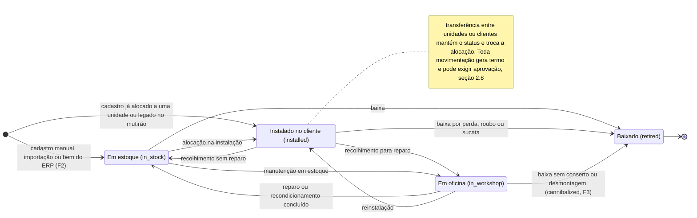
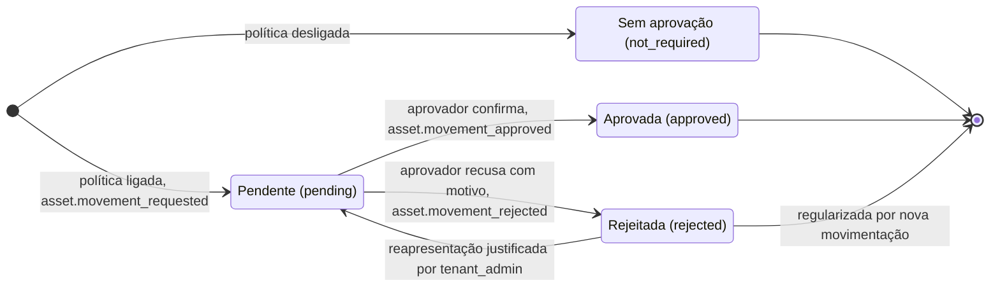
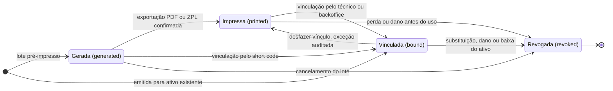
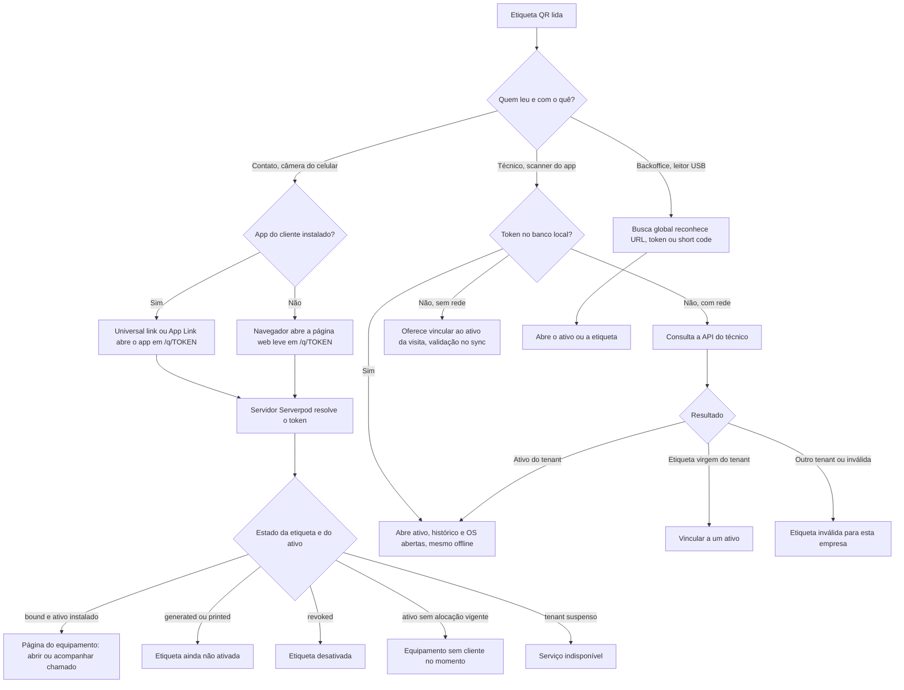
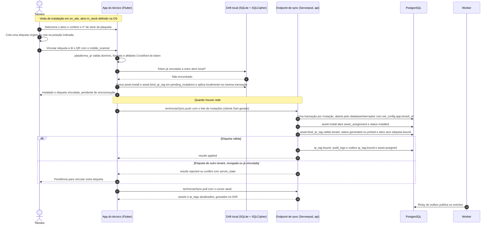
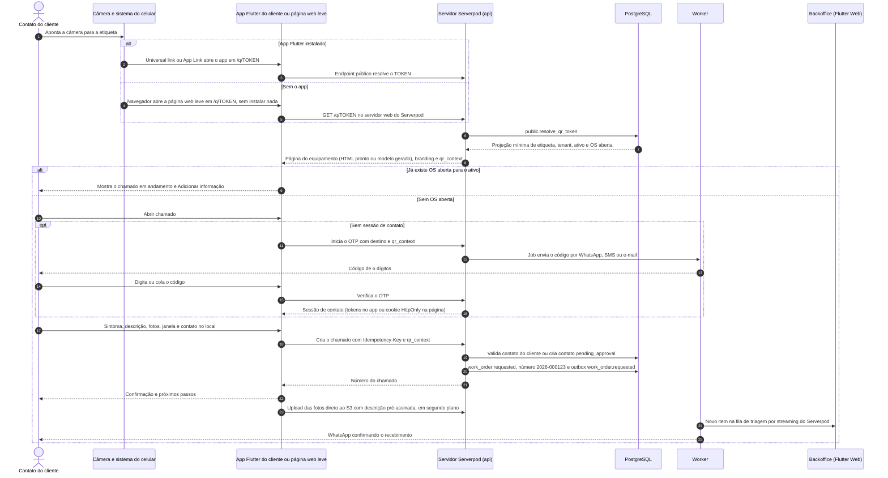
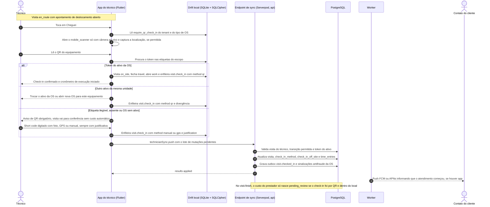
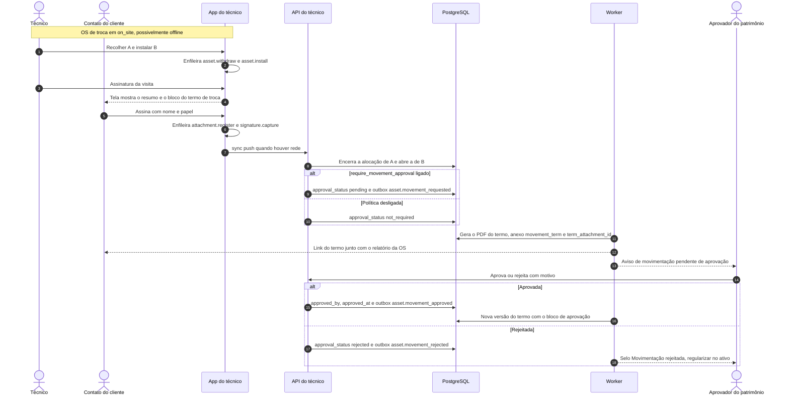
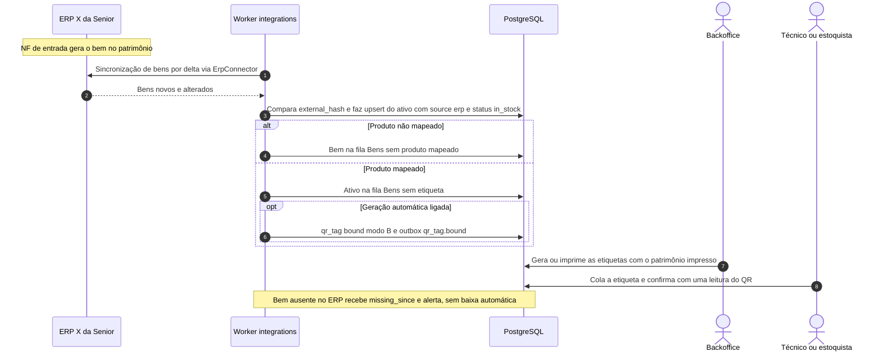

# Ativos e QR code

Versão 0.3 — 02/11/2026 — rascunho para revisão (stack Dart: Flutter + Serverpod)

Este documento define o ciclo de vida dos ativos (equipamentos do tenant em posse dos clientes), o vínculo produto–cliente e o funcionamento completo das etiquetas QR — do token impresso à abertura do chamado — para orientar backend, apps e operação de campo.

**Novidades da v0.2** (origem: [Benchmark Sismetro](11-benchmark-sismetro-e-novas-funcionalidades.md)): movimentação com aprovação opcional e termo em PDF (seção 2.8, MVP); documentos do ativo e do modelo por categoria (2.9, MVP/F2); dados de aquisição (2.10, MVP); bens vindos do ERP com etiqueta gerada após a integração e mutirão do legado (2.11, F2); medidores (2.12, F2); dispositivo IoT vinculado (2.13, F3); hierarquia pai/filho (2.14, F3); check-in pelo QR obrigatório por política como antifraude (7.10, MVP); OS de desmontagem com baixa `cannibalized` (F3).

**Mudanças da v0.3** (origem: [Stack Dart: Flutter + Serverpod](12-stack-dart-flutter-serverpod.md)): só a implementação muda. O primeiro acesso pelo QR sem app passa a ser uma **página web leve** (HTML servido pelo servidor web do Serverpod, sem Flutter Web) no lugar da PWA; quem tem o app Flutter do cliente instalado cai nele por universal links/App Links; a leitura de QR nos apps usa `mobile_scanner`; o pacote de validação do QR passa a ser Dart. Token, short code, `qr_context`, regras e máquinas de estado não mudam.

Leia junto: [Modelo de domínio](03-modelo-de-dominio.md) (entidades e máquinas de estado oficiais), [Multi-tenancy e segurança](04-multi-tenancy-e-seguranca.md) (RLS, OTP, rate limit), [Aplicações e fluxos](06-aplicacoes-e-fluxos.md) (telas, sincronização offline e notificações), [API](08-api.md) (contratos HTTP) e [Integração ERP Senior](07-integracao-erp-senior.md).

---

## 1. Conceitos e princípios

| Conceito | Entidade | O que é | Exemplo |
|---|---|---|---|
| Produto | `product` | Item de catálogo (modelo). Pode vir do ERP X da Senior (fase 2). | Freezer horizontal 400 L, modelo FH400 |
| Ativo | `asset` | Unidade física rastreável de um produto, com nº de série e/ou patrimônio. | FH400, série 23A0098812, patrimônio PAT-004512 |
| Alocação | `asset_assignment` | Período em que o ativo esteve em um cliente/unidade — é o "vínculo produto–cliente", com histórico. | Instalado na Padaria Central — Loja Centro desde 03/02/2026 |
| Etiqueta QR | `qr_tag` | Identificador físico colado no ativo: token opaco (no QR) + short code legível. | Short code `7KQ2-M9X1` |
| Lote de etiquetas | `qr_tag_batch` | Conjunto de etiquetas emitidas de uma vez, com ou sem ativo. | Lote de 500 etiquetas para a equipe Sul |

Princípios que orientam todas as decisões abaixo:

1. **O QR identifica a etiqueta, não o cliente.** O cliente é determinado no momento da leitura pela alocação vigente do ativo. Transferir um freezer para outro cliente não exige trocar a etiqueta, e o novo cliente passa a abrir chamados imediatamente; o anterior perde o acesso.
2. **O vínculo produto–cliente é sempre do ativo** (unidade física com código específico), nunca do produto (modelo).
3. **Todo movimento é rastreável**: alocação com início, fim, motivo e OS de origem; eventos de domínio no outbox; registro em `audit_logs`.
4. **A etiqueta não carrega dados**: só uma URL curta com token opaco (D7). Nada de IDs sequenciais, nome de cliente ou nº de série no QR.
5. **Dono no monólito**: módulo `assets` (ativos, alocações, etiquetas). A OS e o chamado pertencem a `work_orders`; contatos a `customers`; OTP e sessões a `identity_access`. A comunicação entre eles segue D1 (interface pública e eventos). Na v0.2, medidores e leituras pertencem ao módulo `maintenance` (F2) e dispositivos IoT ao módulo `telemetry` (F3). Ambos referenciam o ativo pela interface pública de `assets`. A movimentação com aprovação e termo continua em `assets`.

### 1.1 O que a experiência exige do modelo de dados

A definição oficial das tabelas está no [Modelo de domínio](03-modelo-de-dominio.md) e em [schema.sql](../db/schema.sql). A tabela abaixo lista os campos dos quais este documento depende, para alinhamento na revisão cruzada.

| Entidade | Campos de que este documento depende |
|---|---|
| `assets` | `product_id`, `serial_number`, `asset_tag` (patrimônio), `status` (D9b), `ownership_type` (D9b), `location_note` (posição no local, ex.: "cozinha, ao lado da porta"), `warranty_until`, `is_active`; alocação vigente consultável de forma eficiente |
| `asset_assignments` | `asset_id`, `customer_id`, `customer_site_id`, `started_at`, `ended_at` (nulo = vigente; no máximo uma vigente por ativo), `start_reason`, `end_reason`, `work_order_id` (opcional) |
| `qr_tags` | `token` (único global), `short_code` (único global), `status` (D9b), `asset_id` (preenchido somente quando `bound`), `batch_id`, `bound_at`, `bound_by`, `bound_via`, `printed_at`, `print_count`, `revoked_at`, `revoked_reason`, `replaced_by_tag_id` |
| `qr_tag_batches` | `quantity`, `label_layout`, `notes`, `created_by`, `printed_at`; fase 2: custódia (técnico ou equipe) |
| `customer_contacts` | `status` (`active`, `pending_approval`, `blocked`), `origin` (backoffice, import, erp, qr_self_service), `customer_site_id` opcional (escopo por unidade; nulo = todas), vínculo com `users` |
| `products` | família/categoria (filtra sintomas e causas), instrução e foto de referência da posição da etiqueta |
| `symptoms` | rótulo para o cliente, ícone, `visible_to_customer`, aplicabilidade por família/modelo, prioridade sugerida |
| `work_orders` | `customer_id` e `customer_site_id` gravados na abertura (o histórico não muda se o ativo for transferido), `asset_id`, forma de entrada (QR, short code, lista de equipamentos, backoffice) e sinalizações de triagem (solicitante não verificado, fora do local, aberto por código digitado) |
| `assets` — v0.2 | MVP: `branch_id`, `acquisition_date`, `acquisition_cost`, `supplier_name`, `acquisition_document`. F2: `source` (`local`, `erp`), `external_system`, `external_id`, `external_payload`, `external_hash`, `last_synced_at`, `missing_since`. F3: `parent_asset_id` |
| `asset_assignments` — v0.2 (MVP) | `approval_status` (`not_required`, `pending`, `approved`, `rejected`), `approved_by`, `approved_at`, `term_attachment_id` (termo de movimentação em PDF) |
| `attachments` — v0.2 (MVP) | Dono `asset` ou `product` (já previstos) e categoria de documento: `comodato_contract`, `invoice`, `manual`, `movement_term`, `photo`, `other` |
| `tenant_settings` — v0.2 (MVP) | `require_qr_check_in`, `require_movement_approval` |
| `work_order_visits` — v0.2 | `check_in_method`, `check_in_off_site` (já existentes) passam a pesar na conferência e no custo do prestador (seção 7.10) |
| `asset_meters`, `meter_readings` — F2 | Medidores do ativo (`hour_meter`, `energy_kwh`, `temperature`, `cycles`) e leituras (origem `manual`, `iot`, `file_import`) |
| `iot_devices` — F3 | Dispositivo de telemetria vinculado ao ativo, com credencial própria no cofre |

---

## 2. Ciclo de vida do ativo

### 2.1 Estados



Na v0.2 o diagrama não ganha estados novos. A aprovação da movimentação é um estado da **alocação** (seção 2.8), não do ativo; a desmontagem (F3) é uma baixa com motivo `cannibalized` ao fim de uma OS `teardown`; um componente filho (F3) segue o status do pai enquanto estiver montado nele (seção 2.14).

| Status | Significado | Etiqueta aceita chamado do cliente? | Aparece em "Meus equipamentos"? |
|---|---|---|---|
| `in_stock` | No estoque/depósito do tenant | Não (página "sem cliente") | Não |
| `installed` | Em um cliente/unidade, com alocação vigente | Sim | Sim |
| `in_workshop` | Na oficina do tenant | Não (página "sem cliente") | Sim, como "Em reparo", enquanto houver OS aberta originada naquele cliente |
| `retired` | Fora de operação (sucata, perda, roubo, venda, devolução ao fabricante). Terminal. | Não (etiqueta revogada automaticamente) | Não |

### 2.2 Regras por tipo de propriedade

| `ownership_type` | Status permitidos | `billing_type` padrão dos itens da OS | Observações |
|---|---|---|---|
| `tenant_loan` (comodato) | todos | `contract` | Caso-âncora (freezer em comodato). |
| `tenant_rental` (locação) | todos | `contract` | Igual ao comodato para a operação; muda o contrato. |
| `customer_owned` (do cliente) | `installed`, `in_workshop`, `retired` | `billable` (ou `warranty` se dentro da garantia do serviço) | `in_stock` não se aplica: o equipamento não fica no estoque do tenant. "Baixado" = deixou de ser atendido. |

A sugestão de `billing_type` é só o padrão do app do técnico; a regra final (garantia, contrato) é aplicada no servidor e revisada na conferência (ver [Aplicações e fluxos](06-aplicacoes-e-fluxos.md)). Mudar o `ownership_type` (ex.: o tenant vende ao cliente o freezer que estava em comodato) é uma operação auditada que não altera o status.

### 2.3 Operações

Nomes de eventos seguem D12; o catálogo oficial fica no [Modelo de domínio](03-modelo-de-dominio.md). As mutações do app do técnico estão detalhadas no protocolo de sincronização em [Aplicações e fluxos](06-aplicacoes-e-fluxos.md).

| Operação | Transição | Quem / canal | Pré-condições | Efeitos | Evento |
|---|---|---|---|---|---|
| Cadastrar | → `in_stock` (ou `installed` se informada a unidade) | Backoffice (tenant_admin, dispatcher, backoffice_agent); importação CSV/XLSX; técnico via `asset.register` (se permitido) | Produto ativo; nº de série e/ou patrimônio; unicidade (série por produto; patrimônio por tenant) | Cria o ativo; opcionalmente alocação inicial e etiqueta | `asset.registered` |
| Alocar (instalar) | `in_stock` ou `in_workshop` → `installed` | Técnico na OS de instalação (`asset.install`); backoffice ("alocar sem OS", com motivo) | Unidade ativa do cliente; ativo sem alocação vigente | Abre `asset_assignment`; o QR passa a valer para aquele cliente | `asset.assigned` |
| Transferir | `installed` → `installed` | Backoffice; técnico em OS de remanejamento | Nova unidade diferente da atual; sem OS aberta para o ativo (ou decisão explícita sobre ela) | Encerra a alocação (`end_reason = transfer`) e abre outra; etiqueta continua válida | `asset.transferred` |
| Recolher para oficina | `installed` → `in_workshop` | Técnico (`asset.withdraw`) em OS de retirada ou corretiva; backoffice | — | Encerra a alocação (`sent_to_workshop`); a OS de origem mantém o cliente | `asset.withdrawn` |
| Recolher para estoque | `installed` → `in_stock` | Idem | — | Encerra a alocação (`returned_to_stock`), ex.: fim de comodato | `asset.withdrawn` |
| Concluir reparo | `in_workshop` → `in_stock` | Backoffice | — | — (fluxo de OS de oficina é fase 3) | `asset.status_changed` |
| Baixar | qualquer → `retired` | tenant_admin (dispatcher com permissão) | Nenhuma OS aberta para o ativo | Encerra alocação; revoga a etiqueta `bound` (`asset_retired`) | `asset.retired` |
| Alterar propriedade | sem mudança de status | tenant_admin | — | Muda `ownership_type` e o padrão de cobrança | `asset.updated` (com `ownership_type` entre os campos alterados) |
| Corrigir dados | — | Backoffice; técnico via `asset.update_details` (série, patrimônio, posição) | Unicidade; campos mestres de bem com `source = erp` não editáveis (F2) | Auditoria campo a campo | `asset.updated` |
| Registrar movimentação pendente de aprovação (MVP) | conforme a operação de origem (alocar, transferir, recolher) | Qualquer canal acima, quando `tenant_settings.require_movement_approval = true` | — | Alocação com `approval_status = pending`; termo gerado (seção 2.8) | `asset.movement_requested` (além do evento da operação) |
| Aprovar / rejeitar movimentação (MVP) | sem mudança de status | tenant_admin ou usuário com permissão de aprovar movimentação (nunca quem registrou) | Alocação `pending` | `approved_by`, `approved_at`; nova versão do termo com o bloco de aprovação; rejeição abre pendência de regularização | `asset.movement_approved` / `asset.movement_rejected` |
| Anexar documento (MVP) | — | Backoffice; ERP na F2 (contrato de comodato, se a API permitir) | Categoria válida (seção 2.9) | `attachment` com dono `asset` ou `product` | — (só auditoria) |
| Registrar medidor e leitura (F2) | — | Backoffice; técnico pela mutação `meter_reading.record`; importação | Medidor ativo do ativo | `asset_meters`, `meter_readings` | `meter_reading.recorded` |
| Vincular dispositivo IoT (F3) | — | Backoffice (tenant_admin) | Ativo não baixado; dispositivo sem vínculo ativo | `iot_devices.asset_id`; credencial no cofre | — (auditoria) |
| Montar / desmontar componente (F3) | filho segue o pai | Backoffice; técnico dentro de OS (seção 2.14) | Pai e filho do mesmo tenant; sem ciclo | `parent_asset_id` preenchido ou limpo | `asset.updated` |
| Desmontar para peças (F3) | `in_workshop` → `retired` (`cannibalized`) | Backoffice, ao concluir OS `teardown` | OS `teardown` concluída | Baixa; peças recuperadas registradas na OS; etiqueta revogada (`asset_retired`) | `asset.retired` |

### 2.4 Cadastro de ativos

- **Manual (backoffice):** produto (busca), nº de série, patrimônio, propriedade, garantia, filial (padrão: a filial `is_default` do tenant), dados de aquisição (seção 2.10), fotos, status inicial; opcionalmente cliente/unidade e data de instalação; caixa "gerar etiqueta agora" (modo B da seção 3.9).
- **Importação CSV/XLSX:** colunas `codigo_produto`, `numero_serie`, `patrimonio`, `propriedade`, `codigo_cliente`, `codigo_unidade`, `data_instalacao`, `garantia_ate` e, opcionalmente, `short_code_etiqueta` (para registrar etiquetas pré-impressas já coladas). Assistente com simulação (dry-run), validação linha a linha, upsert por (produto, série) ou patrimônio e relatório de erros. A execução é um job do módulo `integrations` registrado como `sync_run` de importação (ver [Integração ERP Senior](07-integracao-erp-senior.md)).
- **Carga inicial (go-live) — campanha de etiquetagem:** o primeiro tenant já tem freezers em campo sem etiqueta. Roteiro: (1) importar ativos com o cliente atual a partir de planilha/relatório do ERP; (2) imprimir lotes pré-impressos; (3) técnicos visitam os clientes e, no app, leem a etiqueta virgem e escolhem o ativo da unidade (busca por série/patrimônio) — a vinculação acontece no momento em que a etiqueta é colada, eliminando troca de etiquetas entre equipamentos.
- **Pelo técnico em campo:** `asset.register` para equipamento encontrado no local sem cadastro (ex.: `customer_owned`), se a configuração do tenant permitir; nasce com sinalização "cadastrado em campo — revisar".
- **Fase 2 (ERP):** os bens do módulo de patrimônio da Senior chegam como ativos com `source = erp` e as mesmas colunas de origem externa dos cadastros mestres (`external_system`, `external_id`, `external_payload`, `external_hash`, `last_synced_at`, `missing_since`) — decisão da v0.2, detalhada na seção 2.11. Se o ERP X expuser também documentos de remessa/retorno de comodato com nº de série, o conector poderá abrir a alocação automaticamente, com idempotência por documento (a validar em [Integração ERP Senior](07-integracao-erp-senior.md)).

### 2.5 Alocação, transferência e histórico

- `asset_assignments` é append-only na prática: alocações não são editadas, são encerradas (`ended_at`, `end_reason`) e substituídas. Correções de data são auditadas.
- **No máximo uma alocação vigente por ativo** (índice único parcial em `ended_at IS NULL`).
- A OS grava `customer_id`/`customer_site_id` na abertura. Se o ativo for transferido depois, as OS antigas continuam no cliente original — base para relatórios por cliente e para o histórico que cada cliente pode ver (um cliente nunca vê OS de outro cliente que teve o mesmo ativo).
- Consultas que o backoffice precisa responder rápido: "onde está o ativo X?", "quais ativos estão no cliente/unidade Y?", "histórico do ativo X" (linha do tempo de alocações + OS + etiquetas) e "ativos em comodato por cliente".
- v0.2 (MVP): cada alocação aberta ou encerrada gera um **termo de movimentação** e, se a política do tenant exigir, passa por **aprovação** (seção 2.8). A aprovação nunca edita a alocação: só preenche `approval_status`, `approved_by` e `approved_at`.

### 2.6 Troca de equipamento (swap)

Em corretiva sem conserto no local, o técnico recolhe o ativo A (`asset.withdraw` → `in_workshop`) e instala o ativo reserva B (`asset.install`) na mesma unidade, na mesma OS. B usa a própria etiqueta (já vinculada no estoque ou vinculada no local com uma etiqueta virgem). O cliente passa a ver B em "Meus equipamentos" e A como "Em reparo" enquanto a OS estiver aberta. A etiqueta de A segue com A para a oficina (não é transferida para B).

### 2.7 "Meus equipamentos" (o que o cliente vê)

| Quem | Vê |
|---|---|
| `customer_contact` ativo | Ativos com alocação vigente nas unidades do seu escopo (todas as unidades do cliente ou só a sua, conforme `customer_site_id` do contato) |
| `customer_admin` | Todas as unidades do cliente |
| Contato pendente de aprovação | Só o equipamento cuja etiqueta leu e os chamados que abriu (seção 7.5) |

Cada cartão mostra: foto e nome do modelo, nº de série e patrimônio, unidade e posição no local, situação em linguagem simples ("Funcionando", "Chamado aberto nº 2026-000123 — Visita amanhã, 14h–16h", "Em reparo"), "Em comodato desde 03/02/2026" ou "Garantia até 10/2027", data do último atendimento. Ações: **Abrir chamado** (equipamento pré-selecionado), **Ver histórico** (OS encerradas com data, tipo, resumo escrito para o cliente e relatório de atendimento em PDF) e **Ler QR** (para identificar um equipamento).

Nunca exibidos ao cliente: valores e preços, comentários internos, laudo técnico interno, dados de outros clientes. Estado vazio: "Nenhum equipamento encontrado. Leia o QR da etiqueta do equipamento para abrir um chamado."

v0.2: o cartão ganha **Documentos** (termos de movimentação assinados pelo cliente e, se o tenant marcar como visíveis, o contrato de comodato e os manuais — seção 2.9). Valores de aquisição, notas fiscais, leituras de medidor e telemetria continuam ocultos ao cliente.

### 2.8 Movimentação com aprovação e termo — MVP

O Sismetro mostrou duas exigências da área de patrimônio: toda movimentação precisa de uma **declaração** (de onde, para onde, quem fez, quem aprovou) e algumas precisam de **aprovação**. Na plataforma, isso fica na própria alocação (`asset_assignments`), que já é o histórico do vínculo produto–cliente.

**Princípio: a alocação registra o fato físico; a aprovação valida a declaração.** A movimentação vale assim que é registrada, mesmo pendente de aprovação. Bloquear o registro até alguém aprovar faria a plataforma divergir do mundo real: o freezer já está na loja nova, e o QR precisa abrir chamados para o cliente certo (princípio 1). Quem quer controlar *antes* do fato usa uma OS de instalação, retirada ou remanejamento, que passa pela triagem e pelo despacho.

**Tipos de termo** (gerados pelo worker, em PDF, com o branding do tenant):

| Termo | Operação que o gera | Origem → destino no termo |
|---|---|---|
| Termo de entrega | Alocar/instalar (`asset.install` ou "alocar sem OS") | Estoque/oficina da filial → cliente/unidade |
| Termo de retirada | Recolher (`asset.withdraw`) | Cliente/unidade → oficina ou estoque |
| Termo de transferência | Transferir | Cliente/unidade A → cliente/unidade B |
| Termo de troca | Troca (swap) na mesma OS (seção 2.6) | Um termo só, com a retirada de A e a entrega de B |

**Conteúdo do termo:** número e versão do termo; tipo; ativo (modelo, nº de série, patrimônio, short code); origem e destino; data e hora; OS e técnico (quando houver); estado do equipamento declarado (checklist e fotos da visita, se houver); signatário (nome, documento mascarado no PDF, papel); bloco de aprovação ("Pendente", ou aprovador e data); hash do conteúdo no rodapé. O PDF é um anexo de categoria `movement_term` com dono `asset`, e a alocação aponta para ele em `term_attachment_id`.

**Em campo (app do técnico):** a assinatura do cliente na visita (`signature.capture`) cobre o atendimento **e** os termos daquela visita. A tela de assinatura mostra, acima do resumo do atendimento, o bloco "Termo de entrega do freezer FH400, série 23A0098812" (ou de retirada/troca). Tudo funciona offline. Depois do sync, o worker gera o PDF com a imagem da assinatura e envia o link ao cliente junto com o relatório da OS. Se o cliente recusar ou não houver quem assine, o termo sai "sem assinatura", com o motivo informado, e fica sinalizado na conferência.

**No backoffice (sem OS):** o termo é gerado sem assinatura, para imprimir; a cópia assinada é digitalizada e anexada como nova versão. A versão sem assinatura fica no histórico.

**Aprovação (opcional por tenant, `tenant_settings.require_movement_approval`):**

- Com a política ligada, toda alocação aberta ou encerrada nasce `approval_status = pending` e o sistema emite `asset.movement_requested`. Com a política desligada, nasce `not_required`.
- **Quem aprova:** tenant_admin ou usuário com a permissão de aprovar movimentações (ex.: a área de patrimônio; permissões em [Multi-tenancy e segurança](04-multi-tenancy-e-seguranca.md)). Quem registrou não aprova a própria movimentação (segregação de funções).
- **Aprovar** preenche `approved_by` e `approved_at`, gera uma nova versão do termo com o bloco de aprovação (a versão assinada original continua anexada) e emite `asset.movement_approved`. Há aprovação em lote, útil depois do mutirão do legado (seção 2.11).
- **Rejeitar** exige motivo, emite `asset.movement_rejected` e põe no ativo o selo "Movimentação rejeitada — regularizar". A rejeição não apaga nem edita a alocação (histórico append-only). A regularização é uma nova movimentação corretiva, que também passa por aprovação, ou a reapresentação com justificativa por tenant_admin.
- **Efeitos da pendência:** nenhum bloqueio operacional. A OS pode ser conferida e encerrada. Relatórios de comodato mostram "pendente de aprovação" separado, e a rentabilidade (F3) usa só alocações `approved` ou `not_required`.



### 2.9 Documentos do ativo e do modelo — MVP (manuais offline na F2)

Os anexos de ativo e de produto (modelo) ganham **categoria de documento**:

| Categoria | Dono típico | Origem | Visível ao técnico | Visível ao cliente (padrão) |
|---|---|---|---|---|
| `comodato_contract` | Ativo | Emitido pelo ERP. MVP: upload no backoffice. F2: anexado pelo conector, se a API da Senior permitir | Não | Não (o tenant pode liberar para `customer_admin`) |
| `invoice` | Ativo | NF de entrada ou de remessa (upload; F2 pelo ERP) | Não | Não |
| `manual` | Modelo (vale para todos os ativos dele) ou ativo | Upload | Sim | Opcional |
| `movement_term` | Ativo | Gerado pela plataforma (seção 2.8) | Sim (os termos das suas visitas) | Sim, para o cliente da alocação |
| `photo` | Ativo ou modelo | Upload ou app do técnico | Sim | Opcional |
| `other` | Ativo ou modelo | Upload | Conforme marcação | Não |

- O detalhe do ativo mostra os documentos dele **e** os herdados do modelo, separados ("deste equipamento" / "do modelo FH400").
- Documento substituído (ex.: contrato renovado) não é apagado: a versão nova fica como vigente e a anterior no histórico.
- **App do técnico:** no MVP, os manuais abrem online por URL pré-assinada. Na F2, os `manual` dos modelos dos ativos do escopo são baixados no Wi-Fi e ficam disponíveis offline, com limite de tamanho por tenant.
- Contrato e nota fiscal carregam valores e ficam fora do escopo do técnico e do prestador.

### 2.10 Dados de aquisição — MVP

`acquisition_date`, `acquisition_cost` (`numeric(14,2)`), `supplier_name` e `acquisition_document` (número da NF de entrada; o arquivo vai como anexo `invoice`).

- Editáveis no backoffice para ativos locais. Na F2, para bens com `source = erp`, viram somente leitura (selo "ERP").
- Valores nunca aparecem para técnico, prestador ou cliente.
- Alimentam o relatório "valor em comodato por cliente" (MVP) e a rentabilidade do comodato (F3: valor dos equipamentos alocados × vendas × custo de manutenção).
- A garantia de fábrica (`warranty_until`) pode ser sugerida a partir da data de aquisição e do prazo do modelo.

### 2.11 Bens vindos do ERP e etiqueta após a integração — F2

Na Superpan, o patrimônio nasce no ERP: a NF de entrada gera o bem no módulo de patrimônio da Senior, e a etiqueta QR só existe depois que o bem chega à plataforma.

**Bem novo:**

1. A sincronização de bens (delta, mesmo mecanismo dos cadastros mestres — [Integração ERP Senior](07-integracao-erp-senior.md)) cria o ativo com `source = erp`, `status = in_stock`, filial do bem (`branch_id`), patrimônio (`asset_tag`), produto pelo código do item, série (se o ERP tiver) e dados de aquisição.
2. Bem cujo item não corresponde a nenhum produto rastreável vai para a fila "Bens sem produto mapeado" e não vira ativo até o mapeamento.
3. O ativo entra na fila **"Bens sem etiqueta"**. O tenant escolhe se a etiqueta é gerada automaticamente (modo B da seção 3.9, já `bound`) ou em lote por quem imprime.
4. A etiqueta sai com o patrimônio impresso, é colada no depósito e confirmada com uma leitura do QR (scanner do app ou leitor USB no backoffice). Até a primeira leitura, o ativo mostra "etiqueta gerada, não confirmada".
5. A entrega ao cliente segue o fluxo normal (OS de instalação, termo e aprovação — seção 2.8).

**Regras do bem ERP:** campos mestres (patrimônio, produto, série, filial, aquisição) ficam somente leitura na UI e na API (D10). Continuam locais: propriedade, posição no local, fotos, documentos, medidores e etiqueta. Bem que some do ERP ou é baixado lá recebe `missing_since` e um alerta: a baixa na plataforma é sugerida, nunca automática, porque pode haver equipamento ainda no cliente.

**Mutirão do legado** (equipamentos já nos clientes, sem etiqueta):

1. Os bens do legado chegam do ERP. Se o ERP souber o cliente (contrato de comodato), a alocação é pré-preenchida com `approval_status = pending`. Se não souber, o bem fica em estoque com o selo "legado — localizar".
2. O despacho cria OS de etiquetagem por unidade (categoria `inspection`), em lote, e as distribui a técnicos próprios ou prestadores.
3. No local, o técnico cola uma etiqueta virgem, lê o QR e procura o bem pelo patrimônio ou pela série da plaqueta. A busca é online. Sem rede, ele digita o patrimônio: `asset.register` com esse patrimônio volta `conflict` no sync com o bem existente em `server_state`, e o app oferece vincular a etiqueta a ele (`asset.bind_qr_tag`).
4. Se o bem estava sem cliente, o técnico confirma "este equipamento está aqui" (`asset.install`, termo de entrega de regularização). Se estava em outro cliente, o app avisa e registra a divergência para o patrimônio decidir.
5. As movimentações do mutirão caem na fila de aprovação, que tem aprovação em lote, e o painel do mutirão mostra o avanço por filial, cliente e técnico.

### 2.12 Medidores — F2

- **Cadastro:** `asset_meters` no detalhe do ativo: tipo (`hour_meter`, `energy_kwh`, `temperature`, `cycles`), unidade, leitura inicial e data, e leitura e data mais recentes (desnormalizadas para listagem). O modelo pode sugerir medidores padrão, criados no cadastro do ativo.
- **Leituras** (`meter_readings`): origem `manual` (técnico ou backoffice), `file_import` (planilha) e `iot` (F3). O técnico lê o medidor como item de checklist do tipo `meter_reading`, gravado pela mutação `meter_reading.record`. Cada leitura emite `meter_reading.recorded`.
- **Validação:** medidores acumulativos (`hour_meter`, `energy_kwh`, `cycles`) não podem voltar. Leitura menor que a anterior exige justificativa ("medidor trocado" ou "zerado") e marca um reinício da série. `temperature` não é acumulativa e só tem faixa válida.
- **Usos:** planos de manutenção por medidor (o gatilho `meter` reage a cada leitura), MTBF por horas de uso, gráfico de leituras no detalhe do ativo.
- Leituras não aparecem na página pública do QR nem para o cliente na F2.

### 2.13 Dispositivo IoT vinculado — F3

- `iot_devices`: identificador do fabricante, modelo, ativo vinculado, medidores que alimenta (ligação com `asset_meters`), status, último contato e referência à credencial por dispositivo no cofre de segredos (com rotação — [Multi-tenancy e segurança](04-multi-tenancy-e-seguranca.md)).
- **Um dispositivo ativo por ativo.** O vínculo é feito no backoffice depois que o técnico instala o hardware. Trocar o dispositivo encerra o vínculo anterior, e o histórico de leituras continua no medidor do ativo.
- **Movimentação:** o dispositivo segue o ativo. No recolhimento, o app do técnico lembra de "retirar ou manter o sensor" e o backoffice registra a escolha.
- **Detalhe do ativo:** selo online/offline, última leitura, alertas recentes. As regras (`telemetry_alert_rules`) podem abrir OS com `origin = telemetry` (evento `telemetry.alert_triggered`).
- A telemetria nunca aparece na página pública do QR.

### 2.14 Hierarquia pai/filho — F3

- `assets.parent_asset_id` para componentes rastreados com série própria (ex.: o compressor de um freezer, o motor de um forno). Proposta: **um nível só** (o filho não tem filhos), sem ciclos, pai e filho do mesmo tenant.
- **Montado no pai,** o filho não tem alocação própria: a localização e o cliente são os do pai. Movimentar o pai leva os filhos, e o termo lista os componentes.
- O filho pode ter etiqueta própria. Lida pelo técnico, ela abre o componente com o pai como contexto. O cliente vê só o pai em "Meus equipamentos", e chamados abertos pelo QR de um filho ficam no pai, com o componente indicado.
- **Troca de componente em OS:** o componente velho é desmontado (`parent_asset_id` limpo, vai para oficina ou estoque) e o novo é montado. Assim há histórico e MTBF por componente. As mutações de componente do app do técnico serão definidas na F3 e não fazem parte do catálogo da v0.2.
- **Desmontagem para peças** (OS `teardown`, F3) é outra coisa: o ativo inteiro é baixado (`cannibalized`) e as peças recuperadas ficam registradas na OS, para entrada manual no ERP como estoque de seminovos.

---

## 3. QR code

### 3.1 Conteúdo da etiqueta

O QR contém somente `https://<dominio-da-plataforma>/q/<token>` (D7). Exemplo com domínio ilustrativo:

```
https://os.example.com/q/3Z9K0QW1M4T7XB2H6R8PDNC5AE
```

Ao lado do QR, impresso em texto, vai o short code `7KQ2-M9X1` para digitação manual em `https://<dominio-da-plataforma>/q`. Nenhum outro dado vai no QR.

### 3.2 Token

| Aspecto | Decisão |
|---|---|
| Geração | 128 bits de CSPRNG (16 bytes de `Random.secure()` do `dart:math`, no servidor Serverpod), codificados em base32 Crockford sem padding: 26 caracteres maiúsculos (os 2 bits excedentes ficam zerados, então o 1º caractere vai de `0` a `7`). |
| Alfabeto | `0123456789ABCDEFGHJKMNPQRSTVWXYZ` (sem I, L, O, U). |
| Unicidade | Índice único global em `qr_tags.token`; colisão é praticamente impossível, mas a inserção trata violação de unicidade com nova tentativa. |
| Não usar | ULID ou UUID v7: têm componente de tempo, reduzem a entropia e revelam a data de emissão. |
| Armazenamento | Texto puro, com índice único. O token é um **identificador não adivinhável, não uma credencial**: dá acesso apenas à página pública com dados mínimos; qualquer ação (abrir chamado, ver detalhes) exige autenticação. Guardar só o hash impediria a reimpressão. |
| Entrada | Normalizar antes de qualquer consulta: maiúsculas, remover hífens/espaços, mapear `O→0` e `I/L→1`, exigir 26 caracteres válidos com o 1º entre `0` e `7`. Fora do formato → "QR não reconhecido", sem ir ao banco. |
| Logs | Logs de aplicação mascaram o token (6 primeiros caracteres); logs de borda (CDN/LB) inevitavelmente têm a URL — aceitável porque o token não é credencial. |

A normalização e a validação ficam num pacote Dart puro compartilhado do monorepo (ex.: `packages/qr`, pacote `plataforma_qr` no pub workspace), sem dependência de Flutter, usado pelo servidor Serverpod, pelos dois apps Flutter e pelo backoffice Flutter Web. A página web leve do QR é renderizada no servidor e reaproveita a mesma validação do lado do servidor; o pouco JavaScript dela só repete a checagem de formato do short code (seção 3.3) para responder na hora, sem chamar a API.

### 3.3 Short code (com dígito verificador)

- **Formato:** 8 caracteres base32 Crockford = 7 aleatórios (35 bits ≈ 34 bilhões de combinações) + 1 caractere verificador. Exibido como `XXXX-XXXX`. Único global (índice único; geração com nova tentativa em colisão e filtro de sequências impróprias).
- **Verificador:** algoritmo Luhn mod N com N = 32 sobre o alfabeto Crockford. Detecta 100% das substituições de um caractere e a grande maioria das transposições adjacentes (testado na elaboração deste documento com o código de exemplo: 248 substituições e 7 transposições, nenhuma passou despercebida). O app rejeita o erro de digitação na hora, sem chamar a API e sem gastar a cota de rate limit.
- **Entrada tolerante:** aceita minúsculas, com ou sem hífen/espaço, `O` como `0`, `I`/`L` como `1`.
- **Força:** 35 bits não é segredo — por isso a resolução por short code tem rate limit mais rígido e desafio anti-bot (seção 7.2). O short code tem o mesmo poder do token na página pública, que expõe só dados mínimos.

```dart
// packages/qr (plataforma_qr) — short code com verificador Luhn mod 32 (Crockford)
const alphabet = '0123456789ABCDEFGHJKMNPQRSTVWXYZ';
const n = 32;
final _shortCodePattern = RegExp(r'^[0-9A-HJKMNP-TV-Z]{8}$');

String normalizeCode(String input) => input
    .toUpperCase()
    .replaceAll(RegExp(r'[\s-]'), '')
    .replaceAll('O', '0')
    .replaceAll(RegExp('[IL]'), '1');

int _luhnSum(String code, int startFactor) {
  var factor = startFactor; // 1 ou 2
  var sum = 0;
  for (var i = code.length - 1; i >= 0; i--) {
    final value = alphabet.indexOf(code[i]);
    if (value < 0) throw FormatException('caractere inválido', code, i);
    final addend = factor * value;
    sum += addend ~/ n + addend % n;
    factor = factor == 2 ? 1 : 2;
  }
  return sum;
}

String checkChar(String payload7) =>
    alphabet[(n - _luhnSum(payload7, 2) % n) % n];

bool isValidShortCode(String raw) {
  final code = normalizeCode(raw);
  return _shortCodePattern.hasMatch(code) && _luhnSum(code, 1) % n == 0;
}

// checkChar('7KQ2M9X') == '1'  ->  impresso como 7KQ2-M9X1
```

### 3.4 Por que uma URL

1. **Câmera nativa abre direto.** iOS e Android reconhecem URLs em QR na câmera do sistema e abrem sem nenhum app instalado. Isso viabiliza o primeiro acesso pela **página web leve** do QR, sem instalar nada (decisão "os dois" do usuário): HTML renderizado pelo servidor web do Serverpod, pouco JavaScript e meta de conteúdo útil em menos de 1,5 s em 4G (spike S6 do [docs/12](12-stack-dart-flutter-serverpod.md)). Essa tela não usa Flutter Web, cujo primeiro carregamento de alguns MB não cabe na urgência de quem está diante do freezer parado.
2. **Mesma URL abre o app quando instalado.** A URL é universal link (iOS) e App Link verificado (Android) do app Flutter do cliente: com o app instalado, o sistema abre o app direto na rota `/q/<token>` (tratada pelo `go_router`); sem o app, o navegador abre a página web leve na mesma rota. A Apple documenta esse comportamento para QR + universal links desde o iOS 11 — validar em dispositivo com o arquivo de associação de produção.
3. **Sem dependência de leitor próprio**, sem dados no QR e com controle total do lado do servidor (revogar, mudar de cliente, mudar mensagens).

Alternativas descartadas:

| Alternativa | Motivo da rejeição |
|---|---|
| Esquema próprio (`plataformaos://...`) no QR | A câmera não abre nada sem o app instalado — quebra o primeiro acesso. |
| Dados crus no QR (série, ID) | Exige leitor próprio, expõe dados e impede revogação. |
| App Clip (iOS) / Instant App (Android) | App Clip é opção de fase 3 (experiência nativa sem instalar, mas exige target nativo separado, limite de tamanho apertado para um binário com o motor do Flutter e esforço próprio de build). O Google anunciou o fim do Play Instant em dez/2025 (a validar). |
| NFC no lugar do QR | Complemento de fase 3 (mesma URL gravada em NDEF), útil onde o QR suja; não substitui o QR porque nem todo cliente sabe usar NFC. |

### 3.5 Configuração de universal links e App Links

Os dois arquivos de associação são publicados por rotas do **servidor web do Serverpod** (o mesmo que serve a página leve), versionados no repositório e verificados no CI contra o bundle ID / package name e o certificado de cada ambiente. No app Flutter, o `go_router` recebe o link (com o *deep linking* do Flutter habilitado) e o leva à rota `/q/<token>` ou `/chamados/<id>`.

- **iOS:** entitlement `com.apple.developer.associated-domains` com `applinks:<dominio-da-plataforma>` no projeto Xcode do app (`ios/Runner/Runner.entitlements`); arquivo `https://<dominio>/.well-known/apple-app-site-association` servido como JSON, sem redirecionamento, com `components` para `/q/*` e `/chamados/*` (links das notificações) e exclusão explícita do restante (`/api/*`, `/admin*`). O padrão de `caseSensitive` é `true` (documentação Apple) — compatível porque o prefixo `/q/` é sempre minúsculo e o curinga aceita o token em maiúsculas.
- **Android:** `<intent-filter android:autoVerify="true">` no `AndroidManifest.xml` com `scheme="https"`, `host="<dominio>"` e `pathPrefix` `/q/` e `/chamados/`; `https://<dominio>/.well-known/assetlinks.json` com as impressões SHA-256 do certificado de assinatura **do Play App Signing** (não só da chave de upload). O Android compara esquema e host diferenciando maiúsculas (documentação do elemento `data`), por isso esquema e host no QR são sempre minúsculos (seção 3.7).
- **Só o app do cliente reivindica `/q/*`.** Se o app do técnico também reivindicasse, o iOS escolheria um app pela ordem do arquivo de associação. O técnico usa o scanner do próprio app; se usar a câmera do sistema, cai no app do cliente ou na página web leve, que têm o link discreto "Sou técnico" (esquema próprio do app do técnico com o token).
- **Página web leve:** Smart App Banner no iOS (`<meta name="apple-itunes-app" content="app-id=..., app-argument=https://<dominio>/q/<token>">`) e banner próprio no Android apontando para a Play Store, exibidos só depois que o chamado foi aberto (não atrapalhar a urgência). Deep link diferido (abrir o app já no contexto após instalar) é fase 2.
- **Navegadores embutidos** (ex.: abrir o link de dentro de outro app) podem não acionar universal links; a página web leve cobre esse caso, porque roda em qualquer navegador sem depender de recursos de PWA.

### 3.6 Domínio estável da plataforma

- O QR usa **sempre o domínio da plataforma**, curto e dedicado, nunca o domínio do tenant: etiquetas duram anos, tenants mudam de domínio, encerram contrato ou ganham white-label; o token é que resolve o tenant.
- Trocar esse domínio significa reimprimir todas as etiquetas em campo: é uma decisão **irreversível**, que deve virar ADR. Requisitos: renovação automática e bloqueio de transferência no registrador, DNSSEC, monitoramento de expiração e de certificado, HSTS.
- O mesmo domínio hospeda a página web leve (servidor web do Serverpod), os arquivos `/.well-known/` e a rota `/q/*`. A rota `/q/<token>` nunca muda de formato; evoluções acontecem no servidor. Hospedagem, DNS e CDN são definidos em [Infraestrutura e operação](09-infraestrutura-e-operacao.md).
- **Comprimento recomendado: até 16 caracteres** (impacta a densidade, seção 3.7). Exemplo ilustrativo: `os.example.com` (14).
- **Decidido:** `qr.platform-lac.com.br` (22 caracteres), que leva o QR para a **versão 5** ([ADR-020](adr/ADR-020-dominio-do-qr.md)).

### 3.7 Codificação e densidade do QR

- **Dois segmentos no mesmo QR:** modo byte para `https://<dominio>/q/` (em minúsculas, por causa da comparação de esquema/host do Android) e modo alfanumérico para o token (o alfabeto Crockford maiúsculo é subconjunto do conjunto alfanumérico do QR: `0–9`, `A–Z`, espaço e `$%*+-./:`). O alfanumérico usa 5,5 bits por caractere contra 8 do byte.
- **Nível de correção de erro Q (25%)** em todas as etiquetas (seção 4.2).
- Versão resultante (dados por versão no nível Q: V4 = 48, V5 = 62, V6 = 76 codewords):

| Comprimento do domínio | Só modo byte (tudo minúsculo) | Byte + alfanumérico (recomendado) |
|---|---|---|
| até 9 caracteres | V4 (33×33 módulos) | V4 (33×33) |
| 10 a 16 | V5 (37×37) | **V4 (33×33)** |
| 17 a 23 | V5 (37×37) | V5 (37×37) |
| 24 a 30 | V6 (41×41) | V5 (37×37) |

- Menos módulos no mesmo tamanho físico = módulos maiores = leitura mais fácil com etiqueta suja, riscada ou com geada.
- Colocar a URL inteira em maiúsculas (`HTTPS://HOST/Q/...`) permitiria V3 com domínios muito curtos, mas foi descartado: o App Link do Android não casaria com esquema/host em maiúsculas e o link cairia sempre no navegador.
- Geração: no `worker`, com os pacotes Dart `barcode` (matriz do QR) e `pdf` (folhas de etiquetas), e ZPL por template ([docs/12](12-stack-dart-flutter-serverpod.md) §3). O gerador precisa aceitar **segmentos manuais** (byte para o prefixo, alfanumérico para o token), nível de correção e versão fixa: confirmar no spike de etiquetas que o `barcode` expõe os segmentos; se não expuser, usar o pacote `qr` ou um codificador de segmentos próprio sobre ele, com teste comparando a matriz gerada com a de uma referência. Fixar a versão por domínio (ex.: V4) para todas as etiquetas terem o mesmo aspecto. O mesmo gerador alimenta o PDF e o ZPL.

### 3.8 Ciclo de vida da etiqueta



Regras:

- **No máximo uma etiqueta `bound` por ativo** (índice único parcial em `(tenant_id, asset_id)` onde `status = 'bound'`). Pode haver duas cópias físicas do mesmo token (seção 4.4); continua sendo uma etiqueta.
- `asset_id` preenchido se e somente se `status = 'bound'`.
- `revoked` é terminal: um token revogado nunca volta a valer.
- `printed` só existe para etiquetas sem ativo. Etiquetas emitidas para um ativo nascem `bound`; a impressão é registrada em `printed_at`/`print_count`, sem mudar o status.
- **Desfazer vínculo** (`bound` → `printed`): só tenant_admin, com motivo, para erro de vinculação detectado logo após (ex.: técnico leu a etiqueta errada do rolo). O caminho normal para corrigir no campo é a substituição (seção 3.10).

### 3.9 Modos de emissão

| Modo | Como funciona | Quando usar |
|---|---|---|
| **A — Lote pré-impresso, sem ativo** (padrão) | tenant_admin/dispatcher cria um `qr_tag_batch` (1 a 5.000 etiquetas, layout, observação como "rolo da equipe Sul"); um job da fila de jobs gera as etiquetas (`generated`); o usuário baixa PDF/ZPL e confirma a impressão (`printed`). Técnicos carregam rolos e vinculam na hora de colar. | Instalações e campanha de etiquetagem. A vinculação no momento da colagem elimina a troca de etiquetas entre equipamentos. |
| **B — Etiqueta para ativo existente** | No detalhe do ativo ou em lote ("gerar etiquetas para ativos sem etiqueta", filtrando cliente/região), a etiqueta nasce `bound` e o layout pode imprimir patrimônio/série. | Reimpressões, poucos equipamentos, ou quando o escritório prepara a etiqueta antes da instalação. Risco: colar no equipamento errado — mitigado imprimindo série/patrimônio na etiqueta e exigindo leitura do QR no check-in da próxima visita. |

Fase 2: **custódia de lotes** — atribuir um lote/faixa a um técnico ou equipe, para saber quem está com quais etiquetas e permitir que o app valide offline que a etiqueta lida é da sua custódia.

### 3.10 Vinculação, substituição, revogação e reimpressão

**Vinculação pelo técnico (online ou offline)** — dentro da visita ou na tela do ativo: "Vincular etiqueta" → scanner → o app valida domínio e formato; se o token já existe localmente vinculado a outro ativo, bloqueia; senão grava a mutação `asset.bind_qr_tag` (`entity_id` = ativo; payload com token ou short code e `replace_existing`) e mostra "Etiqueta vinculada — pendente de sincronização". Validações no servidor:

1. O token existe e a etiqueta é do mesmo tenant do técnico. Se for de outro tenant: rejeita como "etiqueta inválida para esta empresa", sem revelar nada do outro tenant.
2. Status `generated` ou `printed`. Se `bound` a outro ativo → conflito (com o ativo atual no `server_state`, se do mesmo tenant); se `revoked` → rejeita.
3. Ativo ativo e não baixado; sem etiqueta `bound` ou `replace_existing = true` (a anterior vira `revoked` com motivo `replaced`).
4. Permissão: ativo no escopo de uma visita do técnico, ou permissão de vincular qualquer ativo do tenant (campanhas).

A vinculação otimista offline é deliberada: instalações acontecem em locais sem sinal (subsolos, zona rural). A rejeição é rara (etiqueta de outro tenant, já usada ou revogada) e vira pendência visível ao técnico e ao backoffice.

**Vinculação pelo backoffice** — no detalhe do ativo: digitar o short code ou usar leitor USB; mesmas validações; `bound_via = backoffice`. **Por importação** — coluna `short_code_etiqueta` da planilha de ativos.

**Substituição** — etiqueta danificada, ilegível ou arrancada: o técnico vincula uma nova etiqueta com `replace_existing`; a antiga é revogada (`replaced`) e o app orienta remover/destruir a antiga se ainda estiver no equipamento. É também a forma de corrigir no campo uma vinculação errada (a etiqueta errada é revogada e descartada; perder uma etiqueta custa menos que um fluxo complexo de desvinculação).

**Revogação** — backoffice (tenant_admin, dispatcher), individual ou em massa (lote ou faixa inteiros), com motivo: `damaged`, `lost`, `replaced`, `asset_retired`, `suspected_fraud`, `batch_cancelled`. Automática na baixa do ativo. Token revogado mostra a página "etiqueta desativada".

**Reimpressão** — mesmo token, mesmo QR: falha de impressão, dano antes da aplicação ou segunda cópia (seção 4.4). Incrementa `print_count`, auditada, proibida para etiqueta revogada. Regra: se a cópia antiga pode estar circulando solta (fora do equipamento), prefira substituição (token novo).

### 3.11 Auditoria e rastreabilidade

- Toda operação de etiqueta e de ativo gera registro em `audit_logs` (quem, quando, de onde — app/dispositivo/IP —, antes e depois) e, quando há consumidores, evento de domínio no outbox conforme o catálogo canônico da [API](08-api.md) (seção 6.2): `qr_tag_batch.generated`, `qr_tag.bound`, `qr_tag.unbound`, `qr_tag.revoked`. Impressão e reimpressão ficam só na auditoria e nos campos da etiqueta (`printed_at`, `print_count`).
- **Leituras (scans) não vão para `audit_logs`** (volume e risco de negação de serviço por escrita). São contadas no Valkey (protocolo Redis) por etiqueta e consolidadas periodicamente (ex.: a cada 5 min) em `last_scanned_at` e `scan_count` — colunas sugeridas em `qr_tags`, a confirmar em [Modelo de domínio](03-modelo-de-dominio.md). Alimentam o antiabuso (seção 7.7) e o relatório "etiquetas vinculadas nunca lidas".
- Linha do tempo do ativo no backoffice: alocações, etiquetas (vigente e revogadas, com motivo) e OS.

---

## 4. Etiqueta física

### 4.1 Layout

Formato padrão 60 × 40 mm (paisagem):

```
+------------------------------------------------------------+
|  [LOGO / NOME DO TENANT]                                    |
|  +-------------+   Equipamento com problema?                |
|  |             |   Aponte a câmera do celular para o QR.    |
|  |  QR 25 mm   |                                            |
|  |             |   Código:  7KQ2-M9X1                        |
|  +-------------+   Sem câmera? os.example.com/q             |
|  WhatsApp (11) 4000-0000            Não remova esta etiqueta|
+------------------------------------------------------------+
```

| Elemento | Regra |
|---|---|
| Logo ou nome do tenant | Monocromático na térmica; colorido nas folhas A4. Nunca dentro do QR. |
| QR | 25 × 25 mm (mínimo 20 × 20 mm), zona de silêncio de 4 módulos (~3 mm) sem impressão. |
| Short code | Fonte monoespaçada em negrito, altura de maiúscula ≥ 4 mm, formato `XXXX-XXXX`. |
| Instrução | Linguagem simples, com ícone de câmera. |
| URL para digitação | `<dominio>/q` curto, para quem não consegue ler o QR. |
| Opcionais | WhatsApp/telefone de suporte do tenant; patrimônio/série (só no modo B); "Não remova esta etiqueta". |
| Proibido | Dados do cliente, preços, IDs sequenciais. |

Formatos: **padrão** 60 × 40 mm; **compacta** 40 × 30 mm (QR de 20 mm, para equipamentos pequenos); **folha A4** com 21 etiquetas de 63,5 × 38,1 mm (3 × 7, formato comum de mercado) em poliéster para laser.

### 4.2 Tamanho mínimo e correção de erro

- **Correção de erro Q (25%)**: tolera riscos, gordura e geada. Nível H (30%) só faria sentido com logo no centro do QR, que não usamos; L/M são frágeis para o ambiente.
- **Módulo ≥ 0,6 mm**: V4 com 20 mm dá 0,61 mm; com 25 mm, 0,76 mm. Regra prática: distância de leitura ≈ 10 × o lado do QR (25 mm → até ~25 cm com conforto).
- Preto sobre branco **fosco** (brilho reflete a iluminação da loja), sem cores invertidas, sem estilizações (módulos arredondados, degradês).
- Térmicas: número inteiro de pontos por módulo para não distorcer. 203 dpi → 6 pontos = 0,75 mm (V4 ≈ 24,8 mm); 300 dpi → 9 pontos = 0,76 mm (V4 ≈ 25,1 mm).

### 4.3 Material

Ambiente do caso-âncora: frio (freezer até −25 °C; câmaras podem chegar a −40 °C), condensação, limpeza com detergente e álcool, atrito.

- **Face:** poliéster (PET) branco fosco ou vinil, com laminação de proteção ou sobrelaminado transparente.
- **Adesivo:** acrílico permanente para baixa temperatura ("freezer grade"), com temperatura de serviço compatível com o equipamento — confirmar ficha técnica do fornecedor (a validar).
- **Aplicação:** superfície limpa (álcool isopropílico), seca, em temperatura ambiente, respeitando a temperatura mínima de aplicação do adesivo. De preferência na instalação, antes de ligar o equipamento; em equipamento já operando, numa face externa sem condensação.
- **Impressão:** transferência térmica com ribbon de **resina** (resiste a álcool e atrito). Evitar térmica direta (desbota com calor e luz) e etiquetas de papel. Para folhas A4, poliéster próprio para laser (validar aderência do toner).
- **Piloto obrigatório:** 30 dias em equipamentos reais, medindo taxa de leitura e resistência a limpeza e raspagem, antes da compra em volume.

### 4.4 Posicionamento no equipamento

- Face externa visível e alcançável sem mover o equipamento (frontal ou lateral superior), entre ~0,8 e 1,6 m de altura quando possível, perto da plaqueta do fabricante (facilita conferir o nº de série).
- Evitar: borrachas de vedação, dobradiças, áreas com geada ou condensação, proximidade do compressor/condensador (calor), superfícies curvas de raio pequeno, áreas que recebem adesivos promocionais.
- Padronizar por modelo: o cadastro do produto traz instrução e foto de referência da posição, exibidas no app do técnico na hora de vincular.
- Opcional: segunda cópia do mesmo token em local protegido (ex.: tampa do compartimento do motor), para uso do técnico quando a externa estiver danificada.

### 4.5 Impressão: PDF e ZPL

- **PDF (folhas A4):** gerado por job na fila de jobs, sob demanda; QR vetorial; arquivos de até 500 etiquetas; régua de calibração de 50 mm na margem para conferir escala (imprimir em 100%, nunca "ajustar à página").
- **ZPL (térmicas de 203/300 dpi):** gerado no servidor por tamanho de etiqueta. Padrão: QR rasterizado pelo nosso gerador e enviado como gráfico (`^GF`), garantindo os mesmos segmentos e versão do PDF e funcionando em impressoras com emulação ZPL. Alternativa: comando nativo `^BQN,2,<ampliação>` com `^FDQA,<url>^FS` (arquivo menor, mas o codificador da impressora escolhe os modos e pode subir a versão). Validar com o modelo de impressora do tenant; muitas térmicas vendidas no Brasil oferecem emulação ZPL (a validar caso a caso).
- **Entrega:** MVP = download do `.zpl`/PDF e impressão pelo utilitário da impressora; fase 2 = impressão direta (Zebra Browser Print ou agente local enviando para a porta 9100 da impressora de rede).
- **Confirmação:** após o download, o usuário confirma "impressão concluída" (etiquetas → `printed`) ou reimprime as folhas que falharam.

### 4.6 Etiquetas antiviolação (opcional)

Vinil destrutível ou poliéster "VOID": ao remover, a etiqueta se rompe ou deixa marca, o que impede mover a etiqueta de um equipamento coberto por contrato para outro não coberto. Mais caras e mais difíceis de aplicar no frio; recomendadas para ativos de alto valor ou contratos com multa de SLA. Complemento independente do material: o técnico confere o nº de série da plaqueta na primeira visita após a vinculação e por amostragem nas seguintes.

---

## 5. O que acontece ao escanear, por ator



### 5.1 Contato do cliente

- **Sem o app:** a câmera abre o navegador na página web leve em `/q/<token>`; a página do equipamento carrega sem login (seção 6). Para abrir chamado, identificação por OTP (seção 7.3), na própria página. Depois do chamado aberto, a página sugere instalar o app (banner).
- **Com o app:** o universal link/App Link abre o app Flutter em `/q/<token>`. Com sessão válida e contato vinculado ao cliente do ativo, vai direto ao assistente de chamado com o equipamento selecionado.
- **Dentro do app**, o botão "Ler QR" usa a câmera com `mobile_scanner` ou permite digitar o short code. A página web leve não tem leitor próprio: quem está nela já leu o QR com a câmera do sistema; para outro equipamento, lê de novo pela câmera ou digita o short code.
- Contato de vários tenants (ex.: um restaurante com freezer de uma empresa e máquina de café de outra): o QR define o tenant de contexto; o app troca branding e dados para aquele tenant.

### 5.2 Técnico (scanner do app)

| Situação | Comportamento |
|---|---|
| Fora de visita, token no escopo local | Abre o ativo: modelo, série, patrimônio, cliente/unidade, propriedade, garantia, OS abertas e últimas OS. Ações: abrir nova OS, substituir etiqueta, instalar/recolher (dentro de OS). Funciona offline. |
| Durante a visita, no "Cheguei" | Check-in de presença por QR: confere se é o ativo da OS (seção 8.3). Com a política de QR obrigatório (MVP, seção 7.10), é o único caminho sem sinalização. |
| Fora de visita, componente filho (F3) | Abre o componente com o pai como contexto (seção 2.14). |
| Mutirão do legado (F2) | Etiqueta virgem → busca do bem do ERP por patrimônio ou série (seção 2.11). |
| Etiqueta virgem (no rolo ou recém-colada) | Oferece vincular ao ativo da visita ou buscar o ativo na unidade (por série/patrimônio). |
| Token desconhecido e sem rede | "Não foi possível consultar agora"; permite vincular de forma otimista ao ativo da visita (validação no sync). |
| Etiqueta de outro tenant | "Etiqueta inválida para esta empresa" (nenhum dado do outro tenant). |
| Etiqueta revogada | "Etiqueta desativada" + oferta de substituir por uma nova. |

O escopo local inclui as etiquetas `bound` dos ativos das unidades das visitas baixadas (ver protocolo de sincronização em [Aplicações e fluxos](06-aplicacoes-e-fluxos.md)), gravadas no banco local Drift (SQLite + SQLCipher). O scanner usa `mobile_scanner` (só o formato QR habilitado, para ler mais rápido); a URL lida é normalizada pelo pacote `plataforma_qr` e o token é procurado no Drift **sem rede**, por isso a leitura de ativos do escopo funciona offline. O scanner tem lanterna e campo para digitar o short code (validado localmente pelo verificador da seção 3.3).

### 5.3 Backoffice

- A busca global (atalho Ctrl+K) aceita: URL completa vinda de leitor USB/Bluetooth (que "digita" como teclado), token, short code com ou sem hífen, nº de série, patrimônio e nº da OS.
- Leitores configurados com layout de teclado diferente do sistema (ex.: leitor em US e Windows em ABNT2) trocam `/` e `:` — o analisador procura o padrão do token (26 caracteres Crockford após `q`) em qualquer posição da string, em vez de exigir a URL perfeita. Recomendar configurar o leitor para ABNT2.
- Fase 2: leitura pela webcam no backoffice para mesas sem leitor.

---

## 6. Página pública do QR

### 6.1 Resolução

1. Na **página web leve**, a rota `/q/<token>` do servidor web do Serverpod resolve o token no próprio servidor e devolve o HTML já com o estado da etiqueta (sem chamada extra do navegador, o que ajuda a meta de 1,5 s). No **app Flutter**, a resolução é um método de endpoint público do Serverpod chamado pelo cliente Dart gerado; a mesma resolução também existe como rota REST pública para terceiros (ex.: `GET /api/v1/public/qr/{token}`; contrato oficial em [API](08-api.md)). Os três caminhos usam o mesmo serviço e o mesmo rate limit (seção 7.2).
2. A API normaliza o token e chama `public.resolve_qr_token(p_token text)` (ou `public.resolve_qr_short_code(p_code text)`), funções `SECURITY DEFINER` que atravessam o RLS apenas para essa projeção mínima: status da etiqueta; tenant e seu status; ativo e seu status; existência de alocação vigente; nome e imagem do modelo; 4 últimos dígitos da série; existência de OS aberta (data de abertura e status público). Nada de cliente, unidade ou contatos.
3. A resposta inclui branding público do tenant e um **`qr_context`**: credencial curta (ex.: 30 min) e assinada que prova que aquela leitura aconteceu (tenant, etiqueta, ativo, hora, forma de entrada token/short code). O `qr_context` acompanha o início do OTP e a abertura do chamado — é a "prova de presença" usada na regra de contatos não cadastrados (seção 7.5). Formato e assinatura definidos em [Multi-tenancy e segurança](04-multi-tenancy-e-seguranca.md) e [API](08-api.md).
4. `Cache-Control: no-store` na resposta e no HTML da página (o status muda); só os arquivos estáticos da página leve (CSS, o pouco JavaScript, ícones), com nome versionado por hash, vão para cache/CDN.

### 6.2 Dados exibidos

| Sem autenticação | Após autenticação como contato do cliente do ativo |
|---|---|
| Nome, logo e cores do tenant | Tudo ao lado, mais: |
| Nome e foto do modelo do equipamento | Unidade e posição do equipamento |
| Short code e série mascarada (`•••• 8812`) | Detalhes do chamado em andamento |
| "Este equipamento pertence a {tenant}" | Histórico de atendimentos do próprio cliente |
| "Há um chamado em andamento para este equipamento (aberto em 26/10)", sem detalhes | — |

Nunca exibidos sem autenticação: nome do cliente, endereço/unidade, contatos, histórico, valores.

### 6.3 Ações

- **Abrir chamado** (ação principal) — exige sessão de contato ou OTP (seção 7.3); se já houver OS aberta para o ativo, vira **Acompanhar chamado** e **Adicionar informação** (seção 7.4).
- **Falar no WhatsApp** — link `https://wa.me/<numero-do-tenant>?text=...` com mensagem pré-preenchida contendo o short code ("Olá, preciso de ajuda com o equipamento 7KQ2-M9X1"). Só aparece se o tenant configurou o número.
- **Ligar** — telefone de suporte do tenant, se configurado.
- **Sou técnico** — link discreto que abre o app do técnico (esquema próprio) com o token.

### 6.4 Estados de erro

| Estado | Condição | Mensagem ao usuário | Ações |
|---|---|---|---|
| Etiqueta não ativada | `generated`/`printed` | "Esta etiqueta ainda não foi ativada. Se este equipamento está com você e apresenta problema, fale com {tenant}." | WhatsApp/telefone do tenant; "Sou técnico" |
| Etiqueta desativada | `revoked` (inclui ativo baixado) | "Esta etiqueta foi desativada. Procure uma etiqueta mais nova no equipamento ou fale com {tenant}." | WhatsApp/telefone; digitar código |
| Equipamento sem cliente | Ativo `in_stock`/`in_workshop` ou sem alocação vigente | "Este equipamento não está associado a um cliente no momento." | Contato do tenant |
| Serviço indisponível | Tenant suspenso | "O serviço de chamados está temporariamente indisponível. Fale com {tenant} pelo telefone." | Telefone, se o tenant permitir exibir |
| Serviço encerrado | Tenant encerrado | "Este serviço não está mais disponível." | Nenhuma (sem dados do tenant; política de retenção em aberto) |
| Código não reconhecido | Formato inválido ou inexistente | "Não reconhecemos este código. Confira se leu a etiqueta certa ou digite o código impresso." | Digitar código |
| Muitas tentativas | Rate limit | "Muitas tentativas. Aguarde alguns minutos e tente de novo." | — |
| Sem internet | Página leve já aberta perde a conexão no envio, ou app sem rede | "Sem internet. Vamos tentar de novo assim que a conexão voltar." | Tentar novamente (o rascunho fica guardado no navegador ou no app) |
| Chamado já aberto (não é erro) | OS aberta para o ativo | "Já existe um chamado em andamento para este equipamento." | Acompanhar; adicionar informação |

### 6.5 Página web leve: como é construída

| Aspecto | Decisão |
|---|---|
| Onde roda | Rotas do **servidor web do Serverpod** (mesmo executável da `api`), com templates HTML renderizados no servidor. Sem Flutter Web nesta tela (decisão do usuário, [docs/12](12-stack-dart-flutter-serverpod.md) §1). |
| Orçamento de desempenho | Conteúdo útil em **menos de 1,5 s em 4G** (spike S6): HTML com o estado já resolvido, CSS crítico embutido, nenhuma fonte web obrigatória, imagem do modelo em tamanho reduzido e carregamento preguiçoso. Meta de referência: HTML + CSS + JavaScript abaixo de ~60 KB comprimidos. |
| JavaScript | Pouco e sem framework: validação imediata do short code e do código OTP, compressão de foto no navegador (canvas) antes do upload direto ao S3 e envio com retentativa. Sem JavaScript, os formulários continuam funcionando (POST tradicional ao servidor), só sem compressão de mídia. |
| Fluxos cobertos | Página do equipamento (seção 6.2), OTP (seção 7.3), abertura do chamado com fotos, **Acompanhar chamado** e **Adicionar informação** (seção 7.4), WhatsApp/telefone, "Sou técnico". O que vai além disso (lista de chamados de várias unidades, avaliações antigas, `customer_admin`) fica no app Flutter ([Aplicações e fluxos](06-aplicacoes-e-fluxos.md), seção 4). |
| Sessão | Cookie `HttpOnly`, `Secure`, `SameSite=Strict`, emitido pelo servidor após o OTP; os formulários levam token anti-CSRF. |
| Branding | Nome, logo e cores do tenant aplicados como variáveis CSS no HTML gerado. |
| Arquivos de associação | `/.well-known/apple-app-site-association` e `/.well-known/assetlinks.json` servidos pelo mesmo servidor web (seção 3.5). |
| Acessibilidade e idioma | HTML semântico, contraste AA, textos em pt-BR vindos do catálogo de i18n do servidor. |

---

## 7. Segurança e antiabuso

### 7.1 Identificadores

- Token de 128 bits: adivinhar um token válido por força bruta é inviável mesmo sem rate limit.
- Short code de 35 bits + verificador: enumerável em teoria, por isso protegido por rate limit e desafio; expõe só dados mínimos.
- Ambos são identificadores, não credenciais: nenhuma ação sensível depende só deles.

### 7.2 Rate limit (valores iniciais, configuráveis; mecanismo no Valkey (protocolo Redis), ver [Multi-tenancy e segurança](04-multi-tenancy-e-seguranca.md))

| Ação | Chave | Limite inicial | Ao exceder |
|---|---|---|---|
| Resolver token | IP | 60/min e 600/h | HTTP 429 com `Retry-After` |
| Resolver token | token | 30/min | 429 + sinal de "etiqueta exposta" (7.7) |
| Resolver short code | IP | 10/min e 50/h; após 5 falhas seguidas, desafio anti-bot | 429 ou desafio |
| Iniciar OTP | destino (telefone/e-mail) | 3 a cada 10 min; 10/dia | 429 |
| Iniciar OTP | IP | 10/h | Desafio anti-bot, depois 429 |
| Validar OTP | desafio | 5 tentativas; validade de 10 min (D5a) | Desafio invalidado |
| Abrir chamado | contato | 5/dia (verificado); 2/dia (não verificado) | 429 com mensagem |
| Abrir chamado | ativo | 1 OS corretiva aberta por vez | Mostra a existente (7.4) |
| SMS de OTP (fallback) | país e tenant | Somente +55 por padrão; orçamento diário por tenant | Bloqueio + alerta à plataforma |

### 7.3 OTP antes de abrir chamado

- Abrir chamado exige contato autenticado: sessão válida (refresh token rotativo, D5a) ou OTP na hora. Código de 6 dígitos por WhatsApp (modelo de autenticação), SMS ou e-mail, válido por 10 min, com hash em `otp_challenges` (D5a).
- O desafio é criado no contexto do tenant do QR (a mensagem leva o nome do tenant) e carrega o `qr_context`.
- Contato com sessão no app Flutter não repete OTP; na página web leve a sessão persiste em cookie `HttpOnly` definido pelo servidor web do Serverpod (detalhes em [Multi-tenancy e segurança](04-multi-tenancy-e-seguranca.md)).

### 7.4 Chamado duplicado

- Se o ativo já tem OS aberta (`requested`, `open`, `scheduled`, `in_progress`, `on_hold`), o app não oferece novo chamado: mostra o existente e a ação **Adicionar informação** (comentário com fotos, sinalizado "novo relato" para o backoffice). A triagem decide se separa em outra OS.
- A verificação acontece na página (resposta da resolução) e de novo no servidor ao criar o chamado (corrida entre dois contatos lendo o mesmo QR): a segunda criação recebe o chamado existente em vez de erro.
- Retentativas de rede não duplicam: `Idempotency-Key` gerada no início do assistente (D12).

### 7.5 Contato que não pertence ao cliente do ativo

**Regra adotada: aceitar e sinalizar** (padrão), configurável por tenant para "somente contatos cadastrados".

Ao validar o OTP, se o telefone/e-mail não corresponder a um `customer_contact` ativo do cliente do ativo:

1. O app pede nome e vínculo com o local ("Funcionário", "Gerente/responsável", "Proprietário", "Outro").
2. Cria um `customer_contact` com status `pending_approval`, ligado ao cliente e à unidade do ativo, origem `qr_self_service`.
3. O chamado é aceito (`requested`) com o selo **"Solicitante não verificado"** na fila de triagem.
4. O contato pendente vê apenas os chamados que abriu e o equipamento que leu: não vê "Meus equipamentos", outros chamados nem dados da unidade.
5. Aprovação pelo backoffice (na triagem ou no cadastro de clientes) ou pelo `customer_admin` do cliente, que é notificado. Recusa → contato `blocked` para aquele cliente; os chamados seguem o que a triagem decidir.
6. Limites: 2 chamados/dia; sempre a partir de leitura física (QR ou short code, com `qr_context`), nunca pela lista de equipamentos.

Contato do cliente com escopo restrito a outra unidade do mesmo cliente: aceito, com sinalização "unidade fora do escopo do contato".

**Por quê:** falha de equipamento costuma ser urgente (freezer com mercadoria) e quem está no local nem sempre está cadastrado — funcionário novo, turno da noite, gerente substituto. Bloquear empurra o chamado para o telefone e causa perda de mercadoria. O risco é contido porque (a) a leitura do QR comprova presença física, (b) o OTP comprova o telefone/e-mail, (c) a triagem humana filtra antes de despachar e (d) nenhum dado do cliente é exposto ao não verificado.

**Descartadas:** bloquear sempre (atrito alto, chamados migram para canais informais); aceitar sem sinalizar (trote e exposição de dados); aprovação prévia obrigatória antes de registrar o chamado (atrasa justamente o atendimento urgente).

### 7.6 Geolocalização como sinal opcional

- Ao enviar o chamado, o app pede a localização (opcional), explicando o motivo ("ajuda a confirmar o local do atendimento"). Envia latitude, longitude e precisão.
- O servidor compara com as coordenadas da unidade: distância > 1 km com precisão < 200 m → sinalização "possivelmente fora do local" na triagem. **Nunca bloqueia**: GPS dentro de lojas é impreciso e a permissão pode ser negada.
- Guardada apenas na OS, com retenção conforme política do tenant; finalidade declarada no aviso de privacidade (LGPD: legítimo interesse/prevenção a fraude).

### 7.7 Monitoramento de abuso

| Sinal | Interpretação provável | Ação |
|---|---|---|
| Muitas leituras de um token, de IPs/cidades distintos, em pouco tempo | Foto da etiqueta circulando (etiqueta exposta) | Alerta ao tenant; sugerir substituição; chamados por esse token sinalizados |
| Falhas seguidas de short code por IP/ASN | Tentativa de enumeração | Bloqueio temporário + desafio anti-bot |
| OTP para muitos destinos a partir de um IP; prefixos internacionais; custo de SMS em alta | "SMS pumping" (fraude de tráfego) | Bloquear SMS, manter WhatsApp/e-mail; alerta à plataforma |
| Chamados cancelados como "trote/indevido" por contato, ativo ou cliente | Abuso | Bloqueio automático do contato após N ocorrências; revisão do cliente |
| Leituras de tokens revogados | Etiqueta antiga ainda no equipamento | Relatório para substituição na próxima visita |

Painéis no console da plataforma e alertas na stack de observabilidade ([Infraestrutura e operação](09-infraestrutura-e-operacao.md)).

### 7.8 Integridade física e fraude

- Mover a etiqueta de um equipamento coberto (comodato/contrato) para outro: conferência do nº de série pelo técnico (primeira visita após a vinculação e por amostragem) e, opcionalmente, etiqueta antiviolação (seção 4.6).
- Check-in por QR que lê ativo diferente do da OS: o app pergunta se o técnico quer trocar o ativo da OS ou abrir nova OS; a divergência fica registrada.
- Vinculação com etiqueta de outro tenant: rejeitada sem revelar nada; aparece como pendência.
- v0.2: **conserto de equipamento que não é do tenant, cobrado dele** (caso relatado na demonstração): coberto pelo check-in pelo QR obrigatório e pela regra "só há OS para ativo do tenant alocado ao cliente" (seção 7.10).
- v0.2: **substituição de etiqueta numa visita sem check-in por QR** (etiqueta "ausente"): exige foto da plaqueta de série e entra na conferência, porque é o caminho para "plantar" uma etiqueta num equipamento de terceiros.

### 7.9 Privacidade (LGPD)

A página pública não expõe dados pessoais. Localização é opcional e com finalidade declarada. Códigos OTP só com hash (D5a). Logs mascaram tokens, telefones e e-mails. A exclusão de conta de contato é atendida pelo app do cliente (ver [Aplicações e fluxos](06-aplicacoes-e-fluxos.md)).

### 7.10 Check-in pelo QR obrigatório como antifraude — MVP

A demonstração confirmou dois abusos com terceirizados: visitas desnecessárias e conserto, cobrado do tenant, de equipamento que não é dele. O QR do ativo passa a ser a **prova de presença diante do equipamento certo**.

**Política:** `tenant_settings.require_qr_check_in` liga a exigência no tenant, e o tipo de OS pode ligá-la ou desligá-la (ex.: obrigatória em corretivas de terceiros, dispensada em OS de etiquetagem do legado, em que a etiqueta ainda não existe).

| Situação no "Cheguei" | Registro | Sinalização | Custo automático do prestador |
|---|---|---|---|
| QR do ativo da OS lido pelo scanner | `method = qr` | — | Gerado (`pending_review`) |
| QR de outro ativo do mesmo cliente | `method = qr` com divergência | "Ativo diferente do da OS" | Só depois de o despacho confirmar a troca do ativo da OS |
| QR de ativo de outro cliente ou de outro tenant | Recusado no app | — | — |
| Etiqueta ilegível: short code digitado | `method = manual`, justificativa automática "código digitado" e foto da etiqueta | "Check-in sem leitura do QR" | Não: entra só depois da conferência |
| Etiqueta ausente ou OS sem ativo: GPS | `method = gps` (ou `manual` fora do raio), justificativa obrigatória | "Check-in sem QR" e, fora do raio, `check_in_off_site` | Não |
| Sem GPS e sem etiqueta | `method = manual`, justificativa e foto do equipamento | "Check-in manual" | Não |

- **Nunca bloqueia o atendimento:** uma etiqueta arrancada não pode deixar o cliente sem atendimento no mesmo dia. A política tira o caminho "fácil": sem QR lido, a visita não gera custo automático e vai para a conferência com selo.
- **Só há OS para ativos do tenant:** a OS precisa de um ativo vinculado e alocado ao cliente. OS sem ativo exige justificativa e fica sinalizada (selo "OS sem ativo" e indicador por prestador — [Aplicações e fluxos](06-aplicacoes-e-fluxos.md)).
- **Na saída:** fotos "depois" obrigatórias pelo tipo de OS. Opcionalmente, uma segunda leitura do QR ao finalizar mede o tempo diante do equipamento (configurável, desligado por padrão).
- **Indicadores por prestador e técnico:** % de check-ins por QR, check-ins fora do local, OS sem ativo, reincidência em 30 dias no mesmo ativo, tempo no local.
- **Limite conhecido:** uma foto do QR guardada de uma visita anterior pode ser "lida" de novo. Mitigações: o scanner aceita só a câmera ao vivo (não a galeria), a localização é capturada junto quando permitida e comparada com a da unidade, e o selo antiviolação (seção 4.6) é recomendado nos clientes com histórico de abuso. Não há segredo dinâmico na etiqueta (D7). O objetivo é tornar a fraude trabalhosa e visível, não impossível.

---

## 8. Diagramas de sequência

### 8.1 Vincular etiqueta na instalação



### 8.2 Cliente abre chamado via QR, com e sem app instalado



### 8.3 Técnico faz check-in lendo o QR



### 8.4 Movimentação em campo com termo assinado e aprovação — MVP



### 8.5 Bem do ERP gera etiqueta — F2



---

## 9. Fases

| Fase | Escopo de ativos e QR |
|---|---|
| **MVP (fase 1)** | Cadastro manual e importação de ativos; alocações com histórico; transferir, recolher, baixar, alterar propriedade; lotes pré-impressos e etiquetas por ativo; PDF A4 e download de ZPL; vinculação pelo técnico (offline otimista) e pelo backoffice; substituição, revogação, reimpressão e auditoria; página pública com estados de erro; OTP; regra de contato não cadastrado; deduplicação; rate limit e desafio anti-bot; scanner no app do técnico; busca por leitor USB; "Meus equipamentos". **v0.2:** movimentação com termo em PDF (assinado no app do técnico em campo) e aprovação opcional; documentos do ativo e do modelo por categoria; dados de aquisição; filial do ativo; check-in pelo QR obrigatório por política, com sinalizações e bloqueio do custo automático. |
| **Fase 2** | Bens do patrimônio da Senior como ativos `source = erp`, etiqueta gerada após a integração e mutirão do legado; alocação a partir de documentos de remessa/retorno (se disponíveis); contrato de comodato anexado pelo ERP (se a API permitir); manuais offline no app do técnico; medidores e leituras manuais (`asset_meters`, `meter_readings`, `meter_reading.record`); planos de manutenção por ativo e por modelo (`origin = preventive_plan`); custódia de lotes por técnico/equipe; impressão direta; contadores de leitura (`last_scanned_at`) e relatórios de etiquetas; leitura por webcam no backoffice; deep link diferido; número de WhatsApp próprio do tenant na página. |
| **Fase 3** | Dispositivo IoT vinculado ao ativo (`iot_devices`) e alertas de telemetria abrindo OS (`origin = telemetry`); hierarquia pai/filho (`parent_asset_id`); OS de oficina com fluxo próprio (`refurbishment`, `teardown`) e baixa `cannibalized`; NFC com a mesma URL; App Clip (iOS). |

---

## Questões em aberto

1. **Domínio definitivo da plataforma** (curto, até 16 caracteres) — decisão irreversível; registrar em ADR antes da primeira impressão.
2. **Regra padrão para contato não cadastrado**: confirmar "aceitar e sinalizar" com o primeiro tenant e definir se `customer_admin` pode aprovar sozinho.
3. **Quem faz a campanha de etiquetagem inicial** — só técnicos ou também promotores/vendedores? Se outros, precisa de um papel além dos canônicos (ou do papel `technician` com permissões reduzidas).
4. **Material, fornecedor e impressoras** do primeiro tenant (modelo, dpi, emulação ZPL) para o piloto de 30 dias.
5. O ERP X expõe **remessa/retorno de comodato com nº de série**? (fase 2, [Integração ERP Senior](07-integracao-erp-senior.md)).
6. Exibir a **série mascarada** na página pública ajuda o cliente a confirmar o equipamento — confirmar com o tenant se não há objeção.
7. Após o **encerramento de um tenant**, por quanto tempo as etiquetas em campo resolvem para a página informativa, e com quais dados?
8. **Etiquetas genéricas da plataforma** (sem tenant, vendidas em rolos): descartadas no MVP porque `qr_tags` tem `tenant_id NOT NULL` (D4); reavaliar se houver modelo comercial para isso.
9. O técnico terá **impressora portátil** para reimprimir em campo, ou substituição com etiqueta do rolo é suficiente?
10. **Aprovação de movimentação (v0.2):** quem aprova na Superpan (patrimônio, controladoria, gerente comercial)? A aprovação vale para todos os tipos de movimentação ou só para transferência entre clientes e retirada?
11. **Termo de movimentação:** o modelo de declaração usado hoje pode virar o layout do PDF? O documento do signatário é obrigatório no termo, mesmo sendo opcional na assinatura da OS?
12. **Bens do ERP (F2):** o número do patrimônio da Senior é o que vai impresso na etiqueta? O ERP sabe em qual cliente está cada bem do legado (contrato de comodato vinculado ao bem)?
13. **Check-in por QR obrigatório:** para quais tipos de OS e quais prestadores ligar no piloto? A segunda leitura do QR na saída vale o atrito?
14. **Hierarquia (F3):** quais componentes merecem rastreio próprio (compressor, motor, placa)? Um nível basta?

## Divergências do contrato

Nenhuma divergência. Complementos propostos, não conflitantes, a confirmar na revisão cruzada:

- **URL no QR em dois segmentos** (byte para `https://<dominio>/q/`, alfanumérico para o token em maiúsculas): a URL continua exatamente a de D7; muda só a codificação dentro do símbolo.
- **Short code** = 7 caracteres aleatórios + 1 verificador Luhn mod 32 (continua com 8 caracteres base32 Crockford, como em D7).
- **`qr_context`** (credencial curta e assinada emitida na resolução do QR) para provar a leitura física no OTP e na abertura do chamado — formato em [Multi-tenancy e segurança](04-multi-tenancy-e-seguranca.md) e [API](08-api.md).
- **Campos sugeridos** listados na seção 1.1 (status e origem em `customer_contacts`, escopo opcional por unidade, campos de impressão/revogação em `qr_tags`, contadores de leitura, posição da etiqueta no produto, sinalizações de triagem na OS).
- **Transição `bound` → `printed`** ("desfazer vínculo") como exceção auditada, restrita a tenant_admin.
- **Mutações de ativo no app do técnico** (`asset.bind_qr_tag`, `asset.install`, `asset.withdraw`, `asset.register`, `asset.update_details`), detalhadas em [Aplicações e fluxos](06-aplicacoes-e-fluxos.md).

**v0.2 — alinhamento com o [Benchmark Sismetro](11-benchmark-sismetro-e-novas-funcionalidades.md):**

- Corrigido: alertas de IoT abrem OS com `origin = telemetry` (antes `origin = api`); planos preventivos passaram da fase 3 para a F2.
- Decidido: `source` e colunas de origem externa também em `assets` (F2), fechando a pendência da seção 2.4.
- Proposto: a movimentação vale ao ser registrada e a aprovação valida a declaração depois (seção 2.8), sem bloqueio operacional. O termo de campo reaproveita a assinatura da visita (`signature.capture`), sem mutação nova.
- Proposto: short code digitado no check-in conta como `method = manual` (não `qr`), com foto da etiqueta.
- Proposto: hierarquia de um nível só, e as mutações de componente ficam para a F3.
