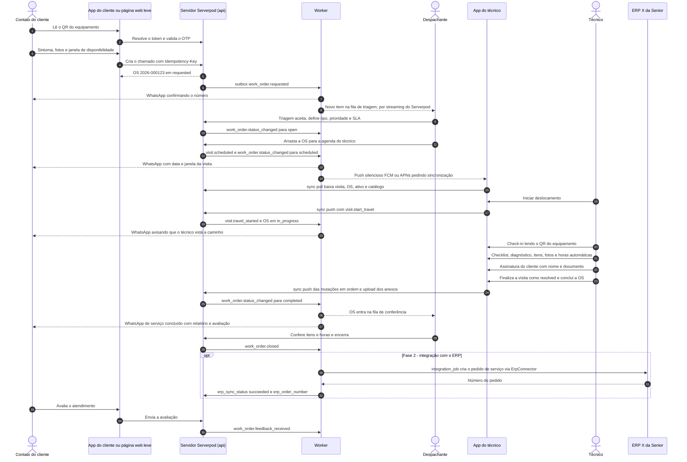
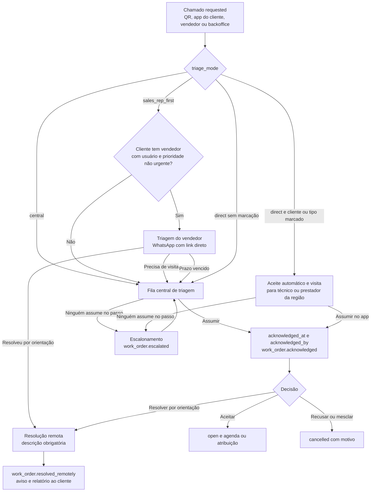
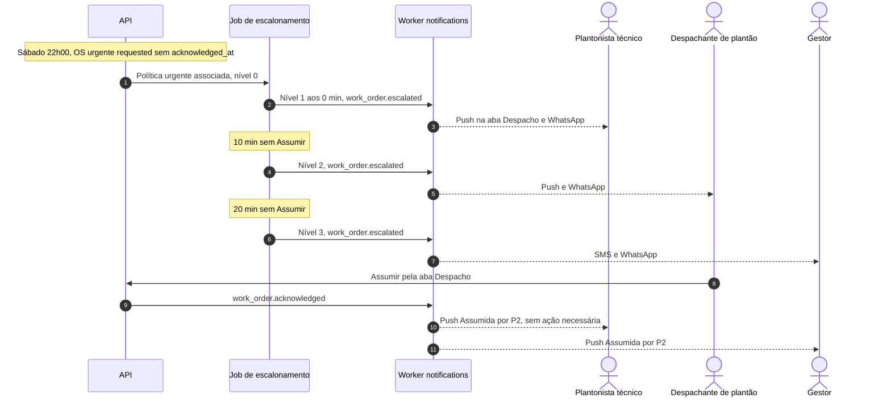
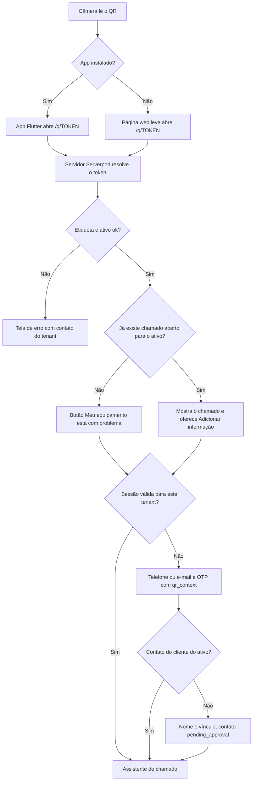
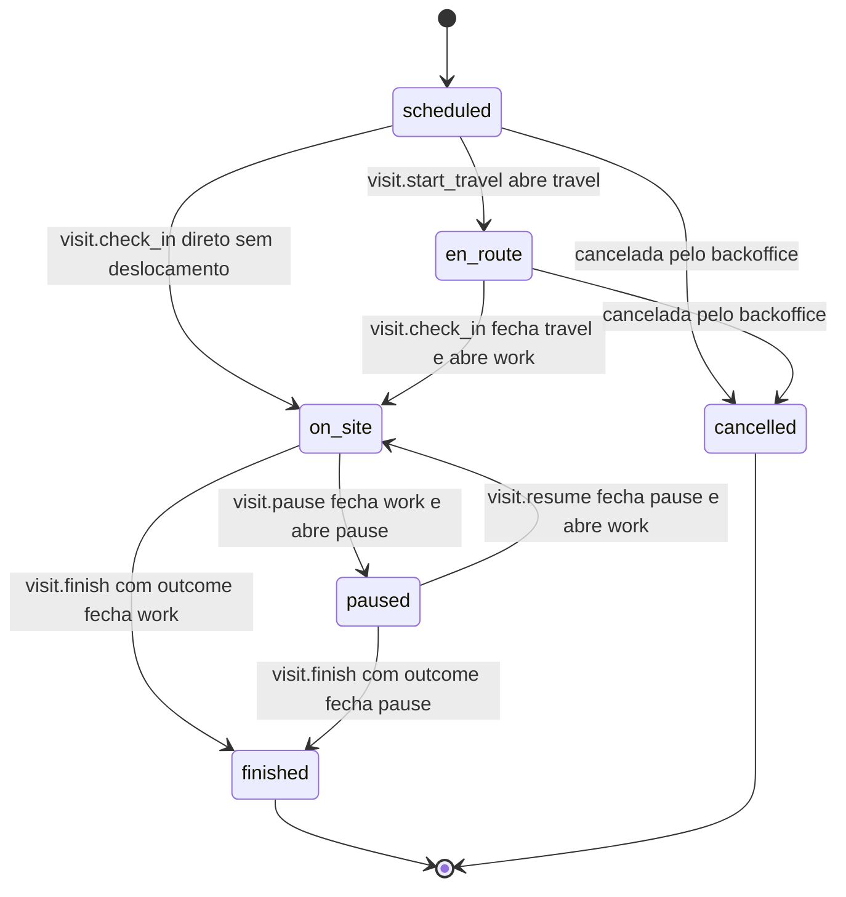
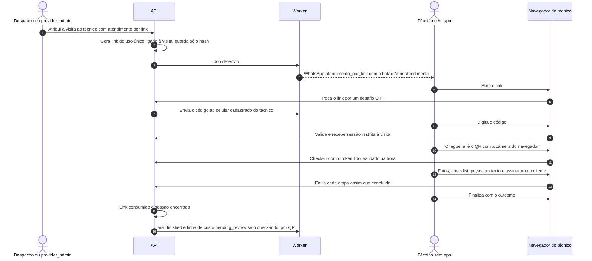
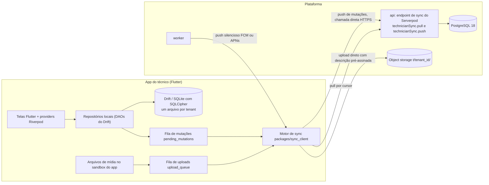
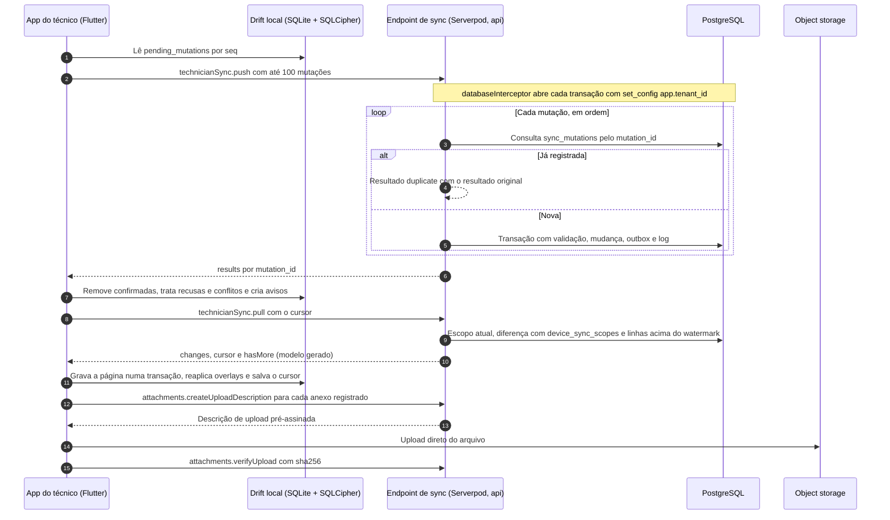
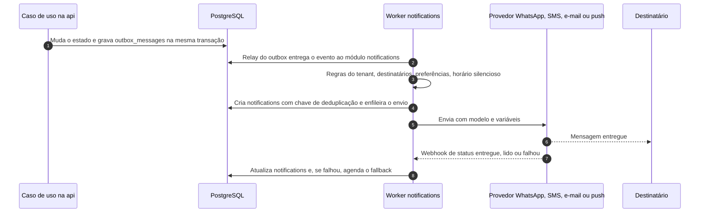

# Aplicações e fluxos

Versão 0.3 — 02/11/2026 — rascunho para revisão (stack Dart: Flutter + Serverpod)

Este documento descreve as três aplicações da plataforma — backoffice (Flutter Web), app do cliente (Flutter iOS/Android + página web leve do QR) e app do técnico (Flutter, offline-first) —, a jornada ponta a ponta da OS, o protocolo de sincronização offline e as notificações, para orientar os times de front-end, mobile e backend.

**Novidades da v0.2** (origem: [Benchmark Sismetro](11-benchmark-sismetro-e-novas-funcionalidades.md)):

- **Backoffice:** telas de prestadores, vendedores e carteira, filiais, plantão, políticas de escalonamento e aba Custos na OS (MVP); modo TV, planos de manutenção, medidores e fechamento de prestadores (F2); rentabilidade do comodato, telemetria e oficina (F3). Seções 3.2 a 3.9 e 3.12 a 3.16.
- **Triagem:** modos `central`, `sales_rep_first` e `direct`, ação "Assumir" e resolução remota (seção 3.12). O vendedor trabalha no backoffice responsivo, avisado por WhatsApp com link direto para a triagem (seção 3.13).
- **App do técnico:** aba Despacho para quem tem o papel `dispatcher` (5.19); técnico terceirizado e aba "Minha equipe" do `provider_admin` (5.20); check-in pelo QR obrigatório (5.8); leitura de medidor no checklist e mutação `meter_reading.record` (F2; 5.9 e 6.7).
- **Atendimento por link** para prestadores sem app (F2, seção 5.21).
- **App do cliente:** aviso de "resolvido por orientação" e entrega automática do relatório em PDF (4.6).
- **Notificações:** eventos novos na matriz (seção 7.2.1).

**Mudanças da v0.3** (origem: [Stack Dart: Flutter + Serverpod](12-stack-dart-flutter-serverpod.md)) — só a implementação muda; telas, fluxos, protocolo de sync e funcionalidades da v0.2 continuam:

- **Apps:** técnico e cliente em **Flutter** (iOS e Android); backoffice em **Flutter Web**; quem lê o QR sem app usa a **página web leve** servida pelo servidor web do Serverpod (seção 4.2). Estado com Riverpod e navegação com go_router nos três.
- **Servidor:** endpoints do **Serverpod** com modelos e cliente Dart gerados no lugar de OpenAPI + SDK para os próprios apps; tempo real por **streaming do Serverpod** (seção 3.1).
- **Offline:** banco local **Drift (SQLite) + SQLCipher** no lugar de expo-sqlite + Drizzle; fila local `pending_mutations`; endpoint direto de sync, sem broker (seções 6.1 e 6.2).
- **Notificações:** push nativo por **FCM/APNs** (`firebase_messaging`), sem web push (seção 7).
- **Dinheiro** em centavos (`int`) e quantidades em milésimos (`int`) nos payloads ([docs/12](12-stack-dart-flutter-serverpod.md) §4.1).

Leia junto: [Ativos e QR code](05-ativos-e-qr-code.md) (etiquetas, página pública, antiabuso), [Modelo de domínio](03-modelo-de-dominio.md) (entidades, estados e eventos oficiais), [Arquitetura de solução](02-arquitetura-de-solucao.md) (módulos, tempo real, monorepo), [Multi-tenancy e segurança](04-multi-tenancy-e-seguranca.md) (IdP, OTP, sessões), [API](08-api.md) (contratos HTTP) e [Integração ERP Senior](07-integracao-erp-senior.md).

---

## 1. Visão geral das aplicações

| Aplicação | Usuários (papéis) | Tecnologia | Distribuição | Autenticação | Offline |
|---|---|---|---|---|---|
| **Backoffice web** | tenant_admin, dispatcher, backoffice_agent, manager; platform_admin (console) | **Flutter Web** (Riverpod, go_router), cliente Dart gerado pelo Serverpod | Navegador (desktop; responsivo até tablet) | OIDC no IdP (D5), fluxo OIDC no Flutter Web | Não |
| **App do cliente** | customer_contact, customer_admin | **Flutter** (iOS/Android; Riverpod, go_router, `mobile_scanner`) | App Store e Google Play | OTP próprio (D5a); tokens ES256 emitidos pela `api` | Parcial (rascunho e fila de envio) |
| **Página web leve do QR** | customer_contact sem o app | HTML renderizado pelo **servidor web do Serverpod**, pouco JavaScript, sem Flutter Web | Navegador, no domínio da plataforma (`/q/<token>`) | OTP próprio (D5a); sessão em cookie `HttpOnly` | Não (rascunho guardado no navegador) |
| **App do técnico** | technician | **Flutter** (iOS/Android) + **Drift (SQLite) + SQLCipher**, Riverpod, go_router, `mobile_scanner`, `flutter_appauth` | App Store e Google Play (MDM opcional) | OIDC no Keycloak 26.8 (`flutter_appauth`, PKCE) + biometria/PIN | Total (offline-first) |
| Backoffice web — v0.2 (MVP) | + `sales_rep` (telas responsivas de carteira e triagem, seção 3.13) e `provider_admin` (área restrita à sua empresa, seção 3.14) | Mesmo app Flutter Web | Navegador; telas do vendedor e do prestador funcionam a partir de 360 px | OIDC no IdP (D5) | Não |
| App do técnico — v0.2 (MVP) | + `technician` terceirizado (`technicians.kind = contractor`); aba Despacho para `dispatcher`; aba "Minha equipe" para `provider_admin` | Mesmo app | Mesmo | Mesmo | Execução offline; Despacho e Minha equipe só online |
| **Atendimento por link** (F2) | Técnico de prestador sem o app | Rotas web leves do servidor web do Serverpod, na mesma base da página do QR (seção 5.21) | Link de uso único por WhatsApp, no domínio da plataforma | Link ligado à visita + OTP no celular do técnico | Não (fluxo online) |

Pacotes compartilhados no monorepo com Dart pub workspaces (+ melos para scripts) (D3). Os nomes são sugestão; o layout definitivo está em [Arquitetura de solução](02-arquitetura-de-solucao.md).

| Pacote (sugestão) | Conteúdo | Usado por |
|---|---|---|
| `plataforma_os_client` (gerado pelo Serverpod) | Classes Dart dos modelos `.spy.yaml` — inclusive os payloads das mutações e as respostas de pull/push — e o cliente dos endpoints | Os três apps Flutter |
| `packages/domain_rules` | Regras de validação em Dart puro sobre os modelos gerados (campos obrigatórios por transição, limites, formatos) | Servidor e apps (a mesma regra valida no aparelho e no servidor) |
| `packages/design_tokens` | Cores, tipografia, espaçamentos → `ThemeData` do Flutter e variáveis CSS da página web leve | Os três apps e a página leve |
| `packages/qr` (`plataforma_qr`) | Normalização e validação de token e short code em Dart puro ([Ativos e QR code](05-ativos-e-qr-code.md)) | Servidor, apps, backoffice |
| `packages/sync_client` | Motor de sincronização do app do técnico sobre o Drift (fila `pending_mutations`, cursor, uploads, conflitos) | App do técnico |
| `packages/i18n` | Textos pt-BR em ARB (geração do `flutter gen-l10n`), inclusive o mapeamento de status para linguagem simples; o servidor lê o mesmo catálogo para a página leve | Os três apps e a página leve |

---

## 2. Jornada ponta a ponta

Nomes de eventos de visita e de conclusão seguem D12; o catálogo oficial está em [Modelo de domínio](03-modelo-de-dominio.md).



O que cada ator vê em cada status canônico (D9):

| Status | Backoffice | App do cliente | App do técnico |
|---|---|---|---|
| `requested` | Fila de triagem | "Recebemos seu chamado" | — |
| `open` | A agendar | "Chamado aprovado, vamos agendar" | — |
| `scheduled` | Agenda | "Visita agendada para {dia}, {janela}" | Visita na agenda |
| `in_progress` | Em atendimento + status da visita | "{Nome} está a caminho" / "Atendimento em andamento" | Em execução |
| `on_hold` | Pendente + motivo | "Aguardando peça" / "Precisamos de você" / "Retorno agendado" | Visita finalizada com retorno |
| `completed` | Fila de conferência | "Serviço concluído" + relatório + avaliação | Concluída |
| `closed` | Encerrada + status do ERP | "Serviço concluído" | Sai do escopo após a janela |
| `cancelled` | Cancelada + motivo | "Chamado cancelado: {motivo}" | Visita removida |

**v0.2 (MVP), três variações da jornada:**

- **Resolução remota:** a triagem resolve por orientação (telefone/WhatsApp), sem visita. A OS é concluída com `resolution_mode = remote` e descrição obrigatória, pela transição de resolução remota do [Modelo de domínio](03-modelo-de-dominio.md), e emite `work_order.resolved_remotely`. O cliente vê "Resolvido por orientação" (seção 4.6), o backoffice vê o selo "Remota" e o app do técnico não recebe nada.
- **Triagem pelo vendedor** (`sales_rep_first`): antes da fila central, o chamado passa pelo vendedor da carteira, com prazo. Detalhes nas seções 3.12 e 3.13.
- **Aceite ("Assumir") e escalonamento:** além da mudança de status, a OS registra quem a assumiu (`acknowledged_at`, `acknowledged_by`). Enquanto ninguém assumir, o escalonamento sobe de nível e avisa o plantão (seção 3.15).

---

## 3. Backoffice web

### 3.1 Princípios

- **Tela padrão única** (pedido do usuário): um app Flutter Web de página única, com menu lateral, busca global (Ctrl+K) e centro de notificações. Abrir OS, acompanhar, despachar e manter todos os cadastros acontecem no mesmo lugar.
- **Tempo real**: listas, quadros e contadores se atualizam sozinhos pelo **streaming do Serverpod** (WebSocket; [Arquitetura de solução](02-arquitetura-de-solucao.md)): o worker publica avisos de **invalidação** sem dados (`{"type", "id", "version"}`) nas mensagens globais do Serverpod (canal por tenant, ex.: `t:<tenant_id>:ui`, difundido entre instâncias via Redis/Valkey); o endpoint de streaming da `api` repassa ao backoffice só os avisos do tenant da sessão; a tela invalida o provider do Riverpod correspondente e relê pelo endpoint normal, onde a autorização acontece. Ao reconectar, a tela relê tudo o que está aberto (avisos perdidos durante a queda não são reenviados).
- **Produtividade do despachante**: atalhos de teclado, filtros salvos por usuário, ações em lote, arrastar e soltar.
- **Padrões de API** (D12): paginação por cursor nas tabelas; edição com `version` (o equivalente ao `If-Match` nos endpoints do Serverpod, ver [API](08-api.md)) — em conflito, a tela mostra "alterado por Fulano às 10:42" e oferece recarregar ou comparar.
- **Fuso**: datas no fuso do tenant (padrão America/Sao_Paulo), com aviso quando o usuário estiver em outro fuso.
- **Acessibilidade**: WCAG 2.2 AA, navegação completa por teclado, foco visível; status sempre com texto + ícone, nunca só cor.
- Responsivo até tablet (≥ 1024 px); agenda e despacho pensados para desktop (≥ 1280 px).
- **v0.2 (MVP):** as telas do vendedor (carteira, triagem do chamado, nova OS em nome do cliente, OS dos clientes) e do `provider_admin` (OS da empresa, técnicos, indicadores) são **mobile-first**, a partir de 360 px. O vendedor e o pequeno prestador abrem o backoffice pelo celular, a partir de um link no WhatsApp.
- **Escopo por filial (v0.2):** quem tem escopo limitado a filiais só vê os registros delas, e um seletor de filial aparece no topo quando o usuário tem mais de uma.

### 3.2 Arquitetura de informação (menu)

- **Início** — painel do dia
- **Ordens de serviço**
  - Triagem (contador)
  - Acompanhamento (kanban e lista)
  - Nova OS
  - Agenda e despacho
  - Mapa
  - Conferência (contador)
  - Não assumidas e escalonadas (contador) — MVP
  - Oficina: recondicionamento e desmontagem — F3
- **Ativos**
  - Equipamentos
  - Etiquetas QR (lotes, impressão, busca)
  - Movimentações (com "Pendentes de aprovação", contador — MVP)
  - Bens sem etiqueta e mutirão do legado — F2
  - Medidores e leituras — F2
  - Telemetria: dispositivos, regras e alertas — F3
- **Manutenção** — F2
  - Planos de manutenção
  - Previsão (também como camada na agenda)
- **Prestadores** — MVP
  - Prestadores (cadastro, tabela de preços, técnicos, indicadores antifraude)
  - Fechamento — F2
- **Comercial** — MVP
  - Vendedores e carteira
  - Rentabilidade do comodato — F3
- **Cadastros**
  - Clientes (com unidades e contatos)
  - Produtos
  - Serviços
  - Técnicos (operadores)
  - Equipes
  - Regiões de atendimento
  - Filiais — MVP
  - Turnos de trabalho
  - Escalas
  - Plantão — MVP
  - Calendários e feriados
  - Tipos de OS
  - Sintomas, causas e soluções
  - Checklists
  - Políticas de SLA
  - Políticas de escalonamento — MVP
- **Integrações**
  - Monitor de integrações
  - Importações
  - Conexões (fase 2)
- **Relatórios**
  - Indicadores
  - Custos — MVP (básico), F2 (completo)
  - Relatórios detalhados e exportações
  - Modo TV — F2
- **Configurações**
  - Empresa e branding
  - Usuários e papéis
  - Regras de OS e numeração
  - Portal do cliente
  - Notificações e modelos
  - Dispositivos
  - Auditoria
- **Console da plataforma** (somente platform_admin)

### 3.3 Papéis e capacidades

E = executa/edita · L = somente leitura · — = sem acesso. Permissões finas e escopo por papel em [Multi-tenancy e segurança](04-multi-tenancy-e-seguranca.md).

| Capacidade | tenant_admin | dispatcher | backoffice_agent | manager |
|---|---|---|---|---|
| Triagem (aceitar, recusar, mesclar duplicado, aprovar contato) | E | E | E | L |
| Criar OS | E | E | E | — |
| Agendar, despachar, reatribuir visitas | E | E | L | L |
| Conferir e encerrar OS | E | E | E | L |
| Cancelar OS | E | E | E (até `scheduled`) | — |
| Comentários internos e visíveis ao cliente | E | E | E | L |
| Ativos e etiquetas (vincular, transferir, recolher, reimprimir) | E | E | E | L |
| Baixar ativo, revogar em massa | E | E | — | — |
| Desfazer vínculo de etiqueta | E | — | — | — |
| Clientes, unidades, contatos, produtos, serviços (locais) | E | E | E | L |
| Técnicos, equipes, regiões, turnos, escalas, calendários | E | E | L | L |
| Tipos de OS, sintomas, causas, soluções, checklists, SLA | E | L | L | L |
| Importações CSV/XLSX | E | E | — | — |
| Monitor de integrações (reprocessar) | E | L | — | L |
| Relatórios e indicadores | E | E | L (operacionais) | E |
| Configurações, usuários e papéis | E | — | — | — |
| Dispositivos dos técnicos (encerrar sessão, bloquear) | E | E | — | — |
| Auditoria | L | — | — | L |
| Assumir OS e resolver remotamente (MVP) | E | E | E | — |
| Aprovar movimentação de ativo (MVP) | E | com permissão | — | — |
| Prestadores, tabela de preços, vendedores e carteira, filiais (MVP) | E | E (filiais: L) | L | L |
| Plantão e políticas de escalonamento (MVP) | E | E (plantão); L (políticas) | L | L |
| Aba Custos da OS e conferência de custos (MVP) | E | E | L | L |
| Relatórios de custo (MVP básico, F2 completo) | E | E | — | E |
| Fechamento de prestadores (F2) | E (aprovar) | E (montar) | — | L |
| Planos de manutenção e medidores (F2) | E | E | L | L |
| Modo TV: criar e revogar tokens de exibição (F2) | E | E | — | E |
| Telemetria: dispositivos e regras (F3) | E | L (alertas: E) | — | L |
| Rentabilidade do comodato (F3) | E | — | — | E |

platform_admin usa o console da plataforma e, quando necessário, o acesso de suporte a um tenant (com motivo, prazo e registro em `audit_logs` — ver [Multi-tenancy e segurança](04-multi-tenancy-e-seguranca.md)). Os papéis technician, customer_contact e customer_admin não acessam o backoffice.

**Papéis novos da v0.2 (MVP)**, ambos com escopo de dados restrito ([Multi-tenancy e segurança](04-multi-tenancy-e-seguranca.md)):

| Capacidade | `sales_rep` (vendedor) | `provider_admin` (gestor do prestador) |
|---|---|---|
| Ver clientes, unidades, ativos e OS | Só da sua carteira (`customers.primary_sales_rep_id`) | Só as OS atribuídas à sua empresa e os ativos delas |
| Triagem | Chamados da carteira em `sales_rep_first`: assumir, resolver remotamente, encaminhar à fila central (com nota), pedir informação | — |
| Abrir OS | Em nome de um cliente da carteira (`origin = sales_rep`) | — |
| Despachar | — | Atribuir e reatribuir as OS da empresa entre os seus técnicos; assumir em nome da empresa |
| Técnicos | — | Ver os da empresa; convidar técnico novo (ativação aprovada pelo tenant) |
| Custos e preços | — | Ver as linhas de custo da empresa e, na F2, o demonstrativo do fechamento |
| Indicadores | % resolvido remotamente, OS e reincidência da carteira; rentabilidade da carteira (F3) | Os próprios indicadores antifraude e de SLA |
| Comentários | Internos e visíveis ao cliente, nas OS da carteira | Internos, nas OS da empresa |

### 3.4 Telas de operação

#### Painel inicial
KPIs do dia (chamados novos, OS por status, SLA em risco/estourado, técnicos em campo e ociosos, visitas atrasadas, falhas de integração), backlog por idade e atalhos. Todos os papéis internos.

#### Fila de triagem
- **Objetivo:** transformar chamados `requested` em OS aceitas ou recusadas rapidamente.
- **Lista:** ordenada por prioridade sugerida (sintoma + perguntas de impacto) e idade. Selos: "Solicitante não verificado", "Possível duplicado", "Fora do local", "Aberto por código digitado", "Novo relato" (informação adicionada a uma OS existente). Contador no menu e alerta sonoro para urgentes.
- **Painel lateral:** equipamento (modelo, série, propriedade, garantia), cliente e unidade, sintoma e descrição, fotos/vídeo, janela de disponibilidade, contato no local, histórico do ativo (últimas OS, reincidência em 30 dias), outras OS abertas do cliente, mapa.
- **Ações:** **Aceitar** (confirma tipo, prioridade e região/equipe; SLA calculado pela política) → `open`; **Aceitar e agendar** (abre a agenda filtrada); **Mesclar como duplicado** (→ `cancelled` com motivo "duplicada", ligada à OS principal; o cliente recebe o número correto); **Recusar** (→ `cancelled` com motivo e mensagem ao cliente); **Pedir informação** (comentário visível ao cliente; continua `requested`); **Aprovar/recusar contato** não verificado ([Ativos e QR code](05-ativos-e-qr-code.md)).
- **Papéis:** dispatcher, backoffice_agent, tenant_admin. Fase 2: aceite automático para contatos verificados e sintomas configurados.
- **v0.2 (MVP):** botão **Assumir** (aceite humano, independente do status), **Resolver remotamente** (descrição obrigatória), coluna "Com o vendedor até {hora}" no modo `sales_rep_first`, selos "Escalonada nível N" e "OS sem ativo", e o contador de "não assumidas". Regras e fluxograma na seção 3.12.

#### Acompanhamento (kanban e lista)
- **Colunas:** Solicitada, Aberta, Agendada, Em atendimento, Pendente, Concluída. Encerrada e Cancelada ocultas por padrão (filtro mostra as últimas 24 h).
- **Cartão:** nº, cliente/unidade, equipamento, tipo, prioridade, técnico, próxima visita, status da visita (a caminho, no local, pausada), SLA (barra com cor e texto: no prazo / em risco, ≥ 75% consumido / estourado) e selos (falha no ERP, não verificado, retorno, anexos pendentes, registros a revisar do sync).
- **Filtros:** status, cliente, unidade, região, equipe, técnico, tipo, prioridade, origem, estado do SLA, período, `erp_sync_status`; visões salvas e compartilháveis; alternância kanban/lista; exportação CSV.
- **Arrastar** só nas transições do backoffice (ex.: Aberta → Agendada abre o diálogo de agendamento); as transições de campo vêm do app do técnico.
- **Papéis:** todos os internos (manager só leitura).

#### Nova OS
Cliente → unidade → equipamento (busca por série, patrimônio, short code ou leitor USB; se o ativo já tem OS aberta, alerta e oferece abri-la) → tipo → sintoma → descrição → prioridade → contato no local → janela de disponibilidade → anexos. `origin = backoffice`; como já passou por um atendente, nasce `open` (sem triagem), conforme as transições de [Modelo de domínio](03-modelo-de-dominio.md); pode ser agendada na mesma tela. Papéis: dispatcher, backoffice_agent, tenant_admin.

**v0.2 (MVP):** o equipamento só aceita ativos do tenant alocados ao cliente. Para seguir sem ativo, a tela exige justificativa e marca a OS com o selo "OS sem ativo". A filial vem do ativo ou da unidade e pode ser trocada. Aberta pelo vendedor, a OS registra `origin = sales_rep` e segue a regra de triagem da seção 3.12.

#### Detalhe da OS
- **Cabeçalho:** nº, status, prioridade, tipo, origem, cronômetros de SLA, cliente/unidade, equipamento, responsável, `erp_sync_status` e `erp_order_number`.
- **Blocos:** Resumo (relato, sintoma, mídia, janela, contato no local, sinalizações) · Linha do tempo (`work_order_status_history` + eventos de visita + comentários + notificações enviadas) · Visitas (técnico, horário planejado e real, método e distância do check-in, outcome, diagnóstico) · Itens (produto/serviço, quantidade, unidade, `billing_type`, preço do snapshot, totais por tipo de cobrança) · Horas (`time_entries` por visita e tipo; ajustes manuais destacados com justificativa) · Checklists · Anexos (galeria por categoria, assinatura com nome/documento, status de envio) · Comentários · Integração (fase 2: jobs, tentativas, erro, reprocessar) · Auditoria.
- **Comentários:** o campo nasce **interno**; marcar "visível ao cliente" muda a cor do campo e pede confirmação. Comentário visível notifica o cliente.
- **Ações por status:** aceitar/recusar, agendar visita, reatribuir, pôr em pendência (motivo), devolver na conferência, conferir e encerrar, cancelar (motivo), gerar/enviar relatório de atendimento (PDF com assinatura), abrir OS de retorno.
- **Registros a revisar:** horas, itens ou fotos que o técnico registrou offline numa OS que foi cancelada, reatribuída ou encerrada no meio-tempo aparecem num bloco de revisão com aceitar/descartar (seção 6.9).
- **v0.2 (MVP), cabeçalho:** filial, prestador (`service_provider_id`), modo de resolução (`field`, `remote`, `workshop`), "Assumida por {nome} às {hora}" ou "Não assumida — nível {escalation_level}", vendedor da carteira e origem `sales_rep`, `preventive_plan` (F2) ou `telemetry` (F3).
- **v0.2 (MVP), aba Custos:** linhas de `work_order_costs` por tipo (`parts`, `own_labor`, `third_party_labor`, `travel`, `other`) e status (`pending_review`, `approved`, `rejected`), com origem (automática pela taxa do prestador, pela baixa de peças no ERP na F2 ou manual), valor, quem conferiu e quando.
  - **Conferência linha a linha:** aprovar, rejeitar com motivo ou ajustar com justificativa, que gera uma linha nova e rejeita a original. Na F2, a linha aprovada mostra o fechamento a que pertence (`settlement_id`) e fica travada depois dele.
  - **Sinalizações ao lado da linha automática do terceiro:** check-in sem QR, `check_in_off_site`, OS sem ativo, reincidência em 30 dias no mesmo ativo, tempo no local fora do padrão. Visita com sinalização não gera a linha automática, e quem confere pode lançá-la manualmente.
  - **Totais:** custo total da OS e custo por tipo. O custo nunca aparece para o cliente, e o `provider_admin` vê só as linhas da empresa dele.
- **v0.2 (F2):** bloco Requisição de materiais (status de `work_order_items.stock_requisition_status` e `erp_requisition_ref`) e, nas OS preventivas, o plano de origem (`maintenance_plan_asset_id`).

#### Agenda e despacho
- **Quadro:** linhas = técnicos (filtro por equipe/região); colunas = horas (visão dia) ou dias (visão semana); visitas como blocos por status/prioridade. À esquerda, a fila "a agendar" (OS `open` e `on_hold` aguardando retorno).
- **Turnos e escalas:** fora do turno (de `technician_shift_assignments` + `work_shifts`) e feriados (`business_calendars`) em cinza; intervalos marcados; ausências (férias, folgas) bloqueadas.
- **Arrastar** da fila para técnico/horário cria a visita (`scheduled`) com a duração estimada do tipo de OS; arrastar entre técnicos reatribui; redimensionar muda a duração.
- **Avisos** (não bloqueiam, exceto ausência): fora do turno (hora extra), sobreposição, região diferente da do técnico, fora da janela do cliente, SLA estoura antes do horário, técnico sem sincronizar há mais de 30 min ("a mudança só chega quando ele conectar").
- Reatribuir visita já iniciada (`en_route`/`on_site`) exige confirmação: a visita antiga é cancelada e outra é criada, preservando o histórico.
- **Mapa lateral:** unidades com OS a agendar, visitas do dia e última posição conhecida do técnico (último evento de visita; rastreamento contínuo é fase 3). Fase 3: sugestão do melhor técnico e roteirização.
- **Papéis:** dispatcher, tenant_admin.
- **v0.2 (MVP), prestadores:** as linhas do quadro incluem técnicos terceirizados (selo com o nome do prestador) e uma linha por prestador. Soltar a OS na linha do prestador atribui a visita à empresa (`work_order_visits.service_provider_id`, sem técnico), e o `provider_admin` escolhe o técnico (seção 5.20). Há aviso quando o prestador não atende a região da unidade ou está fora da vigência do contrato.
- **v0.2 (MVP), plantão:** faixas de plantão (`on_call_assignments`) aparecem no quadro, e fins de semana e feriados mostram quem está de plantão por filial ou região.
- **v0.2 (F2), previsão dos planos:** uma camada liga a previsão das preventivas (`maintenance_plan_assets`, próxima data ou leitura prevista) na fila "a agendar" e no quadro, em tom claro. Arrastar uma previsão gera a OS antecipadamente e agrupa por cliente e unidade, para uma visita atender vários ativos.

#### Mapa
OS por status e prioridade, unidades, técnicos (último evento), camadas por região de atendimento; clique abre o detalhe.

#### Conferência
Fila das OS `completed`: revisão de itens (`billing_type`, quantidades, preços), horas (ajustes, sobreposições, relógio suspeito), assinatura e anexos pendentes. Aplica a regra do tenant que converte horas apontadas em item de serviço faturável (ex.: mão de obra por hora — mapeamento em [Integração ERP Senior](07-integracao-erp-senior.md)). Ações: **Encerrar** (→ `closed`; na fase 2 dispara o pedido de serviço no ERP) e **Devolver** (pendência para retorno). Com "exigir conferência do backoffice" desligada, a OS encerra sozinha e a fila não aparece. Papéis: dispatcher, backoffice_agent, tenant_admin.

**v0.2 (MVP):** a conferência inclui os **custos** (aba Custos do detalhe), as sinalizações antifraude e as movimentações de ativo da OS com aprovação pendente (só informativo, não bloqueia). Filtros novos: prestador, "com custo pendente", "check-in sem QR", "OS sem ativo". Com a conferência desligada, as linhas `pending_review` continuam na fila "Custos a conferir", porque o custo do terceiro só vale depois de conferido.

### 3.5 Ativos e etiquetas

Ciclo de vida e regras em [Ativos e QR code](05-ativos-e-qr-code.md).

| Tela | Objetivo | Conteúdo e ações | Papéis |
|---|---|---|---|
| Equipamentos (lista) | Encontrar e filtrar ativos | Busca por série, patrimônio, short code, cliente, modelo; filtros status, propriedade, modelo, cliente, região, "sem etiqueta", "garantia vencendo"; em lote: gerar etiquetas, transferir, exportar | tenant_admin, dispatcher, backoffice_agent; manager (L) |
| Detalhe do ativo | Ficha e linha do tempo | Dados, alocação vigente e histórico, etiqueta vigente e revogadas, OS abertas e históricas, falhas e MTBF do ativo, anexos; ações: alocar, transferir, recolher, baixar, alterar propriedade, gerar/vincular/substituir/revogar etiqueta, abrir OS | idem |
| Etiquetas QR — lotes | Emitir e imprimir | Criar lote (quantidade, layout, observação), baixar PDF/ZPL, confirmar impressão, reimprimir, revogar lote ou faixa; contadores por status | tenant_admin, dispatcher |
| Etiquetas QR — busca | Consultar uma etiqueta | Por short code ou leitor USB: status, ativo, lote, auditoria; vincular, revogar, reimprimir, desfazer vínculo (tenant_admin) | tenant_admin, dispatcher; backoffice_agent (consulta) |
| Movimentações | Comodatos e movimentos | Alocações por período e cliente (entradas, saídas, transferências), ativos em comodato por cliente, exportação | internos (L) |
| Detalhe do ativo — v0.2 (MVP) | Acréscimos à ficha | Abas **Documentos** (do ativo e herdados do modelo, por categoria: `comodato_contract`, `invoice`, `manual`, `movement_term`, `photo`, `other`) e **Aquisição** (data, custo, fornecedor, documento); filial; termo e status de aprovação em cada alocação da linha do tempo; selo "Movimentação rejeitada — regularizar". F2: selo "ERP" e aba **Medidores**. F3: **Componentes** (pai/filho) e **Telemetria** | idem; valores de aquisição só tenant_admin, dispatcher e manager |
| Movimentações — pendentes de aprovação (MVP) | Aprovar ou rejeitar | Lista de alocações `approval_status = pending` (ativo, tipo de termo, origem → destino, quem registrou, OS, termo assinado ou não); aprovar em lote; rejeitar com motivo; baixar termo | Aprovadores (tenant_admin ou permissão de aprovar) |
| Bens sem etiqueta e mutirão (F2) | Etiquetar os bens do ERP | Filas "Bens sem produto mapeado" e "Bens sem etiqueta"; gerar etiquetas em lote (modo B); painel do mutirão do legado por filial, cliente e técnico (localizados, etiquetados, divergentes) | tenant_admin, dispatcher |
| Medidores e leituras (F2) | Acompanhar uso | Medidores por ativo, última leitura, leituras suspeitas (regressão justificada, fora da faixa), importação de leituras, gráfico por ativo | tenant_admin, dispatcher; manager (L) |
| Telemetria (F3) | Dispositivos, regras e alertas | **Dispositivos:** vínculo com o ativo, status online/offline, último contato, rotação de credencial. **Regras** (`telemetry_alert_rules`): medidor, condição, duração, ação (notificar ou abrir OS). **Alertas:** lista com reconhecer, abrir OS e silenciar | tenant_admin (E); dispatcher (alertas) |
| Oficina (F3) | Recondicionamento e desmontagem | Quadro das OS `refurbishment` e `teardown` dos ativos `in_workshop`; registro das peças recuperadas na desmontagem; baixa `cannibalized` ao concluir | tenant_admin, dispatcher |

### 3.6 Cadastros

**Padrões comuns a todos os cadastros:**

- Lista com busca, filtros e exportação; detalhe com abas (dados, relacionamentos, auditoria).
- Nada é apagado fisicamente: **Inativar** (`is_active = false`) com motivo; inativos somem das seleções e continuam no histórico (D14).
- **Selo "ERP"** quando `source = 'erp'`: campos mestres com cadeado e dica "mantido no ERP X — última sincronização em dd/mm hh:mm" (`last_synced_at`); extensões locais editáveis (geolocalização, instruções de acesso, horários). A edição de campos mestres é bloqueada na UI e na API (D10).
- **Importação CSV/XLSX** (assistente): baixar modelo → enviar arquivo → mapear colunas → simulação com erros por linha → confirmar (job assíncrono) → relatório (criados, atualizados, ignorados, erros e arquivo de erros para correção). Upsert pelo código do registro (idempotente). Na fase 2, quando a sincronização com o ERP estiver ativa para a entidade, a importação dela fica desabilitada.
- Concorrência otimista (`version`) e auditoria campo a campo.

| Cadastro | Campos principais | Origem | Particularidades |
|---|---|---|---|
| Clientes (`customers`) | Razão social/nome, nome fantasia, CNPJ/CPF, código, status, observações para técnicos | Local no MVP; ERP na fase 2 | Abas Unidades, Contatos, Equipamentos e OS |
| Unidades (`customer_sites`) | Nome, endereço, geolocalização (pino ajustável), horário de funcionamento, instruções de acesso, região de atendimento, calendário | Local / ERP (mestre) + extensões locais | Geocodificação ao salvar; o técnico pode sugerir coordenadas |
| Contatos (`customer_contacts`) | Nome, celular (WhatsApp), e-mail, papel (customer_contact ou customer_admin), unidade opcional, status (ativo, pendente, bloqueado), preferências de notificação | Local / ERP / auto-cadastro via QR | Convidar (link por WhatsApp/e-mail), aprovar pendentes, bloquear |
| Produtos (`products`) | Código, descrição, unidade, família, fabricante/modelo, preço de referência, rastreável como ativo, código de barras, foto, posição da etiqueta | Local / ERP | A família filtra sintomas e causas; o preço alimenta o snapshot do item |
| Serviços (`services`) | Código, descrição, unidade (h, visita, un), preço, tipo (mão de obra, deslocamento, visita técnica) | Local / ERP | Itens com `kind = service` |
| Técnicos (`technicians`) | Usuário (o convite cria `user` + `tenant_membership` com papel technician), matrícula, equipe, regiões, escala padrão, telefone, foto (mostrada ao cliente), custo/hora, status | Local | Abas Dispositivos (encerrar sessão, bloquear), Agenda, Produtividade |
| Equipes (`teams`) | Nome, líder, membros, regiões | Local | — |
| Regiões de atendimento (`service_areas`) | Nome, municípios/CEPs ou polígono, equipe padrão, calendário | Local | Usadas na triagem e na agenda |
| Turnos de trabalho (`work_shifts`) | Nome, dias da semana, início e fim, intervalos, tolerâncias, atravessa meia-noite | Local | Fuso do tenant (D14) |
| Escalas (`technician_shift_assignments`) | Técnico × período × turno; padrões recorrentes (5x2, 12x36) e exceções (folga, férias, plantão) | Local | Grade visual e importação; alimenta agenda e produtividade |
| Calendários e feriados (`business_calendars`) | Expediente; feriados nacionais (pré-carregados), estaduais e municipais | Local | SLA em horas úteis e agenda |
| Tipos de OS (`work_order_types`) | Nome, categoria (corretiva, preventiva, instalação, retirada, inspeção), checklist padrão, exige assinatura/fotos/diagnóstico, duração estimada, SLA padrão, visível ao cliente | Local | Define as obrigatoriedades no app do técnico |
| Sintomas (`symptoms`) | Nome técnico, rótulo e ícone para o cliente, visível ao cliente, aplicabilidade por família/modelo, prioridade sugerida, ordem | Local | Grade de ícones no app do cliente |
| Causas (`failure_causes`) e soluções (`resolution_codes`) | Código, descrição, aplicabilidade por família | Local | Base de MTBF, first-time fix e reincidência |
| Checklists (`checklist_templates`) | Itens (tipo de resposta, obrigatório, faixa válida, foto exigida), vínculo a tipo de OS/família, versão | Local | Nova versão não afeta OS em andamento |
| Políticas de SLA (`sla_policies`) | Critérios (cliente, tipo, prioridade, região), metas (aceite, chegada, solução), calendário (horas úteis ou corridas), pausas (ex.: pendência aguardando cliente) | Local | Cálculo detalhado em [Modelo de domínio](03-modelo-de-dominio.md) |

**Cadastros novos e alterados na v0.2:**

| Cadastro | Campos principais | Origem | Particularidades |
|---|---|---|---|
| Filiais (`branches`) — MVP | CNPJ, IE, endereço, código da filial no ERP, `is_default` | Local (uma filial padrão criada com o tenant) | Usada em ativos, OS e técnicos; define a filial do pedido no ERP; base do escopo por filial |
| Prestadores (`service_providers`) — MVP | Razão social, CNPJ, contato, regiões atendidas, status, vigência do contrato | Local | Abas **Tabela de preços**, **Técnicos**, **OS**, **Indicadores antifraude** e, na F2, **Fechamentos**. Inativar o prestador desatribui as visitas futuras, com aviso ao despacho |
| Tabela de preços (`provider_rates`) — MVP | Tipo de taxa (por visita, por hora, por km ou valor fixo por serviço), valor, tipo de OS ou serviço a que se aplica, vigência | Local | Vigências não se sobrepõem. A taxa vigente ao finalizar a visita gera a linha `third_party_labor` (`pending_review`) |
| Técnicos (`technicians`) — v0.2 | + `kind` (`employee` ou `contractor`), `service_provider_id` (obrigatório se `contractor`), `branch_id` | Local | Técnico terceirizado convidado pelo `provider_admin` só fica ativo depois da aprovação do tenant. Custo/hora só para `employee` |
| Vendedores (`sales_reps`) — MVP | Nome, contato (WhatsApp), `user_id` opcional, código do representante no ERP | Local; ERP na F2 | Aba **Carteira**: clientes com `customers.primary_sales_rep_id`, atribuição em lote e troca de carteira. Sem `user_id`, o vendedor só recebe avisos e não acessa a plataforma |
| Clientes (`customers`) — v0.2 | + vendedor principal; `kind` (`standard` ou `internal`, F3) | — | Filtro por vendedor. Cliente `internal` (F3) representa setores e a oficina do próprio tenant |
| Plantão (`on_call_assignments`) — MVP | Usuário, papel no plantão (`dispatcher` ou `technician`), filial ou região opcional, início e fim | Local | Grade semanal com cópia de semana; alerta de "furo de plantão" (período sem plantonista) nos fins de semana e feriados |
| Políticas de escalonamento (`escalation_policies`) — MVP | Critérios (prioridade, tipo, cliente), passos com espera em minutos, quem avisar (plantonista, papel ou usuário) e canais (push, WhatsApp, SMS) | Local | Simulador ("uma OS urgente às 22 h de sábado avisaria: …"); custo estimado das mensagens por passo |
| Tipos de OS (`work_order_types`) — v0.2 | + exige QR no check-in; exige ativo; fotos antes/depois obrigatórias; categorias `refurbishment` e `teardown` (F3) | Local | Base das regras antifraude da seção 5.8 |
| Checklists (`checklist_templates`) — F2 | + tipo de item `meter_reading` (medidor do ativo, faixa esperada, foto do mostrador opcional) | Local | Ver seção 5.9 |
| Planos de manutenção (`maintenance_plans`) — F2 | Tipo de OS, checklist, gatilho (`interval_days`, `monthly_day` ou `meter`), intervalo, antecedência, tolerância, aplicação por modelo ou por ativo | Local | Aba **Ativos do plano** (`maintenance_plan_assets`): próxima data ou leitura prevista e última OS gerada. Pré-visualização das OS dos próximos 90 dias |

### 3.7 Integrações

- **Monitor de integrações:** `integration_jobs` com status, tentativas, próximo retry, erro, payload e resposta (dados sensíveis mascarados); filtros por tipo, status, período e OS; ações reprocessar e cancelar. `sync_runs` de importações e sincronizações de cadastro (início/fim, lidos, criados, atualizados, erros, arquivo de erros). Regras em [Integração ERP Senior](07-integracao-erp-senior.md).
- **Importações:** histórico (sync_runs de importação) e atalhos para os assistentes.
- **Conexões (fase 2):** `integration_connections` — conector, endpoint, referência às credenciais no cofre de segredos (nunca o segredo, D10), mapeamentos, agendamentos e teste de conexão.
- Papéis: tenant_admin (E); dispatcher e manager (L); platform_admin em acesso de suporte.

### 3.8 Relatórios e indicadores

Calculados pelo módulo `reporting` a partir de visões de leitura (materializadas ou em réplica), atualizadas a cada 5–15 min; cada indicador mostra sua definição numa dica; exportação CSV.

| Indicador | Definição proposta | Cortes |
|---|---|---|
| SLA de atendimento | % das OS com check-in da 1ª visita dentro da meta da política | cliente, região, tipo, prioridade, período |
| SLA de solução | % das OS concluídas dentro da meta | idem |
| MTTR | Média de (concluída − criada) das corretivas; variante "em campo": soma dos apontamentos `work` | modelo, cliente, região, técnico |
| MTBF por modelo | Soma dos dias em operação dos ativos do modelo no período (alocações vigentes) ÷ nº de OS corretivas desses ativos no período (sem canceladas, duplicadas e "sem defeito") | modelo, família, cliente |
| First-time fix | % das corretivas encerradas com uma única visita, cujo outcome foi `resolved` | técnico, modelo, tipo |
| Produtividade por técnico/turno | Horas apontadas (`work`, `travel`, `pause`) ÷ horas escaladas; OS concluídas por dia; tempo médio no local; % de deslocamento | técnico, equipe, turno, período |
| Backlog | OS não concluídas por idade (0–1, 1–3, 3–7, > 7 dias), status, região, prioridade | — |
| Reincidência | % das corretivas com outra corretiva no mesmo ativo até 30 dias após encerrar | modelo, técnico, causa |
| Satisfação (CSAT) | Média das avaliações (1–5) e % de "não resolveu" | técnico, cliente, região |
| Tempo de triagem | Média de `requested` → `open` | período, atendente |
| Tempo até agendar | Média de `open` → `scheduled` | período, região |
| Tempo até assumir (MVP) | Média de entrada na fila → `acknowledged_at`; % assumidas sem escalonamento; % por nível de escalonamento | período, filial, prioridade, plantonista |
| % resolvido remotamente (MVP) | OS com `resolution_mode = remote` ÷ OS triadas (sem canceladas e duplicadas) | cliente, vendedor, prestador, sintoma |
| Custo por OS (MVP) | Soma das linhas `approved` de `work_order_costs` ÷ OS encerradas | tipo de custo, tipo de OS, cliente, ativo, modelo, prestador, filial |
| Antifraude por prestador e técnico (MVP) | % check-in por QR; check-ins fora do local; OS sem ativo; visitas por cliente; reincidência em 30 dias; tempo médio no local; custo médio por OS — cada um contra a média do tenant | prestador, técnico, região, período |
| HH (F2) | Horas-homem apontadas (`work` + `travel`) por OS, ativo e período, próprias e de terceiros | técnico, prestador, tipo |
| MTBF por horas de uso (F2) | Horas do horímetro entre falhas corretivas | modelo, cliente |
| Aderência aos planos (F2) | % das preventivas geradas executadas dentro da tolerância | plano, modelo, cliente |
| Rentabilidade do comodato (F3) | Vendas do cliente (`customer_sales_summaries`) × valor de aquisição dos ativos alocados × custo de manutenção; clientes abaixo do mínimo | cliente, vendedor, modelo, filial |

**Relatórios de custo (MVP básico, F2 completo):** custos por período, tipo de custo, tipo de OS, cliente, ativo, modelo e prestador, com detalhe até a linha e exportação CSV. No MVP entram só as linhas `approved`. Na F2 entram também o custo das peças vindo da baixa no ERP, MTBF, MTTR, HH e backlog com valor, e a comparação entre o custo de manutenção e o valor de aquisição do ativo (candidato a troca).

**Modo TV (F2):** painel só-leitura para a sala de operação, sem login, aberto por um **token de exibição revogável** criado no backoffice (nome da tela, painéis escolhidos, filial, validade). A URL contém só o token opaco. O painel (rota do mesmo app Flutter Web) atualiza pelo streaming do Serverpod (invalidação), autenticado pelo token de exibição, não mostra dados pessoais de contatos (nome do cliente e da unidade sim; telefone não) e tem modo escuro e fonte grande. Painéis iniciais: não assumidas e escalonadas, SLA em risco, técnicos em campo, OS do dia por status e alertas de telemetria (F3). Painéis personalizáveis são F3.

### 3.9 Configurações do tenant

| Área | Conteúdo |
|---|---|
| Empresa | Razão social, CNPJ, endereço, fuso (padrão America/Sao_Paulo), idioma |
| Branding | Nome de exibição, logo (claro/escuro), cores primária e secundária (com verificação de contraste), contatos de suporte (WhatsApp, telefone, e-mail), links de termos e privacidade |
| Usuários e papéis | Convites (via IdP), papéis por usuário (`tenant_memberships`), desativação; escopo por equipe/região na fase 2 |
| Regras de OS | Numeração (`{AAAA}-{seq:6}` → 2026-000123, reinício anual), exigir conferência do backoffice, motivos de cancelamento e pendência, obrigatoriedades por tipo de OS, técnico pode abrir OS no local e executar sem triagem, visibilidade de preços no app do técnico, raio do check-in por GPS, exigir QR no check-in, janela de sincronização, correção de relógio do dispositivo |
| Portal do cliente | Política de contato não cadastrado (aceitar e sinalizar / somente cadastrados), perguntas de impacto, exibir histórico e prazo estimado, textos |
| Triagem e plantão — v0.2 (MVP) | `triage_mode` (`central`, `sales_rep_first`, `direct`); `sales_rep_triage_timeout_minutes`; clientes e tipos de OS que dispensam triagem no modo `direct`; política de escalonamento padrão |
| Antifraude e ativos — v0.2 (MVP) | `require_qr_check_in` (refina o "exigir QR no check-in" das Regras de OS; o tipo de OS pode sobrepor); `require_movement_approval`; exigir justificativa para OS sem ativo; envio automático do relatório PDF ao cliente no encerramento |
| Notificações | Canais habilitados, política de canal (WhatsApp nos marcos / push primeiro), modelos por evento, horário silencioso, remetente de e-mail |
| Dispositivos | Aparelhos dos técnicos: último sync, versão do app, pendências reportadas; encerrar sessão, bloquear e apagar |
| Auditoria | Consulta a `audit_logs` (usuário, entidade, período) |

### 3.10 Console da plataforma

Área separada do mesmo app Flutter Web (rotas próprias no go_router, com guarda por papel e endpoints que só aceitam platform_admin), servida somente a platform_admin: tenants (criar, suspender, encerrar, plano), planos e limites, saúde por tenant (filas, jobs, erros, consumo de WhatsApp/SMS), antiabuso ([Ativos e QR code](05-ativos-e-qr-code.md)) e acesso de suporte auditado. Detalhes em [Multi-tenancy e segurança](04-multi-tenancy-e-seguranca.md) e [Infraestrutura e operação](09-infraestrutura-e-operacao.md).

### 3.11 Stack de front-end recomendada (Flutter Web)

Recomendação a consolidar com [Arquitetura de solução](02-arquitetura-de-solucao.md) e com o spike S5 do [docs/12](12-stack-dart-flutter-serverpod.md) (carga do backoffice, grade com 10 mil linhas, agenda de despacho). As licenças marcadas "a avaliar" precisam de parecer antes da escolha final (questão aberta 3 do docs/12).

| Necessidade | Recomendação | Alternativas consideradas | Licença |
|---|---|---|---|
| Componentes e tema | Material 3 do Flutter com `ThemeData` gerado de `packages/design_tokens` (os mesmos tokens dos apps móveis) | `shadcn_ui` para Flutter, `fluent_ui` | BSD-3 (Flutter); alternativas MIT/BSD |
| Estado e cache de servidor | **Riverpod** (providers assíncronos com cache; o aviso do streaming invalida o provider e a tela relê) | Bloc (questão aberta 1 do docs/12) | MIT |
| Rotas | **go_router** (URLs profundas e compartilháveis, `ShellRoute` para o menu lateral, guarda por papel) | auto_route | BSD-3 |
| Grade de dados | Componente de grade com virtualização, ordenação, filtros, colunas fixas e seleção em lote: candidatos `trina_grid` (continuação comunitária do PlutoGrid) e `syncfusion_flutter_datagrid` | `data_table_2` (simples, para telas pequenas); grade própria sobre `TableView` do `two_dimensional_scrollables` | `trina_grid` MIT; Syncfusion comercial com licença comunitária sujeita a limites de receita e de equipe — **a avaliar** |
| Formulários | `reactive_forms` (ou `flutter_form_builder`) com validadores de `packages/domain_rules` | Formulários próprios com `Form`/`TextFormField` | MIT |
| Agenda e despacho | Componente de linha do tempo por recurso (técnicos × horas), com arrastar, soltar e redimensionar: candidatos `syncfusion_flutter_calendar` (visão *timeline* com recursos) e `kalender` | Componente próprio com `Draggable`/`DragTarget` e rolagem bidimensional (mais esforço, controle total) | Syncfusion **a avaliar** (mesma licença da grade); `kalender` MIT — **a avaliar** maturidade |
| Mapas | **flutter_map** com provedor de tiles comercial; geocodificação com boa cobertura de endereços brasileiros (custo a validar) | `maplibre_gl` (vetorial); `google_maps_flutter` com Google Maps Platform | `flutter_map` BSD-3; tiles e geocodificação por contrato — **a avaliar** |
| Gráficos e KPIs | `fl_chart` | `syncfusion_flutter_charts` | MIT; Syncfusion **a avaliar** |
| Atalhos e leitor USB | `Shortcuts`/`Actions` do Flutter para Ctrl+K e atalhos do despachante; o leitor USB "digita" no campo de busca como teclado | — | — |

Cuidados próprios do Flutter Web: o primeiro carregamento tem alguns MB (aceitável no escritório, com cache do navegador e *deferred imports* para módulos pesados como relatórios e console); a árvore de acessibilidade precisa estar habilitada para leitores de tela e a meta WCAG 2.2 AA é verificada no spike S5; o Ctrl+F do navegador não encontra texto desenhado pelo Flutter, por isso a busca global e os filtros cobrem esse uso.

### 3.12 Triagem: modos, aceite e resolução remota — MVP

A demonstração mostrou que hoje o cliente liga para o vendedor ou gerente, que muitas vezes resolve por telefone, e que há visitas desnecessárias. A triagem passa a ser o primeiro filtro antifraude: **nenhuma visita sai sem alguém ter assumido o chamado**, exceto no modo `direct`, configurado de propósito.

| Modo (`tenant_settings.triage_mode`) | Para onde vai o chamado `requested` | Quem assume | Quando usar |
|---|---|---|---|
| `central` (padrão) | Fila de triagem do despacho | dispatcher, backoffice_agent, tenant_admin (backoffice ou aba Despacho) | Operação com central de atendimento |
| `sales_rep_first` | Se o cliente tem vendedor com usuário: primeiro para o vendedor, com prazo `sales_rep_triage_timeout_minutes`; vencido o prazo, ou sem vendedor, vai para a fila central | Vendedor; depois, a central | Clientes que hoje ligam para o vendedor (caso da Superpan) |
| `direct` | Para clientes ou tipos de OS marcados: OS aceita automaticamente e visita criada para o técnico ou prestador da região. Os demais chamados seguem como em `central` | O técnico ou o `provider_admin` que recebeu, pelo app | Contratos com atendimento imediato e prestador de confiança |



**Assumir (aceite humano):**

- "Assumir" quer dizer "este chamado está comigo". Grava `acknowledged_at` e `acknowledged_by` só na primeira vez, emite `work_order.acknowledged` e encerra o escalonamento. Não muda o status: a OS continua `requested` até ser aceita, recusada ou resolvida.
- **Aceitar**, **Recusar**, **Mesclar** e **Resolver remotamente** assumem implicitamente quando ninguém assumiu antes.
- Onde: botão na fila e no detalhe do backoffice; aba Despacho (5.19); aba "Minha equipe" do `provider_admin` (5.20); no modo `direct`, no cartão da visita do técnico. No app, é sempre uma chamada online da API, não uma mutação de sync. Sem rede, o botão fica indisponível com "Sem conexão: não foi possível assumir", e o escalonamento continua, que é o comportamento desejado.
- A tela mostra quem assumiu ("Com Ana desde 22:14"). Assumir de novo uma OS já assumida pede confirmação e fica registrado na linha do tempo, mas não muda o `acknowledged_by` original.

**Resolução remota:**

- **Quem:** dispatcher, backoffice_agent, tenant_admin e o vendedor (nas OS da carteira), no backoffice ou na aba Despacho.
- **Quando:** com a OS em `requested` ou `open`, ou `scheduled` com a visita ainda não iniciada. A visita é cancelada com o motivo "resolvido remotamente", e o técnico recebe o aviso de visita removida.
- **Formulário:** canal (telefone, WhatsApp, outro), **descrição obrigatória** do que foi orientado (mínimo de 20 caracteres), causa e solução opcionais (alimentam os indicadores) e um resumo para o cliente, pré-preenchido com a descrição e editável, que segue marcado para envio.
- **Efeito:** `resolution_mode = remote`, transição de resolução remota do [Modelo de domínio](03-modelo-de-dominio.md) e `work_order.resolved_remotely`. O cliente recebe o aviso e o relatório (4.6). Se avaliar com "não resolveu", o backoffice recebe o alerta de sempre e pode abrir uma OS de retorno.
- **Sem custo:** a resolução remota não gera linha de terceiro. Ela entra no indicador "% resolvido remotamente" por cliente, vendedor e prestador.

### 3.13 Vendedor: onde e como trabalha — MVP

**Decisão:** o vendedor trabalha no **backoffice web responsivo**, nas telas mobile-first da seção 3.1. Recebe cada chamado da carteira por **WhatsApp, com link direto para a triagem daquele chamado**, e abre o link no navegador do celular.

**v0.3:** o backoffice passa a ser Flutter Web, cujo primeiro carregamento tem alguns MB. No celular do vendedor, em 4G, isso pesa só na primeira abertura (depois fica no cache do navegador); as telas do vendedor ficam num módulo carregado sob demanda (*deferred import*) e o spike S5 mede a abertura pelo link do WhatsApp num Android intermediário. Se ficar lento demais, a alternativa é servir a tela de triagem do vendedor pelas mesmas rotas web leves da página do QR (questão aberta 21).

| Opção avaliada | Resultado | Motivo |
|---|---|---|
| **Backoffice responsivo + aviso por WhatsApp com link** | **Escolhida** | O vendedor está sempre online e vive no WhatsApp. Precisa de poucas telas (carteira, triagem, nova OS, OS dos clientes) e não precisa de offline. Não exige um quarto app nem loja, e usa o mesmo RBAC, auditoria e tempo real do backoffice |
| Aba no app do técnico | Descartada | O app é offline-first, com SQLite cifrado, sync e biometria, tudo pensado para execução de campo. Exigiria instalar e manter um app pesado para três telas, e o escopo de sync não cobre a carteira |
| App do cliente | Descartada | Público, autenticação (OTP de contato) e marca diferentes. Misturar papéis internos no app do cliente aumenta o risco de vazamento entre clientes |
| Triagem só por WhatsApp (botões "resolvi" / "mandar técnico") | Descartada no MVP | Rápida, mas sem descrição obrigatória, sem foto do equipamento e com auditoria fraca. Pode voltar na F2 como atalho, abrindo a tela já com a decisão escolhida |

**Como funciona:**

1. Chegou um chamado de cliente da carteira, com `sales_rep_first`: o vendedor recebe o WhatsApp `triagem_vendedor` ("Chamado {nº} da {cliente}: {sintoma}. Responda até {hora}") com o botão "Ver chamado". O link leva à tela de triagem pelo ID da OS, sem dados pessoais na URL.
2. O primeiro acesso pede login no IdP. A sessão longa no celular ("manter conectado", prazo em [Multi-tenancy e segurança](04-multi-tenancy-e-seguranca.md)) evita login a cada chamado, e o backoffice pode ser adicionado à tela inicial.
3. A tela mostra, numa coluna: equipamento (foto, modelo, série, comodato), relato, fotos e vídeo do cliente, últimas OS do ativo e reincidência, contato no local com o toque para ligar ou abrir o WhatsApp, e o prazo restante.
4. Ações: **Assumir**; **Resolver por orientação** (formulário da seção 3.12); **Precisa de visita** (encaminha à fila central com nota e prioridade sugerida); **Pedir informação** ao cliente.
5. Prazo vencido sem decisão: a OS vai para a fila central com o selo "Vendedor não respondeu" e o vendedor é avisado. "Assumir" não para esse prazo, para que nenhum chamado fique parado com o vendedor; ele só interrompe o escalonamento.
6. Proposta: chamado **urgente** não espera o vendedor. Vai direto à central, e o vendedor só é avisado.
7. O vendedor também abre OS em nome do cliente (`origin = sales_rep`), com o mesmo assistente da Nova OS restrito à carteira. Essas OS seguem para a fila central, porque o vendedor já fez a triagem.

```mermaid
sequenceDiagram
    autonumber
    actor CT as Contato do cliente
    participant API as API
    participant WK as Worker
    actor VD as Vendedor
    participant BO as Backoffice no celular
    actor DP as Despacho

    CT->>API: Abre chamado pelo QR
    API->>WK: outbox work_order.requested
    WK-->>VD: WhatsApp triagem_vendedor com link do chamado
    VD->>BO: Abre o link e faz login se preciso
    BO->>API: GET do chamado no escopo da carteira
    alt Resolve por telefone
        VD->>BO: Resolver por orientação com descrição
        BO->>API: Resolução remota
        API->>WK: work_order.resolved_remotely
        WK-->>CT: WhatsApp resolvido por orientação com relatório
    else Precisa de visita
        VD->>BO: Encaminhar ao despacho com nota
        BO->>API: Encaminha à fila central
        WK-->>DP: Novo item na fila de triagem
    else Prazo vencido
        WK->>API: Job de prazo devolve à fila central
        WK-->>VD: Aviso de prazo vencido
        WK-->>DP: Item com selo Vendedor não respondeu
    end
```



### 3.14 Prestadores no backoffice — MVP (fechamento na F2)

- **Lista de prestadores:** status, regiões, vigência do contrato (selo "vence em 30 dias"), nº de técnicos, OS no mês, custo no mês e semáforo antifraude.
- **Detalhe do prestador:**
  - **Dados.**
  - **Tabela de preços:** vigências numa linha do tempo.
  - **Técnicos:** convites pendentes de aprovação; ativar, bloquear e encerrar sessões dos aparelhos.
  - **OS:** atribuídas, em execução, concluídas e com custo pendente.
  - **Indicadores antifraude:** cada indicador da seção 3.8 contra a média do tenant, com a lista das OS que geraram o alerta ("12 visitas ao mesmo cliente em 30 dias", "4 check-ins sem QR"). Os alertas vão ao centro de notificações do despacho e não bloqueiam nada automaticamente.
  - **Fechamentos (F2).**
- **Área do `provider_admin` no backoffice:** o mesmo app Flutter Web, filtrado pela empresa, com as telas OS da empresa (lista, detalhe sem preços de venda nem dados de faturamento do cliente), Técnicos (ver e convidar), Indicadores próprios e, na F2, Demonstrativos. O despacho do dia a dia fica no app (aba "Minha equipe", seção 5.20). O backoffice serve para consultas e demonstrativos.
- **Fechamento (F2):**
  - **Montar o rascunho** (dispatcher): escolher prestador e período; o rascunho (`provider_settlements` em `draft`) reúne as linhas `approved` ainda sem `settlement_id`.
  - **Revisar:** dá para remover uma linha do fechamento, com motivo, e ela volta para o próximo.
  - **Aprovar** (tenant_admin, → `approved`, evento `provider_settlement.approved`): gera o demonstrativo PDF, enviado ao `provider_admin` por e-mail e WhatsApp.
  - **Enviar ao ERP** (→ `sent_to_erp`, evento `provider_settlement.sent_to_erp`): a integração é acompanhada no Monitor de integrações.
  - **Depois do fechamento:** linhas aprovadas mais tarde entram no fechamento seguinte. Na F2, o `provider_admin` pode contestar uma linha com um comentário, antes da aprovação.

### 3.15 Plantão e escalonamento — MVP

- **Plantão:** grade semanal por filial ou região com os plantonistas (`dispatcher` e `technician`). Feriados vêm de `business_calendars`. O furo de plantão (período sem ninguém) aparece em vermelho e gera aviso ao tenant_admin com 48 h de antecedência.
- **Painel "Não assumidas e escalonadas":** OS sem `acknowledged_at`, ordenadas por prioridade e espera, com o nível atual (`escalation_level`), quem já foi avisado e por qual canal (das `notifications`) e o próximo passo com horário. Ações: Assumir, Resolver remotamente, Aceitar e atribuir.
- **Editor de políticas** (`escalation_policies`): passos em lista ("após {min} minutos, avisar {plantonista | papel | usuário} por {push, WhatsApp, SMS}"), com simulador e custo estimado (WhatsApp e SMS são pagos por mensagem). Uma política padrão por tenant e políticas específicas por prioridade, tipo e cliente.
- **SLA 24×7:** clientes com atendimento no mesmo dia usam calendário corrido na política de SLA, e a barra de SLA do kanban mostra "relógio corrido".
- Mecanismo do job de escalonamento: [Arquitetura de solução](02-arquitetura-de-solucao.md).



### 3.16 Manutenção planejada, telemetria e oficina — F2 e F3

- **Planos de manutenção (F2):**
  - **Lista e editor:** os do cadastro da seção 3.6.
  - **Previsão:** tela com as OS que serão geradas nos próximos 90 dias, por cliente e unidade, também visível como camada na agenda.
  - **Geração automática:** um job diário, que também reage a cada leitura de medidor, cria as OS com `origin = preventive_plan`, agrupadas por cliente e unidade, e emite `maintenance_plan.work_order_generated`.
  - **Resumo diário:** o despacho recebe "N preventivas geradas para a semana".
- **Medidores (F2):** tela da seção 3.5. Leituras suspeitas entram numa fila de revisão.
- **Telemetria (F3):** dispositivos, regras e alertas (seção 3.5). Um alerta que abre OS cria a OS com `origin = telemetry` e o selo do alerta. Um alerta de "equipamento ocioso" (desligado por N dias) avisa o vendedor da carteira, como candidato a recolhimento ou realocação.
- **Oficina (F3):** OS `refurbishment` e `teardown` sobre ativos `in_workshop`, com `resolution_mode = workshop`. A desmontagem registra as peças recuperadas e baixa o ativo com `cannibalized` ([Ativos e QR code](05-ativos-e-qr-code.md)).

---

## 4. App do cliente (Flutter) e página web leve do QR

### 4.1 Princípios

- **Quem usa:** o funcionário do estabelecimento que está diante do freezer parado — muitas vezes com pressa, celular simples, rede ruim e nenhuma vontade de instalar nada. A primeira experiência é sempre a **página web leve** aberta pela câmera (D3): HTML servido pelo servidor web do Serverpod, conteúdo útil em menos de 1,5 s em 4G, sem Flutter Web ([Ativos e QR code](05-ativos-e-qr-code.md), seção 6.5). O **app Flutter** (iOS/Android) é para o contato frequente (gerente de rede de lojas, `customer_admin`).
- **Três toques até o chamado:** ler o QR → "Meu equipamento está com problema" → escolher o sintoma. Tudo o mais (fotos, descrição, janela) é opcional ou tem valor padrão.
- **Linguagem simples:** nada de "OS", "triagem" ou status técnicos; o mapeamento de status para frases está na tabela da seção 2 e no pacote `packages/i18n` (usado pelo app e pela página leve).
- **Nenhum dado pessoal antes da identificação:** a página pública mostra só marca do tenant e modelo do equipamento ([Ativos e QR code](05-ativos-e-qr-code.md)).
- **Duas superfícies, mesmas regras:** a página leve cobre só o caminho urgente do QR (ver o chamado, identificar-se, abrir, acompanhar, avaliar); o app Flutter tem a experiência completa. As duas usam os mesmos serviços do servidor (regras, rate limit, `Idempotency-Key`), os mesmos textos (`packages/i18n`) e os mesmos design tokens (CSS na página, `ThemeData` no app). No app, estado com Riverpod e rotas com go_router.

### 4.2 Página web leve × app Flutter: o que fica em cada um

| Aspecto | Página web leve (navegador) | App Flutter (lojas) |
|---|---|---|
| Entrada | Câmera do sistema abre `/q/<token>` no navegador | Universal link / App Link abre o app em `/q/<token>` (go_router) |
| Telas disponíveis | Página do equipamento, digitar short code, OTP, assistente de chamado do equipamento do QR, confirmação, **acompanhar** e **adicionar informação** no chamado aberto (também pelo link do WhatsApp), avaliação pelo link, baixar o relatório PDF | Tudo da página, mais: Início, Meus equipamentos e documentos, Meus chamados (histórico), seletor de empresa, Contatos (`customer_admin`), Perfil e preferências de notificação |
| Instalação | Nenhuma; Smart App Banner (iOS) ou banner próprio (Android) depois do primeiro chamado | Loja; sugerida pela página ao contato com 2+ chamados |
| Sessão | Cookie `HttpOnly`, `Secure`, `SameSite=Strict`, emitido pelo servidor web do Serverpod após o OTP, com anti-CSRF nos formulários | Refresh token no `flutter_secure_storage` (Keychain/Keystore); access token em memória |
| Leitura de QR | Sem leitor próprio: a câmera do sistema já trouxe o contato; campo de short code sempre visível | `mobile_scanner`, com campo de short code como alternativa |
| Notificações | WhatsApp/SMS/e-mail (sem web push) | Push nativo FCM/APNs (`firebase_messaging`) + WhatsApp nos marcos |
| Fotos e vídeo | `<input type="file" accept="image/*,video/*" capture>`; compressão no navegador (canvas) pelo pouco JavaScript da página | `image_picker` / câmera; compressão de foto com `flutter_image_compress` e de vídeo com pacote nativo (a validar junto com o spike S4) |
| Fila de envio offline | Rascunho no armazenamento do navegador; envio quando a aba volta a ter rede (sem envio em segundo plano) | Rascunho e fila em armazenamento local (Hive CE basta: poucos registros chave-valor, [docs/12](12-stack-dart-flutter-serverpod.md) §6); envio ao recuperar rede, inclusive com o app em segundo plano por curto período |
| Atualização | Imediata (deploy do servidor; HTML sem cache, estáticos versionados por hash) | Lojas; OTA com Shorebird a validar ([docs/12](12-stack-dart-flutter-serverpod.md) §9) |
| Desempenho | Conteúdo útil < 1,5 s em 4G (spike S6; gate de aceite em [Arquitetura de solução](02-arquitetura-de-solucao.md)) | Abertura a frio ≤ 2 s em Android intermediário |
| Multi-tenant | O QR define o tenant de contexto | Seletor de empresa quando o contato pertence a mais de um tenant |

**Regra de corte:** entra na página leve só o que alguém sem o app precisa para resolver **este** equipamento agora ou responder a um link recebido. O que exige memória de longo prazo (lista de equipamentos, histórico, preferências, administração de contatos) fica no app. O pedido de exclusão de dados (LGPD) também está disponível pelo link de privacidade da página, para quem nunca instalou o app.

### 4.3 Mapa de telas (rotas do go_router no app; rotas do servidor web na página leve)

| Rota | Tela | Requer sessão | Página leve | Observações |
|---|---|---|---|---|
| `/q/<token>` | Página do equipamento (pública) | Não | Sim | Resolução do token; estados de erro de [Ativos e QR code](05-ativos-e-qr-code.md) |
| `/codigo` | Digitar short code | Não | Sim | `XXXX-XXXX`, maiúsculas automáticas, validação do dígito verificador antes de chamar o servidor |
| `/entrar` | Identificação (telefone ou e-mail) | Não | Sim | Envia o OTP com o `qr_context`, quando houver |
| `/entrar/codigo` | Digitar o código de 6 dígitos | Não | Sim | Autopreenchimento (SMS One-Time-Code no iOS, WebOTP na página e SMS Retriever no app Android quando o canal for SMS); reenviar após 60 s |
| `/entrar/sobre-voce` | Nome e vínculo com o local | Não (desafio validado) | Sim | Só para contato não cadastrado (regra "aceitar e sinalizar") |
| `/` | Início | Sim | Não | Chamados em andamento no topo + "Meus equipamentos" |
| `/equipamentos` e `/equipamentos/<id>` | Meus equipamentos e detalhe | Sim (contato `active`) | Não | Ver [Ativos e QR code](05-ativos-e-qr-code.md) para o conteúdo |
| `/chamados/novo` | Assistente de chamado | Sim | Sim (equipamento do QR) | Etapas da seção 4.5 |
| `/chamados` e `/chamados/<id>` | Meus chamados e acompanhamento | Sim | Só `/chamados/<id>` | Linha do tempo em linguagem simples |
| `/chamados/<id>/avaliar` | Avaliação | Sim | Sim | Também aberta pelo link do WhatsApp |
| `/contatos` | Contatos da empresa | Sim (`customer_admin`) | Não | Aprovar pendentes, convidar, bloquear |
| `/perfil` | Perfil e preferências | Sim | Não | Canais, horário silencioso, sair, excluir meus dados (LGPD) |

### 4.4 Entrada via QR e identificação por OTP



- A resolução devolve o `qr_context` (credencial curta e assinada — [Ativos e QR code](05-ativos-e-qr-code.md)); o app o guarda em memória (a página leve, em campo oculto dos formulários) e o envia no início do OTP e na criação do chamado. Se expirar no meio do assistente (ex.: o contato demorou 40 min), o app ou o servidor da página refaz a resolução do mesmo token de forma transparente — o token continua na URL.
- **Canal do OTP:** WhatsApp por padrão (modelo de autenticação), SMS como alternativa ("não recebi"), e-mail se o contato escolher. Mensagens de erro nunca revelam se o telefone está cadastrado.
- Depois do OTP a sessão dura até 90 dias de inatividade (refresh rotativo, D5a); o app não pede OTP de novo a cada chamado.
- O contato não precisa escolher empresa: o tenant vem do QR. No app Flutter, sem QR, a tela inicial lista os tenants aos quais o contato está ligado.

### 4.5 Abrir chamado (assistente)

Uma etapa por tela, barra de progresso, botão "Voltar" que não perde nada (rascunho salvo a cada campo).

| Etapa | Conteúdo | Obrigatório | Regras |
|---|---|---|---|
| 1. Equipamento | Já selecionado pelo QR (foto de referência do modelo, apelido/posição: "freezer da cozinha") | Sim | Pela lista "Meus equipamentos" só contato `active`; contato pendente só via QR ([Ativos e QR code](05-ativos-e-qr-code.md)) |
| 2. O que está acontecendo? | Grade de ícones grandes com os sintomas `visible_to_customer` aplicáveis à família do produto (ex.: "Não gela", "Fazendo barulho", "Vazando água", "Não liga", "Porta não fecha", "Outro") | Sim | Ordem e rótulos do cadastro de sintomas; "Outro" exige descrição |
| 3. Impacto | 1 a 2 perguntas configuráveis pelo tenant (ex.: "Há mercadoria em risco?" sim/não) | Configurável | Alimentam a prioridade sugerida na triagem |
| 4. Conte mais e mostre | Descrição (texto livre ou ditado pelo teclado do celular), até 5 fotos e 1 vídeo de até 30 s | Não | Compressão no aparelho (seção 4.10); upload em segundo plano enquanto o contato segue |
| 5. Quando podemos ir? | Janelas rápidas ("Hoje, o quanto antes", "Amanhã de manhã", "Amanhã à tarde", "Escolher dias e horários") + horário de funcionamento da unidade pré-preenchido | Sim (padrão: "o quanto antes, no horário de funcionamento") | Não é agendamento: a data real vem do despacho |
| 6. Quem recebe o técnico? | Nome e telefone de quem estará no local (padrão: o próprio contato) | Sim | Telefone validado (formato BR) |
| 7. Revisar e enviar | Resumo editável | — | Criação do chamado com `Idempotency-Key` gerada na etapa 1 e o `qr_context`: no app, método do endpoint do cliente no Serverpod (modelo gerado); na página leve, envio do formulário à rota do servidor web, que chama o mesmo serviço (contrato em [API](08-api.md)) |

**Confirmação:** tela com o número da OS em destaque (ex.: **2026-000123**), o que acontece a seguir ("Nossa equipe vai analisar e avisar pelo WhatsApp quando a visita for marcada"), o prazo estimado se o tenant habilitar e o botão "Acompanhar". O mesmo número chega por WhatsApp.

Contato `pending_approval` vê a confirmação com a nota "Seu cadastro será confirmado pela empresa"; o chamado entra na triagem com o selo "Solicitante não verificado".

### 4.6 Acompanhamento

- **Lista "Meus chamados":** cartões com equipamento, frase de status, data e um indicador de "novidade" quando houver comentário visível ou mudança desde a última visualização.
- **Detalhe:** linha do tempo vertical, só com marcos que fazem sentido ao cliente (Recebido → Aprovado → Visita marcada para {dia, janela} → Técnico a caminho → Em atendimento → Concluído), mais comentários visíveis ao cliente.
- **"Técnico a caminho":** nome, foto (se o tenant permitir) e horário estimado de chegada. A posição contínua do técnico não é exibida no MVP (rastreamento contínuo é fase 3); o ETA vem da janela da visita e, quando houver, da estimativa calculada no `visit.start_travel` (rota da unidade com base na localização informada — a validar custo da API de rotas).
- **Comentários:** o contato pode responder (texto e fotos); a resposta vira `work_order_comment` visível, com o selo "novo relato" para o backoffice. Comentários internos nunca aparecem.
- **Ações do contato:** cancelar o chamado enquanto `requested` ou `open` (motivo simples: "o problema foi resolvido", "abri por engano"); depois disso, "Falar com a empresa" (WhatsApp/telefone do branding).
- **Concluído:** resumo do atendimento (o que foi feito, peças trocadas em linguagem simples, sem preços no MVP), relatório em PDF com assinatura, se o tenant habilitar, e chamada para avaliar.
- **Atualização:** ao abrir a tela e por "puxar para atualizar"; o push/WhatsApp leva direto ao chamado (link universal `/chamados/<id>`: abre o app se instalado, senão a página leve). Sem conexão persistente (decisão de [Arquitetura de solução](02-arquitetura-de-solucao.md)).
- **v0.2 (MVP), "Resolvido por orientação":** quando a triagem resolve sem visita (`work_order.resolved_remotely`), o contato recebe o WhatsApp `resolvido_orientacao` e vê no chamado o marco "Resolvido por orientação", com o resumo escrito para ele ("Orientamos a regular o termostato para a posição 4 e a liberar a grade de ventilação"), quem orientou e quando. Logo abaixo vem a pergunta **"O problema foi resolvido?"**. "Não" reabre a conversa com o despacho (comentário com o selo "não resolveu") e entra no indicador. A linha do tempo pula "Visita marcada" e "Técnico a caminho".
- **v0.2 (MVP), relatório PDF:** com o envio automático ligado (Configurações do tenant), o relatório do atendimento é gerado ao concluir a OS (ou na resolução remota, num relatório resumido sem visita) e entregue por três caminhos: link no WhatsApp `servico_concluido`, botão "Baixar relatório" no chamado e anexo por e-mail, se o contato tiver e-mail. O relatório inclui logo do tenant, fotos visíveis ao cliente, checklist, itens sem preço e a assinatura. Os termos de movimentação assinados na visita vão juntos, como PDFs separados. O link usa o domínio da plataforma e um token de uso único com escopo da OS (o mesmo mecanismo da avaliação, seção 4.7) e nunca expõe dados na URL.
- **v0.2 (MVP), documentos do equipamento:** em `/equipamentos/<id>` (app), a seção **Documentos** lista os termos de movimentação do cliente e os documentos que o tenant marcou como visíveis (manual, contrato de comodato para `customer_admin`).

### 4.7 Avaliação

- Nota de 1 a 5 (estrelas grandes com rótulos), pergunta "O problema foi resolvido?" (sim/não) e comentário opcional → `work_order_feedback`.
- Disponível por 15 dias após `completed`; uma avaliação por OS (pode ser editada nas primeiras 24 h).
- "Não resolveu" gera alerta para o backoffice (pode virar OS de retorno) e entra no indicador de satisfação e reincidência.
- O link no WhatsApp abre a avaliação; se a sessão tiver expirado, a avaliação aceita um token de uso único com escopo só para aquela OS (sem novo OTP — formato em [API](08-api.md)).

### 4.8 Branding dinâmico por tenant

- A resolução do QR e o endpoint de configuração pública do tenant devolvem: nome de exibição, logo claro/escuro, cores primária e secundária, contatos de suporte e links de termos e privacidade.
- O tema é montado em tempo de execução sobre os design tokens (`packages/design_tokens`: `ThemeData` no app, variáveis CSS geradas no servidor na página leve); a cor primária só é aplicada se passar no contraste AA contra o fundo (senão o app usa a variante escurecida calculada no cadastro).
- O app mostra "Atendimento por {tenant}" e um rodapé discreto da plataforma. White-label nas lojas (app com nome e ícone do tenant) é fase 3.
- Logo e configuração ficam em cache por tenant (até 24 h), para a segunda leitura abrir instantaneamente.

### 4.9 Notificações no app do cliente

Canal principal no Brasil: WhatsApp nos marcos (confirmação, visita marcada, técnico a caminho, concluído, avaliação), com SMS e e-mail como alternativa; push nativo (FCM/APNs pelo `firebase_messaging`) quando o app Flutter estiver instalado e autorizado. Não há web push: quem usa só a página leve recebe WhatsApp, SMS ou e-mail. O app pede permissão de push **depois** do primeiro chamado enviado ("Quer receber avisos deste chamado aqui?"), nunca na abertura. Matriz completa na seção 7.

### 4.10 Sinal ruim: rascunho e fila de envio

- O assistente salva o rascunho localmente a cada campo (app: armazenamento local; página leve: armazenamento do navegador, pelo pouco JavaScript dela) e o restaura se o contato fechar a página ou perder a conexão.
- Mídias são comprimidas antes do envio: fotos com lado maior de 1600 px, JPEG ~0,7 (~300–500 KB); vídeo de até 30 s limitado a ~720p (compressão nativa no app; na página leve, limite de tamanho de 25 MB e aviso).
- **Ordem de envio:** cria o chamado primeiro (payload pequeno, com a lista de anexos declarados); depois envia cada mídia direto ao S3 com a descrição de upload pré-assinada do cloud storage do Serverpod e confirma. O chamado nunca espera as fotos: se elas falharem, ficam "enviando…" na tela do contato e o backoffice vê "anexos pendentes".
- Sem rede no envio: o app mostra "Seu chamado será enviado assim que houver sinal" e tenta de novo com backoff (5 s, 15 s, 60 s…) enquanto a tela estiver aberta; a `Idempotency-Key` garante que retentativas não dupliquem. Na página leve, se a aba for fechada, o rascunho fica salvo e é oferecido na próxima abertura; o banner explica que é melhor ligar para o suporte se o caso for urgente e a rede não voltar.

### 4.11 Simplicidade e acessibilidade

- Alvos de toque ≥ 48 dp, fonte base 16 px que respeita o tamanho de fonte do sistema, contraste AA, leitores de tela (VoiceOver/TalkBack com `Semantics` no app Flutter; HTML semântico e rótulos ARIA na página leve), ícones sempre com texto.
- Uma ação primária por tela; sem jargão; mensagens de erro dizem o que fazer ("Não conseguimos enviar. Verifique sua internet e toque em Tentar de novo").
- Testes de usabilidade com 5 usuários reais do primeiro tenant antes do piloto (funcionários de loja, sem treinamento).

### 4.12 `customer_admin`

Além do que um contato faz: vê todos os equipamentos e chamados do cliente (ou das unidades do seu escopo), aprova ou recusa contatos `pending_approval`, convida e bloqueia contatos, e escolhe quem recebe avisos de cada unidade. Não vê dados de faturamento no MVP.

---

## 5. App do técnico (Flutter, offline-first)

**Stack do app:** Flutter (iOS/Android) · Drift (SQLite) + SQLCipher (`sqlcipher_flutter_libs`), um arquivo por tenant · Riverpod (estado; as consultas reativas do Drift viram streams consumidos pelos providers) · go_router (rotas e links) · `mobile_scanner` (QR e código de barras) · `flutter_appauth` (OIDC + PKCE no Keycloak) · `flutter_secure_storage` (chaves e tokens no Keychain/Keystore) · `firebase_messaging` (push FCM/APNs) · upload em segundo plano com biblioteca a escolher no spike S4 do [docs/12](12-stack-dart-flutter-serverpod.md) · cliente Dart gerado pelo Serverpod para pull/push · wipe remoto (seção 6.14).

### 5.1 Princípios

- **Offline é o normal**, não exceção: toda tela de execução lê e grava no banco local Drift (SQLite + SQLCipher); nenhuma ação de campo depende de rede. A rede é usada para sincronizar, e o técnico nunca espera por ela.
- **Uma mão, luvas, sol e pressa:** botões grandes, contraste alto, modo escuro, poucos campos digitados (listas, leitores, valores padrão), ditado do teclado nas observações.
- **O app conduz:** cada visita tem uma barra de progresso com as obrigatoriedades do tipo de OS (checklist, fotos antes/depois, diagnóstico, assinatura) e só libera "Finalizar" quando estiverem cumpridas (ou justificadas).
- **Horas sem digitar:** o apontamento nasce das transições da visita (seção 5.7); o técnico só ajusta, com justificativa.
- **Transparência do sync:** o técnico sempre sabe o que está pendente de envio e o que foi recusado.

### 5.2 Login, seleção de tenant e desbloqueio

1. **Login** com OIDC no Keycloak 26.8 (`flutter_appauth`, PKCE, navegador do sistema) — [Multi-tenancy e segurança](04-multi-tenancy-e-seguranca.md). O token do Keycloak é trocado pelo token de tenant (ES256) emitido pela `api` e validado pelo handler de autenticação do Serverpod; o refresh token fica no `flutter_secure_storage`.
2. **Seleção de tenant:** se o usuário tem papel technician em mais de um tenant (ex.: técnico terceirizado), escolhe um. Cada tenant tem um **banco local separado** (arquivo Drift/SQLCipher próprio, chave própria); trocar de tenant exige que a fila de mutações do tenant atual esteja vazia ou mostra o aviso "há N registros não enviados desta empresa".
3. **Registro do dispositivo:** `device_id` (UUID v7 gerado na primeira execução e guardado no armazenamento seguro), modelo, SO, versão do app e token de push FCM (no iOS, o `firebase_messaging` entrega via APNs) → `devices`.
4. **Primeira sincronização** (pull completo) com barra de progresso; o app só abre a agenda depois dela, mas mostra o que já chegou.
5. **Desbloqueio:** biometria ou PIN do app ao abrir e após 15 min em segundo plano (configurável pelo tenant). O refresh token pode durar dias para permitir trabalho offline prolongado (ex.: 14 dias sem rede — valor em [Multi-tenancy e segurança](04-multi-tenancy-e-seguranca.md)); passado o prazo, o app continua permitindo **registrar** offline, mas exige novo login para enviar.
6. **Abas por papel (v0.2, MVP):** o app monta as abas a partir dos papéis do usuário no tenant escolhido. `technician` vê Agenda e execução (offline). `dispatcher` vê **Despacho** (5.19). `provider_admin` vê **Minha equipe** (5.20). Um usuário só `dispatcher` ou só `provider_admin` (sem `technician`) não tem banco local de execução nem sync: o app abre direto na aba online. O técnico terceirizado (`kind = contractor`) que atende mais de um tenant escolhe o tenant como hoje (passo 2).

### 5.3 Mapa de telas

| Tela | Objetivo | Conteúdo e ações principais |
|---|---|---|
| Agenda (dia) | O que fazer hoje, em ordem | Visitas do dia ordenadas por horário planejado; cartão com nº da OS, cliente/unidade, endereço, janela do cliente, tipo, prioridade, status da visita, distância; filtro "pendentes de envio" |
| Agenda (semana) | Planejar | Visitas dos próximos dias e turnos do técnico (`technician_shift_assignments`) |
| Detalhe da visita | Executar | Cabeçalho com status e cronômetro; abas Resumo, Equipamento, Checklist, Diagnóstico, Itens, Fotos, Horas, Comentários; barra de obrigatoriedades; botão de transição principal |
| Equipamento | Contexto do ativo | Modelo, série, patrimônio, propriedade, garantia, posição, histórico de OS e últimos diagnósticos (offline, dentro do escopo); ações de ativo da seção 5.15 |
| Scanner | Ler QR | `mobile_scanner` com consulta ao Drift (offline para os ativos do escopo); lanterna, digitação do short code, retorno tátil e sonoro; comportamentos da tabela de [Ativos e QR code](05-ativos-e-qr-code.md) |
| Catálogo | Buscar peça/serviço | Busca por código, descrição e código de barras (câmera), recentes e favoritos; tudo offline |
| Assinatura | Coletar aceite | Tela cheia em paisagem, nome, documento, papel; recusa justificada |
| Nova OS no local | Atender outro equipamento | Leitura do QR de outro ativo → assistente curto |
| Sincronização | Saúde do sync | Último sync, mutações pendentes por tipo, uploads pendentes (tamanho), recusas com motivo, "Sincronizar agora", "Enviar diagnóstico" |
| Perfil | Conta | Tenant atual, trocar tenant, preferências (mapa padrão Google Maps/Waze), sair |
| Despacho — MVP, online | Triar e despachar pelo celular | Só para `dispatcher` (seção 5.19) |
| Minha equipe — MVP, online | Redistribuir as OS da empresa | Só para `provider_admin` (seção 5.20) |
| Documentos do equipamento — MVP online; F2 offline | Consultar manual | Manuais do modelo e do ativo, termos das visitas do técnico |
| Medidores — F2 | Ler horímetro e outros medidores | Dentro do checklist (seção 5.9) ou na tela do equipamento |

### 5.4 Agenda

- Fonte: visitas `scheduled`/`en_route`/`on_site`/`paused` atribuídas ao técnico no escopo baixado (seção 6.4). Visitas canceladas ou reatribuídas somem com aviso ("Visita da OS 2026-000123 foi removida da sua agenda pelo despacho").
- O despacho define a ordem; o técnico pode reordenar só para si (visual, não altera a agenda oficial) — reordenar de fato é fase 3 (roteirização).
- Visita fora do turno aparece com selo "hora extra", sem bloquear.
- Um push silencioso do servidor ("há novidades", mensagem só de dados do FCM; no iOS, notificação de segundo plano do APNs, sem garantia de entrega imediata) dispara um pull; com o app aberto, pull também a cada 5 min e ao voltar ao primeiro plano.

### 5.5 Detalhe da visita / OS

- **Resumo:** relato do cliente (sintoma, descrição, fotos/vídeo do chamado), janela, contato no local (tocar para ligar ou abrir WhatsApp), instruções de acesso da unidade, observações do cliente para técnicos, OS anteriores do ativo e se é retorno (motivo da visita anterior).
- **Preços:** visíveis ou não conforme a configuração do tenant.
- **Comentários:** o técnico lê os comentários internos e visíveis; os que ele escreve são **internos** por padrão (marcar visível exige confirmação, como no backoffice).

### 5.6 Navegação

Botão "Navegar" com o app de mapas preferido: Google Maps (`https://www.google.com/maps/dir/?api=1&destination=<lat>,<lng>`) ou Waze (`https://waze.com/ul?ll=<lat>,<lng>&navigate=yes`), com o endereço como alternativa quando não houver geolocalização. Formatos de deep link a validar na implementação. Sem SDK de mapas embutido no MVP; um mapa estático da unidade aparece no resumo quando houver rede (ou do cache).

### 5.7 Transições da visita e apontamento automático de horas



| Ação do técnico | Mutação | Visita | Apontamento (`time_entries`) | Efeito na OS (decidido no servidor) |
|---|---|---|---|---|
| "Iniciar deslocamento" | `visit.start_travel` | → `en_route` | Abre `travel` | `scheduled` → `in_progress` (primeira visita iniciada) |
| "Cheguei" | `visit.check_in` | → `on_site` | Fecha `travel`, abre `work` | — |
| "Pausar" (motivo: almoço, buscar peça, aguardando cliente, outro) | `visit.pause` | → `paused` | Fecha `work`, abre `pause` | — |
| "Retomar" | `visit.resume` | → `on_site` | Fecha `pause`, abre `work` | — |
| "Finalizar visita" | `visit.finish` | → `finished` | Fecha o aberto | `resolved` → aguarda "Concluir OS"; `needs_return` → `on_hold` (motivo); `customer_absent` → `on_hold` (`awaiting_customer`); `not_executed` → `open`, de volta à fila de despacho (regra do [Modelo de domínio](03-modelo-de-dominio.md)) |
| "Concluir OS" | `work_order.complete` | — | — | `in_progress` → `completed` (ou `closed`, se a conferência estiver desligada) |

- Os horários vêm do relógio do aparelho corrigido pelo desvio conhecido do servidor (seção 6.11) e são enviados em `occurred_at`; o servidor grava os horários informados e o horário de recebimento.
- **Um único apontamento aberto por técnico.** Se o técnico iniciar deslocamento para outra visita sem finalizar a atual, o app pergunta: "Pausar a visita da OS X?" (gera `visit.pause` antes).
- **Ajuste manual justificado:** na aba Horas o técnico corrige início/fim ou lança um apontamento esquecido (`time_entry.adjust`, `time_entry.create`) com justificativa obrigatória (lista + texto). Ajustes ficam destacados na conferência; o apontamento original é preservado no histórico (auditoria).
- **Esquecimento:** se uma visita fica `on_site` por mais tempo que 2× a duração estimada ou atravessa o fim do turno, o app notifica localmente ("Você ainda está no atendimento da OS X?").

### 5.8 Check-in por GPS e/ou QR

- **QR (preferido):** "Cheguei" abre o scanner; se o token for o do ativo da OS, check-in com `method = qr` (sequência em [Ativos e QR code](05-ativos-e-qr-code.md)).
- **GPS:** se a etiqueta estiver ilegível ou a OS não tiver ativo, o app captura a posição (precisão registrada) e compara com a geolocalização da unidade: dentro do raio configurado (padrão 300 m) → `method = gps`; fora → permite com justificativa (`method = manual`) e sinaliza "fora do local" no backoffice.
- **Exigir QR** é configurável por tenant (`tenant_settings`); mesmo assim, manual com justificativa nunca é bloqueado (etiqueta arrancada não pode impedir o atendimento) — vira sinalização.
- Sem permissão de localização: check-in só por QR ou manual justificado.
- O técnico pode sugerir a correção da geolocalização da unidade (`customer_site.suggest_location`), revisada no backoffice.

**v0.2 (MVP), UX do check-in pelo QR obrigatório** (`tenant_settings.require_qr_check_in` e regra do tipo de OS; regras antifraude em [Ativos e QR code](05-ativos-e-qr-code.md), seção 7.10):

1. **"Cheguei" abre o scanner direto**, em tela cheia, com a foto de referência da posição da etiqueta no modelo ("na lateral direita, perto do puxador"), lanterna e a frase "Leia a etiqueta do freezer FH400 · série …8812". O scanner só usa a câmera ao vivo, nunca a galeria.
2. **QR do ativo da OS:** vibração e som de sucesso, "Check-in confirmado", e o cronômetro começa. Nenhum outro toque.
3. **QR de outro ativo do mesmo cliente:** "Esta etiqueta é do freezer série …4410, não do que está na OS". Opções: **Trocar o ativo da OS** (vira divergência para o despacho confirmar) ou **Abrir nova OS** para ele (5.16). O custo do terceiro espera a confirmação.
4. **Não consigo ler:** um link discreto abaixo do visor, nunca um botão do mesmo tamanho, abre as alternativas em ordem:
   1. **digitar o short code**, com foto obrigatória da etiqueta;
   2. **sem etiqueta** (GPS, com justificativa da lista: "etiqueta arrancada", "ilegível", "equipamento sem etiqueta", mais texto);
   3. **manual**, com justificativa e foto do equipamento, se não houver localização.

   Antes de confirmar, o app avisa com clareza, sem tom de acusação: "Sem a leitura do QR, esta visita vai para conferência do escritório antes de gerar pagamento". A frase sobre pagamento só aparece para técnico `contractor`.
5. **Etiqueta ausente:** depois do check-in alternativo, o app sugere "Colar etiqueta nova" (`asset.bind_qr_tag` com `replace_existing`). Nessa visita, a troca exige foto da plaqueta de série e fica sinalizada na conferência ([Ativos e QR code](05-ativos-e-qr-code.md), seção 7.8).
6. **OS sem ativo** (justificada na abertura): o QR não é exigido, mas o app pede para ler ou cadastrar o equipamento encontrado. Se o equipamento não for do tenant, o app mostra "Este equipamento não pertence a {tenant}. O atendimento não será coberto" e registra o fato.
7. Com a política desligada, o comportamento é o do MVP original (QR preferido, GPS e manual com o mesmo peso visual), e as sinalizações continuam sendo gravadas.

Short code digitado conta como `method = manual`, e não `qr`, porque pode ter sido copiado de uma foto antiga.

### 5.9 Checklist

- O modelo vem do tipo de OS e da família do produto, na versão vigente quando a visita foi baixada (versão nova não afeta visita em andamento).
- Tipos de resposta: sim/não/não se aplica, número com faixa válida (fora da faixa pede observação — ex.: temperatura do freezer), texto, escolha, foto obrigatória.
- Salva a cada resposta (local); "Enviar checklist" gera `checklist_response.submit` com todas as respostas e a versão do modelo. Reenvio substitui a resposta anterior da mesma visita (o servidor guarda o histórico).

**v0.2 (F2), item de leitura de medidor** (tipo `meter_reading`):

- O item aponta para um tipo de medidor (ex.: `hour_meter`) e é resolvido para o medidor do ativo da visita (`asset_meters`, baixado no escopo). O ativo sem esse medidor mostra "Medidor não cadastrado: informar e criar?", e a criação fica para o backoffice revisar.
- **Tela:** nome do medidor e unidade ("Horímetro, h"), **última leitura e data** ("12.340 h em 03/09/2026"), teclado numérico grande e botão de foto do mostrador (obrigatória se o item exigir).
- **Validação local** (repetida no servidor):
  - medidor acumulativo menor que a última leitura exige justificativa ("medidor trocado", "medidor zerado", "erro na leitura anterior");
  - salto acima do esperado pelo intervalo (ex.: mais de 24 h por dia de calendário) pede confirmação ("Confirma 15.900 h? São 3.560 h em 30 dias");
  - `temperature` usa a faixa do item, como os números de hoje.
- **Gravação:** a resposta gera a mutação `meter_reading.record` (seção 6.7) **antes** do `checklist_response.submit`, e a resposta do item guarda o ID da leitura. A leitura vale mesmo que o checklist seja reenviado depois.
- A leitura também pode ser feita fora do checklist, na tela do equipamento ("Registrar leitura"). É a mesma mutação, sem `checklist_response`.
- O servidor reage à leitura: se o ativo tem plano por medidor (`meter`) e a leitura cruzou o limite, a OS preventiva é gerada (`maintenance_plan.work_order_generated`). O técnico vê "Preventiva gerada" só depois do sync seguinte.

### 5.10 Itens (peças e serviços)

- Busca no catálogo offline (produtos e serviços ativos do tenant, com unidade, código de barras e preço de referência quando visível). Leitura de código de barras pela câmera.
- Campos: item, quantidade (numeric com casas conforme a unidade), `billing_type` e observação. **Sugestão automática de `billing_type`**: ativo `tenant_loan`/`tenant_rental` → `contract`; ativo em garantia (`warranty_until` ≥ hoje) → `warranty`; demais → `billable`. O técnico pode trocar; o backoffice confere.
- O preço e a descrição gravados no item são **definidos no servidor** (snapshot no momento da aplicação da mutação); o app mostra o preço local apenas como estimativa.
- Item inativado no catálogo enquanto o técnico estava offline: o servidor aceita se o item estava ativo no `occurred_at` (o técnico já usou a peça) e sinaliza para conferência.
- Na fase 3 (estoque do técnico), o item baixa do estoque do veículo.

### 5.11 Diagnóstico

Sintoma confirmado (pré-preenchido com o relatado; pode trocar), causa da falha e solução aplicada, filtradas pela família do produto, mais observação técnica. Obrigatório se o tipo de OS exigir. Mutação `visit.record_diagnosis`. Alimenta MTBF, first-time fix e reincidência.

### 5.12 Fotos antes/depois

- Categorias: `before`, `after`, `evidence` (ex.: placa queimada, etiqueta de série), `document`. Obrigatoriedades por tipo de OS (ex.: 1 antes + 1 depois).
- Câmera dentro do app (não da galeria, por padrão, para evitar fotos antigas; galeria configurável), carimbo de data/hora e localização nos metadados, compressão no aparelho (seção 6.10).
- A foto é salva primeiro no armazenamento do app e registrada (`attachment.register`); o upload segue em segundo plano.

### 5.13 Assinatura do cliente

- Tela cheia, captura vetorial convertida em PNG, com **nome**, **documento** (CPF ou RG; opcional por configuração do tenant) e papel ("responsável pelo local", "funcionário"), além de um resumo do atendimento exibido acima (itens e horas, sem preços salvo configuração).
- **Recusa ou ausência:** "Cliente não quis assinar" / "Ninguém para assinar" com justificativa; a OS segue, sinalizada para a conferência.
- Mutação `signature.capture` referenciando o `attachment` da imagem. O documento do signatário é dado pessoal: guardado só no servidor e mascarado nas telas (LGPD — [Multi-tenancy e segurança](04-multi-tenancy-e-seguranca.md)).
- **v0.2 (MVP), termos de movimentação:** se a visita instalou, recolheu ou trocou equipamento, a tela de assinatura mostra **acima** do resumo o bloco "Você está recebendo / devolvendo: freezer FH400, série 23A0098812, patrimônio PAT-004512", com origem e destino. Uma única assinatura cobre o atendimento e os termos, e o texto deixa isso explícito ("Ao assinar, você confirma o atendimento e o termo de entrega"). O PDF do termo é gerado no servidor depois do sync ([Ativos e QR code](05-ativos-e-qr-code.md), seção 2.8). Com termo envolvido, o documento do signatário passa a ser pedido por padrão, configurável.

### 5.14 Finalizar visita e concluir OS

1. "Finalizar visita" mostra a lista do que falta (barra de obrigatoriedades). Itens obrigatórios não cumpridos exigem justificativa.
2. Escolha do **outcome** (D9): `resolved`, `needs_return` (motivo: falta de peça, precisa de oficina, outro; a OS vai para `on_hold`), `customer_absent`, `not_executed`.
3. Se `resolved` e não há outra visita aberta na OS: o app propõe "Concluir OS" na sequência (`work_order.complete` com resumo do serviço). O técnico pode deixar sem concluir (ex.: aguardando o retorno do colega).
4. Tela de encerramento: "Tudo registrado. N itens aguardando envio" e atalho para a próxima visita.

### 5.15 Ativos em campo

Mutações de ativo previstas em [Ativos e QR code](05-ativos-e-qr-code.md), disponíveis dentro da visita (e, para `asset.bind_qr_tag` e `asset.update_details`, também na tela do equipamento):

| Ação na tela | Mutação | Quando |
|---|---|---|
| "Vincular etiqueta" / "Substituir etiqueta" | `asset.bind_qr_tag` | Instalação, etiqueta danificada ou ausente, correção de vínculo errado |
| "Instalar equipamento" | `asset.install` | OS de instalação ou troca (swap) |
| "Recolher equipamento" (para oficina ou estoque) | `asset.withdraw` | OS de retirada ou corretiva sem conserto no local |
| "Cadastrar equipamento encontrado" | `asset.register` | Ativo sem cadastro no local, se o tenant permitir |
| "Corrigir série/patrimônio/posição" | `asset.update_details` | Dado divergente da placa do equipamento |

Na troca (swap), o app conduz em sequência: recolher A → instalar B → vincular etiqueta de B (se ainda não tiver) → itens e diagnóstico. Todas as mutações são otimistas (aplicadas no banco local e validadas no sync); recusas viram pendência visível (seção 5.17).

**v0.2:** instalar, recolher e trocar geram termo de movimentação, assinado na tela de assinatura da visita (5.13), e podem ficar pendentes de aprovação no backoffice. O técnico não espera essa aprovação, e o app mostra só "Termo será enviado ao cliente". **Mutirão do legado (F2):** na OS de etiquetagem, "Vincular etiqueta" busca o bem do ERP pelo patrimônio ou pela série (online). Sem rede, aceita o patrimônio digitado e resolve no sync ([Ativos e QR code](05-ativos-e-qr-code.md), seção 2.11).

### 5.16 Abrir nova OS no local

O cliente aponta outro equipamento com defeito: o técnico lê o QR desse ativo (ou busca por série) → assistente curto (tipo, sintoma, descrição, prioridade, fotos) → `work_order.create` com `origin = technician_app`, IDs gerados no aparelho (UUID v7, D6). Se o tenant permite "executar sem triagem", a mutação já cria uma visita atribuída ao próprio técnico e ele pode iniciar o atendimento imediatamente; senão a OS nasce `requested` e vai à triagem. O número legível (ex.: 2026-000124) só existe depois do sync; até lá o app mostra "OS nova (aguardando número)".

### 5.17 Indicador de sincronização e conflitos na UI

- **Indicador permanente** no topo: verde "Tudo enviado", amarelo "N pendentes" (com contagem de fotos), cinza "Sem conexão — tudo está salvo no aparelho", vermelho "N registros recusados — toque para ver". Selo "pendente" em cada item local não confirmado.
- **Recusas e conflitos** aparecem numa caixa "Precisa da sua atenção" com mensagem humana e ação: "A OS 2026-000123 foi cancelada pelo despacho enquanto você estava sem sinal. Suas horas e fotos foram enviadas para revisão do escritório." (ação: OK); "A etiqueta lida já pertence a outro equipamento" (ação: substituir por outra etiqueta / ignorar).
- O app **nunca descarta** silenciosamente um registro do técnico: o que o servidor não aplicar vai para revisão no backoffice ("Registros a revisar", seção 3.4) ou volta para o técnico corrigir.
- "Enviar diagnóstico" gera um pacote (versão, contagens, últimas falhas — sem conteúdo de dados pessoais) para o suporte.

### 5.18 Permissões e recursos do aparelho

Câmera (QR e fotos), localização "durante o uso" (check-in; sem localização em segundo plano no MVP), notificações (push e lembretes locais), biometria. Upload em segundo plano com biblioteca a escolher no **spike S4** do [docs/12](12-stack-dart-flutter-serverpod.md) (critério: 30 fotos e 2 vídeos sem perda depois de ficar offline, com retomada) — candidatos: `background_downloader` (tarefas de upload pelo `URLSession` em segundo plano no iOS e pelo WorkManager no Android) e `workmanager` para disparar o motor de sync; o iOS não garante horário de execução, então o app também envia sempre que volta ao primeiro plano. Distribuição por lojas com publicação privada opcional (Managed Google Play / Apple Business Manager) para tenants com MDM.

### 5.19 Aba Despacho — MVP (somente online)

Para o plantonista e o coordenador que precisam despachar no fim de semana, longe do computador. Aparece só para quem tem o papel `dispatcher` no tenant.

- **Online por desenho:** as ações são chamadas aos endpoints do backoffice no Serverpod com o token do usuário, não mutações de sync. Os dados ficam no cache em memória (providers do Riverpod), não no Drift, e o escopo de sync do técnico não cresce. Sem rede, a aba mostra a última lista com o aviso "Sem conexão. O Despacho precisa de internet", e os botões de ação ficam desabilitados.
- **Push:** a cada OS nova na fila (conforme o modo de triagem e a filial ou região do plantonista) e a cada escalonamento que o tenha como destinatário. O push abre a OS direto na aba. Para quem está de plantão, os pushes de escalonamento usam um canal de alta prioridade no Android e notificação sensível ao tempo no iOS (*time-sensitive*, sem furar o "não perturbe" sem autorização do usuário).
- **Telas:**
  - **Fila:** OS `requested` e não assumidas, com prioridade, idade, nível de escalonamento, cliente, equipamento e sintoma. Filtros: filial, região, "só urgentes".
  - **Detalhe da OS:** relato, fotos do cliente, histórico do ativo, contato no local (ligar ou WhatsApp).
  - **Ações:** **Assumir**, **Aceitar**, **Recusar** (motivo), **Resolver remotamente** (descrição obrigatória), **Atribuir** a um técnico (lista com status do turno, plantão, visita atual e distância aproximada da última posição conhecida) ou a um prestador. Atribuir cria a visita para agora ou para um horário escolhido.
  - **Mapa:** unidades com OS abertas e técnicos pelo último evento, num mapa simples do sistema e sem SDK embutido. Tocar abre o detalhe.
- **Fora da aba:** a agenda completa com arrastar e soltar, a conferência e os cadastros continuam no backoffice web.
- **Usuário que é técnico e despachante:** as duas coisas convivem, e as OS que ele atribui a si mesmo aparecem na Agenda depois do pull, disparado logo após a ação.

### 5.20 Técnico terceirizado e aba "Minha equipe" do `provider_admin` — MVP

**Técnico terceirizado** (`technicians.kind = contractor`):

- Usa o mesmo app e o mesmo fluxo offline, com o nome do prestador no perfil.
- **Diferenças:** não vê preços de venda nem dados de faturamento; vê a própria taxa da visita, se o tenant permitir. O check-in pelo QR obrigatório vale por padrão para terceirizados. A tela final mostra "Visita registrada. Custo sujeito a conferência".
- **Vários tenants:** técnico que atende mais de um tenant troca de tenant como hoje (5.2), com banco local separado por tenant.

**Decisão sobre o `provider_admin`:** o despacho do dia a dia fica numa **aba "Minha equipe" no app**, online, e o backoffice fica para consulta e demonstrativos (seção 3.14). O gestor do prestador costuma ser um pequeno empresário que também atende em campo. A redistribuição precisa acontecer em minutos e no mesmo dia, no celular onde ele já recebe o push. Exigir o computador repetiria o problema do WhatsApp de hoje.

| Elemento | Conteúdo |
|---|---|
| Fila da empresa | Visitas atribuídas ao prestador sem técnico e visitas dos seus técnicos, por status e horário, com SLA |
| Ações | **Assumir** em nome da empresa (conta como aceite humano e para o escalonamento); **Atribuir** ou **Reatribuir** a um técnico da empresa (com status, turno e última sincronização); **Devolver ao tenant** com motivo ("sem técnico na região hoje"), que volta para a fila do despacho e avisa o despacho |
| Equipe | Técnicos da empresa com a visita atual, o último sync e as pendências de envio. Convidar técnico (o tenant aprova a ativação) |
| Indicadores | Os da empresa: OS no mês, % check-in por QR, reincidência, custo pendente de conferência |
| Fora do escopo | OS de outras empresas, clientes sem OS atribuída, preços de venda, dados de contato além do contato no local das OS da empresa |

Online como o Despacho: chamadas de API e push a cada OS atribuída à empresa e a cada escalonamento dirigido a ela. Um `provider_admin` que também é técnico (`technician`) tem as duas abas.

### 5.21 Atendimento por link para prestadores sem app — F2

Alguns técnicos terceirizados têm dificuldade até com o WhatsApp e não vão instalar um app. Para eles existe um **fluxo web online, de uma visita só**, aberto por um link.

**Fluxo:**



**Telas** (rotas web leves do servidor web do Serverpod, na mesma base de templates, CSS e pouco JavaScript da página do QR, com o branding do tenant; sem Flutter Web, pelo mesmo motivo de tempo de carga em 4G): Resumo da visita (cliente, endereço com "Navegar", janela, relato e fotos do cliente) → **Cheguei** (QR pela câmera do navegador, com as mesmas alternativas justificadas da seção 5.8) → Fotos antes → Checklist → Fotos depois → Peças e serviço (texto livre, para a conferência transformar em itens) → Assinatura do cliente → Finalizar (`resolved`, `needs_return`, `customer_absent`, `not_executed`).

**Segurança:**

- **Link:** token opaco de 128 bits na URL (`https://<dominio>/v/<token>`, sem dados pessoais), guardado só com hash, de uso único e ligado a **uma** visita e a **um** técnico (com celular cadastrado). Validade: até 24 h depois do fim planejado da visita. Pode ser revogado e reenviado pelo despacho.
- **Primeiro uso:** o link exige OTP enviado ao celular do técnico (WhatsApp ou SMS). Um link encaminhado a outra pessoa não funciona sem o celular do técnico. A sessão resultante vale só para aquela visita, até finalizar ou expirar, e fica num cookie HttpOnly da mesma origem.
- **Reabertura:** reabrir o link no mesmo navegador continua a sessão. Em outro aparelho, pede novo OTP e encerra a sessão anterior.
- **Abuso:** rate limit por link e por IP, como as rotas públicas ([Multi-tenancy e segurança](04-multi-tenancy-e-seguranca.md)), e auditoria de cada acesso.
- **QR:** validado online no servidor (o token lido precisa ser o da etiqueta do ativo da OS). O scanner usa só a câmera ao vivo, por getUserMedia, com o leitor de códigos nativo do navegador quando houver ou uma biblioteca JavaScript pequena carregada só nesse passo (para não pesar a primeira carga), a validar por plataforma.

**Limites** (deliberados, para manter o fluxo simples e seguro):

- Online: sem rede, as etapas não avançam. O rascunho das respostas e das fotos fica no armazenamento do navegador (IndexedDB, pelo JavaScript da página) e é enviado quando a rede voltar, com a página aberta.
- Uma visita por link. Sem agenda, sem histórico além das 3 últimas OS do ativo, sem catálogo de peças (texto livre), sem apontamento manual de horas (as horas vêm dos horários de check-in e de finalização), sem movimentação de ativo (instalar, recolher e trocar exigem o app) e sem abrir OS nova.
- O custo do terceiro segue as mesmas regras de conferência. As visitas por link levam o selo "atendimento por link" na conferência e nos indicadores.

---

## 6. Protocolo de sincronização do app do técnico (D11)

### 6.1 Visão geral

Protocolo próprio pull/push por comandos (D11, [ADR-005](adr/ADR-005-sync-offline-por-comandos.md)): o servidor publica um **recorte** do banco para cada técnico (pull incremental por `row_version`) e recebe **comandos de negócio** (mutações) que valida e aplica como qualquer caso de uso. O banco local é uma réplica parcial, somente leitura do ponto de vista do servidor, mais as mudanças locais ainda não confirmadas.



**Ciclo de sincronização** (disparado por: abertura do app, volta ao primeiro plano, push silencioso, nova mutação com rede disponível, a cada 5 min com o app aberto, botão "Sincronizar agora"):

1. **Push** de todas as mutações pendentes (em lotes de até 100, na ordem de criação).
2. **Pull** até `has_more = false`.
3. **Uploads** de anexos pendentes (em paralelo, limitado a 2 simultâneos; vídeos só em Wi-Fi se o técnico configurar).

Push antes do pull reduz conflitos: o servidor já conhece as mudanças locais quando monta o recorte.

**Fila local `pending_mutations` (a fila durável fica no aparelho):** cada ação do técnico (iniciar deslocamento, check-in, item, foto, assinatura…) grava, **numa única transação do Drift**, a mudança otimista nas tabelas locais e uma linha em `pending_mutations` com `mutation_id` (UUID v7 gerado no aparelho), `seq`, tipo e payload (padrão outbox no aparelho: ou ambas acontecem, ou nenhuma). A fila sobrevive a reinício, falta de sinal e bateria. O motor de sync lê a fila em ordem de `seq`, envia em lotes e atualiza cada linha com o resultado devolvido pelo servidor (`applied`, `duplicate`, `rejected`, `conflict`); só `applied`/`duplicate` saem da fila. O reenvio do mesmo lote é inofensivo porque o servidor deduplica por `mutation_id` (`sync_mutations`).

**Endpoint direto, sem broker** ([docs/12](12-stack-dart-flutter-serverpod.md) §5): o app chama o endpoint de sync do Serverpod por HTTPS; não há RabbitMQ nem outra fila de mensagens entre o aparelho e o servidor. Motivos: (1) a fila durável já existe no lugar certo, o próprio aparelho — um broker no servidor não ajuda quem está sem rede; (2) o app precisa da **resposta de cada mutação** para atualizar a tela e mostrar conflitos, e com uma fila no meio a resposta viraria assíncrona e exigiria um segundo canal; (3) o `mutation_id` dá efeito exatamente uma vez sem broker, e cada mutação aplica regra, RBAC e RLS na mesma transação que grava o dado e o evento no `outbox_messages`; (4) expor um broker a milhares de celulares exigiria credencial por aparelho e abriria mão de WAF, rate limit por tenant e versão mínima do app, que o HTTPS já tem; (5) o volume (até 10 mil técnicos sincronizando no fim do turno) é escala horizontal comum da `api` + PostgreSQL. Robustez do endpoint: lotes de até 100 mutações ou 1 MB, anexos fora do lote, `429` com `Retry-After` e reenvio com backoff exponencial e *jitter*, versão mínima do app verificada a cada chamada e métricas da fila local reportadas pelo app (quantas pendentes e há quanto tempo). O trabalho assíncrono do servidor (notificações, ERP, PDF) continua nas filas transacionais do PostgreSQL consumidas pelo `worker`.

### 6.2 Banco local e camada de acesso: recomendação

**Decidido pela Plataforma** ([docs/12](12-stack-dart-flutter-serverpod.md) §6): **Drift (SQLite) com SQLCipher** (`sqlcipher_flutter_libs`). Hive CE só para preferências simples, se necessário. Este documento detalha a camada de acesso e o motor de sync sobre ele.

**Recomendação: Drift para schema, migrações e consultas locais + motor de sync próprio (`packages/sync_client`).**

- **Dados relacionais de verdade:** OS, visitas, itens, apontamentos, ativos, etiquetas e catálogo se consultam com joins, índices e filtros (agenda do dia, ativos da unidade, busca no catálogo). O Drift oferece isso com tipos gerados em Dart (tabelas declaradas em Dart ou em arquivos `.drift` com SQL, código gerado pelo `build_runner`).
- **Migrações versionadas com o app:** `schemaVersion` + `MigrationStrategy` com um passo por versão, e testes de migração a partir dos snapshots de schema exportados pelo `drift_dev` — resolve a evolução do banco local entre versões do app, o ponto mais doloroso de bancos locais.
- **Consultas reativas:** `watch()` do Drift reemite o resultado quando as tabelas consultadas mudam; providers do Riverpod expõem esses streams às telas, dando o comportamento "fonte de verdade local" pedido em [Arquitetura de solução](02-arquitetura-de-solucao.md) sem um store paralelo.
- **Transações locais:** cada ação do técnico executa, numa única `transaction()` do Drift, a mudança otimista nas tabelas replicadas + a inserção em `pending_mutations` (seção 6.1). Ou ambas acontecem, ou nenhuma.
- **Contrato compartilhado:** o payload da mutação é a classe gerada pelo Serverpod a partir do modelo `.spy.yaml` (`plataforma_os_client`), validada no aparelho pelas mesmas regras Dart (`packages/domain_rules`) que o servidor aplica.
- **Criptografia em repouso:** SQLCipher documentado para o Drift, com a chave do Keychain/Keystore (seção 6.12).

| Opção | Avaliação | Decisão |
|---|---|---|
| **Drift + SQLCipher** | Ativo; criptografia documentada com `sqlcipher_flutter_libs`; consultas relacionais, índices, transações, migrações entre versões do app e consultas reativas; a fila de mutações fica na mesma transação dos dados locais; nosso protocolo D11 fica intacto | **Escolhido** |
| Hive CE | Ativo (continuação do Hive v2), mas é chave-valor: sem joins nem consultas relacionais e sem transação entre "caixas" — não garante a gravação atômica de dado + mutação | Só para preferências e cache simples |
| Isar | Desenvolvimento original parado (há um fork da comunidade): risco de manutenção e sem criptografia em repouso embutida | Descartado |
| ObjectBox | Ativo e rápido, mas a criptografia em repouso não é nativa e o sync é produto comercial (e seguiria o modelo dele, não as mutações por comando do D11) | Descartado |
| sqflite | Ativo, mas SQL cru, sem tipos nem migrações estruturadas; custo alto de manutenção com ~25 tabelas (o Drift já roda sobre SQLite) | Descartado (SQL próprio só em pontos quentes, via `customSelect` do Drift) |
| PowerSync (SDK Dart) | Ativo; serviço de sync sobre o PostgreSQL. Poderia cuidar só do *download* (réplica pelas regras de sync), com o upload chamando o nosso endpoint de push. Acrescenta um serviço para operar ou contratar e "sync rules" paralelas às nossas regras de escopo e RLS | **Plano B** para o pull, se o pull próprio der trabalho demais |

**Critérios de saída do spike S3 (fase 0):** abrir o banco criptografado em < 1 s, com a chave do armazenamento seguro, num Android de entrada e num iPhone; consultas da agenda < 50 ms; pull inicial de 20 mil linhas em ≤ 60 s em Android intermediário; migração de schema de uma versão para a seguinte sem perda, com 1 dia de dados.

### 6.3 Esquema local

| Tabela local | Conteúdo |
|---|---|
| Tabelas replicadas (`work_orders`, `work_order_visits`, `customers`, `customer_sites`, `customer_contacts`, `assets`, `asset_assignments`, `qr_tags`, `products`, `services`, `symptoms`, `failure_causes`, `resolution_codes`, `checklist_templates`, `work_order_types`, `work_shifts`, `technician_shift_assignments`, `time_entries`, `work_order_items`, `checklist_responses`, `attachments`, `work_order_comments`) | Mesmas colunas publicadas pelo pull (subconjunto das colunas do servidor; sem `external_payload` nem campos internos), mais `row_version` e `server_version`. Sem `tenant_id` (o banco inteiro é de um tenant) |
| `pending_mutations` | `mutation_id`, `seq` (ordem local), `type`, `entity_id`, `payload` (JSON), `client_timestamp`, `status` (`pending`, `sending`, `rejected`, `conflict`), `attempts`, `last_error`, `created_at` |
| `upload_queue` | `attachment_id`, `local_uri`, `content_type`, `size`, `sha256`, `status` (`waiting_registration`, `uploading`, `uploaded`, `failed`), `attempts`, `next_attempt_at`, `upload_session` (para retomada) |
| `sync_state` | `cursor`, `last_pull_at`, `last_push_at`, `server_clock_offset_ms`, `schema_version`, `scope_days` |
| `local_overlays` | Para cada entidade alterada localmente e ainda não confirmada: `entity`, `entity_id`, `fields` — permite reaplicar a mudança otimista se um pull sobrescrever a linha antes da confirmação |
| `notices` | Mensagens "precisa da sua atenção" geradas por recusas, conflitos e perda de escopo |

**Regra de reconciliação:** o pull grava sempre o estado do servidor nas tabelas replicadas; em seguida o motor reaplica os `local_overlays` das mutações ainda pendentes. Quando a mutação é confirmada (`applied`/`duplicate`), o overlay é removido; se for `rejected`/`conflict`, o overlay é removido, a linha volta ao estado do servidor (`server_state`) e um aviso é criado.

### 6.4 Escopo baixado

O escopo é calculado no servidor a cada pull, a partir do técnico autenticado (via `technicians.user_id`) e do tenant da sessão. Janela padrão configurável em `tenant_settings`: visitas de **D−2 a D+14**.

| Entidade | Critério de inclusão |
|---|---|
| `work_order_visits` | Atribuídas ao técnico, com horário planejado na janela, mais todas as `en_route`/`on_site`/`paused` dele independentemente da data |
| `work_orders` | OS das visitas do escopo + OS criadas pelo técnico nos últimos 7 dias |
| Histórico do ativo | Até 10 últimas OS encerradas de cada ativo do escopo (somente campos de resumo e diagnóstico) |
| `customers`, `customer_sites` | Das OS do escopo |
| `customer_contacts` | Contato no local das OS e contatos `active` das unidades do escopo (nome e telefone; sem e-mail) |
| `assets`, `asset_assignments` (vigentes) | Ativos das OS do escopo + todos os ativos instalados nas unidades do escopo (para leitura de QR de outro equipamento no local) |
| `qr_tags` | Etiquetas `bound` dos ativos do escopo (token, short code, status) — base do scanner offline ([Ativos e QR code](05-ativos-e-qr-code.md)) |
| `time_entries`, `work_order_items`, `checklist_responses`, `attachments` (metadados), `work_order_comments` | Das OS do escopo |
| Catálogo (`products`, `services`, `symptoms`, `failure_causes`, `resolution_codes`, `checklist_templates`, `work_order_types`) | Tenant inteiro, só ativos (`is_active = true`); preços apenas se o tenant permitir |
| `work_shifts`, `technician_shift_assignments` | Do próprio técnico, D−7 a D+30 |
| `attachments` de documentos (metadados) — MVP | Categorias `manual` e `photo` dos ativos do escopo e dos seus modelos, mais os `movement_term` das visitas do técnico. Nunca `comodato_contract` nem `invoice`. Na F2, os binários dos `manual` são pré-baixados no Wi-Fi |
| `asset_meters` — F2 | Medidores dos ativos do escopo |
| `meter_readings` — F2 | As 3 últimas leituras de cada medidor do escopo (base da validação local de regressão e de salto) |
| Configurações de execução — v0.2 | `require_qr_check_in` do tenant e a regra do tipo de OS, para o app conduzir o check-in offline |

**v0.2:** a aba Despacho e a aba "Minha equipe" **não** ampliam o escopo de sync (seções 5.19 e 5.20). O técnico terceirizado tem o mesmo escopo do próprio: as visitas atribuídas a ele, não as da empresa toda.

Volume estimado por técnico: centenas de linhas operacionais + catálogo (até dezenas de milhares de produtos em tenants grandes). Mídias do chamado (fotos do cliente) não entram no pull: são baixadas sob demanda por URL pré-assinada e guardadas em cache para as visitas do dia (pré-carregadas no Wi-Fi).

### 6.5 Pull: cursor, paginação, tombstones e perda de escopo

**Requisição e resposta** com o mesmo conteúdo do D11: `{"cursor": "<opaco>" | null}` → `{"changes": {"<entidade>": {"upserts": [...], "deletes": ["<id>"]}}, "cursor": "<opaco>", "has_more": bool}`. Na v0.3 o transporte deixa de ser uma rota REST escrita à mão e passa a ser **métodos do endpoint de sync do Serverpod** (`technicianSync.pull` e `technicianSync.push`, no papel `api`), com requisição e resposta declaradas como **modelos `.spy.yaml`**; o Serverpod gera as classes Dart usadas pelo servidor e pelo app (pacote `plataforma_os_client`), então não há OpenAPI nem SDK manual para esse caminho. Nomes de campo no Dart seguem lowerCamelCase (`hasMore`, `mutationId`); a correspondência com os nomes do D11 e o formato no fio ficam em [API](08-api.md).

```yaml
# lib/src/sync/models/sync_pull_request.spy.yaml (servidor)
class: SyncPullRequest
fields:
  cursor: String?            # opaco; null = ressincronização completa
  deviceId: UuidValue
  appVersion: String         # versão mínima verificada a cada chamada
```

```yaml
# lib/src/sync/models/sync_pull_response.spy.yaml
class: SyncPullResponse
fields:
  changes: SyncChanges       # um campo tipado por tabela replicada (seção 6.3)
  cursor: String
  hasMore: bool
  serverTime: DateTime       # UTC; base do offset de relógio (seção 6.11)
```

```yaml
# lib/src/sync/models/sync_work_order_item_changes.spy.yaml (um modelo destes por entidade)
class: SyncWorkOrderItemChanges
fields:
  upserts: List<SyncWorkOrderItem>
  deletes: List<UuidValue>
  removedReasons: Map<String, String>?   # meta.removed_reasons: scope_lost, deleted
```

```dart
// lib/src/sync/sync_endpoint.dart (servidor, papel api)
class SyncEndpoint extends Endpoint {
  @override
  bool get requireLogin => true; // token de tenant validado pelo handler de autenticação

  Future<SyncPullResponse> pull(Session session, SyncPullRequest request) =>
      SyncPullService(session).run(request); // escopo, cursor e paginação (seção 6.5)

  Future<SyncPushResponse> push(Session session, SyncPushRequest request) =>
      SyncPushService(session).run(request); // 1 transação por mutação (seção 6.6)
}

// No app: o motor de sync usa o cliente gerado.
final page = await client.technicianSync.pull(
  SyncPullRequest(cursor: state.cursor, deviceId: deviceId, appVersion: appVersion),
);
```

**Cursor opaco** (base64url de um JSON assinado com HMAC pela `api`, para impedir adulteração), contendo: `v` (watermark de `row_version`), `sv` (versão do esquema de sync), `sh` (hash do escopo da última página), `dev` (device_id) e `t` (tenant). Cursor de outro dispositivo/tenant ou de versão de esquema incompatível → erro `sync-reset-required` (exceção serializável do Serverpod com o mesmo `code` do Problem Details; mapeamento em [API](08-api.md)) e o app faz **ressincronização completa** (cursor `null`), preservando a fila de mutações.

**Como o servidor monta as mudanças:**

1. Calcula o conjunto de IDs do escopo atual (seção 6.4) e compara com o **snapshot de escopo do dispositivo** (tabela `device_sync_scopes`: `tenant_id`, `device_id`, `entity_type`, `entity_id`, `added_at`).
2. **Entradas no escopo** (ex.: visita recém-atribuída cujo cliente foi criado há meses, com `row_version` baixo): são enviadas por inteiro, independentemente do watermark.
3. **Saídas do escopo** (visita reatribuída, cancelada há mais de 2 dias, fora da janela): vão em `deletes` com motivo — o app trata `deletes` como "remover do aparelho", não como exclusão de negócio. O motivo vem num campo auxiliar `meta.removed_reasons` (`scope_lost`, `deleted`) para o app gerar o aviso certo.
4. **Mudanças incrementais** das entidades que continuam no escopo: linhas com `row_version > v`, ordenadas por `row_version`.
5. **Tombstones** de exclusão real (raras, já que cadastros não são apagados — D14; ex.: anexo removido, item removido da OS) vêm de `sync_tombstones` (`tenant_id`, `entity`, `entity_id`, `row_version`, `deleted_at`), retida por 90 dias. Inativação (`is_active = false`) é upsert comum; o app esconde inativos das seleções e mantém para exibir histórico.

**Paginação:** até 1.000 linhas por resposta no total (parâmetro do servidor), sempre fechando a página num limite de `row_version` (todas as linhas com o mesmo `row_version` na mesma página); `has_more = true` faz o app pedir a próxima página imediatamente. O app grava cada página numa transação local e só então persiste o novo cursor — interrupção no meio retoma da última página gravada.

**Watermark seguro (transações concorrentes):** uma sequência global não garante que números menores já estejam commitados quando o pull lê (uma transação longa pode commitar o `row_version` 1001 depois que o 1002 já foi lido). Para não pular linhas, o trigger que grava `row_version` também grava o `xid8` da transação, e o pull só avança o watermark até o maior `row_version` cujas transações são anteriores a `pg_snapshot_xmin(pg_current_snapshot())`; linhas acima disso podem ser reenviadas no pull seguinte (upsert idempotente no aparelho). Proposta para validar com o [Modelo de domínio](03-modelo-de-dominio.md) e o [schema.sql](../db/schema.sql).

**Isolamento:** o pull executa em `REPEATABLE READ` somente leitura, numa transação aberta pelo `databaseInterceptor` do Serverpod com `set_config('app.tenant_id', ..., true)` (RLS, D4; [docs/12](12-stack-dart-flutter-serverpod.md) §4.3); as consultas de escopo são SQL parametrizado (`unsafeQuery`) por usarem o watermark e a função de snapshot; a consulta de escopo usa índices por `(tenant_id, technician_id, planned_start)` nas visitas e por `(tenant_id, row_version)` nas tabelas sincronizadas.

**Ressincronização completa** acontece: no primeiro login, por cursor inválido, por mudança da versão do esquema de sync, por comando remoto do backoffice ("forçar ressincronização") e quando o snapshot de escopo do dispositivo não existe mais (ex.: dispositivo inativo há mais de 30 dias).

### 6.6 Push: lote, ordem, idempotência

Requisição e resposta com o mesmo conteúdo do D11, como modelos gerados (método `technicianSync.push`):

```yaml
# lib/src/sync/models/sync_push_request.spy.yaml
class: SyncPushRequest
fields:
  deviceId: UuidValue
  appVersion: String
  mutations: List<SyncMutation>   # até 100 ou 1 MB, na ordem de seq
```

```yaml
# lib/src/sync/models/sync_mutation.spy.yaml
class: SyncMutation
fields:
  mutationId: UuidValue           # UUID v7 gerado no aparelho
  type: String                    # ex.: visit.check_in (catálogo da seção 6.7)
  entityId: UuidValue
  clientTimestamp: DateTime       # UTC
  payload: String                 # JSON do payload do tipo, validado por packages/domain_rules
```

```yaml
# lib/src/sync/models/sync_mutation_result.spy.yaml
class: SyncMutationResult
fields:
  mutationId: UuidValue
  status: SyncMutationStatus      # enum: applied, duplicate, rejected, conflict
  error: SyncError?               # code e mensagem (ex.: dependency_failed)
  serverState: String?            # JSON do estado do servidor (número da OS, preço em centavos)
```

O `payload` vai como JSON tipado por `type` porque cada mutação tem formato próprio; se o gerador do Serverpod 4.1 serializar bem uma hierarquia `sealed` de modelos (uma classe por tipo de mutação), o payload passa a ser essa hierarquia — a validar no spike S2. Regras do servidor:

- **Autenticação e dispositivo:** o `device_id` precisa estar registrado para o usuário e o tenant da sessão e não estar bloqueado; senão erro `403`/`device-blocked` e o app entra no fluxo de logout remoto (seção 6.14).
- **Ordem:** as mutações são aplicadas **na ordem do array** (que é a ordem `seq` local), cada uma na **sua própria transação** (aberta pelo `databaseInterceptor` com `set_config('app.tenant_id', ..., true)`). Uma falha não desfaz as anteriores.
- **Dependências:** se uma mutação é `rejected`/`conflict`, as mutações seguintes do mesmo lote que dependem dela são marcadas `rejected` com `error.code = dependency_failed` sem executar. Dependência é inferida pelo servidor: mesmo `entity_id`, ou referência no payload a uma entidade criada pela mutação falha (ex.: `work_order_item.add` de uma OS cujo `work_order.create` falhou), ou mutação da mesma visita após transição recusada. Mutações independentes continuam.
- **Idempotência:** tabela `sync_mutations` (`id` = `mutation_id`, `tenant_id`, `device_id`, `technician_id`, `type`, `entity_id`, `status`, `payload_hash`, `result` jsonb, `client_timestamp`, `received_at`), gravada na mesma transação da mutação. Um `mutation_id` repetido devolve `status = duplicate` com o resultado original — nunca reaplica. Retenção de 90 dias (depois disso o risco de reenvio é nulo, pois o app apaga a fila após confirmação).
- **Eventos e jobs:** cada mutação aplicada grava seus eventos de domínio em `outbox_messages` e, quando preciso, enfileira jobs nas tabelas de jobs do PostgreSQL (`notifications`, `integration_jobs`, consumidas pelo `worker` com `FOR UPDATE SKIP LOCKED`) **na mesma transação** (ex.: `visit.travel_started` → notificação "técnico a caminho" ao cliente).
- **Limites:** até 100 mutações e 1 MB por requisição; acima disso, ou com o servidor sobrecarregado, `429` com `Retry-After` e o app reenvia com backoff exponencial e *jitter*. Não há `Idempotency-Key` do lote: a idempotência é por mutação (`mutation_id`).
- **Resposta parcial:** se o tempo de processamento ultrapassar ~20 s, o servidor encerra o lote e devolve os resultados processados; as demais vêm sem resultado e o app as reenvia no próximo ciclo.
- **Validação local antes do envio:** o app valida o payload com as mesmas regras Dart de `packages/domain_rules` que o servidor usa; erro local nunca chega ao servidor (bug — vai para o Sentry, `sentry_flutter`).

**Status de resultado:**

| Status | Significado | Ação do app |
|---|---|---|
| `applied` | Aplicada agora | Remove da fila e o overlay; aplica `server_state` se vier (ex.: número da OS, preço do snapshot em centavos) |
| `duplicate` | Já aplicada antes (reenvio) | Igual a `applied` |
| `rejected` | Inválida e não aplicável (permissão, validação, estado impossível) | Remove da fila, restaura a linha com `server_state`, cria aviso; se a regra prevê, envia o conteúdo para "Registros a revisar" no backoffice |
| `conflict` | Válida em si, mas o estado do servidor mudou (ex.: OS cancelada) | Igual a `rejected`, com mensagem específica e, quando houver, opção de resolução (seção 6.9) |
| (sem resultado) | Lote interrompido | Mantém `pending` e reenvia |

Erros de transporte (timeout, 5xx, sem rede) mantêm tudo `pending` com backoff exponencial com jitter (2 s, 4 s, 8 s… até 5 min).

### 6.7 Catálogo de mutações

Todos os payloads incluem `occurred_at` (horário do fato, relógio corrigido do aparelho) quando o fato tem horário; `client_timestamp` (D11) é o momento em que a mutação foi criada. Campos opcionais entre colchetes. O formato definitivo de cada payload fica nos modelos do Serverpod (pacote `plataforma_os_client`) e em [API](08-api.md).

**Unidades nos payloads** ([docs/12](12-stack-dart-flutter-serverpod.md) §4.1): dinheiro é **inteiro em centavos** (`int`; R$ 12,34 → `1234`) e quantidade é **inteiro em milésimos** (`int`; 1,5 m de tubo → `1500`; 2 unidades → `2000`). Medidas — `lat`, `lng`, `accuracy_m`, distâncias e leituras de medidor — são `double` (double precision no banco). Datas em UTC. Exemplo de `work_order_item.add`:

```json
{
  "mutation_id": "0193a1f2-7c4e-7a10-9b2e-5f0c1d2e3a4b",
  "type": "work_order_item.add",
  "entity_id": "0193a1f2-7d01-7c22-8e11-0a9b8c7d6e5f",
  "client_timestamp": "2026-11-02T13:41:07Z",
  "payload": {
    "work_order_id": "0193a1e0-1111-7000-8000-000000000123",
    "visit_id": "0193a1e0-2222-7000-8000-000000000456",
    "kind": "product",
    "product_id": "0193a0aa-3333-7000-8000-000000000789",
    "quantity": 1500,
    "billing_type": "billable",
    "occurred_at": "2026-11-02T13:40:55Z"
  }
}
```

Na resposta `applied`, o `server_state` traz o snapshot calculado no servidor, por exemplo `{"unit_price": 4590, "discount_amount": 0, "total_amount": 6885}` (R$ 45,90 × 1,5 = R$ 68,85, calculado por `app.line_amount_cents` no banco). O exemplo usa os nomes do D11; no envelope Dart os campos são `mutationId`, `entityId` e `clientTimestamp` (seção 6.6).

| Tipo | `entity_id` | Payload resumido | Validações no servidor | Efeitos / eventos |
|---|---|---|---|---|
| `visit.start_travel` | visita | `occurred_at`, [`location`] | Visita do técnico, `scheduled`; OS não cancelada/encerrada; nenhum outro apontamento aberto do técnico (se houver, fecha com `occurred_at` e sinaliza) | Visita `en_route`; abre `time_entry` `travel`; OS `scheduled` → `in_progress`; `visit.travel_started` |
| `visit.check_in` | visita | `occurred_at`, `method` (`qr`/`gps`/`manual`), [`qr_token`], [`location` {lat, lng, accuracy_m} em `double`], [`justification`] | Visita `scheduled`/`en_route`; se `qr`, token pertence ao ativo da OS (outro ativo do mesmo cliente → aceita e sinaliza); se `gps`, distância calculada no servidor; `manual` exige justificativa | Visita `on_site`; fecha `travel`, abre `work`; grava `check_in_method`, `check_in_distance_m` e `check_in_off_site`; `visit.checked_in` |
| `visit.pause` | visita | `occurred_at`, `reason_code`, [`note`] | Visita `on_site` | Visita `paused`; fecha `work`, abre `pause`; `visit.paused` |
| `visit.resume` | visita | `occurred_at` | Visita `paused` | Visita `on_site`; fecha `pause`, abre `work`; `visit.resumed` |
| `visit.finish` | visita | `occurred_at`, `outcome`, [`on_hold_reason`], [`notes`], [`justifications` das obrigatoriedades] | Visita `on_site`/`paused`; obrigatoriedades do tipo de OS cumpridas ou justificadas | Visita `finished`; fecha apontamento aberto; OS conforme outcome (seção 5.7); `visit.finished` |
| `visit.record_diagnosis` | visita | `confirmed_symptom_id`, `failure_cause_id`, `resolution_code_id`, [`notes`] | Códigos ativos e aplicáveis à família; visita do técnico não `cancelled` | Atualiza diagnóstico; `visit.diagnosis_recorded` |
| `time_entry.create` | novo apontamento | `visit_id`, `type` (`travel`/`work`/`pause`), `started_at`, `ended_at`, `justification` | Visita do técnico; `ended_at > started_at`; sem sobreposição com outro apontamento do técnico (seção 6.9); duração ≤ 16 h | Cria apontamento manual (`is_manual`); `time_entry.created` |
| `time_entry.adjust` | apontamento | `started_at`, `ended_at`, `justification`, `base_version` | Apontamento do técnico; OS não `closed`; sem sobreposição | Atualiza preservando o original no histórico; `time_entry.adjusted` |
| `time_entry.cancel` | apontamento | `justification` | Idem | Marca cancelado (não apaga); `time_entry.cancelled` |
| `work_order_item.add` | novo item | `work_order_id`, `visit_id`, `kind`, `product_id` XOR `service_id`, `quantity` (inteiro em milésimos), `billing_type`, [`asset_id`], [`note`] | OS no escopo e não `closed`/`cancelled`; item ativo no `occurred_at`; quantidade > 0 e compatível com as casas da unidade (ex.: unidade inteira só aceita múltiplos de 1000) | Cria item com snapshot de descrição, unidade e preço em centavos calculado no servidor (devolvido em `server_state`); `work_order_item.added` |
| `work_order_item.update` | item | `quantity` (milésimos), `billing_type`, [`note`], `base_version` | Item criado pelo técnico ou na sua visita; OS não `closed` | Atualiza; `work_order_item.updated` |
| `work_order_item.remove` | item | `reason` | Idem | Exclusão lógica + tombstone; `work_order_item.removed` |
| `checklist_response.submit` | resposta (UUID da resposta da visita) | `visit_id`, `checklist_template_id`, `template_version`, `answers[]` {item_key, value, [note], [attachment_id]} | Modelo e versão aplicáveis; respostas obrigatórias e faixas válidas (fora da faixa exige `note`) | Cria/substitui a resposta, guardando histórico; `checklist_response.submitted` |
| `attachment.register` | anexo | `owner_type` (`work_order`/`visit`/`checklist_response`/`asset`), `owner_id`, `category` (`before`/`after`/`evidence`/`document`/`signature`), `content_type`, `size_bytes`, `sha256`, `captured_at`, [`location`] | Dono no escopo; tipo e tamanho permitidos (imagem ≤ 10 MB após compressão; vídeo ≤ 100 MB) | Cria `attachment` em `pending_upload`; a URL de upload é pedida à parte (seção 6.10) |
| `signature.capture` | visita | `attachment_id`, `signer_name`, [`signer_document`], `signer_role`, `signed_at`, [`refused` + `refusal_reason`] | Visita do técnico `on_site`/`paused`/`finished` há menos de 24 h; anexo `signature` registrado | Grava assinatura na visita (`signature_attachment_id`, `signer_name`, `signer_document`, `signed_at`); `signature.captured` |
| `work_order.complete` | OS | `occurred_at`, `summary` | Técnico com visita na OS; nenhuma visita aberta; ao menos uma visita `resolved`; obrigatoriedades da OS | OS `completed` (ou `closed` se conferência desligada); `work_order.status_changed` |
| `work_order.create` | nova OS | `customer_site_id`, [`asset_id`], `work_order_type_id`, `symptom_id`, `description`, `priority`, [`start_now` + `visit_id`] | Unidade e ativo do tenant; ativo sem OS aberta (senão `conflict` com a OS existente em `server_state`); `start_now` só se o tenant permitir executar sem triagem | Cria OS (`origin = technician_app`; `requested` ou `open`) e, com `start_now`, visita atribuída ao técnico; número legível em `server_state`; `work_order.requested` ou `work_order.created` |
| `work_order_comment.add` | novo comentário | `work_order_id`, `body`, `visibility` (`internal`/`customer`) | OS no escopo | Cria comentário; visível ao cliente dispara notificação; `work_order_comment.added` |
| `customer_site.suggest_location` | unidade | `lat`, `lng`, `accuracy_m` (`double`) | Unidade do escopo | Cria sugestão para revisão no backoffice (não altera a unidade) |
| `asset.bind_qr_tag` | ativo | `qr_token` ou `short_code`, `replace_existing`, [`visit_id`] | Regras 1–4 de [Ativos e QR code](05-ativos-e-qr-code.md) | Etiqueta `bound` (`bound_via = technician_app`); anterior `revoked` se substituição; `qr_tag.bound` |
| `asset.install` | ativo | `customer_site_id`, `work_order_id`, `visit_id`, `occurred_at`, [`location_note`] | Ativo `in_stock`/`in_workshop`, sem alocação vigente; unidade ativa; OS do técnico | Abre `asset_assignment`; ativo `installed`; `asset.assigned` |
| `asset.withdraw` | ativo | `destination` (`in_workshop`/`in_stock`), `work_order_id`, `visit_id`, `occurred_at`, `reason` | Ativo `installed` na unidade da OS | Encerra a alocação; muda o status; `asset.withdrawn` |
| `asset.register` | novo ativo | `product_id`, [`serial_number`], [`asset_tag`], `ownership_type`, [`customer_site_id`], [`work_order_id`] | Tenant permite cadastro em campo; produto ativo; unicidade (série por produto, patrimônio por tenant) — duplicado → `conflict` com o ativo existente | Cria ativo com sinalização "cadastrado em campo — revisar"; opcionalmente alocação; `asset.registered` |
| `asset.update_details` | ativo | [`serial_number`], [`asset_tag`], [`location_note`], `base_version` | Ativo no escopo; unicidade; campos mestres vindos do ERP não editáveis (D10) | Atualiza com auditoria campo a campo; `asset.updated` |
| `meter_reading.record` (F2) | nova leitura (UUID v7 gerado no aparelho) | `asset_meter_id`, `value` (`double`; double precision no banco), `occurred_at` (momento da leitura), [`visit_id`], [`attachment_id`] (foto do mostrador), [`reset_reason`] (`meter_replaced`, `meter_reset`, `previous_reading_error`) + [`justification`] | Escopo: só `asset_meters` dos ativos do escopo do técnico, de ativo não baixado e medidor ativo. Se houver `visit_id`, a visita é do técnico e não está `cancelled`. Valor numérico finito, arredondado às casas da unidade antes de comparar. Medidor acumulativo: `value` ≥ última leitura anterior a `occurred_at`, ou `reset_reason` com justificativa. `occurred_at` não pode estar no futuro, além da tolerância de relógio (6.11). Leitura com o mesmo medidor e o mesmo `occurred_at` já gravada → `duplicate` | Cria `meter_readings` (origem `manual`), atualiza a última leitura do medidor quando `occurred_at` é a mais recente, emite `meter_reading.recorded` e, no servidor, reavalia os planos por medidor do ativo |

Nomes de eventos de domínio acima são propostas a confirmar no catálogo oficial do [Modelo de domínio](03-modelo-de-dominio.md).

**Mudanças da v0.2 em mutações existentes** (sem nomes novos):

- `visit.check_in` (MVP): com a política de QR obrigatório, `method` diferente de `qr` continua aceito, mas exige `justification` e grava a sinalização antifraude da visita, sem custo automático do terceiro. O short code digitado vai como `method = manual`. A foto da etiqueta ou do equipamento vai como `attachment.register` antes do check-in.
- `visit.finish` (MVP): ao aplicar, o servidor gera a linha `third_party_labor` (`pending_review`, evento `work_order_cost.added`) quando a visita é de técnico `contractor` ou de prestador e o check-in foi por QR e dentro do local.
- `asset.install` e `asset.withdraw` (MVP): o servidor preenche `approval_status` conforme `require_movement_approval` e enfileira a geração do termo. O payload não muda.
- `signature.capture` (MVP): passa a cobrir também os termos de movimentação da visita. O payload não muda.
- `attachment.register` (MVP): a lista de `category` ganha `photo` para fotos do ativo fora das categorias de OS. As categorias de documento (`comodato_contract`, `invoice`, `manual`, `movement_term`, `other`) não são registradas pelo app.
- `work_order.create` (MVP): sem `asset_id`, exige `no_asset_justification` (nome do campo a fixar nos modelos do Serverpod), e a OS nasce com o selo "OS sem ativo".
- `checklist_response.submit` (F2): a resposta de item `meter_reading` leva o `meter_reading_id` da leitura criada antes, na mesma fila.

**Ações online fora do sync** (não são mutações; rotas em [API](08-api.md)): assumir, aceitar, recusar, resolver remotamente e atribuir, na aba Despacho; assumir, atribuir e devolver ao tenant, na aba Minha equipe; assumir uma OS no modo `direct`.

### 6.8 Ordenação e dependências no aparelho

- A fila é **FIFO estrita por `seq`**; o envio nunca reordena. Mutações criadas offline numa ordem lógica (criar OS → registrar anexo → adicionar item → iniciar deslocamento) chegam nessa ordem.
- **IDs gerados no aparelho** (UUID v7, D6) permitem que mutações posteriores referenciem entidades ainda não confirmadas sem mapa de IDs temporários.
- **Anexos:** `attachment.register` entra na fila antes de qualquer mutação que o referencie (ex.: `signature.capture`, resposta de checklist com foto). O binário vai pela fila de uploads, desacoplada — o servidor aceita `signature.capture` com anexo ainda `pending_upload`.
- **Bloqueio por recusa:** se uma mutação volta `rejected`/`conflict`, as dependentes locais ainda não enviadas são marcadas `rejected` localmente com o mesmo motivo (em vez de enviar algo que vai falhar), e o aviso agrupa todas ("A OS nova não foi aceita; 3 registros ligados a ela foram para revisão").
- **Compactação:** o app **não** funde mutações (ex.: várias edições do mesmo item) — cada uma é um comando auditável; o volume é pequeno.

### 6.9 Conflitos

Princípio: **o servidor decide e nada do técnico se perde**. Fatos de campo (horas trabalhadas, peças usadas, fotos) são preservados mesmo quando o estado da OS impede aplicá-los diretamente.

| Situação | Comportamento no servidor | O que o técnico vê | O que o backoffice vê |
|---|---|---|---|
| OS cancelada enquanto o técnico estava offline, e ele executou | Transições da visita → `conflict`; horas, itens, fotos, diagnóstico e assinatura são gravados como **registros a revisar** (`sync_review_items`, com o payload original da mutação) ligados à OS (não entram nos totais) | "OS cancelada pelo despacho; seus registros foram enviados para revisão" | Bloco "Registros a revisar" na OS: aceitar (reabre a OS ou cria OS nova com os registros) ou descartar com motivo |
| Visita reatribuída a outro técnico | Mutações da visita antiga → `conflict`; fatos de campo → registros a revisar; a visita sai do escopo no pull | "Esta visita foi transferida para {nome}" | Idem; alerta ao despachante, que decide quem fica com o atendimento |
| Visita remarcada (mesmo técnico, outro horário) | Sem conflito: transições valem; horário planejado é só referência | A agenda atualiza no pull | Nada |
| OS encerrada (`closed`) e chega item/apontamento atrasado | `conflict`; registros a revisar (o pedido no ERP pode já ter saído — fase 2: ajuste manual) | "OS já encerrada; registro enviado para revisão" | Alerta na OS e no monitor de integrações |
| Item alterado no backoffice e alterado pelo técnico | `work_order_item.update` com `base_version` desatualizado → `conflict` com `server_state`; o backoffice vence | "O escritório alterou este item; veja a versão atual" e pode reaplicar sua alteração | Nada |
| Apontamentos sobrepostos (mesmo técnico) | Transições automáticas: o servidor fecha o apontamento anterior no `occurred_at` do novo e sinaliza "sobreposição ajustada"; lançamentos manuais sobrepostos → `rejected` com a lista dos conflitantes | Aviso com opção de ajustar | Selo "horas ajustadas" na conferência |
| Transição inválida por estado (ex.: `visit.resume` de visita já `finished` por outro dispositivo do mesmo técnico) | `rejected` com `server_state` | Estado atualizado e aviso | Nada |
| Ativo já instalado em outro cliente (`asset.install`) | `conflict` com a alocação vigente | "Equipamento consta instalado em outro local" | Pendência no ativo para corrigir o cadastro |
| Etiqueta já vinculada a outro ativo (`asset.bind_qr_tag`) | `conflict` (ativo atual no `server_state` se do mesmo tenant) | "Etiqueta pertence a outro equipamento; use outra etiqueta" | Pendência na busca de etiquetas |
| Cadastro de ativo duplicado (`asset.register`) | `conflict` com o ativo existente | "Já existe um equipamento com esta série"; ação: usar o existente (gera as mutações seguintes com o ID correto) | Nada |
| Item de catálogo inativado no meio-tempo | Aceita se ativo no `occurred_at`; sinaliza | Nada | Selo na conferência |

### 6.10 Anexos: fila de upload, URLs pré-assinadas, retomada e compressão

1. **Captura:** a imagem é comprimida no aparelho (lado maior 1920 px, JPEG qualidade ~0,75, EXIF de orientação aplicado; GPS e data mantidos em campos próprios, não no EXIF enviado) e salva no diretório de documentos do app; calcula-se `sha256`.
2. **Registro:** `attachment.register` entra na fila de mutações (metadados).
3. **Upload** (fila independente, após o registro ser `applied`): o método de endpoint de anexos do Serverpod (ex.: `attachments.createUploadDescription(attachmentId)`) devolve a **descrição de upload pré-assinada** do cloud storage S3 do Serverpod (validade 15 min) no prefixo `t/<tenant_id>/attachments/...`, com `Content-Type` e `Content-Length` fixados na assinatura. Vídeos acima de 8 MB usam **upload multipart** do S3 (partes de 5 MB, URLs por parte, emitidas pelo nosso endpoint), permitindo **retomada** de onde parou — confirmar no spike S4 se o armazenamento do Serverpod cobre multipart ou se esse caso usa o SDK S3 direto no servidor.
4. **Confirmação:** `attachments.verifyUpload(attachmentId, sha256)`; o servidor confere tamanho e hash (o worker verifica o objeto e gera miniaturas) e marca `uploaded`.
5. **Retentativas:** backoff exponencial até 24 h; fotos têm prioridade sobre vídeos; vídeos opcionalmente só em Wi-Fi; o upload continua em segundo plano quando o SO permitir, pela biblioteca escolhida no spike S4 (seção 5.18; no iOS, sem garantia de horário — o app retoma ao voltar ao primeiro plano).
6. **Limpeza:** o arquivo local é apagado 7 dias após `uploaded` (mantém miniatura) ou quando a OS sai do escopo, nunca antes da confirmação.

Os métodos de descrição de upload e confirmação são chamadas diretas ao Serverpod (exigem rede) e não mutações, porque não alteram estado de negócio além do próprio upload. Assinaturas seguem o mesmo fluxo (PNG pequeno).

### 6.11 Relógio do dispositivo × servidor

- Toda resposta de pull/push traz o horário do servidor (`serverTime` nos modelos de resposta, além do cabeçalho HTTP `Date`); o motor calcula `server_clock_offset_ms` (média móvel das últimas medições, descartando requisições lentas) e o guarda em `sync_state`.
- `occurred_at` é gravado como **relógio do aparelho + offset conhecido** e também o relógio bruto e o tempo monotônico desde o boot, no payload (`device_clock`), para auditoria.
- No servidor: `occurred_at` no futuro (> 5 min além do recebimento) é limitado ao horário de recebimento e sinalizado "relógio suspeito"; desvio do aparelho > 10 min gera aviso ao técnico ("ajuste a data e hora automáticas") e selo na conferência. Apontamentos com horários impossíveis (antes da criação da visita) são sinalizados, não recusados.
- Sem rede desde o boot (offset desconhecido): grava o relógio bruto; a correção é aplicada no servidor com base na diferença entre `client_timestamp` e o horário de recebimento quando a primeira conexão ocorrer (heurística sinalizada).

### 6.12 Segurança dos dados locais

- **Banco criptografado:** Drift com SQLCipher (`sqlcipher_flutter_libs`), **um arquivo por tenant**; chave aleatória de 256 bits gerada no aparelho no primeiro uso e guardada no `flutter_secure_storage` (Keychain/Keystore, acessível só com o aparelho desbloqueado e sem backup para outro aparelho), aplicada com `PRAGMA key` na abertura do banco. Arquivos de mídia no sandbox do app; criptografia do sistema de arquivos do SO (iOS Data Protection; Android FBE).
- **Mínimo de dados pessoais:** contatos só com nome e telefone; documento do signatário nunca volta ao aparelho depois de enviado; sem e-mails, CNPJ/CPF de clientes pessoa física mascarados.
- **Desbloqueio** por biometria/PIN (seção 5.2); bloqueio de capturas de tela na tela de assinatura (configurável).
- **Detecção de root/jailbreak** apenas como sinal (registrado em `devices`), não bloqueante no MVP.
- **Transporte:** TLS 1.2+; pinning de certificado não recomendado no MVP (risco operacional na renovação) — reavaliar na fase 3.

### 6.13 Limpeza de dados antigos

- Linhas que saem do escopo são removidas no pull (`deletes`).
- A fila de mutações apaga entradas confirmadas imediatamente; `rejected`/`conflict` ficam 30 dias na caixa de avisos.
- `VACUUM` incremental semanal quando o app estiver em primeiro plano e ocioso; alvo de banco < 200 MB e mídias locais < 1 GB (alerta ao técnico perto do limite, priorizando uploads).

### 6.14 Logout, logout remoto e bloqueio

- **Logout pelo técnico:** se houver pendências, o app avisa e oferece sincronizar; sair mesmo assim exige confirmação explícita ("N registros serão perdidos") e envia antes um relatório com as contagens perdidas, se houver rede.
- **Logout remoto** (backoffice → Dispositivos: "encerrar sessão"): revoga a sessão no IdP e marca o `device` como `logout_requested`. No próximo contato, a API responde `401` com o código `device-logout-requested`; o app tenta enviar as mutações pendentes (o push ainda é aceito nesse estado por uma janela curta, se o token for válido), depois faz o **wipe**: fecha o banco Drift, apaga o arquivo SQLCipher do tenant, remove a chave do `flutter_secure_storage` e apaga as mídias.
- **Bloquear e apagar** (aparelho perdido ou roubado): `device` em `blocked`; a API recusa tudo (`403 device-blocked`); o app faz o mesmo wipe ao receber a resposta ou o push de comando (mensagem de dados do FCM/APNs). Se o aparelho nunca mais se conectar, a proteção restante é a criptografia do banco + bloqueio do aparelho; o refresh token já está revogado no IdP.
- **Desligamento do técnico** (membership desativado) equivale a logout remoto em todos os dispositivos dele.

### 6.15 Observabilidade e testes do sync

- **Métricas** (logs do Serverpod + OpenTelemetry, pacote da comunidade a validar — [docs/12](12-stack-dart-flutter-serverpod.md) §3): duração e tamanho de pull/push, mutações por status e tipo, conflitos por tipo, idade da mutação pendente mais antiga por dispositivo, uploads pendentes, ressincronizações completas. Alerta: técnico com mutação pendente há mais de 4 h em horário de turno.
- **Painel de dispositivos** no backoffice: último sync, versão do app, pendências reportadas no último push.
- **Sentry** no app (`sentry_flutter`) e no servidor (`sentry_dart`) com remoção de dados pessoais; `mutation_id` como rastreio entre app e API.
- **Testes:** suíte de contrato das mutações (modelos gerados + `packages/domain_rules`, rodando igual no servidor e no app); testes do endpoint de sync com `serverpod_test` e banco real (inclui isolamento RLS); testes de propriedade do motor com Drift em memória (sequências aleatórias de mutações + quedas de rede + duplicação de envio → estado final igual ao do servidor); testes de migração do Drift a partir dos snapshots de schema; cenários e2e dos conflitos da tabela 6.9 em emulador com rede simulada (`integration_test`/Patrol e Maestro).

### 6.16 Sequência de um ciclo de sincronização



---

## 7. Notificações

### 7.1 Princípios

- **WhatsApp é o canal principal do cliente no Brasil**; SMS e e-mail são alternativas; push nativo (FCM/APNs) complementa para quem tem o app Flutter. Não há web push: quem usa só a página leve é avisado por WhatsApp, SMS ou e-mail.
- **Poucas mensagens, nos marcos certos:** o cliente recebe 4 a 6 mensagens por chamado, não uma por mudança interna.
- **Sem dados pessoais em push** (payload com IDs e texto genérico; o app busca o detalhe na API autenticada).
- **Tudo passa pelo outbox:** o caso de uso grava o evento em `outbox_messages`; o módulo `notifications` decide destinatários e canais e enfileira os envios (fila `critical` para OTP e mensagens de tempo sensível; `default` para o resto). Cada envio vira uma linha em `notifications` com status do provedor.
- **Avisos de tela do backoffice** não são notificações: seguem pelo streaming do Serverpod como invalidação (seção 3.1).

### 7.2 Matriz evento × canal × destinatário

Legenda: **W** WhatsApp · **S** SMS (alternativa ao WhatsApp) · **E** e-mail · **P** push nativo (FCM/APNs; só com o app instalado) · **C** centro de notificações do backoffice · **L** lembrete local no app. "Padrão" indica o que vem ligado; o tenant pode alterar.

| Evento (domínio) | Contato do cliente | Backoffice | Técnico |
|---|---|---|---|
| OTP solicitado | W (modelo de autenticação) ou S ou E, conforme escolha | — | — |
| `work_order.requested` (chamado aberto pelo cliente) | W + P: "Recebemos seu chamado {nº}" | C + contador da triagem; E opcional para urgentes | — |
| Contato `pending_approval` criado | — | C (selo na triagem) | — |
| Pedido de informação / comentário visível ao cliente | W + P | — | — |
| Resposta do cliente (novo relato) | — | C para o responsável pela OS | P se houver visita atribuída |
| `work_order.status_changed` → `open` (aceito) | P (W só se o tenant ligar) | — | — |
| `work_order.status_changed` → `cancelled` | W + P com o motivo em linguagem simples | C se cancelado pelo cliente | P se havia visita atribuída |
| `visit.scheduled` / visita remarcada | W + P: data e janela | — | P (silencioso + visível): "Nova visita em {dia}" |
| Visita reatribuída ou cancelada | W se mudou a data | — | P para o técnico que perdeu e para o que ganhou |
| Lembrete da visita (D−1 às 18 h, configurável) | W opcional | — | L com a agenda do dia seguinte |
| `visit.travel_started` | W + P: "{Nome} está a caminho" | C (mapa/painel) | — |
| `visit.checked_in` | P | C | — |
| Visita finalizada com `customer_absent` | W: "Estivemos no local e não encontramos responsável; responda para reagendar" | C para o despachante | — |
| `work_order.status_changed` → `on_hold` | W + P: "Aguardando peça" / "Retorno agendado" | C | — |
| `work_order.status_changed` → `completed` | W + P: concluído + link do relatório + avaliação | C (fila de conferência) | — |
| `work_order.closed` | — (já avisado no `completed`) | — | — |
| Lembrete de avaliação (48 h sem avaliação) | W ou P (uma única vez) | — | — |
| `work_order.feedback_received` com "não resolveu" ou nota ≤ 2 | — | C + E para o gestor | — |
| SLA em risco (≥ 75%) / estourado | — | C + E opcional para o despachante e gestor | P se a visita é dele e está atrasada |
| Integração com ERP falhou (fase 2) | — | C + E para tenant_admin | — |
| Registro do técnico enviado para revisão (conflito) | — | C para o despachante | P informativo |
| Mutações pendentes há mais de 4 h no turno | — | C (painel de dispositivos) | L: "Conecte-se para enviar seus registros" |
| Convite de usuário / técnico | — | E (convite do IdP) | E com link do app |
| Contato convidado pelo backoffice ou `customer_admin` | W ou E com link | — | — |

#### 7.2.1 Eventos novos da v0.2

Colunas extras para os destinatários novos. **Despacho / plantão** = dispatcher, backoffice_agent e tenant_admin no backoffice, mais o plantonista na aba Despacho. **Prestador** = `provider_admin` e técnicos da empresa. Os canais de escalonamento seguem os passos da política, e esta tabela mostra o padrão.

| Evento (domínio) | Fase | Contato do cliente | Despacho / plantão | Técnico | Vendedor | Prestador | Outros |
|---|---|---|---|---|---|---|---|
| `work_order.requested` em `sales_rep_first` (triagem do vendedor) | MVP | (igual à matriz principal) | C com o selo "com o vendedor até {hora}" | — | **W** `triagem_vendedor` com link direto + C | — | — |
| Prazo da triagem do vendedor vencido (volta à central) | MVP | — | C com o selo "Vendedor não respondeu" | — | C + P/W informativo | — | — |
| `work_order.acknowledged` (Assumir) | MVP | — (o marco do cliente continua sendo o aceite) | C: "Assumida por {nome}". Os já avisados pelo escalonamento recebem P "sem ação necessária" | P se já tinha sido avisado | C se a OS é da carteira | P se já tinha sido avisado | Gestor: P se foi avisado no escalonamento |
| `work_order.escalated` | MVP | — | **P** (canal de alta prioridade) + **W** ou **S** conforme o passo, ao plantonista, papel ou usuário do passo + C | P/W se o passo aponta o técnico de plantão | — | P/W se a OS está atribuída à empresa e o passo aponta o prestador | Gestor: S/W no último nível |
| `work_order.resolved_remotely` | MVP | **W** `resolvido_orientacao` + P, com o resumo e o link do relatório; avaliação 48 h depois (lembrete da matriz principal) | C para quem estava com a OS | P se havia visita cancelada por isso | C se a OS é da carteira | P se havia visita da empresa cancelada | — |
| `work_order.status_changed` → `completed` com relatório automático | MVP | W `servico_concluido` com o link do relatório PDF + E com o PDF anexo, se houver e-mail | (igual à matriz principal) | — | — | — | — |
| Atribuição ao prestador (`visit.scheduled` ou reatribuição com `service_provider_id`, sem técnico) | MVP | (igual a `visit.scheduled`) | — | — | — | **P** na aba "Minha equipe" + **W** `os_atribuida_prestador` ao `provider_admin` | — |
| Atribuição a técnico do prestador | MVP | (igual a `visit.scheduled`) | — | P (silencioso + visível), como na matriz principal | — | C na aba "Minha equipe" | — |
| Atribuição com atendimento por link | F2 | (igual a `visit.scheduled`) | — | **W** `atendimento_por_link` com o link de uso único; S como alternativa | — | C | — |
| Devolução da OS pelo prestador | MVP | — | C + P ao plantonista | — | — | — | — |
| `asset.movement_requested` (movimentação pendente de aprovação) | MVP | — | — | — | — | — | Aprovadores: C + E (resumo diário opcional no lugar de um e-mail por movimentação) |
| `asset.movement_approved` / `asset.movement_rejected` | MVP | — | C para quem registrou | P informativo só na rejeição de movimentação feita por ele | C se o cliente é da carteira (rejeição) | — | tenant_admin: E na rejeição |
| Termo de movimentação gerado em campo | MVP | **W** `termo_movimentacao` com o link do PDF (junto com `servico_concluido`, quando coincidirem — coalescência) | — | — | — | — | — |
| `work_order_cost.added` em `pending_review` | MVP | — | C (contador "Custos a conferir") | — | — | — | — |
| `work_order_cost.reviewed` com rejeição | MVP | — | — | — | — | C + E ao `provider_admin` com o motivo | — |
| Alerta antifraude de prestador (indicador acima do limite) | MVP | — | C + E ao despacho e ao gestor | — | — | — | — |
| Furo de plantão (período sem plantonista em 48 h) | MVP | — | C + E ao tenant_admin | — | — | — | — |
| `maintenance_plan.work_order_generated` | F2 | — (o cliente é avisado no `visit.scheduled`; opcional W "preventiva prevista para {mês}") | C com resumo diário ("N preventivas geradas") | — | — | — | — |
| `provider_settlement.approved` | F2 | — | — | — | — | **E** com o demonstrativo PDF + W `demonstrativo_prestador` ao `provider_admin` | — |
| `provider_settlement.sent_to_erp` / falha | F2 | — | C; falha: C + E ao tenant_admin (como a falha de integração) | — | — | — | — |
| `telemetry.alert_triggered` | F3 | Opcional, desligado por padrão: W "detectamos uma anomalia no seu freezer; um técnico vai entrar em contato" | **C + P** ao plantonista; E opcional; se a regra abre OS, segue o fluxo da OS (`origin = telemetry`) | — | C + W nas regras de "equipamento ocioso" | — | Modo TV: painel de alertas |

- **Sem duplicar:** o escalonamento usa a mesma deduplicação e coalescência da seção 7.10. Um plantonista que também é o vendedor recebe uma mensagem só.
- **Horário silencioso:** não se aplica ao escalonamento nem à triagem do vendedor para OS urgentes, que são o motivo do plantão. Avisos de aprovação, custos e fechamento respeitam o horário silencioso.
- **Custo:** cada WhatsApp e SMS de escalonamento é medido por tenant, e o editor de políticas mostra a estimativa (seção 3.15).

### 7.3 Modelos por tenant

- `notification_templates` por tenant × evento × canal × idioma (pt-BR no MVP), com variáveis tipadas (`{work_order.number}`, `{visit.window}`, `{technician.first_name}`, `{tenant.display_name}`, `{link}`), pré-visualização e envio de teste.
- **Padrões da plataforma** para todos os eventos; o tenant só personaliza se quiser (tom, assinatura, links).
- **WhatsApp:** o texto é um modelo aprovado pela Meta (seção 7.4); o tenant escolhe entre os modelos aprovados disponíveis e preenche variáveis — não edita texto livre de modelo sem nova aprovação.
- **Links** nas mensagens usam o domínio estável da plataforma e levam ao chamado (`/chamados/<id>`), com token de uso único para a avaliação (seção 4.7); nunca carregam dados pessoais na URL.

### 7.4 WhatsApp Business Platform

**Modelo de integração (MVP):** WhatsApp Cloud API da Meta, por meio de um provedor de soluções (BSP) ou diretamente — a escolha do provedor fica em [Infraestrutura e operação](09-infraestrutura-e-operacao.md). O adaptador fica em `platform/` (mensageria de baixo nível), atrás de uma porta `WhatsAppSender`, para trocar de provedor sem mexer no módulo `notifications`.

**Número remetente:**

| Opção | Vantagem | Custo/risco | Uso |
|---|---|---|---|
| Número da plataforma, com nome de exibição neutro e o nome do tenant no corpo | Operação simples; um só processo de verificação e aprovação de modelos | Cliente final vê um remetente que não é o da empresa | **MVP** |
| Número próprio do tenant (WABA do tenant ligada à plataforma, via cadastro incorporado do provedor) | Marca do tenant e conversa no mesmo número que o cliente já conhece | Onboarding por tenant, aprovação de modelos por WABA, qualidade do número por tenant | Fase 2, opcional por plano |

**Regras da plataforma que o desenho respeita** (confirmadas na documentação de preços da Meta em 28/10/2026; valores e mudanças a revalidar antes do go-live):

- **Mensagens iniciadas pela empresa** fora de uma conversa aberta precisam ser **modelos (templates) aprovados pela Meta**, classificados em categorias — **autenticação** (OTP), **utilidade** (atualizações do chamado) e **marketing** (não usamos). Classificação errada pode ser corrigida pela Meta para marketing (mais cara): os textos de utilidade devem ser estritamente transacionais, sem promoção.
- **Janela de atendimento de 24 h:** quando o contato envia uma mensagem, abre-se uma janela de 24 h em que a empresa pode responder com mensagens livres (não-modelo). Respostas do contato ao WhatsApp (ex.: "pode vir amanhã") entram no MVP apenas como **encaminhamento ao backoffice** (comentário com selo "via WhatsApp" — a validar o esforço); atendimento conversacional completo é fase 2.
- **Cobrança por mensagem** (desde 01/07/2025): cada modelo entregue é cobrado conforme a categoria e o país do destinatário; segundo a página oficial atualizada em março de 2026, mensagens não-modelo e modelos de utilidade enviados dentro de uma janela de atendimento aberta são gratuitos. **Há relatos de terceiros de que a Meta passará a cobrar mensagens de serviço e modelos de utilidade dentro da janela a partir de 01/10/2026, com franquia mensal — não confirmado em fonte oficial; a validar.** O desenho não depende da gratuidade: cada envio é medido por tenant (`notifications` com categoria e custo estimado) para repasse/limite por plano ([Infraestrutura e operação](09-infraestrutura-e-operacao.md)).
- **Opt-in:** a Meta exige consentimento do destinatário para receber mensagens da empresa. O consentimento é registrado no primeiro contato (aceite na tela do OTP: "Quero receber atualizações deste chamado pelo WhatsApp") e no cadastro de contatos feito pelo backoffice (campo de consentimento com origem).
- **Qualidade do número:** bloqueios e denúncias reduzem a classificação e o limite de envio; por isso a política de "poucas mensagens nos marcos" (seção 7.1) e opt-out por palavra-chave ("SAIR").
- **Webhooks de status** (enviado, entregue, lido, falhou) chegam por `/api/v1/integrations/*` (rotas REST do servidor web do Serverpod) e atualizam `notifications`; falha definitiva em WhatsApp dispara o fallback para SMS (OTP e mensagens críticas) ou e-mail (demais), conforme a política do tenant.

**Modelos iniciais a submeter (utilidade, pt-BR):** `chamado_recebido`, `pedido_informacao`, `visita_agendada`, `tecnico_a_caminho`, `cliente_ausente`, `aguardando_peca`, `servico_concluido`, `avaliacao_lembrete`, `chamado_cancelado`, `convite_contato`; e `otp_codigo` (autenticação, com botão de copiar código).

**Modelos novos da v0.2 (utilidade, pt-BR):** MVP: `triagem_vendedor`, `os_escalonada`, `os_atribuida_prestador`, `resolvido_orientacao`, `termo_movimentacao`; F2: `atendimento_por_link`, `demonstrativo_prestador`. Os modelos internos (vendedor, plantão, prestador) vão a usuários da equipe e de prestadores, que também precisam de opt-in, registrado no convite. `os_escalonada` deve ser estritamente transacional ("OS {nº} urgente aguardando atendimento — {cliente}, {cidade}"), para não ser reclassificado.

### 7.5 Push nativo (FCM e APNs)

- **No app:** `firebase_messaging` nos dois apps Flutter obtém o token de registro FCM (no iOS, o Firebase entrega via APNs com a chave de autenticação APNs `.p8` cadastrada no projeto Firebase) e trata mensagens em primeiro plano, segundo plano e com o app fechado; `flutter_local_notifications` exibe os avisos em primeiro plano e os lembretes locais (**L**).
- **No servidor:** o `worker` envia pela **API HTTP v1 do FCM** com conta de serviço do Google (credencial no gerenciador de segredos da AWS), um projeto Firebase por ambiente. O adaptador de push em `platform/` isola o provedor, para permitir APNs direto (HTTP/2 com chave `.p8`) no iOS se houver restrição de dados ou de volume.
- Tokens em `devices` (app, plataforma, `push_token`, `last_seen_at`), ligados ao usuário e ao tenant; o app reenvia o token quando o `firebase_messaging` o renova; removidos no logout e quando o FCM responde `UNREGISTERED` (ou o APNs `410`).
- **Técnico:** push "há novidades" do tipo silencioso/de dados (mensagem só com `data` no FCM; `content-available` no APNs) para acordar o sync. No iOS a entrega de push silencioso é limitada e não garantida — por isso mudanças relevantes de agenda vão também como push **visível** ("Nova visita em {dia}"), e o app sincroniza ao abrir.
- **Cliente:** push visível com título genérico ("Atualização do seu chamado {nº}") e link `/chamados/<id>` aberto pelo go_router; nada de endereço, nome do cliente ou descrição do defeito no payload.
- Agrupamento por OS (`thread-id` no APNs, `tag` no Android) para não empilhar avisos; canal Android de alta prioridade e `interruption-level: time-sensitive` no iOS para os alertas do Despacho e do plantão.

### 7.6 Sem web push (v0.3)

A v0.2 previa web push para a PWA instalada. Com a página web leve no lugar da PWA ([docs/12](12-stack-dart-flutter-serverpod.md) §1), não há instalação na tela inicial nem service worker, então **não há web push**. Quem usa só a página leve recebe os marcos por WhatsApp (principal), SMS ou e-mail; quem quer push instala o app Flutter, sugerido pela página depois do primeiro chamado. O navegador da página leve continua registrado em `devices` com `app_kind = customer_web` e `platform = web`, **sem push** (CHECK no schema), para amarrar a sessão do contato e o `X-Install-Id` do `qr_context` e permitir revogar a sessão.

### 7.7 E-mail

Amazon SES na região São Paulo (nuvem de referência — [Arquitetura de solução](02-arquitetura-de-solucao.md)), domínio de envio da plataforma com SPF, DKIM e DMARC; remetente com o nome do tenant ("{tenant} via plataforma") e `Reply-To` configurável para o e-mail de suporte do tenant. Domínio de envio próprio do tenant é fase 2. Bounces e reclamações (via notificações do SES) desativam o e-mail do contato e alimentam a supressão.

### 7.8 SMS

Usado como alternativa ao WhatsApp para OTP ("não recebi pelo WhatsApp") e como fallback de mensagens críticas. Provedor nacional ou AWS End User Messaging (a definir em [Infraestrutura e operação](09-infraestrutura-e-operacao.md)); textos curtos (≤ 160 caracteres, sem acentos problemáticos), com o nome do tenant. Custo medido por tenant.

### 7.9 Preferências, opt-out e horário silencioso

- **Contato do cliente:** por canal (WhatsApp, SMS, e-mail, push) e por tipo de aviso (marcos do chamado obrigatórios enquanto houver chamado aberto; lembretes e avaliação opcionais). Opt-out por "SAIR" no WhatsApp, link no e-mail e configuração no app. O OTP não respeita opt-out (é pedido pelo próprio contato).
- **Horário silencioso** do tenant (padrão 21 h–7 h no fuso do tenant): mensagens não urgentes (lembrete de avaliação, convite) esperam o fim do horário; marcos do chamado em andamento e "técnico a caminho" são enviados sempre.
- **Usuários internos:** preferências por evento no centro de notificações (ligar/desligar e-mail).
- **Técnico:** push obrigatório para mudanças de agenda (condição de uso do app); lembretes locais configuráveis.
- **LGPD:** registro do consentimento (canal, data, origem), finalidade transacional, histórico de envios retido por 12 meses (conteúdo renderizado mascarado após 90 dias), direito de exclusão pela tela de perfil ([Multi-tenancy e segurança](04-multi-tenancy-e-seguranca.md)).

### 7.10 Pipeline de envio



- **Deduplicação:** chave `(evento, destinatário, canal, entidade, versão)` única em `notifications`; reprocessar o outbox não manda duas vezes.
- **Coalescência:** mudanças em rajada no mesmo chamado em até 60 s (ex.: aceitar e agendar logo em seguida) geram só a última mensagem ao cliente.
- **Retentativas:** erro transitório do provedor → retry exponencial na fila de jobs; erro definitivo → fallback de canal e registro visível na linha do tempo da OS ("WhatsApp não entregue; enviado SMS").

---

## 8. Fases

| Tema | Fase 1 (MVP) | Fase 2 | Fase 3 |
|---|---|---|---|
| Backoffice | Todas as telas da seção 3; agenda com arrastar e soltar; conferência; relatórios principais | Monitor e conexões do ERP; aceite automático na triagem; webcam para leitura de QR | Sugestão de técnico, roteirização, painéis configuráveis |
| App do cliente | Página web leve do QR + app Flutter (iOS/Android), OTP, chamado via QR, acompanhamento, avaliação, `customer_admin` | Conversa pelo WhatsApp integrada à OS; preços/orçamento ao cliente | White-label nas lojas; rastreamento do técnico em tempo real |
| App do técnico | Offline-first completo (seções 5 e 6), ativos em campo, nova OS no local | Estoque mínimo por técnico (consulta) | Estoque do veículo com baixa, rota otimizada, localização contínua opcional (as preventivas planejadas passaram para a F2 na v0.2) |
| Sync | Protocolo D11 com todas as mutações da seção 6.7 | Escopo por equipe para líderes | Sync de mídia diferencial |
| Notificações | WhatsApp (número da plataforma), SMS, e-mail, push nativo (FCM/APNs) | Número do tenant, domínio de e-mail do tenant | Canais adicionais (ex.: RCS), modelos multilíngues |
| Backoffice — v0.2 | Prestadores (cadastro, tabela de preços, técnicos, indicadores antifraude) e área do `provider_admin`; vendedores e carteira com telas mobile-first; filiais; plantão; políticas de escalonamento e painel de não assumidas; triagem com modos, Assumir e resolução remota; aba Custos e conferência de custos; relatórios de custo básicos; movimentações pendentes de aprovação; documentos e aquisição no ativo | Modo TV; planos de manutenção e previsão na agenda; medidores e leituras; fechamento de prestadores; bens sem etiqueta e mutirão; requisição de materiais na OS; relatórios de custo completos (MTBF, MTTR, HH, backlog) | Rentabilidade do comodato; telemetria (dispositivos, regras, alertas); oficina e desmontagem; painéis personalizáveis |
| App do técnico — v0.2 | Aba Despacho (online); técnico terceirizado; aba Minha equipe do `provider_admin` (online); check-in pelo QR obrigatório; termo de movimentação na assinatura; manuais online | Leitura de medidor no checklist (`meter_reading.record`); manuais offline; mutirão com bens do ERP | Componentes pai/filho em campo |
| Atendimento por link — v0.2 | — | Fluxo web online de uma visita para prestador sem app | — |
| App do cliente — v0.2 | "Resolvido por orientação"; relatório PDF automático; documentos do equipamento | Aviso opcional de preventiva prevista | Aviso opcional de alerta de telemetria |
| Sync — v0.2 | Escopo com documentos (metadados) e regra de QR; mudanças em mutações existentes (seção 6.7) | `meter_reading.record`; `asset_meters` e últimas `meter_readings` no escopo | — |
| Notificações — v0.2 | Eventos da seção 7.2.1 (triagem do vendedor, Assumir, escalonamento, resolução remota, atribuição ao prestador, movimentação, custos); modelos novos | Atendimento por link, plano gerou OS, fechamento | Alertas de telemetria |

---

## Questões em aberto

1. **Número do WhatsApp:** número da plataforma no MVP (proposta) ou número próprio do primeiro tenant desde o início? Afeta o onboarding e a percepção do cliente final.
2. **Cobrança do WhatsApp dentro da janela de atendimento a partir de 01/10/2026:** relatada por terceiros, não confirmada em fonte oficial — revalidar os preços e a franquia antes do go-live e ajustar o repasse por plano.
3. **Atendimento por WhatsApp:** respostas livres do contato viram comentário na OS no MVP (proposta) ou ficam fora até a fase 2?
4. **Janela de escopo do técnico** (D−2 a D+14) e prazo máximo de trabalho offline com refresh token válido (proposta de 14 dias, a fechar em [Multi-tenancy e segurança](04-multi-tenancy-e-seguranca.md)).
5. **Transição da OS quando a visita termina com `customer_absent` ou `not_executed`:** resolvido no [Modelo de domínio](03-modelo-de-dominio.md) — `customer_absent` → `on_hold` (`awaiting_customer`, SLA pausável) e `not_executed` → `open` (volta à fila, SLA continua). Validar com a operação se a regra fixa atende a todos os tenants.
6. **Watermark seguro:** resolvido no [schema.sql](../db/schema.sql) — o trigger de `row_version` grava também `sync_xid` (xid8) e o pull só devolve linhas com `sync_xid` anterior a `pg_snapshot_xmin`, sem perder escritas de transações longas. Validar o custo no teste de carga.
7. **Documento do signatário** obrigatório ou opcional por padrão? Impacto em LGPD e no valor probatório do aceite.
8. **Preços no app do técnico e no resumo do cliente:** visíveis por padrão ou ocultos? (Proposta: ocultos no cliente; configurável no técnico.)
9. **Componentes de agenda/despacho e de grade no Flutter Web:** pacote comercial (Syncfusion, licença a avaliar) ou de código aberto (`kalender`, `trina_grid`) ou construção própria — decidir no spike S5, junto com [Arquitetura de solução](02-arquitetura-de-solucao.md) (questão 3 do [docs/12](12-stack-dart-flutter-serverpod.md)).
10. **E2e mobile:** divisão entre `integration_test`/Patrol e Maestro, e cobertura mínima dos cenários de conflito antes do piloto.
11. **Avaliação por link sem sessão:** formato e validade do token de uso único (proposta: 15 dias, escopo de uma OS) — a definir em [API](08-api.md).
12. **Upload em segundo plano (spike S4):** escolher a biblioteca Flutter (candidatos `background_downloader` e `workmanager`) e confirmar 30 fotos e 2 vídeos sem perda depois de ficar offline, com retomada, em Android e iOS; confirmar se o cloud storage do Serverpod cobre o upload multipart dos vídeos.
13. **Vendedor (v0.2):** os vendedores da Superpan aceitam abrir o backoffice pelo celular a partir do WhatsApp? Qual o prazo padrão da triagem do vendedor (proposta: 30 min em horário comercial)? Chamado urgente pula o vendedor (proposta: sim)?
14. **`provider_admin` (v0.2):** os prestadores do RS, PR e SC têm alguém que distribui as OS (gestor), ou cada técnico é um prestador individual? No segundo caso, a aba "Minha equipe" vira desnecessária e a atribuição é direta ao técnico.
15. **Atendimento por link (F2):** quantos técnicos terceirizados não instalariam o app? Vale o custo de manter um segundo fluxo de execução? O piloto deve medir isso.
16. **Assinatura com termo:** uma assinatura só para atendimento e termo de movimentação tem valor suficiente para a área de patrimônio, ou o termo precisa de assinatura separada?
17. **Notificações de escalonamento:** canais e esperas da política padrão (proposta: push aos 0 min, WhatsApp aos 10 min, SMS ao gestor aos 20 min) e o orçamento mensal de mensagens do plantão.
18. **Aba Despacho e alertas sensíveis ao tempo:** confirmar no spike a entrega dos pushes de alta prioridade (canal Android e *time-sensitive* no iOS) pelo FCM/APNs.
19. **Payload das mutações no modelo do Serverpod (v0.3):** JSON tipado por `type` dentro de `SyncMutation` (proposta atual) ou hierarquia `sealed` de modelos, se o gerador do Serverpod 4.1 a serializar bem — validar no spike S2. Também fixar em [API](08-api.md) a correspondência entre os nomes do D11 (`has_more`, `mutation_id`) e os campos lowerCamelCase dos modelos Dart.
20. **Página web leve:** confirmar no spike S6 a meta de conteúdo útil < 1,5 s em 4G com templates do servidor web do Serverpod e o orçamento de JavaScript (~60 KB comprimidos com CSS e HTML); e a leitura de QR no navegador para o atendimento por link (F2).
21. **Backoffice Flutter Web no celular do vendedor e do `provider_admin`:** a primeira carga de alguns MB em 4G é aceitável para quem abre pelo link do WhatsApp? Medir no spike S5; plano B: tela de triagem do vendedor nas rotas web leves do servidor.

---

## Divergências do contrato

Nenhuma decisão do contrato foi alterada. Os itens abaixo são **acréscimos** propostos, a acomodar pelos donos dos outros documentos:

- **Mutações além dos exemplos de D11**, todas no padrão `<entidade>.<verbo>`: `visit.record_diagnosis`, `time_entry.adjust`, `time_entry.cancel`, `work_order_item.update`, `work_order_item.remove`, `work_order.complete`, `work_order.create`, `work_order_comment.add`, `customer_site.suggest_location`, além das mutações de ativo já registradas em [Ativos e QR code](05-ativos-e-qr-code.md) (`asset.bind_qr_tag`, `asset.install`, `asset.withdraw`, `asset.register`, `asset.update_details`).
- **Campo auxiliar no pull:** `meta.removed_reasons` ao lado de `changes`, `cursor` e `has_more`, para distinguir perda de escopo de exclusão real. Não altera os campos definidos em D11. Também o código de erro `sync-reset-required` (409 no Problem Details; exceção serializável no endpoint do Serverpod) para cursor inválido.
- **v0.3 (stack):** pull e push passam a métodos do endpoint de sync do Serverpod com os mesmos conteúdos como modelos gerados; os campos ganham nomes lowerCamelCase no Dart (questão 19). O protocolo D11 não muda.
- **Tabelas de apoio ao sync** (módulo `field_execution`) — incorporadas ao [schema.sql](../db/schema.sql): `device_sync_scopes` (snapshot do escopo por dispositivo), `sync_mutations` (idempotência por `mutation_id`), `sync_tombstones` (exclusões reais e perdas de escopo), `sync_review_items` (registros a revisar) e a coluna `sync_xid` (xid8) nas tabelas sincronizadas para o watermark seguro.
- **Endpoints de anexo fora das mutações:** na v0.3, métodos do endpoint de anexos do Serverpod (ex.: `attachments.createUploadDescription` e `attachments.verifyUpload`), no lugar de `POST /api/v1/technician/attachments/{id}/upload-url` e `.../complete` da v0.2 (exigem rede; não são mutações de negócio).
- **Eventos de domínio** citados que não estão nos exemplos de D12 (`visit.travel_started`, `visit.checked_in`, `visit.paused`, `visit.resumed`, `visit.finished`, `visit.diagnosis_recorded`, `signature.captured`, `time_entry.*`, `work_order_item.*`, `work_order_comment.added`, `work_order.feedback_received`, `checklist_response.submitted`): incorporados ao catálogo canônico da [API](08-api.md), seção 6.2. O `visit.started` do contrato foi abolido por ser ambíguo.

**v0.2 — alinhamento com o [Benchmark Sismetro](11-benchmark-sismetro-e-novas-funcionalidades.md):**

- **Única mutação nova:** `meter_reading.record` (F2), com escopo restrito aos `asset_meters` dos ativos do escopo. As ações de Despacho, Minha equipe e Assumir são chamadas online, não mutações.
- **Campos de payload propostos** (a fixar nos modelos `.spy.yaml` do Serverpod e na [API](08-api.md)): `reset_reason` em `meter_reading.record`, `no_asset_justification` em `work_order.create`, `meter_reading_id` na resposta de item `meter_reading`.
- **Decisões de experiência:**
  - o vendedor usa o backoffice responsivo com link pelo WhatsApp (3.13);
  - o `provider_admin` despacha pela aba "Minha equipe" no app e consulta no backoffice (5.20);
  - a assinatura da visita cobre os termos de movimentação (5.13);
  - short code digitado no check-in conta como `manual` (5.8).
- **Atendimento por link (F2):** precisa de rota pública nova (`/v/<token>`) e de uma sessão restrita à visita, obtida com OTP no celular do técnico. Isso vale para técnico de prestador sem usuário no IdP e estende D5/D5a, a validar em [Multi-tenancy e segurança](04-multi-tenancy-e-seguranca.md).
- **Telas mobile-first** do vendedor e do prestador: amplia o princípio "responsivo até tablet" da v0.1 só para esses fluxos.
