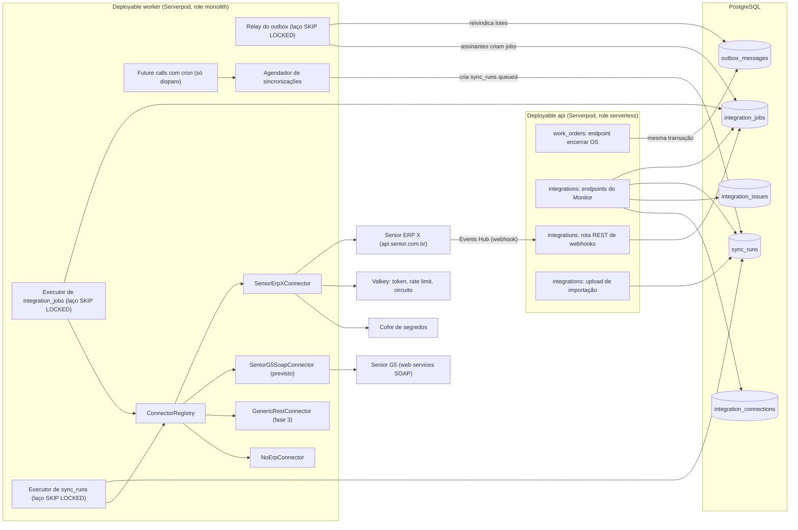
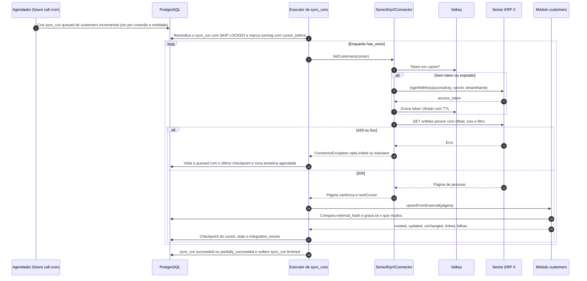
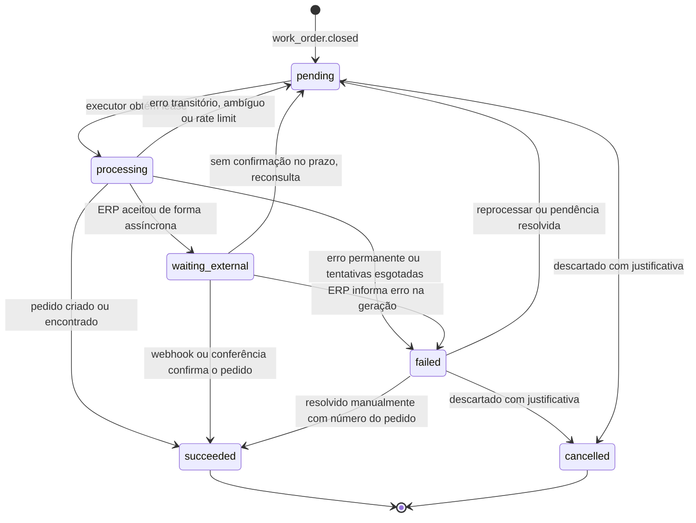
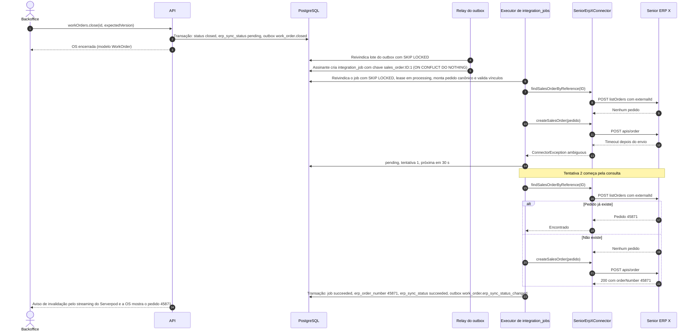
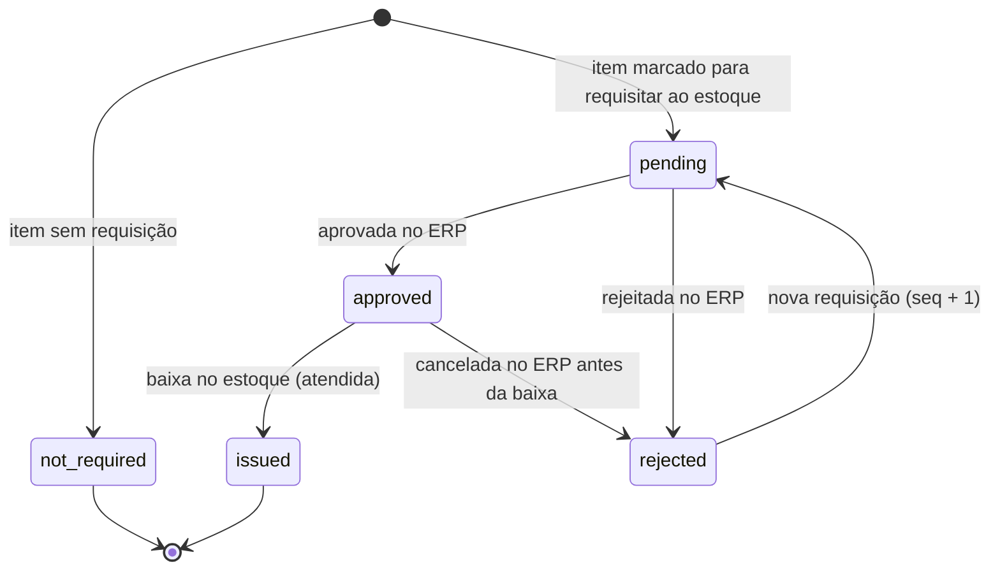
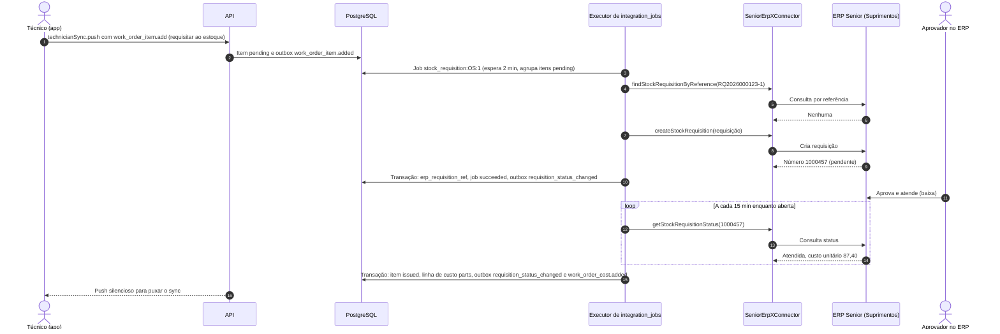
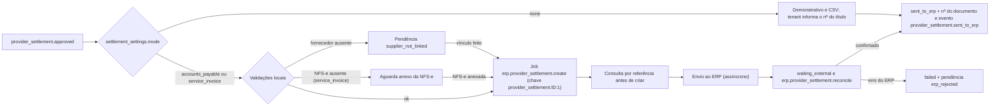

# 07 — Integração com ERP (Senior ERP X, Senior G5 e outros)

Versão 0.3 — 02/11/2026 — rascunho para revisão (stack Dart: Flutter + Serverpod)

> **Em segundo plano (decisão do usuário, 07/11/2026).** Esta integração não entra no primeiro ciclo de desenvolvimento: o MVP roda com cadastros locais e importação por planilha. Este documento continua como desenho de referência para a fase 2, e o modelo de dados (`source`, `external_*`, outbox, `integration_jobs`) já está pronto para ela. Antes de retomar, validar o checklist da seção 12 com a Senior.

Propósito: definir como a plataforma-os troca dados com o ERP de cada tenant — cadastros mestres entrando (clientes, unidades, contatos, produtos, serviços e, na v0.2, bens patrimoniais, filiais, representantes e vendas por cliente), pedido de serviço saindo quando a OS é encerrada e, na v0.2, requisição de materiais e fechamento de prestadores —, começando pelo ERP Senior X, sem acoplar o domínio a nenhum fornecedor.

Documentos relacionados: [Visão geral e requisitos](01-visao-geral-e-requisitos.md) · [Arquitetura de solução](02-arquitetura-de-solucao.md) · [Modelo de domínio](03-modelo-de-dominio.md) · [Multi-tenancy e segurança](04-multi-tenancy-e-seguranca.md) · [Ativos e QR code](05-ativos-e-qr-code.md) · [Aplicações e fluxos](06-aplicacoes-e-fluxos.md) · [API](08-api.md) · [Infraestrutura e operação](09-infraestrutura-e-operacao.md) · [Roadmap e riscos](10-roadmap-e-riscos.md) · [Benchmark Sismetro e novas funcionalidades](11-benchmark-sismetro-e-novas-funcionalidades.md) · [Schema do banco](../db/schema.sql)

**Novidades da v0.2** (origem: [doc 11](11-benchmark-sismetro-e-novas-funcionalidades.md)): bens do patrimônio (`assets_pull`, F2), requisição de materiais com status (`create_stock_requisition`, F2), envio do fechamento de prestadores ao ERP (F2, a validar), vendas mensais por cliente para a rentabilidade do comodato (`sales_summary_pull`, F3), documento do contrato de comodato (F2, se a API permitir), filial do pedido vinda de `branches` e representante vindo de `sales_reps`. Seções 2.8, 13, 14 e 15; checklist ampliado na seção 12.

**Novidades da v0.3** (origem: [doc 12](12-stack-dart-flutter-serverpod.md)): o conector passa a Dart — classe abstrata `ErpConnector` com adaptadores, cliente HTTP em Dart e conversão centavos ↔ decimal e milésimos ↔ quantidade feita só no adaptador (seções 5 e 9.5); o agendamento usa future calls do Serverpod com cron só como disparo, e a fila de trabalho e as retentativas ficam em `integration_jobs` e `sync_runs`, consumidas com `FOR UPDATE SKIP LOCKED` (seções 4 e 10); os webhooks da Senior chegam por rota REST do servidor web do Serverpod (seção 8.3). Fluxos, regras, idempotência e capacidades não mudam.

---

## 1. Resumo

O usuário citou o "ERPX da Senior". Neste documento isso é o **ERP Senior X** (ERP em nuvem sobre a plataforma Senior X). Clientes do SaaS também podem usar o **Senior Gestão Empresarial | ERP** (conhecido como G5 ou Sapiens), que expõe web services SOAP, outro ERP ou nenhum. Por isso o módulo `integrations` fala com o domínio por um **modelo canônico** e com cada ERP por um **adaptador** que implementa a porta `ErpConnector` (classe abstrata em Dart).

| Fase | Entrada (ERP → plataforma) | Saída (plataforma → ERP) | O que existe no módulo `integrations` |
|---|---|---|---|
| 1 (MVP) | Cadastro manual no backoffice e importação de planilhas CSV/XLSX (clientes, unidades, contatos, produtos, serviços e base instalada de ativos) | Nenhuma. A OS encerrada fica com `erp_sync_status = not_required`; relatório de faturamento exportável para quem lança no ERP manualmente | Importações (como `sync_runs`), relay do outbox, Monitor básico |
| 2 | Senior ERP X: carga inicial e sincronização incremental de clientes, unidades, contatos, produtos e serviços; busca sob demanda. **v0.2:** bens do patrimônio (`assets_pull`), filiais (`branches_pull`), representantes (`sales_reps_pull`, a validar), contrato de comodato do bem (a validar) | Pedido de venda com itens de serviço e de produto no Senior ERP X ao encerrar a OS, com filial vinda de `branches` e representante vindo de `sales_reps`. **v0.2:** requisição de materiais com acompanhamento de status (`create_stock_requisition`); fechamento de prestadores como título a pagar ou nota de serviço tomado (a validar) | `SeniorErpXConnector`, `integration_jobs`, Monitor de Integrações completo, reprocessamento |
| 3 | Tabelas de preço, contratos, notas de remessa em comodato → alocação de ativos; Senior G5 via SOAP; outros ERPs. **v0.2:** vendas mensais por cliente (`sales_summary_pull`) para a rentabilidade do comodato | Situação de faturamento (NF-e/NFS-e) de volta para a OS; estoque do técnico (depósito por veículo); cancelamento de pedido | `SeniorG5SoapConnector`, `GenericRestConnector`, webhooks para tenants |

Decisões principais deste documento:

1. **Porta `ErpConnector` com adaptadores** (`SeniorErpXConnector`, `SeniorG5SoapConnector`, `GenericRestConnector`, `NoErpConnector`), em Dart. Nenhum nome de campo de ERP sai do adaptador, nem o formato decimal dos valores: o domínio usa centavos e milésimos inteiros.
2. **No ERP Senior X, o "pedido de serviço" é um pedido de venda** do serviço `erpx_com_ven/pedido`, com linhas `serviceItem` (mão de obra, visita, deslocamento) e `product` (peças). Não encontramos API de OS de campo nativa no ERP X (a validar com a Senior; ver seção 2.4).
3. **Autenticação por aplicação** (`loginWithKey`, chave e segredo), nunca por usuário e senha. O token fica em cache no Valkey por conexão.
4. **Idempotência fim a fim**: `externalId` do pedido = id da OS; o executor **consulta antes de criar** e grava o número do pedido na mesma transação em que conclui o job.
5. **A plataforma envia o preço** de cada linha (snapshot gravado no item da OS); **tributos ficam no ERP**.
6. **Regras de faturamento por `billing_type`** (`billable`, `warranty`, `contract`, `no_charge`), configuráveis por tenant, com padrão "só `billable` entra no pedido".
7. **Cadastros vindos do ERP têm campos mestres somente leitura**; extensões locais (geolocalização, SLA, preferências, flags de ativo) continuam editáveis.
8. **Integração assíncrona**: encerrar a OS nunca falha por causa do ERP. Falhas viram registros visíveis e reprocessáveis no Monitor de Integrações.
9. **(v0.2, F2) Bens do patrimônio entram como ativos `source = erp`**: o ERP é dono da identidade e da aquisição do bem (número de patrimônio, descrição, aquisição, filial); a plataforma continua dona do status operacional, da alocação ao cliente, da etiqueta e das OS (seção 14.1).
10. **(v0.2, F2) Requisição de materiais e fechamento de prestadores seguem o mesmo padrão do pedido**: outbox → `integration_jobs` idempotentes → consulta antes de criar → estado gravado na mesma transação. A aprovação da requisição acontece **no ERP**; a plataforma só acompanha o status (seção 15).
11. **(v0.2) Filial e representante do pedido vêm de cadastros próprios** (`work_orders.branch_id` → `branches`; `customers.primary_sales_rep_id` → `sales_reps`). O mapeamento `service_area_branch` passa a ser só o último recurso (seção 13.3).
12. **(v0.2) A telemetria IoT não passa pelo `ErpConnector`**: dispositivos falam com o módulo `telemetry` pela rota de ingestão própria ([API](08-api.md)); o ERP não participa (seção 15.3).

---

## 2. Pesquisa realizada (fontes) e o que falta validar

Pesquisa feita em 27/10/2026 em fontes públicas da Senior. O portal de tutoriais `api.xplatform.com.br` respondeu HTTP 503 durante toda a pesquisa; o que dele se cita veio de trechos exibidos por mecanismos de busca e deve ser relido. Legenda de status: **Confirmado** (lido em documentação oficial), **Divergente** (fontes oficiais se contradizem), **A validar** (não encontrado ou inferido; vai para o checklist da seção 12).

### 2.1 Onde está a documentação oficial

| Portal | Conteúdo | Endereço |
|---|---|---|
| Portal do desenvolvedor Senior | Catálogo de APIs públicas e privadas por domínio e serviço; especificação Swagger 2.0 de cada serviço | https://dev.senior.com.br/apis_privadas/ e páginas `api_publica/<serviço>` |
| API Portal (tutoriais) | Autenticação, `loginWithKey`, uso de entidades com filtros OData, Events Hub | https://api.xplatform.com.br/api-portal/pt-br/ (indisponível na pesquisa) |
| Documentação de produto | Manuais do ERP Senior X, do Gestão Empresarial (G5) e dos web services | https://documentacao.senior.com.br/ |
| Central de ajuda | Artigos de suporte (ex.: onde encontrar as APIs, recomendação de `loginWithKey`) | https://suporte.senior.com.br/ |

### 2.2 Plataforma Senior X: autenticação e padrão das APIs

| # | Achado | Status | Fonte |
|---|---|---|---|
| 1 | A credencial de integração é uma **aplicação** com **chave e segredo** (sem usuário e senha), que só ganha permissões quando incluída em papéis. As chaves não expiram; "Gerar chave" cria um novo par e invalida o anterior. | Confirmado | [F2] |
| 2 | Login de aplicação: primitiva `loginWithKey` com `accessKey`, `secret` e `tenantName` (obrigatórios) e `scope` (opcional, padrão `desktop`); erros 400 e 401. | Confirmado | [F1] |
| 3 | A Senior desaconselha a API `login` (usuário e senha) em integrações e recomenda `loginWithKey`. | Confirmado | [F3] |
| 4 | A resposta traz `jsonToken` com `access_token`, `token_type` (`Bearer`), `expires_in`, `refresh_token` e `scope`. Na especificação o `jsonToken` é uma string contendo JSON; num manual aparece como objeto. O exemplo de login de **usuário** mostra `expires_in` = 604800 s (7 dias). | Divergente (formato); A validar (validade para aplicações) | [F1], [F14] |
| 5 | Login de aplicação **não retorna refresh token**; renovar = novo `loginWithKey`. A especificação genérica tem `refreshToken`, mas para usuários. | Confirmado | [F2] |
| 6 | Chamadas usam `Authorization: Bearer <access_token>` e o cabeçalho `client_id` (identificação da aplicação no portal) no gateway `api.senior.com.br`. | Confirmado | [F5], [F7] |
| 7 | Hosts: gateway `https://api.senior.com.br/<domínio>/<serviço>/...`; padrão legado ("bridge") `https://platform.senior.com.br/t/senior.com.br/bridge/1.0/rest/<domínio>/<serviço>/<queries, actions, entities ou events>/<primitiva>`; login legado em `https://platform.senior.com.br:8243/t/senior.com.br/bridge/1.0/anonymous/rest/platform/authentication/actions/loginWithKey`. | Confirmado | [F12], [F4] |
| 8 | Homologação: `https://platform-homologx.senior.com.br:8243/...` aparece na documentação do Integrador SST, onde o tenant de homologação **tem custo**. | A validar para o ERP X | [F13], [F25] |
| 9 | Tipos de primitiva: `queries`, `actions`, `events` (marcados `x-senior-event`) e `entities` (CRUD, com `/bulk`). Listas de entidade aceitam `offset` (número da página, base 0), `size`, `filter` (subconjunto de OData; exemplo oficial `filter=containing(lower(name), ' de ')&orderby=name desc,id`), `orderby` e `displayfields`; respostas com `totalPages`/`totalElements`. | Confirmado (parâmetros); A validar (sintaxe completa e tamanho máximo de página) | [F15], [F8] |
| 10 | Eventos para fora: **Events Hub** (Tecnologia > Customização > Events Hub > Webhooks). Cada endpoint aceita `basicAuth`, `headers` customizados, `applyRetry` (ligado por padrão) e `ignoreHttpCode`; há histórico de entregas (`listLogHistories`). Política de retentativa e envelope do corpo não são documentados. | Confirmado (cadastro); A validar (entrega) | [F10] |
| 11 | Limites de requisição (rate limit) por tenant ou aplicação. | Não documentado — A validar | — |
| 12 | O portal separa APIs "públicas" e "privadas", sem política escrita de compatibilidade. Tratamos as privadas como sujeitas a mudança sem aviso. | A validar | [F24] |

### 2.3 Cadastros no ERP Senior X

| # | Achado | Status | Fonte |
|---|---|---|---|
| 1 | Serviço público `erpx/foundation` (v3.17.0): entidades `person`, `contact`, `product`, `serviceitem`, `company`, `branch`, `family`, `brand`, `paymentTerms`, `paymentMethod`, `salePriceList`, `salePriceListItem`, `salePriceListValidity`, `customerDefinition`; fachadas `/apis/address`, `/apis/measureUnit`, `/apis/product`, `/apis/stock`. | Confirmado | [F7] |
| 2 | `person`: `id` (uuid), `code` (inteiro), `name`, `tradeName`, `documentNumber`, `personType`, endereço principal (`address`, `addressNumber`, `addressComplement`, `neighborhood`, `zipCode`, `city`, `state`, `country`), `phoneNumber`, `phoneNumber2`, `email`, `emailForElectronicDocuments`, inscrições, `status`, `deleted` e o objeto aninhado `customer`. | Confirmado | [F7] |
| 3 | `contact`: `id`, `person`, `name`, `title`, `email`, `phoneNumber`, `phoneNumber2`, `cpf`, `visibility`, `status`, endereço e `note`. | Confirmado | [F7] |
| 4 | `product`: `code`, `description`, `additionalDescription`, `family`, `status`, `company`, `barcode`, `gtin`, `deleted`, entre outros. O campo de unidade de medida não ficou visível. | Parcial — A validar | [F7] |
| 5 | `serviceitem`: `id`, `company`, `family`, `code`, `description`, `additionalDescription`, `measureUnit`, `status`, `deleted`, entre outros. | Confirmado | [F7] |
| 6 | Endereços adicionais: serviço privado `erpx_com/pessoa` (v2.1.0), entidade `e001end` ("endereço de pessoa") com indicadores `indEnt` (entrega) e `indCob` (cobrança). | Confirmado (API privada) | [F8] |
| 7 | Serviço privado `erpx_fnd/servico` (v2.5.1): entidade `e080ser`; queries `export*` e actions `import*` assíncronas (retornam `exportJobId`/`importJobId`). | Confirmado (API privada) | [F9] |
| 8 | **Delta**: não encontramos consulta "alterados desde" nem eventos de alteração de cadastro. As entidades aceitam `filter`; outras definições têm auditoria (`auditing.lastModifiedDate` no pedido; `dthAlt` em tabelas internas). | A validar (campo de alteração filtrável em `person`, `contact`, `product`, `serviceitem`) | [F6], [F8] |
| 9 | A pessoa precisa ser **definida por empresa e filial** (definição de cliente) para operar. | Confirmado | [F16] |

### 2.4 Pedido no ERP Senior X

| # | Achado | Status | Fonte |
|---|---|---|---|
| 1 | Criação: `POST https://api.senior.com.br/erpx_com_ven/pedido/apis/order` (API pública; serviço v1.227.2). | Confirmado | [F4], [F5] |
| 2 | Obrigatórios: `company`, `branch`, `customer`, `items`; cada item com `quantity` (obrigatório), `product` **ou** `serviceItem` e `price`. | Confirmado | [F4], [F5] |
| 3 | Opcionais relevantes no cabeçalho: `id`, `externalId`, `origin` (`ECOMMERCE`, `CRM`, `FORCA_DE_VENDA`, `API`), `representative`, `paymentTerms`, `paymentMethod`, `deliveryAddress`, `fiscalAddress`, `issueDate`, `observation` (até 999), `customerOrderNumber` (até 20), `discount`, `shippingCost`, `close` (padrão `false`), `productTransaction`, `serviceTransaction`, `freightType`, `keepInstallments`, `additionalValues`. Por item: `priceList`, `saleMeasureUnit`, `discount`, `complement` (complemento do item de serviço), `observation`, `productTransaction`/`serviceTransaction`, `customerOrderNumber`/`customerOrderItemSequence`, datas previstas. Referências no formato `recDefaultData` (`id`, `code`, `description`, `tradeName`). Valores monetários de 0,00 a 9.999.999.999.999,99. | Confirmado | [F4], [F5] |
| 4 | Depósito e centro de custo **não aparecem** na fachada pública (centro de custo `e044ccu` existe na action interna `persistItens`). | A validar | [F5], [F6] |
| 5 | **Modo de processamento**: o manual descreve criação **assíncrona** — o POST devolve 201 indicando apenas "registro da integração"; o resultado chega por webhooks `erpx_com_ven/pedido/orderGenerationSuccess` (`orderId`, `orderNumber`, `orderStatus`, `externalOrderId`, `orderValue`) e `orderGenerationError` (`message`, `externalOrderId`), com consulta opcional à entidade `externalOrderIntegration` filtrando `idExterno`. A especificação pública documenta resposta **200** com `orderFacadeOutput` (`id`, `orderNumber`, ...). | **Divergente** — o conector trata os dois modos | [F4], [F5] |
| 6 | `externalOrderIntegration` (privada): `idExterno`, `status` (enum `orderStatus`), `errorMessage`, `orderPayload`, `externalIntegrationType`, datas de geração e alteração. | Confirmado (API privada) | [F6] |
| 7 | Consulta: `GET /apis/order/{id}`; `POST /listOrders` com filtros `externalId`, `number`, `customer`, `branch`, `status`, `initialIssueDate`/`finalIssueDate` e `pageRequest` (`offset`, `size`, `orderBy`). Situação `orderStatus`: `IN_PROGRESS`, `ORDER_CREATED`, `NOT_PAID`, `PAID`, `INVOICED`, `CANCELED`, `ERROR`. Notas por item em `items[].invoices` (`number`, `issueDate`, `quantity`, `value`). | Confirmado | [F5] |
| 8 | Cancelamento: `POST /cancelOrders` com lista de `ids`. | Confirmado | [F5] |
| 9 | Comportamento com **`externalId` repetido**. | Não documentado — A validar (crítico para idempotência) | — |
| 10 | Pré-requisitos: aplicação cadastrada e associada a papel; propriedade "Ativar replicação de entidades para a base centralizada" (domínio `erpx`, serviço `datacenter`) = verdadeiro; cliente (`person`) e produto existentes. | Confirmado | [F4] |
| 11 | **OS nativa**: o ERP Senior X tem "pedido ou orçamento de serviço" em Mercado > Gestão de vendas, com vínculo a equipamento, usado na integração com o Sismetro (evento `erpx_com_ven/pedido/externalServiceOrderFinished`, payload com `orderId`, `orderNumber`, `equipmentId`, `newEquipmentDescription`, `items`). Nesse fluxo o pedido nasce no ERP e a OS no sistema externo, com faturamento bloqueado até a conclusão — o inverso do nosso fluxo. | Confirmado | [F11], [F5] |

### 2.5 Senior Gestão Empresarial (G5 / Sapiens) — web services SOAP

| # | Achado | Status | Fonte |
|---|---|---|---|
| 1 | WSDL: `http(s)://<servidor>/g5-senior-services/sapiens_Sync<serviço>?wsdl` (também `sapiens_Async…` e `sapiens_Scheduled…`), com o nome do serviço usando `_` no lugar de `.` (ex.: `com_senior_g5_co_mcm_ven_pedidos`). | Confirmado | [F17], [F23] |
| 2 | Autenticação no corpo da requisição (`user`, `password`, `encryption`). Com token da Senior X: `password` = token e `encryption` = 3, exigindo usuário homônimo no Gerenciador de Usuários, middleware configurado e web services publicados. | Confirmado | [F17], [F22] |
| 3 | Exportação com controle de integração: porta `Exportar` com `tipoIntegracao` (`T` todos, `A` somente alterados, `E` específico), `identificadorSistema` (sigla do sistema integrador, até 15), `quantidadeRegistros`; retorno com `numeroLote` e `finalizaramRegistros`. Confirmação do lote em `com.senior.g5.co.int.geral.exportacao`, porta `Confirmar` (`codEmp`, `codFil`, `sigInt`, `lote.ideInt`, `lote.numLot`, `lote.excecao[]`), além de `ObterPendencias` e `ConfirmarSequencia`. | Confirmado | [F19], [F21] |
| 4 | Clientes: `com.senior.g5.co.cad.clientes` — `Exportar` (v9, com blocos de contatos e endereços de entrega), `ConsultarCadastro`, `ConsultarGeral_4`. Em `ConsultarCadastro`, `cgcCpf` vem como número (Double), o que perde zeros à esquerda. | Confirmado | [F18] |
| 5 | Produtos: `com.senior.g5.co.cad.produtos` — `Exportar` (v14; código de integração 5 na confirmação). A Senior recomenda **não** filtrar só ativos, para que inativações também cheguem. | Confirmado | [F20] |
| 6 | Serviços: `com.senior.g5.co.cad.servicos` — `Exportar` (v5) com `codSer`, `desSer`, `uniMed`, `sitSer` (A/I), `codFam`, `datAlt`/`horAlt`; confirmação com código de integração 08. | Confirmado | [F19] |
| 7 | Pedidos: `com.senior.g5.co.mcm.ven.pedidos` — `GravarPedidos` (v15). Cabeçalho com `codEmp`, `codFil`, `numPed`, `codCli`, `codRep` e `codCpg` (obrigatórios), `tnsPro`, `tnsSer`, `obsPed`, `pedCli`, `opeExe`; itens `pedido.produto[]` e `pedido.servico[]` (`codSer`, `cplIsp`, `tnsSer`, `qtdPed`, `uniMed`, `preUni`, `datEnt`, `sitIsp`). **`numInt` (até 20) impede duplicidade** na inclusão; `ideExt` não garante. | Confirmado | [F17] |
| 8 | A documentação da versão 5.10.3 foi descontinuada em 30/09/2025; usar 5.10.4 ou posterior e o WSDL da instalação do cliente. | Confirmado | [F12] |

### 2.6 Lacunas mais críticas

1. Comportamento real do `POST apis/order` (200 síncrono ou 201 assíncrono) e com `externalId` repetido.
2. Se um pedido só com itens de serviço é aceito, quais transações usar e como sai a NFS-e; pedido misto (peças e serviços).
3. Delta de cadastros no ERP X (campo de alteração filtrável ou eventos).
4. Limites de requisição e tamanho máximo de página.
5. Ambiente de homologação do ERP X para o tenant, e o custo.
6. Quais parâmetros a configuração comercial do tenant torna obrigatórios (transação, condição e forma de pagamento, representante, tabela de preço, depósito, centro de custo).
7. **(v0.2)** API de leitura de **bens do patrimônio** no ERP X (ou no G5) e se o módulo de patrimônio está no escopo da implantação (seção 2.8).
8. **(v0.2)** API de **requisição de materiais** (criar e consultar status) e como a baixa no estoque fica ligada à OS sem movimentar o estoque duas vezes junto com o pedido (seção 15.1).
9. **(v0.2)** Destino do **fechamento de prestadores**: título a pagar ou nota fiscal de entrada de serviço tomado (seção 15.2).
10. **(v0.2)** Fonte das **vendas mensais por cliente** (pedidos faturados, notas de saída ou relatório gerencial) para a rentabilidade do comodato (seção 14.4).

O checklist completo está na seção 12.

### 2.7 Fontes

- [F1] Autenticação (platform/authentication, v9.0.1): https://dev.senior.com.br/api_publica/platform_authentication/
- [F2] Gerenciamento de aplicações: https://dev.senior.com.br/gerenciamento-de-aplicacoes/
- [F3] Onde encontrar as APIs dos produtos na Plataforma Senior X: https://suporte.senior.com.br/hc/pt-br/articles/53016009512852-Plataforma-Senior-X-APIs-Onde-encontrar-as-APIs-dos-produtos-na-Plataforma-Senior-X
- [F4] Integração do pedido de venda via API: https://documentacao.senior.com.br/seniorxplatform/manual-do-usuario/erp/mercado/vendas/integracao-pedido-venda-api.htm
- [F5] Pedido (erpx_com_ven/pedido, API pública v1.227.2): https://dev.senior.com.br/api_publica/erpx_com_ven_pedido/
- [F6] Pedido (erpx_com_ven/pedido, API privada v1.136.0): https://dev.senior.com.br/api_privada/erpx_com_ven_pedido/
- [F7] Foundation (erpx/foundation, v3.17.0): https://dev.senior.com.br/api_publica/erpx_foundation/
- [F8] Pessoa (erpx_com/pessoa, v2.1.0): https://dev.senior.com.br/api_privada/erpx_com_pessoa/
- [F9] Serviço (erpx_fnd/servico, v2.5.1): https://dev.senior.com.br/api_privada/erpx_fnd_servico/
- [F10] Integrador de Webhooks e APIs (platform/events_hub, v3.5.0): https://dev.senior.com.br/api_privada/platform_events_hub/
- [F11] Integração com Sismetro (ERP Senior X): https://documentacao.senior.com.br/seniorxplatform/manual-do-usuario/erp/mercado/vendas/integracao-sismetro.htm
- [F12] Central de Configurações Senior — Chaves: https://documentacao.senior.com.br/tecnologia/5.10.3/central-de-configuracao/cfgkeysform.htm
- [F13] Desenvolver a API do Integrador SST: https://documentacao.senior.com.br/seniorxplatform/manual-do-usuario/hcm/integrador-sst/desenvolvedores/desenvolvendo-api/
- [F14] Autenticação na plataforma (Admissão Digital): https://documentacao.senior.com.br/seniorxplatform/manual-do-usuario/hcm/admissao-digital/integracoes/api/login-plataforma
- [F15] Tutorial de uso das APIs de entidade com filtros OData (indisponível na pesquisa): https://api.xplatform.com.br/api-portal/pt-br/tutoriais/entidades/uso-das-apis-de-entidade-com-filtros-odata
- [F16] Configurações iniciais do ERP Senior X: https://documentacao.senior.com.br/seniorxplatform/manual-do-usuario/erp/cadastros/configuracoes-iniciais.htm
- [F17] Web service com.senior.g5.co.mcm.ven.pedidos: https://documentacao.senior.com.br/goup/5.10.3/webservices/com_senior_g5_co_mcm_ven_pedidos.htm
- [F18] Web service com.senior.g5.co.cad.clientes (5.10.4): https://documentacao.senior.com.br/gestaoempresarialerp/5.10.4/webservices/com_senior_g5_co_cad_clientes.htm
- [F19] Web service com.senior.g5.co.cad.servicos (5.10.4): https://documentacao.senior.com.br/gestaoempresarialerp/5.10.4/webservices/com_senior_g5_co_cad_servicos.htm
- [F20] Web service com.senior.g5.co.cad.produtos (5.10.4): https://documentacao.senior.com.br/gestaoempresarialerp/5.10.4/webservices/com_senior_g5_co_cad_produtos.htm
- [F21] Web service com.senior.g5.co.int.geral.exportacao (5.10.4): https://documentacao.senior.com.br/gestaoempresarialerp/5.10.4/webservices/com_senior_g5_co_int_geral_exportacao.htm
- [F22] Autenticação de web services a partir do token da Senior X: https://documentacao.senior.com.br/tecnologia-senior-x/manual-do-usuario/integracoes/web-services.htm
- [F23] Como montar o WSDL de um web service: https://suporte.senior.com.br/hc/pt-br/articles/34761234846228-ERP-WebServices-Como-montar-o-WSDL-de-um-WebService-customizado
- [F24] Catálogo de APIs privadas: https://dev.senior.com.br/apis_privadas/
- [F25] Acesso ao ambiente de homologação (Integrador SST): https://documentacao.senior.com.br/seniorxplatform/manual-do-usuario/hcm/integrador-sst/desenvolvedores/ambiente-de-testes-para-homologacao
- [F26] Requisições (Suprimentos, ERP na Senior X): https://documentacao.senior.com.br/seniorxplatform/manual-do-usuario/erp/Subsystems/index/backoffice/suprimentos/requisicao/requisicao.htm
- [F27] F207EME — Geração individual de requisições de produto (G5 5.10.4): https://documentacao.senior.com.br/gestaoempresarialerp/5.10.4/menu_suprimentos/f207eme.htm
- [F28] Identificador de regra INT-000INTXT01 (movimentação de estoque vinda da Senior X): https://documentacao.senior.com.br/gestaoempresarialerp/5.10.4/identificadores_regras/int_000intxt01.htm
- [F29] Integração de títulos de contas a pagar via API (ERP Senior X): https://documentacao.senior.com.br/seniorxplatform/manual-do-usuario/erp/financas/contas-pagar/integracao-contas-pagar-api.htm
- [F30] Integração da nota fiscal de entrada via API (ERP Senior X): https://documentacao.senior.com.br/seniorxplatform/manual-do-usuario/erp/suprimentos/recebimento/integracao-nota-fiscal-entrada-via-api.htm
- [F31] F070EPT — Parâmetros da empresa para patrimônio (G5 5.10.4): https://documentacao.senior.com.br/gestaoempresarialerp/5.10.4/menu_cadastros/f070ept.htm
- [F32] Web service `com.senior.g5.co.mct.imp.escrituracao.lancamentos.titulos` (G5 5.10.4): https://documentacao.senior.com.br/gestaoempresarialerp/5.10.4/webservices/com_senior_g5_co_mct_imp_escrituracao_lancamentos_titulos.htm
- [F33] Reunião de demonstração do Sismetro para a Superpan (transcrição) e folheto do Sismetro Kairós — resumo no [doc 11](11-benchmark-sismetro-e-novas-funcionalidades.md)

### 2.8 Pesquisa complementar da v0.2 (02/11/2026): patrimônio, requisição de estoque e contas a pagar

Três buscas em fontes públicas, só com os trechos exibidos pelo buscador; nenhuma especificação Swagger desses serviços foi lida. Status novo nesta tabela: **Trecho oficial** = nome ou comportamento visto em trecho de página oficial da Senior, sem leitura completa — vale como forte indício, não como confirmação. Tudo abaixo precisa ser relido na documentação e confirmado com a Senior (checklist, seção 12, itens 23 a 36).

**Indício vindo da demonstração (não é confirmação):** na reunião, o comercial do Sismetro afirmou que o produto dele **já integra com a Senior** bens (patrimônio), clientes e estoque — a requisição nasce no sistema de manutenção, é **aprovada no ERP** e a **baixa** fica vinculada à OS. Isso sugere que existem APIs para esses fluxos no ambiente da Superpan, mas não diz quais, nem se são públicas ou feitas sob medida pela consultoria. A integração Sismetro já documentada pela Senior [F11] cobre só o pedido de serviço com equipamento.

| # | Achado | Status | Fonte |
|---|---|---|---|
| 1 | **Patrimônio:** não encontramos serviço de API de bens patrimoniais no ERP X nem no catálogo do portal do desenvolvedor. No G5 existe o módulo de patrimônio (parâmetros por empresa em F070EPT, com bloqueio de movimentação de bens com crédito de CIAP), sem web service de bens identificado. | **A validar** (nome do serviço, entidades, campos e se o patrimônio da Superpan roda no ERP X ou no G5) | [F31], [F33] |
| 2 | **Requisição de materiais:** o ERP na Senior X tem o processo "Requisições" em Suprimentos (necessidade de retirada do estoque ou de compra). A requisição é lançada na Senior X, passa por aprovação e pode ser atendida no Gestão Empresarial (G5) com movimentação de estoque ou solicitação de compra. Exige parâmetros de integração (F199INT), usuário com login igual ao do ERP e uma faixa de numeração própria (padrão a partir de 1.000.000) para não colidir com as requisições do G5. | Trecho oficial (processo); **A validar** (API para criar e consultar requisições, nomes de serviço e primitivas) | [F26] |
| 3 | **Requisição no G5:** a tela F207EME gera requisições de produto individualmente; a movimentação de estoque vinda da Senior X passa pelas primitivas `movimentarEstoque` e `movimentarEstoqueAssincrono` (identificador de regra INT-000INTXT01, que pode alterar o JSON da requisição antes do processamento). | Trecho oficial (nomes); **A validar** (se a plataforma pode chamar essas primitivas ou só a Senior X) | [F27], [F28] |
| 4 | **Contas a pagar no ERP X:** criação ou reprocessamento de títulos a pagar por `POST erpx_fin_int/facade/saveAccountsPayableTitles`, após `loginWithKey`, com processamento **assíncrono**. | Trecho oficial (endpoint e modo); **A validar** (corpo, campos obrigatórios, retorno e consulta do resultado) | [F29] |
| 5 | **Nota fiscal de entrada no ERP X:** consulta por `erpx_sup_int/facade/apis/incomingInvoice/{notaFiscalId}` (itens de produto ou serviço, transações, condição de pagamento, impostos) e integração **assíncrona** de nota de terceiros por `integrateThirdPartyIncomingInvoice`. Os títulos a pagar são gerados pela nota conforme o tipo de título e a transação configurados (F001TCP). | Trecho oficial (nomes); **A validar** (se cobre nota de serviço tomado e NFS-e do prestador) | [F30] |
| 6 | **Títulos no G5:** web service `com.senior.g5.co.mct.imp.escrituracao.lancamentos.titulos`, com porta que aceita número do título, filial e série da nota de entrada. | Trecho oficial (existência); A validar (uso para o fechamento) | [F32] |
| 7 | **Vendas por cliente:** não pesquisado nesta rodada. Hipótese inicial: agregar pedidos faturados (`POST listOrders` com `status = INVOICED` e `items[].invoices`, já confirmado em [F5]) ou ler notas de saída. | A validar | [F5] |
| 8 | **Filiais:** `erpx/foundation` já expõe as entidades `company` e `branch` (item 1 da seção 2.3), base do `branches_pull`. | Confirmado (entidades); A validar (campos de CNPJ e IE) | [F7] |
| 9 | **Representante:** o pedido do ERP X aceita `representative` e o G5 exige `codRep` (seções 2.4 e 2.5). Não localizamos a entidade de cadastro de representantes no ERP X. | A validar (entidade e vínculo cliente → representante) | [F5], [F17] |

---

## 3. Princípios da integração

| # | Princípio | Consequência prática |
|---|---|---|
| P1 | A operação de campo não depende do ERP | Encerrar a OS só grava o outbox. ERP fora do ar atrasa o pedido, mas não bloqueia técnico, backoffice nem cliente. |
| P2 | O domínio fala o modelo canônico | Nenhum `e120ped`, `codCli` ou `serviceItem` fora do adaptador. Trocar de ERP não toca `work_orders`, `customers` ou `catalog`. |
| P3 | O ERP é dono dos cadastros mestres quando conectado; a plataforma é dona da operação | O ERP nunca altera OS, etiqueta, alocação ou agenda. **(v0.2, F2)** Em ativos `source = erp` o ERP é dono só dos campos mestres do bem (seção 14.1); status, alocação e etiqueta continuam da plataforma. A plataforma cria pedido, **requisição de materiais e lançamento do fechamento de prestadores (F2)** e, na fase 3, consulta situação e cancela pedido. |
| P4 | Idempotência fim a fim | Chave determinística por operação; consultar antes de criar; resultado gravado na mesma transação que conclui o job. |
| P5 | Falhar alto e de forma reprocessável | Toda falha vira registro visível (`integration_jobs`, `integration_issues`) com ação no Monitor. Nada falha em silêncio em log. |
| P6 | Segredos fora do banco | `integration_connections` guarda só a referência do cofre (D10). |
| P7 | Notificação é dica, não verdade | Webhook recebido dispara uma reconsulta ao ERP antes de mudar estado. |
| P8 | Uma conexão de ERP ativa por tenant na fase 2 | Simplifica regras e o Monitor; múltiplas conexões (ex.: ERP por filial) ficam para a fase 3. |

---

## 4. Arquitetura do módulo `integrations`

O módulo é a biblioteca `lib/src/integrations/` do projeto Serverpod e roda nos dois papéis do mesmo executável (D1; [doc 12](12-stack-dart-flutter-serverpod.md), seção 3): no `api` (`--role serverless`, atrás do load balancer) ficam os endpoints do Monitor, o upload de importações e o receptor de webhooks (rota REST do servidor web do Serverpod); no `worker` (`--role monolith`, fora do load balancer) ficam as future calls com cron, o relay do outbox, o agendador, os laços executores de jobs e de sincronizações e os conectores.



### 4.1 Componentes

| Componente | Responsabilidade |
|---|---|
| Relay do outbox | Laço do `worker` que reivindica lotes de `outbox_messages` com `FOR UPDATE SKIP LOCKED` (funções `claim_*` do schema) e entrega cada evento aos assinantes do processo (pelo menos uma vez), sem broker. O relay pertence a este módulo; a escrita no outbox é feita por todos os módulos por um componente compartilhado descrito em [Arquitetura de solução](02-arquitetura-de-solucao.md). |
| Assinante de `work_order.closed` | Cria o `integration_job` do pedido de forma idempotente (chave única) e nada mais. |
| Executor de `integration_jobs` | Laço do `worker` que reivindica jobs vencidos (`status = pending` e `next_attempt_at` ≤ agora) com `FOR UPDATE SKIP LOCKED` e grava o lease (`locked_until`, `locked_by`); chama o conector, classifica erros, agenda retentativas em `next_attempt_at` e atualiza o estado ERP da OS pela interface pública do módulo `work_orders`. As tentativas ficam nesta tabela porque as future calls do Serverpod não têm retentativa automática ([doc 12](12-stack-dart-flutter-serverpod.md), seção 4.4). |
| Montador de pedido (`OrderAssembler`) | Lê a OS pela interface pública de `work_orders`/`field_execution`, aplica regras de faturamento e gera o pedido canônico. É o mesmo código da pré-visualização do pedido no backoffice. |
| Agendador de sincronizações | Future call do Serverpod com cron de 1 min (persistida, executada pelo menos uma vez) que lê `sync_schedule` de cada conexão no fuso do tenant e cria os `sync_runs` `queued` devidos. É idempotente: a mesma janela de agenda não cria dois `sync_runs` da mesma conexão e entidade. |
| Executor de `sync_runs` | Laço do `worker` que reivindica `sync_runs` `queued` com `FOR UPDATE SKIP LOCKED` (só se não houver outro `running` da mesma conexão e entidade); pagina no conector, normaliza, chama as interfaces públicas de `customers` e `catalog` para upsert, registra pendências, confirma lotes (G5) e avança o cursor. |
| `ConnectorRegistry` | Resolve o adaptador pelo `connector_type` e registra a versão usada em cada job. |
| Receptor de webhooks | Rota REST do servidor web do Serverpod; valida o segredo do endpoint, grava um job `erp.webhook.process` e responde 202 em milissegundos. |
| Importador de planilhas | Valida e aplica arquivos CSV/XLSX como `sync_runs` com `mode = file_import` (seção 8), com leitura de XLSX no `worker` por pacote Dart. |
| Endpoints do Monitor | Leitura e ações do backoffice sobre conexões, execuções, jobs, pendências e mapeamentos (`integrationConnections`, `integrationJobs`, `syncRuns`, `integrationIssues`, `integrationMappings`, `integrations`; métodos em [API](08-api.md)). |
| Assinante de `work_order_item.added` com requisição (F2) | Para itens marcados para requisitar ao estoque do ERP, cria (com agrupamento por OS) o job `erp.stock_requisition.create` (seção 15.1). |
| Conferente de requisições (F2) | Job `erp.stock_requisition.status_sync` que consulta o status das requisições abertas e atualiza `work_order_items.stock_requisition_status` pela interface de `field_execution`. |
| Assinante de `provider_settlement.approved` (F2) | Cria o job `erp.provider_settlement.create` do fechamento aprovado (seção 15.2). |
| Executor de `sync_runs` de bens, filiais, representantes e vendas (F2/F3) | Mesmo executor da seção 4.1, com as entidades novas (`assets`, `branches`, `sales_reps`, `customer_sales_summaries`) e as interfaces públicas de `assets`, `tenancy` e `customers` (seção 14). |

### 4.2 Fronteiras com outros módulos

O módulo não lê nem escreve tabelas de outros módulos (D1). Interfaces públicas que ele consome (nomes sugeridos; contrato final em [Modelo de domínio](03-modelo-de-dominio.md)):

| Módulo | Interface | Uso |
|---|---|---|
| `customers` | `upsertFromExternal(batch)`, `findCandidatesForLink(document, code)`, `linkExternal(id, ref)` | Aplicar páginas de clientes, unidades e contatos vindas do ERP; vincular registros locais |
| `catalog` | `upsertProductsFromExternal(batch)`, `upsertServicesFromExternal(batch)` | Aplicar produtos e serviços |
| `work_orders` | `getBillingSnapshot(workOrderId)`, `setErpSyncState(workOrderId, state)` | Ler a OS para montar o pedido; gravar `erp_sync_status` e `erp_order_number` na mesma transação do job |
| `tenancy` | `getSettings(tenantId)` | Fuso, regras de faturamento e mão de obra |
| `tenancy` (v0.2) | `getBranch(branchId)`, `upsertBranchesFromExternal(batch)` (F2) | Filial do pedido, da requisição e do fechamento; aplicar filiais lidas do ERP |
| `customers` (v0.2) | `getSalesRep(salesRepId)`, `upsertSalesRepsFromExternal(batch)` (F2, a validar), `upsertSalesSummaries(batch)` (F3) | Representante do pedido; carteira vinda do ERP; vendas mensais por cliente |
| `assets` (v0.2, F2) | `upsertAssetsFromExternal(batch)`, `findAssetCandidatesForLink(assetTag, serial, productId)`, `attachExternalDocument(assetId, ref)` | Aplicar bens do patrimônio; vincular ao legado; anexar o contrato de comodato |
| `field_execution` (v0.2, F2) | `getRequisitionSnapshot(workOrderId)`, `setRequisitionState(itemIds, state)`, `getSettlementSnapshot(settlementId)`, `setSettlementErpState(settlementId, state)` | Montar a requisição e gravar status e `erp_requisition_ref`; montar o fechamento e marcar `sent_to_erp` |
| `scheduling` (v0.2, F2) | `getServiceProvider(id)` | Fornecedor do prestador no ERP para o fechamento |
| `notifications` | via eventos (`integration_job.failed`, `sync_run.finished`) | Alertas para administradores do tenant |

### 4.3 Tabelas do módulo (contrato com o modelo de dados)

`integration_connections`, `integration_jobs`, `outbox_messages` (relay) e `sync_runs` estão no glossário do contrato. `integration_issues` e `integration_mappings` são **nomes novos propostos aqui** para revisão do arquiteto de Domínio e Dados; o schema oficial é o de [Schema do banco](../db/schema.sql). Colunas de `integration_connections` estão na seção 6.1.

`integration_jobs` — uma unidade de trabalho contra um sistema externo:

| Coluna | Tipo | Descrição |
|---|---|---|
| `id`, `tenant_id`, colunas padrão (D14) | — | `version` também serve de controle otimista nas ações do Monitor |
| `connection_id` | uuid | FK composta (`tenant_id`, `connection_id`) |
| `direction` | text | `outbound` ou `inbound` |
| `operation` | text | `erp.sales_order.create`, `erp.sales_order.reconcile`, `erp.webhook.process`; fase 2 (v0.2): `erp.stock_requisition.create`, `erp.stock_requisition.status_sync`, `erp.provider_settlement.create`, `erp.provider_settlement.reconcile`, `erp.asset_document.fetch`; fase 3: `erp.sales_order.cancel`, `erp.sales_order.status_sync` |
| `subject_type`, `subject_id` | text, uuid | Ex.: `work_order` e o id da OS; v0.2: `work_order` (requisição), `provider_settlement`, `asset` (documento) |
| `idempotency_key` | text | Única por tenant. Ex.: `sales_order:<work_order_id>:1`; v0.2: `stock_requisition:<work_order_id>:<seq>`, `provider_settlement:<settlement_id>:1`, `asset_document:<asset_id>:<external_document_id>` |
| `external_reference` | text | Referência enviada ao ERP (`externalId` no ERP X, `numInt` no G5) |
| `status` | text | `pending`, `processing`, `waiting_external`, `succeeded`, `failed`, `cancelled` (seção 9.6) |
| `attempt_count`, `max_attempts` | int | Contam só tentativas transitórias ou ambíguas |
| `next_attempt_at` | timestamptz | Agendamento da próxima tentativa ou conferência |
| `locked_until`, `locked_by` | timestamptz, text | Lease do executor |
| `last_error_kind`, `last_error_code`, `last_error_message` | text | `transient`, `permanent`, `auth`, `rate_limited`, `ambiguous` |
| `request_payload` | jsonb | Pedido canônico e payload mapeado, com dados sensíveis mascarados |
| `response_payload` | jsonb | Última resposta do ERP, mascarada |
| `result` | jsonb | `erp_order_id`, `erp_order_number`, `erp_status`, `skipped_reason` |
| `attempt_log` | jsonb | Últimas 20 tentativas: início, fim, HTTP, código de erro, duração, `trace_id`, referência usada |
| `connector_type`, `connector_version` | text | Reprodutibilidade |
| `source_event_id` | uuid | `outbox_messages.id` que originou o job |
| `resolution_note`, `resolved_manually_by` | text, uuid | Resolução manual pelo Monitor |
| `completed_at` | timestamptz | — |

Índices: único (`tenant_id`, `idempotency_key`); (`status`, `next_attempt_at`) para o agendamento; (`tenant_id`, `subject_type`, `subject_id`).

`sync_runs` — uma execução de sincronização ou importação:

| Coluna | Tipo | Descrição |
|---|---|---|
| `connection_id` | uuid null | Nulo em importação de planilha |
| `entity_type` | text | `customers`, `customer_sites`, `customer_contacts`, `products`, `services`, `assets` (planilha no MVP; ERP na F2); v0.2: `branches` (F2), `sales_reps` (F2), `customer_sales_summaries` (F3) |
| `mode` | text | `full`, `incremental`, `single`, `file_import` |
| `trigger` | text | `schedule`, `manual`, `webhook`, `lookup`, `file_upload` |
| `dry_run` | boolean | Simulação: grava só o relatório |
| `status` | text | `queued`, `running`, `succeeded`, `partially_succeeded`, `failed`, `cancelled` |
| `cursor_before`, `cursor_after` | text | Cursor opaco do conector (checkpoint a cada página) |
| `stats` | jsonb | `read`, `created`, `updated`, `unchanged`, `linked`, `deactivated`, `skipped`, `failed` |
| `file_storage_key`, `file_name`, `file_sha256` | text | Importação de planilha |
| `report_storage_key` | text | Relatório (XLSX de erros, amostras do dry-run) |
| `error_message`, `started_at`, `finished_at`, `requested_by` | — | — |

`integration_issues` (novo) — pendências que exigem ação humana, deduplicadas:

| Coluna | Tipo | Descrição |
|---|---|---|
| `connection_id` | uuid null | — |
| `issue_type` | text | `customer_not_linked`, `item_not_linked`, `unmapped_value`, `possible_duplicate`, `not_found_in_erp`, `erp_rejected`, `record_invalid`, `credentials_invalid`; v0.2 (F2): `asset_not_linked` (bem sem modelo correspondente ou com mais de um ativo candidato), `asset_retired_in_erp` (bem baixado no ERP com ativo ainda ativo aqui), `branch_not_linked`, `sales_rep_not_linked`, `supplier_not_linked` (prestador sem fornecedor no ERP), `requisition_rejected` |
| `severity` | text | `warning` ou `error` |
| `entity_type`, `entity_id`, `external_id` | text, uuid, text | Registro afetado (local, do ERP ou ambos) |
| `sync_run_id`, `integration_job_id` | uuid | Origem |
| `message`, `details` | text, jsonb | Mensagem do ERP ou da validação |
| `status` | text | `open`, `resolved`, `ignored` |
| `occurrences`, `first_seen_at`, `last_seen_at`, `resolved_at`, `resolved_by` | — | Uma pendência aberta por (`issue_type`, `entity_type`, registro); repetições incrementam `occurrences` |

`integration_mappings` (novo) — de-para de valores por conexão:

| Coluna | Tipo | Descrição |
|---|---|---|
| `connection_id` | uuid | — |
| `mapping_type` | text | `billing_type_transaction`, `service_area_branch` (v0.2: só último recurso, seção 13.3), `unit_of_measure`, `work_order_type_transaction`; v0.2 (F2): `branch_warehouse` (depósito de requisição por filial), `requisition_transaction`, `requisition_transaction` (transação da requisição), `issued_part_order_transaction` (transação do pedido para peça já baixada pela requisição, sem nova baixa de estoque — seção 15.1), `settlement_account` (natureza/conta financeira e centro de custo do fechamento por `cost_type`), `settlement_transaction` (transação da nota de serviço tomado) |
| `local_key` | text | Ex.: `warranty`, id da região, `UN` |
| `external_value` | jsonb | Ex.: `{"product_transaction_code": "90120", "service_transaction_code": "90320"}` |
| `is_active` | boolean | — |

Nas tabelas mestres (`customers`, `customer_sites`, `customer_contacts`, `products`, `services`) o contrato (D10) já prevê `source`, `external_system`, `external_id`, `external_payload` e `last_synced_at`. Este documento pede também `external_hash` (SHA-256 do registro normalizado, para detectar mudança em varredura completa) e unicidade (`tenant_id`, `external_system`, `external_id`) quando `external_id` não é nulo.

**v0.2:** `assets` ganha o mesmo conjunto de colunas de origem externa (`source`, `external_system`, `external_id`, `external_payload`, `external_hash`, `last_synced_at`, `missing_since`), mais as colunas de aquisição (`acquisition_date`, `acquisition_cost`, `supplier_name`, `acquisition_document`) e `branch_id` ([doc 11](11-benchmark-sismetro-e-novas-funcionalidades.md), apêndice A). `branches`, `sales_reps` e `service_providers` guardam o **código no ERP** (filial, representante e fornecedor) como extensão local editável pelo tenant_admin; nomes das colunas no [Modelo de domínio](03-modelo-de-dominio.md). `customer_sales_summaries` (F3) é escrita só pela integração ou por importação.

---

## 5. Porta `ErpConnector` e adaptadores

### 5.1 Interface

A porta vive em `lib/src/integrations/ports/erp_connector.dart`, no projeto do servidor Serverpod. Os tipos canônicos (`Canonical*`) são classes Dart simples internas ao módulo `integrations` — não são modelos `.spy.yaml`, porque não trafegam para os apps; os módulos `customers` e `catalog` recebem os tipos das suas próprias interfaces públicas, nunca o tipo do conector. Valores monetários dos tipos canônicos são `int` em centavos e quantidades são `int` em milésimos, como no banco; só o adaptador conhece o formato decimal do ERP (seção 9.5).

```dart
enum ConnectorType { seniorErpx, seniorG5Soap, genericRest, none }    // texto no banco: senior_erpx, ...
enum MasterEntity { customers, customerContacts, products, services }
enum IncrementalRead { nativeDelta, hashScan, none }
enum OrderCreationMode { synchronous, asynchronous, both }

// Nos exemplos deste documento, os construtores (const, com parâmetros nomeados) foram omitidos.
class ConnectorCapabilities {
  final bool readCustomers, readContacts, readProducts, readServices; // clientes incluem unidades
  final Map<MasterEntity, IncrementalRead> incrementalRead;
  final bool inboundEvents;                    // ERP avisa mudanças por webhook
  final bool createSalesOrder, getOrderStatus, cancelSalesOrder; // cancelamento: fase 3
  final OrderCreationMode orderCreationMode;   // ERP X: tratar os dois (seção 2.4)
  final bool findOrderByReference;             // pré-requisito para "consultar antes de criar"
  final bool batchConfirmation;                // G5: Exportar + Confirmar lote
  final int maxPageSize, externalReferenceMaxLength; // ERP X: a validar; G5 numInt: 20
}

/// Conexão sem segredo; segredo lido do cofre sob demanda; deadline = timeout do job.
class ConnectorContext {
  final UuidValue tenantId;
  final ConnectionConfig connection;
  final Future<ConnectionSecrets> Function() secrets;
  final DateTime deadline;   // cada chamada HTTP usa timeout = deadline - agora
  final String traceId;
}

class ListRequest { final String? cursor; final int pageSize; final bool incremental; }
class Page<T> { final List<T> items; final String? nextCursor; final bool hasMore; final String? batchToken; }

sealed class ExternalLookup {}
final class ByExternalId extends ExternalLookup { ByExternalId(this.externalId); final String externalId; }
final class ByCode extends ExternalLookup { ByCode(this.code); final String code; }
final class ByDocument extends ExternalLookup { ByDocument(this.document); final String document; }

typedef Ctx = ConnectorContext;

abstract class ErpConnector {
  ConnectorType get type;
  String get version; // gravado em integration_jobs
  ConnectorCapabilities capabilities(ConnectionConfig conn);
  Future<HealthResult> healthcheck(Ctx ctx);
  // cadastros (entrada)
  Future<Page<CanonicalCustomer>> listCustomers(Ctx ctx, ListRequest req);
  Future<CanonicalCustomer?> getCustomer(Ctx ctx, ExternalLookup ref);
  Future<Page<CanonicalContact>> listCustomerContacts(Ctx ctx, ListRequest req);
  Future<Page<CanonicalProduct>> listProducts(Ctx ctx, ListRequest req);
  Future<CanonicalProduct?> getProduct(Ctx ctx, ExternalLookup ref);
  Future<Page<CanonicalService>> listServices(Ctx ctx, ListRequest req);
  Future<CanonicalService?> getService(Ctx ctx, ExternalLookup ref);
  // pedido (saída)
  Future<SalesOrderState?> findSalesOrderByReference(Ctx ctx, String externalReference);
  Future<CreateOrderResult> createSalesOrder(Ctx ctx, CanonicalSalesOrder order);
  Future<SalesOrderState?> getSalesOrderStatus(Ctx ctx, {String? erpOrderId, required String externalReference});

  // Opcionais: o padrão lança UnsupportedError e a capacidade correspondente fica false.
  Future<void> confirmBatch(Ctx ctx, MasterEntity entity, String batchToken, List<String> failures) =>
      throw UnsupportedError('confirmBatch'); // G5
  Future<void> cancelSalesOrder(Ctx ctx, String erpOrderId, String reason) =>
      throw UnsupportedError('cancelSalesOrder'); // fase 3
  List<WebhookHint> parseWebhook(Map<String, String> headers, Object? body) => const []; // só dicas (P7)
}

sealed class CreateOrderResult { const CreateOrderResult(this.raw); final Object? raw; }
final class OrderCreated extends CreateOrderResult {
  const OrderCreated(this.erpOrderId, this.erpOrderNumber, this.erpStatus, super.raw);
  final String erpOrderId, erpOrderNumber, erpStatus;
}
final class OrderAccepted extends CreateOrderResult { // assíncrono: confirmar depois
  const OrderAccepted(this.trackingReference, super.raw);
  final String trackingReference;
}

enum ErrorKind { transient, permanent, auth, rateLimited, ambiguous } // texto no banco: rate_limited, ...

class ConnectorException implements Exception {
  ConnectorException(this.kind, this.code, this.message, {this.retryAfter, this.details});
  final ErrorKind kind;
  final String code; // ex.: ERP_VALIDATION, ERP_TIMEOUT_AFTER_SEND
  final String message;
  final Duration? retryAfter;
  final Object? details;
}
```

Regras da porta:

- Todo método é **sem estado** e recebe o contexto; o executor é quem persiste cursor, resultado e tentativas.
- O conector **classifica** o erro (`ConnectorException.kind`, gravado em `last_error_kind` como texto snake_case); o executor decide retry a partir do `kind` (seção 9.8). Assim o mapeamento "HTTP 502 do Senior = transitório" fica num único lugar por ERP.
- O cursor é opaco para o resto do sistema: o conector decide se é data de alteração, número de página, número de lote do G5 ou hash de varredura.
- Testes de contrato por adaptador com respostas gravadas (fixtures sanitizadas, servidas por um `MockClient` do `package:http`) e um `FakeErpConnector` para os testes do executor e do Monitor (`serverpod_test` com banco real).
- **v0.2:** a porta ganha métodos opcionais para bens, filiais, representantes, documentos, requisição, fechamento e vendas. A extensão está na seção 13.2; um adaptador que não implementa um método declara a capacidade como `false` e a funcionalidade fica desligada na conexão.

### 5.2 Modelo canônico (resumo)

| Tipo | Campos principais |
|---|---|
| `CanonicalCustomer` | `externalId`, `code`, `legalName`, `tradeName`, `personType` (`company`/`individual`), `document` (só dígitos, com zeros à esquerda), `stateRegistration`, `email`, `phones[]`, `isActive`, `isDeleted`, `sites[]`, `raw` |
| `CanonicalSite` | `externalId`, `name`, `isMain`, `isDelivery`, `isBilling`, `street`, `number`, `complement`, `district`, `city`, `cityIbgeCode?`, `state`, `zipCode`, `country`, `isActive` |
| `CanonicalContact` | `externalId`, `customerExternalId`, `name`, `jobTitle`, `email`, `phones[]` (E.164), `isActive` |
| `CanonicalProduct` | `externalId`, `code`, `description`, `additionalDescription`, `unitCode`, `familyCode`, `familyName`, `barcode`, `isActive`, `isDeleted` |
| `CanonicalService` | `externalId`, `code`, `description`, `unitCode`, `familyCode`, `isActive`, `isDeleted` |
| `CanonicalSalesOrder` (dinheiro em centavos, quantidade em milésimos) | `externalReference`, `workOrderNumber`, `companyRef`, `branchRef`, `customerRef`, `siteRef?`, `issueDate`, `paymentTermsRef?`, `paymentMethodRef?`, `representativeRef?`, `observation`, `lines[]` (`kind`, `itemRef`, `description`, `complement`, `quantity`, `unitCode`, `unitPrice`, `discount`, `transactionRef?`, `billingType`, `sourceItemIds[]`), `totals` |

### 5.3 Capacidades por adaptador

| Capacidade | `SeniorErpXConnector` (fase 2) | `SeniorG5SoapConnector` (fase 3) | `GenericRestConnector` (fase 3) | `NoErpConnector` (MVP) |
|---|---|---|---|---|
| Ler clientes, unidades e contatos | Sim (`person`, `e001end`, `contact`) | Sim (`clientes.Exportar`) | Conforme contrato publicado pela plataforma | Não (planilha) |
| Ler produtos e serviços | Sim (`product`, `serviceitem`) | Sim (`produtos.Exportar`, `servicos.Exportar`) | Idem | Não (planilha) |
| Leitura incremental | `hash_scan` até validar campo de alteração; `native` se confirmado | `native` (`tipoIntegracao = A` + `Confirmar`) | `native` (`updated_since`) | `none` |
| Eventos de entrada | A validar (Events Hub) | Não | Sim (webhook assinado) | Não |
| Criar pedido | Sim (`apis/order`) | Sim (`GravarPedidos`) | Sim | Não (exportação de faturamento) |
| Modo de criação | `both` (seção 2.4, item 5) | `sync` | `sync` | — |
| Consultar por referência | Sim (`listOrders` por `externalId`; `externalOrderIntegration` por `idExterno`) | A validar (consulta por `numInt`) | Sim | — |
| Situação do pedido | Sim (`GET apis/order/{id}`) | A validar | Opcional | — |
| Cancelar pedido | Sim (`cancelOrders`), usado só na fase 3 | A validar | Opcional | — |
| Ler filiais (`branches_pull`, F2) | Sim (`company`, `branch` do `erpx/foundation`) | A validar | Opcional | Não (cadastro manual) |
| Ler representantes (`sales_reps_pull`, F2) | A validar | A validar (`codRep`) | Opcional | Não (cadastro manual) |
| Ler bens do patrimônio (`assets_pull`, F2) | A validar (seção 2.8, item 1) | A validar | Opcional | Não (planilha `ativos_v1.xlsx`) |
| Documento do contrato de comodato (`asset_documents_pull`, F2) | A validar | A validar | Opcional | Não (upload no MVP) |
| Requisição de materiais (`create_stock_requisition`, F2) | A validar (processo "Requisições" existe, seção 2.8, itens 2 e 3) | A validar (F207EME) | Opcional | Não |
| Fechamento de prestadores (`provider_settlement_push`, F2) | A validar (`saveAccountsPayableTitles` ou `integrateThirdPartyIncomingInvoice`, seção 2.8) | A validar (`lancamentos.titulos`) | Opcional | Não (demonstrativo em PDF/XLSX) |
| Vendas mensais por cliente (`sales_summary_pull`, F3) | A validar (agregar `listOrders` faturados) | A validar | Opcional | Não (planilha) |

### 5.4 `SeniorErpXConnector`

- **Autenticação:** `loginWithKey` com `accessKey`, `secret` e `tenantName` do cofre. O `access_token` fica no Valkey (`int:tok:<connection_id>`), cifrado com AES-256-GCM (chave de aplicação do cofre), com TTL = `expires_in` − 10 min; se `expires_in` não vier, 1 h. Renovação com trava curta (`int:tok:lock:<connection_id>`, 30 s) para que 10 jobs simultâneos não façam 10 logins. Um 401 numa chamada invalida o token e repete **uma vez** com novo login; o segundo 401 vira `ConnectorException(ErrorKind.auth, ...)`.
- **Cliente HTTP:** `package:http`, um `http.Client` reutilizado por processo no `worker` (conexões persistentes), com timeout por chamada calculado a partir do `deadline` do contexto; JSON com `dart:convert`. As respostas do ERP são lidas em tipos de transporte privados do adaptador e convertidas para os tipos canônicos ali mesmo.
- **Cabeçalhos:** `Authorization: Bearer <token>`, `client_id` quando exigido pelo gateway (item 6 da seção 2.2), `Content-Type: application/json`, `traceparent` (OpenTelemetry) e um `X-Request-Id` próprio, registrado no `attempt_log`.
- **Hosts:** base `https://api.senior.com.br` (configurável por conexão para o padrão "bridge" ou homologação).
- **Leitura de entidades:** `GET .../entities/<entidade>?offset=<página>&size=<n>&orderby=id&filter=...`; o cursor guarda página, filtro e o instante de início da varredura. Tamanho de página inicial 100 (máximo a validar).
- **Pedido:** `POST /erpx_com_ven/pedido/apis/order`. Se a resposta for 200 com `orderFacadeOutput`, devolve `OrderCreated`; se for 201 sem número, devolve `OrderAccepted` e o job passa a `waiting_external` (seção 9.6). O parser aceita `jsonToken` como string ou objeto (divergência do item 4 da seção 2.2).
- **Timeouts:** 10 s para login e leituras, 30 s para criação de pedido; nenhum retry automático dentro do conector (o executor decide).

### 5.5 `SeniorG5SoapConnector` (previsto)

- Cliente SOAP próprio em Dart, um por serviço (`clientes`, `produtos`, `servicos`, `pedidos`, `int.geral.exportacao`): envelopes XML montados por template e respostas lidas com `package:xml`, sobre o mesmo `http.Client`. Não há gerador de cliente SOAP maduro em Dart; o WSDL da instalação do tenant (versão 5.10.4+) serve de referência para os testes de contrato e as fixtures.
- Autenticação no corpo: usuário de integração + senha do cofre (`encryption = 0`) ou token da Senior X (`encryption = 3`), conforme item 2 da seção 2.5.
- Leitura incremental nativa: `Exportar` com `tipoIntegracao = A`, `identificadorSistema = PLATOS` (sigla a combinar com o cliente) e `quantidadeRegistros` = 200; cada página traz `numeroLote`; após aplicar a página, o executor chama `confirmBatch` (porta `Confirmar`, com exceções dos registros que falharam). Carga inicial com `tipoIntegracao = T`.
- Pedido por `GravarPedidos` com `numInt` = referência externa (máx. 20 caracteres; seção 9.7).
- Muitos servidores G5 ficam na rede do cliente: exige publicação dos web services com TLS e lista de IPs de saída fixos da plataforma (NAT com IP elástico, ver [Infraestrutura e operação](09-infraestrutura-e-operacao.md)). VPN site-a-site só como exceção comercial.

### 5.6 `GenericRestConnector` (fase 3)

Para ERPs sem adaptador dedicado: a plataforma publica um contrato REST próprio (OpenAPI) que o cliente ou um parceiro implementa num middleware — `GET /customers?updated_since=&cursor=`, `GET /products`, `GET /services`, `POST /sales-orders` (idempotente por `external_reference`), `GET /sales-orders?external_reference=` —, autenticado por OAuth2 client credentials ou chave + HMAC. Mudanças de cadastro podem chegar por webhook assinado na rota REST `/api/v1/integrations/webhooks/generic/{connection_id}` (ver [API](08-api.md)). Valores nesse contrato seguem decimal no JSON, convertidos pelo adaptador como na seção 9.5. Assim o produto escala para outros ERPs sem que a plataforma escreva um adaptador para cada um.

### 5.7 `NoErpConnector` (MVP e tenants sem ERP)

Todas as capacidades remotas são `false`. Os cadastros são locais ou importados por planilha (seção 8.4); ao encerrar a OS, o assinante de `work_order.closed` vê que não há conexão com `createSalesOrder` e grava `erp_sync_status = not_required` sem criar job. O relatório "Faturamento de OS encerradas" (CSV/XLSX por período, uma linha por item com `billing_type`, código, quantidade, preço e nº da OS) cobre quem lança no ERP manualmente.

---

## 6. Configuração por tenant

### 6.1 `integration_connections`

Colunas conforme o [schema.sql](../db/schema.sql). A configuração específica do conector fica em `config` (jsonb lido e validado por uma classe de configuração Dart por `connector_type`, com `fromJson` e validação própria; a leitura do `jsonb` pelo ORM do Serverpod é verificada no spike S2 e, se não servir, essa coluna é lida por SQL próprio — [doc 12](12-stack-dart-flutter-serverpod.md), seção 4.1); nas seções seguintes, `sync_settings`, `order_settings` e `limits` são chaves de `config`.

| Coluna | Tipo | Descrição |
|---|---|---|
| `id`, `tenant_id`, colunas padrão (D14) | — | — |
| `name` | text | Ex.: "ERP X — produção" |
| `external_system` | text | Sistema gravado em `external_system` das entidades mestres (ex.: `senior_erpx`) |
| `connector_type`, `connector_version` | text | `senior_erpx`, `senior_g5_soap`, `generic_rest`, `file_only` (importação por planilha); versão do adaptador em uso |
| `status` | text | `draft`, `active`, `paused`, `error`, `disabled`. No máximo uma conexão vigente (`is_active`) por tenant e `external_system` (índice único parcial `integration_connections_system_key`) (P8) |
| `base_url` | text | Ex.: `https://api.senior.com.br` |
| `secret_ref` | text | Referência do segredo no cofre (ARN do AWS Secrets Manager); nunca o segredo (D10) |
| `config` | jsonb | `environment` (`production` ou `homologation`); `erp_tenant_name` (`tenantName` da Senior X, não é segredo); `company_ref` e `default_branch_ref` (`{"id": "...", "code": "1"}`); `sync_settings` (entidades habilitadas, filtros — ex.: só pessoas com definição de cliente —, tamanho de página, `site_address_kinds`); `order_settings` (parâmetros do pedido da seção 6.2, regras por `billing_type` da seção 9.3, `orders_enabled`, `orders_enabled_from`); `limits` (requisições por segundo, concorrência máxima, timeouts — seção 10); `webhook_secret_ref` (referência no cofre do segredo do endpoint de entrada) |
| `enabled_features` | text[] | Capacidades ligadas nesta conexão (ex.: `customers_pull`, `products_pull`, `services_pull`, `sales_order_push`; v0.2, F2: `branches_pull`, `sales_reps_pull`, `assets_pull`, `asset_documents_pull`, `create_stock_requisition`, `provider_settlement_push`; F3: `sales_summary_pull`). Só pode ser ligada a capacidade que o adaptador declara (seção 13.2) |
| `sync_schedule` | jsonb | Agenda por entidade (cron no fuso do tenant) |
| `last_health_check_at`, `last_health_status` (`ok`, `degraded`, `failing`), `last_error` | — | Atualizados pelo teste de conexão e pelo healthcheck periódico (a cada 15 min) |
| `activated_at`, `is_active` | — | — |

### 6.2 Parâmetros do pedido

| Parâmetro | ERP Senior X (`apis/order`) | G5 (`GravarPedidos`) | Obrigatório | Onde se configura |
|---|---|---|---|---|
| Empresa | `company` | `codEmp` | Sim / Sim | Conexão |
| Filial | `branch` | `codFil` | Sim / Sim | **v0.2:** `work_orders.branch_id` → código da filial no ERP em `branches`; sem filial na OS, a filial padrão (`branches.is_default`); só então `service_area_branch` e `default_branch_ref` da conexão (seção 13.3) |
| Cliente | `customer` | `codCli` | Sim / Sim | `customers.external_id` / código |
| Endereço de entrega | `deliveryAddress` | (a confirmar) | Não | Unidade da OS, se tiver `external_id` |
| Representante | `representative` | `codRep` | Não / Sim | **v0.2:** `customers.primary_sales_rep_id` → código do representante no ERP em `sales_reps`; sem vendedor, `order_settings.representative_ref` (a validar se a configuração comercial do ERP X exige) |
| Condição de pagamento | `paymentTerms` | `codCpg` | Não / Sim | Padrão do cliente no ERP; senão `order_settings.payment_terms_ref` (a validar) |
| Forma de pagamento | `paymentMethod` | (a confirmar) | Não | `order_settings.payment_method_ref` |
| Transação de produto e de serviço | `productTransaction`, `serviceTransaction` (cabeçalho e item) | `tnsPro`, `tnsSer` | A validar | Mapeamento `billing_type_transaction` e `work_order_type_transaction` |
| Tabela de preço | `items[].priceList` | (a confirmar) | Não (a plataforma envia o preço) | `order_settings.price_list_ref`, opcional |
| Depósito | Não exposto na fachada pública | (a confirmar) | A validar | `order_settings.warehouse_ref` (reservado) |
| Centro de custo | Não exposto (só `e044ccu` interno) | (a confirmar) | A validar | `order_settings.cost_center_ref` (reservado) |
| Origem | `origin = API` | — | Não | Constante |
| Observação | `observation` (≤ 999) | `obsPed` | Não | Modelo de texto com nº da OS, equipamento, série e técnico |
| Pedido do cliente | `customerOrderNumber` (≤ 20) = nº da OS | `pedCli` | Não | Automático |
| Referência externa | `externalId` | `numInt` (≤ 20) | Não, mas usamos sempre | Automático (seção 9.7) |
| Fechar pedido | `close` | (a confirmar) | Não | `order_settings.close_order`, padrão `false`: o faturamento revisa no ERP antes de fechar |

### 6.3 Credenciais

- Segredo por conexão no AWS Secrets Manager (equivalentes Azure Key Vault e GCP Secret Manager, ver [Arquitetura de solução](02-arquitetura-de-solucao.md)), nome `plataforma-os/<ambiente>/t/<tenant_id>/integrations/<connection_id>`, conteúdo JSON (`access_key`, `secret`, `client_id`; no G5 `user`, `password`).
- O papel IAM do **worker** lê apenas o prefixo `.../integrations/*`; o papel da **api** só pode **gravar** (`PutSecretValue`) quando o tenant_admin cola a credencial na tela de Conexões — a API nunca devolve o segredo; a tela mostra "configurado em 28/10/2026 por Fulano".
- Rotação: na Senior X, "Gerar chave" invalida a anterior na hora (item 1 da seção 2.2). Procedimento: pausar a conexão, gerar a chave, colar, testar e reativar; jobs que falharam por `auth` no intervalo voltam automaticamente para `pending`.
- Cache do segredo em memória do worker por 5 min; revogação forçada pelo evento `integration_connection.credentials_changed`.

### 6.4 Ativação de uma conexão (passo a passo)

1. tenant_admin cria a conexão (`draft`), escolhe o conector e o ambiente — recomendação: homologação primeiro, se a Senior disponibilizar (item 8 da seção 2.2).
2. Informa credenciais, `tenantName`, empresa e filial.
3. **Testar conexão**: login, healthcheck, leitura de 1 registro de cada entidade habilitada e verificação de permissão de criação de pedido (consulta `listOrders` vazia). Cada verificação aparece com OK/erro e a mensagem do ERP.
4. Preenche os mapeamentos obrigatórios (transações por `billing_type`, unidades de medida sem correspondência, filial por região se houver mais de uma).
5. Roda a **carga inicial em simulação** (`dry_run`), revisa o relatório de vinculação (seção 8.1) e resolve as pendências.
6. Roda a carga inicial real; a importação por planilha das entidades sincronizadas fica desabilitada.
7. Liga `orders_enabled` com `orders_enabled_from`. OS encerradas antes dessa data ficam `not_required`; um envio retroativo é ação explícita ("enviar OS encerradas desde dd/mm"), com pré-visualização.

---

## 7. Mapeamento de campos e dono do dado

Legenda da coluna **Dono**: **ERP** = campo mestre, somente leitura na UI e na API quando `source = 'erp'` (D10); **Local** = extensão da plataforma, sempre editável; **ERP → Local** = vem do ERP na criação e depois é local. Nomes do G5 sem confirmação na documentação lida estão marcados "(a confirmar)". Nomes de colunas locais seguem [Modelo de domínio](03-modelo-de-dominio.md); onde aquele documento usar outro nome, vale o dele.

### 7.1 Cliente (`customers`)

| Campo local | ERP Senior X (`erpx/foundation` `person`) | G5 (`clientes`) | Dono | Regra |
|---|---|---|---|---|
| `external_id` | `id` (uuid) | `codCli` | ERP | Chave do vínculo |
| `code` | `code` | `codCli` | ERP | Exibido como "Código ERP" |
| `legal_name` | `name` | `nomCli` (a confirmar) | ERP | — |
| `trade_name` | `tradeName` | `apeCli` (a confirmar) | ERP | — |
| `person_type` | `personType` | `tipCli` (a confirmar) | ERP | Valores mapeados para `company`/`individual` (a validar enum) |
| `document_number` | `documentNumber` | `cgcCpf` | ERP | Só dígitos, completando zeros à esquerda (14 ou 11) — o G5 devolve número (item 4 da seção 2.5) |
| `state_registration` | inscrição estadual (nome a validar) | `insEst` (a confirmar) | ERP | — |
| `email`, `phone` | `email`, `phoneNumber`, `phoneNumber2` | `intNet`, `fonCli` (a confirmar) | ERP | Telefone em E.164 (+55) |
| `is_active` | `status`, `deleted` | `sitCli` (a confirmar) | ERP | Inativo ou excluído → `is_active = false` (seção 8.5) |
| `notes_for_technicians`, SLA, região padrão, regras de portal | — | — | Local | Nunca sobrescritos pela sincronização |
| `external_payload` | registro bruto | registro bruto | Plataforma | Sem dados de contato pessoa física além do necessário |

Filtro de entrada: só pessoas com definição de cliente na empresa e filial da conexão (objeto `customer`, item 9 da seção 2.3). Fornecedores e transportadoras não entram.

### 7.2 Unidade (`customer_sites`)

| Campo local | ERP Senior X | G5 | Dono | Regra |
|---|---|---|---|---|
| `external_id` | `person.id` + `:main` para o endereço principal; `e001end.id` para os adicionais | `codCli` + sequência do endereço de entrega (a confirmar) | ERP | — |
| `name` | "Principal" ou descrição do endereço | (a confirmar) | ERP → Local | Renomear é permitido |
| Endereço (`street`, `number`, `complement`, `district`, `city`, `state`, `zip_code`, `country`) | `address`, `addressNumber`, `addressComplement`, `neighborhood`, `city`, `state`, `zipCode`, `country` | bloco de endereços de entrega do `Exportar` | ERP | CEP só dígitos |
| `is_delivery`, `is_billing` | `indEnt`, `indCob` (`e001end`) | (a confirmar) | ERP | Só endereços de entrega viram unidade por padrão (`sync_settings.site_address_kinds`) |
| `latitude`, `longitude` | — | — | Local | Geocodificação ao criar e quando o endereço do ERP muda (aviso "endereço mudou no ERP; confira o pino") |
| `service_area_id`, `business_calendar_id`, horário, instruções de acesso | — | — | Local | — |

Unidades criadas localmente num cliente do ERP continuam `source = 'local'` (ex.: um depósito que o ERP não conhece). Elas não vão para o pedido como `deliveryAddress`.

### 7.3 Contato (`customer_contacts`)

| Campo local | ERP Senior X (`contact`) | G5 | Dono | Regra |
|---|---|---|---|---|
| `external_id` | `id` | sequência do contato no cliente (a confirmar) | ERP | — |
| `customer_id` | `person` | `codCli` | ERP | Contato de pessoa ainda não sincronizada fica pendente e é reaplicado na próxima página |
| `name`, `job_title` | `name`, `title` | (a confirmar) | ERP | — |
| `mobile_phone`, `email` | `phoneNumber`, `phoneNumber2`, `email` | (a confirmar) | ERP | São o destino do OTP; mudança no ERP revoga as sessões abertas do contato (D5a) |
| `cpf` | `cpf` | — | — | **Não importado** (minimização, LGPD); não é usado pela plataforma |
| `role` (`customer_contact`/`customer_admin`), `site_id`, preferências de notificação | — | — | Local | Contatos do ERP nascem `customer_contact` |
| `status` (ativo, pendente, bloqueado) | `status` | — | ERP e Local | Vence o mais restritivo: bloqueado localmente continua bloqueado; inativo no ERP inativa aqui |

Contatos auto-cadastrados pelo QR ([Ativos e QR code](05-ativos-e-qr-code.md)) são `source = 'local'`. Se um contato do ERP chega com o mesmo celular ou e-mail de um contato local do mesmo cliente, a sincronização **não funde sozinha**: abre a pendência `possible_duplicate` com a ação "vincular" (o contato local passa a `source = 'erp'` e mantém sessões, histórico e preferências).

### 7.4 Produto (`products`) e serviço (`services`)

| Campo local | ERP Senior X: `product` / `serviceitem` | G5: `produtos` / `servicos` | Dono | Regra |
|---|---|---|---|---|
| `external_id`, `code` | `id`, `code` (ambos) | `codPro` (a confirmar) / `codSer` | ERP | — |
| `description`, `additional_description` | `description`, `additionalDescription` (ambos) | `desPro` (a confirmar) / `desSer` | ERP | — |
| `unit` | produto: campo a validar (item 4 da seção 2.3) / `measureUnit` | `uniMed` | ERP | De-para `unit_of_measure` quando a sigla local difere |
| `family_code`, `family_name` | `family` (ambos) | `codFam` | ERP | Família desconhecida é criada localmente (filtra sintomas e causas) |
| `barcode` (só produto) | `barcode`, `gtin` | (a confirmar) | ERP | — |
| `is_active` | `status`, `deleted` (ambos) | `sitPro` (a confirmar) / `sitSer` (A/I) | ERP | — |
| Produto: `tracked_as_asset`, fabricante/modelo, foto, posição da etiqueta | — | — | Local | — |
| `reference_price` | — | — | Local | Local na fase 2 (seção 9.2); tabela de preço do ERP na fase 3 |
| Serviço: `service_kind` (mão de obra, deslocamento, visita técnica) | — | — | Local | Liga horas apontadas ao serviço (seção 9.4) |

### 7.5 Normalização e hash

- Normalização antes de comparar: trim, colapso de espaços, CNPJ/CPF e CEP só dígitos, telefone E.164, e-mail em minúsculas, UF em maiúsculas.
- `external_hash` = SHA-256 do JSON canônico (chaves ordenadas) **apenas dos campos mestres**. Hash igual → `unchanged` sem escrita (sem trigger de `row_version`, o que evita inflar o sync do técnico).
- `external_payload` guarda o registro bruto para suporte, sem campos descartados por LGPD (ex.: `cpf` do contato).

---

## 8. Carga inicial, sincronização incremental e importação

### 8.1 Carga inicial

Ordem: produtos e serviços (independentes) → clientes com unidades → contatos. Cada entidade é um `sync_run` com `mode = full`, executado pelo laço de `sync_runs` do `worker` (classe `heavy`, que cede a vez aos pedidos — seção 10); a reivindicação só pega um `sync_run` se não houver outro `running` da mesma conexão e entidade, para nunca rodar duas vezes em paralelo.

Vinculação de registros locais já existentes (o MVP terá cadastros manuais e importados):

| Situação | Regra | Resultado |
|---|---|---|
| Registro local com mesmo `document_number` (cliente) ou mesmo `code` (produto, serviço) e sem `external_id` | Vínculo automático | `linked`: o local passa a `source = 'erp'`, mantém id, histórico, ativos e OS; campos mestres passam a vir do ERP |
| Mais de um candidato local (ex.: duas filiais cadastradas com o mesmo CNPJ) | Não vincula | Pendência `possible_duplicate` com os candidatos |
| Nenhum candidato | Cria | `created` com `source = 'erp'` |
| Registro local sem correspondente no ERP | Mantém local | Relatório "locais sem ERP" (pode ser vinculado manualmente por código) |

O `dry_run` executa as mesmas regras sem gravar e entrega o relatório (XLSX) com as quatro listas. O id local nunca muda num vínculo, por isso ativos, etiquetas e OS continuam apontando para o mesmo registro.

### 8.2 Sincronização incremental agendada

| Estratégia | Quando | Como |
|---|---|---|
| Delta nativo | O ERP expõe campo de alteração filtrável (G5: `tipoIntegracao = A`; ERP X: a validar) | Cursor = maior data de alteração aplicada − 5 min de sobreposição; ordenado por (data, id); o upsert idempotente absorve a repetição |
| Varredura com hash | Delta indisponível (padrão inicial do ERP X) | Leitura paginada completa; compara `external_hash`; grava só o que mudou. Com 20 mil clientes e página de 100, são 200 chamadas por varredura |
| Busca sob demanda | Atendente procura cliente que ainda não chegou | `sync_run` `mode = single`, `trigger = lookup`: botão "Buscar no ERP" por CNPJ ou código no cadastro de clientes e na Nova OS |
| Evento | ERP avisa (Events Hub, se houver evento de cadastro — a validar) | O webhook só agenda um `single` daquele registro (P7) |

Agenda padrão (fuso do tenant, editável em `sync_schedule`): clientes, unidades e contatos a cada 15 min das 06h às 22h com delta nativo, ou 2×/dia (06h e 13h) com varredura + busca sob demanda; produtos e serviços a cada 1 h com delta, ou 1×/dia (02h) com varredura.

Cada página é aplicada numa transação própria e o `cursor_after` é gravado no fim dela (checkpoint): uma interrupção retoma da última página aplicada. Falha de um registro não derruba a página: o registro vai para `stats.failed` e para `integration_issues` (`record_invalid`), e o `sync_run` termina `partially_succeeded`.

### 8.3 Eventos do ERP (Events Hub)

- O Events Hub da Senior X permite cadastrar webhooks com `basicAuth` ou cabeçalhos customizados (item 10 da seção 2.2). Configuramos um endpoint por conexão: a rota REST `POST /api/v1/integrations/webhooks/senior-erpx/{connection_id}` do servidor web do Serverpod (papel `api`, atrás do WAF), com um segredo aleatório de 32 bytes no cabeçalho customizado; o receptor compara em tempo constante.
- Uso na fase 2: eventos de pedido (`orderGenerationSuccess`, `orderGenerationError`) para o modo assíncrono. Eventos de cadastro só se a Senior confirmar que existem.
- O receptor não tem sessão de usuário: resolve o tenant pela conexão do caminho, abre a transação com o tenant explícito (o `databaseInterceptor` aplica o `set_config` também aqui), grava um job `erp.webhook.process` e responde 202; o processamento **reconsulta o ERP** e só então muda estado. Webhook perdido não causa inconsistência: a conferência periódica (seção 9.6) cobre.

### 8.4 Importação por planilha (MVP e modo "sem ERP")

- Modelos XLSX versionados por entidade (`clientes_v1.xlsx`, `unidades_v1.xlsx`, `contatos_v1.xlsx`, `produtos_v1.xlsx`, `servicos_v1.xlsx`, `ativos_v1.xlsx`) com aba de instruções, colunas obrigatórias destacadas e listas de validação. CSV aceito em UTF-8 com `;` ou `,`.
- Chave natural de upsert: cliente = `codigo` (ou `cnpj_cpf` se não houver código); unidade = `codigo_cliente` + `codigo_unidade`; contato = `codigo_cliente` + `celular` ou `email`; produto e serviço = `codigo`; ativo = `codigo_produto` + `numero_serie`.

| Modelo | Colunas |
|---|---|
| Clientes | `codigo`, `razao_social`, `nome_fantasia`, `tipo_pessoa` (PJ/PF), `cnpj_cpf`, `inscricao_estadual`, `email`, `telefone`, `observacoes_tecnico`, `ativo` (S/N) |
| Unidades | `codigo_cliente`, `codigo_unidade`, `nome`, `cep`, `logradouro`, `numero`, `complemento`, `bairro`, `cidade`, `uf`, `latitude`, `longitude`, `regiao`, `instrucoes_acesso`, `ativo` |
| Contatos | `codigo_cliente`, `codigo_unidade` (opcional), `nome`, `cargo`, `celular`, `email`, `papel` (contato/administrador), `ativo` |
| Produtos | `codigo`, `descricao`, `unidade`, `familia`, `fabricante`, `modelo`, `codigo_barras`, `preco_referencia`, `rastreavel_como_ativo` (S/N), `ativo` |
| Serviços | `codigo`, `descricao`, `unidade`, `tipo` (mao_de_obra/deslocamento/visita), `preco_referencia`, `ativo` |
| Ativos (base instalada) | `codigo_produto`, `numero_serie`, `patrimonio`, `propriedade` (comodato/locacao/cliente), `status`, `codigo_cliente`, `codigo_unidade`, `data_instalacao`, `garantia_ate`, `short_code_etiqueta` (opcional, para vincular etiqueta pré-impressa); v0.2 (MVP): `codigo_filial`, `data_aquisicao`, `custo_aquisicao`, `fornecedor`, `documento_aquisicao` (nº da NF de entrada) |
| Vendas mensais por cliente (v0.2, F3, sem ERP) | `codigo_cliente`, `mes` (AAAA-MM), `valor_bruto`, `valor_liquido`, `quantidade_notas` |

- Fluxo: upload (URL pré-assinada) → validação de formato → mapeamento de colunas → simulação obrigatória com erros por linha → confirmação → `sync_run` `mode = file_import` → relatório com arquivo de erros para corrigir e reenviar. Arquivo e relatório ficam no object storage em `t/<tenant_id>/imports/` por 90 dias.
- Limites: 50 mil linhas e 20 MB por arquivo; dinheiro com vírgula ou ponto decimal, sem separador de milhar, convertido para centavos na validação (quantidades para milésimos e coordenadas para `double`); valor com mais de 2 casas (dinheiro) ou 3 casas (quantidade) é erro da linha.
- A importação de uma entidade fica desabilitada enquanto a sincronização dela com o ERP estiver ativa (evita dois donos).

### 8.5 Exclusões e inativações

- Nada é apagado fisicamente (D14). Registro com `status` inativo ou `deleted = true` no ERP → `is_active = false`, motivo "inativado no ERP" e evento de domínio do módulo dono (ex.: `customer.deactivated`).
- Registro que **sumiu** de uma varredura completa (não veio em nenhuma página) não é inativado na primeira vez: marca `missing_since`; inativa só se continuar ausente na varredura seguinte **e** se a varredura terminou `succeeded` (uma varredura interrompida nunca inativa nada). Proteção extra: se mais de 5% dos registros de uma entidade sumirem de uma vez, nada é inativado e abre-se pendência `error` para o tenant_admin.
- Efeitos de um cliente inativado: ativos e OS existentes continuam; novas OS para ele exigem confirmação no backoffice; a resolução do QR continua funcionando (o equipamento ainda está lá). Contato inativado: sessões revogadas.
- Produto ou serviço inativado: some das seleções de novos itens; itens já lançados preservam o snapshot.

### 8.6 Conflitos

| Conflito | Regra |
|---|---|
| Campo mestre editado localmente num registro `source = 'erp'` | Impossível pela API (`ApiException` `MASTER_FIELD_READ_ONLY`, ver [API](08-api.md)); o ERP sempre vence |
| Mesmo registro alterado no ERP e numa extensão local | Não há conflito: conjuntos de campos disjuntos |
| Registro do ERP com o mesmo `document_number` de outro cliente já vinculado | Pendência `possible_duplicate`; não cria |
| `external_id` reaproveitado no ERP para outro registro (raro) | Detectado por mudança de `document_number`/`code`; pendência `error`, sem sobrescrever |
| Página aplicada duas vezes (retomada após falha) | Upsert idempotente por (`tenant_id`, `external_system`, `external_id`) |
| Desligar a conexão | Registros continuam `source = 'erp'`, somente leitura, com aviso "conexão desativada"; tenant_admin pode "desvincular do ERP" em massa (passam a `local`, com auditoria) |

### 8.7 Sequência: sincronização incremental



---

## 9. Fluxo de saída: pedido de serviço ao encerrar a OS (fase 2)

### 9.1 Gatilho

1. A OS vai para `closed` (conferência do backoffice ou automático a partir de `completed`, D9). Na **mesma transação**, `work_orders` grava `work_order.closed` no outbox e define `erp_sync_status = pending` se o tenant tem conexão ativa com `orders_enabled` e a OS foi encerrada depois de `orders_enabled_from`; caso contrário `not_required`.
2. O relay publica o evento; o assinante de `work_order.closed` em `integrations` cria o `integration_job` (`operation = erp.sales_order.create`) com `INSERT ... ON CONFLICT (tenant_id, idempotency_key) DO NOTHING` (`status = pending`, `next_attempt_at` = agora), na mesma transação em que o relay marca a mensagem do outbox como processada. Evento entregue duas vezes não gera dois jobs.
3. O laço executor reivindica o job com `FOR UPDATE SKIP LOCKED`, grava o lease (`locked_until` = agora + 2 min) e segue a seção 9.7. Não há fila separada: `integration_jobs` é a fila.

### 9.2 Quem precifica

**Decisão: a plataforma envia o preço unitário de cada linha** — o `unit_price` do snapshot do item (D8b), que nasce do `reference_price` do produto ou serviço (ou de preço manual permitido ao backoffice) e pode ser ajustado na conferência. **Tributos, descontos comerciais da tabela, parcelas e emissão de NF-e/NFS-e ficam no ERP.**

Motivos: (1) o técnico e o backoffice precisam ver e validar o valor antes de encerrar (relatório de atendimento assinado pelo cliente mostra valores, quando o tenant permite); (2) o pedido no ERP X exige `price` por item (item 2 da seção 2.4), então não enviar preço não é opção nessa API; (3) o valor faturado fica igual ao que o cliente viu.

Alternativa descartada: deixar o ERP precificar pela tabela (`priceList`) — o valor só seria conhecido depois do pedido e poderia divergir do relatório assinado. Fica como opção por conexão (`order_settings.pricing = erp_price_list`, fase 3), quando a sincronização de tabelas de preço existir e o preço exibido já vier dela.

### 9.3 Regras por `billing_type`

Configuração em `order_settings.billing_rules`, por tenant (e por conexão):

| `billing_type` | Padrão | Opções | Observação |
|---|---|---|---|
| `billable` | Entra no pedido com o preço do snapshot | — | Única regra fixa |
| `warranty` | Não entra | `include_zero_price` (linha com preço 0,00 e transação de garantia do de-para) · `separate_order` (pedido separado só de garantia, com transação própria) | Útil quando o fiscal exige movimentar peças de garantia |
| `contract` | Não entra | `include_zero_price` · `include_full_price` (o contrato fatura à parte no ERP, mas o pedido registra o consumo) | Cobre comodato e contrato de manutenção |
| `no_charge` | Não entra | `include_zero_price` | Cortesias |

- Preço zero no ERP X: a faixa documentada começa em 0,00 (item 3 da seção 2.4), mas o aceite de linha com preço zero é **a validar**.
- Se nenhuma linha entrar, o job termina `succeeded` com `result.skipped_reason = no_billable_items` e a OS fica `erp_sync_status = not_required`.
- `separate_order` gera um segundo job com chave própria (`sales_order:<work_order_id>:warranty:1`); cada pedido é independente no Monitor.
- Transação por linha: de-para `billing_type_transaction` (ex.: `billable` → transação de venda de serviço; `warranty` → transação de remessa em garantia), com sobreposição opcional por tipo de OS (`work_order_type_transaction`). Os códigos vêm do fiscal do tenant (checklist, seção 12).

### 9.4 Horas apontadas viram itens

O pedido é feito **somente de `work_order_items`**. A conversão de horas em itens de serviço acontece antes, na conferência ([Aplicações e fluxos](06-aplicacoes-e-fluxos.md)), pelo módulo `field_execution`, com as regras de `tenant_settings`:

| Regra | Exemplo |
|---|---|
| Serviço por tipo de apontamento | `work` → serviço de `service_kind = labour` ("Mão de obra técnica — hora"); `travel` → `service_kind = travel`; `pause` não fatura |
| Arredondamento e mínimo | Frações de 15 min para cima; mínimo de 1 h por visita |
| Visita técnica fixa | 1 un do serviço `service_kind = visit` por visita com outcome diferente de `not_executed` |
| `billing_type` herdado | Do tipo de OS ou do ativo (comodato → `contract`), editável na conferência |

Os itens gerados guardam a referência aos `time_entries` de origem (coluna `work_order_items.source_time_entry_ids`, ver [Modelo de domínio](03-modelo-de-dominio.md)). Assim o pedido, o relatório de atendimento e a pré-visualização no backoffice usam a mesma lista, e o `OrderAssembler` não recalcula nada.

### 9.5 Montagem e mapeamento

Validações antes de qualquer chamada ao ERP (falha = `permanent`, sem tentativa remota):

| Verificação | Pendência gerada |
|---|---|
| Cliente da OS tem `external_id` na conexão | `customer_not_linked` (ação: buscar no ERP e vincular) |
| Cada produto ou serviço das linhas tem `external_id` | `item_not_linked` |
| Transação mapeada para cada `billing_type` usado | `unmapped_value` |
| Unidade de medida mapeada | `unmapped_value` |
| Quantidades > 0 (milésimos) e preços ≥ 0 (centavos) dentro da faixa do ERP; quantidade com mais casas que a unidade aceita no ERP | `record_invalid` |

Quando a pendência é resolvida (vínculo ou de-para criado), os jobs `failed` bloqueados por ela voltam para `pending` automaticamente.

Exemplo canônico → ERP X (resumo; o exemplo completo antes e depois do mapeamento está em [API](08-api.md)):

| Canônico | ERP X (`apis/order`) | G5 (`GravarPedidos`) |
|---|---|---|
| `externalReference` | `externalId` | `numInt` |
| `workOrderNumber` | `customerOrderNumber` e início de `observation` | `pedCli`, `obsPed` |
| `customerRef` | `customer.id` | `codCli` |
| `siteRef` | `deliveryAddress` (se a unidade veio do ERP) | (a confirmar) |
| linha `service` | `items[].serviceItem.id`, `quantity`, `price`, `complement` (descrição do serviço prestado) | `servico[].codSer`, `qtdPed`, `preUni`, `cplIsp`, `uniMed`, `tnsSer` |
| linha `product` | `items[].product.id`, `quantity`, `price` | `produto[]` (campos a confirmar), `tnsPro` |
| `transactionRef` por linha | `items[].serviceTransaction` / `productTransaction` | `tnsSer` / `tnsPro` |
| `observation` | `observation` (≤ 999, truncado com "…") | `obsPed` |

**Conversão de valores (só no adaptador).** A plataforma guarda dinheiro em centavos e quantidades em milésimos, como inteiros (`bigint` no banco, `int` no Dart; [doc 12](12-stack-dart-flutter-serverpod.md), seção 4.1). O adaptador converte na ida e na volta com aritmética inteira, sem cálculo em ponto flutuante:

```dart
// lib/src/integrations/adapters/shared/scaled_decimal.dart
const _pow10 = [1, 10, 100, 1000];

/// 18500 → "185.00" (centavos, escala 2); 1500 → "1.500" (milésimos, escala 3).
String toDecimalText(int value, int scale) {
  final f = _pow10[scale];
  final sign = value < 0 ? '-' : '';
  final abs = value.abs();
  return '$sign${abs ~/ f}.${(abs % f).toString().padLeft(scale, '0')}';
}

/// "87.4" ou 87.4 (número JSON lido como double) → 8740 na escala 2.
/// Mais casas que a escala → erro permanente (o ERP mandou algo que a plataforma não representa).
int fromDecimal(Object? value, int scale) {
  final text = value is num ? value.toString() : '$value'.trim();
  final m = RegExp(r'^(-?)(\d+)(?:\.(\d+))?$').firstMatch(text);
  final frac = m?.group(3) ?? '';
  if (m == null || frac.length > scale) {
    throw ConnectorException(ErrorKind.permanent, 'ERP_INVALID_NUMBER', 'Valor inválido do ERP: $text');
  }
  final v = int.parse('${m.group(2)}${frac.padRight(scale, '0')}');
  return m.group(1) == '-' ? -v : v;
}
```

- **Saída (pedido, requisição, fechamento):** o JSON do ERP X usa número. O adaptador gera o texto decimal (`toDecimalText(18500, 2)` → `185.00`; `toDecimalText(1000, 3)` → `1.000`, enviado como `1`) e escreve o número a partir dele. Até 15 dígitos significativos — a faixa do ERP X vai a 9.999.999.999.999,99 — a passagem por `double` na serialização do `dart:convert` é exata, e o teste de contrato do adaptador confere os limites. No SOAP do G5, o valor vai como texto no XML.
- **Entrada (custo da baixa, valores de vendas, custo de aquisição do bem):** `fromDecimal(valor, 2)` para dinheiro e `fromDecimal(valor, 3)` para quantidade. O `toString()` de um `double` do Dart dá a menor representação decimal que volta ao mesmo número, então `87.4` vira `8740` sem erro de arredondamento.
- Quantidades em milésimos têm até 3 casas; unidade do ERP que aceite menos casas recebe a quantidade arredondada pela regra do de-para `unit_of_measure` ou cai em `record_invalid`.

### 9.6 Estados do job e `erp_sync_status`



| `integration_jobs.status` | `work_orders.erp_sync_status` | Exibição na OS |
|---|---|---|
| `pending` (1ª vez) | `pending` | "Aguardando envio ao ERP" |
| `processing`, `waiting_external`, `pending` com tentativas | `processing` | "Enviando ao ERP (tentativa 3 de 12)" |
| `succeeded` | `succeeded` + `erp_order_number` | "Pedido 45871 no ERP" |
| `succeeded` com `skipped_reason` | `not_required` | "Sem itens faturáveis" |
| `failed` | `failed` | Selo vermelho "Falha no ERP" + motivo |
| `cancelled` | `not_required` | "Envio descartado por Fulano: motivo" |

O executor atualiza o job e chama `work_orders.setErpSyncState` **na mesma transação** (interface pública, D1), e grava no outbox `work_order.erp_sync_status_changed` para tempo real e notificações. No modo assíncrono, um job `erp.sales_order.reconcile` confere a situação 2, 10 e 30 min depois do aceite e depois a cada hora, até 24 h; sem confirmação, volta a `pending` e a próxima tentativa começa pela consulta.

### 9.7 Idempotência

- **Chave do job:** `sales_order:<work_order_id>:<seq>`; `seq` começa em 1 e só muda por ação explícita de "novo pedido" (seção 9.9).
- **Referência enviada ao ERP:** ERP X → `externalId = <work_order_id>` (UUID, 36 caracteres; se o limite real for menor, usa o formato do G5 — a validar); G5 → `numInt = OS` + número da OS sem hífen + `-<seq>` (ex.: `OS2026000123-1`, 14 caracteres, dentro do limite de 20). A referência usada fica em `integration_jobs.external_reference` e não muda entre tentativas.
- **Consultar antes de criar, sempre que a tentativa não for a primeira** (e também na primeira, se `findOrderByReference` for barato): ERP X `POST listOrders` com `externalId` e, no modo assíncrono, `externalOrderIntegration` por `idExterno`; achou → `succeeded` com o número encontrado, sem novo POST.
- **Erro ambíguo** (timeout depois de enviar o corpo, conexão caída sem resposta, 502 do gateway após o envio) nunca dispara novo POST direto: a tentativa seguinte começa pela consulta. Se a consulta não estiver disponível, o job vai para `failed` com `ambiguous` e o Monitor pede confirmação humana ("verifique no ERP se o pedido com referência X existe").
- **Proteção do ERP:** G5 rejeita `numInt` repetido (item 7 da seção 2.5); no ERP X o comportamento com `externalId` repetido é desconhecido (item 9 da seção 2.4) e a consulta prévia é a garantia.
- **Gravação do resultado:** número do pedido, id, status do ERP, `erp_sync_status` e conclusão do job numa única transação; o lease impede dois executores no mesmo job.

### 9.8 Classificação de erros e retentativas

| Situação | `kind` | Ação |
|---|---|---|
| Timeout ou erro de rede **antes** do envio; HTTP 500, 502, 503, 504 sem corpo processado | `transient` | Retry com backoff |
| Timeout ou queda **depois** do envio do corpo | `ambiguous` | Retry começando pela consulta |
| HTTP 429 | `rate_limited` | Respeita `Retry-After` (ou 60 s); **não** conta tentativa |
| HTTP 401 após renovar token | `auth` | Conexão vai para `error`; jobs da conexão pausados sem consumir tentativa; alerta ao tenant_admin |
| HTTP 403 | `permanent` (`ERP_FORBIDDEN`) | Falta papel/permissão da aplicação na Senior; pendência `credentials_invalid` |
| HTTP 400/422 com mensagem de validação; cliente ou item inexistente no ERP | `permanent` (`ERP_VALIDATION`) | `failed` + pendência `erp_rejected` com a mensagem do ERP |
| Webhook `orderGenerationError` | `permanent` | Idem |
| Circuito aberto (seção 10) | — | Reagenda sem chamar o ERP e sem consumir tentativa |

Backoff exponencial com jitter: `atraso = min(30 s × 2^(n−1), 6 h) × aleatório(0,8–1,2)` → aproximadamente 30 s, 1 min, 2 min, 4 min, 8 min, 16 min, 32 min, 1 h, 2 h, 4 h, 6 h, 6 h. `max_attempts = 12` (cerca de 20 h no total, cobrindo uma noite de ERP fora do ar). Esgotado → `failed` e alerta.

### 9.9 Reprocessamento manual e mudanças depois do envio

| Ação no Monitor ou no detalhe da OS | Quem | Efeito |
|---|---|---|
| **Reprocessar** | tenant_admin | `failed` → `pending`, zera `attempt_count`, mantém a chave e a referência (a consulta prévia evita duplicar). Remonta o pedido a partir da OS atual |
| **Marcar como lançado manualmente** | tenant_admin | Informa o número do pedido criado no ERP à mão → `succeeded` com `resolved_manually_by` |
| **Descartar envio** | tenant_admin | → `cancelled` com justificativa; OS `not_required` |
| **Enviar novo pedido** | tenant_admin | Só para OS com pedido `succeeded`, depois de confirmar que o pedido anterior foi cancelado no ERP; cria `seq + 1` |
| **Reabrir OS já enviada** | tenant_admin | Permitida com aviso "o pedido 45871 já existe no ERP e não será alterado"; ao reencerrar, se os itens mudaram, o Monitor abre a pendência "OS diverge do pedido" com a ação "Enviar novo pedido" |

Fase 3: cancelamento automático do pedido anterior (`cancelOrders`) quando a OS é reaberta, se a conexão tiver `cancelSalesOrder` e o pedido ainda não estiver faturado. Toda ação manual grava `audit_logs`.

### 9.10 Sequência: criação do pedido com retry e idempotência



---

## 10. Limites e resiliência

Os limites da Senior não são documentados (item 11 da seção 2.2), por isso a plataforma se autolimita de forma conservadora e ajusta por conexão em `limits`:

| Mecanismo | Valor inicial | Implementação |
|---|---|---|
| Taxa por conexão | 5 req/s, rajada 10 | Token bucket no Valkey (`int:rl:<connection_id>`), compartilhado por todos os workers |
| Concorrência por conexão | 2 chamadas simultâneas para pedidos; 1 `sync_run` por entidade | Semáforo no Valkey + condição da reivindicação (nenhum outro `sync_run` `running` da mesma conexão e entidade) |
| Concorrência global do executor | 20 jobs de integração por worker | Tamanho do lote reivindicado e número de chamadas em andamento no laço de `integration_jobs` (isolate do `worker`) |
| Circuit breaker por conexão | Abre após 5 falhas `transient` seguidas em 2 min; meio-aberto após 60 s com 1 chamada de teste | Estado no Valkey (`int:cb:<connection_id>`); jobs reagendados sem consumir tentativa |
| Timeouts | Login e leitura 10 s; criação de pedido 30 s; SOAP 60 s | `Future.timeout` em cada chamada do `http.Client`, limitado pelo `deadline` do contexto |
| Janela de manutenção | Opcional por conexão (ex.: domingo 00h–06h) | Agendador não cria `sync_runs` e o executor adia (`next_attempt_at`) |
| Prioridade | Pedidos antes de sincronizações | Laços separados: o de `integration_jobs` (pedidos, requisições, fechamentos) tem prioridade; o de `sync_runs` (classe `heavy`, cargas completas) só reivindica com folga |

Sincronização falha da mesma forma que pedidos (seção 9.8), com uma diferença: uma página com erro `transient` é retentada até 5 vezes com backoff; depois o `sync_run` termina `failed` com o cursor do último checkpoint, e a próxima execução agendada continua dali.

---

## 11. Observabilidade e Monitor de Integrações

### 11.1 Telemetria

- **Traces (OpenTelemetry, pelo pacote da comunidade para Serverpod 4, a validar; logs do Serverpod como base):** um span por job e por chamada externa, com `tenant_id`, `connection_id`, `connector_type`, `operation`, `integration_job_id` ou `sync_run_id`, status HTTP e o `X-Request-Id` enviado. O `trace_id` fica no `attempt_log` e aparece no Monitor (link para o Grafana Cloud, só para platform_admin).
- **Métricas:** `integration_job_duration_seconds` (por operação e resultado), `integration_job_failures_total` (por `kind`), `integration_jobs_pending` e idade do mais antigo, `erp_request_duration_seconds` (por endpoint), `erp_rate_limited_total`, `circuit_breaker_open`, `sync_run_lag_seconds` (tempo desde o último sucesso por entidade), `integration_issues_open`.
- **Logs** estruturados sem segredos nem tokens; CPF, e-mail e telefone mascarados (`***.456.789-**`, `f***@dominio`, `+55 11 9****-1234`). Payloads em `request_payload`/`response_payload` também mascarados e expurgados após 90 dias (LGPD; política em [Multi-tenancy e segurança](04-multi-tenancy-e-seguranca.md)).
- **Erros** inesperados do conector vão ao Sentry (`sentry_dart`) com `tenant_id` e `connection_id` como tags.

### 11.2 Alertas

| Alerta | Condição | Destino |
|---|---|---|
| Pedido falhou | Job → `failed` | Notificação in-app e e-mail para tenant_admin (evento `integration_job.failed`); selo na OS |
| Credencial inválida | Conexão → `error` por `auth` | tenant_admin (imediato) e plataforma |
| Sincronização atrasada | `sync_run_lag_seconds` > 24 h em qualquer entidade | tenant_admin |
| Fila acumulando | Mais de 50 jobs pendentes ou o mais antigo com mais de 1 h | Plataforma (on-call) |
| Circuito aberto por mais de 30 min | — | Plataforma e tenant_admin |
| Muitos registros sumidos | Proteção de 5% acionada (seção 8.5) | tenant_admin |
| Requisição rejeitada no ERP (F2) | `stock_requisition_status` → `rejected` (evento `work_order_item.requisition_status_changed`) | Dispatcher da OS e técnico da visita (push); selo no item |
| Requisição parada (F2) | Requisição `pending` há mais de `requisition_stale_hours` (padrão 24 h) | Dispatcher e tenant_admin |
| Fechamento não lançado (F2) | Job `erp.provider_settlement.create` → `failed`, ou `provider_settlement.approved` sem `sent_to_erp` em 48 h | tenant_admin e manager |
| Bem baixado no ERP (F2) | Pendência `asset_retired_in_erp` aberta | tenant_admin |

### 11.3 Monitor de Integrações (backoffice)

Telas no backoffice em Flutter Web ([Aplicações e fluxos](06-aplicacoes-e-fluxos.md)); endpoints em [API](08-api.md), seção 3.6. Ações exigem tenant_admin; dispatcher e manager têm leitura; platform_admin acessa em modo suporte. Tudo é atualizado por tempo real (aviso de invalidação no canal do tenant, pelo streaming do Serverpod).

| Aba | Conteúdo | Ações |
|---|---|---|
| Visão geral | Por conexão: saúde (último healthcheck), circuito, última sincronização por entidade, jobs pendentes/falhos nas últimas 24 h, pendências abertas | Testar conexão, pausar/retomar |
| Pedidos (jobs) | Lista filtrável por status, operação, período, nº da OS e cliente; detalhe com linha do tempo das tentativas, erro do ERP, pedido canônico × payload mapeado lado a lado, resposta | Reprocessar, reprocessar em lote (filtro), marcar como lançado manualmente, descartar, abrir a OS |
| Execuções | `sync_runs` e importações: modo, gatilho, duração, `stats`, cursor, relatório | Executar agora (incremental ou completa), simular, cancelar, baixar relatório |
| Pendências | `integration_issues` agrupadas por tipo, com contagem de jobs bloqueados | Vincular cliente/item (busca no ERP), criar de-para, ignorar, resolver |
| Mapeamentos | Editor de `integration_mappings` por tipo, com validação contra o ERP quando possível | Criar, editar, inativar |
| Conexões | Configuração (seção 6), agenda, limites, segredo (só gravar) | Editar, testar, ativar, desativar |
| Requisições (v0.2, F2) | Requisições por status (`pending`, `approved`, `rejected`, `issued`), OS, filial e idade; número da requisição no ERP | Reconsultar agora, reenviar (`failed`), marcar como atendida manualmente com o número, abrir a OS |
| Fechamentos (v0.2, F2) | `provider_settlements` aprovados e o envio ao ERP (título ou nota), com referência e erro | Reprocessar, marcar como lançado manualmente, abrir o fechamento |

A aba **Pedidos (jobs)** passa a filtrar também por `operation` das novas capacidades; **Execuções** inclui `assets`, `branches`, `sales_reps` e (F3) `customer_sales_summaries`.

---

## 12. Checklist para validar com a Senior, consultoria e TI do cliente

Interlocutores: **S** = Senior (suporte/API) · **C** = consultoria de implantação · **T** = TI e fiscal do tenant.

| # | Tema | Pergunta | Com |
|---|---|---|---|
| 1 | Ambiente | Existe homologação do ERP X para o tenant? Custo, prazo, cópia de dados de produção? | S |
| 2 | Autenticação | Validade do `access_token` de aplicação (`expires_in`) e formato do `jsonToken` (string ou objeto)? | S |
| 3 | Autenticação | O cabeçalho `client_id` é obrigatório no gateway para APIs públicas e privadas? Como obtê-lo? | S |
| 4 | Permissões | Quais papéis a aplicação precisa para ler `person`, `contact`, `product`, `serviceitem`, `e001end` e criar/consultar/cancelar pedidos? | S, C |
| 5 | Limites | Rate limit por tenant e aplicação; tamanho máximo de página (`size`); restrição de IP no gateway? | S |
| 6 | Compatibilidade | Política de mudança das APIs privadas (`erpx_com/pessoa`, `externalOrderIntegration`)? | S |
| 7 | Delta | Há campo de alteração filtrável em `person`, `contact`, `product`, `serviceitem`? Sintaxe do filtro? | S |
| 8 | Eventos | Há eventos de cadastro no Events Hub? Envelope do corpo e política de retentativa das entregas? | S |
| 9 | Clientes | Como filtrar pessoas com definição de cliente na empresa/filial (`customerDefinition`)? Enums de `personType` e `status`; semântica de `deleted`? | S |
| 10 | Produtos | Campo de unidade de medida do `product`; `e001end` é o caminho certo para endereços de entrega? | S |
| 11 | Pedido | `POST apis/order` é síncrono (200 com número) ou assíncrono (201 + webhooks) neste tenant? Depende de configuração? | S |
| 12 | Pedido | Comportamento com `externalId` repetido e tamanho máximo do campo? | S |
| 13 | Pedido | Pedido só com `serviceItem` é aceito? Pedido misto gera NF-e e NFS-e corretamente? | S, T |
| 14 | Fiscal | Transações para venda, garantia, comodato e cortesia; linha com preço 0,00 é aceita? | C, T |
| 15 | Comercial | Representante, condição/forma de pagamento, tabela de preço, depósito, centro de custo: quais são obrigatórios e de onde vêm os padrões? | C, T |
| 16 | Faturamento | `close = true` ou `false`: o faturamento revisa o pedido antes de fechar? | T |
| 17 | OS nativa | O "pedido ou orçamento de serviço" com equipamento (fluxo Sismetro) pode ser criado via API no nosso sentido (OS primeiro)? É preferível ao pedido de venda? | S, C |
| 18 | Fase 3 | Situação de faturamento e notas (`items[].invoices`) são confiáveis para devolver à OS? | S |
| 19 | G5 | Versão (≥ 5.10.4), web services publicados com TLS e acessíveis (internet ou VPN)? | T |
| 20 | G5 | Sigla do integrador (`identificadorSistema`), códigos de integração por entidade, consulta de pedido por `numInt`, campos de `pedido.produto[]`? | C, T |
| 21 | Negócio | Quais OS geram pedido e regra por `billing_type`? | T |
| 22 | Negócio | Serviços de mão de obra, deslocamento e visita: códigos, arredondamento e mínimo? Uma filial ou filial por região? | T |
| 23 | Patrimônio (v0.2, F2) | O módulo de patrimônio da Senior está no escopo da implantação da Superpan? Roda no ERP X ou no G5? | C, T |
| 24 | Patrimônio (v0.2, F2) | Existe API (pública ou privada) para listar bens com número de patrimônio, descrição, produto/NF de origem, data e valor de aquisição, fornecedor, filial, centro de custo, situação (ativo, baixado) e data de alteração? Nome do serviço e das entidades? | S |
| 25 | Patrimônio (v0.2, F2) | O número do patrimônio é o que vai impresso na etiqueta? O bem traz o código do produto (para ligar ao modelo) e o número de série? | C, T |
| 26 | Patrimônio (v0.2, F2) | Há evento (Events Hub) na criação e na baixa do bem? A NF de entrada gera o bem automaticamente? | S, C |
| 27 | Contrato de comodato (v0.2, F2) | O contrato de comodato emitido pelo ERP pode ser baixado por API (PDF) e a que registro ele se liga (bem, cliente, NF de remessa)? | S, C |
| 28 | Requisição (v0.2, F2) | Qual API cria a requisição de materiais na Senior X (serviço, primitiva, campos) e qual consulta o status (pendente, aprovada, rejeitada, atendida)? Há evento de mudança de status? | S |
| 29 | Requisição (v0.2, F2) | A requisição aceita um identificador externo (para consultar antes de criar) e um texto com o nº da OS? Faixa de numeração (F199INT) a usar? | S, C |
| 30 | Requisição (v0.2, F2) | O atendimento devolve o custo da baixa (custo médio) por item? Depósito e centro de custo por filial ou por técnico? | C, T |
| 31 | Requisição × pedido (v0.2, F2) | Se a peça já saiu do estoque pela requisição e é cobrada do cliente, que transação do pedido evita **baixar o estoque duas vezes**? | C, T |
| 32 | Fechamento (v0.2, F2) | O pagamento aos prestadores entra como **título a pagar** (`saveAccountsPayableTitles`) ou como **nota fiscal de entrada de serviço tomado** (`integrateThirdPartyIncomingInvoice`)? Qual módulo e quais campos obrigatórios (fornecedor, natureza, centro de custo, vencimento, retenções)? | S, C, T |
| 33 | Fechamento (v0.2, F2) | Os prestadores já estão cadastrados como fornecedores no ERP? Por CNPJ? A NFS-e do prestador precisa ser anexada antes do lançamento? | T |
| 34 | Vendas (v0.2, F3) | Qual a fonte confiável de vendas mensais por cliente (pedidos faturados, notas de saída, relatório gerencial)? Valor bruto ou líquido de devoluções e impostos? Há API agregada? | S, C, T |
| 35 | Representantes (v0.2, F2) | Existe cadastro de representantes acessível por API e o vínculo cliente → representante? É o mesmo código do campo `representative` do pedido? | S, C |
| 36 | Filiais (v0.2, F2) | `branch` traz CNPJ, IE e endereço? A filial do pedido deve ser a do ativo, a da região ou a do técnico? | S, T |

---

## 13. Novas capacidades do conector (v0.2)

### 13.1 Visão geral

| Capacidade (`enabled_features`) | Fase | Direção | O que faz | Disparo | Escreve em (pela interface pública do módulo dono) | Eventos |
|---|---|---|---|---|---|---|
| `branches_pull` | F2 | Entrada | Filiais (CNPJ, IE, endereço, código no ERP) | `sync_run` diário e manual | `branches` (tenancy) | — |
| `sales_reps_pull` | F2 (a validar) | Entrada | Representantes e, se o ERP tiver, a carteira (cliente → representante) | `sync_run` diário e manual | `sales_reps`, `customers.primary_sales_rep_id` (customers) | — |
| `assets_pull` | F2 | Entrada | Bens do patrimônio como ativos `source = erp` | `sync_run` diário, busca sob demanda por nº de patrimônio | `assets` (assets) | `asset.registered`, `asset.updated` |
| `asset_documents_pull` | F2 (se a API permitir) | Entrada | PDF do contrato de comodato do bem | Job `erp.asset_document.fetch` após criar/alterar o bem | `attachments` com categoria `comodato_contract` (assets) | `attachment.uploaded` |
| `create_stock_requisition` | F2 | Saída e conferência | Requisição de peças ao estoque, aprovação no ERP, baixa ligada à OS | `work_order_item.added` com requisição; conferência periódica | `work_order_items.stock_requisition_status`, `erp_requisition_ref`; `work_order_costs` (`parts`) (field_execution) | `work_order_item.requisition_status_changed`, `work_order_cost.added` |
| `provider_settlement_push` | F2 (a validar) | Saída | Fechamento de prestadores como título a pagar ou nota de serviço tomado | `provider_settlement.approved` | `provider_settlements` → `sent_to_erp` (field_execution) | `provider_settlement.sent_to_erp` |
| `sales_summary_pull` | F3 | Entrada | Vendas mensais por cliente | `sync_run` mensal (últimos 3 meses) e manual | `customer_sales_summaries` (customers) | — |
| `sales_order_push` (existente) | F2 | Saída | Pedido de serviço com filial de `branches` e representante de `sales_reps` | `work_order.closed` | — | — |

### 13.2 Extensão da porta `ErpConnector`

Os métodos novos são **opcionais**: o `ConnectorRegistry` só oferece a capacidade na tela de Conexões se o adaptador a declarar, e o executor nunca chama um método ausente.

```dart
enum MasterEntity {
  customers, customerContacts, products, services,
  assets, branches, salesReps,                                  // v0.2 (F2)
}
enum RequisitionTracking { polling, events, none }              // como acompanhar a aprovação
enum SettlementMode { accountsPayable, serviceInvoice }

class ConnectorCapabilities {
  // ... campos da seção 5.1
  final bool readBranches;                                      // branches_pull (F2)
  final bool readSalesReps;                                     // sales_reps_pull (F2, a validar)
  final bool readAssets;                                        // assets_pull (F2)
  final bool readAssetDocuments;                                // asset_documents_pull (F2, se a API permitir)
  final bool createStockRequisition;                            // create_stock_requisition (F2)
  final RequisitionTracking stockRequisitionStatus;
  final Set<SettlementMode> providerSettlementModes;            // F2; vazio = não suporta
  final bool readSalesSummaries;                                // sales_summary_pull (F3)
}

Never _unsupported(String method) => throw UnsupportedError(method);

abstract class ErpConnector {
  // ... métodos da seção 5.1. Todos os abaixo são opcionais: o padrão lança UnsupportedError.
  Future<Page<CanonicalBranch>> listBranches(Ctx ctx, ListRequest req) => _unsupported('listBranches');
  Future<Page<CanonicalSalesRep>> listSalesReps(Ctx ctx, ListRequest req) => _unsupported('listSalesReps');
  Future<Page<CanonicalAsset>> listAssets(Ctx ctx, ListRequest req) => _unsupported('listAssets');
  Future<CanonicalAsset?> getAsset(Ctx ctx, {ExternalLookup? ref, String? assetTag}) => _unsupported('getAsset');
  Future<List<CanonicalDocumentRef>> listAssetDocuments(Ctx ctx, String assetExternalId) =>
      _unsupported('listAssetDocuments');
  Future<DownloadedDocument> downloadAssetDocument(Ctx ctx, CanonicalDocumentRef ref) =>
      _unsupported('downloadAssetDocument');
  Future<StockRequisitionState?> findStockRequisitionByReference(Ctx ctx, String externalReference) =>
      _unsupported('findStockRequisitionByReference');
  Future<CreateRequisitionResult> createStockRequisition(Ctx ctx, CanonicalStockRequisition req) =>
      _unsupported('createStockRequisition');
  Future<StockRequisitionState?> getStockRequisitionStatus(Ctx ctx,
          {String? erpRequisitionId, required String externalReference}) =>
      _unsupported('getStockRequisitionStatus');
  Future<SettlementErpState?> findProviderSettlementByReference(Ctx ctx, String externalReference) =>
      _unsupported('findProviderSettlementByReference');
  Future<SendSettlementResult> sendProviderSettlement(Ctx ctx, CanonicalProviderSettlement s) =>
      _unsupported('sendProviderSettlement');
  Future<Page<CanonicalSalesSummary>> listSalesSummaries(Ctx ctx, ListRequest req,
          {required String fromMonth, required String toMonth}) =>
      _unsupported('listSalesSummaries'); // F3
}

class DownloadedDocument { final String contentType; final Stream<List<int>> body; final int? sizeBytes; }

enum RequisitionStatus { pending, approved, rejected, issued } // já traduzido para o vocabulário da plataforma

class StockRequisitionState {
  final String erpRequisitionId, erpRequisitionNumber;
  final RequisitionStatus status;
  final List<RequisitionLineState> lines;
  final Object? raw;
}
class RequisitionLineState {
  final UuidValue sourceItemId;
  final RequisitionStatus status;
  final int? issuedQuantity;   // milésimos, convertido pelo adaptador
  final int? unitCost;         // centavos, convertido pelo adaptador
  final String? rejectionReason;
}

sealed class CreateRequisitionResult {}
final class RequisitionCreated extends CreateRequisitionResult {
  RequisitionCreated(this.state);
  final StockRequisitionState state;
}
final class RequisitionAccepted extends CreateRequisitionResult { // assíncrono: conferir depois
  RequisitionAccepted(this.trackingReference, this.raw);
  final String trackingReference;
  final Object? raw;
}

sealed class SendSettlementResult {}
final class SettlementCreated extends SendSettlementResult {
  SettlementCreated(this.erpDocumentId, this.erpDocumentNumber, this.raw);
  final String erpDocumentId, erpDocumentNumber;
  final Object? raw;
}
final class SettlementAccepted extends SendSettlementResult {
  SettlementAccepted(this.trackingReference, this.raw);
  final String trackingReference;
  final Object? raw;
}
```

Modelo canônico novo (complementa a seção 5.2; `acquisitionCost`, `amount`, `grossAmount` e `netAmount` em centavos, `quantity` em milésimos):

| Tipo | Campos principais |
|---|---|
| `CanonicalBranch` | `externalId`, `code`, `companyCode`, `legalName`, `tradeName`, `document` (CNPJ só dígitos), `stateRegistration`, endereço, `isActive` |
| `CanonicalSalesRep` | `externalId`, `code`, `name`, `email?`, `phone?` (E.164), `isActive`, `customerExternalIds[]?` (carteira, se o ERP tiver) |
| `CanonicalAsset` | `externalId`, `assetTag` (nº do patrimônio), `description`, `productRef?` (código do produto), `serialNumber?`, `branchRef`, `acquisitionDate`, `acquisitionCost`, `supplierName?`, `acquisitionDocument?` (nº da NF de entrada), `costCenterRef?`, `situation` (`active`, `retired`), `retiredAt?`, `raw` |
| `CanonicalDocumentRef` | `externalDocumentId`, `kind` (`comodato_contract`, `invoice`), `fileName`, `issuedAt`, `customerExternalId?` |
| `CanonicalStockRequisition` | `externalReference`, `workOrderNumber`, `branchRef`, `warehouseRef?`, `costCenterRef?`, `requesterRef?`, `transactionRef?`, `observation`, `lines[]` (`sourceItemId`, `productRef`, `quantity`, `unitCode`) |
| `CanonicalProviderSettlement` | `externalReference`, `settlementNumber`, `mode` (`accounts_payable` ou `service_invoice`), `branchRef`, `supplierRef` (fornecedor do prestador), `periodStart`, `periodEnd`, `dueDate`, `amount`, `currency`, `providerInvoice?` (nº, série, emissão, código do serviço, retenções), `allocations[]` (`costType`, `accountRef`, `costCenterRef`, `amount`), `observation` |
| `CanonicalSalesSummary` | `customerExternalId`, `month` (`YYYY-MM`), `branchRef?`, `grossAmount`, `netAmount`, `invoiceCount`, `currency` |

### 13.3 Filial e representante do pedido (colunas no MVP, envio na F2)

Ordem de resolução no `OrderAssembler` (também usada pela requisição e pelo fechamento):

| Campo do pedido | 1º | 2º | 3º | Sem resultado |
|---|---|---|---|---|
| Filial (`branchRef`) | `work_orders.branch_id` → código da filial no ERP em `branches` | Filial padrão do tenant (`branches.is_default`) com código no ERP | Legado v0.1: `service_area_branch` da região da OS e, por fim, `default_branch_ref` da conexão | `permanent` com pendência `branch_not_linked` |
| Representante (`representativeRef`) | `customers.primary_sales_rep_id` → código do representante no ERP em `sales_reps` | `order_settings.representative_ref` | — | ERP X: envia sem representante; G5 (`codRep` obrigatório): `permanent` com pendência `sales_rep_not_linked` |

- Quem preenche `work_orders.branch_id` é o módulo `work_orders` na criação da OS (filial do ativo; senão a do técnico ou da região; senão a padrão — regra no [Modelo de domínio](03-modelo-de-dominio.md)). A integração só lê.
- No MVP, com **uma filial padrão** criada no provisionamento do tenant, nada muda para quem já usa `default_branch_ref`: a migração copia `default_branch_ref` para o código no ERP da filial padrão.
- Uma OS aberta pelo vendedor (`origin = sales_rep`) usa o representante **do cliente**, não o de quem abriu, para não distorcer a comissão no ERP. Se o tenant quiser outra regra, é opção futura de `order_settings`.

---

## 14. Entrada: bens, documentos, filiais, representantes e vendas

### 14.1 Bens do patrimônio → ativos (`assets_pull`, F2)

O patrimônio nasce no ERP: a NF de entrada gera o bem, e a etiqueta QR é gerada **depois** da integração ([doc 11](11-benchmark-sismetro-e-novas-funcionalidades.md), C6). A API do patrimônio é **a validar** (seção 2.8, item 1); o desenho abaixo vale para qualquer adaptador que declare `readAssets`.

**Ordem da carga inicial (estende a seção 8.1):** produtos e serviços → filiais → **bens** → clientes com unidades → contatos. Bens dependem de produto (modelo) e filial, não de cliente: a alocação ao cliente continua local.

**Filtro de entrada:** só os grupos de bens configurados em `sync_settings.assets.filters` (ex.: grupo patrimonial "equipamentos em comodato", conta contábil, filial). Móveis do escritório e veículos não entram. `sync_settings.assets.default_ownership_type` define a propriedade inicial (padrão `tenant_loan`).

| Campo local (`assets`) | Origem no ERP (nomes a validar) | Dono | Regra |
|---|---|---|---|
| `external_id` | id do bem | ERP | Chave do vínculo |
| `asset_tag` | número do patrimônio | ERP | É o número que vai impresso na etiqueta, se a Superpan confirmar (item 25 da seção 12) |
| `product_id` | produto do bem (item da NF de entrada) | ERP → Local | Código sem produto correspondente → pendência `asset_not_linked`; o tenant escolhe o modelo e a escolha fica até o ERP mandar um produto |
| `serial_number` | série, se houver | ERP → Local | O técnico completa no mutirão quando o ERP não tem |
| `acquisition_date`, `acquisition_cost`, `supplier_name`, `acquisition_document` | data e valor de aquisição, fornecedor, nº da NF de entrada | ERP | Base da rentabilidade do comodato (seção 14.4) |
| `branch_id` | filial do bem | ERP | Pelo código da filial em `branches`; sem correspondência → `branch_not_linked` |
| `is_active` | situação (baixado) | ERP e Local | Bem baixado no ERP **não** baixa o ativo sozinho (ele pode estar no cliente): abre `asset_retired_in_erp` com a ação "baixar o ativo" |
| `status`, `ownership_type`, `current_customer_id`, `current_customer_site_id`, `location_note`, `warranty_until`, alocações, etiquetas, OS | — | Local | Nunca sobrescritos pela sincronização |
| `external_payload`, `external_hash`, `last_synced_at`, `missing_since` | registro bruto | Plataforma | Mesmas regras das seções 7.5 e 8.5 |

O gatilho `tg_guard_erp_master_fields` do schema passa a cobrir `assets` com os campos marcados **ERP** (proposta ao [Modelo de domínio](03-modelo-de-dominio.md)); a API lança `MASTER_FIELD_READ_ONLY` ao tentar alterá-los.

**Vínculo com o legado** (ativos já cadastrados por planilha ou no mutirão):

| Situação | Regra | Resultado |
|---|---|---|
| Ativo local sem `external_id` com o mesmo `asset_tag` | Vínculo automático | `linked`: passa a `source = erp`, mantém id, etiqueta, alocação e OS |
| Sem `asset_tag` igual, mas mesmo produto e mesma série | Vínculo automático | `linked` |
| Mais de um candidato, ou `asset_tag` igual com série diferente | Não vincula | Pendência `asset_not_linked` com os candidatos |
| Nenhum candidato | Cria | `created` com `status = in_stock`, sem etiqueta, na lista "sem etiqueta" |

**Etiqueta depois da integração:** bens novos aparecem no filtro "sem etiqueta" do backoffice; a etiqueta é gerada em lote (`assets.bulkGenerateQrTags`) para os que estão no depósito, ou vinculada em campo no mutirão (`asset.bind_qr_tag` + `asset.install`, [Ativos e QR code](05-ativos-e-qr-code.md)) para os que já estão nos clientes — o técnico acha o bem pelo nº do patrimônio (`technicianAssets.lookup`).

**Agenda:** varredura com hash 1×/dia (03h), busca sob demanda por nº de patrimônio no cadastro de ativos e evento de criação/baixa do bem se o Events Hub tiver (item 26 da seção 12). Volume esperado baixo (milhares de bens), no laço de `sync_runs` (classe `heavy`).

### 14.2 Contrato de comodato do bem (`asset_documents_pull`, F2, se a API permitir)

- **MVP:** upload manual no ativo, com categoria `comodato_contract` ([Ativos e QR code](05-ativos-e-qr-code.md)).
- **F2:** se a API do ERP expuser o PDF (item 27 da seção 12), depois de cada criação ou alteração do bem o executor agenda `erp.asset_document.fetch` (chave `asset_document:<asset_id>:<external_document_id>`). O job baixa o arquivo pelo conector, grava no object storage pelo mesmo fluxo de anexos (antivírus, miniatura) e registra o anexo no ativo com categoria `comodato_contract` e a referência externa em metadados. Documento já baixado com o mesmo `external_document_id` não é baixado de novo.
- Se o contrato estiver ligado ao **cliente ou à nota de remessa**, e não ao bem, o anexo vai para o ativo da alocação vigente e guarda o id da alocação. Com as notas de remessa da fase 3 (seção 16), o vínculo fica automático.

### 14.3 Filiais (`branches_pull`, F2) e representantes (`sales_reps_pull`, F2, a validar)

- **Filiais:** `company` e `branch` do `erpx/foundation` (item 8 da seção 2.8) viram `branches` pelo código da filial no ERP. CNPJ, IE e endereço são mestres (ERP); `is_default` e o escopo de usuários por filial são locais. Sem ERP, o cadastro é manual (MVP com uma filial padrão).
- **Representantes:** se houver API (item 35 da seção 12), `sales_reps` recebe código, nome e contato; o vínculo com `user_id` (para o papel `sales_rep`) é sempre local, feito pelo tenant_admin. Se o cliente no ERP tiver representante, `customers.primary_sales_rep_id` passa a ser campo mestre (ERP); senão continua local. Dados pessoais do representante: só nome, e-mail e telefone de trabalho.
- Sem API de representantes, o tenant_admin informa o código do representante no ERP no cadastro do vendedor (MVP), e a validação acontece no primeiro pedido (rejeição do ERP → pendência `sales_rep_not_linked`).

### 14.4 Vendas mensais por cliente (`sales_summary_pull`, F3)

Base da **rentabilidade do comodato** ([doc 11](11-benchmark-sismetro-e-novas-funcionalidades.md), seção 4.11): o módulo `reporting` cruza `customer_sales_summaries` com os ativos alocados (valor de aquisição) e com os custos de manutenção.

- **Fonte (a validar, item 34 da seção 12):** (a) pedidos faturados (`POST listOrders` com `status = INVOICED` e período, somando `items[].invoices[].value` por cliente); (b) API de notas de saída, se existir; (c) planilha mensal (modelo "Vendas mensais por cliente", seção 8.4) para quem não tem API.
- **Granularidade:** uma linha por cliente, mês e (opcional) filial, com valor bruto, valor líquido e quantidade de notas. Sem detalhe de produto na F3; mix de produtos fica para depois, se a métrica da empresa exigir (questão 8 do doc 11).
- **Agenda:** mensal (dia 3, 04h), relendo os **últimos 3 meses** para absorver devoluções e correções; upsert idempotente por (cliente, mês, filial), que substitui o valor anterior. Execução manual por período no Monitor.
- **Acesso:** dado comercial sensível — visível a tenant_admin e manager, e ao `sales_rep` só para a própria carteira ([Multi-tenancy e segurança](04-multi-tenancy-e-seguranca.md)). Não vai para o app do técnico.
- Cliente sem `external_id` na conexão não recebe vendas; a linha é descartada e contada em `stats.skipped`.

---

## 15. Saída: requisição de materiais e fechamento de prestadores

### 15.1 Requisição de materiais ao estoque do ERP (`create_stock_requisition`, F2)

Hoje as peças são requisitadas ao estoque do ERP, com aprovação lá, e a baixa fica vinculada à OS ([doc 11](11-benchmark-sismetro-e-novas-funcionalidades.md), C8). A plataforma **cria e acompanha**; quem aprova e baixa é o ERP.

**Gatilho:** um item `kind = product` lançado pelo técnico (mutação `work_order_item.add`) ou pelo backoffice com a opção "requisitar ao estoque" nasce com `work_order_items.stock_requisition_status = pending`; os demais itens ficam `not_required` (peça levada pelo técnico, estoque do veículo na F3, peça do cliente). O assinante de `work_order_item.added` cria o job `erp.stock_requisition.create` **agrupado por OS**: chave `stock_requisition:<work_order_id>:<seq>` (o `ON CONFLICT` da chave impede um segundo job enquanto este está aberto), com `next_attempt_at` = agora + 2 min para agrupar, levando todos os itens `pending` da OS ainda sem `erp_requisition_ref`. Itens lançados offline entram quando o push chega.

**Montagem:** filial da OS (seção 13.3) → depósito pelo de-para `branch_warehouse`; centro de custo da filial; transação `requisition_transaction`; requisitante = usuário de integração exigido pela Senior (item 2 da seção 2.8); observação com nº da OS, ativo (patrimônio e série) e técnico; referência externa compacta `RQ<nº da OS sem hífen>-<seq>` (≤ 20 caracteres, pelo mesmo motivo da seção 9.7). Validações locais antes da chamada: produto com `external_id` (`item_not_linked`), depósito mapeado (`unmapped_value`).

**Idempotência e retentativas:** iguais às do pedido (seções 9.7 e 9.8): consultar por referência antes de criar a partir da 2ª tentativa; erro ambíguo nunca faz novo POST direto; resposta assíncrona → `waiting_external`.

**Acompanhamento:** com `stockRequisitionStatus = polling`, o job `erp.stock_requisition.status_sync` consulta as requisições abertas da conexão a cada 15 min no horário comercial do tenant (a cada 1 h fora dele), por até 7 dias; com eventos, o webhook só agenda uma consulta (P7). Cada mudança chama `field_execution.setRequisitionState` na mesma transação do job, grava `erp_requisition_ref` (número da requisição + linha) e publica `work_order_item.requisition_status_changed`.



| Status | Efeito na plataforma |
|---|---|
| `pending` | Item com selo "Aguardando aprovação no ERP"; aparece na aba Requisições do Monitor |
| `approved` | Técnico e dispatcher veem "Aprovada — retirar no depósito"; push ao técnico da visita |
| `rejected` | Selo vermelho com o motivo do ERP; push ao técnico e aviso ao dispatcher; pendência `requisition_rejected`. Ações: anular o item ou requisitar de novo |
| `issued` | Baixa concluída. Se o ERP devolver o custo da baixa (item 30 da seção 12), `field_execution` cria a linha de custo `parts` em `work_order_costs` com esse valor e `status = approved` (o valor vem do sistema de registro, sem conferência), evento `work_order_cost.added`. Atendimento parcial: o item continua `approved` com aviso da quantidade faltante até a baixa total |

**Peça requisitada e cobrada do cliente — sem baixa dupla:** se o item `issued` também for `billable`, o pedido de venda do encerramento não pode baixar o estoque de novo. O `OrderAssembler` marca a linha como "estoque já baixado" e o adaptador usa a transação do de-para `issued_part_order_transaction` (venda sem movimentar estoque). A transação certa é do fiscal do tenant (item 31 da seção 12); sem de-para, o job do pedido falha com `unmapped_value` antes de chamar o ERP.



### 15.2 Fechamento de prestadores no ERP (`provider_settlement_push`, F2, a validar)

`provider_settlements` agrupa as linhas de custo conferidas de um período por prestador (`draft → approved → sent_to_erp`, [doc 11](11-benchmark-sismetro-e-novas-funcionalidades.md), seção 4.1). A integração começa quando o fechamento é **aprovado** e termina quando o ERP confirma o lançamento.

**Modo por conexão** (`config.settlement_settings.mode`):

| Modo | Lançamento no ERP | Pré-requisitos | Status |
|---|---|---|---|
| `none` (padrão até validar) | Nenhum: demonstrativo em PDF/XLSX para o prestador e arquivo CSV para lançamento manual; o tenant marca `sent_to_erp` à mão, informando o número do título | — | Disponível |
| `accounts_payable` | Título a pagar ao fornecedor do prestador (ERP X: `saveAccountsPayableTitles`, assíncrono) | Prestador vinculado a fornecedor no ERP; natureza/conta e centro de custo pelo de-para `settlement_account`; vencimento pela regra do contrato do prestador | A validar (item 32 da seção 12) |
| `service_invoice` | Nota fiscal de entrada de serviço tomado, que gera os títulos (ERP X: `integrateThirdPartyIncomingInvoice`, assíncrono) | Além dos acima: dados da NFS-e do prestador (nº, série, emissão, código do serviço, retenções), anexada ao fechamento pelo `provider_admin` ou pelo backoffice; transação `settlement_transaction` | A validar (itens 32 e 33) |

**Fluxo:**



- **Referência externa:** `FP<nº do fechamento>`; o número e o id do documento no ERP voltam para o fechamento pela interface de `field_execution`, na mesma transação que conclui o job.
- **Rateio:** as linhas do fechamento são agrupadas por `cost_type` (`third_party_labor`, `travel`, `parts`, `other`) e por filial; cada grupo vira uma alocação com conta e centro de custo do de-para.
- **Depois do envio:** o fechamento enviado é imutável. Correção = fechamento complementar (positivo ou negativo) no período seguinte; estorno no ERP é manual e registrado no Monitor ("marcar como estornado", com auditoria).
- O prestador vê o demonstrativo e o status ("enviado ao financeiro em 05/12") pelo backoffice com escopo de `provider_admin` ([API](08-api.md)); nunca vê dados do ERP além do número do documento.

### 15.3 Telemetria fora do conector

Leituras de dispositivos IoT (F3) **não** passam pelo `ErpConnector` nem por `integration_jobs`: chegam pela rota REST de ingestão própria no servidor web do Serverpod (`POST /api/v1/integrations/iot/readings`, credencial por dispositivo, [API](08-api.md)) e são gravadas pelo módulo `telemetry` em `meter_readings`. O módulo `integrations` só empresta o prefixo de rota e o padrão de webhook de entrada (responder rápido, idempotência). O ERP não recebe leituras; se um dia precisar (ex.: apontamento de horas de máquina), será uma capacidade nova do conector.

---

## 16. Futuro (fase 3)

| Tema | Desenho previsto |
|---|---|
| Alocação de ativos a partir de notas de remessa em comodato | Ler notas de saída com transação de comodato e nº de série por item; propor `asset_assignment` (cliente, unidade, data) para confirmação no backoffice, criando o ativo se a série não existir. Vínculo da etiqueta continua físico ([Ativos e QR code](05-ativos-e-qr-code.md)); a nota de retorno propõe o recolhimento |
| Tabelas de preço | Sincronizar `salePriceList`/`salePriceListItem` (vigência) e usar como `reference_price` por cliente; opção `pricing = erp_price_list` (seção 9.2) |
| Estoque do técnico | Depósito por técnico (veículo) no ERP; consulta de saldo no app; o pedido (ou movimento de estoque separado) baixa as peças do depósito do técnico; reposição pela requisição de materiais, que já existe na F2 para o estoque da filial (seção 15.1) |
| Peças recuperadas na desmontagem (v0.2) | OS de `teardown` registram as peças reaproveitadas; a entrada no estoque de seminovos do ERP fica **manual** na F3 (relatório das peças por OS). Integração automática só se a Senior oferecer API de movimento de entrada e o negócio pedir (questão 7 do [doc 11](11-benchmark-sismetro-e-novas-funcionalidades.md)) |
| Rentabilidade do comodato (v0.2) | `sales_summary_pull` (seção 14.4); alertas ao vendedor calculados em `reporting` |
| Telemetria por MQTT (v0.2) | Broker gerenciado para dispositivos que não falam HTTPS; continua fora do `ErpConnector` (seção 15.3) |
| Situação de faturamento de volta para a OS | Job `erp.sales_order.status_sync` lê `orderStatus` e `items[].invoices` (número e data da NF-e/NFS-e) e mostra na OS; webhook quando a Senior oferecer |
| Cancelamento automático | `cancelOrders` ao reabrir OS com pedido não faturado (seção 9.9) |
| Outros ERPs e webhooks para tenants | `GenericRestConnector`; webhooks de saída assinados com HMAC a partir dos eventos de domínio ([API](08-api.md)) |
| Múltiplas conexões por tenant | ERP por filial ou ERP + sistema fiscal; roteamento por região ou empresa |

---

## 17. Divergências do contrato

Nenhuma divergência de decisão. Os acréscimos propostos por este documento foram **incorporados ao [schema.sql](../db/schema.sql)** na consolidação:

- Tabelas `integration_issues` e `integration_mappings` (seção 4.3).
- Colunas `external_hash` e `missing_since` nas tabelas mestres, e unicidade parcial (`tenant_id`, `external_system`, `external_id`).
- Coluna `source_time_entry_ids` em `work_order_items` (seção 9.4) e `service_kind` (`labour`, `travel`, `visit`, `other`) em `services`.
- Status de job `waiting_external` (modo assíncrono do ERP X), que no `erp_sync_status` aparece como `processing`.
- `integration_connections` segue as colunas do schema; a configuração específica do conector fica em `config` (seção 6.1).

Propostas da v0.2 para o [Modelo de domínio](03-modelo-de-dominio.md) e o [schema.sql](../db/schema.sql) (nomes canônicos do [doc 11](11-benchmark-sismetro-e-novas-funcionalidades.md), apêndice A, usados sem alteração):

- Novos valores em `integration_jobs.operation`, `sync_runs.entity_type`, `integration_issues.issue_type` e `integration_mappings.mapping_type` (seção 4.3); são listas de texto com `CHECK`, que precisam ser ampliadas no schema.
- Gatilho de campos mestres (`tg_guard_erp_master_fields`) também em `assets` e `branches` (seção 14.1).
- Código no ERP como coluna local em `branches`, `sales_reps` e `service_providers` (fornecedor); os nomes das colunas ficam com o 03. Sugestão para revisão: `erp_code` nas três, com unicidade parcial por tenant.
- Colunas de `customer_sales_summaries` (cliente, mês, filial opcional, valor bruto, valor líquido, quantidade de notas, moeda, origem, `last_synced_at`), seção 14.4.
- `config.settlement_settings` (modo do fechamento) e `config.sync_settings.assets` (filtros e propriedade padrão) dentro de `integration_connections.config`, validados pelas classes de configuração Dart do conector (seção 6.1).
- O mapeamento `service_area_branch` deixa de ser a fonte principal da filial (seção 13.3), sem ser removido.

Ajustes da v0.3 (stack Dart, [doc 12](12-stack-dart-flutter-serverpod.md)), sem mudar fluxos nem regras:

- Valores monetários em centavos e quantidades em milésimos (`bigint`) em `work_order_items`, `work_order_costs`, `provider_settlements`, `assets.acquisition_cost` e `customer_sales_summaries`; a conversão para decimal acontece só no adaptador (seção 9.5). `request_payload` guarda o pedido canônico (inteiros) e o payload mapeado (decimais do ERP), como antes.
- Sem fila de mensagens: as filas `default` e `heavy` da v0.2 viram dois laços do `worker` sobre `integration_jobs` e `sync_runs` com `FOR UPDATE SKIP LOCKED`; as future calls do Serverpod só disparam por horário (agendador de sincronizações, conferências periódicas), e tentativas e backoff continuam nas nossas tabelas.
- A condição "um `sync_run` `running` por conexão e entidade" passa a estar na reivindicação; se o 03 preferir, um índice único parcial em `sync_runs` (`tenant_id`, `connection_id`, `entity_type`) `WHERE status = 'running'` garante o mesmo no banco (proposta).

---

## Questões em aberto

1. O ERP X responde à criação de pedido de forma síncrona ou assíncrona no tenant do primeiro cliente, e como trata `externalId` repetido? (Define se o `reconcile` é caminho principal ou exceção.)
2. Pedido de venda com itens de serviço ou "pedido de serviço" com equipamento (fluxo Sismetro): qual a Senior e o fiscal do tenant recomendam?
3. Existe delta de cadastros no ERP X? Sem ele, a varredura com hash 2×/dia é aceitável para o negócio, ou é preciso busca sob demanda mais agressiva?
4. Garantia e comodato precisam aparecer no ERP (preço zero ou pedido separado) por exigência fiscal de movimentação de peças?
5. Haverá homologação da Senior para os testes de contrato, e quem paga o tenant de homologação?
6. Contatos do ERP devem virar automaticamente usuários aptos a abrir chamado, ou só após convite/aprovação do tenant?
7. Quem no tenant opera o Monitor (tenant_admin apenas, ou um papel "integração" dedicado)?
8. Retenção de `request_payload`/`response_payload` além de 90 dias para auditoria fiscal?
9. **(v0.2)** O patrimônio da Superpan está no ERP X ou no G5, e há API de bens? Sem API, a carga de bens fica por planilha exportada do ERP, com a mesma regra de vínculo da seção 14.1?
10. **(v0.2)** As integrações que o Sismetro diz ter com a Senior (bens, clientes, estoque com aprovação e baixa) usam APIs padrão ou foram feitas sob medida pela consultoria? A consultoria pode compartilhar os serviços usados?
11. **(v0.2)** A requisição deve ser uma por OS (agrupada) ou uma por item? O ERP aceita atendimento parcial?
12. **(v0.2)** Fechamento de prestadores: título a pagar ou nota de serviço tomado? Quem confere a NFS-e do prestador antes do lançamento?
13. **(v0.2)** A filial do pedido é a do ativo, a do técnico ou a da região, quando forem diferentes?
14. **(v0.2)** Vendas para a rentabilidade: valor bruto ou líquido, e por filial ou consolidado?
15. **(v0.3)** O G5 via SOAP exige cliente escrito à mão em Dart (sem gerador de WSDL maduro): o esforço cabe na fase 3 ou vale um middleware do parceiro com o contrato do `GenericRestConnector`?
16. **(v0.3)** Alguma unidade de medida do ERP usa mais de 3 casas decimais na quantidade (ex.: kg com 4 casas)? Se sim, a escala em milésimos não basta para essa unidade e o tema volta ao [doc 12](12-stack-dart-flutter-serverpod.md), seção 4.1.
