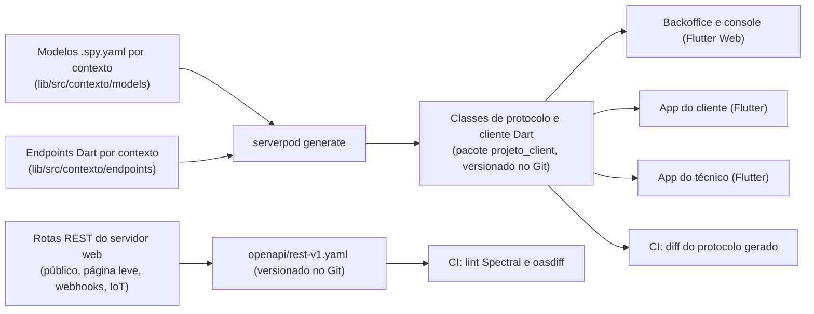

# 08 — API (endpoints Serverpod, rotas REST, eventos e tempo real)

Versão 0.3 — 02/11/2026 — rascunho para revisão (stack Dart: Flutter + Serverpod)

Propósito: especificar o contrato da API da plataforma-os — convenções, catálogo de endpoints por canal, formatos de exemplo, eventos de domínio e tempo real — para que backend, backoffice, apps e integrações sejam construídos sobre o mesmo contrato: os modelos e endpoints do Serverpod para os apps e o OpenAPI 3.1 das rotas REST para o público e as integrações.

Documentos relacionados: [Arquitetura de solução](02-arquitetura-de-solucao.md) · [Modelo de domínio](03-modelo-de-dominio.md) · [Multi-tenancy e segurança](04-multi-tenancy-e-seguranca.md) · [Ativos e QR code](05-ativos-e-qr-code.md) · [Aplicações e fluxos](06-aplicacoes-e-fluxos.md) · [Integração ERP Senior](07-integracao-erp-senior.md) · [Infraestrutura e operação](09-infraestrutura-e-operacao.md) · [Benchmark Sismetro e novas funcionalidades](11-benchmark-sismetro-e-novas-funcionalidades.md) · [Stack Dart: Flutter + Serverpod](12-stack-dart-flutter-serverpod.md)

---

## 1. Resumo

- **Uma API, dois transportes, cinco públicos.** Os apps — backoffice e console da plataforma (Flutter Web), app do técnico e app do cliente (Flutter, Android e iOS) — usam **endpoints do Serverpod 4.1** (RPC sobre HTTP: métodos de endpoint com modelos e cliente Dart gerados), agrupados por contexto e por canal (D12): backoffice (`workOrders`, `customers`, `assets`...), técnico (`technician*`), cliente (`customer*`), plataforma (`platform*`) e exibição (`display`). O público (página leve do QR e seu JSON, OTP da página), os webhooks (Senior, WhatsApp, SES) e a ingestão IoT usam **rotas REST/JSON** em `/api/v1/...` no **servidor web do Serverpod**, com OpenAPI 3.1 só para elas. Os dois servidores rodam no deployable `api` (`--role serverless`).
- **Contrato code-first:** os modelos `.spy.yaml` geram as classes Dart compartilhadas entre servidor e apps e o cliente Dart gerado; não há OpenAPI nem SDK escrito à mão para os próprios apps (seção 9).
- **O tenant vem sempre da credencial**, nunca de um parâmetro livre (seção 2.3).
- **Ações de negócio são métodos próprios** (`workOrders.close`), não `update` de status: cada ação tem validação, permissão, evento de domínio e auditoria próprios.
- **Mobile e integrações são idempotentes** (`idempotencyKey` nos métodos; `Idempotency-Key` nas rotas REST; no sync, `mutation_id`), e toda escrita concorrente usa `version` + `expectedVersion`.
- **Erros** são exceções serializáveis do Serverpod (`ApiException`) com código de negócio estável; nas rotas REST, Problem Details (seção 2.8).
- **Tempo real do backoffice por streaming do Serverpod** com avisos de invalidação sem dados (seção 8).
- **Dinheiro em centavos e quantidades em milésimos**, como inteiros; medidas (coordenadas, precisão, distância, leituras) em `double` (seção 2.12).
- **Novidades da v0.2** ([doc 11](11-benchmark-sismetro-e-novas-funcionalidades.md)): filiais, vendedores e carteira, prestadores e taxas, plantão e escalonamento, `acknowledge` e `resolveRemotely` na OS, custos da OS, aprovação de movimentação com termo em PDF (MVP); planos de manutenção, medidores, modo TV e fechamento de prestadores (F2); dispositivos IoT, regras de alerta e ingestão de telemetria (F3). Os papéis novos `sales_rep` e `provider_admin` usam os endpoints do backoffice **com escopo** (seção 3.18); o despacho no celular usa o token de tenant do app do técnico (seção 3.19).
- **Novidades da v0.3** ([doc 12](12-stack-dart-flutter-serverpod.md)): mesma lista de casos de uso e papéis, agora como métodos de endpoint do Serverpod para os apps; rotas REST mantidas só para o público, a página leve e as integrações; autenticação por handler customizado do Serverpod; streaming no lugar do tempo real da v0.2.

---

## 2. Convenções

### 2.1 Transportes, hosts e grupos

| Cliente | Transporte e host | Observação |
|---|---|---|
| Backoffice (Flutter Web) | Endpoints do Serverpod por `<slug>.<dominio>/api/`, que a CDN encaminha ao servidor de API do Serverpod (prefixo removido na borda), inclusive o WebSocket do streaming | Mesma origem, sem CORS ([Arquitetura de solução](02-arquitetura-de-solucao.md)) |
| Console da plataforma (Flutter Web) | Endpoints do Serverpod por `console.<dominio>/api/` | Mesma origem; WAF com lista de IPs opcional |
| Apps Flutter (técnico e cliente) | Endpoints do Serverpod em `api.<dominio>` | Sem cache na CDN |
| Página leve do QR (sem app) | Servidor web do Serverpod em `<dominio>`: HTML em `/q/...`, JSON em `/api/v1/public/*` e `/api/v1/customer/*` | Mesma origem; cookie HttpOnly de refresh |
| ERPs, provedores e dispositivos | Servidor web do Serverpod em `api.<dominio>/api/v1/integrations/*` | Webhooks e ingestão IoT |

| Grupo | Onde | Credencial | Quem usa |
|---|---|---|---|
| Backoffice | Endpoints por contexto (`workOrders`, `customers`, `assets`, `integrationJobs`...) | Token de tenant emitido pela api (troca do token do Keycloak em `auth.exchangeIdpToken`) + RBAC | tenant_admin, dispatcher, backoffice_agent, manager; **v0.2 (MVP), com escopo:** sales_rep (carteira) e provider_admin (sua empresa) — seção 3.18; dispatcher no app do técnico (despacho no celular) — seção 3.19 |
| Exibição (modo TV, v0.2, F2) | Endpoint `display` (parte do backoffice) | Token de exibição opaco e revogável; só leitura | Televisão da sala de operação (seção 3.16) |
| Técnico | Endpoints `technician*` | Token de tenant com papel technician, obtido com prova de posse da chave do dispositivo registrado (`devices.public_key_jwk`) | technician |
| Cliente | Endpoints `customer*` (app) e rotas `/api/v1/customer/*` (página leve) | Access token próprio (ES256) do contato | customer_contact, customer_admin |
| Público | Rotas `/api/v1/public/*` (página leve) e métodos sem login no app (`publicQr`, `customerAuth.startOtp`/`verifyOtp`/`selectTenant`, `publicTenants`, `appConfig`) | Nenhuma; rate limit e, quando aplicável, `qr_context` | Qualquer pessoa |
| Plataforma | Endpoints `platform*` | Token emitido pela api a partir do login no realm `platform` do Keycloak (MFA resistente a phishing); em sessão de suporte, token de tenant com `act = platform_support` | platform_admin, platform_support |
| Webhooks de entrada | Rotas `/api/v1/integrations/webhooks/*` | Segredo por conexão ou HMAC | ERP, provedores de mensagem e e-mail |
| Ingestão de telemetria (v0.2, F3) | Rotas `/api/v1/integrations/iot/*` | Credencial por dispositivo (HMAC do corpo com segredo do cofre) | Dispositivos IoT e gateways (seção 3.17) |

Health checks ficam fora do contrato: rotas `GET /healthz` (vivo) e `GET /readyz` (dependências) nos servidores de API e web do Serverpod, acessíveis só pelo load balancer.

### 2.2 Autenticação por canal

| Canal | Fluxo | Onde fica o refresh | Validade do access token |
|---|---|---|---|
| Backoffice | OIDC Authorization Code + PKCE no Keycloak 26.8 (`auth.<dominio>`), pelo fluxo OIDC do Flutter Web → troca por token de tenant em `auth.exchangeIdpToken` | Refresh do Keycloak gerenciado pelo fluxo OIDC no navegador (detalhes e endurecimento em [Multi-tenancy e segurança](04-multi-tenancy-e-seguranca.md)) | 10 min (token de tenant) |
| Técnico | OIDC Authorization Code + PKCE pelo navegador do sistema (`flutter_appauth`) → troca por token de tenant com prova de posse da chave do aparelho | Armazenamento seguro do aparelho (`flutter_secure_storage`: Keychain/Keystore) | 10 min (token de tenant); refresh do Keycloak de longa duração para o trabalho offline (política no 04) |
| Cliente (app) | OTP (D5a) por `customerAuth.startOtp`/`verifyOtp` → tokens próprios | `flutter_secure_storage`; refresh rotativo com detecção de reuso (`auth_sessions`) | 10 min |
| Cliente (página leve) | OTP (D5a) por `POST /public/otp/*` → tokens próprios | Cookie `__Host-pos_rt_<slug>` (`HttpOnly`, `Secure`, `SameSite=Strict`, `Path=/`); o refresh exige o cabeçalho `X-Requested-With` e confere `Origin` | 10 min, mantido só em memória na página |
| Plataforma | OIDC no realm `platform` do Keycloak, MFA resistente a phishing → token emitido pela api | Igual ao backoffice | 10 min |
| Webhooks | Segredo aleatório em cabeçalho (Senior Events Hub) ou HMAC-SHA256 do corpo (genérico) | — | — |
| Modo TV (F2) | Token de exibição criado pelo tenant_admin; a TV abre o backoffice em `https://<slug>.<dominio>/tv#t=<token>` (o fragmento não vai ao servidor) e o app envia o token como Bearer | Não há refresh: o token vale até expirar ou ser revogado | Validade configurada na criação (padrão 180 dias) |
| Dispositivo IoT (F3) | `X-Device-Id` + `X-Signature: t=<unix>,v1=<hex(HMAC-SHA256(segredo, t + "." + corpo))>`; segredo por dispositivo no cofre, com dois segredos válidos durante a rotação | — | — |

Todas as chamadas autenticadas levam `Authorization: Bearer <access_token>`, sempre com um token **emitido pela api** (modelo de tokens no 04, seção 4.2): o cliente Dart gerado o envia pelo seu provedor de chave de autenticação; a página leve o envia direto. A validação é feita pelo **handler de autenticação customizado do Serverpod**:

```dart
// bin/main.dart (trecho)
final pod = Serverpod(args, Protocol(), Endpoints(),
    authenticationHandler: tokenAuthenticationHandler);

/// Valida só tokens próprios ES256 (tenant, contato, exibição, plataforma).
Future<AuthenticationInfo?> tokenAuthenticationHandler(Session session, String token) async {
  final claims = await tokenVerifier.verify(token); // assinatura por kid, iss, aud, exp, typ
  if (claims == null || await revocations.isRevoked(claims.sid)) return null;
  sessionClaims[session] = claims;                  // Expando<TokenClaims> lido pelo interceptor e pelos guardas
  return AuthenticationInfo(claims.sub, {           // assinatura exata conforme o Serverpod 4.1 (spike S1)
    Scope('token:${claims.kind.name}'),             // staff, customer, display, platform
    ...claims.roles.map((r) => Scope('role:$r')),
  }, authId: claims.sid);
}

/// Classe-base dos endpoints do backoffice e do técnico.
abstract class StaffEndpoint extends Endpoint {
  @override
  bool get requireLogin => true;
  @override
  Set<Scope> get requiredScopes => {Scope('token:staff')};
}
```

- Classes-base por tipo de token (`StaffEndpoint`, `TechnicianEndpoint`, `CustomerEndpoint`, `DisplayEndpoint`, `PlatformEndpoint`): um token de contato nunca passa num endpoint `technician*`, e um token da equipe nunca passa num `customer*`. Como `requiredScopes` exige **todos** os escopos listados, papel e escopo fino (SR, PV, filial) são conferidos por método, pela tabela de políticas (seção 9.1).
- O token do Keycloak só é aceito como **parâmetro** de um método sem login, nunca pelo handler:

| Método | Parâmetros | Resultado |
|---|---|---|
| `auth.exchangeIdpToken` | `idpToken` (token do Keycloak), `tenantSlug`, `deviceProof` (JWS assinado com a chave do aparelho; obrigatório no app do técnico), `clientInfo` (app, versão, build, plataforma) | `TenantToken { accessToken, tokenType: "Bearer", expiresIn: 600, tenant { id, slug, displayName }, roles }`; `FORBIDDEN` sem vínculo ativo; `UNAUTHENTICATED` com token do IdP inválido. Com token do realm `platform`, emite o token de plataforma |

Chamadas públicas e do cliente informam também o identificador aleatório da instalação, usado no `qr_context` (seção 4): parâmetro `installId` nos métodos do app, cabeçalho `X-Install-Id` nas rotas REST.

Tokens próprios do contato (emitidos pela api, ES256, chave em cofre com rotação por `kid`; JWKS interno):

```json
{ "iss": "https://api.<dominio>", "aud": "plataforma-os:customer", "typ": "customer-access+jwt",
  "sub": "0192f0a4-5b7e-7c31-9d2a-1f0e2d3c4b5a", "tid": "0192e8b1-0c3d-7a44-8e21-6f5a4b3c2d1e",
  "cid": "0192e8c7-77aa-7b10-a1b2-c3d4e5f60718", "ctc": "0192f0a4-5b7f-7d02-8c3b-2a1b0c9d8e7f",
  "roles": ["customer_contact"], "sid": "0192f0a4-6000-7e11-9f00-112233445566",
  "cli": "customer-app/1.8.2+182 (android)", "iat": 1792800000, "exp": 1792800900 }
```

`sub` = `users.id` global; `tid` = tenant; `cid` = `customers.id`; `ctc` = `customer_contacts.id`; `sid` = `auth_sessions.id` (permite revogar sessão sem esperar o `exp`, por lista de revogação no Valkey); `cli` = app e versão informados na emissão (seção 2.4; ausente nos tokens da página leve).

### 2.3 Tenant derivado do token

- O tenant de cada chamada é o da credencial: claim `tid` nos tokens próprios; nos tokens do Keycloak (só na troca), a organização ativa (Keycloak Organizations), traduzida para `tenant_id` pelo catálogo de tenants — mecanismo exato em [Multi-tenancy e segurança](04-multi-tenancy-e-seguranca.md).
- O guarda de permissão confere que existe `tenant_membership` ativa com o papel exigido, e o **`databaseInterceptor` do Serverpod 4** abre toda operação de banco da sessão dentro de transação iniciada por `set_config('app.tenant_id', <tid>, true)`, inclusive o SQL próprio (`unsafeQuery`/`unsafeExecute`) (D4; [doc 12](12-stack-dart-flutter-serverpod.md), seção 4.3). O RLS continua como segunda barreira. Nenhum método fora de `platform*` recebe `tenantId` como parâmetro, e os modelos de entrada não têm campo de tenant; nas rotas REST, `tenant_id` no corpo é campo desconhecido (`400`).
- No backoffice, o host `<slug>.<dominio>` repassado pela CDN precisa corresponder ao tenant do token; divergência → `TENANT_MISMATCH`. Trocar de tenant = obter novo token para a outra organização (`me.tenants` lista as opções).
- Grupo público: o tenant é derivado do recurso (token ou short code do QR resolvido por `public.resolve_qr_token`/`public.resolve_qr_short_code`), nunca informado pelo cliente.
- `platform_admin` em modo suporte troca a sessão de suporte aprovada (motivo, prazo, auditoria; ver 04) por um token de tenant com `act = platform_support` e a claim `ssn` (id da sessão), em `auth.exchangeSupportSession`; não há cabeçalho extra.
- **v0.2:** o app do técnico chama endpoints do backoffice (despacho no celular, seção 3.19) pelo host `api.<dominio>`; ali não há verificação de host, e o tenant vem só do token. O token de exibição (modo TV) carrega o tenant e a filial do painel; o dispositivo IoT resolve o tenant pelo `X-Device-Id` (identificador global), nunca pelo corpo.

### 2.4 Versionamento e depreciação

- **Endpoints:** sem versão no caminho; a compatibilidade é a do protocolo gerado. Só entram mudanças **aditivas**: métodos novos, parâmetros novos só **nomeados e opcionais**, campos novos nos modelos só **anuláveis ou com valor padrão**, valores novos em enums marcados como extensíveis.
- Clientes gerados ignoram campos desconhecidos. Enums usam `serialized: byName`; os extensíveis precisam de valor padrão para desconhecido (`other`) no cliente antigo — se o gerador não suportar, o campo trafega como `String` (questão aberta 13).
- Mudança incompatível → **método novo** (ex.: `workOrders.scheduleV2`) ou endpoint novo, convivendo com o antigo por no mínimo 6 meses (12 meses para métodos usados pelos apps móveis). O método antigo é anotado `@Deprecated`, entra no changelog e tem a métrica de chamadas por versão do app (seção 9.3).
- **Versão mínima do app:** o app informa `clientInfo` na troca e na renovação do token, e a versão vai para a claim `cli`. O handler compara a cada chamada com a versão mínima vigente (configurável sem deploy e devolvida por `appConfig.get`); abaixo dela, `APP_VERSION_UNSUPPORTED` e o app mostra "atualize".
- **Rotas REST:** versão maior no caminho (`/api/v1`). Mudança incompatível → `/api/v2` da rota afetada, convivendo com a v1 por no mínimo 6 meses; rotas em retirada respondem com `Deprecation` (RFC 9745) e `Sunset` (RFC 8594) e um `Link` para a nota de migração.

### 2.5 Nomes e recursos

- **Endpoints:** classe `<Nome>Endpoint` em `lib/src/<contexto>/endpoints/` do servidor; no cliente, o nome é o recurso no plural em camelCase (`workOrders`, `customerSites`, `qrTagBatches`), com prefixo de canal quando não é backoffice (`technicianSync`, `customerWorkOrders`, `platformTenants`). Métodos em camelCase com verbo (`close`, `resolveRemotely`, `bulkGenerateQrTags`). `void` e `return` são palavras reservadas do Dart: "anular" é `annul` e "devolver na conferência" é `sendBack`.
- **Modelos:** campos em camelCase (padrão Dart), mapeados às colunas snake_case do banco nos `.spy.yaml` das tabelas com `managedMigration: false` (mapeamento confirmado no spike S2). Enums com os **mesmos valores snake_case do banco** (`serialized: byName`), para o ORM gravar o texto que os `CHECK`s aceitam.
- **Rotas REST:** caminhos em kebab-case e plural (`/work-orders`, `/qr`); campos JSON em snake_case, iguais ao banco (D14); enums em snake_case minúsculo.
- **IDs** são UUID v7 (`UuidValue`; `defaultModel=random_v7` nos modelos). O cliente pode enviar `id` na criação (app do técnico offline, D6); a API rejeita UUID que não seja v7 ou com timestamp a mais de 7 dias no futuro (`INVALID_UUID`).
- **Resultados:** item = modelo do recurso, com `version`; lista = `<Recurso>Page { items, nextCursor, hasMore, total?, totalIsEstimate? }` (os modelos do Serverpod não têm genéricos, então há uma página por recurso). Operação assíncrona = `AsyncJobRef { id, kind, status }`, acompanhada por `asyncJobs.get(id)` e pelo aviso de invalidação `async_job:<id>`.
- **Expansões** opcionais por `include`, lista de enum por recurso (ex.: `workOrders.get(id, include: [WorkOrderInclude.visits, WorkOrderInclude.items])`).

### 2.6 Paginação por cursor

```dart
final page = await client.workOrders.list(
  WorkOrderFilter(status: [WorkOrderStatus.open, WorkOrderStatus.scheduled]),
  PageRequest(limit: 50, sort: 'created_at', descending: true),
);
// próxima página: PageRequest(limit: 50, sort: 'created_at', descending: true, cursor: page.nextCursor)
```

```json
{ "items": [{ "id": "0192f0b2-...", "number": "2026-000123", "status": "open" }],
  "nextCursor": "eyJrIjpbIjIwMjYtMTAtMjdUMTQ6MDA6MDBaIiwiMDE5MmYwYjIiXX0", "hasMore": true }
```

- `limit` padrão 50, máximo 200. `cursor` é opaco (base64url da chave de ordenação + id, assinado com HMAC para não ser adulterado) e vale para a mesma combinação de filtros e ordenação; se mudar, `CURSOR_MISMATCH`.
- Total só sob pedido (`includeTotal: true`), limitado a 10 000 (`total: 10000, totalIsEstimate: true` acima disso).
- Exportações grandes não paginam: viram job assíncrono (`reports.startExport` → `AsyncJobRef`).

### 2.7 Filtros, busca e ordenação

Cada listagem recebe um modelo `<Recurso>Filter` com campos tipados; o que não está no modelo não pode ser filtrado, o que protege índices e evita consultas caras arbitrárias.

| Tipo | Exemplo no `WorkOrderFilter` | Regra |
|---|---|---|
| Igualdade e lista | `status: [open, scheduled]` | Lista = OU |
| Intervalo | `createdAt: DateTimeRange(gte: DateTime.utc(2026, 10, 1), lt: DateTime.utc(2026, 11, 1))` | `gt`, `gte`, `lt`, `lte` |
| Nulo | `technicianIsNull: true` | — |
| Busca livre | `q: 'freezer 8812'` | Campos de busca definidos por recurso (nº, série, short code, nome, documento) |
| Ordenação | `PageRequest(sort: 'priority', descending: true)` | Só os campos listados no recurso; outro → `INVALID_FILTER` |
| Listas leves | Modelo de resumo (`WorkOrderSummary`) | Projeção fixa no lugar de `fields=` |

Combinações caras (ex.: período acima de 1 ano sem outro filtro) também → `INVALID_FILTER`.

### 2.8 Erros

Nos endpoints, todo erro esperado é a exceção serializável `ApiException`, declarada como modelo do Serverpod; o cliente gerado a recebe tipada:

```yaml
# lib/src/shared/models/api_exception.spy.yaml
exception: ApiException
fields:
  code: String                      # código de negócio estável (tabelas abaixo)
  category: ErrorCategory           # validation, unauthenticated, forbidden, notFound, conflict, ...
  detail: String                    # texto para pessoas, em pt-BR
  traceId: String
  fieldErrors: List<FieldError>?    # { path: "items/0/quantity", code: "too_small", message: "Deve ser maior que zero" }
  currentVersion: int?              # em VERSION_MISMATCH
  retryAfterSeconds: int?           # em RATE_LIMITED, IDEMPOTENCY_IN_PROGRESS, SERVICE_UNAVAILABLE
  meta: Map<String, String>?        # ex.: acknowledgedBy em ALREADY_ACKNOWLEDGED
```

Os clientes decidem pelo `code`; `detail` é só para exibir. Exceção não prevista não vaza detalhes: o Serverpod devolve erro genérico, o servidor registra no Sentry com o `traceId`, e o app mostra mensagem padrão.

Nas **rotas REST**, o mesmo `code` vai em `application/problem+json` (RFC 9457), com o HTTP da categoria:

```json
{
  "type": "https://<dominio>/problems/qr-context-invalid",
  "title": "Leitura do QR inválida ou expirada",
  "status": 422,
  "code": "QR_CONTEXT_INVALID",
  "detail": "Leia o QR do equipamento de novo para continuar.",
  "instance": "/public/otp/start",
  "trace_id": "4bf92f3577b34da6a3ce929d0e0e4736",
  "errors": []
}
```

| Categoria | HTTP (REST) | `code` | Quando |
|---|---|---|---|
| `validation` | 400 | `VALIDATION_FAILED`, `INVALID_FILTER`, `CURSOR_MISMATCH`, `INVALID_UUID` | Dados, filtro ou cursor inválido |
| `unauthenticated` | 401 | `UNAUTHENTICATED`, `TOKEN_EXPIRED`, `SESSION_REVOKED` | Sem credencial ou credencial inválida |
| `forbidden` | 403 | `FORBIDDEN`, `TENANT_MISMATCH`, `TENANT_SUSPENDED`, `DEVICE_BLOCKED`, `CONTACT_NOT_APPROVED` | Sem permissão ou contexto inválido |
| `notFound` | 404 | `NOT_FOUND` | Inexistente **ou** de outro tenant (nunca `FORBIDDEN` para recurso de outro tenant) |
| `conflict` | 409 | `INVALID_TRANSITION`, `MASTER_FIELD_READ_ONLY`, `DUPLICATE`, `ASSET_ALREADY_HAS_TAG`, `QR_TAG_NOT_BINDABLE`, `ASSET_HAS_OPEN_WORK_ORDER`, `IDEMPOTENCY_IN_PROGRESS`, `INTEGRATION_JOB_NOT_RETRYABLE` | Conflito com o estado atual |
| `versionMismatch` | 412 | `VERSION_MISMATCH` | `expectedVersion` diferente da versão atual; traz `currentVersion` |
| `payloadTooLarge` | 413 | `PAYLOAD_TOO_LARGE` | Requisição acima do limite (1 MB; sync push até 100 mutações ou 1 MB) |
| `businessRule` | 422 | `BUSINESS_RULE_VIOLATION`, `IDEMPOTENCY_KEY_REUSED`, `QR_CONTEXT_INVALID`, `QR_CONTEXT_EXPIRED`, `OTP_INVALID`, `OTP_EXPIRED`, `OTP_ATTEMPTS_EXCEEDED` | Regra de negócio; `fieldErrors` detalha |
| `upgradeRequired` | 426 | `APP_VERSION_UNSUPPORTED` | App abaixo da versão mínima |
| — (só REST) | 428 | `PRECONDITION_REQUIRED` | Falta `Idempotency-Key` obrigatório (nos métodos, o parâmetro é obrigatório pela assinatura) |
| `rateLimited` | 429 | `RATE_LIMITED` | Com `retryAfterSeconds` / `Retry-After` |
| `unavailable` | 503 | `SERVICE_UNAVAILABLE` | Manutenção ou dependência indisponível, com `retryAfterSeconds` / `Retry-After` |

Códigos novos da v0.2:

| Categoria | HTTP (REST) | `code` | Quando |
|---|---|---|---|
| `unauthenticated` | 401 | `DISPLAY_TOKEN_REVOKED`, `DEVICE_SIGNATURE_INVALID` | Token de exibição revogado ou expirado; assinatura do dispositivo IoT inválida ou fora da tolerância |
| `forbidden` | 403 | `OUT_OF_ROLE_SCOPE` | Ação que o papel com escopo (`sales_rep`, `provider_admin`) não pode fazer, mesmo em registro visível. Registro **fora** do escopo continua `NOT_FOUND` |
| `conflict` | 409 | `ALREADY_ACKNOWLEDGED`, `MOVEMENT_APPROVAL_PENDING`, `COST_ALREADY_REVIEWED`, `SETTLEMENT_NOT_EDITABLE`, `REQUISITION_IN_PROGRESS`, `DEVICE_ALREADY_BOUND` | OS já assumida por outra pessoa; ativo com movimentação aguardando aprovação; custo já conferido; fechamento já aprovado ou enviado; item com requisição aberta no ERP; dispositivo já vinculado a outro ativo |
| `businessRule` | 422 | `REMOTE_RESOLUTION_NOT_ALLOWED`, `READING_OUT_OF_RANGE`, `READING_BEFORE_PREVIOUS` | Resolução remota em status ou tipo que não permite; leitura fora dos limites do medidor; horímetro menor que a leitura anterior sem `reset` |

Exceção: `GET /public/qr/*` (e `publicQr.resolve`) responde **com sucesso** para estados de etiqueta (não ativada, revogada, sem cliente, tenant suspenso), porque são estados exibíveis da página e não erros ([Ativos e QR code](05-ativos-e-qr-code.md)); só código malformado ou inexistente dá `NOT_FOUND`.

### 2.9 Idempotência

- **Obrigatória** no parâmetro `idempotencyKey` (tipo `UuidValue`, não anulável) de todo método de criação e de ação vindo de mobile — `technician*` online, `customer*`, ações do despacho no celular — e de `customerAuth.startOtp`; e no cabeçalho `Idempotency-Key` (`428` se faltar) de todo `POST` REST da página leve, de `/public/otp/start` e das integrações. **Recomendada** (parâmetro opcional) nos métodos de criação do backoffice; a camada comum dos apps envia sempre. O sync push usa `mutation_id` por mutação (D11) e dispensa a chave.
- Valor: UUID v4/v7 gerado pelo cliente no início da intenção (ex.: ao abrir o assistente de chamado), reaproveitado em todas as retentativas.
- Armazenamento em `idempotency_keys` (proposta ao [Modelo de domínio](03-modelo-de-dominio.md)): `tenant_id` (nulo no público), `principal_id`, `key`, `operation` (`endpoint.método` ou `MÉTODO /rota`), `request_hash` (SHA-256 dos argumentos serializados em forma canônica), `status` (`in_progress`/`completed`), `response_status` (só REST), `response_body` (resultado serializado pelo protocolo do Serverpod ou corpo REST), `expires_at` (24 h; 7 dias para técnico, por causa do offline).
- Mesma chave e mesmos argumentos → mesmo resultado, desserializado do que foi guardado (nas rotas REST, com `Idempotent-Replayed: true`). Mesma chave e argumentos diferentes → `IDEMPOTENCY_KEY_REUSED`. Chamada original ainda em andamento → `IDEMPOTENCY_IN_PROGRESS` com `retryAfterSeconds: 1`.
- A gravação da chave acontece na mesma transação do caso de uso, para que "executou e não registrou" seja impossível:

```dart
class CustomerWorkOrdersEndpoint extends CustomerEndpoint {
  Future<OpenWorkOrderResult> open(Session session, OpenWorkOrderRequest request,
      {required UuidValue idempotencyKey, required String installId}) {
    return idempotent(session, 'customerWorkOrders.open', idempotencyKey, request,
        (tx) => openWorkOrder.execute(session, tx, request, installId: installId));
  }
}
// idempotent(): abre session.db.transaction, grava a chave in_progress, executa,
// guarda o resultado serializado e marca completed; replay devolve o resultado guardado.
```

- **Exceção (v0.2, F3):** `POST /integrations/iot/readings` não exige o cabeçalho. A idempotência é natural, por leitura: dispositivo + medidor (canal) + horário do dispositivo (`measured_at`), com unicidade no banco; um lote reenviado inteiro devolve `duplicate` nas leituras já gravadas (seção 3.17).

### 2.10 Concorrência otimista

- Todo modelo mutável tem `version` (inteiro, D14), devolvido em toda leitura.
- `update`, `deactivate` e ações (`workOrders.close`, `.schedule` etc.) recebem `expectedVersion` (obrigatório); versão diferente → `VERSION_MISMATCH` com `currentVersion`, e o app relê com `get`. O servidor aplica com `UPDATE ... WHERE id = $1 AND version = $2` (ORM ou SQL próprio): zero linhas = conflito.
- O resultado de sucesso traz o modelo com a nova `version`. O backoffice mostra "esta OS foi alterada por Fulano; recarregar" no `VERSION_MISMATCH`.
- O app do técnico não usa `expectedVersion` no sync: as mutações carregam o estado esperado no payload e o servidor responde `conflict` com `server_state` (D11; regras em [Aplicações e fluxos](06-aplicacoes-e-fluxos.md)).

### 2.11 Rate limit

Janela deslizante no Valkey, por chave. Nos endpoints, o excesso vira `RATE_LIMITED` com `retryAfterSeconds`; nas rotas REST, `429` com `Retry-After` e cabeçalhos no formato do rascunho IETF `RateLimit` (`RateLimit-Policy: "default";q=600;w=60` e `RateLimit: "default";r=42;t=18`). O WAF aplica um teto por IP antes do servidor.

| Grupo | Chave | Limite inicial |
|---|---|---|
| Backoffice | usuário + tenant | 600 chamadas/min; exportações 10/h |
| Técnico | dispositivo | 300 chamadas/min; sync push 60/min |
| Cliente | contato | 120 chamadas/min; abertura de chamado conforme [Ativos e QR code](05-ativos-e-qr-code.md) |
| Público | IP, token, short code, destino de OTP | Tabela de rate limit de [Ativos e QR code](05-ativos-e-qr-code.md) |
| Plataforma | usuário | 300 chamadas/min |
| Webhooks | conexão | 50 req/s |
| Exibição (modo TV, F2) | token de exibição | 30 chamadas/min; 2 streams |
| Ingestão IoT (F3) | dispositivo | 12 req/min, até 500 leituras por requisição; agregado do tenant pela linha abaixo |
| Por tenant (agregado) | tenant | Proteção de vizinho barulhento: 3 000 chamadas/min, ajustável por plano |

### 2.12 Formatos

| Tipo | Formato | Exemplo |
|---|---|---|
| Data e hora | `DateTime` em UTC; no JSON, ISO 8601 com `Z` e milissegundos | `"2026-10-27T14:03:12.481Z"` |
| Data | `YYYY-MM-DD` (no fuso do tenant) | `"2026-10-28"` |
| Hora local (turnos) | `HH:mm` + fuso do tenant em `tenant_settings` | `"07:30"` |
| Duração | Inteiro em minutos (`*Minutes` / `*_minutes`) | `"durationMinutes": 95` |
| Dinheiro | `int` em **centavos** + `currency` ISO 4217 no objeto pai; o nome do campo não muda (a unidade está no glossário e no `COMMENT` da coluna) | `"unitPrice": 18500` = R$ 185,00; `"currency": "BRL"` |
| Quantidade | `int` em **milésimos** | `"quantity": 1500` = 1,5 |
| Medidas (latitude, longitude, precisão, distância, leituras de medidor) | `double` (`double precision` no banco) | `"latitude": -23.55052`, `"accuracyM": 12.0`, `"value": 1523.25` |
| Telefone | E.164 | `"+5511987654321"` |
| Documento | Sem pontuação, em maiúsculas. CPF só dígitos; CNPJ com 12 posições alfanuméricas e 2 dígitos verificadores (CNPJ alfanumérico da Receita, emitido desde julho de 2026; os numéricos continuam válidos). Regra única em `packages/core` (`BrDocuments`) | `"11222333000181"`, `"12ABC34501DE35"` |

Inteiros evitam erro de ponto flutuante em todos os clientes; no Flutter Web, `int` tem 53 bits de precisão, o que sobra para centavos. O banco grava `bigint` ([doc 12](12-stack-dart-flutter-serverpod.md), seção 4.1). Onde o JSON é externo (pedido ao ERP, webhooks para tenants), o adaptador converte para decimal na borda ([Integração ERP Senior](07-integracao-erp-senior.md), seção 9.5; seção 7).

### 2.13 Anexos por upload direto

1. **Backoffice e cliente:** `attachments.requestUpload` (ou `customerAttachments.requestUpload`; na página leve, `POST /customer/attachments/upload-url`) com `id` (UUID v7 gerado pelo cliente), `ownerType`, `ownerId`, `category`, `contentType`, `sizeBytes`, `sha256`. **Técnico (offline-first):** o anexo é registrado antes, pela mutação `attachment.register` no sync, assim que a foto é tirada (o backoffice já vê "anexos pendentes"). Quando houver rede, o app pede `technicianAttachments.requestUpload(id)`, com upload multipart em partes de 5 MB para vídeos acima de 8 MB, permitindo retomada ([Aplicações e fluxos](06-aplicacoes-e-fluxos.md), seção 6).
2. O servidor valida tipo (JPEG, PNG, HEIC, WebP, MP4 até 60 s, PDF) e tamanho (imagem 15 MB, vídeo 100 MB, PDF 20 MB) e devolve a descrição de upload para a chave `t/<tenant_id>/attachments/<owner_type>/<owner_id>/<id>`, válida por 15 min: até 8 MB, a **descrição de upload direto do armazenamento S3 do Serverpod** (`session.storage.createDirectFileUploadDescription`); vídeos maiores, multipart S3 com URLs por parte assinadas pelo servidor (spike S4).
3. O cliente envia o arquivo direto ao object storage.
4. O cliente confirma: `attachments.complete` (backoffice), `customerAttachments.complete` (cliente) ou `technicianAttachments.complete` (técnico), sempre com o `sha256`. O servidor confere existência (`session.storage.verifyDirectFileUpload`), tamanho e checksum; um job do `worker` gera miniaturas, remove metadados de localização quando a política exigir e faz a varredura antivírus; até lá `status = processing`.
5. Download: `attachments.downloadUrl(id)` (e os métodos `*Url` do catálogo) devolve URL GET pré-assinada de 5 min, assinada pelo servidor (SigV4). O bucket nunca é público.

### 2.14 Outras regras

- Tipos estritos: nos endpoints, o protocolo gerado já rejeita tipo errado; nas rotas REST, campo desconhecido → `400`. Campos mestres de registros com `source = 'erp'` → `MASTER_FIELD_READ_ONLY` ([Integração ERP Senior](07-integracao-erp-senior.md)).
- Nada é apagado fisicamente (D14): cadastros usam `deactivate` e `reactivate`; lançamentos da OS (itens, apontamentos, anexos) usam `annul` com motivo. Não há método de exclusão na API de negócio, exceto em recursos efêmeros (dispositivo, inscrição de push, visão salva).
- Respostas REST com dados de tenant usam `Cache-Control: no-store`.
- Correlação: cada chamada recebe um `traceId` (OpenTelemetry pelo pacote da comunidade para Serverpod 4, a validar), presente nos logs e em toda `ApiException`; nas rotas REST, `traceparent` é aceito e propagado, e `X-Request-Id` volta em toda resposta.

---

## 3. Catálogo de endpoints

Legenda de papéis: **TA** tenant_admin · **DI** dispatcher · **BA** backoffice_agent · **MG** manager · **TE** technician · **CC** customer_contact · **CA** customer_admin · **PA** platform_admin · **SR** sales_rep (v0.2, só na carteira) · **PV** provider_admin (v0.2, só na sua empresa). "Leitura internos" = TA, DI, BA, MG; SR e PV só acessam o que a linha indica, sempre filtrado pelo escopo (seção 3.18). Fase de métodos novos entre parênteses: (MVP), (F2), (F3). Permissões finas em [Multi-tenancy e segurança](04-multi-tenancy-e-seguranca.md); a matriz de telas em [Aplicações e fluxos](06-aplicacoes-e-fluxos.md).

**Notação:** nos grupos dos apps (seções 3.1 a 3.8, 3.10, 3.12 a 3.19), cada linha é um método de endpoint do Serverpod, `endpoint.método`, chamado pelo cliente Dart gerado; o contexto (pasta `lib/src/<contexto>/` do servidor) aparece no título da seção ou na coluna própria. Ações declaram `expectedVersion` e, quando vindas de mobile, `idempotencyKey` (seções 2.9 e 2.10). Nos grupos público e de integrações (seções 3.9 e 3.11, e as rotas da página leve na 3.8), cada linha é uma rota REST do servidor web, com o prefixo `/api/v1`.

### 3.1 Padrão de cadastro

Todo endpoint de cadastro tem o mesmo conjunto de métodos, que não é repetido nas tabelas seguintes:

| Método | Descrição |
|---|---|
| `<endpoint>.list(filter, page)` | Lista paginada com filtros, busca e ordenação (`<Recurso>Page`) |
| `<endpoint>.create(input)` | Cria (aceita `id` UUID v7 do cliente) |
| `<endpoint>.get(id)` | Detalhe, com `version` |
| `<endpoint>.update(id, patch, expectedVersion)` | Altera campos (`<Recurso>Patch`) |
| `<endpoint>.deactivate(id, reason, expectedVersion)` · `.reactivate(id, expectedVersion)` | Inativa com motivo / reativa |
| `<endpoint>.audit(id, page)` | Auditoria campo a campo |
| `<endpoint>.export(filter)` | CSV dos filtros atuais: URL pré-assinada do arquivo (síncrono até 10 mil linhas) ou `AsyncJobRef` acima disso |

| Endpoint | Contexto | Escrita | Leitura | Métodos próprios |
|---|---|---|---|---|
| `customers` | customers | TA, DI, BA | internos; SR (carteira, MVP) | `listSites`, `listContacts`, `listAssets`, `listWorkOrders` (por cliente); v0.2: `primarySalesRepId` e `kind` (`standard`, `internal`) editáveis por TA e DI; `salesSummaries` (F3; TA, MG, SR da carteira) |
| `customerSites` | customers | TA, DI, BA | internos | `geocode` |
| `customerContacts` | customers | TA, DI, BA | internos | `invite`, `approve`, `reject`, `block`, `unblock`, `revokeSessions` |
| `products` | catalog | TA, DI, BA | internos | `listAssets` |
| `services` | catalog | TA, DI, BA | internos | — |
| `technicians` | scheduling | TA, DI | internos; PV (os da sua empresa) | `invite` (cria `user` + `tenant_membership`), `schedule`, `devices`; v0.2: `kind` (`employee`, `contractor`), `serviceProviderId` e `branchId`; PV convida e inativa só técnicos `contractor` da própria empresa |
| `teams`, `serviceAreas` | scheduling | TA, DI | internos | `teams.setMembers` |
| `workShifts`, `technicianShiftAssignments` | scheduling | TA, DI | internos | `technicianShiftAssignments.generate` (aplica padrão 5x2, 12x36 num período) |
| `businessCalendars` | scheduling | TA, DI | internos | `listHolidays`, `addHoliday`, `importNationalHolidays` |
| `workOrderTypes`, `symptoms`, `failureCauses`, `resolutionCodes`, `slaPolicies` | work_orders | TA | internos | `symptoms.reorder` (ordem da grade do app do cliente) |
| `checklistTemplates` | field_execution | TA | internos | `createVersion` (nova versão; versões são imutáveis) |
| `notificationTemplates` | notifications | TA | TA | `preview` |
| `branches` (MVP) | tenancy | TA | internos | `setDefault`. Um tenant nasce com uma filial padrão; não se inativa a filial padrão |
| `salesReps` (MVP) | customers | TA, DI | internos; SR (o próprio) | `portfolio` (clientes da carteira), `assignPortfolio` · `unassignPortfolio` (lote de `customerIds`, grava `customers.primary_sales_rep_id`), `inviteUser` (cria vínculo com papel `sales_rep`) |
| `serviceProviders` (MVP) | scheduling | TA, DI | internos; PV (a própria) | `listTechnicians`, `inviteTechnician` (técnico `kind = contractor`), `inviteAdmin` (papel `provider_admin`), `scorecard` (indicadores antifraude do doc 11, seção 4.3) |
| `providerRates` (MVP) | field_execution | TA | internos; PV (leitura das próprias) | `list` filtra por `serviceProviderId`. Vigência sem sobreposição por tipo de taxa → `DUPLICATE` |
| `onCallAssignments` (MVP) | scheduling | TA, DI | internos; TE (os próprios, pelo app) | `current(branchId, serviceAreaId, role)` (quem está de plantão agora), `generate` (aplica rodízio num período) |
| `escalationPolicies` (MVP) | scheduling | TA | internos | `simulate` (passos, destinatários e horários para uma OS hipotética) |
| `maintenancePlans` (F2) | maintenance | TA, DI | internos | Ver seção 3.14 |
| `iotDevices`, `telemetryAlertRules` (F3) | telemetry | TA | TA, DI, MG | Ver seção 3.17 |
| `webhookSubscriptions` (F3) | integrations | TA | TA | Ver seção 7 |

Registros com `source = 'erp'` aceitam `update` apenas nas extensões locais ([Integração ERP Senior](07-integracao-erp-senior.md)).

### 3.2 Backoffice — contexto, painel e tempo real

| Método | Descrição | Papéis |
|---|---|---|
| `me.get` | Usuário, tenant ativo, papéis, permissões efetivas, preferências | internos |
| `me.tenants` | Tenants em que o usuário tem vínculo (para troca) | internos |
| `me.updatePreferences` | Idioma, visões salvas padrão, notificações | internos |
| `dashboard.summary` | KPIs do painel inicial | internos |
| `events.subscribe` | Streaming de avisos de invalidação do tenant (seção 8) | internos |
| `savedViews.list` · `.save` · `.delete` | Visões salvas e compartilhadas de listas | internos |

### 3.3 Backoffice — ordens de serviço (contexto work_orders; custos em field_execution)

| Método | Descrição | Papéis |
|---|---|---|
| `workOrders.list` | Lista e kanban (filtros: status, cliente, unidade, região, equipe, técnico, tipo, prioridade, origem, SLA, período, `erpSyncStatus`) | internos |
| `workOrders.create` | Nova OS pelo backoffice (`origin = backoffice`, nasce `open`) | TA, DI, BA |
| `workOrders.get` | Detalhe (`include`: visits, items, timeEntries, checklists, attachments, comments, asset, customer) | internos |
| `workOrders.update` | Campos editáveis (descrição, contato no local, janela, prioridade, tipo antes do atendimento) | TA, DI, BA |
| `workOrders.triage` | Decisão da triagem: `accept` (→ `open`), `reject` (→ `cancelled`), `merge` (duplicada → `cancelled` ligada à principal), `request_info` (continua `requested`) | TA, DI, BA |
| `workOrders.schedule` | Cria a visita e agenda (→ `scheduled`) | TA, DI |
| `workOrders.hold` | Pendência com motivo e previsão (→ `on_hold`) | TA, DI, BA |
| `workOrders.resume` | Sai da pendência (→ `open` ou `scheduled`) | TA, DI, BA |
| `workOrders.complete` | Conclusão pelo backoffice em nome do técnico, com justificativa (→ `completed`) | TA, DI |
| `workOrders.sendBack` | Devolve na conferência (→ `on_hold`, motivo "retorno") | TA, DI, BA |
| `workOrders.close` | Conferir e encerrar (→ `closed`; dispara o pedido na fase 2) | TA, DI, BA |
| `workOrders.cancel` | Cancela com motivo (BA só até `scheduled`) | TA, DI, BA |
| `workOrders.reopen` | Reabre OS `closed` ou `cancelled` com motivo (→ `open`) | TA, DI |
| `workOrders.followUp` | Abre OS de retorno ligada a esta | TA, DI, BA |
| `workOrders.timeline` | Histórico de status, eventos de visita, comentários e notificações | internos |
| `workOrders.billingPreview` | Pré-visualização do pedido (mesmo `OrderAssembler` do [Integração ERP Senior](07-integracao-erp-senior.md)) | TA, DI, BA, MG |
| `workOrders.applyTimeBilling` | Converte horas apontadas em itens de serviço pelas regras do tenant | TA, DI, BA |
| `workOrders.reportUrl` | Relatório de atendimento (PDF com assinatura), por URL pré-assinada | internos |
| `workOrders.sendReport` | Envia o relatório ao cliente (WhatsApp/e-mail) | TA, DI, BA |
| `reviewItems.listByWorkOrder` | Registros offline a revisar (horas, itens, fotos chegados depois de cancelamento/reatribuição) | TA, DI, BA |
| `reviewItems.accept` · `.discard` | Decide um registro a revisar | TA, DI, BA |
| `workOrders.integrationStatus` | Jobs de integração da OS, tentativas e erros | TA, DI, MG |
| `workOrders.acknowledge` (MVP) | "Assumi": grava `acknowledged_at` e `acknowledged_by` na primeira chamada de um humano e para o escalonamento; chamadas seguintes de outra pessoa → `ALREADY_ACKNOWLEDGED` com quem assumiu (mesma pessoa → sucesso idempotente). Evento `work_order.acknowledged` | TA, DI, BA; SR (carteira, em `sales_rep_first`); PV (OS da sua empresa) |
| `workOrders.resolveRemotely` (MVP) | Resolve por orientação sem visita: `resolution_mode = remote`, descrição obrigatória, canal e duração; OS → `completed` (ou `closed`, se a conferência estiver desligada). Cancela visitas `scheduled` da OS. Eventos `work_order.resolved_remotely` e `work_order.status_changed` (exemplo na seção 5.8) | TA, DI, BA; SR (carteira) |
| `workOrders.escalation` (MVP) | Política aplicada, nível atual, passos já disparados (quem, canal, quando) e próximo passo | internos; PV (OS da sua empresa) |
| `workOrderCosts.listByWorkOrder` (MVP) | Linhas de `work_order_costs` (`costType`, `status`, valor, origem, prestador) e totais por tipo | TA, DI, BA, MG; PV (só `third_party_labor` e `travel` da sua empresa) |
| `workOrderCosts.add` (MVP) | Lança custo manual (`own_labor`, `third_party_labor`, `travel`, `other`; `parts` só sem requisição ao ERP); nasce `pending_review`. Evento `work_order_cost.added` (exemplo na seção 5.9) | TA, DI, BA |
| `workOrderCosts.review` (MVP) | Conferência: `decision` (`approve`, `reject`), valor ajustado opcional e nota (obrigatória na rejeição) → `approved` ou `rejected`. Já conferido → `COST_ALREADY_REVIEWED`. Evento `work_order_cost.reviewed` | TA, DI |
| `workOrderCosts.reviewBatch` (MVP) | Conferência em lote pelos filtros (prestador, período, sem sinais de fraude) | TA, DI |
| `workOrderCosts.reviewQueue` (MVP) | Fila de conferência (filtros `status`, `costType`, `serviceProviderId`, período, `flags` — sem check-in válido, `check_in_off_site`, OS sem ativo) | TA, DI, BA, MG; PV (as da sua empresa) |
| `workOrderCosts.annul` (MVP) | Anula com motivo (linha ainda sem fechamento) | TA, DI |

Mudanças em métodos existentes (v0.2, MVP): `workOrders.create` aceita `branchId` e, para SR, só clientes da carteira (`origin = sales_rep`, `entry_method = sales_rep`, com o contato que pediu); `workOrders.triage` ganha a decisão `forward_to_dispatch` (o vendedor devolve à fila central em `sales_rep_first`) e aceita SR na carteira; `workOrders.schedule` aceita `serviceProviderId` no lugar de `technicianId` (atribuição ao prestador, que escolhe o técnico); `workOrders.list` filtra também por `branchId`, `serviceProviderId`, `resolutionMode`, `escalationLevel`, `acknowledged` (`true`/`false`) e `maintenancePlanAssetId`.

Cada ação exige `expectedVersion`, grava `work_order_status_history`, publica o evento correspondente (seção 6) e devolve a OS atualizada. Transições inválidas → `INVALID_TRANSITION`.

### 3.4 Backoffice — visitas, lançamentos, anexos e comentários (scheduling e field_execution)

| Método | Descrição | Papéis |
|---|---|---|
| `visits.list` | Agenda: por período, técnico, equipe, região, status | internos |
| `visits.listByWorkOrder` · `visits.create` | Lista / cria visita adicional (retorno) | listar internos; criar TA, DI |
| `visits.reschedule` | Reagenda (horário, duração) | TA, DI |
| `visits.reassign` | Troca de técnico; se a visita já começou, cancela e cria outra preservando o histórico | TA, DI |
| `visits.cancel` | Cancela a visita com motivo | TA, DI |
| `scheduling.availability` | Disponibilidade por técnico (turnos, escalas, feriados, ausências, visitas) | TA, DI |
| `timeEntries.listByWorkOrder` · `timeEntries.createAdjustment` | Apontamentos (criação = ajuste manual com justificativa) | listar internos; criar TA, DI, BA |
| `timeEntries.update` · `timeEntries.annul` | Ajusta / anula com motivo | TA, DI, BA |
| `workOrderItems.listByWorkOrder` · `workOrderItems.add` | Itens (produto ou serviço, `billingType`, snapshot de preço em centavos, quantidade em milésimos) | listar internos; adicionar TA, DI, BA |
| `workOrderItems.update` · `workOrderItems.annul` | Ajusta quantidade, preço, `billingType` / anula | TA, DI, BA |
| `checklistResponses.listByWorkOrder` | Checklists respondidos | internos |
| `attachments.requestUpload` · `attachments.complete` | Upload direto ao object storage (seção 2.13) | TA, DI, BA |
| `attachments.downloadUrl` | URL GET pré-assinada de 5 min | internos |
| `attachments.update` · `attachments.annul` | Categoria e visibilidade ao cliente / anula | TA, DI, BA |
| `comments.listByWorkOrder` · `comments.add` | Comentários (`visibility = internal` ou `customer`) | listar internos; adicionar TA, DI, BA |
| `visits.reassign` (MVP, com escopo) | O PV escolhe ou troca o técnico de uma visita atribuída à sua empresa, só entre técnicos `contractor` dela | PV |
| `workOrderItems.requestRequisition` (F2) | Pede ao estoque do ERP um item de peça já lançado (`stock_requisition_status` `not_required` → `pending`); o envio é assíncrono ([Integração ERP Senior](07-integracao-erp-senior.md), seção 15.1) | TA, DI, BA |
| `workOrderItems.requisitions` (F2) | Requisições da OS: itens, status, `erpRequisitionRef`, motivo de rejeição | internos |

### 3.5 Backoffice — ativos, alocações e etiquetas QR (contexto assets; medidores em maintenance)

| Método | Descrição | Papéis |
|---|---|---|
| `assets.list` · `assets.create` | Lista (série, patrimônio, short code, cliente, modelo, status, propriedade, "sem etiqueta") / cadastra | listar internos; criar TA, DI, BA |
| `assets.get` · `assets.update` | Detalhe / altera dados (série, patrimônio, garantia, observações) | idem |
| `assets.assign` | Aloca a cliente e unidade (→ `installed`) | TA, DI, BA |
| `assets.transfer` | Transfere para outro cliente ou unidade (fecha a alocação vigente e abre outra) | TA, DI, BA |
| `assets.unassign` | Recolhe (→ `in_stock` ou `in_workshop`) | TA, DI, BA |
| `assets.sendToWorkshop` · `assets.returnToStock` | Movimentos internos | TA, DI, BA |
| `assets.retire` | Baixa (→ `retired`; revoga a etiqueta) | TA, DI |
| `assets.changeOwnership` | Altera `ownership_type` | TA, DI |
| `assets.assignments` | Histórico de alocações | internos |
| `assetAssignments.list` | Movimentações por período e cliente | internos |
| `assets.bulkTransfer` · `assets.bulkGenerateQrTags` | Operações em lote (`AsyncJobRef`) | TA, DI |
| `qrTagBatches.create` | Gera lote de etiquetas sem ativo (quantidade, layout) | TA, DI |
| `qrTagBatches.list` · `qrTagBatches.get` | Lotes e contadores por status | TA, DI |
| `qrTagBatches.labels(id, format)` | Arquivo de impressão `pdf` ou `zpl` (URL pré-assinada até 500 etiquetas; acima, `AsyncJobRef`) | TA, DI |
| `qrTagBatches.confirmPrint` | Marca como impressas (`generated` → `printed`) | TA, DI |
| `qrTagBatches.revoke` | Revoga o lote ou uma faixa de short codes | TA, DI |
| `assets.generateQrTag` | Gera etiqueta para um ativo já cadastrado | TA, DI, BA |
| `qrTags.lookup` | Resolve token ou short code lido no backoffice (scanner USB) dentro do tenant | internos |
| `qrTags.list` · `qrTags.get` | Busca e detalhe (status, ativo, lote, contadores de leitura, auditoria) | TA, DI, BA |
| `qrTags.bind` | Vincula ao ativo (`assetId`, `labelPosition`) | TA, DI, BA |
| `qrTags.replace` | Substitui a etiqueta de um ativo (revoga a anterior e vincula a nova) | TA, DI, BA |
| `qrTags.revoke` | Revoga com motivo | TA, DI |
| `qrTags.reprint` | Reimpressão (mesmo token; registra contador) | TA, DI |
| `qrTags.unbind` | Desfazer vínculo (`bound` → `printed`), exceção auditada | TA |
| `assetAssignments.list` com `approvalStatus = pending` (MVP) | Movimentações aguardando aprovação (com `require_movement_approval`) | TA, DI, MG |
| `assetAssignments.approve` (MVP) | Aprova a movimentação (`approval_status` `pending` → `approved`, `approved_by`, `approved_at`); aplica o efeito no ativo conforme [Ativos e QR code](05-ativos-e-qr-code.md) e gera o termo. Evento `asset.movement_approved` | TA, DI |
| `assetAssignments.reject` (MVP) | Rejeita com motivo (→ `rejected`; o ativo não muda). Evento `asset.movement_rejected` | TA, DI |
| `assetAssignments.termUrl` (MVP) | Termo de entrega, retirada ou transferência em PDF (URL pré-assinada do anexo `term_attachment_id`, categoria `movement_term`) | internos; SR (carteira) |
| `assetAssignments.regenerateTerm` (MVP) | Gera de novo o PDF (ex.: após a assinatura do cliente no app do técnico); a versão anterior continua no histórico | TA, DI |
| `assets.documents` · `assets.addDocument` (MVP) | Documentos do ativo por categoria (`comodato_contract`, `invoice`, `manual`, `movement_term`, `photo`, `other`); `addDocument` registra um anexo já enviado (seção 2.13). Contratos vindos do ERP (F2) aparecem com `source = erp` | listar internos e SR (carteira); adicionar TA, DI, BA |
| `assetMeters.listByAsset` · `assetMeters.create` (F2) | Medidores do ativo (`hour_meter`, `energy_kwh`, `temperature`, `cycles`), unidade, limites e última leitura | listar internos; criar TA, DI |
| `assetMeters.update` · `assetMeters.deactivate` (F2) | Ajusta limites e unidade / inativa | TA, DI |
| `assetMeters.readings` (F2) | Leituras (`meter_readings`) por período e `origin` (`manual`, `iot`, `file_import`); `bucket` = `hour` ou `day` devolve agregados | internos |
| `assetMeters.recordReading` (F2) | Leitura manual pelo backoffice (`origin = manual`, `measuredAt`, valor `double`, `reset` opcional para troca do horímetro). Evento `meter_reading.recorded` | TA, DI, BA |
| `meterReadings.annul` (F2) | Anula leitura errada com motivo; os planos por medidor recalculam a previsão | TA, DI |

Com `require_movement_approval` ligado, `assets.assign`, `assets.transfer` e `assets.unassign` devolvem `AssetMovementResult` com a movimentação `pending` (sem efeito imediato no ativo) e publicam `asset.movement_requested`; outra movimentação do mesmo ativo antes da decisão → `MOVEMENT_APPROVAL_PENDING`. Desligado, a movimentação nasce `not_required` e o termo é gerado na hora. Leituras de medidor em lote entram por `imports.create` (`entityType = meter_readings`, `origin = import`).

### 3.6 Backoffice — importações, integrações, relatórios, configurações e acesso

| Método | Descrição | Papéis |
|---|---|---|
| `imports.templateUrl(entityType)` | Modelo XLSX versionado | TA, DI |
| `imports.create` | Cria importação e devolve a descrição de upload direto | TA, DI |
| `imports.validate` | Mapeamento de colunas + simulação (`AsyncJobRef`; resultado em `imports.get`) | TA, DI |
| `imports.confirm` · `imports.cancel` | Aplica (`AsyncJobRef`) / cancela | TA, DI |
| `imports.list` · `imports.get` · `imports.reportUrl` | Histórico, situação, relatório de erros | TA, DI |
| `integrationConnections.list` · `.create` | Conexões ERP | listar TA, DI, MG; criar TA |
| `integrationConnections.get` · `.update` | Configuração (sem segredo) | idem |
| `integrationConnections.setCredentials` | Grava credencial no cofre (só escrita; o resultado não traz o segredo) | TA |
| `integrationConnections.test` · `.activate` · `.pause` · `.resume` · `.disable` | Teste e ciclo de vida | TA |
| `integrations.overview` | Saúde por conexão, últimas sincronizações, jobs e pendências | TA, DI, MG |
| `integrationJobs.list` · `integrationJobs.get` | Jobs (filtros status, operação, período, OS) e detalhe com tentativas | TA, DI, MG |
| `integrationJobs.retry` · `.discard` · `.resolveManually` | Reprocessar / descartar / marcar lançado com `erpOrderNumber` | TA |
| `integrationJobs.retryBatch` | Reprocessar em lote pelos filtros | TA |
| `workOrders.sendNewErpOrder` | Enviar novo pedido (`seq + 1`) após cancelamento no ERP | TA |
| `syncRuns.list` · `syncRuns.start` | Execuções / executar agora (`entityType`, `mode`, `dryRun`) | listar TA, DI, MG; executar TA |
| `syncRuns.get` · `.reportUrl` · `.cancel` | Detalhe, relatório, cancelamento | TA |
| `integrationIssues.list` · `.resolve` · `.ignore` | Pendências e resolução (vincular, de-para) | listar TA, DI, MG; resolver TA |
| `integrationMappings.list` · `.create` · `.update` | De-para de valores | TA |
| `integrations.lookup` | Buscar no ERP por documento ou código e importar (`mode = single`) | TA, DI, BA |
| `reports.kpis` | Indicadores (`metric`, período, `groupBy`) | TA, DI, MG; BA operacionais |
| `reports.get(reportKey)` | Relatório detalhado paginado (ex.: `billing`, `productivity`, `sla`; v0.2 na seção 3.15) | idem |
| `reports.startExport` · `reports.export` | Exportação assíncrona (`AsyncJobRef`) e URL do arquivo pronto | idem |
| `settings.get` · `settings.update` | `tenant_settings` (empresa, regras de OS, numeração, portal, notificações, dispositivos; v0.2: `triage_mode`, `sales_rep_triage_timeout_minutes`, `require_qr_check_in`, `require_movement_approval`) | ler internos; alterar TA |
| `settings.updateBranding` · `settings.requestLogoUpload` | Branding e logo | TA |
| `users.list` · `users.get` | Usuários com vínculo e papéis | TA |
| `users.invite` | Convida pelo IdP com papéis | TA |
| `memberships.update` · `memberships.deactivate` | Papéis e escopo / desativa o vínculo | TA |
| `accessControl.roles` · `accessControl.permissions` | Papéis canônicos e permissões | TA |
| `devices.list` | Aparelhos dos técnicos (último sync, versão, pendências reportadas) | TA, DI |
| `devices.revokeSession` · `.block` · `.wipe` | Encerrar sessão, bloquear, apagar dados locais no próximo contato | TA, DI |
| `auditLogs.list` | Auditoria (usuário, entidade, período) | TA, MG |

### 3.7 Técnico (endpoints `technician*`)

| Método | Descrição |
|---|---|
| `technician.me` | Técnico, tenant, permissões, configurações relevantes (raio de check-in, exigir QR, visibilidade de preços) |
| `technicianDevices.register` | Registra o aparelho (`deviceId`, plataforma, versão do app, token de push) |
| `technicianDevices.update` | Atualiza token de push e versão |
| `technicianSync.pull` | Pull incremental conforme D11 |
| `technicianSync.push` | Push de mutações conforme D11 (lotes de até 100 mutações ou 1 MB) |
| `technicianSync.diagnostics` | Relatório do aparelho (fila pendente, há quanto tempo, erros, espaço), exibido em Dispositivos |
| `technicianAttachments.requestUpload` | Descrição de upload direto (ou URLs por parte, no multipart) para um anexo já registrado por `attachment.register`; exige rede, não é mutação de sync |
| `technicianAttachments.complete` | Confirma o upload com `sha256`; o anexo passa a `processing` e depois `uploaded` |
| `technicianQr.resolve` | Resolve token ou short code lido no app (dentro do tenant, com dados completos do ativo para a equipe) |
| `technicianAssets.lookup` | Busca por série, patrimônio ou short code fora do escopo sincronizado |
| `technicianCatalog.search` | Busca de produtos e serviços fora do pacote sincronizado (online) |
| `technicianWorkOrders.reportUrl` | Relatório de atendimento para mostrar ao cliente no local |

Formatos de pull e push (D11): os modelos `SyncPullRequest`/`SyncPullResult` e `SyncPushRequest`/`SyncPushResult` levam o envelope; as linhas de cada entidade (no pull) e o `payload` e o `serverState` de cada mutação (no push) trafegam como texto JSON em snake_case, iguais às colunas do banco e às tabelas locais do Drift, para que o app grave sem mapeamento campo a campo.

```dart
final res = await client.technicianSync.pull(SyncPullRequest(cursor: null));
```

```json
{
  "changes": {
    "work_orders": { "upserts": [{ "id": "0192f0b2-...", "number": "2026-000123", "status": "scheduled", "row_version": 918273 }], "deletes": [] },
    "work_order_visits": { "upserts": [], "deletes": ["0192f0c1-..."] }
  },
  "cursor": "c3luYzo5MTgyNzM",
  "hasMore": false
}
```

O push segue o formato de D11 (exemplo completo na seção 5.5). Entidades sincronizadas, escopo, ordem de aplicação, tombstones, tipos de mutação e tratamento de `conflict` estão em [Aplicações e fluxos](06-aplicacoes-e-fluxos.md). Mutações de ativo aceitas pelo push: `asset.bind_qr_tag`, `asset.install`, `asset.withdraw`, `asset.register`, `asset.update_details` ([Ativos e QR code](05-ativos-e-qr-code.md)).

**v0.2 (F2):** mutação `meter_reading.record` — leitura de medidor feita pelo técnico, normalmente como item de checklist do tipo `meter_reading` (horímetro). Payload mínimo: `asset_meter_id`, `value` (número `double`), `measured_at` (horário do aparelho), `visit_id`, opcionais `checklist_response_id` e `photo_attachment_id` (foto do visor). Gravada com `origin = manual`; publica `meter_reading.recorded`. Rejeições: `READING_OUT_OF_RANGE` e `READING_BEFORE_PREVIOUS` voltam como `rejected` com `error.code`; formato completo, telas e regras de conflito no [06](06-aplicacoes-e-fluxos.md). Os medidores do ativo (`asset_meters`) e a última leitura entram no pull junto com o ativo da OS.

Métodos novos do técnico (v0.2, MVP), todos **online** e com `idempotencyKey`:

| Método | Descrição |
|---|---|
| `technicianWorkOrders.acknowledge` | "Assumi" do técnico de plantão notificado pelo escalonamento (mesma regra de `workOrders.acknowledge`) |
| `technicianOnCall.list` | Meus plantões (atual e próximos) |

O despacho no celular (aba "Despacho") não usa endpoints `technician*`: chama os endpoints do backoffice com o mesmo token do app (seção 3.19).

### 3.8 Cliente (endpoints `customer*` no app; rotas REST na página leve)

| Método | Descrição | Papéis |
|---|---|---|
| `customerAuth.refresh` | Troca o refresh token por novo par; reuso detectado revoga a família | CC, CA |
| `customerAuth.logout` | Revoga a sessão atual | CC, CA |
| `customerProfile.me` · `customerProfile.updatePreferences` | Perfil do contato, cliente, tenant e branding; canais e horários de notificação | CC, CA |
| `customerAssets.list` · `customerAssets.get` | "Meus equipamentos" (do cliente; ou da unidade, se o contato tem escopo por unidade) | CC, CA |
| `customerSymptoms.list(assetId)` | Sintomas visíveis ao cliente para o modelo/família do ativo | CC, CA |
| `customerWorkOrders.open` | Abre chamado (`origin = customer_app`, nasce `requested`); exige `idempotencyKey` e, se vier do QR, `qrContext` | CC, CA |
| `customerWorkOrders.list` · `customerWorkOrders.get` | Acompanhar (status público, próxima visita, técnico com foto e nome, prazo estimado) | CC, CA |
| `customerWorkOrders.listComments` · `.addComment` | Comentários visíveis ao cliente / "Adicionar informação" | CC, CA |
| `customerWorkOrders.cancel` | Desistir do chamado enquanto `requested` ou `open` | CC, CA |
| `customerWorkOrders.feedback` | Avaliação 1–5, "resolveu?" e comentário (uma por OS) | CC, CA |
| `customerWorkOrders.reportUrl` | Relatório de atendimento (PDF) | CC, CA |
| `customerAttachments.requestUpload` · `.complete` | Fotos e vídeo do chamado | CC, CA |
| `customerDevices.register` · `customerDevices.unregister` | Registro do aparelho e token de push | CC, CA |
| `customerContacts.list` · `.invite` | Contatos do mesmo cliente / convidar | CA |
| `customerContacts.update` · `.approve` · `.block` | Gerenciar contatos do mesmo cliente | CA |

O contato vê só os ativos e OS do seu cliente (filtro por `cid` do token além do RLS); comentários internos, valores e dados de outros clientes nunca aparecem neste grupo.

**Página leve (sem app).** Quem lê o QR sem o app instalado usa a página web leve do servidor web do Serverpod ([doc 12](12-stack-dart-flutter-serverpod.md), seção 1). Ela cobre só o caminho do QR — OTP, abrir chamado com fotos, acompanhar e adicionar informação — e chama estas rotas REST, que executam os **mesmos casos de uso** dos métodos acima (token de contato no `Authorization: Bearer`, refresh no cookie `HttpOnly`):

| Método | Caminho | Caso de uso equivalente |
|---|---|---|
| POST | `/customer/auth/refresh` · `/customer/auth/logout` | `customerAuth.refresh` · `.logout` (refresh no cookie; exige `X-Requested-With` e confere `Origin`) |
| POST | `/customer/work-orders` | `customerWorkOrders.open` (com `Idempotency-Key`) |
| GET | `/customer/work-orders/{id}` | `customerWorkOrders.get` |
| GET, POST | `/customer/work-orders/{id}/comments` | `customerWorkOrders.listComments` · `.addComment` |
| POST | `/customer/attachments/upload-url` · `/customer/attachments/{id}/complete` | `customerAttachments.requestUpload` · `.complete` |

"Meus equipamentos", avaliação, contatos e notificações push ficam só no app; a página oferece instalar o app ao final.

### 3.9 Público (rotas REST `/api/v1/public/*`)

| Método | Caminho | Descrição |
|---|---|---|
| GET | `/public/qr/{token}` | Resolve o token da etiqueta: projeção mínima, branding e `qr_context` (seção 4). A página HTML leve fica em `/q/{token}`, servida pela mesma rota do servidor web |
| GET | `/public/qr/by-code/{short_code}` | Resolve o short code (aceita com ou sem hífen, maiúsculas/minúsculas, confusões O/0 e I/1 normalizadas; dígito verificador conferido antes de consultar o banco) |
| POST | `/public/otp/start` | Inicia o desafio OTP (sempre `202`, sem revelar se o destino existe) |
| POST | `/public/otp/verify` | Valida o código e emite a sessão do contato |
| GET | `/public/tenants/{slug}/branding` | Branding público da página leve |
| GET | `/public/app-config` | Versões mínimas dos apps, avisos de manutenção |
| GET | `/.well-known/apple-app-site-association` · `/.well-known/assetlinks.json` | Links universais: com o app instalado, o QR abre direto no app Flutter |

Os apps não chamam estas rotas: os mesmos casos de uso públicos têm métodos sem login (`requireLogin = false`), com o mesmo rate limit:

| Método no app | Rota equivalente |
|---|---|
| `publicQr.resolve(token, installId)` · `publicQr.resolveShortCode(shortCode, installId)` | `GET /public/qr/{token}` · `/public/qr/by-code/{short_code}` |
| `customerAuth.startOtp` · `customerAuth.verifyOtp` | `POST /public/otp/start` · `/public/otp/verify` |
| `customerAuth.selectTenant` | Escolhe o tenant quando o mesmo destino é contato em mais de um (login sem QR no app) |
| `publicTenants.branding(slug)` | Branding da tela de login do backoffice (Flutter Web) |
| `appConfig.get` | `GET /public/app-config` |

### 3.10 Plataforma (endpoints `platform*`)

| Método | Descrição |
|---|---|
| `platformTenants.list` · `platformTenants.create` | Lista e cria tenant (slug, plano, organização no Keycloak, tenant_admin inicial) |
| `platformTenants.get` · `platformTenants.update` | Detalhe e alteração (plano, limites, domínio próprio) |
| `platformTenants.suspend` · `.reactivate` · `.terminate` | Ciclo de vida comercial (encerramento com retenção e exportação) |
| `platformTenants.usage` | Uso (OS, ativos, técnicos, mensagens OTP/WhatsApp, armazenamento) |
| `platformPlans.list` · `.create` · `.update` | Planos comerciais e limites |
| `platformSupportSessions.request` | Solicita acesso de suporte a um tenant (motivo, prazo); devolve o id da sessão de suporte |
| `platformSupportSessions.list` · `.end` | Sessões de suporte e encerramento |
| `platformQr.lookup` | Localiza a etiqueta e o tenant por token ou short code (suporte) |
| `platformIntegrations.health` | Saúde das conexões ERP de todos os tenants |
| `platformAuditLogs.list` | Auditoria das ações da plataforma |

### 3.11 Integrações de entrada (rotas REST `/api/v1/integrations/*`)

Rotas do servidor web do Serverpod, no papel `api` (atrás do load balancer e do WAF):

| Método | Caminho | Autenticação | Descrição |
|---|---|---|---|
| POST | `/integrations/webhooks/senior-erpx/{connection_id}` | Segredo da conexão em cabeçalho customizado do Events Hub, comparado em tempo constante | Eventos de pedido (`orderGenerationSuccess`/`orderGenerationError`) e, se existirem, de cadastro; grava job `erp.webhook.process` e responde `202` ([Integração ERP Senior](07-integracao-erp-senior.md)) |
| POST | `/integrations/webhooks/generic/{connection_id}` | HMAC-SHA256 (`X-Signature: t=<unix>,v1=<hex>`) com tolerância de 5 min | Conector genérico REST (fase 3) |
| GET, POST | `/integrations/webhooks/whatsapp` | Verificação do provedor + assinatura do corpo | Status de entrega das mensagens (contexto `notifications`) |
| POST | `/integrations/webhooks/email` | Assinatura das notificações do SES (via SNS) | Bounces e reclamações |
| POST | `/integrations/iot/readings` (F3) | Credencial por dispositivo: `X-Device-Id` + `X-Signature` HMAC-SHA256 (seção 2.2) | Lote de leituras de telemetria, aceitando lotes atrasados; idempotente por dispositivo + horário (seção 3.17) |

Webhooks de entrada nunca alteram estado diretamente: gravam um job e respondem rápido; o job reconsulta a origem quando possível. **Exceção (F3):** a ingestão IoT grava as leituras em `meter_readings` na própria requisição (inserção barata e idempotente, sem origem para reconsultar); a avaliação das regras de alerta e dos planos por medidor é assíncrona. Essas rotas não têm sessão de usuário: o tenant vem da conexão ou do dispositivo, e a rota abre a transação com o tenant explícito antes de qualquer acesso ao banco (o `databaseInterceptor` aplica o `set_config` também aqui).

### 3.12 Backoffice — escopo de filial, carteira e prestadores (MVP)

Os endpoints de cadastro estão na seção 3.1 (`branches`, `salesReps`, `serviceProviders`, `providerRates`). Métodos de contexto para os papéis com escopo:

| Método | Descrição | Papéis |
|---|---|---|
| `me.portfolio` | Carteira do vendedor: clientes, ativos alocados, OS abertas e % resolvido remotamente | SR |
| `me.serviceProvider` | Empresa do gestor do prestador, técnicos, taxas vigentes, indicadores e OS atribuídas | PV |
| `me.triageQueue` | Fila de triagem pessoal: em `sales_rep_first`, as OS da carteira aguardando o vendedor, com o prazo `sales_rep_triage_timeout_minutes`; para PV, as OS atribuídas à empresa sem técnico | SR, PV |

O escopo por filial de um usuário interno (ex.: dispatcher só da filial de Curitiba) é gravado no vínculo (`memberships.update`, campo de escopo) e aplicado da mesma forma que o de SR e PV (seção 3.18).

### 3.13 Backoffice — plantão e escalonamento (MVP)

| Método | Descrição | Papéis |
|---|---|---|
| `escalations.list` | OS com escalonamento ativo (sem "assumi"), por nível, prioridade, filial e idade | TA, DI, MG |
| `escalations.pause` · `escalations.resume` | Pausa o escalonamento de uma OS com motivo (ex.: cliente pediu para ligar amanhã) / retoma | TA, DI |
| `escalations.changePolicy` | Troca a política (`escalationPolicyId`) e reinicia o nível | TA, DI |

A tarefa de escalonamento (future call do Serverpod com cron de 1 min no `worker`, [Arquitetura de solução](02-arquitetura-de-solucao.md)) sobe `escalation_level` enquanto `acknowledged_at` for nulo e publica `work_order.escalated`; os avisos saem pelo contexto `notifications` (push, WhatsApp, SMS) para o plantonista do passo (`onCallAssignments.current`), um papel ou um usuário.

### 3.14 Backoffice — planos de manutenção (F2, contexto maintenance)

| Método | Descrição | Papéis |
|---|---|---|
| `maintenancePlans.*` (padrão da seção 3.1) | Tipo de OS, checklist, gatilho `interval_days`, `monthly_day` ou `meter`, intervalo, antecedência, tolerância, aplicação por modelo de produto ou por ativo | TA, DI; leitura internos |
| `maintenancePlans.listAssets` | `maintenance_plan_assets`: ativos do plano com próxima data ou leitura prevista e última OS gerada | internos |
| `maintenancePlans.addAssets` · `maintenancePlanAssets.deactivate` | Aplica o plano a ativos (lista ou filtro por modelo e cliente) / retira um ativo do plano | TA, DI |
| `maintenancePlanAssets.update` | Ajusta a próxima data ou leitura (ex.: depois de uma corretiva que já fez a preventiva) | TA, DI |
| `maintenancePlans.forecast` | Previsão das preventivas por período, cliente, unidade, região, filial e técnico, já agrupadas por cliente/unidade como serão geradas; usada pela agenda | internos |
| `maintenancePlans.generateNow` | Gera agora as OS vencidas do plano (`dryRun = true` devolve só a lista). Evento `maintenance_plan.work_order_generated` | TA, DI |

### 3.15 Backoffice — custos e relatórios

Os métodos de custo da OS estão na seção 3.3. Relatórios novos em `reports.get(reportKey)` e `reports.kpis`:

| `reportKey` | Conteúdo | Fase | Papéis |
|---|---|---|---|
| `costs` | Custos por período, tipo de OS, `cost_type`, cliente, ativo, modelo, filial e prestador (`groupBy`); só linhas `approved` por padrão, filtro de `status` para ver pendentes | MVP (básico) / F2 (todos os agrupamentos) | TA, DI, MG; PV (só a sua empresa) |
| `provider_scorecard` | Indicadores antifraude por prestador e técnico: visitas por cliente, reincidência em 30 dias, tempo no local, custo médio por OS, OS sem ativo, check-ins fora do local | MVP | TA, DI, MG; PV (só a sua empresa) |
| `remote_resolution` | % resolvido remotamente por cliente, vendedor e prestador | MVP | TA, DI, MG; SR (carteira) |
| `reliability` | MTBF e MTTR por ativo, modelo e cliente | F2 | TA, DI, MG |
| `labor_hours` | Horas (HH) por técnico, prestador, tipo e período | F2 | TA, DI, MG |
| `backlog` | Backlog por idade, prioridade, filial e tipo | F2 | TA, DI, MG |
| `comodato_profitability` | Receita (de `customer_sales_summaries`) × valor de aquisição × custo de manutenção por cliente e equipamento; clientes abaixo do mínimo | F3 | TA, MG; SR (carteira) |

Fechamento de prestadores — `provider_settlements` (F2, contexto field_execution):

| Método | Descrição | Papéis |
|---|---|---|
| `providerSettlements.list` · `providerSettlements.get` | Fechamentos por prestador, período e status (`draft`, `approved`, `sent_to_erp`), com linhas, totais por `cost_type` e situação no ERP | TA, DI, MG; PV (os da sua empresa) |
| `providerSettlements.create` | Cria o rascunho para um prestador e período, juntando as linhas `approved` ainda sem `settlement_id` | TA, DI |
| `providerSettlements.refresh` | Recalcula o rascunho (linhas conferidas depois da criação) | TA, DI |
| `providerSettlements.approve` | `draft` → `approved`; trava as linhas e publica `provider_settlement.approved`, que dispara o envio ao ERP conforme o modo da conexão ([Integração ERP Senior](07-integracao-erp-senior.md), seção 15.2). Fechamento fora de `draft` → `SETTLEMENT_NOT_EDITABLE` | TA |
| `providerSettlements.cancel` | Cancela um rascunho e libera as linhas | TA |
| `providerSettlements.setProviderInvoice` | Dados e anexo da NFS-e do prestador (nº, série, emissão, valor em centavos); exigido no modo `service_invoice` | TA, DI; PV (os da sua empresa) |
| `providerSettlements.markSent` | Modo sem envio automático: informa o nº do título lançado no ERP → `sent_to_erp`. Evento `provider_settlement.sent_to_erp` | TA |
| `providerSettlements.statementUrl(id, format)` | Demonstrativo `pdf` ou `xlsx` para o prestador (OS, datas, ativo, taxas, valores) | TA, DI, MG; PV (os da sua empresa) |

### 3.16 Modo TV (F2)

| Método | Descrição | Credencial |
|---|---|---|
| `displayTokens.list` · `displayTokens.create` | Lista / cria token de exibição: nome, painel (`boardKey`, ex.: `operations`), filtros fixos (filial, região), validade e IPs permitidos opcionais. O valor do token aparece **uma única vez** no resultado | Token de tenant: TA |
| `displayTokens.revoke` | Revoga na hora (lista de revogação no Valkey; streams abertos são encerrados) | Token de tenant: TA |
| `display.board` | Snapshot só-leitura do painel: contadores por status, fila de triagem, escalonamentos, SLA em risco, técnicos em campo. Sem dados de contato e sem valores; clientes por nome fantasia | Token de exibição |
| `display.subscribe` | Streaming só-leitura de avisos de invalidação com as chaves do painel; a TV refaz `display.board` | Token de exibição |

O token de exibição é opaco (256 bits), guardado com hash, ligado a um tenant e a um painel, e **só** é aceito pelo endpoint `display` (qualquer outro → `UNAUTHENTICATED`). Cada uso atualiza "visto por último" na lista de tokens.

### 3.17 Telemetria IoT (F3, contexto telemetry)

Gestão (token de tenant):

| Método | Descrição | Papéis |
|---|---|---|
| `iotDevices.*` (padrão da seção 3.1) | Dispositivo (fabricante, modelo, nº de série, firmware), ativo vinculado e canais → `asset_meters` (ex.: `hour_meter`, `energy_kwh`, `temperature`). Ativo já com dispositivo ativo no mesmo canal → `DEVICE_ALREADY_BOUND` | TA; leitura TA, DI, MG |
| `iotDevices.rotateCredentials` | Gera ou rotaciona o segredo (guardado no cofre); devolve o segredo **uma vez**. O anterior continua válido por 24 h | TA |
| `iotDevices.revokeCredentials` | Revoga todos os segredos na hora | TA |
| `iotDevices.status` | Último contato, último lote, atraso médio dos lotes, leituras rejeitadas | TA, DI, MG |
| `telemetryAlertRules.*` (padrão da seção 3.1) | Regra por medidor, modelo ou ativo (limite, tempo sem leitura, funcionamento contínuo, consumo fora do padrão), ação `notify` ou `open_work_order` (`origin = telemetry`) e carência | TA; leitura TA, DI, MG |
| `telemetryAlertRules.test` | Simula a regra sobre os últimos 7 dias e mostra quando teria disparado | TA |

Ingestão (`POST /api/v1/integrations/iot/readings`, rota REST, credencial do dispositivo):

- **Autenticação:** `X-Device-Id` (UUID global do dispositivo, que resolve o tenant) + `X-Signature: t=<unix>,v1=<hex>` com HMAC-SHA256 do corpo; tolerância de 5 min sobre o `t` de **envio** (o horário das leituras pode ser antigo). Dispositivo desativado ou segredo revogado → `401 DEVICE_SIGNATURE_INVALID`.
- **Lote:** até 500 leituras e 256 KB; cada leitura tem `channel`, `measured_at` (relógio do dispositivo, UTC) e `value` (número, gravado como `double precision`). **Lotes atrasados** são aceitos com `measured_at` de até 30 dias atrás (memória flash do dispositivo); leitura com `measured_at` mais de 5 min no futuro é rejeitada.
- **Idempotência:** por dispositivo + canal + `measured_at` (unicidade em `meter_readings`); reenvio devolve `duplicate` para as leituras já gravadas, sem erro no lote. `batch_id` opcional só serve para rastreio.
- **Resposta:** `200` com o resultado por leitura (`accepted`, `duplicate`, `rejected` com `code`). Falha de validação do lote inteiro → `400`.
- **Efeitos:** grava `meter_readings` com `origin = iot`; publica `meter_reading.recorded` **um por medidor por lote** (último valor e quantidade), não um por leitura; um job avalia `telemetry_alert_rules` e os planos por medidor. Regra disparada → `telemetry.alert_triggered` e, se a ação for `open_work_order`, uma OS com `origin = telemetry`.
- Exemplo na seção 5.10. MQTT via broker, se necessário, fica para depois do piloto e usa o mesmo formato de leitura.

### 3.18 Como `sales_rep` e `provider_admin` acessam a API (MVP)

Os dois papéis usam os **endpoints do backoffice**, com o mesmo login OIDC e o mesmo token de tenant (`auth.exchangeIdpToken`); não há grupo separado. O que muda é o **escopo**, gravado no vínculo (`tenant_memberships`) e levado no token:

| Papel | Escopo no vínculo | O que enxerga | O que pode fazer |
|---|---|---|---|
| `sales_rep` | `sales_rep_id` | Clientes com `customers.primary_sales_rep_id` = o seu, as unidades, contatos, ativos, documentos e OS deles; vendas (F3) da carteira | Abrir OS em nome do cliente (`origin = sales_rep`), triar em `sales_rep_first` (`accept`, `forward_to_dispatch`, `acknowledge`, `resolveRemotely`), comentar. Sem custos, sem preços de prestador, sem agenda de técnicos |
| `provider_admin` | `service_provider_id` | OS e visitas com `service_provider_id` = o seu (na OS ou na visita), os técnicos da empresa, as taxas e custos de terceiros dela, fechamentos (F2) | Assumir, escolher e trocar técnico da própria empresa, ver custos e contestar por comentário, anexar a NFS-e ao fechamento (F2). Sem cadastro de clientes, sem outros prestadores, sem custos próprios do tenant |

Regras:

1. **Filtro obrigatório na camada de autorização:** cada método que aceita SR ou PV declara o filtro de escopo na tabela de políticas (seção 9.1); o repositório do contexto acrescenta o predicado (ex.: `customer_id IN carteira`) em toda consulta, pelo ORM ou pelo SQL próprio. O RLS por tenant continua sendo a segunda barreira ([Multi-tenancy e segurança](04-multi-tenancy-e-seguranca.md) define se o escopo também vira política RLS).
2. **Fora do escopo = `NOT_FOUND`**, como para outro tenant; ação não permitida ao papel em registro visível = `OUT_OF_ROLE_SCOPE`.
3. **Respostas recortadas:** cada projeção por papel é um modelo próprio do Serverpod (ex.: `WorkOrderForProvider`, sem valores faturáveis ao cliente; `CustomerForProvider`, só com nome, endereço da unidade e contato no local). Como é outro tipo, o campo proibido nem existe no cliente gerado.
4. **Mudança de escopo** (cliente trocou de vendedor, prestador desativado) vale na próxima chamada; o evento `service_provider.deactivated` revoga as sessões dos `provider_admin` e técnicos `contractor` daquela empresa.
5. O teste de contrato da seção 9.3 ganha a variante "mesmo tenant, fora do escopo → `NOT_FOUND`" para todo método marcado com SR ou PV.

### 3.19 Despacho no celular (MVP)

A aba "Despacho" do app do técnico ([Aplicações e fluxos](06-aplicacoes-e-fluxos.md)) aparece só para quem tem o papel `dispatcher` no tenant e só funciona **online**:

- **Credencial:** o mesmo token de tenant do app do técnico, obtido com prova de posse da chave do aparelho (seção 2.2), que traz todos os papéis do vínculo (`roles: ["technician", "dispatcher"]`). Os endpoints do backoffice aceitam esse token pelo papel `dispatcher`; os endpoints `technician*` continuam exigindo `technician`. O host é `api.<dominio>` (seção 2.3).
- **Métodos usados** (os mesmos do backoffice, pelo mesmo cliente Dart gerado): `workOrders.list` (fila de triagem e escalonamentos), `workOrders.get`, `workOrders.acknowledge`, `.triage`, `.resolveRemotely`, `.schedule` (técnico ou prestador), `visits.reassign`, `scheduling.availability`, `onCallAssignments.current`, `escalations.list` e o mapa (`visits.list` com posição do último check-in).
- **Não são mutações de sync:** cada ação é uma chamada com `expectedVersion` e `idempotencyKey` (obrigatória, por vir de mobile). Sem rede, os botões ficam desabilitados; nada vai para a fila offline.
- **Avisos:** push a cada OS nova e a cada `work_order.escalated` para o dispatcher de plantão; o app não assina o streaming (seção 8) e refaz as listas ao abrir a aba ou ao receber o push.

---

## 4. `qr_context`: formato e regras

O `qr_context` é a "prova de leitura" emitida pela resolução pública do QR ([Ativos e QR code](05-ativos-e-qr-code.md)). Não é credencial de acesso a dados: só prova que alguém leu (ou digitou) aquela etiqueta há pouco tempo, e amarra o OTP e a abertura do chamado ao tenant e ao ativo certos.

**Formato normativo:** definido em [Multi-tenancy e segurança](04-multi-tenancy-e-seguranca.md), seção 4.6 — JWS compacto ES256 com chave **exclusiva** (`kid` com prefixo `qrc-`, `typ` = `qr-ctx+jwt`), separada da chave dos tokens de acesso, para nunca ser confundido com um access token. Claims: `iss`, `aud` (`plataforma-os:qr-context`), `jti`, `tid` (tenant), `qtid` (`qr_tags.id`), `aid` (`assets.id` ou `null`), `via` (`token` ou `short_code`), `iid` (hash do `X-Install-Id` de quem leu), `iat`, `exp` (30 min). Para o cliente, é uma string opaca: não deve decodificar nem depender do conteúdo.

Regras de uso na API (complementam a validação descrita no 04):

1. Assinatura, `aud`, `typ`, `exp` e `kid` (rotação trimestral, chave anterior aceita por 1 h); `iid` igual ao hash do identificador da instalação da chamada (cabeçalho `X-Install-Id` nas rotas REST da página leve; parâmetro `installId` nos métodos do app).
2. A etiqueta continua `bound` ao mesmo ativo e o tenant está ativo; senão `QR_CONTEXT_INVALID` (`422` nas rotas REST).
3. O início do OTP com `qr_context` (`POST /public/otp/start` na página leve ou `customerAuth.startOtp` no app) cria o desafio no tenant `tid` (a mensagem leva o nome do tenant). Se o destino não for de um contato conhecido do cliente do ativo, o desafio nasce com `purpose = contact_registration` (regra "aceitar e sinalizar" do 05, seção 7.5); sem `qr_context`, o OTP serve só para login de contato já cadastrado (`customer_login`).
4. Abertura do chamado (`customerWorkOrders.open` no app ou `POST /customer/work-orders` na página leve): o `tid` do `qr_context` tem de ser igual ao do token do contato e o `asset_id` do corpo igual a `aid`. Obrigatório quando o contato ainda não é contato verificado do cliente do ativo; opcional quando o chamado é aberto a partir de "Meus equipamentos". `via = short_code` vira o selo "Aberto por código digitado" na triagem.
5. Limites por `jti` (contadores no Valkey, TTL de 30 min): **3 inícios de OTP** e **2 aberturas de chamado**; acima disso, `QR_CONTEXT_INVALID` e nova leitura do QR.
6. Expirado durante o assistente: o app resolve o QR de novo em segundo plano (`publicQr.resolve`; na página leve, `GET /public/qr/{token}`) e repete a chamada; a chave de idempotência do chamado continua a mesma.

Alternativa descartada: guardar o contexto no servidor e devolver um id opaco — exigiria estado e consulta a cada uso; o JWS é autocontido, curto (~450 caracteres) e já usa a infraestrutura de chaves ES256 da api.

---

## 5. Exemplos

### 5.1 Resolução pública do QR

```http
GET /api/v1/public/qr/7Q2M9X1KD4HN8RT6WB3ZC5VF0P
Cache-Control: no-store
```

```json
{
  "tag_status": "bound",
  "short_code": "7KQ2-M9X1",
  "entry": "token",
  "tenant": {
    "display_name": "Refrigeração Exemplo", "status": "active",
    "branding": { "logo_url": "https://cdn.<dominio>/t/0192e8b1/logo-v3.png", "primary_color": "#0B5FFF",
                  "support_whatsapp": "+5511900000000", "support_phone": "+551130000000" }
  },
  "asset": { "status": "installed", "has_active_assignment": true, "model_name": "Freezer horizontal 400 L",
             "model_image_url": "https://cdn.<dominio>/t/0192e8b1/products/fh400.jpg", "serial_last4": "8812" },
  "open_work_order": { "exists": true, "opened_at": "2026-10-26T13:10:00.000Z", "public_status": "scheduled" },
  "actions": ["track_request", "add_information", "whatsapp", "call", "technician"],
  "qr_context": "eyJhbGciOiJFUzI1NiIs...",
  "qr_context_expires_at": "2026-10-28T13:00:00.000Z"
}
```

É o JSON que a página leve usa (o HTML inicial já vem renderizado pelo servidor web com estes dados; o JSON serve à atualização sem recarregar). O app Flutter recebe o mesmo conteúdo no modelo `QrResolution` por `publicQr.resolve` (seção 3.9). Nada de cliente, unidade, contatos, histórico ou valores. Nos estados `generated`/`printed`/`revoked`/tenant suspenso, a resposta é a mesma estrutura com `tag_status` correspondente, `asset` reduzido e sem `qr_context`.

### 5.2 OTP

```json
POST /api/v1/public/otp/start
Idempotency-Key: 0192f0e2-0000-7000-8000-000000000001
X-Install-Id: 6f1c2a9e-3b7d-4e21-9a55-0c8d7e6f5a41
{ "channel": "whatsapp", "destination": "+5511987654321",
  "qr_context": "eyJhbGciOiJFUzI1NiIs..." }
// o servidor decide o purpose: customer_login (contato conhecido) ou contact_registration (autocadastro via QR)

202
{ "challenge_id": "0192f0e2-1111-7222-8333-444455556666", "masked_destination": "+55 11 9****-4321",
  "expires_at": "2026-10-28T12:40:00.000Z", "resend_available_at": "2026-10-28T12:31:00.000Z" }
```

```json
POST /api/v1/public/otp/verify
{ "challenge_id": "0192f0e2-1111-7222-8333-444455556666", "code": "482913" }

200
Set-Cookie: __Host-pos_rt_refrigeracao-exemplo=...; Path=/; HttpOnly; Secure; SameSite=Strict; Max-Age=2592000
{
  "access_token": "eyJhbGciOiJFUzI1NiIsInR5cCI6ImN1c3RvbWVyLWFjY2Vzcytqd3QifQ...",
  "token_type": "Bearer",
  "expires_in": 600,
  "contact": { "id": "0192f0a4-5b7f-7d02-8c3b-2a1b0c9d8e7f", "name": null, "status": "pending_approval", "is_new": true }
}
```

Estas são as rotas da página leve. No app do cliente (Flutter), o mesmo caso de uso entra por `customerAuth.startOtp` e `customerAuth.verifyOtp`, e o `refreshToken` vem no resultado (guardado no armazenamento seguro do aparelho) em vez do cookie. Código errado → `422 OTP_INVALID` com `remaining_attempts` (no app, `ApiException` `OTP_INVALID` com `meta.remaining_attempts`).

### 5.3 Abertura de chamado pelo QR

No app do cliente (Flutter), pelo cliente Dart gerado (`u()` abrevia `UuidValue.fromString` nos exemplos):

```dart
final result = await client.customerWorkOrders.open(
  OpenWorkOrderRequest(
    id: u('0192f0e3-5555-7666-8777-888899990000'),        // UUID v7 gerado no app
    assetId: u('0192e9f0-1234-7abc-9def-0123456789ab'),
    qrContext: 'eyJhbGciOiJFUzI1NiIs...',
    symptomId: u('0192e8d0-0001-7000-8000-00000000000a'),
    description: 'Freezer não está gelando desde ontem à noite; luz acesa.',
    impactAnswers: {'stopped_operation': true, 'has_perishables': true},
    onSiteContact: OnSiteContact(name: 'Marcos', phone: '+5511987654321'),
    availability: [
      AvailabilityWindow(date: '2026-10-28', from: '08:00', to: '12:00'),
      AvailabilityWindow(date: '2026-10-29', from: '08:00', to: '18:00'),
    ],
    attachmentIds: [u('0192f0e3-7777-7888-8999-aaaabbbbcccc')],
    contactName: 'Marcos Silva',
    location: GeoPoint(latitude: -23.550520, longitude: -46.633308, accuracyM: 25.0),
  ),
  idempotencyKey: u('0192f0e3-aaaa-7bbb-8ccc-000000000123'),
  installId: installId,
);
```

Resultado (`OpenWorkOrderResult`, serializado pelo Serverpod):

```json
{ "existing": false,
  "workOrder": { "id": "0192f0e3-5555-7666-8777-888899990000", "number": "2026-000123", "status": "requested",
    "publicStatusLabel": "Recebido — em análise", "origin": "customer_app", "prioritySuggested": "high",
    "createdAt": "2026-10-28T12:34:56.789Z", "flags": ["unverified_requester"], "version": 1 } }
```

Se outro contato abriu chamado para o mesmo ativo segundos antes, o resultado traz a OS existente com `existing: true` em vez de erro ([Ativos e QR code](05-ativos-e-qr-code.md)). `location` é opcional e só sinaliza "fora do local" na triagem. Na página leve, o mesmo caso de uso entra por `POST /api/v1/customer/work-orders` com o corpo equivalente em snake_case e `Idempotency-Key` no cabeçalho (seção 3.8).

### 5.4 Triagem e agendamento

```dart
final triaged = await client.workOrders.triage(
  u('0192f0e3-5555-7666-8777-888899990000'),
  TriageDecision(
    decision: TriageAction.accept,
    workOrderTypeId: u('0192e8d1-0000-7000-8000-000000000001'),
    priority: WorkOrderPriority.high,
    serviceAreaId: u('0192e8d2-0000-7000-8000-000000000007'),
    teamId: u('0192e8d3-0000-7000-8000-000000000002'),
    approveRequester: true,
    commentToCustomer: 'Recebemos seu chamado e vamos agendar a visita.',
  ),
  expectedVersion: 1,
);
// triaged: { "id": "0192f0e3-...", "number": "2026-000123", "status": "open", "version": 2,
//   "sla": { "policyId": "0192e8d4-...", "responseDueAt": "2026-10-28T16:34:56.789Z", "resolutionDueAt": "2026-10-29T12:34:56.789Z" } }

final scheduled = await client.workOrders.schedule(
  triaged.id,
  ScheduleRequest(
    visitId: u('0192f0e4-0000-7000-8000-000000000001'),
    technicianId: u('0192e8e0-0000-7000-8000-000000000015'),
    plannedStart: DateTime.utc(2026, 10, 28, 17, 0),
    plannedEnd: DateTime.utc(2026, 10, 28, 18, 30),
    acknowledgeWarnings: ['outside_shift'],
  ),
  expectedVersion: triaged.version,
);
```

```json
{ "id": "0192f0e3-...", "status": "scheduled", "version": 3,
  "visits": [{ "id": "0192f0e4-...", "status": "scheduled", "technicianId": "0192e8e0-...", "plannedStart": "2026-10-28T17:00:00.000Z" }],
  "warnings": [{ "code": "outside_shift", "message": "Fora do turno do técnico (hora extra)." }] }
```

Avisos não bloqueantes da agenda ([Aplicações e fluxos](06-aplicacoes-e-fluxos.md)) voltam em `warnings`; se o cliente não os reconhecer em `acknowledgeWarnings`, o método lança `ApiException` `BUSINESS_RULE_VIOLATION` listando-os em `fieldErrors`, para o diálogo de confirmação.

### 5.5 Push do técnico

O app lê as mutações de `pending_mutations` (Drift) em ordem e envia o lote:

```dart
final res = await client.technicianSync.push(SyncPushRequest(
  deviceId: u('0192e9aa-1111-7222-8333-444455556666'),
  mutations: lote.map((m) => m.toProtocol()).toList(),  // até 100 mutações ou 1 MB
));
```

`SyncPushRequest` serializado (o `payload` de cada mutação trafega como texto JSON no formato de D11, em snake_case, e aparece decodificado aqui para leitura):

```json
{
  "deviceId": "0192e9aa-1111-7222-8333-444455556666",
  "mutations": [
    { "mutationId": "0192f0f0-0000-7000-8000-000000000001", "type": "visit.check_in",
      "entityId": "0192f0e4-0000-7000-8000-000000000001", "clientTimestamp": "2026-10-28T17:06:41.200Z",
      "payload": { "method": "qr_scan", "qr_token": "7Q2M9X1KD4HN8RT6WB3ZC5VF0P", "expected_status": "en_route",
                   "location": { "latitude": -23.550610, "longitude": -46.633200, "accuracy_m": 12.0 } } },
    { "mutationId": "0192f0f0-0000-7000-8000-000000000002", "type": "work_order_item.add",
      "entityId": "0192f0f1-0000-7000-8000-0000000000a1", "clientTimestamp": "2026-10-28T17:32:10.000Z",
      "payload": { "work_order_id": "0192f0e3-5555-7666-8777-888899990000", "visit_id": "0192f0e4-0000-7000-8000-000000000001",
                   "kind": "product", "product_id": "0192e8f0-0000-7000-8000-000000000321", "quantity": 1000, "billing_type": "billable" } },
    { "mutationId": "0192f0f0-0000-7000-8000-000000000003", "type": "time_entry.create",
      "entityId": "0192f0f2-0000-7000-8000-0000000000b1", "clientTimestamp": "2026-10-28T18:02:05.000Z",
      "payload": { "work_order_id": "0192f0e3-5555-7666-8777-888899990000", "visit_id": "0192f0e4-0000-7000-8000-000000000001",
                   "type": "work", "started_at": "2026-10-28T17:07:00.000Z", "ended_at": "2026-10-28T18:02:00.000Z" } },
    { "mutationId": "0192f0f0-0000-7000-8000-000000000004", "type": "visit.finish",
      "entityId": "0192f0e4-0000-7000-8000-000000000001", "clientTimestamp": "2026-10-28T18:05:30.000Z",
      "payload": { "outcome": "resolved", "expected_status": "on_site", "complete_work_order": true,
                   "failure_cause_id": "0192e8f5-0000-7000-8000-000000000004", "resolution_code_id": "0192e8f6-0000-7000-8000-000000000009",
                   "diagnosis": "Termostato com defeito substituído; temperatura estabilizada em -18 °C.",
                   "signature_attachment_id": "0192f0f3-0000-7000-8000-0000000000c1" } }
  ]
}
```

`SyncPushResult` (o `serverState` também é texto JSON em snake_case):

```json
{
  "results": [
    { "mutationId": "0192f0f0-0000-7000-8000-000000000001", "status": "applied" },
    { "mutationId": "0192f0f0-0000-7000-8000-000000000002", "status": "applied", "serverState": { "unit_price": 14290, "currency": "BRL", "description": "Termostato digital TX-20", "unit": "UN" } },
    { "mutationId": "0192f0f0-0000-7000-8000-000000000003", "status": "duplicate" },
    { "mutationId": "0192f0f0-0000-7000-8000-000000000004", "status": "applied", "serverState": { "work_order_status": "completed" } }
  ]
}
```

`"quantity": 1000` = 1 unidade (milésimos); `"unit_price": 14290` = R$ 142,90 (centavos). O snapshot de preço é fixado pelo servidor (`serverState`), não pelo aparelho; com "visibilidade de preços" desligada no tenant, `unit_price` não é devolvido ao técnico. `duplicate` = `mutation_id` já aplicado antes (retentativa após queda de rede). Sobrecarga → `ApiException` `RATE_LIMITED` com `retryAfterSeconds` (ou `429` com `Retry-After` vindo do WAF), e o app reenvia o mesmo lote com backoff exponencial e *jitter*.

### 5.6 Encerramento da OS

```dart
final closed = await client.workOrders.close(
  u('0192f0e3-5555-7666-8777-888899990000'),
  CloseWorkOrderInput(reviewNote: 'Itens e horas conferidos.'),
  expectedVersion: 9,
);
```

```json
{ "id": "0192f0e3-5555-7666-8777-888899990000", "number": "2026-000123", "status": "closed", "version": 10,
  "closedAt": "2026-10-28T19:10:00.000Z", "erpSyncStatus": "pending", "erpOrderNumber": null,
  "totals": { "currency": "BRL", "billable": 32790, "warranty": 0, "contract": 0, "noCharge": 0 } }
```

Minutos depois, o streaming avisa `work_order:<id>` e um novo `workOrders.get` mostra `"erpSyncStatus": "succeeded", "erpOrderNumber": "45871"`.

### 5.7 Pedido enviado ao ERP: antes e depois do mapeamento

Pedido canônico (gerado pelo `OrderAssembler`, igual ao resultado de `workOrders.billingPreview`; dinheiro em centavos e quantidade em milésimos):

```json
{
  "externalReference": "0192f0e3-5555-7666-8777-888899990000",
  "workOrderNumber": "2026-000123",
  "companyRef": { "id": "a1b2c3d4-0000-0000-0000-000000000001", "code": "1" },
  "branchRef": { "id": "a1b2c3d4-0000-0000-0000-000000000011", "code": "1" },
  "customerRef": { "externalId": "6f1e2d3c-0000-0000-0000-00000000c001", "code": "10432" },
  "siteRef": { "externalId": "b7c8d9e0-0000-0000-0000-00000000e001" },
  "issueDate": "2026-10-28",
  "paymentTermsRef": null,
  "observation": "OS 2026-000123 | Freezer horizontal 400 L série ••••8812 | Técnico: João P. | Termostato substituído",
  "lines": [
    { "kind": "service", "itemRef": { "externalId": "c0ffee00-0000-0000-0000-000000005010", "code": "MO-HORA" }, "description": "Mão de obra técnica — hora", "complement": "Diagnóstico e troca de termostato", "quantity": 1000, "unitCode": "H", "unitPrice": 18500, "billingType": "billable", "transactionRef": { "code": "5933" }, "sourceItemIds": ["0192f0f4-..."] },
    { "kind": "product", "itemRef": { "externalId": "d00dfeed-0000-0000-0000-00000000a321", "code": "TX20" }, "description": "Termostato digital TX-20", "quantity": 1000, "unitCode": "UN", "unitPrice": 14290, "billingType": "billable", "transactionRef": { "code": "5102" }, "sourceItemIds": ["0192f0f1-..."] }
  ],
  "totals": { "currency": "BRL", "amount": 32790 }
}
```

Payload mapeado para o ERP Senior X (`POST https://api.senior.com.br/erpx_com_ven/pedido/apis/order`; campos conforme [Integração ERP Senior](07-integracao-erp-senior.md); formato das referências `recDefaultData` e códigos de transação **a validar**):

```json
{
  "externalId": "0192f0e3-5555-7666-8777-888899990000",
  "origin": "API",
  "company": { "id": "a1b2c3d4-0000-0000-0000-000000000001" },
  "branch": { "id": "a1b2c3d4-0000-0000-0000-000000000011" },
  "customer": { "id": "6f1e2d3c-0000-0000-0000-00000000c001" },
  "deliveryAddress": { "id": "b7c8d9e0-0000-0000-0000-00000000e001" },
  "issueDate": "2026-10-28",
  "customerOrderNumber": "2026-000123",
  "observation": "OS 2026-000123 | Freezer horizontal 400 L série ••••8812 | Técnico: João P. | Termostato substituído",
  "close": false,
  "items": [
    { "serviceItem": { "id": "c0ffee00-0000-0000-0000-000000005010" }, "quantity": 1, "price": 185.00, "complement": "Diagnóstico e troca de termostato", "serviceTransaction": { "code": "5933" } },
    { "product": { "id": "d00dfeed-0000-0000-0000-00000000a321" }, "quantity": 1, "price": 142.90, "productTransaction": { "code": "5102" } }
  ]
}
```

Resposta guardada em `integration_jobs.result` após sucesso: `{"erp_order_id": "9e8d7c6b-...", "erp_order_number": "45871", "erp_status": "ORDER_CREATED"}`. Os números do payload do ERP são convertidos pelo adaptador, por aritmética inteira, de centavos (`18500` → `185.00`) e milésimos (`1000` → `1`) para decimal, sem cálculo em ponto flutuante ([Integração ERP Senior](07-integracao-erp-senior.md), seção 9.5).

### 5.8 Resolução remota (MVP)

O vendedor da carteira (ou o dispatcher) orientou o cliente por telefone e o freezer voltou a gelar:

```dart
final wo = await client.workOrders.resolveRemotely(
  u('0192f0e3-5555-7666-8777-888899990000'),
  RemoteResolutionInput(
    channel: RemoteChannel.phone,
    contactId: u('0192f0a4-5b7f-7d02-8c3b-2a1b0c9d8e7f'),
    durationMinutes: 12,
    resolutionDescription: 'Cliente desligou o freezer da tomada por 10 min e religou; termostato estava no mínimo '
        'e foi ajustado para a posição 4. Temperatura caiu para -15 °C em 20 min.',
    failureCauseId: u('0192e8f5-0000-7000-8000-000000000011'),
    resolutionCodeId: u('0192e8f6-0000-7000-8000-000000000021'),
    notifyCustomer: true,
  ),
  expectedVersion: 2,
  idempotencyKey: u('0192f210-0000-7000-8000-0000000000aa'),
);
```

```json
{
  "id": "0192f0e3-5555-7666-8777-888899990000", "number": "2026-000123",
  "status": "completed", "resolutionMode": "remote", "version": 3,
  "acknowledgedAt": "2026-10-28T14:41:02.117Z", "acknowledgedBy": "0192e8e9-0000-7000-8000-000000000031",
  "escalationLevel": 0, "cancelledVisitIds": []
}
```

Se a OS ainda não tinha "assumi", a resolução remota grava `acknowledged_*` e encerra o escalonamento. `resolutionDescription` vazio → `VALIDATION_FAILED`; OS `in_progress` (técnico no local) → `REMOTE_RESOLUTION_NOT_ALLOWED`. Com conferência desligada, `status` volta `closed`.

### 5.9 Custo de terceiro na OS (MVP)

A taxa do prestador gera a linha automática ao finalizar a visita; o backoffice também lança um deslocamento extra e depois confere. `workOrderCosts.listByWorkOrder(workOrderId)` devolve:

```json
{
  "items": [
    { "id": "0192f220-0000-7000-8000-000000000001", "costType": "third_party_labor", "status": "pending_review",
      "source": "provider_rate", "serviceProviderId": "0192e9c0-0000-7000-8000-000000000004",
      "visitId": "0192f0e4-0000-7000-8000-000000000001", "providerRateId": "0192e9c1-0000-7000-8000-000000000009",
      "description": "Visita técnica — tabela RS 2026", "quantity": 1000, "unitAmount": 18000, "amount": 18000,
      "currency": "BRL", "flags": [], "settlementId": null, "version": 1 }
  ],
  "totals": { "currency": "BRL", "parts": 0, "ownLabor": 0, "thirdPartyLabor": 18000, "travel": 0, "other": 0, "pendingReview": 18000 },
  "nextCursor": null, "hasMore": false
}
```

```dart
final travel = await client.workOrderCosts.add(
  u('0192f0e3-5555-7666-8777-888899990000'),
  NewWorkOrderCost(
    id: u('0192f220-0000-7000-8000-000000000002'),
    costType: CostType.travel,
    serviceProviderId: u('0192e9c0-0000-7000-8000-000000000004'),
    visitId: u('0192f0e4-0000-7000-8000-000000000001'),
    description: 'Deslocamento 46 km (Caxias do Sul → Farroupilha, ida e volta)',
    quantity: 46000,      // 46 km em milésimos
    unitAmount: 120,      // R$ 1,20 por km em centavos
    currency: 'BRL',
  ),
  idempotencyKey: u('0192f221-0000-7000-8000-0000000000bb'),
);
// travel: { "id": "0192f220-...-000000000002", "costType": "travel", "status": "pending_review", "source": "manual",
//           "amount": 5520, "currency": "BRL", "version": 1 }

final reviewed = await client.workOrderCosts.review(
  u('0192f220-0000-7000-8000-000000000001'),
  CostReview(decision: CostReviewDecision.approve, note: 'Check-in pelo QR do ativo e fotos antes/depois conferidos.'),
  expectedVersion: 1,
);
// reviewed: { "id": "0192f220-...-000000000001", "status": "approved", "amount": 18000,
//             "reviewedBy": "0192e8e9-0000-7000-8000-000000000031", "reviewedAt": "2026-10-29T11:02:45.300Z", "version": 2 }
```

Visita sem check-in válido ou com `check_in_off_site` não gera a linha automática (vem só o aviso em `flags` da visita); o lançamento manual nesse caso exige nota. `amount` é calculado no servidor em aritmética inteira: `quantity` (milésimos) × `unitAmount` (centavos) ÷ 1000, arredondado ao centavo (meio para cima) — 46 000 × 120 ÷ 1000 = 5520 (R$ 55,20). Nomes de colunas além de `cost_type`, `status` e `settlement_id` seguem o [Modelo de domínio](03-modelo-de-dominio.md).

### 5.10 Leitura de telemetria (F3)

Lote enviado com atraso por um dispositivo que ficou 2 h sem Wi-Fi (a segunda leitura de horímetro já tinha sido enviada antes):

```http
POST /api/v1/integrations/iot/readings
Content-Type: application/json
X-Device-Id: 0192f300-0000-7000-8000-00000000d001
X-Signature: t=1793190000,v1=5f1c0e9a4b7d2e8f6a3c1b0d9e8f7a6b5c4d3e2f1a0b9c8d7e6f5a4b3c2d1e0f
```

```json
{
  "batch_id": "0192f301-0000-7000-8000-0000000000e1",
  "firmware": "1.4.2",
  "readings": [
    { "channel": "hour_meter", "measured_at": "2026-10-28T10:00:00.000Z", "value": 1523.25 },
    { "channel": "hour_meter", "measured_at": "2026-10-28T10:15:00.000Z", "value": 1523.5 },
    { "channel": "energy_kwh", "measured_at": "2026-10-28T10:15:00.000Z", "value": 4.812 },
    { "channel": "temperature", "measured_at": "2026-10-28T10:15:00.000Z", "value": -4.2 }
  ]
}
```

```json
200
{
  "received": 4, "accepted": 3, "duplicate": 1, "rejected": 0,
  "results": [
    { "index": 0, "status": "duplicate" },
    { "index": 1, "status": "accepted", "meter_reading_id": "0192f302-0000-7000-8000-000000000101" },
    { "index": 2, "status": "accepted", "meter_reading_id": "0192f302-0000-7000-8000-000000000102" },
    { "index": 3, "status": "accepted", "meter_reading_id": "0192f302-0000-7000-8000-000000000103" }
  ],
  "server_time": "2026-10-28T12:20:00.512Z"
}
```

`server_time` permite ao dispositivo corrigir o relógio. O consumo em `energy_kwh` é **estimado** pelo dispositivo (corrente × tensão nominal), não medição de energia ativa ([doc 11](11-benchmark-sismetro-e-novas-funcionalidades.md), seção 5). A temperatura de -4,2 °C num freezer pode disparar uma regra de `telemetry_alert_rules`; a avaliação é assíncrona e publica `telemetry.alert_triggered`.

---

## 6. Eventos de domínio

### 6.1 Envelope

Todo evento é gravado em `outbox_messages` na mesma transação do caso de uso (D2) e entregue aos consumidores pelo relay do `worker`, um laço que reivindica lotes com `FOR UPDATE SKIP LOCKED` (funções `claim_*` do schema); não há broker ([doc 12](12-stack-dart-flutter-serverpod.md), seção 5). Nome `<agregado>.<fato_no_passado>` em snake_case (D12). O envelope é JSON persistido e entregue a webhooks, por isso continua em snake_case; valores de dinheiro em `data` (ex.: `amount`, `totals_by_billing_type`) vão em centavos, como no banco, e só a entrega a tenants (seção 7) os converte para decimal.

```json
{
  "id": "0192f0f9-0000-7000-8000-000000000001", "type": "work_order.status_changed", "schema_version": 1,
  "occurred_at": "2026-10-28T18:05:31.002Z", "tenant_id": "0192e8b1-0c3d-7a44-8e21-6f5a4b3c2d1e",
  "aggregate": { "type": "work_order", "id": "0192f0e3-5555-7666-8777-888899990000", "version": 8 },
  "actor": { "type": "technician", "user_id": "0192e8e0-...", "device_id": "0192e9aa-..." },
  "correlation_id": "4bf92f3577b34da6a3ce929d0e0e4736",
  "causation_id": "0192f0f0-0000-7000-8000-000000000004",
  "data": { "from": "in_progress", "to": "completed", "reason_code": null }
}
```

Regras: `data` leva ids e o mínimo para o consumidor decidir (não o agregado inteiro; quem precisa de mais consulta a interface pública do módulo); sem dados pessoais além de ids; consumidores são idempotentes por `id`; ordem garantida apenas por agregado (`aggregate.version`).

### 6.2 Catálogo

Consumidores: **N** = notificações · **RT** = tempo real (aviso de invalidação pelo streaming do Serverpod) · **I** = integrações (ERP) · **R** = reporting · **S** = sync do técnico (aviso de push para puxar) · **W** = webhooks para tenants (fase 3).

| Evento | Quando | `data` (resumo) | Produtor | Consumidores |
|---|---|---|---|---|
| `work_order.requested` | Chamado aberto pelo cliente (ou por API) | `number`, `asset_id`, `customer_id`, `origin`, `flags` | work_orders | N (backoffice e cliente), RT, R, W |
| `work_order.created` | OS criada já `open` (backoffice, técnico, import, preventiva) | `number`, `origin`, `asset_id`, `customer_id` | work_orders | RT, R, W |
| `work_order.status_changed` | Toda transição de status | `from`, `to`, `reason_code` | work_orders | N (marcos ao cliente), RT, R, S, W |
| `work_order.triaged` | Decisão da triagem | `decision`, `merged_into_id` | work_orders | N, RT, R |
| `work_order.completed` | Técnico conclui (→ `completed`) | `visit_id`, `requires_review` | work_orders | N (conferência), RT, R |
| `work_order.closed` | OS encerrada | `number`, `closed_at`, `totals_by_billing_type` | work_orders | **I** (pedido no ERP), N (relatório ao cliente), RT, R, W |
| `work_order.cancelled` | Cancelada (inclui recusada e duplicada) | `reason_code`, `merged_into_id` | work_orders | N, RT, R, S, W |
| `work_order.reopened` | Reaberta | `reason`, `had_erp_order` | work_orders | I (pendência de divergência), RT, R |
| `work_order.sla_at_risk` · `work_order.sla_breached` | 75% da meta consumida / meta estourada | `target` (`response`, `resolution`), `due_at` | work_orders (job agendado) | N, RT |
| `work_order.erp_sync_status_changed` | Mudança de `erp_sync_status` | `status`, `erp_order_number`, `error_code` | integrations (pela interface de work_orders) | RT, N (falha) |
| `work_order_comment.added` | Comentário | `visibility`, `author_type` | work_orders | N (se visível ao cliente ou "novo relato"), RT |
| `work_order.feedback_received` | Avaliação do cliente | `score`, `resolved` | work_orders | N (nota baixa ao gestor), R |
| `visit.scheduled` · `visit.rescheduled` · `visit.reassigned` · `visit.cancelled` | Agenda | `work_order_id`, `technician_id`, `planned_start` | scheduling | N (técnico e cliente), RT, S |
| `visit.travel_started` | `en_route` | `work_order_id`, `technician_id` | field_execution | N ("técnico a caminho"), RT |
| `visit.checked_in` | Check-in (`on_site`) | `method`, `distance_m`, `off_site` | field_execution | N (configurável), RT, R |
| `visit.paused` · `visit.resumed` | Pausa | `reason_code` | field_execution | RT |
| `visit.diagnosis_recorded` | Diagnóstico registrado na visita | `confirmed_symptom_id`, `failure_cause_id`, `resolution_code_id` | field_execution | R |
| `visit.finished` | Fim da visita | `outcome` | field_execution | N, RT, R |
| `time_entry.created` · `time_entry.adjusted` · `time_entry.cancelled` · `work_order_item.added` · `work_order_item.updated` · `work_order_item.removed` | Lançamentos | `work_order_id`, `visit_id`, ids | field_execution | RT, R |
| `attachment.uploaded` · `signature.captured` · `checklist_response.submitted` | Anexo, assinatura e checklist confirmados | `owner_type`, `owner_id`, `category` | field_execution | RT |
| `asset.registered` · `asset.updated` · `asset.assigned` · `asset.transferred` · `asset.withdrawn` · `asset.retired` · `asset.status_changed` | Ciclo do ativo | `asset_id`, `customer_id`, `customer_site_id`, `assignment_id` | assets | RT, R, S, W |
| `qr_tag_batch.generated` · `qr_tag.bound` · `qr_tag.revoked` · `qr_tag.unbound` | Etiquetas | `qr_tag_id`, `asset_id`, `reason` | assets | RT, S |
| `customer.created` · `customer.updated` · `customer.deactivated` | Cadastro (local ou ERP) | `customer_id`, `source` | customers | RT, S, W |
| `customer_site.created` · `customer_site.updated` · `customer_site.deactivated` | Unidade criada, alterada ou inativada (local, importação ou ERP) | `customer_site_id`, `customer_id`, `source` | customers | RT, S |
| `customer_contact.created` · `customer_contact.updated` · `customer_contact.deactivated` | Contato criado ou alterado (local, importação, ERP ou autocadastro via QR com `status = pending_approval`) | `contact_id`, `customer_id`, `origin`, `status` | customers | N (triagem, no autocadastro), RT |
| `customer_contact.approved` · `customer_contact.blocked` | Decisão do tenant | `contact_id` | customers | N, identity_access (revoga sessões no bloqueio) |
| `product.created` · `product.updated` · `service.created` · `service.updated` | Catálogo | `id`, `source`, `is_active` | catalog | S |
| `integration_job.failed` · `integration_job.succeeded` | Job de integração | `operation`, `subject_id`, `error_kind` | integrations | N (falha ao tenant_admin), RT |
| `sync_run.finished` | Sincronização/importação terminou | `entity_type`, `status`, `stats` | integrations | N, RT |
| `integration_connection.status_changed` · `integration_connection.credentials_changed` | Conexão | `status` | integrations | N, RT |
| `device.registered` · `device.blocked` | Aparelho | `device_id`, `user_id` | identity_access | RT, S |
| `tenant.provisioned` · `tenant.activated` · `tenant.suspended` · `tenant.reactivated` · `tenant.closure_requested` · `tenant.closed` | Ciclo comercial | `tenant_id`, `plan_id` | tenancy | N (plataforma) |
| `work_order.acknowledged` (v0.2, MVP) | Primeiro "assumi" de um humano | `acknowledged_by`, `actor_role`, `escalation_level`, `via` (`backoffice`, `dispatch_app`, `technician_app`) | work_orders | scheduling (para o escalonamento), N (avisa os demais notificados), RT, R |
| `work_order.escalated` (v0.2, MVP) | O job subiu o nível porque ninguém assumiu | `escalation_policy_id`, `escalation_level`, `step`, `targets` (plantonista, papel ou usuário), `channels` | work_orders (job de escalonamento do scheduling, pela interface de work_orders) | N (push, WhatsApp, SMS), RT, R |
| `work_order.resolved_remotely` (v0.2, MVP) | OS resolvida sem visita (`resolution_mode = remote`) | `resolved_by`, `actor_role`, `channel`, `duration_minutes`, `customer_id`, `sales_rep_id` | work_orders | N (cliente), RT, R, W |
| `asset.movement_requested` (v0.2, MVP) | Movimentação criada com aprovação exigida | `assignment_id`, `asset_id`, `movement_kind` (`delivery`, `withdrawal`, `transfer`), origem e destino | assets | N (aprovadores), RT |
| `asset.movement_approved` (v0.2, MVP) | Movimentação aprovada | `assignment_id`, `asset_id`, `approved_by`, `term_attachment_id` | assets | N (solicitante), RT, R, S, W |
| `asset.movement_rejected` (v0.2, MVP) | Movimentação rejeitada | `assignment_id`, `asset_id`, `reason` | assets | N (solicitante), RT, S |
| `service_provider.created` · `service_provider.updated` · `service_provider.deactivated` (v0.2, MVP) | Cadastro do prestador | `service_provider_id`, `status` | scheduling | RT, S, identity_access (na desativação, revoga sessões de `provider_admin` e técnicos `contractor` da empresa) |
| `work_order_cost.added` (v0.2, MVP) | Linha de custo criada (manual, taxa do prestador ou baixa do ERP) | `work_order_id`, `cost_id`, `cost_type`, `status`, `source`, `service_provider_id` | field_execution | RT, R |
| `work_order_cost.reviewed` (v0.2, MVP) | Conferência da linha | `work_order_id`, `cost_id`, `decision`, `amount` | field_execution | N (PV na rejeição), RT, R |
| `maintenance_plan.work_order_generated` (v0.2, F2) | O job (diário ou por leitura) gerou OS preventiva | `maintenance_plan_id`, `maintenance_plan_asset_ids`, `work_order_id`, `trigger` (`interval_days`, `monthly_day`, `meter`) | maintenance | N (dispatcher), RT, R |
| `meter_reading.recorded` (v0.2, F2) | Leitura de medidor gravada (manual, importação ou IoT — um por medidor por lote) | `asset_meter_id`, `asset_id`, `origin`, `value`, `measured_at`, `count` | maintenance | maintenance (planos por medidor), telemetry (regras, F3), RT, R |
| `work_order_item.requisition_status_changed` (v0.2, F2) | Mudança de `stock_requisition_status` | `work_order_id`, `item_ids`, `from`, `to`, `erp_requisition_ref`, `reason` | field_execution (pela integração) | N (técnico e dispatcher), RT, S |
| `provider_settlement.approved` (v0.2, F2) | Fechamento aprovado | `settlement_id`, `service_provider_id`, `period_start`, `period_end`, `amount` | field_execution | **I** (envio ao ERP), N (PV), RT, R |
| `provider_settlement.sent_to_erp` (v0.2, F2) | Lançamento confirmado no ERP (ou informado à mão) | `settlement_id`, `erp_document_number`, `mode` | field_execution (pela integração ou pelo backoffice) | N (PV), RT, R |
| `telemetry.alert_triggered` (v0.2, F3) | Regra de telemetria disparou | `telemetry_alert_rule_id`, `asset_id`, `iot_device_id`, `action` (`notify`, `open_work_order`), `work_order_id` | telemetry | work_orders (abre OS `origin = telemetry`), N, RT, R, W |

Este é o **catálogo canônico**: os mesmos nomes valem no [Modelo de domínio](03-modelo-de-dominio.md), na [Arquitetura de solução](02-arquitetura-de-solucao.md) e em [Aplicações e fluxos](06-aplicacoes-e-fluxos.md). O exemplo `visit.started` do contrato (D12) foi substituído por `visit.travel_started` (`en_route`) e `visit.checked_in` (`on_site`), que espelham os comandos `visit.start_travel` e `visit.check_in` e eliminam a ambiguidade. Os eventos marcados "v0.2" vêm do apêndice A do [doc 11](11-benchmark-sismetro-e-novas-funcionalidades.md), com os mesmos nomes. Eventos existentes que ganham campos na v0.2: `work_order.requested` e `work_order.created` passam a levar `branch_id`, `service_provider_id` e `escalation_policy_id`, e `origin` aceita `sales_rep` e `telemetry`; `visit.checked_in` leva `qr_verified` (check-in pelo QR do ativo da OS).

---

## 7. Webhooks para tenants (fase 3)

- Assinaturas por tenant (`webhook_subscriptions`: URL HTTPS, eventos escolhidos entre os marcados **W**, segredo, ativo) geridas pelo endpoint `webhookSubscriptions` (padrão da seção 3.1; TA).
- Entrega pelo worker, a partir do outbox, por rota HTTP de saída (cliente HTTP Dart), com corpo = envelope da seção 6.1 (sem `actor.device_id`). Valores de dinheiro saem como número decimal com 2 casas (`"amount": 327.90`) e quantidades com 3 casas, convertidos dos inteiros na entrega.
- Assinatura: `X-PlatOS-Signature: t=<unix>,v1=<hex(HMAC-SHA256(segredo, t + "." + corpo))>`; o receptor rejeita `t` com mais de 5 min de diferença. Rotação com dois segredos válidos por 24 h (`v1` duplicado).
- Cabeçalhos `X-PlatOS-Event`, `X-PlatOS-Delivery` (id da entrega) e `X-PlatOS-Event-Id` (idempotência do lado do tenant).
- Retentativas com backoff exponencial por até 24 h em respostas fora de 2xx ou timeout de 10 s; após 3 dias de falhas contínuas, a assinatura é desativada e o tenant_admin é avisado. Histórico de entregas e "reenviar" no backoffice.
- Essa mesma infraestrutura serve de base à API pública para tenants (fase 3: chaves de API por tenant com escopos, client credentials no Keycloak).

---

## 8. Tempo real para o backoffice (streaming do Serverpod)

- **Método de streaming:** `events.subscribe()` devolve `Stream<InvalidationNotice>` pelo WebSocket do cliente Dart gerado, autenticado com o mesmo token de tenant do backoffice (o token nunca vai em query string). O Flutter Web e o app do técnico (aba Despacho, se um dia precisar) usam o mesmo cliente.
- **Difusão entre instâncias:** canal `t:<tenant_id>:ui` nas **mensagens globais do Serverpod** (Redis/Valkey). Os consumidores **RT** dos eventos publicam nele com `session.messages.postMessage(canal, aviso, global: true)`; cada instância da `api` que tem streams abertos do tenant escuta o canal e repassa o aviso a eles.
- **Mensagem:** modelo `InvalidationNotice`, só com chaves de recurso, **sem dados** (o cliente refaz a leitura, que aplica RBAC e RLS):

```json
{ "id": "0192f0f9-0000-7000-8000-000000000001",
  "keys": ["work_orders", "work_order:0192f0e3-5555-7666-8777-888899990000", "triage_queue", "dashboard"],
  "at": "2026-10-28T18:05:31.002Z" }
```

- Keep-alive do WebSocket a cada 25 s (mantém a conexão aberta em proxies). Sem replay: ao reconectar, o cliente invalida todos os providers abertos (o Riverpod refaz as leituras das telas visíveis). Avisos em rajada são agregados por 250 ms no servidor.
- O token expira durante a conexão: o servidor encerra o stream no `exp` e o cliente reconecta com o token renovado.
- Limite de 5 streams por usuário (várias abas); a CDN encaminha o WebSocket da `api` sem buffer e com timeout de leitura longo ([Infraestrutura e operação](09-infraestrutura-e-operacao.md)).
- Apps móveis não assinam o streaming: o técnico recebe push silencioso para puxar o sync (consumidor **S**), e o cliente recebe push/WhatsApp (consumidor **N**).
- **v0.2:** chaves novas de invalidação — `escalations`, `work_order_costs`, `cost_review_queue`, `asset_movement_approvals`, `provider_settlements` (F2), `maintenance_forecast` (F2), `meter:<id>` (F2). Para SR e PV, o servidor só repassa avisos de recursos dentro do escopo (o aviso já não leva dados, mas assim não revela atividade fora da carteira).
- **Modo TV (F2):** `display.subscribe()` usa o mesmo canal do tenant, filtrado para as chaves do painel (`triage_queue`, `escalations`, `dashboard`, `work_orders`), com o token de exibição; limite de 2 streams por token. O token revogado encerra o stream na hora.

---

## 9. Contratos: modelos do Serverpod, cliente Dart gerado e OpenAPI das rotas REST

### 9.1 Do código ao contrato



- **Os apps não usam OpenAPI.** Os modelos `.spy.yaml` são a fonte: o `serverpod generate` produz as classes Dart usadas pelo servidor e o cliente Dart que os três apps importam. O código gerado é **commitado**; o CI roda o gerador e falha se houver diferença (ninguém edita à mão).
- **Validação:** o Serverpod garante tipos e obrigatoriedade; as regras de formato e faixa (E.164, CNPJ, quantidades > 0, janelas de horário) ficam num pacote Dart puro compartilhado (`packages/domain_rules`), usado pelos formulários dos apps e pelos endpoints (mesmas regras nos dois lados).
- **Tabela de políticas por método:** cada `endpoint.método` tem uma entrada com papéis, escopo (SR, PV, filial), se exige `idempotencyKey`, os códigos de erro possíveis e os eventos que publica (substitui os `x-problem-codes` e `x-emits` do OpenAPI da v0.2). A documentação interna dos endpoints é gerada a partir dela e dos comentários `///` dos métodos.
- **OpenAPI 3.1 só para as rotas REST** (seção 2.1): escrito junto das classes de rota, versionado no Git, com `operationId` estável, exemplos e os `code` de erro. Documentação navegável (Scalar ou Redoc) publicada só no ambiente de homologação e para parceiros autorizados.

### 9.2 Cliente gerado

- Um único `Client` (pacote `projeto_client`) expõe todos os endpoints (`client.workOrders`, `client.technicianSync`, `client.customerWorkOrders`...). Cada app só chama os endpoints do seu grupo; o servidor recusa os demais pelo tipo do token (seção 2.2).
- Camada comum nos apps (pacote `packages/api_runtime`): provedor da chave de autenticação (token de tenant ou de contato) com renovação antes do `exp`, geração da `idempotencyKey` uma vez por intenção e reaproveitamento nas retentativas, `expectedVersion` a partir do `version` do modelo e tradução de `ApiException` por `code` em mensagens e ações da UI.
- No backoffice, as leituras ficam em providers do Riverpod cujas chaves seguem as chaves dos avisos de invalidação (`work_order:<id>`), o que torna a invalidação direta.

### 9.3 Governança de mudanças

| Regra | Como é verificada |
|---|---|
| Mudanças só aditivas nos endpoints | Diff do protocolo gerado (endpoints, métodos, parâmetros, modelos, enums) contra a `main`: remover método, parâmetro ou campo, ou mudar tipo, bloqueia o merge; parâmetro novo só nomeado e opcional; campo novo de modelo só anulável ou com valor padrão |
| Mudanças só aditivas nas rotas REST | `oasdiff` no PR compara o OpenAPI com a `main` |
| Estilo das rotas REST (kebab-case, snake_case, Problem Details) | Regras Spectral próprias |
| Todo método declara papéis | Teste que percorre os endpoints registrados no protocolo gerado e exige uma entrada na tabela de políticas |
| Todo método de tenant isolado | Testes de contrato com `serverpod_test` e banco real que chamam cada método com token de outro tenant e esperam `NOT_FOUND` |
| Escopo de SR e PV respeitado (v0.2) | Para todo método marcado com SR ou PV, teste com token do mesmo tenant e escopo diferente (outra carteira, outro prestador) esperando `NOT_FOUND`; e modelo de projeção por papel sem campos proibidos |
| Credenciais especiais restritas (v0.2) | Token de exibição e assinatura de dispositivo rejeitados (`UNAUTHENTICATED` / `401`) em qualquer método fora de `display.*` e rota fora de `/integrations/iot/*` |
| Apps antigos continuam funcionando | Suíte de contrato roda com o cliente gerado das duas últimas versões publicadas de cada app |
| Depreciação anunciada | Changelog gerado do diff; métrica de chamadas por `endpoint.método` e versão do app; nas rotas REST, cabeçalhos `Deprecation`/`Sunset` |

Responsável pelo contrato: o dono do contexto altera os modelos e os endpoints; mudanças em métodos usados pelos apps móveis exigem revisão do time mobile.

---

## Divergências do contrato

Nenhuma divergência de decisão. Propostas para revisão:

- Tabela `idempotency_keys` (seção 2.9) e `webhook_subscriptions` (fase 3) para o [Modelo de domínio](03-modelo-de-dominio.md).
- `qr_context`: formato normativo no [Multi-tenancy e segurança](04-multi-tenancy-e-seguranca.md), seção 4.6; aqui ficam só as regras de uso (seção 4).
- Eventos além dos exemplos de D12 (seção 6.2): catálogo canônico com `visit.travel_started` (`en_route`) e `visit.checked_in` (`on_site`) no lugar de `visit.started`.
- `GET /public/qr/*` responde 200 para estados de etiqueta exibíveis (não ativada, revogada, sem cliente), e não 4xx.

Propostas da v0.2 (nomes canônicos do [doc 11](11-benchmark-sismetro-e-novas-funcionalidades.md), apêndice A, sem alteração):

- `sales_rep` e `provider_admin` usam os endpoints do backoffice com escopo no vínculo (seção 3.18), sem grupo novo. A lista de papéis em `tenant_membership_roles` (schema) precisa incluí-los.
- O modo TV (`display.*`) faz parte do backoffice e aceita **só** o token de exibição (seção 3.16); não é grupo novo de D12, mas é uma credencial nova, a detalhar no [04](04-multi-tenancy-e-seguranca.md).
- `/api/v1/integrations/iot/*` fica no grupo de integrações de entrada (D12), com credencial por dispositivo, sem `Idempotency-Key` (idempotência natural por leitura) e com gravação direta das leituras (seções 2.9, 3.11 e 3.17).
- Decisão de triagem nova `forward_to_dispatch` e movimentação `pending` em `assign`/`transfer`/`unassign` quando a movimentação exige aprovação (seções 3.3 e 3.5).
- `meter_reading.recorded` agregado por medidor e por lote na ingestão IoT, para não gerar um evento de outbox por leitura (seção 3.17).
- Códigos de erro novos (seção 2.8) e chaves de invalidação novas (seção 8).

Ajustes da v0.3 (stack Dart, [doc 12](12-stack-dart-flutter-serverpod.md)), sem mudar casos de uso, papéis nem regras:

- **D12 (grupos de rotas por canal)** passa a ser grupos de endpoints por canal: backoffice, técnico (`technician*`), cliente (`customer*`), plataforma (`platform*`) e exibição (`display`) são endpoints do Serverpod; público, página leve do QR, webhooks e IoT continuam como rotas REST `/api/v1/...` no servidor web do Serverpod.
- **D14 (formatos):** dinheiro em centavos e quantidades em milésimos, como inteiros; medidas (coordenadas, precisão, distância, leituras de medidor) em `double`. Nos modelos dos apps, campos em camelCase (padrão Dart); nas rotas REST e no envelope de eventos, snake_case, como antes.
- `If-Match`/`ETag` viram `expectedVersion`/`version`; `Idempotency-Key` vira o parâmetro `idempotencyKey` nos métodos (cabeçalho mantido nas rotas REST); Problem Details vira `ApiException` nos endpoints (mantido nas rotas REST).
- `void` e `return` são palavras reservadas do Dart: as ações "anular" e "devolver na conferência" viram os métodos `annul` e `sendBack` (seção 2.5).
- Respostas `202` assíncronas viram o modelo `AsyncJobRef`; `302` de download vira um método que devolve a URL pré-assinada (seções 2.6 e 2.13).

---

## Questões em aberto

1. Mecanismo exato do tenant ativo no token do Keycloak (claim de organização × troca de token por tenant) — fechar com [Multi-tenancy e segurança](04-multi-tenancy-e-seguranca.md).
2. O backoffice em Flutter Web precisa de refresh em cookie HttpOnly (BFF leve), como a página leve, ou basta o fluxo OIDC com tokens em memória?
3. Validade do `qr_context` (30 min) é suficiente para quem demora no assistente com fotos e vídeo?
4. API pública para tenants (fase 3): rotas REST novas sobre os mesmos casos de uso, com escopos, ou um subconjunto dedicado?
5. Retenção das `idempotency_keys` do técnico (7 dias) cobre aparelhos que ficam mais tempo offline?
6. Limites de rate limit por plano comercial: valores e se entram no contrato com o cliente.
7. Documentação navegável das rotas REST: só interna ou também para parceiros e clientes já na fase 2?
8. **(v0.2)** O escopo de `sales_rep` e `provider_admin` também vira política RLS, ou basta o filtro na camada de autorização com testes de contrato?
9. **(v0.2)** O `provider_admin` pode ver o valor das próprias taxas e custos na OS (transparência para o prestador) ou só no demonstrativo do fechamento?
10. **(v0.2)** A TV da sala de operação pode mostrar nomes de clientes, ou o painel deve usar só códigos (local com circulação de visitantes)?
11. **(v0.2)** Dispositivos sem relógio confiável ou sem suporte a HMAC (firmware fechado, como pode ser o Kairós) exigem um gateway intermediário ou uma credencial alternativa (token Bearer por dispositivo)?
12. **(v0.2)** Prazo máximo de atraso aceito nos lotes de telemetria (30 dias) é suficiente para a memória flash do dispositivo escolhido?
13. **(v0.3)** O gerador do Serverpod 4.1 aceita valor padrão para enum desconhecido no cliente (necessário para enums extensíveis sem quebrar apps antigos)? Se não, esses campos trafegam como `String` (seção 2.4).
14. **(v0.3)** Herança de endpoints (classes-base por tipo de token, seção 2.2) e o `Expando` de claims na `Session` funcionam como esperado com o `databaseInterceptor`? Validar no spike S1.
15. **(v0.3)** Download de bucket privado: o armazenamento do Serverpod não gera URL GET pré-assinada para bucket privado; a assinatura SigV4 própria (seção 2.13) e o multipart dos vídeos entram no spike S4.
16. **(v0.3)** A CDN mantém o WebSocket do streaming aberto por horas com o timeout configurado, ou o backoffice precisa reconectar periodicamente (seção 8)?

