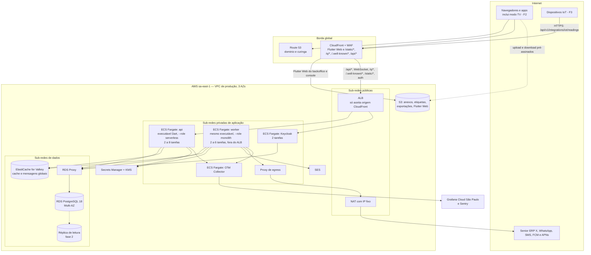

# 09 — Infraestrutura e operação

Versão 0.3 — 02/11/2026 — rascunho para revisão (stack Dart: Flutter + Serverpod)

Propósito: definir onde e como a plataforma roda — nuvem de referência e equivalências, ambientes, IaC, CI/CD, observabilidade, banco em produção, escala, custo e operação —, para que o time implante o MVP de forma reproduzível e opere com metas claras de disponibilidade e recuperação.

Documentos relacionados: [Arquitetura de solução](02-arquitetura-de-solucao.md) · [Multi-tenancy e segurança](04-multi-tenancy-e-seguranca.md) · [Ativos e QR code](05-ativos-e-qr-code.md) · [Aplicações e fluxos](06-aplicacoes-e-fluxos.md) · [Integração com o ERP Senior](07-integracao-erp-senior.md) · [API](08-api.md) · [Benchmark Sismetro e novas funcionalidades](11-benchmark-sismetro-e-novas-funcionalidades.md) · [Stack Dart: Flutter + Serverpod](12-stack-dart-flutter-serverpod.md)

**O que mudou na v0.3** (só implementação; nuvem de referência AWS, topologia de rede, banco, metas de disponibilidade e recuperação **não mudam**):

| Tema | Seção |
|---|---|
| Executável Dart (`dart compile exe`) em container; serviços ECS `api` (`--role serverless`, atrás do ALB) e `worker` (`--role monolith`, fora dele) | 1.1, 1.5, 2.5 |
| Valkey para mensagens globais e cache do Serverpod | 1.1, 1.5, 4 |
| Ajustes do RDS por papel de login (`timezone` UTC, `search_path = app, public`) e migrações das tabelas internas do Serverpod | 4.1 |
| Servidor web do Serverpod servindo a página do QR, os arquivos de links universais e os assets estáticos via CDN; backoffice Flutter Web na CDN | 2.6 |
| CI/CD Dart e Flutter (iOS em runner macOS ou Codemagic, fastlane, OTA com Shorebird a validar, versão mínima do app) | 2.4, 2.7 |
| Observabilidade: logs do Serverpod, OpenTelemetry pela biblioteca da comunidade (a validar), Sentry | 3.1 |
| Custos: sai o EAS, entram minutos de macOS no CI ou Codemagic | 6 |

**O que mudou na v0.2** (decisões do [Benchmark Sismetro](11-benchmark-sismetro-e-novas-funcionalidades.md)):

| Tema | Seção | Fase |
|---|---|---|
| Ingestão IoT na topologia (rota HTTPS na `api`; host mTLS e broker MQTT só se necessários) | 1.4, 1.5 | F3 |
| Monitoramento do tique de escalonamento, da geração de preventivas e da ingestão IoT | 3.3, 3.4, 3.4.1 | MVP / F2 / F3 |
| Volume da telemetria e estratégia de armazenamento (agregação, particionamento mensal, consolidação diária) | 5.4 | F3 |
| Custo de mensagens de plantão e escalonamento; custo da telemetria | 6 | MVP / F3 |
| Runbooks novos | 7.1 | MVP / F2 / F3 |

---

## 1. Nuvem e topologia

### 1.1 Princípios de portabilidade

O usuário não tem preferência de nuvem (D13). O desenho só usa peças com equivalente direto nas três grandes nuvens:

- **Containers OCI** (`api` e `worker` — o mesmo executável Dart do Serverpod em papéis diferentes —, Keycloak, Collector do OpenTelemetry) — nenhuma função serverless proprietária no caminho crítico. O papel `serverless` do Serverpod é só um modo de execução do nosso container (sem tarefas agendadas), não um serviço serverless da nuvem.
- **PostgreSQL gerenciado** padrão (sem extensões exclusivas de um provedor); tabelas de jobs e outbox dentro dele, consumidas por laços `FOR UPDATE SKIP LOCKED`; future calls do Serverpod também persistidas nele.
- **Valkey gerenciado** (protocolo Redis) efêmero: cache do Serverpod, rate limit e mensagens globais (difusão do streaming entre instâncias).
- **Object storage S3-compatível** acessado pelo SDK S3 com endpoint configurável (RustFS no ambiente local; a MinIO deixou de publicar as imagens da edição comunitária).
- **OIDC** padrão (Keycloak); **OpenTelemetry** para observabilidade.
- **OpenTofu** com módulos por componente, de modo que trocar de nuvem significa reescrever módulos de infraestrutura, não código da aplicação.

### 1.2 Nuvem de referência para o MVP: AWS São Paulo (sa-east-1)

| Critério | AWS sa-east-1 | Azure Brazil South | GCP southamerica-east1 |
|---|---|---|---|
| Zonas de disponibilidade na região | 3 | 3 | 3 |
| Containers sem gerenciar cluster | ECS Fargate (maduro, simples) | Container Apps | Cloud Run |
| PostgreSQL 18 gerenciado com Multi-AZ e PITR | RDS for PostgreSQL | Azure Database for PostgreSQL Flexible Server | Cloud SQL for PostgreSQL |
| Pool gerenciado em modo transação | RDS Proxy | PgBouncer embutido no Flexible Server | Pool gerenciado do Cloud SQL (a validar recurso na região) |
| Valkey gerenciado | ElastiCache for Valkey (preço menor que Redis OSS) | Azure Managed Redis | Memorystore for Valkey |
| E-mail transacional nativo | SES na região | Azure Communication Services (e-mail) | Sem serviço nativo (terceiro) |
| Familiaridade de mercado no Brasil | Maior | Alta em empresas Microsoft | Média |

**Decisão:** AWS sa-east-1. Motivos: maturidade do ECS Fargate (sem operar Kubernetes no MVP), RDS for PostgreSQL com Multi-AZ, PITR e RDS Proxy, ElastiCache for Valkey, SES na própria região, WAF integrado à CloudFront e maior oferta de profissionais. Azure é a segunda opção (forte se um tenant exigir alinhamento ao ecossistema Microsoft/Entra). O custo da região de São Paulo é mais alto que o das regiões dos EUA, mas dados no Brasil simplificam a LGPD e reduzem latência para usuários e técnicos.

**Descartados no MVP:** Kubernetes (EKS/AKS/GKE) — custo operacional sem benefício até dezenas de serviços; reavaliar na extração de serviços ou se houver muitas células. PaaS fora das três grandes — menor previsibilidade de região Brasil e de PostgreSQL gerenciado com PITR.

### 1.3 Tabela de equivalência

| Componente | AWS (referência) | Azure | GCP |
|---|---|---|---|
| Containers | ECS on Fargate | Azure Container Apps | Cloud Run |
| Load balancer | Application Load Balancer | Container Apps ingress / Application Gateway | Cloud Load Balancing |
| PostgreSQL gerenciado | RDS for PostgreSQL 18 Multi-AZ | Azure Database for PostgreSQL Flexible Server (zona redundante) | Cloud SQL for PostgreSQL (HA regional) |
| Pool de conexões | RDS Proxy (ou PgBouncer em container) | PgBouncer embutido | PgBouncer em container ou pool gerenciado |
| Valkey (protocolo Redis) | ElastiCache for Valkey | Azure Managed Redis | Memorystore for Valkey |
| Object storage | S3 | Blob Storage (via camada S3-compatível ou SDK) | Cloud Storage (API XML compatível com S3) |
| CDN | CloudFront | Azure Front Door | Cloud CDN |
| WAF | AWS WAF | Front Door WAF | Cloud Armor |
| Segredos | Secrets Manager | Key Vault | Secret Manager |
| KMS | AWS KMS | Key Vault (chaves) | Cloud KMS |
| E-mail | SES | Azure Communication Services | Terceiro (ex.: provedor SMTP) |
| Registro de imagens | ECR | Azure Container Registry | Artifact Registry |
| DNS | Route 53 | Azure DNS | Cloud DNS |
| Observabilidade | OpenTelemetry → Grafana Cloud (CloudWatch só para métricas de infraestrutura) | Igual (Azure Monitor para infraestrutura) | Igual (Cloud Monitoring para infraestrutura) |
| Backup centralizado | AWS Backup (com vault lock) | Azure Backup | Backup and DR |
| Identidade do CI na nuvem | OIDC do GitHub → IAM role | OIDC do GitHub → identidade federada | OIDC do GitHub → Workload Identity Federation |
| Ingestão IoT por HTTPS (v0.2, F3) | Rota da `api` atrás da CloudFront + WAF | Igual (Front Door + WAF) | Igual (Cloud CDN + Cloud Armor) |
| mTLS de dispositivos (v0.2, F3, opcional) | ALB com mTLS em modo de verificação e trust store | Application Gateway com mTLS | Load balancer com mTLS (a validar) |
| Broker MQTT (v0.2, F3, só se necessário) | EMQX ou Mosquitto em ECS atrás de NLB (portável); AWS IoT Core como alternativa operacional | Mesmo container; Event Grid MQTT como alternativa | Mesmo container (o serviço gerenciado de IoT do Google foi descontinuado) |
| Manutenção de partições (v0.2) | Tarefa agendada do pipeline com o papel `app_migrator`; `pg_partman` suportado no RDS como alternativa | Igual; `pg_partman` suportado no Flexible Server | Igual; suporte a `pg_partman` no Cloud SQL a validar |

### 1.4 Rede

- VPC dedicada por ambiente (`10.20.0.0/16` produção, `10.30.0.0/16` homologação), em **3 zonas de disponibilidade**:
  - sub-redes públicas: só ALB e NAT;
  - sub-redes privadas de aplicação: tarefas Fargate (`api`, `worker`, Keycloak, Collector);
  - sub-redes de dados (sem rota para a internet): RDS, RDS Proxy, ElastiCache.
- Security groups por função: só a `api`/`worker`/Keycloak alcançam o proxy do banco; só `api`/`worker` alcançam o Valkey; o ALB só aceita tráfego vindo da CloudFront (lista de prefixos gerenciada + cabeçalho secreto de origem).
- VPC endpoints para S3, ECR, Secrets Manager, KMS e CloudWatch Logs (menos tráfego no NAT e sem sair para a internet).
- **Egress controlado do worker:** chamadas a ERPs e webhooks de tenants saem por um proxy de egress (container com lista de bloqueio de faixas privadas e metadados, [Multi-tenancy e segurança](04-multi-tenancy-e-seguranca.md), seção 6.2) e IP fixo de saída (NAT com Elastic IP), que tenants podem liberar em seus firewalls.
- Acesso administrativo: sem bastion com SSH; SSM Session Manager com aprovação e gravação, e ECS Exec desabilitado em produção exceto em incidente aprovado.
- **Ingestão IoT (v0.2, F3):** o caminho padrão não muda a rede — dispositivos chamam `api.<dominio>/api/v1/integrations/iot/readings` pela CloudFront, com regra própria no WAF. Só se houver dispositivos com mTLS, um listener separado do ALB (`iot.<dominio>`) aceita tráfego direto da internet, **exceção** à regra "ALB só aceita CloudFront", restrita a essa rota e com mTLS obrigatório. Um broker MQTT, se necessário, fica em sub-rede privada atrás de NLB com TLS, e só o `worker` (assinante `telemetry.mqtt_bridge`) fala com ele por dentro.

### 1.5 Diagrama de implantação



## 2. Ambientes, IaC e entrega

### 2.1 Ambientes

| Ambiente | Onde | Dados | Uso | Implantação |
|---|---|---|---|---|
| Local | Máquina do desenvolvedor (`infra/local`: PostgreSQL 18, Valkey, S3 local (RustFS), Keycloak, Mailpit, Collector) | Seeds com 2+ tenants fictícios | Desenvolvimento (servidor em `--role monolith`, api e worker num processo) | `melos run dev` |
| Efêmero de PR | Runner do CI (compose) | Seeds | E2E web (`integration_test` no Chrome e testes da página leve) e mobile (`integration_test`/Patrol e Maestro no emulador Android) | Automática por PR |
| Homologação (`hml`) | Conta AWS própria, mesma topologia da produção em tamanho menor (instâncias sem Multi-AZ, 1 tarefa de cada) | Sintéticos e anonimizados; **nunca** cópia de produção com dados pessoais | Validação do produto, demonstrações, testes de carga, sandbox do ERP | Automática a cada merge na `main` |
| Produção (`prod`) | Conta AWS própria | Reais | Tenants | Promoção da mesma imagem validada em `hml`, com aprovação manual |

- Contas separadas na AWS Organizations: `shared` (ECR, DNS, CI), `hml`, `prod`, `security` (logs de auditoria da nuvem, CloudTrail organizacional) — limita o raio de um erro ou credencial vazada.
- Um "ambiente de demonstração" comercial é um **tenant** em produção marcado como demo, não um ambiente separado.

### 2.2 Infraestrutura como código (OpenTofu)

```text
infra/
├── modules/
│   ├── network/          # VPC, sub-redes, NAT, endpoints, security groups
│   ├── ecs-service/      # serviço Fargate genérico (api, worker, keycloak, otel, egress)
│   ├── postgres/         # RDS, parâmetros, RDS Proxy, alarmes, backup
│   ├── valkey/           # ElastiCache
│   ├── storage/          # buckets (anexos, Flutter Web, exportações), políticas, lifecycle
│   ├── edge/             # CloudFront, funções de borda, WAF, certificados
│   ├── secrets/          # Secrets Manager, KMS (chaves por finalidade)
│   ├── email/            # SES, DKIM, SPF, DMARC
│   └── observability/    # alarmes de infraestrutura e integração com Grafana
├── envs/
│   ├── shared/  hml/  prod/
└── keycloak/             # realms staff e platform como código (keycloak-config-cli)
```

- Estado remoto em S3 com travamento nativo do OpenTofu, um estado por ambiente e por camada (`network`, `data`, `app`, `edge`) para reduzir o raio de mudança.
- `tofu plan` comentado no PR; `tofu apply` só pelo pipeline com aprovação (produção exige dois aprovadores). Detecção de *drift* semanal.
- Nada é criado à mão no console da nuvem; exceções de incidente são reconciliadas no código em até 48 h.

### 2.3 Pipeline de CI/CD (GitHub Actions)

```mermaid
flowchart LR
    PR["Pull request"] --> CK["dart format, dart analyze, regra de imports,<br/>serverpod generate sem diferença,<br/>dart test e flutter test, contrato"]
    CK --> IT["Integração e isolamento RLS<br/>serverpod_test com banco real"]
    IT --> E2E["E2E efêmero: Flutter Web, página leve,<br/>Lighthouse CI, Patrol e Maestro Android"]
    E2E --> SEC["Semgrep, OSV, Trivy,<br/>squawk, tofu plan"]
    SEC --> MRG["Merge na main"]
    MRG --> BLD["dart compile exe, imagem única,<br/>flutter build web, SBOM e assinatura"]
    BLD --> MH["Migrações em hml<br/>dbmate e Serverpod, tarefa avulsa"]
    MH --> DH["Deploy hml: api, worker,<br/>backoffice e console"]
    DH --> SM["Smoke e E2E em hml"]
    SM --> AP{"Aprovação<br/>manual"}
    AP --> MP["Migração em prod"]
    MP --> DP["Deploy prod com<br/>rollback automático"]
```



- **Uma imagem para `api` e `worker`**: o servidor Serverpod é compilado com `dart compile exe` num estágio de build (`dart pub get` com `pubspec.lock`, `serverpod generate` conferido) e copiado para uma imagem mínima (base com `glibc` e certificados, usuário não root, sem SDK do Dart), junto com `config/`, `web/` (templates e assets da página leve) e as migrações do Serverpod. Os papéis vêm do comando do container (`--role serverless` na `api`, `--role monolith` no `worker`). A imagem é construída uma vez por commit e promovida entre ambientes pelo digest; nunca se reconstrói para produção.
- **Conferência do código gerado:** o CI roda `serverpod generate` e falha se o código gerado versionado (servidor e `server_client`) divergir; também confere os modelos `.spy.yaml` × colunas reais num banco efêmero com as migrações aplicadas ([Arquitetura de solução](02-arquitetura-de-solucao.md), seção 4.2.2).
- **Builds Flutter:** web (`flutter build web --release`, backoffice e console) e Android (`flutter build appbundle`) em runners Linux; iOS (`flutter build ipa`) em runner macOS do GitHub Actions ou no Codemagic (decisão por custo e tempo de fila, seção 6). Assinatura de Android com chave de upload no cofre do CI e Play App Signing; iOS com certificados e perfis gerenciados pelo fastlane `match` (repositório cifrado).
- Autenticação do CI na AWS por OIDC (sem chaves longas); permissões mínimas por job.
- Workflows: `ci.yml` (PR), `deploy.yml` (main → hml → prod), `mobile.yml` (builds Android/iOS e publicação por fastlane), `nightly.yml` (iOS com Patrol e Maestro, contrato real do ERP, ZAP, restore de teste semanal).
- Janela de deploy em produção: dias úteis, fora do pico (as OS concentram-se das 8 h às 18 h); correções urgentes a qualquer hora com o plantão ciente.

### 2.4 Migrações de banco sem downtime (expand/contract)

Regra: **toda migração é compatível com a versão anterior da aplicação**, porque durante o deploy as duas versões rodam ao mesmo tempo.

| Mudança | Passo 1 — expandir (release N) | Passo 2 — migrar dados | Passo 3 — contrair (release N+1 ou N+2) |
|---|---|---|---|
| Nova coluna obrigatória | Adicionar nullable (ou com `DEFAULT` constante) | Backfill em lotes por job | `SET NOT NULL` via `CHECK ... NOT VALID` + `VALIDATE CONSTRAINT`, depois `NOT NULL` |
| Renomear coluna | Nova coluna + escrita dupla na aplicação | Backfill | Leitura da nova; remover a antiga |
| Novo índice | `CREATE INDEX CONCURRENTLY` (migração `transaction:false`) | — | — |
| Nova FK composta | `ADD CONSTRAINT ... NOT VALID` | `VALIDATE CONSTRAINT` | — |
| Remover tabela/coluna | Parar de usar no código (release N) | — | Remover (N+1) |
| Nova tabela de tenant | Tabela + RLS + políticas na **mesma** migração (o teste de catálogo falha se faltar) | — | — |

- Toda migração define `SET lock_timeout = '3s'` e `statement_timeout` adequado; se não conseguir o lock, falha e o pipeline tenta de novo (até 3 vezes) em vez de enfileirar bloqueios.
- squawk no PR bloqueia operações perigosas; revisão de CODEOWNERS para qualquer migração.
- A migração roda como **tarefa ECS avulsa** com o usuário de migração (assume `app_owner`) antes do deploy da aplicação, em dois passos: (1) dbmate com as migrações SQL das tabelas de negócio (schema `app`); (2) migrações das tabelas internas do Serverpod (schema `public`), aplicadas pelo próprio executável com a opção de aplicar migrações e encerrar, nunca com *repair migration* sem revisão. A aplicação nunca migra ao subir (`api` e `worker` sobem sem a opção de migração e com o papel `app_runtime`, sem DDL). Backfills grandes são jobs da fila `heavy`, por tenant e em lotes.
- Em produção não há `migrate:down`: correção é sempre para frente. Antes de migração de risco, snapshot manual.

### 2.5 Deploy de `api` e `worker`

| Serviço ECS | Comando | Atrás do ALB | O que roda | Escala |
|---|---|---|---|---|
| `api` | `server --role serverless --mode production` | Sim (endpoints, streaming, servidor web) | Endpoints do Serverpod, streaming (WebSocket), servidor web (página leve do QR, `/.well-known/`, REST externo, webhooks, IoT); **não** executa future calls nem laços | 2 a 8 tarefas; CPU e conexões de streaming |
| `worker` | `server --role monolith --mode production` com `WORKER_LOOPS=...` | **Não** (sem *target group*; health check do container) | Future calls (horários), relay do outbox, laços `SKIP LOCKED` por fila | 2 a 6 tarefas; profundidade e idade das filas |

- O papel `monolith` pode manter abertas as portas de endpoints e do servidor web do Serverpod (a confirmar no spike S1); no `worker` elas ficam fechadas na rede (security group sem entrada exceto health check) e o serviço não é registrado no ALB.
- ECS com *rolling update* (mínimo 100% saudável, máximo 200%) e *deployment circuit breaker* com rollback automático; health checks `/health/live` (processo) e `/health/ready` (banco, Valkey e migração esperada aplicada), rotas do servidor web do Serverpod.
- **Desligamento gracioso:** a `api` para de aceitar conexões, fecha os streams com aviso de reconexão (os clientes reconectam em outra tarefa) e encerra em até 30 s; o worker para de fazer *claim* e conclui os jobs em andamento (até 120 s; além disso, o *lease* do *claim* expira e o job volta a ficar disponível para outra instância).
- **Load balancer e WebSocket:** o ALB e a CloudFront aceitam *upgrade* para WebSocket em `/api/*`; *idle timeout* do ALB de 120 s com heartbeat do stream a cada 15 s; sem afinidade de sessão (a difusão entre instâncias é pelas mensagens globais no Valkey).
- Compatibilidade: modelos e endpoints do Serverpod só evoluem de forma compatível e o REST externo `/api/v1` não quebra (oasdiff), então apps antigos continuam funcionando durante e após o deploy, até a versão mínima (seção 2.7).

### 2.6 Deploy do backoffice e do console (Flutter Web) e da página web leve do QR

**Backoffice e console (Flutter Web) na CDN:**

- `flutter build web --release` (CanvasKit/skwasm servidos da nossa origem, sem `gstatic`; *base href* por app) gera estáticos publicados em buckets S3 privados servidos pela CloudFront (OAC). Arquivos versionados (`main.dart.js`, `.wasm`, fontes e assets com hash ou em pasta por versão): `Cache-Control: public, max-age=31536000, immutable`. `index.html`, `flutter_bootstrap.js` e `version.json`: `Cache-Control: no-cache`.
- Sem *service worker* do Flutter (o *service worker* padrão de cache offline fica desligado no build): o backoffice é sempre online, e isso evita versão antiga presa no navegador.
- Publicação atômica: envia primeiro os arquivos versionados, depois o `index.html`; versões anteriores ficam no bucket por 30 dias (usuários com abas abertas continuam carregando a versão antiga até recarregar). O app compara `version.json` periodicamente e sugere recarregar; abaixo da versão mínima do backoffice, o servidor recusa as chamadas com exceção de "atualize a página".
- **Roteamento na borda** (CloudFront Functions): `<slug>.<dominio>` e `console.<dominio>` → bucket do Flutter Web, com rotas do go_router reescritas para `index.html`; `/api/*` → ALB sem cache, com *upgrade* para WebSocket; cabeçalhos de segurança e CSP do Flutter Web ([Multi-tenancy e segurança](04-multi-tenancy-e-seguranca.md), seção 6.4).

**Página web leve do QR (servidor web do Serverpod, no executável da `api`):**

- `<dominio>/q/*` e as demais telas da página leve → ALB → `api`, **sem cache compartilhado** no HTML (`Cache-Control: no-store` nas páginas com dados; a resolução do token tem cache curto no Valkey). Cabeçalhos de segurança e CSP rígida definidos pelo próprio servidor web ([Multi-tenancy e segurança](04-multi-tenancy-e-seguranca.md), seção 6.4).
- `<dominio>/static/*` (CSS, ícones, o script pequeno e o CSS de branding por tenant) servido pelo servidor web do Serverpod como origem e **cacheado na CloudFront** com nome versionado e `immutable`; o HTML referencia a versão do deploy.
- A página leve sai junto com a `api` (mesma imagem), sem passo de publicação próprio; o orçamento de desempenho é verificado no CI (Lighthouse) e por verificação sintética em produção.

**Universal links e App Links** no domínio do QR (`<dominio>`), publicados pelo **servidor web do Serverpod**:

- `https://<dominio>/.well-known/apple-app-site-association` (sem extensão, `Content-Type: application/json`, sem redirecionamento), declarando o App ID do app do cliente com o caminho `/q/*` (componentes `applinks`);
- `https://<dominio>/.well-known/assetlinks.json` com o pacote Android e as impressões SHA-256 dos certificados de assinatura (chave de upload **e** chave de assinatura do Google Play App Signing);
- no app Flutter: *Associated Domains* `applinks:<dominio>` no projeto iOS (entitlements) e `intent-filter` com `android:autoVerify="true"` para `https://<dominio>/q/*` no `AndroidManifest.xml`; o go_router trata o caminho recebido;
- o conteúdo dos dois arquivos fica versionado em `server/web/well-known/` por ambiente e é servido com `Cache-Control: max-age=3600` (a CloudFront repassa); um teste no pipeline baixa os arquivos de `hml`/`prod` e valida formato e impressões. A Apple obtém o arquivo pela própria CDN dela, então mudanças podem levar horas para propagar.

### 2.7 Apps móveis (Flutter, CI próprio e fastlane)

| Tema | Decisão |
|---|---|
| Build | Builds Flutter no CI com *flavors* `development`, `preview` (homologação, distribuição interna) e `production` (`--dart-define` para URLs e chaves públicas); Android (`appbundle`) em runner Linux; iOS (`ipa`) em runner macOS do GitHub Actions ou no **Codemagic** (decisão por custo e fila, seção 6); release com `--obfuscate --split-debug-info` e símbolos enviados ao Sentry |
| Assinatura | Android: chave de upload no cofre do CI e Play App Signing; iOS: certificados e perfis pelo fastlane `match` (repositório privado cifrado) |
| Publicação | **fastlane** para App Store Connect (TestFlight) e Google Play (trilha interna → produção com *staged rollout* 10% → 50% → 100%); distribuição interna de `preview` por TestFlight e trilha interna do Play |
| Atualização OTA | **Shorebird, a validar** (questão em aberto 7): *patches* de código Dart sem nova versão na loja, só para builds com o mesmo código nativo, publicados pelo pipeline e assinados; avaliar custo e conformidade com as regras das lojas antes de adotar. Sem OTA, toda correção vai por loja, com *expedited review* quando crítico |
| Implantação gradual | Loja: *staged rollout* e acompanhamento de crashes no Sentry antes de 100%. OTA (se adotada): *patch* para uma porcentagem antes de 100% e *rollback* do *patch* em caso de regressão |
| Versão mínima / forçar atualização | O endpoint público `appConfig` (equivalente ao `GET /api/v1/public/app-config` da v0.2) devolve, por app e plataforma, `min_supported_version`, `latest_version` e URL da loja; o app bloqueia com tela de atualização abaixo do mínimo. O servidor também recusa o sync (exceção serializável `AppVersionUnsupportedException`; 426 nas rotas REST) quando a versão enviada pelo app em cada chamada está abaixo do mínimo do protocolo ([Stack Dart](12-stack-dart-flutter-serverpod.md) §5). Como o cliente gerado pelo Serverpod é compilado no app, a versão mínima também protege contra modelos incompatíveis |
| Compatibilidade do sync | O protocolo de sync (D11) é versionado; o servidor aceita a versão atual e a anterior; mutações novas só são enviadas por apps que as declaram |
| Técnicos com fila pendente | Atualização forçada nunca apaga a fila: a tela de atualização permite antes enviar as mutações pendentes |
| Distribuição corporativa | Se um tenant exigir MDM, o app do técnico é compatível com distribuição gerenciada (Apple Business Manager / Google Managed Play) — fase 2 |

### 2.8 Configuração e segredos

- Configuração não secreta pelos arquivos de configuração do Serverpod por modo (`config/production.yaml`, sem segredos) mais variáveis de ambiente na *task definition* (geradas pelo OpenTofu), validadas no boot por uma classe de configuração tipada em Dart: o processo não sobe com configuração inválida. Inclui o papel (`--role`), os laços ligados no `worker` (`WORKER_LOOPS`) e os endereços do banco (proxy) e do Valkey.
- Segredos injetados pelo ECS a partir do Secrets Manager (nunca no repositório, na imagem ou em variável de CI em texto); segredos por tenant (ERP) lidos sob demanda com cache de 5 min ([Multi-tenancy e segurança](04-multi-tenancy-e-seguranca.md), seção 6.5).
- Segredos do Serverpod (senha do banco, Valkey, credenciais do S3 quando não houver papel IAM) pelas variáveis de ambiente que o Serverpod lê para `passwords.yaml`, injetadas pelo ECS a partir do Secrets Manager; o arquivo `passwords.yaml` nunca entra na imagem. Para o S3, preferir o papel IAM da tarefa.
- Front-ends: só configuração pública (URLs, chaves públicas de Sentry/OTel) injetada no build por `--dart-define`; nada secreto em bundle web ou binário móvel.

## 3. Observabilidade

### 3.1 Arquitetura

- **Logs:** os logs do Serverpod e os do nosso logger de `platform/observability` saem em JSON na saída padrão do container e são coletados pelo Collector (via FireLens/Fluent Bit ou leitura do CloudWatch Logs) para o Loki. O log de sessões do Serverpod no banco fica desligado em produção (ou só para erros, com retenção de 7 dias), para não gravar dados pessoais nem pesar no PostgreSQL.
- **Traces e métricas no servidor:** OpenTelemetry pelo pacote da comunidade para Serverpod 4 — **a validar** no spike S1 (maturidade, spans de endpoints, streaming, SQL e chamadas HTTP de saída, propagação do `traceparent`). Plano alternativo: SDK OpenTelemetry para Dart com instrumentação manual nos pontos críticos (endpoints, rotas do servidor web, laços do worker com *span link* para o evento de origem, SQL, chamadas ao ERP e aos provedores de mensagem). Exportação OTLP ao **Collector** (serviço próprio na VPC).
- **Front-ends:** traces de requisições e web-vitals da página leve (script pequeno com OTLP/HTTP) e do backoffice; nos apps Flutter, `sentry_flutter` com *performance monitoring* faz o papel de RUM. Os clientes externos enviam ao Collector por endpoint público autenticado com limite de taxa.
- O Collector aplica redação adicional (remove atributos com padrões de telefone, e-mail, CPF e tokens), amostragem por cauda (100% dos erros e das requisições lentas, 10% do restante) e exporta para o **Grafana Cloud (região São Paulo)**: traces (Tempo), métricas (Mimir/Prometheus) e logs (Loki).
- **Sentry** para erros e crashes do servidor (`sentry_dart`), do backoffice e do console (`sentry_flutter` na web, com *source maps* do `main.dart.js` enviados no CI) e dos apps móveis (`sentry_flutter`, com os símbolos de `--split-debug-info` e de ofuscação enviados no CI), com `beforeSend` removendo dados pessoais; o `trace_id` liga o erro do front ao trace do backend.
- CloudWatch apenas para métricas da infraestrutura gerenciada (RDS, ElastiCache, ALB, CloudFront, WAF), integradas ao Grafana como fonte de dados.

### 3.2 Atributos obrigatórios

| Sinal | Atributos |
|---|---|
| Logs | `service`, `env`, `version`, `request_id`, `trace_id`, `span_id`, `tenant_id`, `user_id`, `actor_type`; mais `route`, `status`, `duration_ms` (HTTP) ou `job_name`, `job_id`, `queue`, `attempt` (jobs) — ver [Arquitetura de solução](02-arquitetura-de-solucao.md), seção 5.10 |
| Traces | Atributos semânticos padrão + `tenant.id`, `enduser.id` (UUID), `app.actor_type`, `app.module`, `app.use_case`; nos jobs, *span link* para o trace que criou o evento |
| Métricas | `tenant_id` só em métricas de negócio e de integração com cardinalidade controlada (50–500 tenants); nunca `user_id` ou id de OS em rótulo de métrica |

### 3.3 Métricas e dashboards

| Dashboard | Conteúdo |
|---|---|
| Saúde da plataforma | Taxa de requisições, erros 5xx, latência p50/p95/p99 por grupo de rotas (`backoffice`, `technician`, `customer`, `public`, `platform`, `integrations`), saturação de CPU/memória das tarefas, conexões de streaming (WebSocket) abertas por tarefa, mensagens globais publicadas e entregues |
| Banco | Conexões (cliente e proxy), *pinning* do proxy, CPU, IOPS, latência de leitura/escrita, *replication lag*, bloqueios, consultas mais lentas (pg_stat_statements), crescimento por tabela |
| Filas e outbox | Mensagens pendentes no outbox e idade da mais antiga; jobs por fila e estado (tabelas de jobs); tempo de espera e de execução; *leases* expirados; falhas e jobs esgotados (equivalente à DLQ); por tenant nas filas `heavy`; future calls atrasadas ou com falha |
| Sync móvel | Pulls e pushes por minuto, duração, mutações por status (`applied`, `duplicate`, `rejected`, `conflict`), respostas `429`, aparelhos sem sync há mais de 24 h, **fila local reportada pelos apps** (mutações pendentes e há quanto tempo), versões de app em uso |
| QR e OTP | Resoluções por minuto, falhas de short code, OTP iniciados/validados por canal, taxa de entrega e de conversão, custo estimado de SMS/WhatsApp por tenant, sinais de abuso ([Ativos e QR code](05-ativos-e-qr-code.md), seção 7.7) |
| Integrações por tenant | `integration_jobs` por estado, taxa de falha, latência do ERP, *circuit breaker* aberto ([Integração com o ERP Senior](07-integracao-erp-senior.md)) |
| Negócio | OS criadas por origem, OS com SLA em risco ou vencido, tempo de triagem, chamados pela página web leve × app nativo |
| Front-ends | Web-vitals da página leve (`/q`) e do backoffice Flutter Web (tempo do primeiro carregamento), erros do Flutter Web, crash-free sessions dos apps |
| Plantão e escalonamento (v0.2, MVP) | Último tique executado, duração do tique, atraso do passo (vencimento → envio) p50/p95, OS sem reconhecimento por prioridade, tempo até "assumi", furos de escala (passo sem plantonista), mensagens enviadas por canal e custo estimado por tenant |
| Preventivas (v0.2, F2) | Execução de `maintenance.generate_due` por tenant (início, fim, OS geradas, falhas), OS previstas × geradas no dia, atraso da reação a leituras de medidor |
| Telemetria (v0.2, F3) | Lotes e leituras por minuto, aceitas/duplicadas/rejeitadas por motivo (assinatura, horário, plausibilidade), latência da rota, atraso entre horário do dispositivo e recebimento, dispositivos silenciosos, profundidade de `telemetry.evaluate_batch`, tamanho das partições de `meter_readings` e linhas na partição *default* |
| Modo TV (v0.2, F2) | Streams abertos por token, trocas de token recusadas, latência do painel agregado e taxa de acerto do cache |

### 3.4 Alertas

| Alerta | Condição inicial | Severidade | Destino |
|---|---|---|---|
| Erros 5xx | > 2% das requisições em 5 min (ou > 5% em `/public`) | Crítica | Plantão (telefone) |
| Latência | p95 do backoffice > 1 s por 10 min; p95 do sync push > 3 s por 10 min | Alta | Plantão |
| Disponibilidade sintética | Verificação externa de `/q/<token-de-teste>`, login e `/health/ready` falha em 2 de 3 locais | Crítica | Plantão |
| Outbox acumulado | Mensagem pendente mais antiga > 2 min | Alta | Plantão |
| Fila acumulada | `critical` com espera > 1 min; `default` > 5 min; `heavy` > 30 min | Alta (`critical`) / Média | Plantão / canal |
| Jobs falhando | Jobs esgotados (sem novas tentativas) crescendo; falhas > 10% em uma fila em 15 min; future call com falha ou atrasada > 2 min | Alta | Plantão |
| Falhas de integração por tenant | > 5 `integration_jobs` em `failed` em 1 h para um tenant ou *circuit breaker* aberto | Média | Canal de integrações + notificação ao `tenant_admin` |
| SLA em risco | OS com SLA vencendo em < 1 h sem visita agendada | Negócio | Notificação ao despachante do tenant (no produto, não no plantão) |
| Sync móvel falhando | Taxa de `rejected` + erros > 5% em 15 min, ou queda > 50% de pushes em relação à mesma hora da semana anterior | Alta | Plantão |
| OTP | Taxa de entrega < 90% em 15 min por canal; pico de inícios (3× a média) ou de prefixos internacionais | Alta | Plantão + segurança |
| Banco | CPU > 80% por 15 min; conexões > 80% do limite; armazenamento < 20% livre; *replication lag* > 30 s | Alta | Plantão |
| Segurança | Violação de `WITH CHECK` de RLS; reuso de refresh token acima do padrão; picos do WAF; uso de credencial administrativa | Crítica | Plantão + segurança |
| Certificados e domínio | Expiração < 21 dias; falha na validação dos arquivos `.well-known` | Média | Canal |
| Tique de escalonamento parado (v0.2, MVP) | Nenhum `scheduling.escalation_tick` concluído há > 3 min | Crítica | Plantão (telefone) |
| Atraso do escalonamento (v0.2, MVP) | Atraso do passo p95 > 90 s por 10 min, ou fila `critical` com espera > 1 min | Alta | Plantão |
| Falha de envio de escalonamento (v0.2, MVP) | > 5% dos avisos de escalonamento em `failed` em 15 min num canal | Alta | Plantão (trocar canal; [Arquitetura de solução](02-arquitetura-de-solucao.md), seção 5.12) |
| Furo de escala (v0.2, MVP) | Passo de escalonamento sem plantonista vigente | Negócio | Notificação ao `tenant_admin` (no produto) |
| Custo de mensagens de escalonamento (v0.2, MVP) | Tenant acima de 80% do orçamento diário de WhatsApp/SMS, ou 3× a média de mensagens por OS | Média | Canal + console (pode indicar política mal configurada) |
| Falha na geração de planos (v0.2, F2) | `maintenance.generate_due` com falha, ou não concluído até 06h no fuso do tenant; ou zero OS geradas com previsão maior que zero | Alta | Canal de operação + notificação ao `tenant_admin` |
| Reação a leitura atrasada (v0.2, F2) | `maintenance.evaluate_meter` com espera > 15 min | Média | Canal |
| Ingestão IoT com erros (v0.2, F3) | 5xx > 2% na rota em 5 min; ou rejeições > 20% dos lotes em 15 min | Alta | Plantão |
| Assinaturas IoT inválidas (v0.2, F3) | Pico de falhas de assinatura ou de `key_id` desconhecido (3× a média) | Alta | Plantão + segurança ([Multi-tenancy e segurança](04-multi-tenancy-e-seguranca.md), seção 4.9) |
| Partição de leituras ausente (v0.2, F3) | Partição do mês seguinte inexistente a 7 dias da virada, ou qualquer linha na partição *default* | Alta | Canal de operação |
| Dispositivos silenciosos (v0.2, F3) | Dispositivo sem lote há mais do que o limite da regra | Negócio | Notificação ao tenant (regra de telemetria), não ao plantão |

- Alertas com *runbook* ligado (seção 7.1) e dono; revisão mensal para remover alertas ruidosos.
- **SLOs** com orçamento de erro: disponibilidade da API (requisições não-5xx) 99,5% mensal no MVP; resolução do QR 99,9%; sync push bem-sucedido 99%. Queima rápida do orçamento (2% em 1 h) aciona o plantão.
- **SLOs novos da v0.2:** 99% dos passos de escalonamento enviados em até 2 min do vencimento (MVP); 99% dos dias com as preventivas geradas até 06h (F2); 99,5% dos lotes IoT válidos aceitos (F3).

#### 3.4.1 Monitoramento do tique de escalonamento (v0.2, MVP)

O escalonamento é o que garante o atendimento "no mesmo dia" fora do horário comercial ([Arquitetura de solução](02-arquitetura-de-solucao.md), seção 5.12). Um tique parado não gera erro: simplesmente ninguém é avisado. Por isso ele tem monitoramento próprio, em três camadas:

1. **Batimento:** cada tique concluído grava a métrica `escalation_tick_last_success_timestamp`; o alerta "tique parado" dispara se ela envelhecer mais de 3 min. Independe de haver OS para escalar.
2. **Atraso de ponta a ponta:** o job registra, para cada passo enviado, a diferença entre o vencimento do passo e o envio pelo canal (`escalation_step_lag_seconds`, histograma por canal e prioridade).
3. **Verificação sintética:** a cada 15 min, um tenant sintético de produção abre uma OS `urgent` com política de teste (passo de 1 min para um destinatário interno) e confirma o recebimento do push; falha em 2 execuções seguidas aciona o plantão.

O tique é disparado por uma future call cron do Serverpod (executada só no papel `monolith`) e processado na fila `critical`, que tem tarefas dedicadas do `worker` quando as filas forem separadas (seção 5.1); uma importação pesada nunca atrasa o escalonamento. Com várias tarefas de `worker`, a future call é persistida no banco e executada *pelo menos uma vez*; o tique é idempotente pela chave do minuto (dois disparos no mesmo minuto não duplicam avisos — spike S11 da [Arquitetura de solução](02-arquitetura-de-solucao.md)), e o *rolling update* mantém pelo menos uma tarefa de `worker` ativa.

### 3.5 Auditoria de negócio × logs técnicos

| | Auditoria de negócio (`audit_logs`) | Logs técnicos |
|---|---|---|
| Finalidade | Quem fez o quê, quando, em qual registro (RNF-10), visível ao tenant | Diagnóstico e operação |
| Onde | PostgreSQL, mesma transação do caso de uso | Grafana Cloud (Loki) |
| Garantia | Transacional, sem perda | Melhor esforço, amostrável |
| Retenção | 5 anos ([Multi-tenancy e segurança](04-multi-tenancy-e-seguranca.md), seção 7.4) | 30 dias quentes; 12 meses arquivados para segurança |
| Quem consulta | `tenant_admin`, `manager`, plataforma (do próprio escopo) | Engenharia e plantão |

Trilha de auditoria da nuvem (CloudTrail organizacional, logs do WAF e da CloudFront) vai para a conta `security`, com bucket com *object lock* e retenção de 1 ano.

## 4. PostgreSQL em produção

### 4.1 Instância e parâmetros

- RDS for PostgreSQL 18 **Multi-AZ** (instância primária + *standby* síncrona em outra zona), classe inicial `db.m7g.large` (2 vCPU, 8 GB) ou `db.r7g.large` se a memória for o gargalo; armazenamento gp3 de 200 GB com autoescala; Performance Insights ativo.
- Parâmetros relevantes: `rds.force_ssl = 1`; `statement_timeout` por papel (`app_api` 5 s, `app_worker` 60 s, `app_migrator` sem limite e com `lock_timeout`); `idle_in_transaction_session_timeout = 10s`; `lock_timeout` de 3 s nas migrações; `pg_stat_statements` e `auto_explain` (consultas > 500 ms); `log_min_duration_statement = 1000`.
- **Ajustes por papel de login da aplicação (v0.3)**, aplicados pela migração, e não no grupo de parâmetros da instância (o Keycloak e as ferramentas administrativas continuam com o padrão):

```sql
-- papéis de login usados pelo Serverpod nos serviços api e worker
ALTER ROLE app_api    SET timezone = 'UTC';
ALTER ROLE app_api    SET search_path = app, public;
ALTER ROLE app_worker SET timezone = 'UTC';
ALTER ROLE app_worker SET search_path = app, public;
-- migrações: dbmate no schema app; tabelas internas do Serverpod no schema public
ALTER ROLE app_migrator SET search_path = app, public;
```

  O Serverpod lê e grava `DateTime` sempre em UTC, e as colunas de negócio continuam `timestamptz`; a sessão em UTC evita conversões implícitas (validação no spike S2 do [Stack Dart](12-stack-dart-flutter-serverpod.md)). O `search_path` faz o ORM encontrar as tabelas de negócio em `app` e as tabelas internas do Serverpod (autenticação, future calls, logs de sessão) em `public`; funções `SECURITY DEFINER` continuam com `search_path` fixo próprio. Os nomes dos papéis de login seguem o [schema.sql](../db/schema.sql) (membros de `app_runtime`, sem `BYPASSRLS`).
- Keycloak usa database separada no mesmo cluster no MVP, com usuário próprio; separar em instância própria se a carga de login crescer.

### 4.2 Pool de conexões compatível com RLS

- O `databaseInterceptor` do Serverpod abre a transação, define as variáveis com `set_config(..., true)` e encerra ([Arquitetura de solução](02-arquitetura-de-solucao.md), seção 5.2). Nenhum estado de sessão sobrevive à transação, então o pool do Serverpod e um pool em **modo transação** na frente do banco são seguros. Os ajustes de `timezone` e `search_path` ficam no papel de login (seção 4.1), e não em `SET` de sessão, justamente para não depender de estado de sessão no proxy.
- **Decisão MVP: RDS Proxy**, gerenciado, Multi-AZ, com *failover* mais rápido para a aplicação e credenciais no Secrets Manager. Ponto de atenção: o RDS Proxy "prende" (*pinning*) a conexão do cliente em certos comandos de sessão e com *prepared statements* do protocolo estendido; o spike S7 de [Arquitetura de solução](02-arquitetura-de-solucao.md) mede se `set_config` local dentro de transação e o driver PostgreSQL usado pelo Serverpod causam *pinning*. **Plano B:** PgBouncer 1.2x em modo `transaction` como serviço Fargate (2 tarefas atrás de NLB interno), ou só o pool do Serverpod direto no banco enquanto o número de conexões couber.
- Orçamento de conexões: `api` até 8 tarefas × pool de 10 (pool do Serverpod por tarefa); `worker` até 6 × 10 (laços e future calls); Keycloak 2 × 20; migrações (dbmate e Serverpod) 10. Total de clientes ≤ 200, multiplexados pelo proxy em ~60 conexões reais no banco.
- Se o relay do outbox usar `LISTEN/NOTIFY` (a validar no S1: depende do acesso do Serverpod a uma conexão dedicada), será **uma conexão direta** por instância do worker (fora do proxy), porque `LISTEN` exige sessão; com ou sem ela, a varredura de 1 s garante o progresso.

### 4.3 Backups, PITR e metas de recuperação

| Mecanismo | Configuração | Protege contra |
|---|---|---|
| Multi-AZ síncrono | *Failover* automático em 1–2 min | Falha de instância ou de zona (RPO ≈ 0) |
| Backups automáticos + PITR | Retenção de 35 dias; logs de transação enviados continuamente (restauração a qualquer segundo, com até ~5 min de defasagem) | Erro humano, corrupção, exclusão acidental |
| Snapshots diários copiados para conta `security` (AWS Backup com *vault lock*) | Retenção de 35 dias diários + 12 mensais | Credencial de produção comprometida, *ransomware* |
| Cópia para outra região (opcional) | Desligada no MVP: a AWS tem uma única região no Brasil e a cópia seria transferência internacional; habilitar só com cláusula no DPA | Perda total da região |
| S3 | Versionamento + replicação para a conta `security`; *lifecycle* para camadas frias | Exclusão acidental de anexos |

**Metas:**

| Cenário | RPO | RTO (MVP) | RTO (fase 2) |
|---|---|---|---|
| Falha de instância/zona | ≈ 0 | ≤ 5 min | ≤ 5 min |
| Erro lógico em todo o banco (restauração PITR) | ≤ 5 min | ≤ 4 h | ≤ 1 h |
| Erro lógico em um tenant | ≤ 5 min | ≤ 1 dia útil (procedimento assistido) | ≤ 4 h |
| Perda da região | Último snapshot disponível | Melhor esforço (dias), salvo contrato | Plano de DR em outra região, se contratado |

### 4.4 Restauração de um único tenant

Necessária quando um tenant apaga ou corrompe os próprios dados sem afetar os demais.

1. Restaurar o PITR do momento anterior ao erro numa **instância temporária isolada** (sem acesso da aplicação).
2. Exportação lógica filtrada: script gerado do catálogo (o mesmo mapa de propriedade das tabelas usado nos testes) que faz `COPY (SELECT * FROM app.<tabela> WHERE tenant_id = $1) TO ...` para cada tabela de tenant, na ordem topológica das FKs.
3. Importar num schema de *staging* em produção e comparar com o estado atual (ferramenta interna com relatório por entidade).
4. Aplicar a correção escolhida com o tenant (restaurar entidades específicas ou o tenant inteiro) por casos de uso administrativos, que gravam `audit_logs` e eventos normalmente; restaurar objetos do S3 sob `t/<tenant_id>/` pelas versões anteriores.
5. Destruir a instância temporária e o *staging*; registrar o procedimento.

O mesmo mecanismo serve para **exportar** um tenant (encerramento, [Multi-tenancy e segurança](04-multi-tenancy-e-seguranca.md), seção 3.5) e para **mover** um tenant para outra célula (silo).

### 4.5 Testes de restauração

- Semanal (automático, `nightly.yml`): restaurar o último snapshot de produção em conta isolada, aplicar verificações (contagens, integridade de FKs, última OS criada) e destruir; medir o tempo e registrar como métrica de RTO.
- Trimestral (exercício): restauração de um tenant de teste ponta a ponta, com o plantão, seguindo o runbook.
- Anual: simulação de perda total do ambiente a partir do IaC e dos backups.

## 5. Escalabilidade e desempenho

### 5.1 Dimensionamento inicial (produção)

| Componente | Início do MVP | Escala automática / limite | Gatilho de revisão |
|---|---|---|---|
| `api` (`--role serverless`) | 2 tarefas de 1 vCPU / 2 GB | 2 → 8 por CPU (alvo 60%), por requisições por tarefa e por conexões de streaming | > 8 tarefas sustentadas |
| `worker` (`--role monolith`) | 2 tarefas de 1 vCPU / 2 GB (todos os laços) | Serviços separados por fila quando necessário, com o mesmo executável e `WORKER_LOOPS` diferente: `critical` 2 → 4; `heavy` 1 → 4 por profundidade da fila | Espera da fila acima dos alertas |
| Keycloak | 2 tarefas de 1 vCPU / 2 GB | 2 → 4 | Latência de login p95 > 1 s |
| Collector OTel | 1 tarefa de 0,5 vCPU / 1 GB | 1 → 3 | Descarte de spans |
| PostgreSQL | `db.m7g.large` Multi-AZ | Vertical até `xlarge`/`2xlarge`; réplica de leitura na fase 2 | CPU > 60% sustentada |
| Valkey | ElastiCache Serverless for Valkey (pub/sub das mensagens globais do Serverpod, cache do Serverpod e scripts Lua do rate limit a validar no modo serverless; plano B: cluster `cache.t4g.small` com réplica) | Automática | Custo acima do equivalente em nós |

As premissas (até ~50 tenants; por tenant ~20 mil ativos, ~5 mil OS/mês, ~200 técnicos, ~50 usuários de backoffice) e a carga de referência derivada estão em [Arquitetura de solução](02-arquitetura-de-solucao.md), seção 7.4; o tamanho acima atende à premissa com folga e foi pensado para chegar a 10× com escala horizontal e um ou dois degraus verticais no banco.

### 5.2 Leitura, cache e particionamento

- **Réplica de leitura (fase 2):** relatórios, exportações e dashboards de gestão; a réplica usa o mesmo modelo de papéis e RLS; a aplicação roteia consultas marcadas como `reporting` para ela e tolera atraso de até 30 s.
- **Cache (Valkey, pelas caches do Serverpod via `platform/cache`):** configurações e flags do tenant, catálogos pouco mutáveis (tipos de OS, sintomas, SLA), branding público, resultado da resolução de QR (30 s), permissões do vínculo (60 s). Chaves sempre com tenant ([Multi-tenancy e segurança](04-multi-tenancy-e-seguranca.md), seção 1.3); invalidação por evento; o sistema funciona com o cache vazio.
- **Particionamento** (declarativo, por intervalo de tempo, com `tenant_id` como primeira coluna dos índices): `audit_logs` (mensal), `outbox_messages` (semanal, removendo partições antigas em vez de `DELETE`), `notifications` (mensal), pontos de localização do técnico (mensal), `integration_jobs` (mensal, a partir da fase 2). Tabelas operacionais (`work_orders`, `work_order_visits`, `time_entries`) não são particionadas antes de ~50 milhões de linhas: índices compostos bastam. A definição final das partições é do [Modelo de domínio](03-modelo-de-dominio.md) e do [schema.sql](../db/schema.sql).
- **v0.2:** `meter_readings` (F2 com leitura manual; volumosa só na F3 com IoT) particionada por mês, com a estratégia da seção 5.4. `work_order_costs` e as tabelas de plantão e escalonamento não são volumosas e não são particionadas.
- **Arquivos pesados** (etiquetas, exportações, importações; na v0.2 também termos de movimentação e demonstrativos de fechamento em PDF) sempre por job na fila `heavy` e entregues por URL pré-assinada.

### 5.3 Limites por tenant (*noisy neighbor*)

| Recurso | Limite |
|---|---|
| Requisições na API | Por tenant proporcional ao plano (ex.: 3.000 req/min no plano base), além dos limites por ator ([Multi-tenancy e segurança](04-multi-tenancy-e-seguranca.md), seção 6.3) |
| Filas `heavy` | No máximo 2 jobs simultâneos por `tenant_id`, aplicado na consulta de *claim* dos laços do worker (importações, exportações, etiquetas, sync com ERP) |
| Importações | Até 50 mil linhas por arquivo; uma importação ativa por entidade por tenant |
| Exportações e relatórios | Intervalo máximo de 12 meses por consulta interativa; acima disso, exportação assíncrona |
| Consultas | `statement_timeout` por papel; paginação por cursor obrigatória (máximo de 200 itens por página) |
| Armazenamento e mensagens | Cotas do plano ([Multi-tenancy e segurança](04-multi-tenancy-e-seguranca.md), seção 3.3) |
| Mensagens de escalonamento (v0.2, MVP) | Teto de 10 mensagens WhatsApp/SMS por OS e orçamento diário por tenant; acima do orçamento, só push |
| Dispositivos IoT (v0.2, F3) | Cota de dispositivos por plano; concorrência limitada por tenant no *claim* da avaliação de lotes; limites por dispositivo de [Multi-tenancy e segurança](04-multi-tenancy-e-seguranca.md), seção 4.9 |
| Geração de preventivas (v0.2, F2) | No máximo 2 jobs simultâneos por tenant (*claim*); até 5 mil OS por execução diária por tenant (acima disso, continua na hora seguinte) |

### 5.4 Telemetria: volume e armazenamento (v0.2, F3)

**Premissas de volume.** O dispositivo agrega no próprio hardware e envia uma leitura por medidor a cada 5 a 15 min ([Benchmark Sismetro](11-benchmark-sismetro-e-novas-funcionalidades.md), seção 5); consideramos 3 medidores por dispositivo (horímetro, consumo estimado e temperatura). Tamanho estimado por leitura no PostgreSQL, com índice: ~150 bytes.

| Cenário | Dispositivos | Intervalo | Leituras/dia | Leituras/mês | Armazenamento/mês | Requisições de lote |
|---|---|---|---|---|---|---|
| Piloto | 20 | 15 min | ~5,8 mil | ~175 mil | ~25 MB | < 0,1/s |
| Meta de desenho | 10 mil | 15 min | ~2,9 milhões | ~86 milhões | ~13 GB | ~11/s |
| Meta de desenho, intervalo curto | 10 mil | 5 min | ~8,6 milhões | ~260 milhões | ~39 GB | ~33/s |
| 10× | 100 mil | 15 min | ~29 milhões | ~860 milhões | ~130 GB | ~110/s |

**Decisão: PostgreSQL nativo, com particionamento declarativo, sem banco de séries temporais.** O RDS for PostgreSQL não oferece TimescaleDB, e mesmo a meta de desenho cabe no banco atual com folga de escrita (~100 inserções/s no pior caso). Um segundo banco (TimescaleDB autogerenciado, ClickHouse, serviço de séries temporais da nuvem) acrescentaria operação, backup e isolamento por tenant à parte, sem necessidade no volume previsto.

| Técnica | Como aplicamos |
|---|---|
| Agregação na origem | O dispositivo envia valores agregados por janela (5 a 15 min), nunca amostras por segundo; a ingestão rejeita lotes com densidade acima da configurada para o dispositivo |
| Particionamento mensal | `meter_readings` particionada por intervalo mensal do **horário da leitura**; dentro de cada mês, subpartição por lista de origem (`iot` × `manual`/`file_import`), para que a retenção apague só as leituras IoT. Chave de idempotência (tenant, medidor, horário) inclui a coluna de partição. Índice `(tenant_id, asset_meter_id, horário DESC)` em cada partição. Partição *default* só como rede de segurança, com alerta (seção 3.4) |
| Lotes atrasados | Aceitos até 30 dias, então só as duas partições mais recentes recebem escrita significativa; as anteriores ficam praticamente imutáveis (boas para `VACUUM FREEZE` e backup) |
| Consolidação diária | Job `telemetry.consolidate_daily` grava, por medidor e dia, mínimo, máximo, último valor, delta (horas ligado, kWh) e contagem, numa tabela de consolidação (nome no [Modelo de domínio](03-modelo-de-dominio.md)). Relatórios, painéis e regras de longo prazo leem a consolidação, nunca o detalhe |
| Retenção | Detalhe IoT por 13 meses (comparação ano a ano); depois a subpartição IoT do mês é desanexada (`DETACH PARTITION`, com `CONCURRENTLY` — permitido porque a partição do mês não tem *default* própria) e removida, sem `DELETE` em massa. Leituras manuais e a consolidação diária seguem o ativo ([Multi-tenancy e segurança](04-multi-tenancy-e-seguranca.md), seção 7.4) |
| Manutenção de partições | O papel de runtime não tem DDL; uma tarefa agendada mensal do pipeline (papel `app_migrator`) cria as partições dos próximos 3 meses e remove as vencidas. A migração inicial já cria 6 meses à frente. `pg_partman` é alternativa suportada no RDS e no Azure Flexible Server (no Cloud SQL, a validar), mas preferimos a tarefa própria para não depender de extensão |
| Leitura recente | O último valor de cada medidor é mantido no próprio `asset_meters` (ou numa projeção) na transação da ingestão, para que telas e planos não consultem a tabela grande |

**Quando revisitar:** acima de ~300 milhões de leituras/mês ou ~40 GB/mês sustentados, ou se a ingestão passar a pesar na latência do backoffice. Opções, em ordem: reduzir o detalhe retido para 3 meses; mover `meter_readings` para uma instância PostgreSQL própria do módulo `telemetry` (a fronteira de módulo já permite — [Arquitetura de solução](02-arquitetura-de-solucao.md), seção 3.5); só então avaliar um banco colunar ou de séries temporais.

**Backup e restauração:** as partições IoT entram no PITR como o resto. Na restauração de um único tenant (seção 4.4), o detalhe IoT é opcional (padrão: só a consolidação), para não alongar o RTO.

## 6. Estimativa de custo mensal do MVP

**É uma estimativa de ordem de grandeza** (preços públicos de referência de sa-east-1 e de fornecedores em outubro de 2026, câmbio de referência de R$ 5,50 por US$, sem impostos e sem descontos de compromisso); deve ser recalculada na calculadora de cada fornecedor antes do orçamento formal.

| Item | Produção (US$/mês) | Homologação (US$/mês) | Observação |
|---|---|---|---|
| ECS Fargate (`api`, `worker`, Keycloak, Collector, proxy de egress) | 250 – 450 | 80 – 150 | sa-east-1 custa mais que regiões dos EUA |
| RDS PostgreSQL Multi-AZ + armazenamento + backups | 450 – 700 | 100 – 180 (Single-AZ) | Maior item fixo |
| RDS Proxy | 30 – 60 | 15 – 30 | Proporcional ao tamanho do banco |
| ElastiCache for Valkey | 20 – 80 | 10 – 20 | Serverless no MVP |
| ALB, NAT, IP fixo, VPC endpoints | 120 – 200 | 80 – 120 | NAT cobra por hora e por GB |
| S3, CloudFront, WAF | 60 – 150 | 15 – 30 | Cresce com fotos e etiquetas |
| Secrets Manager, KMS, SES, Route 53, CloudTrail, AWS Backup | 40 – 90 | 15 – 30 | — |
| Grafana Cloud | 0 – 300 | — | Faixa gratuita no início; cresce com volume de logs |
| Sentry | 30 – 100 | — | Plano de equipe |
| Builds iOS: minutos de runner macOS no GitHub Actions **ou** Codemagic | 30 – 200 | — | macOS custa ~10× o minuto Linux no GitHub Actions; com ~20 builds iOS de 15–25 min por mês mais o noturno, fica na faixa baixa; Codemagic tem planos por minuto ou fixo (a validar). Android e web rodam em Linux, dentro do plano do CI |
| Shorebird (OTA, só se adotado) | 0 – 400 | — | Preço por *patch installs*/mês, a validar; sem custo se a OTA não for adotada |
| Lojas (Apple US$ 99/ano, Google US$ 25 uma vez) | ≈ 10 | — | — |
| Status page e verificações sintéticas | 0 – 50 | — | — |
| **Total de infraestrutura** | **≈ 1.000 – 2.800** | **≈ 330 – 560** | **≈ R$ 7 mil a R$ 18 mil por mês, os dois ambientes** (o teto sobe com Shorebird; sem ele, ≈ 1.000 – 2.400) |

**Custo variável de mensagens (repassado ou limitado por plano):**

| Mensagem | Preço de referência (a validar) | Exemplo por 1.000 chamados abertos pelo cliente |
|---|---|---|
| WhatsApp — modelo de autenticação (OTP) | ≈ US$ 0,03 por mensagem no Brasil | ~500 OTPs (metade dos contatos já tem sessão) ≈ US$ 15 |
| WhatsApp — modelo de utilidade (recebido, agendado, concluído) | ≈ US$ 0,008 por mensagem | 3 por chamado ≈ US$ 24 |
| SMS (contingência) | ≈ R$ 0,05 – 0,15 por SMS | 10% dos OTPs ≈ R$ 5 – 15 |
| E-mail (SES) | ≈ US$ 0,10 por 1.000 | Desprezível |

Com a premissa máxima do 1º ano (50 tenants, até 250 mil OS/mês, das quais uma parte aberta pelo cliente), mensagens podem passar de **US$ 3 mil/mês** e superar a infraestrutura; por isso: preço por pacote de mensagens no plano, WhatsApp como canal preferido, sessão longa do contato para evitar OTP repetido, orçamento diário de SMS e painel de custo por tenant no console.

**Mensagens de plantão e escalonamento (v0.2, MVP).** Os avisos vão para a equipe do tenant (plantonistas, despachantes, técnicos e prestadores), não para o cliente. Ordem de canais padrão da política: push primeiro (sem custo variável), WhatsApp a partir do segundo passo, SMS só no último passo ou se o WhatsApp falhar. Como os plantonistas raramente têm uma conversa aberta com o número da plataforma, cada WhatsApp conta como mensagem de modelo de utilidade.

| Cenário por 1.000 OS que entram em escalonamento | Mensagens | Custo de referência (a validar) |
|---|---|---|
| Assumida no 1º passo (só push) | ~2 push por OS | ≈ US$ 0 |
| Assumida no 2º passo (push + WhatsApp para 2 pessoas) | ~2 WhatsApp por OS | ≈ US$ 16 |
| Vai até o 3º passo (push + 2 WhatsApp + 1 SMS) | ~3 WhatsApp + 1 SMS por OS | ≈ US$ 24 + R$ 50 – 150 |
| Despacho pelo celular (push a cada OS nova e a cada escalonamento) | Só push | ≈ US$ 0 |

Para um tenant como o primeiro (atendimento no mesmo dia, inclusive fins de semana), estimamos algumas centenas de OS escalonadas por mês, ou seja, dezenas de dólares por mês — pequeno perto das mensagens ao cliente, mas sujeito a explodir com uma política mal configurada (passo curto, muitos destinatários). Por isso: espera mínima de 5 min entre passos, teto de 10 mensagens WhatsApp/SMS por OS, orçamento diário por tenant com queda para "só push" e o alerta de custo da seção 3.4.

**Telemetria (v0.2, F3).**

| Item | Piloto (~20 dispositivos) | Meta de desenho (10 mil dispositivos) | Observação |
|---|---|---|---|
| Armazenamento das leituras no RDS (13 meses de detalhe + consolidação) | Desprezível | ~170 GB → ≈ US$ 40 – 60/mês, mais backups | Preço de gp3 em sa-east-1 a validar |
| Segredos dos dispositivos | Secrets Manager, um por dispositivo: ≈ US$ 8/mês | Um por dispositivo custaria ≈ US$ 4 mil/mês; por isso envelope encryption com KMS ([Multi-tenancy e segurança](04-multi-tenancy-e-seguranca.md), seção 4.9): chamadas de decifragem ≈ US$ 50 – 100/mês com cache curto | Preço por segredo de ≈ US$ 0,40/mês (a validar) |
| Requisições na `api`, CDN e WAF | Desprezível | ~29 milhões de requisições/mês → dezenas de dólares em CDN/WAF; cabe nas tarefas atuais da `api` | — |
| Broker MQTT (só se necessário) | 1 tarefa pequena + NLB ≈ US$ 40 – 60/mês | 2 tarefas + NLB ≈ US$ 100 – 200/mês | Evitar se o hardware falar HTTPS |
| Hardware e conectividade | Por conta do tenant (dispositivo e, nos pontos críticos, chip celular) | Idem | Comparar com o valor do ativo ([Benchmark Sismetro](11-benchmark-sismetro-e-novas-funcionalidades.md), seção 5) |

**O que faz o custo crescer:** volume de mensagens (principal variável), fotos e anexos (armazenamento e transferência), logs e traces (controlar amostragem e retenção), tamanho do banco e réplica de leitura, número de tarefas da `api` por conexões de streaming (WebSocket), minutos de macOS por build iOS, tenants em silo (cada célula dedicada soma ~US$ 600–900/mês), e futuros requisitos de DR em outra região.

## 7. Operação

### 7.1 Runbooks

Cada alerta da seção 3.4 aponta para um runbook em `docs/runbooks/` (a criar na implementação), no formato sintoma → diagnóstico → ação → verificação → comunicação. Runbooks mínimos para o go-live:

| Runbook | Conteúdo principal |
|---|---|
| API com erros 5xx ou lenta | Traces por rota, último deploy (rollback), banco e proxy, escala manual |
| Outbox ou fila acumulada | Saúde do relay e dos laços do worker, *leases* expirados, jobs travados ou esgotados, reprocessamento, isolamento do tenant que gera a carga |
| Falha de integração com ERP | *Circuit breaker*, credencial expirada, indisponibilidade do ERP, reprocessamento pelo Monitor de Integrações ([Integração com o ERP Senior](07-integracao-erp-senior.md)) |
| Sync móvel falhando | Versão de app, erros de mutação mais comuns, filas locais reportadas pelos apps, ativar versão mínima, *patch* OTA (se Shorebird adotado) ou release expresso nas lojas |
| OTP sem entrega ou abuso | Status do WhatsApp/SMS, trocar canal, bloquear SMS, aumentar anti-bot, bloquear IPs/ASN |
| *Failover* e restauração do banco | Seções 4.3 e 4.4 |
| Página leve do QR ou backoffice Flutter Web com defeito | Página leve: rollback da `api` (mesma imagem). Backoffice: republicar o `index.html` da versão anterior no bucket (os arquivos versionados continuam lá) e invalidar a CDN (seção 2.6) |
| Incidente de segurança / suspeita de vazamento entre tenants | Contenção (revogar chaves e sessões, bloquear rota ou tenant), preservação de evidências, comunicação ao tenant em até 24 h ([Multi-tenancy e segurança](04-multi-tenancy-e-seguranca.md), seção 7.6) |
| Rotação de segredos e chaves | Chaves de assinatura, *pepper* do OTP, credenciais de banco e de provedores |
| Certificado ou `.well-known` inválido | Reemissão, validação dos arquivos de universal links |
| Escalonamento parado ou atrasado (v0.2, MVP) | Saúde da future call cron do tique (tabela de future calls do Serverpod) e da fila `critical`, tarefas do `worker`, consulta do tique (plano e índice), reprocessar o tique manualmente, avisar os tenants afetados para acompanharem a fila de triagem pelo painel |
| Mensagens de escalonamento sem entrega ou com custo anormal (v0.2, MVP) | Status do WhatsApp/SMS, trocar canal, revisar a política do tenant, aplicar o orçamento ("só push") |
| Geração de preventivas falhou (v0.2, F2) | Logs do job por tenant, plano inválido ou ativo baixado, reexecutar o dia (idempotente por ciclo), conferir OS previstas × geradas |
| Ingestão IoT com falhas ou suspeita de falsificação (v0.2, F3) | Erros por motivo, relógio dos dispositivos, revogar ou suspender dispositivos, rotacionar segredos, bloquear IP/ASN no WAF |
| Partições de leituras (v0.2, F3) | Criar partições faltantes com o papel de migração, mover linhas da partição *default*, verificar a tarefa agendada |

### 7.2 Plantão e gestão de incidentes

- Plantão 24×7 a partir do go-live do primeiro tenant, em escala semanal entre os engenheiros do produto (ferramenta de plantão com telefone, ex.: Grafana OnCall); tempo de resposta para alerta crítico ≤ 15 min.
- Severidades: **SEV1** (indisponibilidade geral, vazamento de dados, perda de dados) — todos os papéis acionados, atualização na status page a cada 30 min; **SEV2** (funcionalidade crítica degradada para vários tenants, como abertura de chamado ou sync); **SEV3** (um tenant ou funcionalidade não crítica).
- Pós-incidente sem culpados para SEV1 e SEV2 em até 5 dias úteis, com ações rastreadas.

### 7.3 Status page

- `status.<dominio>` em serviço externo (fora da nossa infraestrutura), com componentes: Backoffice, App do cliente e QR, App do técnico e sync, Notificações (WhatsApp/SMS/e-mail), Integração com ERP.
- Atualizada pelo plantão; verificações sintéticas alimentam alertas, não a página diretamente (evita falsos positivos públicos). Janelas de manutenção anunciadas com 5 dias úteis de antecedência.

### 7.4 SLA oferecido aos tenants

| Item | MVP | Fase 2 |
|---|---|---|
| Disponibilidade mensal (backoffice, API, página do QR) | 99,5% (≈ 3 h 39 min de indisponibilidade/mês) | 99,9% |
| Exclusões | Manutenção anunciada, falhas de terceiros (Meta, operadoras, ERP do tenant, lojas), força maior | Idem |
| Créditos | 5% da mensalidade abaixo de 99,5%; 10% abaixo de 99% | Tabela comercial |
| Suporte | Horário comercial (8 h–18 h, dias úteis) para dúvidas; 24×7 para SEV1 | Planos com suporte estendido |
| Tempo de primeira resposta | SEV1 30 min; SEV2 2 h; SEV3 1 dia útil | — |
| RPO / RTO | ≤ 5 min / ≤ 4 h (seção 4.3) | ≤ 5 min / ≤ 1 h |

O SLA externo é sempre menos rígido que o SLO interno (seção 3.4), para haver margem de reação.

### 7.5 Ferramentas de suporte

- **Console da plataforma:** busca de tenant, saúde e uso, filas e integrações por tenant, sinais de abuso, flags, sessões de suporte com aprovação e auditoria ([Multi-tenancy e segurança](04-multi-tenancy-e-seguranca.md), seção 3.6).
- **Diagnóstico por `request_id`:** o backoffice e os apps mostram o `request_id` nos erros; o suporte abre o trace e os logs correspondentes sem acessar dados de negócio.
- **Informações do dispositivo do técnico:** versão do app, último sync, fila pendente, erros de mutação recentes (sem conteúdo pessoal), com ação de "forçar novo pull completo".
- **Reprocessamento** de jobs e `integration_jobs` pelo Monitor de Integrações (tenant) e pelo console (plataforma).
- **Acesso ao banco de produção** apenas em incidente: papel nominal de leitura com prazo de 4 h, aprovado por segundo engenheiro, via SSM Session Manager com gravação; consultas sempre com `app.tenant_id` definido (a RLS vale também para esse papel).

## Questões em aberto

1. Domínio estável da plataforma — bloqueia certificados, universal links, SES e Keycloak.
2. RDS Proxy × PgBouncer × só o pool do Serverpod: resultado do spike de *pinning* com `set_config` local e o driver usado pelo Serverpod.
3. ElastiCache Serverless for Valkey: confirmar suporte ao pub/sub das mensagens globais do Serverpod e aos scripts Lua usados no rate limit; senão, cluster com nós.
4. (v0.3) Builds iOS em runner macOS do GitHub Actions ou no Codemagic, e plano do Grafana Cloud adequado ao volume do 1º ano.
5. Exigência de DR fora da região (transferência internacional) por algum tenant e quem paga por ela.
6. Fornecedores de plantão e de status page (custo e dados fora do país).
7. Política de preço das mensagens WhatsApp/SMS nos planos (repasse, pacote ou franquia).
8. (v0.2) Mensagens de plantão e escalonamento entram no mesmo pacote de mensagens do plano ou em franquia própria?
9. (v0.2) Intervalo de agregação padrão dos dispositivos (15 min proposto; 5 min só para temperatura de freezers) e retenção do detalhe IoT (13 meses proposto).
10. (v0.2) Hardware IoT exige broker MQTT ou mTLS? Define se o listener `iot.<dominio>` e o broker entram na F3.
11. (v0.2) Suporte a `pg_partman` no Cloud SQL, caso um tenant exija GCP (hoje irrelevante, pois a manutenção de partições é própria).
12. (v0.2) Ferramenta de verificação sintética para o escalonamento (tenant sintético em produção) e quem recebe o push de teste.
13. (v0.3) Adotar atualização OTA com Shorebird (custo por instalação de *patch*, política das lojas, processo de revisão) ou ficar só com releases nas lojas.
14. (v0.3) Pacote da comunidade de OpenTelemetry para Serverpod 4 maduro o bastante, ou instrumentação manual (spike S1).
15. (v0.3) Comportamento exato do papel `monolith` no `worker` (portas abertas, execução das future calls com várias instâncias) e do `serverless` na `api` — spike S1.
16. (v0.3) Hospedagem no Serverpod Cloud × AWS própria; a referência continua AWS por portabilidade e dados no Brasil ([Stack Dart](12-stack-dart-flutter-serverpod.md) §9).
