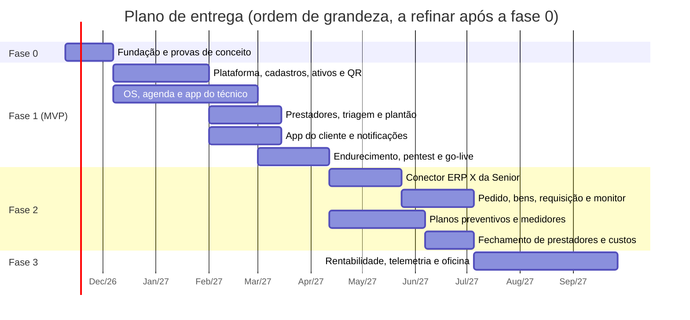

# 10 — Roadmap e riscos

Versão 0.3 — 02/11/2026 — rascunho para revisão (inclui o [benchmark Sismetro](11-benchmark-sismetro-e-novas-funcionalidades.md) e a [stack Dart](12-stack-dart-flutter-serverpod.md))

Propósito: transformar a arquitetura em um plano de entrega, com fases, épicos, provas de conceito, dependências externas, riscos e decisões pendentes.

---

## 1. Princípios de entrega

- **Valor cedo para o primeiro tenant** (a empresa do usuário), sem atalhos que impeçam o multi-tenant depois. `tenant_id`, RLS e testes de isolamento entram no primeiro commit, não "quando chegar o segundo cliente".
- **Fatias verticais:** cada épico entrega banco + API + tela + testes, e roda em homologação.
- **ERP depois do processo (confirmado pelo usuário em 07/11/2026: integração em segundo plano):** a integração com o ERP X fica na fase 2, quando o fluxo operacional estiver estável. O modelo de dados já nasce preparado (`source`, `external_id`, outbox), então a fase 2 não exige refatoração.
- **Medir desde o MVP:** tempo do scan até o chamado, SLA, first-time fix e sincronizações com falha são instrumentados desde o início.
- **Riscos primeiro:** o que tem mais incerteza (etiqueta física, stack Dart com Serverpod + RLS, offline, API da Senior) é provado na fase 0, antes de virar compromisso de prazo.

## 2. Linha do tempo (ordem de grandeza)

As datas são ilustrativas. Partem de um time como o da seção 7 e precisam ser recalculadas depois da fase 0, com o backlog refinado.

## 3. Fase 0 — Fundação e provas de conceito (2 a 4 semanas)

| # | Prova de conceito / fundação | Pergunta que responde | Critério de sucesso |
|---|---|---|---|
| P1 | **Etiqueta QR no mundo real:** imprimir 3 tamanhos × 2 materiais, colar em freezers (frio, condensação, limpeza com pano úmido) e ler com 5+ celulares, incluindo Android de entrada e iPhone, pela câmera nativa | A etiqueta continua legível e abre a URL em campo? | 100% de leitura em até 2 s após 2 semanas de uso; código curto legível |
| P2 | **Stack Dart (v0.3):** spikes S1 a S6 de [Stack Dart](12-stack-dart-flutter-serverpod.md): interceptor do Serverpod + RLS, ORM em tabelas não gerenciadas (centavos, `timestamptz`, `jsonb`), Drift + SQLCipher em aparelho de entrada, upload em segundo plano, Flutter Web com grade e agenda, página leve do QR com links universais | O Serverpod e o Flutter atendem o desenho sem perder as garantias do banco? | Critérios de cada spike no docs/12, seção 7; se S1 ou S2 falharem, aplicar a alternativa registrada no ADR-019 |
| P3 | **Offline do técnico:** protocolo pull/push com Drift (SQLite + SQLCipher) e endpoint direto, um dia inteiro em modo avião, 30 fotos, OS cancelada pelo backoffice durante o offline | O protocolo de sync aguenta o uso real sem perder nem duplicar dados? | Zero perda, zero duplicidade, conflito mostrado ao técnico |
| P4 | **ERP X da Senior:** obter credenciais de homologação, autenticar, ler clientes, produtos e serviços, criar um pedido de teste | Quais campos e parâmetros o pedido exige? Existe consulta incremental? | Pedido criado e consultado; checklist de [Integração com o ERP Senior](07-integracao-erp-senior.md) respondido |
| P5 | **WhatsApp Business Platform:** conta, número, aprovação de um modelo de autenticação (OTP) e de um modelo de notificação | O OTP por WhatsApp é viável em prazo e custo? | Modelos aprovados; custo por mensagem confirmado |
| P6 | **Fundação técnica:** monorepo, CI, ambiente de homologação, migrações, RLS com testes de isolamento rodando no CI, IdP configurado | A base aguenta o time trabalhando em paralelo? | Pipeline verde; teste de isolamento falha se alguém esquecer o `tenant_id` |

## 4. Fase 1 — MVP

| Épico | Escopo | Requisitos |
|---|---|---|
| E1 Plataforma e tenancy | Tenants, usuários, papéis, IdP da equipe, OTP de contatos, branding básico, console mínimo da plataforma, acesso de suporte auditado | RF-17, RF-60 a RF-64 |
| E2 Cadastros | Clientes/unidades/contatos, produtos, serviços, técnicos, equipes, regiões, turnos e escalas, calendário, tipos de OS, sintomas/causas/soluções, checklists, SLA; importação CSV/XLSX | RF-10 a RF-16 |
| E3 Ativos e QR | Ativos, alocações com histórico, lotes de etiquetas, PDF/ZPL, vinculação, substituição, revogação, página pública do QR | RF-20 a RF-23 |
| E4 OS no backoffice | Abertura, triagem, detalhe e linha do tempo, comentários, conferência, encerramento, cancelamento e reabertura | RF-01, RF-02, RF-05 a RF-08 |
| E5 Agenda e despacho | Visitas, quadro técnico × dia, atribuição respeitando turno e escala | RF-03 |
| E6 App do técnico | Agenda, execução, itens, horas, fotos, checklist, assinatura, QR, offline e sync | RF-40 a RF-46 |
| E7 App do cliente | QR → chamado, OTP, meus equipamentos, acompanhamento, avaliação; página web leve + app Flutter nas lojas | RF-30 a RF-35 |
| E8 Notificações | WhatsApp, e-mail e push; modelos por tenant; preferências | RF-70 |
| E9 Painel e indicadores básicos | Kanban em tempo real, SLA, backlog, produtividade | RF-04, RF-71 |
| E10 Produção | Observabilidade, backups e restore testado, pentest, LGPD (DPA, retenção, termos), runbooks | RNF-01 a RNF-12 |
| E15 Prestadores e custos (v0.2) | Cadastro de prestadores e tabela de preços, técnicos terceirizados, custo do terceiro automático com conferência, linhas de custo da OS, indicadores antifraude | RF-80 a RF-82, RF-88 |
| E16 Triagem e resolução remota (v0.2) | Modos de triagem (central, vendedor primeiro, direto), vendedores e carteira, abertura em nome do cliente, resolução remota | RF-85 a RF-87 |
| E17 Plantão e despacho móvel (v0.2) | Escala de plantão, políticas de escalonamento com aceite, aba Despacho no app do técnico | RF-89, RF-90 |
| E18 Ativos: movimentação e documentos (v0.2) | Aprovação opcional, termo em PDF assinado, documentos do ativo, dados de aquisição, filial padrão | RF-91, RF-92 |

**Critérios de saída do MVP (go-live do primeiro tenant):**

- fluxo completo QR → chamado → triagem → visita → execução offline → conclusão → encerramento funcionando em produção;
- testes de isolamento entre tenants no CI e pentest sem achados críticos ou altos em aberto;
- etiquetas do lote inicial vinculadas aos equipamentos prioritários (mutirão com o legado);
- restore de backup testado; alertas de fila, sync e erros ativos;
- técnicos e atendentes treinados; política de privacidade e termos publicados.

## 5. Fase 2 — Integração com o ERP X da Senior

| Épico | Escopo | Requisitos |
|---|---|---|
| E11 Conector Senior ERP X | Autenticação, carga inicial e sincronização incremental de clientes/unidades/contatos, produtos e serviços; campos mestres somente leitura | RF-50 |
| E12 Pedido de serviço | Outbox → job idempotente → pedido com itens e horas por regra de `billing_type` → número do pedido de volta na OS | RF-51 |
| E13 Monitor de integrações | Execuções, erros, pendências de mapeamento, reprocessamento | RF-52 |
| E14 Comercial | Planos e feature flags completos, indicadores avançados, onboarding do 2º tenant | RF-63, RF-71 |
| E19 Bens do ERP e requisição (v0.2) | Bens patrimoniais da Senior com etiqueta após a integração; requisição de materiais com status e baixa | RF-95, RF-96 |
| E20 Manutenção planejada (v0.2) | Planos de manutenção (calendário e medidor), geração automática agrupada, previsão na agenda, medidores com leitura manual | RF-93, RF-94 |
| E21 Prestadores, fase 2 (v0.2) | Fechamento mensal e envio ao ERP; atendimento por link sem app | RF-83, RF-84 |
| E22 Gestão (v0.2) | Relatório de custos completo, modo TV, multifilial | RF-92, RF-97 |

## 6. Fase 3 — Evoluções (a priorizar)

**v0.2:** rentabilidade do comodato (vendas do ERP × equipamentos × custos) · telemetria IoT com piloto em ~20 equipamentos (horímetro, consumo, temperatura, alertas e OS automática) · oficina e desmontagem para peças · manutenção interna · hierarquia de ativos · painéis personalizáveis. **Anteriores:** estoque de peças do técnico com baixa no ERP · roteirização e sugestão de técnico · SSO corporativo para tenants · apps white-label nas lojas · conectores de outros ERPs (incluindo o ERP Senior "clássico" via SOAP) · API pública e webhooks para tenants · alocação automática de ativos pelas NFs de remessa em comodato · telemetria/IoT dos equipamentos (ex.: sensor de temperatura abrindo OS preventiva).

## 7. Time sugerido (para o MVP)

| Papel | Dedicação | Observação |
|---|---|---|
| Tech lead / arquiteto | 1 | Dono das fronteiras dos módulos, do RLS e do protocolo de sync |
| Back-end (Dart / Serverpod) | 2 | Um com foco em domínio/OS, outro em plataforma/integrações; SQL forte (RLS, migrações) |
| Flutter Web (backoffice) | 1 | Backoffice; com a mesma linguagem, pode apoiar os apps |
| Mobile (Flutter) | 1 a 2 | App do técnico (offline, Drift) e app do cliente; a página web leve do QR fica com o back-end |
| QA | 1 | Automação e2e (`integration_test`/Patrol, Maestro) e testes em campo |
| UX/UI | 0,5 | Principalmente app do cliente e app do técnico |
| PO | 1 | Pode ser alguém do negócio do primeiro tenant |

Com esse time, a ordem de grandeza é de **6 a 8 meses até o go-live do MVP** (antes da v0.2 eram 5 a 7; entraram prestadores, triagem configurável, plantão e movimentação com termo) e **3 a 4 meses para a fase 2** (com bens, requisição, preventivas e fechamento). O prazo da fase 2 depende muito da agilidade no acesso à Senior. A estimativa deve ser refeita ao fim da fase 0.

**Linha de corte sugerida, se o prazo apertar:** manter no MVP o que ataca as dores da operação (prestadores com custo conferido, check-in pelo QR, resolução remota, plantão e escalonamento, despacho no celular) e levar para um "MVP+" de 4 a 6 semanas após o go-live o modo "vendedor primeiro", o gestor do prestador e os indicadores antifraude avançados.

## 8. Riscos

| # | Risco | Prob. | Impacto | Mitigação |
|---|---|---|---|---|
| R1 | APIs do ERP X não cobrirem o "pedido de serviço" como esperado, ou campos obrigatórios desconhecidos | Média | Alto | P4 na fase 0; checklist com a Senior; conector isolado atrás da porta `ErpConnector`; MVP não depende do ERP |
| R2 | Demora para obter credenciais e apoio técnico da Senior | Alta | Médio | Pedir já; a fase 2 só começa com homologação disponível |
| R3 | Etiqueta ilegível em freezer (condensação, gelo, desgaste, limpeza) | Média | Alto | P1; material e adesivo para baixa temperatura; posição fora da área fria; código curto como alternativa |
| R4 | Cliente final não adota (não lê o QR, não quer instalar app) | Média | Alto | Página web leve sem instalação; WhatsApp como canal; atendente pode abrir OS por telefone; instrução clara na etiqueta |
| R5 | Vazamento de dados entre tenants | Baixa | Muito alto | Defesa em camadas, RLS com FORCE, FKs compostas, testes de isolamento no CI, pentest |
| R6 | Abuso via QR (foto da etiqueta compartilhada, spam de chamados) | Média | Médio | OTP, rate limit, detecção de duplicidade, triagem obrigatória para quem não é contato conhecido |
| R7 | Complexidade do sync offline subestimada | Média | Alto | P3; conjunto fechado de mutações; testes automatizados de cenários de conflito |
| R8 | Stack Dart no servidor: ecossistema menor (OpenTelemetry, bibliotecas de integração), API de banco do Serverpod mudando entre versões, tipos do ORM limitados (v0.3) | Média | Médio | Spikes S1 e S2; versão do Serverpod fixada; testes de isolamento a cada atualização; SQL próprio onde o ORM não atender; dinheiro em centavos |
| R18 | Flutter Web no backoffice: grades grandes, agenda de despacho e acessibilidade (v0.3) | Média | Médio | Spike S5; componentes de grade/agenda escolhidos cedo (licença); a página pública do QR não usa Flutter Web |
| R9 | Custo de WhatsApp/SMS crescer com o volume | Média | Médio | Preferir push/e-mail quando possível; modelos de autenticação; repassar no plano |
| R10 | Rejeição ou atraso nas lojas (Apple/Google) | Baixa | Médio | Contas de organização cedo; seguir as diretrizes; white-label só na fase 3 |
| R11 | MVP inchar (todos os cadastros + 3 apps + QR) | Alta | Alto | Corte explícito de MVP; cadastros com telas genéricas reaproveitáveis; o que não for crítico vai para a fase 2/3 |
| R12 | LGPD: rastreamento de localização do técnico questionado | Baixa | Médio | Coleta só durante jornada/visita, transparência, política interna, DPA |
| R13 | Técnicos terceirizados com pouca familiaridade digital não adotam o app (v0.2) | Alta | Alto | App mínimo, treinamento por região, atendimento por link sem app (F2), período de transição com o despacho registrando por eles |
| R14 | Prestadores resistem aos controles (QR obrigatório, conferência), que reduzem visitas e faturamento deles (v0.2) | Média | Alto | Regras no contrato com o prestador, pagamento só de visita conferida, comunicação clara dos critérios, indicadores transparentes para o próprio prestador |
| R15 | Custo de mensagens do escalonamento e do plantão (v0.2) | Média | Médio | Push primeiro, WhatsApp/SMS só nos passos finais, limite de passos por política, painel de custo |
| R16 | Módulos da Senior necessários (patrimônio, estoque, contas a pagar, faturamento) fora do escopo contratado (v0.2) | Média | Alto | Confirmar o escopo da implantação já; tudo que depende deles fica na F2/F3 e tem alternativa manual |
| R17 | Telemetria: fabricante não expõe dados, Wi-Fi do cliente instável ou hardware caro (v0.2) | Média | Médio | Piloto pequeno, módulo genérico (ADR-016), hardware aberto como alternativa, conectividade celular nos pontos críticos |

## 9. Dependências externas — providências imediatas

- [ ] Credenciais de homologação do ERP X da Senior e um contato técnico (Senior ou parceiro de implantação)
- [ ] Conta Meta Business e WhatsApp Business Platform (direto ou via BSP), com número dedicado
- [ ] Contas Apple Developer (organização, com D-U-N-S) e Google Play Console
- [ ] Domínio curto e estável para o QR (não pode mudar depois que as etiquetas forem impressas)
- [ ] Fornecedor de etiquetas: amostras de material para a P1
- [ ] Conta na nuvem de referência (ver [Infraestrutura e operação](09-infraestrutura-e-operacao.md))
- [ ] Jurídico: termos de uso, política de privacidade, DPA com tenants, contrato com suboperadores
- [ ] Levantamento do legado: planilha de equipamentos × clientes (nº de série, patrimônio, endereço)
- [ ] **v0.2:** lista de prestadores e técnicos terceirizados (contato, CNPJ, regiões) e a tabela de preços atual
- [ ] **v0.2:** escala de plantão de fins de semana e feriados, e definição do modo de triagem (central ou vendedor primeiro)
- [ ] **v0.2:** lista de vendedores com a carteira de clientes (o código do representante no ERP ajuda)
- [ ] **v0.2:** confirmação dos módulos da Senior contratados (patrimônio, estoque/requisição, contas a pagar, faturamento)

## 10. Decisões pendentes (consolidadas)

As questões de negócio principais estão em [Visão geral e requisitos](01-visao-geral-e-requisitos.md), seção 11. Abaixo, tudo o que as áreas levantaram, agrupado por quem decide. Cada documento mantém as suas no final, com mais contexto.

### 10.1 Negócio (dono do produto / primeiro tenant)

| # | Decisão | Proposta atual | Onde |
|---|---|---|---|
| N1 | O que vai para o ERP: só itens cobráveis, ou também garantia/comodato (preço zero ou pedido separado)? | Configurável por `billing_type`; padrão: só cobráveis | 07 |
| N2 | Conferência do backoffice antes de encerrar a OS | Ligada por padrão | 01, 03 |
| N3 | Quem pode abrir chamado pelo QR: só contatos cadastrados ou qualquer pessoa com OTP (com triagem)? | "Aceitar e sinalizar": desconhecido vira contato `pending_approval` | 05 |
| N4 | Contatos vindos do ERP já podem abrir chamado ou só após convite/aprovação? | Após convite | 07 |
| N5 | Início do SLA de primeiro atendimento: check-in no local ou aceite na triagem? | Check-in | 03 |
| N6 | Número do WhatsApp no MVP: da plataforma ou do primeiro tenant? | Da plataforma | 06 |
| N7 | Respostas livres do contato no WhatsApp viram comentário na OS já no MVP? | Fase 2 | 06 |
| N8 | Documento do signatário obrigatório na assinatura? Preços visíveis para o técnico e no resumo do cliente? | Opcional; sem preços no MVP | 06 |
| N9 | Mais de um técnico por visita (ajudantes) | Fase 2 | 03 |
| N10 | Reabrir OS cujo pedido já saiu no ERP | MVP: tratamento manual no ERP, com pendência no Monitor | 03, 07 |
| N11 | Preço das mensagens (WhatsApp/SMS) nos planos comerciais | Pacote de mensagens por plano | 09 |
| N12 | App do cliente nas lojas: um app da plataforma ou apps white-label por tenant? | Um app da plataforma no MVP; white-label na fase 3 | 03, 04 |

### 10.2 Senior / ERP (validar com a Senior ou o parceiro de implantação)

1. A criação de pedido no ERP X é síncrona ou assíncrona no tenant real? Como trata `externalId` repetido e qual o tamanho máximo do campo?
2. Pedido de venda com itens de serviço ou pedido/orçamento de serviço com equipamento: qual caminho o fiscal do tenant recomenda?
3. Existe consulta incremental (delta) de cadastros, ou eventos no Events Hub? Sem isso, vale a varredura com hash 2×/dia.
4. Existe ambiente de homologação para o tenant? Quanto custa e quem paga?
5. O checklist completo está no [07](07-integracao-erp-senior.md), seção 12.

### 10.3 Técnicas (resolver nos spikes da fase 0)

| # | Questão | Spike |
|---|---|---|
| T1 | **Domínio estável da plataforma** (QR, universal links, e-mail, Keycloak): precisa ser registrado antes de imprimir qualquer etiqueta | P1/P6 |
| T2 | Pool de conexões: RDS Proxy × PgBouncer com `set_config` local (pinning) | P6 |
| T3 | ElastiCache Serverless para Valkey suporta o pub/sub e os scripts de rate limit usados? | P6 |
| T4 | Desempenho da página web leve do QR (conteúdo útil < 1,5 s em 4G) e links universais para o app Flutter | P2 (S6) |
| T5 | Upload em segundo plano no Flutter (Android e iOS) e chave não exportável no aparelho para a prova de posse | P2 (S4) / P3 |
| T6 | Janela de escopo do técnico (D−2 a D+14) e prazo máximo offline (refresh de 14 dias; tombstones retidos por 30 dias) | P3 |
| T7 | Validade do `qr_context` (30 min) para quem demora no assistente com fotos/vídeo | P2 |
| T8 | Assinatura dos tokens dentro do KMS ou com chave carregada do cofre (latência × segurança) | P6 |
| T9 | Componente de agenda/despacho (FullCalendar Premium × construção própria) e provedor de mapas/geocodificação | Fase 1 |
| T10 | Serverpod: interceptor de banco com `set_config` + RLS (S1) e ORM sobre tabelas não gerenciadas com centavos, `timestamptz` e `jsonb` (S2) | P2 |

### 10.4 Jurídico, LGPD e segurança

1. Confirmar no texto oficial da Resolução CD/ANPD nº 15/2024 o prazo de comunicação de incidentes (3 dias úteis; em dobro para agentes de pequeno porte).
2. Transferência internacional de dados para suboperadores (Meta/WhatsApp, Google Firebase/FCM, Apple APNs, Sentry): cláusulas e região de dados.
3. Retenção da auditoria (proposta: 5 anos), anonimização de contatos e retenção de payloads de integração além de 90 dias.
4. MFA obrigatória só para `tenant_admin` ou para todo o backoffice; política padrão de aprovação das sessões de suporte.
5. Provedor de SMS de contingência e eventual desafio anti-bot no OTP.

### 10.5 Novas decisões da v0.2

As perguntas sobre prestadores (forma de pagamento e fechamento), triagem pelo vendedor, plantão, bens no ERP, piloto de telemetria, desmontagem e métrica de rentabilidade do comodato estão no [benchmark Sismetro](11-benchmark-sismetro-e-novas-funcionalidades.md), seção 9. As mais urgentes para o MVP são: **como os prestadores são pagos hoje**, **se o vendedor continua como primeiro filtro** e **quem faz o plantão**.

## 11. Próximos passos

1. Revisar esta documentação e responder às questões em aberto (principalmente faturamento, conferência e quem pode abrir chamado).
2. Disparar as providências da seção 9, que têm prazo de terceiros.
3. Executar a fase 0 (POCs P1 a P6) e recalcular o plano.
4. Quebrar os épicos do MVP em histórias, com critérios de aceite derivados dos requisitos RF/RNF.
