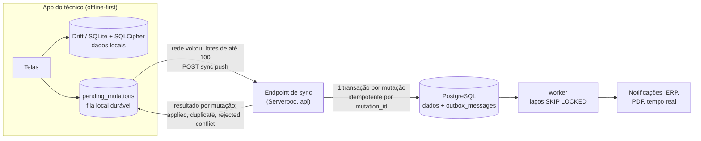

# 12 — Stack Dart: Flutter + Serverpod + PostgreSQL

Versão 0.3 — 02/11/2026 — rascunho para revisão

Propósito: registrar a mudança de stack pedida pelo usuário, avaliar como ela se encaixa na arquitetura, decidir **fila de mensagens × endpoint direto** para a sincronização offline e **o banco local do app**, e fixar o mapeamento da stack anterior para a nova. Este documento é o contrato para atualizar os demais.

---

## 1. Decisões do usuário (02/11/2026)

| Tema | Decisão |
|---|---|
| Apps móveis | **Flutter**, compilando para **Android e iOS** (app do técnico e app do cliente) |
| Backoffice | **Flutter Web**, no navegador de qualquer computador |
| Cliente que lê o QR sem ter o app | **Página web leve** servida pelo servidor (HTML simples), sem Flutter Web nessa tela; quem tem o app instalado cai direto nele |
| Backend | **Dart com Serverpod**, conectado ao **PostgreSQL** |
| Offline | O app grava sem rede e sobe as informações ao recuperar a conexão |

## 2. O que não muda

- Domínio, máquina de estados e regras de negócio.
- O banco PostgreSQL com RLS FORCE, FKs compostas, triggers e funções ([schema.sql](../db/schema.sql)), salvo a convenção de dinheiro da seção 4.1.
- Multi-tenancy e QR (token opaco, código curto, `qr_context`).
- O **protocolo de sincronização por comandos** (pull/push, `mutation_id`, tombstones, registros a revisar).
- Outbox, conector ERP, catálogo canônico de eventos e funcionalidades da v0.2.
- AWS como nuvem de referência, Keycloak para a equipe interna e OTP próprio para contatos.

## 3. Mapeamento da stack

| Camada | v0.2 (TypeScript) | **v0.3 (Dart)** |
|---|---|---|
| Linguagem | TypeScript | **Dart 3** no servidor e nos apps |
| Backend | NestJS 12 + Fastify | **Serverpod 4.1** (servidor compilado para executável nativo) |
| Monólito modular | Módulos do Nest | Bibliotecas Dart por contexto dentro do projeto Serverpod (`lib/src/<contexto>/`), com endpoints por contexto e fronteiras verificadas por regra de imports no CI |
| Deployables | `api` + `worker` | O mesmo executável em dois papéis: `api` com `--role serverless` (sem tarefas agendadas), atrás do load balancer; `worker` com `--role monolith`, fora do load balancer, rodando as tarefas agendadas e os laços de processamento |
| Acesso a dados | Kysely | ORM do Serverpod sobre tabelas com `managedMigration: false`, mais SQL parametrizado (`unsafeQuery`/`unsafeExecute`) para relatórios e consultas complexas |
| Migrações | dbmate (SQL) | **Continua dbmate (SQL puro)**, com `schema.sql` como referência. Os modelos `.spy.yaml` espelham as tabelas, e o CI confere modelos × banco. As tabelas internas do Serverpod (auth, tarefas agendadas) são migradas pelo próprio Serverpod |
| Contexto do tenant | `nestjs-cls` + transação com `set_config` | **`databaseInterceptor` do Serverpod 4**: toda operação da sessão roda dentro de transação iniciada por `set_config('app.tenant_id', ..., true)`, inclusive SQL próprio. O RLS continua como segunda barreira |
| Contratos | Zod + OpenAPI | Modelos do Serverpod geram classes Dart compartilhadas entre servidor e apps. OpenAPI só para as rotas REST externas |
| Cliente da API | openapi-fetch | Cliente Dart gerado pelo Serverpod |
| Fila de jobs | pg-boss | Tabelas já existentes no PostgreSQL (`outbox_messages`, `integration_jobs`, `notifications`), consumidas com `FOR UPDATE SKIP LOCKED` (funções `claim_*` do schema) por laços no `worker`. **Tarefas agendadas do Serverpod** (future calls com cron) disparam o escalonamento (1 min), os planos (diário), o fechamento (mensal) e as partições |
| Tempo real | SSE | **Streaming do Serverpod** (WebSocket) com avisos de invalidação; difusão entre instâncias pelas mensagens globais do Serverpod via Redis/Valkey |
| Página pública do QR, OTP e chamado sem app | Expo web (PWA) | **Servidor web do Serverpod** (rotas + HTML leve), que também publica `apple-app-site-association` e `assetlinks.json` |
| Webhooks e ingestão IoT | Rotas do Nest | Rotas REST do servidor web do Serverpod |
| Backoffice | React + Vite | **Flutter Web** |
| App do cliente | Expo (iOS/Android/PWA) | **Flutter** (iOS/Android) + página web leve |
| App do técnico | Expo + expo-sqlite/SQLCipher + Drizzle | **Flutter + Drift (SQLite) + SQLCipher** |
| Estado e navegação nos apps | TanStack Query / Expo Router | **Riverpod** e **go_router** |
| Leitura de QR | expo-camera | `mobile_scanner` |
| Login da equipe | oidc-client-ts / expo-auth-session | `flutter_appauth` (OIDC + PKCE) no mobile; fluxo OIDC no Flutter Web |
| Autenticação na API | Validação com `jose` | **Handler de autenticação customizado do Serverpod** validando os tokens próprios ES256: token de tenant (troca do token do Keycloak) e token de contato (OTP) |
| Arquivos | URL pré-assinada própria | Cloud storage S3 do Serverpod (upload direto com descrição pré-assinada e verificação) |
| PDF, QR e etiquetas | pdfkit / qrcode | Pacotes Dart `pdf` e `barcode` no `worker`; ZPL por template |
| Observabilidade | OpenTelemetry Node | Logs do Serverpod + OpenTelemetry (pacote da comunidade para Serverpod 4, a validar) + Sentry (`sentry_flutter` / `sentry_dart`) |
| Builds mobile | EAS Build/Submit/Update | Builds Flutter no CI (Android em Linux; iOS em runner macOS ou Codemagic), fastlane para lojas; atualização OTA com Shorebird (a validar) |
| Testes | Vitest, Testcontainers, Playwright, Maestro | `serverpod_test` com banco real (inclui os testes de isolamento RLS); `flutter_test`, `integration_test`/Patrol; Maestro para e2e mobile |
| Monorepo | pnpm + Turborepo | Dart pub workspaces (+ melos para scripts) |

## 4. Avaliação do Serverpod para este desenho

**Pontos fortes:**
- Dart de ponta a ponta, com modelos e cliente gerados: nada de manter OpenAPI e SDK para os próprios apps.
- Recursos prontos: autenticação, streaming, armazenamento S3, tarefas agendadas persistentes, servidor web e papéis de execução.
- UUID v7 gerado no próprio modelo (`defaultModel=random_v7`), exatamente o que o app offline precisa para criar registros sem rede.

**Pontos de atenção, com a decisão tomada:**

### 4.1 Tipos de coluna

O ORM do Serverpod não tem `decimal`/`numeric` (preços aparecem como `double`, impreciso para dinheiro) e grava `DateTime` como timestamp sem fuso.

- **Dinheiro em centavos e quantidades em milésimos**, como inteiros (`bigint` no banco, `int` no Dart). Exemplos: R$ 12,34 → `1234`; 1,5 m de tubo → `1500`. Os nomes das colunas não mudam; o `COMMENT` e o glossário registram a unidade. No JSON externo (webhooks, ERP), o adaptador converte para decimal.
- **Datas continuam `timestamptz`** no banco, com o fuso da sessão do papel da aplicação fixado em UTC. O Serverpod lê e grava sempre em UTC. Validar no spike S2.
- **`jsonb`:** validar no spike S2 o mapeamento para campos de objeto do Serverpod; se não funcionar, essas colunas são lidas e gravadas por SQL próprio.
- No Flutter Web, `int` tem 53 bits de precisão, o que sobra para valores em centavos.

### 4.2 Migrações

As migrações geradas pelo Serverpod não expressam RLS, FKs compostas, CHECKs, triggers nem funções.

- Tabelas de negócio com `managedMigration: false`; o DDL é SQL-first (dbmate + `schema.sql`).
- As tabelas do Serverpod ficam no schema `public` e as nossas em `app`, com `search_path = app, public` no papel da aplicação.
- Nunca rodar "repair migration" em produção sem revisão.

### 4.3 Interceptor de banco

O `databaseInterceptor` (Serverpod 4.0+) é o ponto único para aplicar o tenant. A documentação avisa que a API da camada de banco pode mudar de forma incompatível numa versão *minor*. Por isso: versão fixada, atualização planejada e os testes de isolamento rodando no CI a cada atualização.

### 4.4 Tarefas agendadas

As future calls do Serverpod são persistidas, executadas **pelo menos uma vez** e **não têm retentativa automática**. Então:
- toda tarefa é idempotente;
- tentativas e backoff ficam nas nossas tabelas de jobs, como já desenhado;
- as future calls servem para disparar no horário (cron), não como fila de trabalho.

### 4.5 Autenticação

O módulo `serverpod_auth_idp` cobre e-mail e provedores externos, mas MFA, passkeys e SSO corporativo não estão confirmados. **Mantém-se o Keycloak** para a equipe (ADR-003). Os nossos tokens são validados por um handler customizado. Se o MVP dispensar MFA e SSO, o módulo nativo pode ser uma alternativa mais simples, a avaliar no spike S1.

### 4.6 REST externo

Os endpoints do Serverpod são RPC sobre HTTP, não REST. As rotas públicas, os webhooks e a ingestão IoT ficam no servidor web do Serverpod, com OpenAPI escrito para elas.

### 4.7 Flutter Web no backoffice

O primeiro carregamento é de alguns MB, aceitável no escritório. Grades grandes e a agenda de despacho exigem componentes Flutter específicos (avaliar licenças). A página pública do QR não usa Flutter Web (decisão do usuário).

## 5. Fila de mensagens (RabbitMQ) × endpoint direto

**Decisão: endpoint direto no servidor, com a fila no próprio aparelho e jobs no PostgreSQL. Sem RabbitMQ.**

**Por que não um broker entre o app e o servidor:**

1. **A fila durável já existe, no lugar certo:** o próprio aparelho. Cada ação vira uma mutação gravada no SQLite local (`pending_mutations`) na mesma transação da alteração local. Ela sobrevive a reinício, falta de sinal e bateria; um broker no servidor não ajuda quem está sem rede.
2. **O app precisa da resposta de cada mutação** (`applied`, `duplicate`, `rejected`, `conflict`) para atualizar a tela e mostrar conflitos. Com uma fila no meio, a resposta vira assíncrona e exige um segundo canal (polling ou push) só para isso.
3. **Exatamente uma vez sem broker:** o `mutation_id` torna o reenvio inofensivo (`sync_mutations`), e cada mutação aplica regra de negócio, RBAC e RLS na mesma transação que grava o dado e o evento no outbox.
4. **Segurança e operação:** expor RabbitMQ (AMQP) a milhares de celulares exigiria credencial por aparelho, abrir o broker na internet e abrir mão de WAF, rate limit por tenant e versão mínima do app, que o HTTPS já tem. Seria mais um cluster para manter em alta disponibilidade.
5. **Volume pequeno para um broker:** na premissa de 10× (até 10 mil técnicos), mesmo com todos sincronizando ao mesmo tempo no fim do turno, são centenas de requisições por segundo em lotes. Isso é escala horizontal comum de instâncias da `api` + PostgreSQL, e o trabalho assíncrono do servidor já tem fila transacional no próprio PostgreSQL.

**Como o endpoint fica robusto:**
- lotes limitados (até 100 mutações ou 1 MB) e ordem preservada por entidade;
- anexos fora do lote, em upload direto ao S3;
- `429` com `Retry-After` quando sobrecarregado, e o app reenvia com backoff exponencial e *jitter*;
- versão mínima do app verificada a cada chamada;
- métricas de fila local reportadas pelo app (quantas mutações pendentes e há quanto tempo).

**Quando reavaliar um broker:**
- **(a)** telemetria IoT em volume alto (milhares de dispositivos por minuto): um broker **MQTT** na borda, que não é para os apps;
- **(b)** trabalho assíncrono sustentado acima de ~500 jobs/s;
- **(c)** extração de serviços.

## 6. Banco local do app: Hive × alternativas

**Decisão: Drift (SQLite) com SQLCipher. Hive CE só para preferências simples, se necessário.**

| Opção | Situação | Encaixe neste app |
|---|---|---|
| **Drift + SQLCipher** | Ativo; criptografia documentada com `sqlcipher_flutter_libs` | **Escolhido:** dados relacionais (OS, visitas, itens, apontamentos, ativos, catálogo) com consultas, índices, transações, migrações de schema entre versões do app e consultas reativas para a UI. A fila de mutações fica na mesma transação dos dados locais |
| Hive CE | Ativo (continuação do Hive v2) | Chave-valor: sem joins nem consultas relacionais, e sem transação entre "caixas". Serve para preferências e cache simples |
| Isar | Desenvolvimento original parado (há um fork da comunidade) | Risco de manutenção e sem criptografia em repouso embutida |
| ObjectBox | Ativo; rápido | Criptografia em repouso não é nativa; o sync é produto comercial |
| sqflite | Ativo | SQL cru, sem tipos nem migrações estruturadas; o Drift já roda sobre SQLite |
| PowerSync (SDK Dart) | Ativo; serviço de sync sobre o PostgreSQL | Alternativa para o *download* (réplica via regras de sync), com o upload chamando o nosso endpoint. Fica como opção se o pull próprio der trabalho demais; acrescenta um serviço |

Regras do banco local:
- um arquivo por tenant;
- chave do SQLCipher gerada no aparelho e guardada no Keychain/Keystore (`flutter_secure_storage`);
- tabelas locais: espelho do escopo do técnico + `pending_mutations` + fila de uploads;
- migrações do Drift versionadas com o app;
- limpeza por janela de escopo;
- wipe remoto no logout ou no bloqueio do dispositivo.

## 7. Spikes da fase 0 (substituem P2 e complementam P3 e P6 do roadmap)

| Spike | Pergunta | Critério de sucesso |
|---|---|---|
| S1 — Serverpod + RLS | O `databaseInterceptor` garante `set_config` em toda operação (ORM, SQL próprio, transações) com o pool do Serverpod? | Teste de isolamento passa; nenhuma operação sem tenant; custo da transação extra < 2 ms |
| S2 — ORM em tabelas não gerenciadas | Leitura/escrita de `uuid` v7, `timestamptz` (sessão UTC), textos com CHECK, `bigint` em centavos e `jsonb` | CRUD completo de `work_orders` e `work_order_items` pelo ORM sem conversão manual (ou lista exata das colunas que exigem SQL próprio) |
| S3 — Drift + SQLCipher | Desempenho e tamanho num Android de entrada e num iPhone, com 1 dia de dados e migração de schema | Abrir < 1 s; consultas da agenda < 50 ms; migração sem perda |
| S4 — Upload em segundo plano | Fotos e vídeos sobem em segundo plano (Android e iOS) com retomada | 30 fotos e 2 vídeos sem perda após ficar offline |
| S5 — Flutter Web | Carga do backoffice, grade com 10 mil linhas, agenda de despacho | Interação fluida; componente de agenda escolhido |
| S6 — Página leve do QR | Tempo de carga em 4G e links universais para o app Flutter | Conteúdo útil < 1,5 s; app instalado abre direto |

## 8. Impacto nos documentos

| Documento | Mudanças |
|---|---|
| [02](02-arquitetura-de-solucao.md) | Stack, padrões transversais, deployables e papéis, monorepo, testes |
| [03](03-modelo-de-dominio.md) e [schema.sql](../db/schema.sql) | Dinheiro em centavos e quantidades em milésimos (`bigint`); sessão em UTC; `search_path`; observações de implementação com os modelos do Serverpod |
| [04](04-multi-tenancy-e-seguranca.md) | Tenant pelo `databaseInterceptor`; handler de autenticação do Serverpod; armazenamento de tokens no Flutter (mobile e web); página leve do QR |
| [05](05-ativos-e-qr-code.md) e [06](06-aplicacoes-e-fluxos.md) | Apps em Flutter (Drift, Riverpod, go_router, `mobile_scanner`), backoffice em Flutter Web, página leve do QR no lugar da PWA |
| [07](07-integracao-erp-senior.md) | Conector em Dart; conversão centavos ↔ decimal no adaptador |
| [08](08-api.md) | Endpoints do Serverpod (RPC) para os apps + rotas REST para o público e as integrações; erros, idempotência e versionamento no modelo do Serverpod; dinheiro em centavos |
| [09](09-infraestrutura-e-operacao.md) | Executável Dart em container, papéis `serverless`/`monolith`, Redis/Valkey para mensagens globais, CI de Flutter (macOS para iOS), OTA |
| [ADRs](adr/README.md) | ADR-017 a ADR-019; ADR-004, 010, 011 e 012 marcados como substituídos |

## 9. Questões em aberto

1. **Estado nos apps:** Riverpod (recomendado) ou Bloc? Vale a preferência do time.
2. **Atualização OTA** dos apps Flutter (Shorebird): custo e política das lojas.
3. **Componentes de grade e agenda** no Flutter Web: pacote comercial (licença) ou construção própria.
4. **Hospedagem:** Serverpod Cloud (gerenciado pelo time do Serverpod) × AWS própria. A referência continua AWS, por portabilidade e dados no Brasil.
5. **Login da equipe:** Keycloak desde o MVP (MFA/SSO) ou módulo nativo do Serverpod no MVP e Keycloak depois?

## Fontes consultadas (02/11/2026)

- Serverpod no pub.dev (versão estável 4.1.0): https://pub.dev/packages/serverpod
- Papéis de execução e tarefas agendadas: https://docs.serverpod.dev/deployments/custom-hosting/hosting-elsewhere e https://docs.serverpod.dev/concepts/scheduling/overview.md
- Acesso SQL e interceptors de banco: https://docs.serverpod.dev/next/concepts/data-and-the-database/database/raw-access e https://pub.dev/documentation/serverpod/latest/serverpod/DatabaseInterceptor.html
- Modelos, IDs UUID e tipos de campo: https://docs.serverpod.dev/4.0.0/concepts/data-and-the-database/database/tables e https://docs.serverpod.dev/next/concepts/data-and-the-database/models/field-types
- Migrações e `managedMigration`: https://docs.serverpod.dev/concepts/database/migrations
- Autenticação (serverpod_auth_idp): https://docs.serverpod.dev/4.0.0/concepts/authentication/setup
- Drift e criptografia: https://drift.simonbinder.eu/Platforms/encryption
- Hive CE: https://pub.dev/packages/hive_ce
