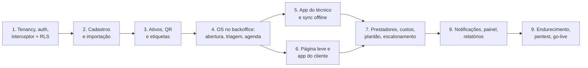

# 13 — Guia de início do desenvolvimento

Versão 1.0 — 07/11/2026 — arquitetura fechada para início do desenvolvimento

Propósito: dizer ao time **o que construir primeiro, em que ordem, com quais regras**, e o que ainda depende de decisão. Os detalhes estão nos documentos 01 a 12; este guia é o ponto de partida.

---

## 1. Estado da arquitetura

| Área | Estado |
|---|---|
| Requisitos, domínio, estados e regras | Fechados (RF-01 a RF-101, [01](01-visao-geral-e-requisitos.md), [03](03-modelo-de-dominio.md)) |
| Banco de dados | Fechado e validado: [schema.sql](../db/schema.sql) com 90 tabelas, RLS em todas as tabelas de tenant, 42 testes passando ([db/validacao](../db/validacao/README.md)) |
| Stack | Fechada: Flutter (Android, iOS, Web) + Dart/Serverpod 4 + PostgreSQL ([12](12-stack-dart-flutter-serverpod.md), ADR-017 a 019) |
| Segurança e multi-tenancy | Fechadas ([04](04-multi-tenancy-e-seguranca.md)) |
| Apps, telas, sync offline, notificações | Fechados ([05](05-ativos-e-qr-code.md), [06](06-aplicacoes-e-fluxos.md)) |
| API | Fechada ([08](08-api.md)) |
| Infraestrutura e operação | Fechadas ([09](09-infraestrutura-e-operacao.md)) |
| **Integração com o ERP** | **Em segundo plano (decisão do usuário, 07/11/2026).** O desenho está em [07](07-integracao-erp-senior.md), mas não entra no primeiro ciclo. O MVP funciona com cadastros locais e importação por planilha; o modelo de dados já nasce pronto para o ERP (`source`, `external_id`, outbox), sem refatoração depois |
| Validação prática da stack | Pendente, por natureza: spikes S1 a S6 do [12](12-stack-dart-flutter-serverpod.md), na sprint 0 |

## 2. Escopo do primeiro ciclo (MVP, sem ERP)

Entram os épicos E1 a E10 e E15 a E18 do [roadmap](10-roadmap-e-riscos.md):

- **Plataforma:** multi-tenant, login da equipe (Keycloak), login do cliente por OTP, papéis, filial padrão.
- **Cadastros locais:** clientes, unidades, contatos, produtos, serviços, técnicos, prestadores, turnos, escalas, tipos de OS, sintomas, checklists, SLA. Importação por planilha.
- **Ativos e QR:** etiquetas em lote, vínculo na instalação, movimentação com termo, página pública.
- **OS no backoffice:** abertura, triagem (com resolução remota e vendedor), agenda, painel em tempo real, conferência, custos.
- **App do técnico** offline, **app do cliente** e **página web leve** do QR.
- **Plantão e escalonamento**, notificações por WhatsApp, e-mail e push.

Fica para depois: tudo do [07](07-integracao-erp-senior.md) (cadastros vindos do ERP, pedido de serviço, bens, requisição, fechamento enviado ao ERP), além das fases 2 e 3 do roadmap.

## 3. Sprint 0 (2 a 4 semanas)

### 3.1 Contas e providências (começar no dia 1, porque dependem de terceiros)

- [ ] **Domínio curto e estável da plataforma** (QR, links universais, e-mail, Keycloak). Precisa existir antes de imprimir qualquer etiqueta.
- [ ] Conta AWS (região São Paulo) com organização e contas separadas para homologação e produção.
- [ ] Apple Developer (organização, com D-U-N-S) e Google Play Console.
- [ ] Meta Business / WhatsApp Business Platform, com número dedicado e modelos de OTP e de notificação enviados para aprovação.
- [ ] Projeto Firebase (FCM) e chave APNs.
- [ ] Sentry e repositório Git com CI (GitHub Actions; runner macOS ou Codemagic para iOS).
- [ ] Amostras de etiqueta (prova P1) e planilha do legado (equipamentos × clientes).

### 3.2 Fundação técnica

1. **Monorepo** conforme o [02](02-arquitetura-de-solucao.md): `server`, `apps/technician_app`, `apps/customer_app`, `apps/backoffice_web`, cliente gerado, `packages/core`, `packages/ui_kit`, `packages/sync_engine`, `db`, `infra`, `docs`.
2. **Banco:** migração inicial do dbmate derivada do `schema.sql`; validação ([db/validacao](../db/validacao/README.md)) no CI desde o primeiro PR.
3. **docker-compose** local com PostgreSQL 18, Valkey e Keycloak.
4. **CI:** `dart analyze`, testes, conferência do código gerado pelo Serverpod, conferência modelos `.spy.yaml` × banco, build do Flutter Web e do Android.

### 3.3 Spikes (antes de assumir prazo)

| Ordem | Spike | Se falhar |
|---|---|---|
| 1 | **S1:** `databaseInterceptor` + `set_config` + RLS FORCE, com teste de isolamento no `serverpod_test` | Transação explícita em cada caso de uso, com revisão obrigatória e teste de isolamento por endpoint |
| 2 | **S2:** ORM do Serverpod em tabelas não gerenciadas (UUID v7, `timestamptz`, centavos, `jsonb`) | SQL próprio nas colunas que não mapearem (lista no relatório do spike) |
| 3 | **S3 e S4:** Drift + SQLCipher em aparelho de entrada e upload em segundo plano | PowerSync como plano B do download; upload ao abrir o app |
| 4 | **S5 e S6:** Flutter Web (grade e agenda) e página leve do QR | Componente comercial de grade/agenda; simplificar a página |
| 5 | **P1:** etiqueta no freezer, no frio e na limpeza | Outro material ou outra posição |

A saída da sprint 0 é um relatório curto por spike e o plano de sprints recalculado.

## 4. Ordem de construção sugerida

Cada etapa entrega fatia vertical (banco + endpoint + tela + testes) em homologação. As etapas 5 e 6 podem correr em paralelo, com times diferentes.

## 5. Regras do time (valem desde o primeiro commit)

| Regra | Detalhe |
|---|---|
| **Isolamento por tenant** | Toda tabela de negócio tem `tenant_id`, RLS FORCE e FK composta. Todo acesso ao banco passa pelo interceptor. Um teste de isolamento acompanha cada endpoint novo |
| **Banco SQL-first** | Mudança de schema = migração dbmate + atualização do `schema.sql` + modelo `.spy.yaml` no mesmo PR, com a validação passando |
| **Tipos** | IDs UUID v7 gerados no cliente; dinheiro em centavos (`int`); quantidades em milésimos; datas em UTC (`timestamptz`); nada de `double` para dinheiro |
| **Idioma** | Código e banco em inglês; telas, mensagens e documentação em português |
| **Erros** | Exceção serializável com `code` estável; o app decide pelo `code`, nunca pelo texto |
| **Idempotência** | Toda criação vinda do app ou de integração tem chave de idempotência; toda mutação do sync tem `mutation_id` |
| **Eventos** | Nomes do catálogo canônico do [08](08-api.md), gravados no outbox na mesma transação |
| **Offline** | O app do técnico nunca chama a API para gravar: grava no Drift e enfileira em `pending_mutations` |
| **Decisões** | Decisão técnica nova ou que mude um ADR vira ADR novo em `docs/adr` |
| **Git** | Branch por história, PR com revisão, Conventional Commits, CI verde para mesclar |
| **Segredos** | Nunca no repositório nem no banco em texto puro; cofre (Secrets Manager) |

## 6. O que cada pessoa lê primeiro

| Papel | Leitura |
|---|---|
| Todos | [README](../README.md) → este guia → [01](01-visao-geral-e-requisitos.md) |
| Back-end (Dart/Serverpod) | [12](12-stack-dart-flutter-serverpod.md) → [02](02-arquitetura-de-solucao.md) → [03](03-modelo-de-dominio.md) + [schema.sql](../db/schema.sql) → [04](04-multi-tenancy-e-seguranca.md) → [08](08-api.md) |
| Mobile e web (Flutter) | [12](12-stack-dart-flutter-serverpod.md) → [06](06-aplicacoes-e-fluxos.md) → [05](05-ativos-e-qr-code.md) → [08](08-api.md) |
| Infra e DevOps | [09](09-infraestrutura-e-operacao.md) → [04](04-multi-tenancy-e-seguranca.md) → [12](12-stack-dart-flutter-serverpod.md) |
| PO e QA | [01](01-visao-geral-e-requisitos.md) → [11](11-benchmark-sismetro-e-novas-funcionalidades.md) → [10](10-roadmap-e-riscos.md) → [06](06-aplicacoes-e-fluxos.md) |

## 7. Decisões pendentes e o que cada uma trava

| Decisão (dono: negócio) | Trava | Precisa estar decidida até |
|---|---|---|
| ~~Domínio do QR~~ **Decidido em 07/11/2026:** `qr.platform-lac.com.br` ([ADR-020](adr/ADR-020-dominio-do-qr.md)) | Etiquetas, links universais, e-mail | Fim da sprint 0 |
| Como os prestadores são pagos (visita, hora, km, fixo) | Tabela de preços e custo automático (etapa 7) | Início da etapa 7 |
| Vendedor como primeiro filtro ou triagem central | Configuração padrão da triagem (etapa 4) | Início da etapa 4 (o sistema suporta os dois modos) |
| Quem faz o plantão e por região | Escala e políticas de escalonamento (etapa 7) | Início da etapa 7 |
| Conferência antes de encerrar | Configuração padrão da OS (etapa 4) | Início da etapa 4 (configurável) |
| Quem pode abrir chamado pelo QR (só cadastrados ou "aceitar e sinalizar") | Regra da página leve (etapa 6) | Início da etapa 6 |
| O que vai para o ERP, módulos da Senior, homologação | Só a fase 2 (ERP em segundo plano) | Antes de iniciar a fase 2 |

## 8. Como manter a documentação viva

- A arquitetura está na versão 1.0 para início; mudanças entram por PR na pasta `docs`, com ADR quando mudarem uma decisão.
- O `schema.sql` é a referência do banco e anda junto com as migrações; a validação no CI garante que não divirjam.
- Os relatórios dos spikes da sprint 0 entram em `docs/spikes/` e atualizam o [12](12-stack-dart-flutter-serverpod.md).
